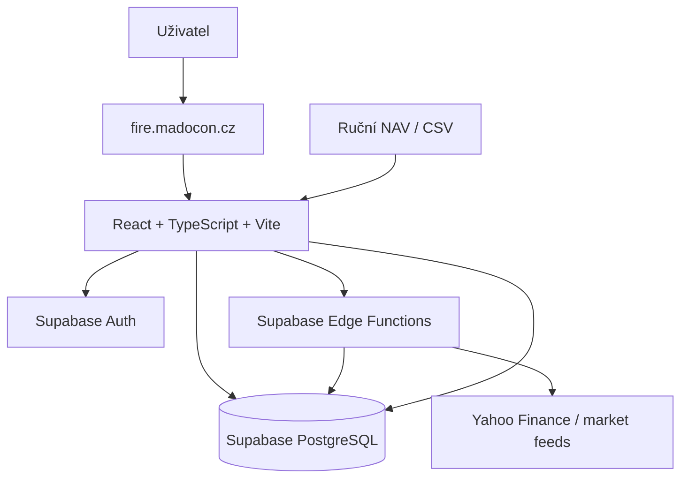
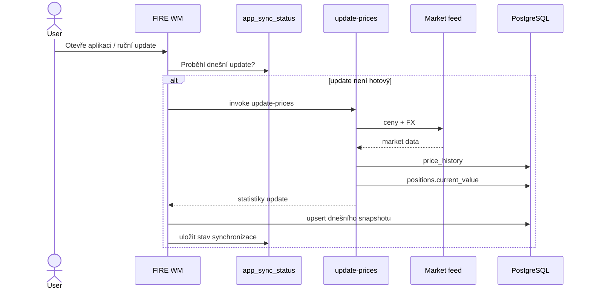
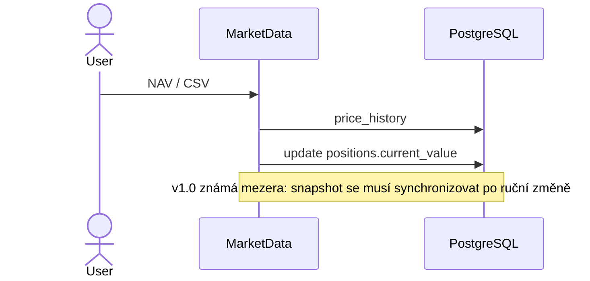
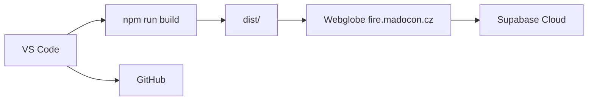

# FIRE WM — Technická architektura

## 1. Účel

Tento dokument je technický handover pro dalšího vývojáře nebo nový vývojový chat. Popisuje současnou produkční architekturu FIRE WM v1.0 a pravidla, která další vývoj nesmí porušit.

## 2. Kontext systému



## 3. Komponenty

### Frontend
- React + TypeScript + Vite
- Recharts
- `src/App.tsx` jako shell, Auth Gate a navigace
- `src/pages/*` jako obrazovky
- `src/services/*` jako datová a integrační vrstva
- `src/styles/app.css` jako hlavní design systém

### Backend
- Supabase PostgreSQL
- Supabase Auth
- PostgreSQL Row Level Security
- Supabase Edge Functions

### Hosting
- Webglobe
- produkční URL: `https://fire.madocon.cz`
- nasazuje se statický obsah `dist/`

## 4. Logické vrstvy

```text
Page / Component
      ↓
Service
      ↓
Supabase JS client / Edge Function
      ↓
Auth + RLS
      ↓
PostgreSQL / externí market feed
```

UI nemá implementovat databázové normalizace. Například nejednoznačné Supabase embedded relations se normalizují v service vrstvě.

## 5. Mapování obrazovek na služby

| Obrazovka | Hlavní zdroje |
|---|---|
| Dashboard | positions, instruments, FIRE metrics, net-worth stats, allocation |
| Portfolio | `portfolio.ts`, positions + instruments |
| Výkonnost | XIRR, TWR, net-worth snapshots |
| Tržní data | price updater, manual valuation, price history |
| Historie cen | `priceHistory.ts`, price_history |
| Vývoj majetku | portfolio_snapshots, postupně i live net worth |
| FIRE | fire_settings + live net worth |
| Cashflow | cashflows |
| Příjmy | dividend / coupon cashflows |
| Pozice | position manager |
| Instrumenty | instrument manager |
| Data | import services + backup |

## 6. Hlavní běhové toky

### Automatické ceny



### Ruční NAV



## 7. Aktuální versus historický stav

**Autorita současného stavu:**

```text
SUM(positions.current_value)
```

**Autorita historického stavu:**

```text
portfolio_snapshots
```

Poslední historický snapshot se nesmí používat jako autorita aktuálního majetku.

## 8. Nasazení



## 9. Non-goals v1.0

- multi-user databázový model
- automatická rekonstrukce pozic z transakcí
- FIFO a daňový engine
- Monte Carlo FIRE
- automatický restore backupu
- plně automatizovaný deployment
