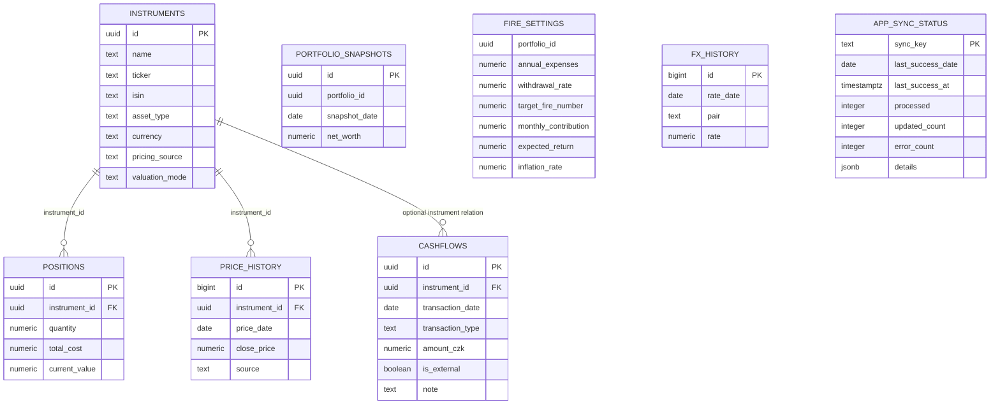
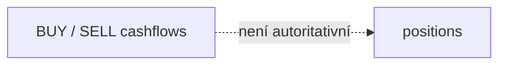
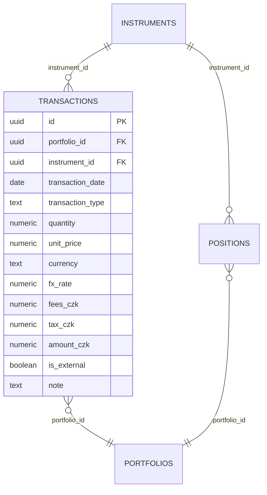

# FIRE WM — Databáze a ERD

## 1. ERD současné verze

> Typy níže dokumentují logický model. Přesné SQL typy je při migracích nutné ověřit proti živému Supabase schématu.



## 2. Tabulky

### instruments
Master data aktiv. Důležitá pravidla:
- `pricing_source`: `yahoo` nebo `manual`
- `valuation_mode`: `unit_price` nebo `total_value`
- ticker je povinný pro Yahoo instrumenty

### positions
Aktuální agregovaný stav portfolia.
- `quantity` je současný počet jednotek
- `total_cost` je současný evidovaný cost basis v CZK
- `current_value` je současná hodnota v CZK
- záporný `current_value` představuje pasivum

### price_history
Časová řada cen a NAV.
- nevytvářet syntetické denní NAV mezi skutečnými NAV body
- ruční CSV a Yahoo používají stejnou analytickou vrstvu

### cashflows
Historické peněžní pohyby.

**Známé omezení v1.0:** BUY/SELL nejsou dosud autoritativním ledgerem pro `positions`. Pozici tedy nelze spolehlivě zrekonstruovat pouze z cashflow.

### portfolio_snapshots
Historie čistého jmění.

Požadovaný unikátní constraint:

```sql
unique (portfolio_id, snapshot_date)
```

### fire_settings
Single-portfolio nastavení FIRE a rentové simulace.

### app_sync_status
Globální stav synchronizace tržních cen. Klíč `market_prices`.

## 3. Známé referenční mezery



To je hlavní datová mezera pro v1.1.

## 4. Navržený ERD v1.1: Transaction Ledger



Doporučení: `positions` ponechat jako agregovaný stav, ale zavést reconciliation vůči transakcím.
