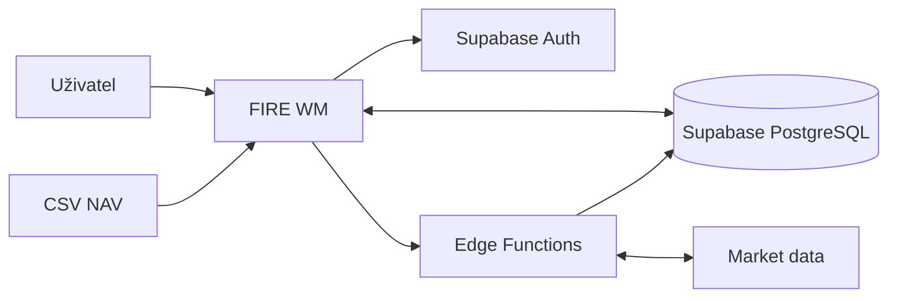
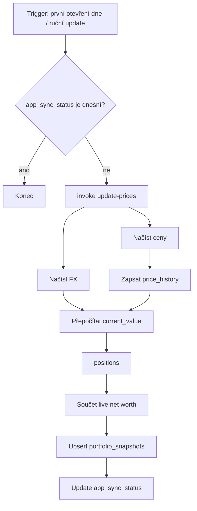
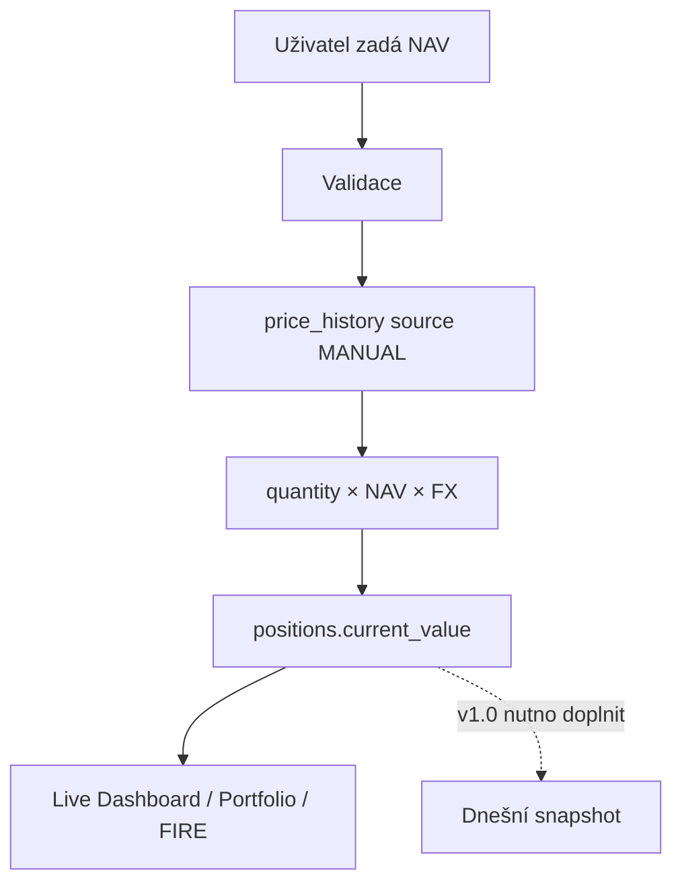
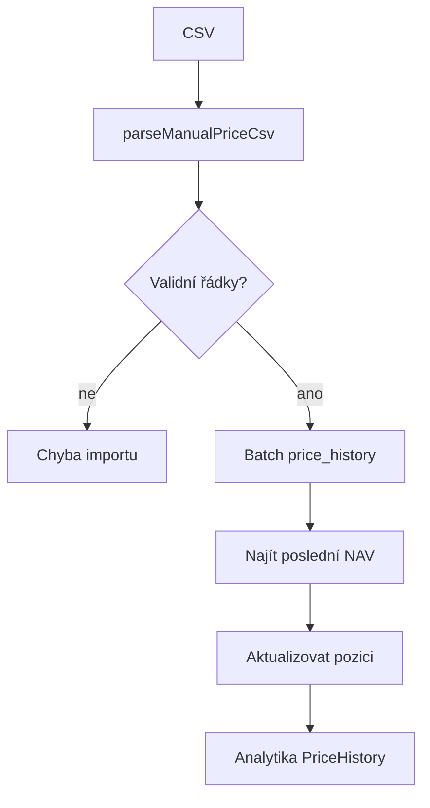
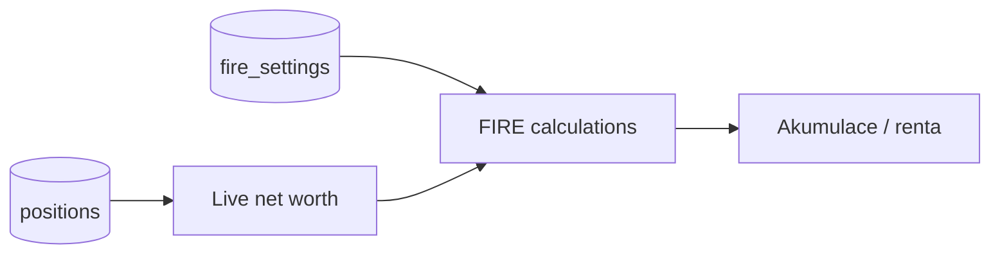
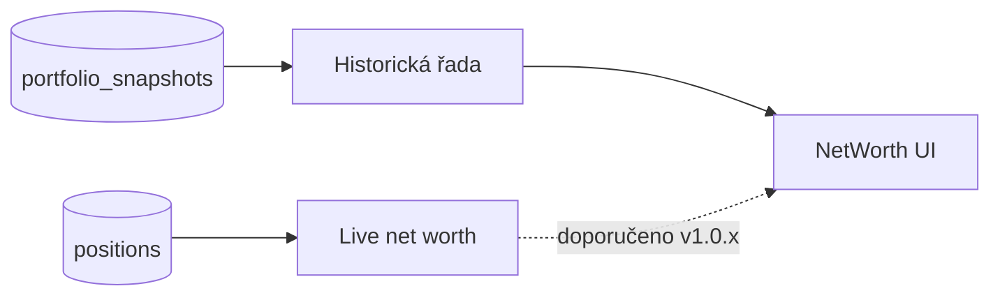
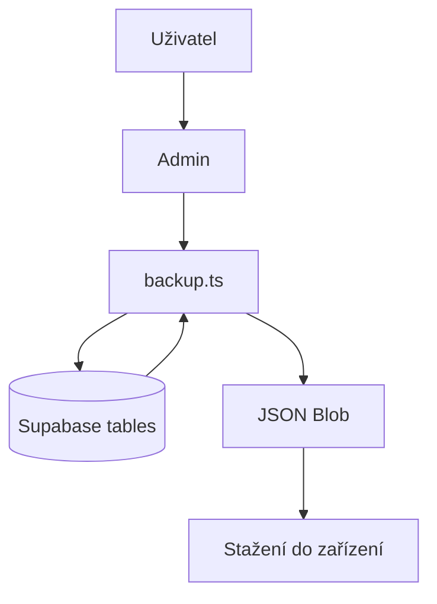
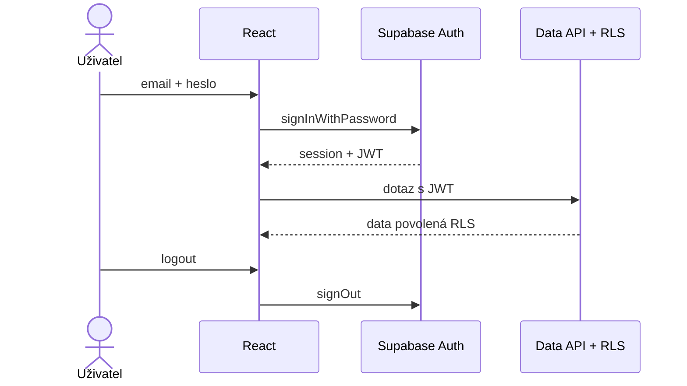

# FIRE WM — EFD / Data Flows

## 1. Kontextový tok

## 2. EFD: Aktualizace tržní ceny

## 3. EFD: Ruční jednotková cena

## 4. EFD: CSV NAV

## 5. EFD: FIRE

## 6. EFD: Vývoj majetku

## 7. EFD: Backup

## 8. EFD: Auth

