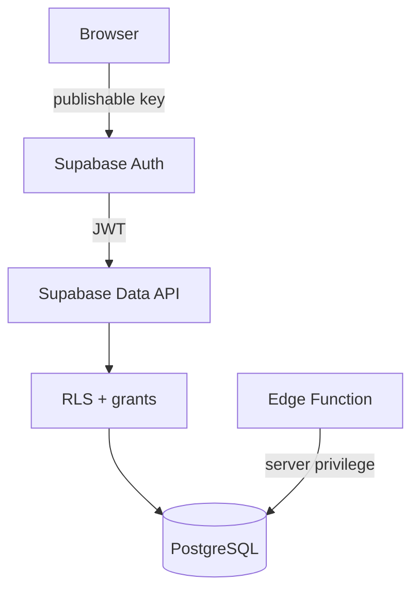

# FIRE WM — Security Model

## 1. Threat model

Chráněná data zahrnují:
- velikost majetku
- instrumenty a pozice
- cashflow
- příjmy
- FIRE plán
- historické ceny a NAV

Aplikace je dostupná z internetu, takže UI login sám o sobě nestačí.

## 2. Security layers



## 3. Auth Gate

`src/App.tsx`:
- načte session
- pokud session není, renderuje Login
- market update se nespouští před přihlášením
- logout ukončí session

## 4. RLS model v1.0

```text
anon          → bez finančních dat
authenticated → CRUD povolený pro data FIRE WM
server role   → Edge Functions
```

### Kritické omezení

Současná single-user politika typu `to authenticated using (true)` nerozlišuje vlastníka. Další účet ve stejném projektu by mohl vidět stejné finanční údaje.

Proto:
- nepovolovat veřejný signup
- nevytvářet další účty bez změny datového modelu

## 5. Budoucí multi-user RLS

Po přidání `user_id`:

```sql
using ((select auth.uid()) = user_id)
with check ((select auth.uid()) = user_id)
```

## 6. Secrets

### Povolené v browseru
- Supabase URL
- publishable key

### Zakázané v browseru/GitHubu
- service role
- secret API keys
- databázové heslo
- SFTP credentials

## 7. Backup security

JSON backup není šifrovaný. Obsahuje citlivé finanční informace.

Pravidla:
- ukládat jen do důvěryhodného úložiště
- neposílat veřejnými odkazy
- před sdílením vývojáři anonymizovat data, pokud nejsou pro debugging nutná

## 8. Security test před releasem

- anonymní browser vidí Login
- anonymní DB role nemá SELECT na positions
- přihlášený uživatel čte i zapisuje
- logout zneplatní přístup UI
- Edge update funguje i s RLS
- service secret není v `dist/`
- `.env.local` není commitnutý
