# FIRE Wealth Manager - Source Bundle


---

## FILE: .vscode\extensions.json

```
{
  "recommendations": ["denoland.vscode-deno"]
}

```

---

## FILE: .vscode\settings.json

```
{
  "deno.enablePaths": [
    "supabase/functions"
  ],
  "deno.lint": true,
  "deno.unstable": [
    "bare-node-builtins",
    "byonm",
    "sloppy-imports",
    "unsafe-proto",
    "webgpu",
    "broadcast-channel",
    "worker-options",
    "cron",
    "kv",
    "ffi",
    "fs",
    "http",
    "net"
  ],
  "[typescript]": {
    "editor.defaultFormatter": "denoland.vscode-deno"
  },
  "json.schemaDownload.trustedDomains": {
    "https://supabase.com/schemas/": true
  }
}

```

---

## FILE: DOCUMENTATION\APP_DOCUMENTATION.md

```
# FIRE WM: Dokumentace aplikace

## 1. Účel aplikace

FIRE WM je soukromá webová aplikace pro správu osobního majetku a investičního portfolia. Spojuje evidenci instrumentů a pozic, tržní a ruční ocenění, cashflow, historickou výkonnost a plánování finanční nezávislosti.

ProdukÄŤnĂ­ adresa:

```text
https://fire.madocon.cz
```

Aplikace je určena pro jednoho uživatele a pracuje s finančními údaji uloženými v Supabase Cloud.

## 2. HlavnĂ­ funkce

### Dashboard

Dashboard poskytuje souhrn:

- aktuální hodnoty portfolia,
- investovaného kapitálu,
- nerealizovaného výsledku,
- XIRR,
- FIRE progressu,
- CAGR čistého jmění,
- historického maxima,
- drawdownu,
- struktury portfolia,
- největších pozic.

### Portfolio

Portfolio zobrazuje aktuální pozice a jejich:

- instrument,
- ticker,
- typ aktiva,
- poÄŤet jednotek,
- váhu v portfoliu,
- pořizovací náklady,
- aktuální hodnotu,
- nerealizovaný výsledek,
- procentní výnos.

Kliknutím na instrument se otevře detail pozice.

### Výkonnost

Obrazovka Výkonnost obsahuje:

- XIRR jako money-weighted výnos,
- TWR očištěný o externí vklady a výběry,
- CAGR čistého jmění,
- celkovĂ˝ rĹŻst majetku,
- historické maximum,
- drawdown.

CAGR čistého jmění není čistý investiční výnos, protože zahrnuje také nové úspory a výběry.

### Vývoj majetku

Vývoj majetku používá historické body z tabulky `portfolio_snapshots`.

Zobrazuje:

- aktuální hodnotu posledního snapshotu,
- celkovĂ˝ rĹŻst,
- CAGR,
- ATH,
- drawdown,
- obdobĂ­ 1Y, 3Y, 5Y a MAX.

Aktuální živá hodnota portfolia vzniká ze součtu `positions.current_value`. Historický graf vychází ze snapshotů.

### Historie cen

Historie cen podporuje:

- instrumenty oceňované přes Yahoo Finance,
- ručně oceňované instrumenty s jednotkovou cenou,
- NAV importované z CSV.

Zobrazuje:

- aktuální cenu,
- YTD,
- 1Y price return,
- 3Y a 5Y CAGR,
- ATH,
- drawdown,
- obdobĂ­ 1Y, 3Y, 5Y a MAX.

Výnosy v této obrazovce jsou price return. Nezahrnují dividendy ani kupóny.

### TrĹľnĂ­ data

Tržní data obsahují dvě skupiny ocenění:

#### Automatické ocenění

- ceny veřejně obchodovaných instrumentů,
- měnové kurzy USD/CZK a EUR/CZK,
- datum poslednĂ­ ceny,
- zdroj ceny.

#### Ruční ocenění

- cena za jednotku nebo NAV,
- celková hodnota pozice,
- datum ocenění,
- CSV import historických NAV.

### FIRE

FIRE má dvě podzáložky.

#### Akumulace

Modeluje:

- současný věk,
- aktuální kapitál,
- měsíční investici,
- FIRE cĂ­l,
- nominální výnos,
- inflaci,
- reálný výnos,
- datum dosaĹľenĂ­ FIRE,
- věk při FIRE,
- podíl vkladů a výnosů.

Reálný výnos se počítá:

```text
(1 + nominální výnos) / (1 + inflace) - 1
```

#### Simulátor renty

Modeluje:

- počáteční kapitál,
- věk začátku renty,
- požadovanou měsíční rentu,
- očekávaný výnos,
- inflaci,
- délku modelu,
- státní důchod,
- inflaÄŤnĂ­ indexaci,
- dynamické čerpání,
- konečný kapitál,
- věk vyčerpání kapitálu.

Simulace je deterministická. Neobsahuje volatilitu, sequence-of-returns risk, daně ani poplatky.

### Cashflow

Cashflow eviduje:

- nákupy,
- prodeje,
- dividendy,
- kupĂłny,
- externĂ­ vklady,
- externí výběry,
- poplatky,
- danÄ›,
- Ăşroky.

Externí vklady a výběry jsou důležité pro XIRR a TWR. Nákup a prodej jsou interní přesuny uvnitř portfolia.

Aktuální omezení: cashflow zatím není plně propojeno s pozicemi a instrumenty tak, aby z transakcí automaticky rekonstruovalo množství, cost basis a realizovaný zisk.

### Příjmy

Příjmy zobrazují:

- dividendy,
- kupĂłny,
- celkový pasivní příjem,
- příjem posledního roku,
- meziroční změnu,
- strukturu příjmů,
- historii podle kalendářních let.

### Správa pozic

Umožňuje:

- vytvořit pozici,
- upravit pozici,
- smazat pozici,
- zadat poÄŤet jednotek,
- zadat pořizovací náklady,
- zadat aktuální hodnotu.

U automaticky oceňovaných instrumentů může být aktuální hodnota při příští aktualizaci přepočtena podle množství, ceny a FX kurzu.

### Správa instrumentů

Umožňuje spravovat:

- název,
- ticker,
- typ aktiva,
- měnu,
- zdroj ceny,
- režim ocenění.

Podporované zdroje:

```text
yahoo
manual
```

Podporované režimy:

```text
unit_price
total_value
```

### Správa dat

Obsahuje:

- import historických snapshotů,
- import historického cashflow,
- JSON export zálohy,
- volitelné zahrnutí cenové historie.

Záloha není šifrovaná a má být ukládána pouze do důvěryhodného úložiště.

## 3. Oceňování portfolia

### Yahoo instrument

```text
current_value = quantity Ă— market_price Ă— fx_rate
```

### Ruční jednotková cena

```text
current_value = quantity Ă— manual_price Ă— fx_rate
```

### Ruční celková hodnota

```text
current_value = ručně zadaná hodnota v CZK
```

Ruční NAV je nutné pravidelně aktualizovat. Neaktuální NAV může podhodnotit Portfolio, Dashboard, FIRE i denní snapshot.

## 4. DennĂ­ aktualizace a snapshoty

Při úspěšné aktualizaci cen:

1. Edge Function naÄŤte ceny a FX.
2. Aktualizuje `price_history`.
3. Přepočítá `positions.current_value`.
4. Frontend uloží dnešní čisté jmění do `portfolio_snapshots`.
5. Frontend aktualizuje `app_sync_status`.

Kombinace `portfolio_id + snapshot_date` je unikátní. Další aktualizace ve stejný den dnešní snapshot přepíše pomocí upsertu.

## 5. Přihlášení a zabezpečení

Aplikace používá:

- Supabase Auth,
- přihlášení e-mailem a heslem,
- Auth Gate v Reactu,
- Row Level Security v databázi,
- odhlášení ze sidebaru.

SouÄŤasnĂ˝ model je single-user:

```text
anon          → bez přístupu
authenticated → přístup k datům aplikace
service role  → Edge Functions
```

Veřejná registrace nových uživatelů nesmí být povolená.

## 6. Zálohování

Ve Správě dat lze stáhnout soubor:

```text
fire-wm-backup-YYYY-MM-DD.json
```

StandardnĂ­ export zahrnuje:

- instrumenty,
- pozice,
- cashflow,
- historii majetku,
- FIRE nastavenĂ­,
- FX historii,
- stav synchronizace.

Cenovou historii lze zahrnout volitelnÄ›.

DoporuÄŤenĂ­:

- vytvářet zálohu před změnou databázového schématu,
- vytvářet zálohu před hromadným importem,
- uchovávat alespoň jednu poslední ověřenou zálohu mimo hosting.

## 7. Provoz a deployment

### ProdukÄŤnĂ­ build

```powershell
npm run build
```

Výstup:

```text
dist/
```

### Lokální kontrola produkčního buildu

```powershell
npm run preview
```

### Deployment na Webglobe

Na hosting `fire.madocon.cz` se nahrává pouze obsah `dist/`:

```text
index.html
assets/
```

Nenahrávají se:

- `src/`,
- `node_modules/`,
- `.git/`,
- `.env.local`,
- `supabase/`,
- serverové secret keys.

### DoporuÄŤenĂ˝ release postup

1. Upravit kĂłd.
2. Spustit `npm run build`.
3. Spustit `npm run preview`.
4. Provést lokální smoke test.
5. Commitnout změny přes GitHub Desktop.
6. Pushnout na GitHub.
7. Nahrát nový obsah `dist/` na Webglobe.
8. Provést produkční smoke test.
9. Vytvořit nový JSON backup.

## 8. ProdukÄŤnĂ­ smoke test

Po deploymentu ověřit:

- odhlášený stav zobrazí pouze Login,
- login funguje,
- session přežije reload,
- Dashboard naÄŤte data,
- Portfolio odpovídá live pozicím,
- FIRE odpovídá live čistému jmění,
- TrĹľnĂ­ data zobrazĂ­ ceny a FX,
- ruční ocenění funguje,
- Vývoj majetku obsahuje aktuální bod,
- změna FIRE nastavení se uloží,
- backup se stáhne,
- logout vrátí Login,
- aplikace funguje na telefonu přes mobilní data.

## 9. Řešení běžných problémů

### Portfolio je nižší než očekávání

Zkontrolovat:

1. ruÄŤnĂ­ NAV,
2. datum ručního ocenění,
3. reĹľim `unit_price` nebo `total_value`,
4. mnoĹľstvĂ­ pozice,
5. FX kurz,
6. zda se `current_value` přepočítalo.

### Vývoj majetku ukazuje méně než Dashboard

Pravděpodobná příčina:

- Dashboard používá live pozice,
- Vývoj majetku používá starší snapshot.

Řešení:

- uložit nebo aktualizovat dnešní snapshot po ručním ocenění,
- v další verzi doplnit live poslední bod grafu.

### Aktualizace cen se nespouští

Zkontrolovat `app_sync_status`. Pokud je `last_success_date` dnešní datum, aplikace automatický update znovu nespustí.

### Build selĹľe

Spustit:

```powershell
npm run build
```

Opravit všechny TypeScript chyby před deploymentem. Vývojový server může některé typové chyby nezastavit, produkční build ano.

## 10. Omezení současné verze

- cashflow není plně provázané s pozicemi a instrumenty,
- pozice se neregenerujĂ­ automaticky z BUY/SELL transakcĂ­,
- nenĂ­ implementovanĂ˝ realizovanĂ˝ P/L a FIFO,
- Historie cen používá price return bez dividend,
- FIRE simulace nenĂ­ Monte Carlo,
- restore backupu nenĂ­ implementovanĂ˝,
- ruční NAV nemá upozornění na stáří,
- deployment na Webglobe je ruÄŤnĂ­,
- single-user RLS nerozlišuje vlastníky dat.

## 11. HlavnĂ­ soubory

```text
src/App.tsx
src/lib/supabase.ts
src/styles/app.css

src/pages/Login.tsx
src/pages/Dashboard.tsx
src/pages/Portfolio.tsx
src/pages/Performance.tsx
src/pages/MarketData.tsx
src/pages/PriceHistory.tsx
src/pages/NetWorth.tsx
src/pages/Fire.tsx
src/pages/Cashflow.tsx
src/pages/Income.tsx
src/pages/PositionManager.tsx
src/pages/InstrumentManager.tsx
src/pages/Admin.tsx
src/pages/InstrumentDetail.tsx

src/components/AssetAllocationChart.tsx

src/services/netWorth.ts
src/services/fireSettings.ts
src/services/priceUpdater.ts
src/services/priceHistory.ts
src/services/portfolio.ts
src/services/topPositions.ts
src/services/backup.ts
```

```

---

## FILE: DOCUMENTATION\ARCHITECTURE.md

```
# FIRE WM — Technická architektura

## 1. Účel

Tento dokument je technický handover pro dalšího vývojáře nebo nový vývojový chat. Popisuje současnou produkční architekturu FIRE WM v1.0 a pravidla, která další vývoj nesmí porušit.

## 2. Kontext systému

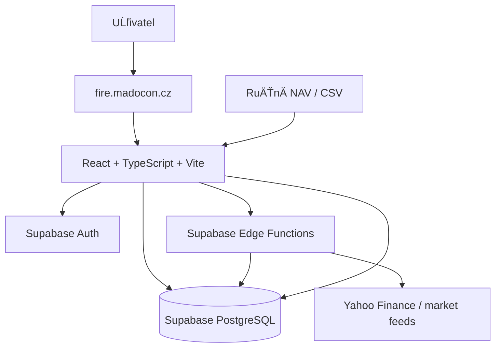

## 3. Komponenty

### Frontend
- React + TypeScript + Vite
- Recharts
- `src/App.tsx` jako shell, Auth Gate a navigace
- `src/pages/*` jako obrazovky
- `src/services/*` jako datová a integrační vrstva
- `src/styles/app.css` jako hlavní design systém

### Backend
- Supabase PostgreSQL
- Supabase Auth
- PostgreSQL Row Level Security
- Supabase Edge Functions

### Hosting
- Webglobe
- produkÄŤnĂ­ URL: `https://fire.madocon.cz`
- nasazuje se statickĂ˝ obsah `dist/`

## 4. Logické vrstvy

```text
Page / Component
      ↓
Service
      ↓
Supabase JS client / Edge Function
      ↓
Auth + RLS
      ↓
PostgreSQL / externĂ­ market feed
```

UI nemá implementovat databázové normalizace. Například nejednoznačné Supabase embedded relations se normalizují v service vrstvě.

## 5. Mapování obrazovek na služby

| Obrazovka | HlavnĂ­ zdroje |
|---|---|
| Dashboard | positions, instruments, FIRE metrics, net-worth stats, allocation |
| Portfolio | `portfolio.ts`, positions + instruments |
| Výkonnost | XIRR, TWR, net-worth snapshots |
| TrĹľnĂ­ data | price updater, manual valuation, price history |
| Historie cen | `priceHistory.ts`, price_history |
| Vývoj majetku | portfolio_snapshots, postupně i live net worth |
| FIRE | fire_settings + live net worth |
| Cashflow | cashflows |
| Příjmy | dividend / coupon cashflows |
| Pozice | position manager |
| Instrumenty | instrument manager |
| Data | import services + backup |

## 6. Hlavní běhové toky

### Automatické ceny

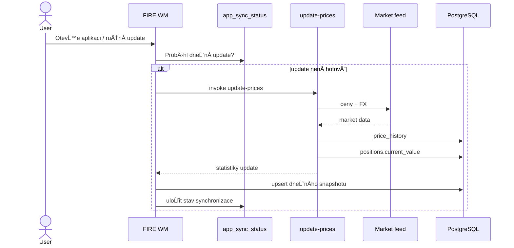

### RuÄŤnĂ­ NAV

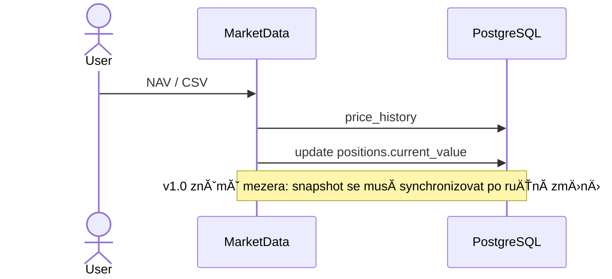

## 7. Aktuální versus historický stav

**Autorita současného stavu:**

```text
SUM(positions.current_value)
```

**Autorita historického stavu:**

```text
portfolio_snapshots
```

Poslední historický snapshot se nesmí používat jako autorita aktuálního majetku.

## 8. NasazenĂ­

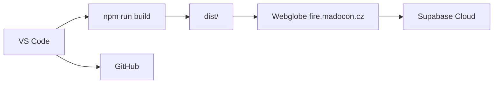

## 9. Non-goals v1.0

- multi-user databázový model
- automatická rekonstrukce pozic z transakcí
- FIFO a daňový engine
- Monte Carlo FIRE
- automatickĂ˝ restore backupu
- plnÄ› automatizovanĂ˝ deployment

```

---

## FILE: DOCUMENTATION\BUSINESS_RULES.md

```
# FIRE WM — Business Rules and Invariants

## INV-001: Live net worth
Aktuální čisté jmění je odvozené z `positions.current_value`.

## INV-002: Snapshots are history
`portfolio_snapshots` jsou historická řada, ne autorita aktuální hodnoty.

## INV-003: One snapshot per day
Pro kombinaci portfolio + datum smí existovat nejvýše jeden snapshot.

## INV-004: Reporting currency
`positions.current_value`, historické net worth a hlavní reporting jsou v CZK.

## INV-005: Native market price
Tržní cena může zůstat v nativní měně instrumentu.

## INV-006: External cashflow
`CONTRIBUTION` a `WITHDRAWAL` jsou externĂ­ cashflow pro portfolio performance.

## INV-007: Trades are internal
BUY a SELL nejsou externí cashflow celého portfolia. Jde o přesun mezi cash a instrumentem.

## INV-008: Unit-price manual valuation
Ruční `unit_price` používá quantity × NAV × FX.

## INV-009: Total-value manual valuation
Ruční `total_value` je přímá celková hodnota pozice v CZK.

## INV-010: Real market data only
`price_history` nemá obsahovat vymyšlené mezilehlé NAV body.

## INV-011: XIRR versus net-worth growth
XIRR a CAGR čistého jmění nejsou zaměnitelné metriky.

## INV-012: Security secret boundary
Privilegované serverové credentials nesmí být dostupné v browseru.

## INV-013: Backup before destructive migrations
Před destruktivní změnou DB vytvořit ověřený JSON backup.

## INV-014: Manual valuation freshness
Před finálním denním snapshotem zkontrolovat ruční NAV.

## INV-015: Transaction ledger future rule
Po zavedení Transaction Ledger musí být možné vysvětlit quantity pozice jako součet BUY minus SELL po zohlednění corporate actions.

```

---

## FILE: DOCUMENTATION\DATA_FLOWS.md

```
# FIRE WM — EFD / Data Flows

## 1. KontextovĂ˝ tok

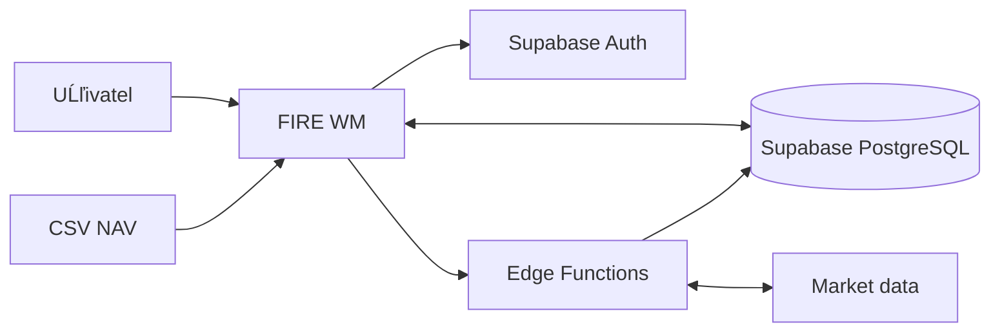

## 2. EFD: Aktualizace trĹľnĂ­ ceny

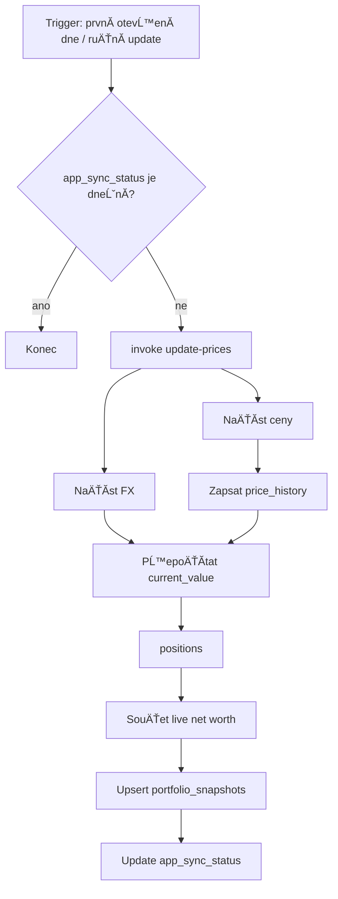

## 3. EFD: Ruční jednotková cena

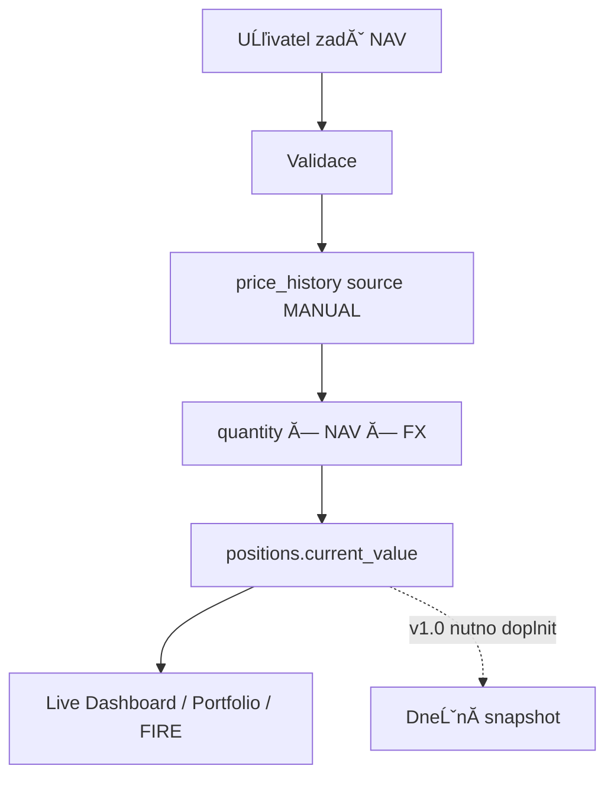

## 4. EFD: CSV NAV

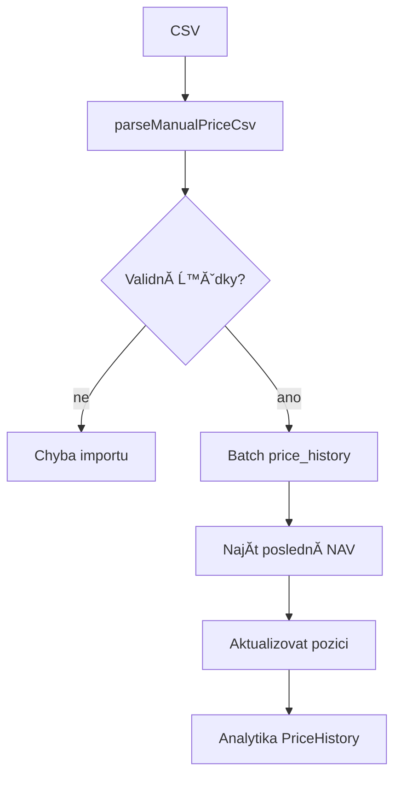

## 5. EFD: FIRE

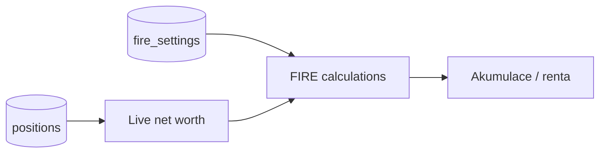

## 6. EFD: Vývoj majetku

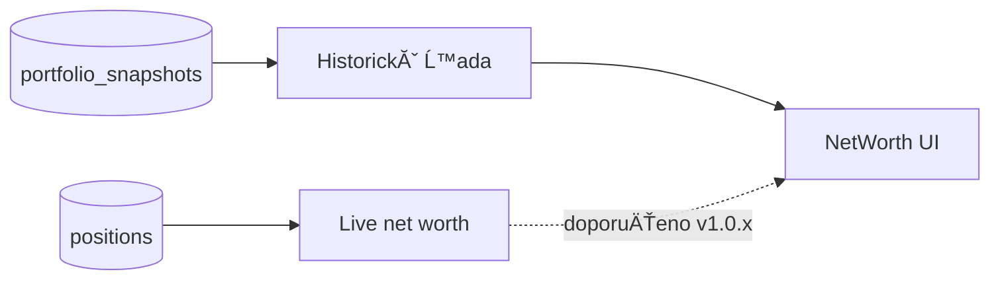

## 7. EFD: Backup

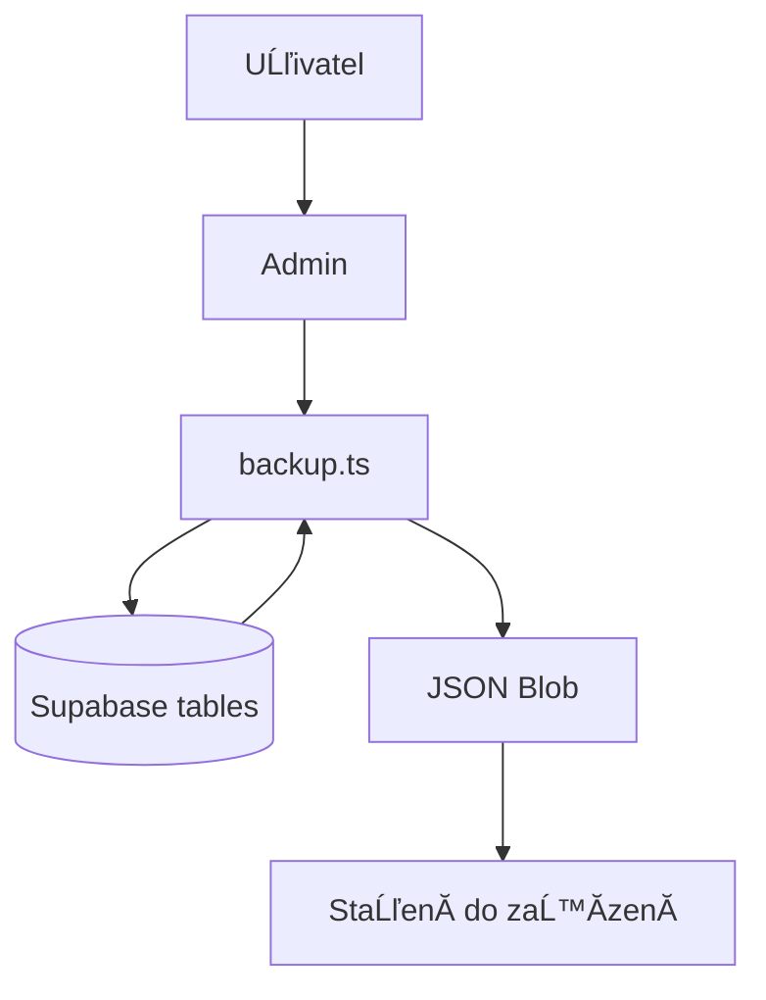

## 8. EFD: Auth

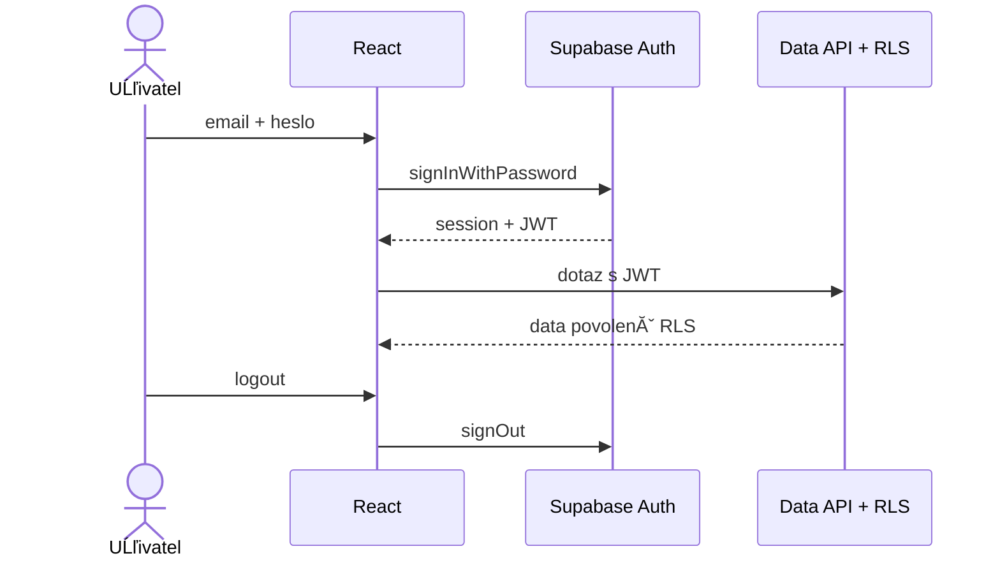

```

---

## FILE: DOCUMENTATION\DATABASE_ERD.md

```
# FIRE WM — Databáze a ERD

## 1. ERD současné verze

> Typy níže dokumentují logický model. Přesné SQL typy je při migracích nutné ověřit proti živému Supabase schématu.

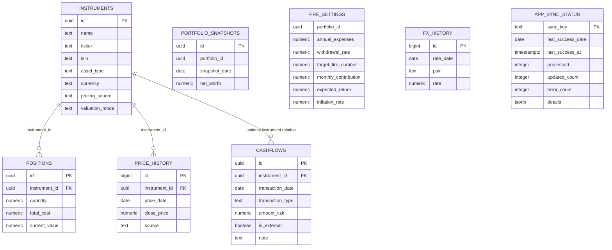

## 2. Tabulky

### instruments
Master data aktiv. Důležitá pravidla:
- `pricing_source`: `yahoo` nebo `manual`
- `valuation_mode`: `unit_price` nebo `total_value`
- ticker je povinnĂ˝ pro Yahoo instrumenty

### positions
Aktuální agregovaný stav portfolia.
- `quantity` je souÄŤasnĂ˝ poÄŤet jednotek
- `total_cost` je souÄŤasnĂ˝ evidovanĂ˝ cost basis v CZK
- `current_value` je současná hodnota v CZK
- záporný `current_value` představuje pasivum

### price_history
Časová řada cen a NAV.
- nevytvářet syntetické denní NAV mezi skutečnými NAV body
- ruční CSV a Yahoo používají stejnou analytickou vrstvu

### cashflows
Historické peněžní pohyby.

**Známé omezení v1.0:** BUY/SELL nejsou dosud autoritativním ledgerem pro `positions`. Pozici tedy nelze spolehlivě zrekonstruovat pouze z cashflow.

### portfolio_snapshots
Historie čistého jmění.

Požadovaný unikátní constraint:

```sql
unique (portfolio_id, snapshot_date)
```

### fire_settings
Single-portfolio nastavení FIRE a rentové simulace.

### app_sync_status
Globální stav synchronizace tržních cen. Klíč `market_prices`.

## 3. Známé referenční mezery

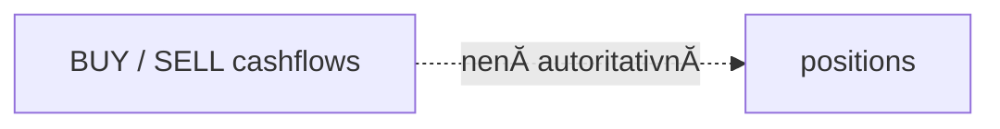

To je hlavní datová mezera pro v1.1.

## 4. NavrĹľenĂ˝ ERD v1.1: Transaction Ledger

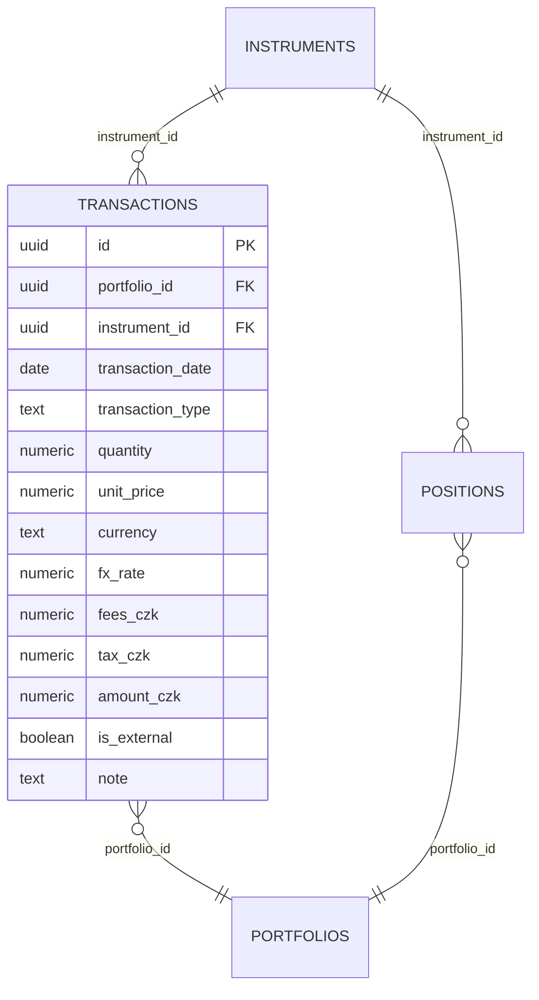

Doporučení: `positions` ponechat jako agregovaný stav, ale zavést reconciliation vůči transakcím.

```

---

## FILE: DOCUMENTATION\DECISION\ADR-001-LIVE-NET-WORTH.md

```
# ADR-001: Live net worth pochází z positions

## Status
Accepted

## Context
Historický snapshot může být starší než poslední přecenění pozic.

## Decision
Aktuální čisté jmění se počítá z `positions.current_value`. Snapshoty slouží pouze jako historie.

## Consequences
Dashboard a FIRE nesmí číst poslední snapshot jako současnou autoritu. NetWorth UI má v budoucí stabilizační verzi zobrazovat live současný bod.

```

---

## FILE: DOCUMENTATION\DECISION\ADR-002-DAILY-SNAPSHOTS.md

```
# ADR-002: Jeden denní snapshot přes upsert

## Status
Accepted

## Decision
Kombinace `portfolio_id + snapshot_date` je unikátní. Dnešní snapshot se zapisuje přes upsert.

## Rationale
Více aktualizací za den nesmí vytvořit více bodů denního grafu.

## Consequence
Pozdější ruční ocenění musí dnešní snapshot aktualizovat, jinak může historie dočasně zaostávat za live stavem.

```

---

## FILE: DOCUMENTATION\DECISION\ADR-003-SINGLE-USER-RLS.md

```
# ADR-003: Single-user RLS pro MVP

## Status
Accepted for v1.0

## Decision
Anon přístup je blokovaný, authenticated role má přístup k datům FIRE WM.

## Trade-off
Model neodděluje více autentizovaných uživatelů. Veřejný signup proto nesmí být povolen.

## Migration path
Před multi-user provozem doplnit owner/user ID a owner-based RLS.

```

---

## FILE: DOCUMENTATION\DECISION\ADR-004-TRANSACTION-LEDGER.md

```
# ADR-004: Transaction Ledger jako priorita v1.1

## Status
Proposed

## Context
Současné positions představují aktuální stav, ale BUY/SELL historie není autoritativně propojená s množstvím a cost basis.

## Proposed decision
Zavést samostatnou `transactions` tabulku s instrumentem, quantity, unit price, currency, FX, fees a type.

## Recommended model
- transactions = auditovatelná historie obchodů
- positions = agregovanĂ˝ souÄŤasnĂ˝ stav
- reconciliation = kontrola vypočtené quantity proti positions.quantity
- weighted average cost jako prvnĂ­ reporting metoda
- FIFO jako pozdější daňová vrstva

```

---

## FILE: DOCUMENTATION\DEPLOYMENT.md

```
# FIRE WM — Deployment a provoz

## 1. Prostředí

### Development
```text
npm run dev
http://localhost:5173
```

### Production preview
```text
npm run build
npm run preview
```

### Production
```text
https://fire.madocon.cz
```

## 2. Environment

Vite klient potřebuje:

```text
VITE_SUPABASE_URL
VITE_SUPABASE_PUBLISHABLE_KEY
```

`.env.local` necommitovat a nenahrávat na Webglobe.

## 3. Build

```powershell
npm run build
```

Build musí skončit bez TypeScript errors. Výstup je `dist/`.

Známé neblokující upozornění: hlavní JS chunk může být >500 kB před gzipem.

## 4. Webglobe upload

Do document root subdomény nahrát obsah:

```text
dist/index.html
dist/assets/*
```

Ne nahrát samotnou vnořenou složku `dist`.

## 5. Supabase Auth URL

```text
Site URL: https://fire.madocon.cz
Redirect URL: https://fire.madocon.cz/**
Redirect URL: http://localhost:5173/**
```

## 6. Release checklist

1. vytvořit backup
2. `npm run build`
3. `npm run preview`
4. smoke test
5. commit přes GitHub Desktop
6. push na GitHub
7. upload `dist/` na Webglobe
8. produkÄŤnĂ­ smoke test
9. test z telefonu přes mobilní data
10. nový backup po datových migracích

## 7. Rollback

Frontend rollback:
- uchovat předchozí `dist` nebo znovu buildnout předchozí Git commit
- nahrát předchozí statické soubory

Databázový rollback:
- před migrací vždy backup
- preferovat forward migration před ručním mazáním
- destruktivnĂ­ restore zatĂ­m nenĂ­ automatizovanĂ˝

```

---

## FILE: DOCUMENTATION\INTEGRATIONS.md

```
# FIRE WM — Integrace

## 1. Katalog integracĂ­

| Integrace | Směr | Účel | Autentizace | Selhání |
|---|---|---|---|---|
| Supabase Auth | FE ↔ Supabase | session, login/logout | publishable key + credentials/JWT | zobrazit login/error |
| Supabase Data API | FE ↔ PostgreSQL | CRUD finančních dat | user JWT + RLS | error state, nepokračovat destruktivně |
| Supabase Edge Functions | FE → server | update a backfill cen | frontend invoke; serverové secrets uvnitř Edge | zachovat poslední cenu |
| Yahoo / market feed | Edge ↔ external | ceny veřejných instrumentů | server-side implementace | partial errors, poslední dostupné ceny |
| FX feed | Edge ↔ external | USD/CZK, EUR/CZK | server-side | neposílat nevalidní FX do pozic |
| CSV NAV | lokální soubor → FE | ruční historie fondů | bez autentizace souboru, ale FE vyžaduje Auth | validace, odmítnout chybný import |
| Webglobe | deployment | produkční statický frontend | SFTP/WebFTP účet | před uploadem produkční build |
| GitHub | development | verzování | GitHub účet | není runtime závislost |

## 2. Supabase

Frontend používá pouze:

```text
VITE_SUPABASE_URL
VITE_SUPABASE_PUBLISHABLE_KEY
```

Do browseru nesmí přijít:

```text
service_role
sb_secret_...
database password
```

## 3. Market feed

### Trigger
- automaticky jednou dennÄ› podle `app_sync_status`
- ruÄŤnÄ› z TrĹľnĂ­ch dat

### Výstup
- price_history
- FX
- positions.current_value
- následně snapshot a sync status

### Failure policy
- dĂ­lÄŤĂ­ chyby evidovat v `error_count`
- portfolio používá poslední dostupnou cenu
- nedělat nulování pozice při chybě feedu

## 4. RuÄŤnĂ­ NAV

### Jednotková cena
- ukládá se do `price_history`
- poslední NAV přeceňuje pozici

### Total value
- přímý zápis celkové CZK hodnoty pozice

### BudoucĂ­ poĹľadavek
- stale-price warning 35/60 dnĂ­
- snapshot update po ručním ocenění

## 5. Webglobe

ProdukÄŤnĂ­ adresa:

```text
https://fire.madocon.cz
```

Nasazuje se obsah `dist/`, nikoliv zdrojovĂ˝ projekt.

```

---

## FILE: DOCUMENTATION\PRODUCT_BACKLOG.md

```
# FIRE WM: Produktový backlog a plán dalších verzí

## 1. Účel dokumentu

Tento dokument definuje doporučené pořadí dalšího vývoje FIRE WM po dokončení MVP v1.0.

Priority:

```text
P0 = kritická chyba nebo bezpečnost
P1 = vysoká hodnota, doporučeno pro nejbližší verzi
P2 = významné rozšíření
P3 = dlouhodobĂ˝ rozvoj
```

## 2. Východiska

Aktuální verze umí:

- evidovat instrumenty a pozice,
- oceňovat Yahoo i ruční aktiva,
- spravovat cashflow a příjmy,
- poÄŤĂ­tat XIRR, TWR a CAGR,
- zobrazovat historii cen a majetku,
- modelovat FIRE a rentu,
- ukládat denní snapshot,
- exportovat JSON backup,
- zabezpečit data přes Auth a RLS,
- běžet v produkci na `https://fire.madocon.cz`.

Největší funkční mezera je oddělení transakcí od pozic. Aplikace dobře eviduje současný stav, ale neumí plně rekonstruovat, kdy a za kolik byla pozice vytvořena nebo prodána.

## 3. Verze v1.0.x: Stabilizace

Cíl: opravy bez zásadní změny datového modelu.

### P0: Live hodnota ve Vývoji majetku

**Problém:** Dashboard a FIRE používají live `positions.current_value`, zatímco Vývoj majetku může zobrazit starší poslední snapshot.

**Řešení:**

- naÄŤĂ­st live net worth spoleÄŤnÄ› s historiĂ­,
- dnešní bod grafu nahradit live hodnotou,
- pokud dnešní snapshot neexistuje, přidat pouze virtuální bod v UI,
- při uložení snapshotu použít upsert.

**Akceptační kritéria:**

- Aktuální majetek je stejný na Dashboardu, FIRE a Vývoji majetku.
- Historické body zůstávají beze změny.
- NevznikajĂ­ duplicitnĂ­ snapshoty.

### P0: Snapshot po ručním ocenění

**Problém:** po změně ručního NAV se pozice přepočítá, ale dnešní snapshot může zůstat starý.

**Řešení:** volat `saveTodaySnapshot()` po:

- ruční jednotkové ceně,
- ruční celkové hodnotě,
- CSV importu NAV,
- změně množství nebo hodnoty pozice.

### P1: Upozornění na staré ruční ceny

**Pravidla:**

- 0 až 35 dní: bez upozornění,
- 36 až 60 dní: upozornění „Starší ocenění“,
- více než 60 dní: upozornění „Neaktuální ocenění“,
- chybějící datum: kritické upozornění.

**Umístění:**

- TrĹľnĂ­ data,
- Portfolio,
- případně Dashboard.

### P1: Audit aktualizace cen

Doplnit:

- poslední úspěšnou cenu každého instrumentu,
- datum poslednĂ­ho pokusu,
- zdroj ceny,
- poslednĂ­ chybu,
- poÄŤet dnĂ­ od poslednĂ­ ceny.

### P1: KonsistenÄŤnĂ­ kontrola

Servisní kontrola ve Správě dat:

```text
live net worth
vs.
dnešní snapshot
```

Výsledek:

- shoda,
- rozdĂ­l v KÄŤ,
- rozdĂ­l v %,
- možnost aktualizovat dnešní snapshot.

### P1: Automatické testy kritických funkcí

Minimálně testovat:

- reálný výnos FIRE,
- akumulaÄŤnĂ­ projekci,
- rentovou simulaci,
- XIRR vstupy,
- TWR segmentaci,
- výpočet net worth,
- normalizaci Supabase relations,
- backup strukturu.

Doporučený nástroj:

```text
Vitest
```

### P2: Code splitting

Použít:

- `React.lazy()`,
- `Suspense`,
- lazy loading jednotlivých stránek,
- oddělený chunk pro Recharts.

CĂ­l:

- odstranit upozornění na chunk nad 500 kB,
- zrychlit prvnĂ­ naÄŤtenĂ­ loginu a Dashboardu.

## 4. Verze v1.1: Transaction Ledger

CĂ­l: propojit historii obchodĹŻ s pozicemi a instrumenty.

### P1: Rozšíření transakčního modelu

Doplnit do `cashflows` nebo vytvořit novou tabulku `transactions` s poli:

```text
id
portfolio_id
instrument_id
transaction_date
transaction_type
quantity
unit_price
currency
fx_rate
fees_czk
tax_czk
amount_czk
is_external
note
created_at
updated_at
```

Doporučení: pro čistotu modelu vytvořit novou tabulku `transactions` a externí peněžní pohyby ponechat v `cashflows` nebo je sjednotit až po migraci.

### P1: Provázání BUY/SELL s instrumentem

Každý nákup a prodej musí mít:

- instrument,
- datum,
- mnoĹľstvĂ­,
- jednotkovou cenu,
- měnu,
- FX kurz,
- poplatek.

### P1: Rekonstrukce mnoĹľstvĂ­ pozice

```text
quantity = SUM(BUY quantity) - SUM(SELL quantity)
```

Aplikace má porovnat:

```text
calculated quantity
vs.
positions.quantity
```

Neshoda musí být viditelná jako upozornění.

### P1: Cost basis

Nejdřív implementovat jednu jasně definovanou metodu:

- weighted average cost pro internĂ­ reporting,
- později FIFO pro realizovaný P/L a daňové podklady.

### P1: RealizovanĂ˝ a nerealizovanĂ˝ P/L

Výstupy:

- realizovanĂ˝ zisk z prodejĹŻ,
- nerealizovaný zisk současné pozice,
- poplatky,
- dividendy,
- total return instrumentu.

### P1: HistorickĂ˝ import transakcĂ­

Připravit CSV formát:

```text
date;type;ticker;quantity;unit_price;currency;fx_rate;fees_czk;amount_czk;note
```

Import musĂ­ mĂ­t:

- validaci,
- náhled,
- dry-run,
- seznam chyb,
- idempotenci nebo ochranu před duplicitami.

### P2: Detail instrumentu vÄŤetnÄ› historie

Detail má zobrazovat:

- současné množství,
- průměrnou cenu,
- nákupy,
- prodeje,
- dividendy,
- realizovanĂ˝ P/L,
- nerealizovanĂ˝ P/L,
- total return.

### P2: Rekonciliace

Správa dat má obsahovat kontrolu:

```text
transakce → vypočtená pozice → evidovaná pozice
```

## 5. Verze v1.2: Výkonnost a benchmarky

### P1: Total return

Historie výnosu instrumentu má zahrnout:

- změnu ceny,
- dividendy,
- kupĂłny,
- poplatky.

### P1: Benchmark

Podporovat minimálně:

- MSCI World ETF nebo uĹľivatelem vybranĂ˝ ticker,
- S&P 500,
- vlastnĂ­ benchmark podle portfolia.

Porovnání:

- kumulativní výnos,
- CAGR,
- drawdown,
- relativní výkonnost.

### P2: TWR podle obdobĂ­

- YTD,
- 1Y,
- 3Y,
- 5Y,
- od počátku.

### P2: Rizikové metriky

- volatilita,
- Sharpe ratio,
- Sortino ratio,
- maximum drawdown,
- recovery time.

### P2: Výkonnost podle tříd aktiv

- akcie,
- ETF,
- fondy,
- hotovost,
- penzijnĂ­ produkty,
- pasiva.

## 6. Verze v1.3: Rebalancing a plánování

### P1: Cílové váhy

Doplnit k instrumentům nebo třídám aktiv:

```text
target_weight
minimum_weight
maximum_weight
```

### P1: Rebalancing report

Zobrazit:

- aktuální váhu,
- cílovou váhu,
- odchylku,
- doporučený nákup/prodej,
- variantu pouze s novými vklady.

### P2: Plán pravidelných investic

Rozdělit měsíční investici podle:

- cílových vah,
- největších odchylek,
- minimální velikosti transakce,
- zadaných omezení.

### P2: Likvidita

Rozlišit:

- okamĹľitÄ› likvidnĂ­,
- likvidnĂ­ do 30 dnĂ­,
- omezenÄ› likvidnĂ­,
- nelikvidnĂ­.

## 7. Verze v1.4: FIRE Advanced

### P1: Monte Carlo simulace

Parametry:

- očekávaný výnos,
- volatilita,
- inflace,
- počet scénářů,
- investiÄŤnĂ­ horizont,
- renta,
- dĹŻchod.

Výstupy:

- pravděpodobnost úspěchu,
- medián konečného kapitálu,
- 10., 25., 75. a 90. percentil,
- pravděpodobnost vyčerpání podle věku.

### P1: Sequence-of-returns risk

Modelovat rozdílné pořadí stejných průměrných výnosů, zejména v prvních 10 letech renty.

### P2: Guardrails

Podporovat například:

- pevnou rentu,
- procentnĂ­ rentu,
- Guyton-Klinger guardrails,
- dočasné snížení renty při drawdownu.

### P2: Mimořádné příjmy a výdaje

Například:

- prodej nemovitosti,
- dědictví,
- školné,
- nové auto,
- zdravotní výdaje,
- jednorázová investice.

### P2: Scénáře

- konzervativnĂ­,
- základní,
- optimistickĂ˝,
- vlastní scénář.

## 8. Verze v1.5: Provoz a automatizace

### P1: AutomatickĂ˝ scheduler cen

Aktualizace cen bez otevření aplikace.

MoĹľnosti:

- Supabase Cron,
- plánovaná Edge Function,
- externĂ­ cron pouze jako fallback.

Po aktualizaci:

- přepočítat pozice,
- uloĹľit snapshot,
- aktualizovat sync status,
- uloĹľit audit chyby.

### P1: AutomatizovanĂ˝ Webglobe deployment

MoĹľnosti:

- GitHub Actions + SFTP,
- build v CI,
- upload obsahu `dist/`,
- produkÄŤnĂ­ smoke check.

Nutné:

- SFTP credentials v GitHub Secrets,
- ochrana produkční větve,
- oddělený preview workflow.

### P2: Monitoring

- chyba Edge Function,
- staré ceny,
- chybějící snapshot,
- neúspěšný backup,
- neúspěšný build.

### P2: Audit log

Evidovat:

- změnu pozice,
- ruční ocenění,
- import,
- smazání,
- změnu FIRE nastavení.

## 9. Verze v2.0: Multi-user platforma

### P1: Owner-based databázový model

Doplnit `user_id` nebo `owner_id` do všech relevantních tabulek.

RLS:

```sql
(select auth.uid()) = user_id
```

### P1: VĂ­ce portfoliĂ­

- osobnĂ­ portfolio,
- partnerské portfolio,
- dětské portfolio,
- penzijnĂ­ portfolio,
- firemnĂ­ portfolio.

### P1: Role

- vlastnĂ­k,
- pouze ÄŤtenĂ­,
- poradce,
- administrátor.

### P2: SdĂ­lenĂ­ reportu

- ÄŤasovÄ› omezenĂ˝ read-only odkaz,
- export PDF,
- skrytí citlivých částek,
- poradenskĂ˝ report.

### P2: Oddělené konfigurace

Každý uživatel nebo portfolio má vlastní:

- FIRE nastavenĂ­,
- cílové váhy,
- měnu reportingu,
- benchmark,
- pravidla aktualizace.

## 10. TechnickĂ˝ dluh

### P1

- centralizovat formátovací funkce pro CZK, procenta a datum,
- odstranit zbývající inline styly,
- vytvořit sdílené komponenty `MetricCard`, `PageHeader`, `Panel`, `DataTable`, `FormField`,
- přidat Error Boundary,
- doplnit retry pro síťové chyby.

### P2

- generované Supabase TypeScript typy,
- odstranit `any` v backup service,
- oddělit doménové výpočty od React komponent,
- doplnit schema validaci odpovědí, například pomocí Zod,
- přidat lint a formatting v CI,
- zjednodušit dlouhé soubory `Fire.tsx`, `MarketData.tsx` a `App.tsx`.

## 11. Doporučené pořadí implementace

### Nejbližší sprint

1. Live poslední bod ve Vývoji majetku.
2. Snapshot po ručním ocenění.
3. Stáří ručních cen.
4. KonsistenÄŤnĂ­ kontrola net worth.
5. Vitest pro FIRE a net worth.

### Následující hlavní epika

1. Datový návrh Transaction Ledger.
2. SQL migrace.
3. CSV import s dry-run.
4. Rekonstrukce quantity.
5. Cost basis.
6. RealizovanĂ˝ P/L.
7. Total return.

## 12. Doporučená definice hotové verze v1.1

Verze v1.1 je hotová, pokud:

- každý BUY/SELL je navázán na instrument,
- transakce obsahují quantity, cenu, měnu, FX a poplatek,
- lze z transakcí spočítat současné množství,
- aplikace zobrazĂ­ neshodu proti `positions.quantity`,
- je implementovanĂ˝ cost basis,
- je zobrazen realizovanĂ˝ a nerealizovanĂ˝ P/L,
- import historických transakcí má validaci a dry-run,
- XIRR používá pouze externí cashflow,
- nákup a prodej nejsou chybně považované za externí cashflow,
- existuje backup před migrací,
- produkÄŤnĂ­ build a smoke test projdou.

## 13. Rozhodnutí, která je nutné udělat před Transaction Ledgerem

1. Zda rozšířit `cashflows`, nebo vytvořit samostatnou `transactions` tabulku.
2. Zda používat weighted average cost, FIFO, nebo obě metody.
3. Jak importovat staré obchody s neúplným FX kurzem.
4. Jak zacházet s corporate actions, split, spin-off a převody.
5. Zda mají být pozice vždy odvozené z transakcí, nebo zůstanou editovatelné s kontrolou konzistence.

DoporuÄŤenĂ­ pro v1.1:

- samostatná `transactions` tabulka,
- weighted average cost pro portfolio reporting,
- FIFO jako navazující daňová vrstva,
- `positions` jako materializovaný nebo kontrolovaný agregát,
- explicitnĂ­ reconciliation report.

```

---

## FILE: DOCUMENTATION\SECURITY.md

```
# FIRE WM — Security Model

## 1. Threat model

Chráněná data zahrnují:
- velikost majetku
- instrumenty a pozice
- cashflow
- příjmy
- FIRE plán
- historické ceny a NAV

Aplikace je dostupná z internetu, takže UI login sám o sobě nestačí.

## 2. Security layers

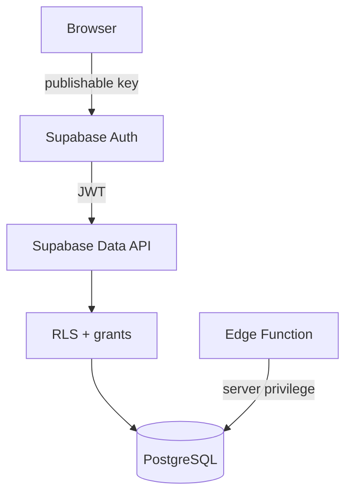

## 3. Auth Gate

`src/App.tsx`:
- naÄŤte session
- pokud session nenĂ­, renderuje Login
- market update se nespouští před přihlášením
- logout ukonÄŤĂ­ session

## 4. RLS model v1.0

```text
anon          → bez finančních dat
authenticated → CRUD povolený pro data FIRE WM
server role   → Edge Functions
```

### Kritické omezení

Současná single-user politika typu `to authenticated using (true)` nerozlišuje vlastníka. Další účet ve stejném projektu by mohl vidět stejné finanční údaje.

Proto:
- nepovolovat veřejný signup
- nevytvářet další účty bez změny datového modelu

## 5. BudoucĂ­ multi-user RLS

Po přidání `user_id`:

```sql
using ((select auth.uid()) = user_id)
with check ((select auth.uid()) = user_id)
```

## 6. Secrets

### Povolené v browseru
- Supabase URL
- publishable key

### Zakázané v browseru/GitHubu
- service role
- secret API keys
- databázové heslo
- SFTP credentials

## 7. Backup security

JSON backup není šifrovaný. Obsahuje citlivé finanční informace.

Pravidla:
- ukládat jen do důvěryhodného úložiště
- neposílat veřejnými odkazy
- před sdílením vývojáři anonymizovat data, pokud nejsou pro debugging nutná

## 8. Security test před releasem

- anonymnĂ­ browser vidĂ­ Login
- anonymní DB role nemá SELECT na positions
- přihlášený uživatel čte i zapisuje
- logout zneplatní přístup UI
- Edge update funguje i s RLS
- service secret nenĂ­ v `dist/`
- `.env.local` nenĂ­ commitnutĂ˝

```

---

## FILE: DOCUMENTATION\SOURCE_BOUNDLE_CREATION.md

```
$root = Get-Location
$output = Join-Path $root "FIRE_SOURCE_BUNDLE.md"

"# FIRE Wealth Manager - Source Bundle`n" | Set-Content $output -Encoding utf8

$files = Get-ChildItem -Recurse -File |
    Where-Object {
        $_.FullName -notmatch '\\node_modules\\' -and
        $_.FullName -notmatch '\\dist\\' -and
        $_.FullName -notmatch '\\\.git\\' -and
        $_.Name -notin @(
            '.env',
            '.env.local',
            'FIRE_SOURCE_BUNDLE.md'
        ) -and
        $_.Extension -in @(
            '.ts',
            '.tsx',
            '.js',
            '.jsx',
            '.sql',
            '.json',
            '.md',
            '.css',
            '.html'
        )
    } |
    Sort-Object FullName

foreach ($file in $files) {
    $relative = $file.FullName.Substring($root.Path.Length + 1)

    Add-Content $output ""
    Add-Content $output "---"
    Add-Content $output ""
    Add-Content $output "## FILE: $relative"
    Add-Content $output ""
    Add-Content $output '```'
    Get-Content $file.FullName -Raw | Add-Content $output
    Add-Content $output '```'
}

Write-Host ""
Write-Host "Bundle created successfully."
Write-Host "File: $output"
Write-Host "Source files: $($files.Count)"

Get-Item $output | Select-Object Name, Length, LastWriteTime
```

---

## FILE: eslint.config.js

```
import js from '@eslint/js'
import globals from 'globals'
import reactHooks from 'eslint-plugin-react-hooks'
import reactRefresh from 'eslint-plugin-react-refresh'
import tseslint from 'typescript-eslint'
import { defineConfig, globalIgnores } from 'eslint/config'

export default defineConfig([
  globalIgnores(['dist']),
  {
    files: ['**/*.{ts,tsx}'],
    extends: [
      js.configs.recommended,
      tseslint.configs.recommended,
      reactHooks.configs.flat.recommended,
      reactRefresh.configs.vite,
    ],
    languageOptions: {
      globals: globals.browser,
    },
  },
])

```

---

## FILE: index.html

```
<!doctype html>
<html lang="en">
  <head>
    <meta charset="UTF-8" />
    <link rel="icon" type="image/svg+xml" href="/favicon.svg" />
    <meta name="viewport" content="width=device-width, initial-scale=1.0" />
    <title>fire-wealth-manager</title>
  </head>
  <body>
    <div id="root"></div>
    <script type="module" src="/src/main.tsx"></script>
  </body>
</html>

```

---

## FILE: package.json

```
{
  "name": "fire-wealth-manager",
  "private": true,
  "version": "0.0.0",
  "type": "module",
  "scripts": {
    "dev": "vite",
    "build": "tsc -b && vite build",
    "lint": "eslint .",
    "preview": "vite preview",
    "test": "vitest run",
    "test:watch": "vitest",
    "test:coverage": "vitest run --coverage"
  },
  "dependencies": {
    "@emotion/react": "^11.14.0",
    "@emotion/styled": "^11.14.1",
    "@mui/icons-material": "^9.5.0",
    "@mui/material": "^9.5.0",
    "@supabase/supabase-js": "^2.119.0",
    "dotenv": "^18.0.10",
    "react": "^19.3.1",
    "react-dom": "^19.3.1",
    "react-router-dom": "^7.18.5",
    "recharts": "^3.10.1",
    "xlsx": "^0.18.5"
  },
  "devDependencies": {
    "@eslint/js": "^10.0.1",
    "@types/node": "^24.19.2",
    "@types/react": "^19.3.0",
    "@types/react-dom": "^19.3.0",
    "@vitejs/plugin-react": "^6.1.2",
    "@vitest/coverage-v8": "^4.0.17",
    "eslint": "^10.14.0",
    "eslint-plugin-react-hooks": "^7.1.1",
    "eslint-plugin-react-refresh": "^0.5.7",
    "globals": "^17.13.0",
    "typescript": "~6.0.3",
    "typescript-eslint": "^8.72.1",
    "vite": "^8.3.6",
    "vitest": "^4.0.17"
  }
}
```

---

## FILE: package-lock.json

```
{
  "name": "fire-wealth-manager",
  "version": "0.0.0",
  "lockfileVersion": 3,
  "requires": true,
  "packages": {
    "": {
      "name": "fire-wealth-manager",
      "version": "0.0.0",
      "dependencies": {
        "@emotion/react": "^11.14.0",
        "@emotion/styled": "^11.14.1",
        "@mui/icons-material": "^9.5.0",
        "@mui/material": "^9.5.0",
        "@supabase/supabase-js": "^2.119.0",
        "dotenv": "^18.0.10",
        "react": "^19.3.1",
        "react-dom": "^19.3.1",
        "react-router-dom": "^7.18.5",
        "recharts": "^3.10.1",
        "xlsx": "^0.18.5"
      },
      "devDependencies": {
        "@eslint/js": "^10.0.1",
        "@types/node": "^24.19.2",
        "@types/react": "^19.3.0",
        "@types/react-dom": "^19.3.0",
        "@vitejs/plugin-react": "^6.1.2",
        "@vitest/coverage-v8": "^4.0.17",
        "eslint": "^10.14.0",
        "eslint-plugin-react-hooks": "^7.1.1",
        "eslint-plugin-react-refresh": "^0.5.7",
        "globals": "^17.13.0",
        "typescript": "~6.0.3",
        "typescript-eslint": "^8.72.1",
        "vite": "^8.3.6",
        "vitest": "^4.0.17"
      }
    },
    "node_modules/@babel/code-frame": {
      "version": "7.29.7",
      "resolved": "https://registry.npmjs.org/@babel/code-frame/-/code-frame-7.29.7.tgz",
      "integrity": "sha512-Aup7aUOfpbAUg2ROOJN6Iw5f9DMBlzu0mIkm/malLQFN/YQgO48wCj0Kxa3sEHJvPVFg7siR+qRInwXd2qhQKw==",
      "license": "MIT",
      "dependencies": {
        "@babel/helper-validator-identifier": "^7.29.7",
        "js-tokens": "^4.0.0",
        "picocolors": "^1.1.1"
      },
      "engines": {
        "node": ">=6.9.0"
      }
    },
    "node_modules/@babel/compat-data": {
      "version": "7.29.7",
      "resolved": "https://registry.npmjs.org/@babel/compat-data/-/compat-data-7.29.7.tgz",
      "integrity": "sha512-locTkQyKvwIEgBzVrn8693ebc97F2U8ZHjbXwDXJ5Fn2TCpNwTlKcaKLkdHop5c/icOFE7qt7Q9JC5hnKNa6Gg==",
      "dev": true,
      "license": "MIT",
      "engines": {
        "node": ">=6.9.0"
      }
    },
    "node_modules/@babel/core": {
      "version": "7.29.13",
      "resolved": "https://registry.npmjs.org/@babel/core/-/core-7.29.13.tgz",
      "integrity": "sha512-j1nvOQCZYSgp7HLmisnCXFTpVvFODiijQ9QHkORfGKWH6YDtskTEeCJS7eV545GZ9UBzrq0e2xsOd5QQ5PjIqw==",
      "dev": true,
      "license": "MIT",
      "dependencies": {
        "@babel/code-frame": "^7.29.7",
        "@babel/generator": "^7.29.13",
        "@babel/helper-compilation-targets": "^7.29.13",
        "@babel/helper-module-transforms": "^7.29.13",
        "@babel/helpers": "^7.29.13",
        "@babel/parser": "^7.29.13",
        "@babel/template": "^7.29.7",
        "@babel/traverse": "^7.29.13",
        "@babel/types": "^7.29.11",
        "@jridgewell/remapping": "^2.3.5",
        "convert-source-map": "^2.0.0",
        "debug": "^4.1.0",
        "gensync": "^1.0.0-beta.2",
        "json5": "^2.2.3",
        "semver": "^6.3.1"
      },
      "engines": {
        "node": ">=6.9.0"
      },
      "funding": {
        "type": "opencollective",
        "url": "https://opencollective.com/babel"
      }
    },
    "node_modules/@babel/generator": {
      "version": "7.29.13",
      "resolved": "https://registry.npmjs.org/@babel/generator/-/generator-7.29.13.tgz",
      "integrity": "sha512-T5FRo+RzVHvGjWOuF1Ljc44b+NXAOazodHkGUHp4I3zCkQ4/sNVJm56h1S278LMR0bY5xBhztGziSbli8zObIw==",
      "license": "MIT",
      "dependencies": {
        "@babel/parser": "^7.29.13",
        "@babel/types": "^7.29.11",
        "@jridgewell/gen-mapping": "^0.3.12",
        "@jridgewell/trace-mapping": "^0.3.28",
        "jsesc": "^3.0.2"
      },
      "engines": {
        "node": ">=6.9.0"
      }
    },
    "node_modules/@babel/helper-compilation-targets": {
      "version": "7.29.13",
      "resolved": "https://registry.npmjs.org/@babel/helper-compilation-targets/-/helper-compilation-targets-7.29.13.tgz",
      "integrity": "sha512-8WxJ4/Vmes3ghacj8VOJy3NW8eyHiFY/4thU/LSBuBE470+igjR/j1ZTNn8fV5VdNrLx6iXUwig526UdOvfP0w==",
      "dev": true,
      "license": "MIT",
      "dependencies": {
        "@babel/compat-data": "^7.29.7",
        "@babel/helper-validator-option": "^7.29.7",
        "browserslist": "^4.24.0",
        "lru-cache": "^5.1.1",
        "semver": "^6.3.1"
      },
      "engines": {
        "node": ">=6.9.0"
      }
    },
    "node_modules/@babel/helper-globals": {
      "version": "7.29.7",
      "resolved": "https://registry.npmjs.org/@babel/helper-globals/-/helper-globals-7.29.7.tgz",
      "integrity": "sha512-3nQVUAtvkKH9zahfWgw96Jc/uFOmjACE1kQz82E2lqWmHBgjzbNlsC22nuQTfahmWeQtTq5nQ/4Nnd2A1wj4zA==",
      "license": "MIT",
      "engines": {
        "node": ">=6.9.0"
      }
    },
    "node_modules/@babel/helper-module-imports": {
      "version": "7.29.7",
      "resolved": "https://registry.npmjs.org/@babel/helper-module-imports/-/helper-module-imports-7.29.7.tgz",
      "integrity": "sha512-ejHwrQQYcm9xnTivShn2IDOlIzInN34AXskvq9QicvCtEzq1Vzclu/tKF8Jq1Cg8JG2GL6/EmjgsCT7lXepE3g==",
      "license": "MIT",
      "dependencies": {
        "@babel/traverse": "^7.29.7",
        "@babel/types": "^7.29.7"
      },
      "engines": {
        "node": ">=6.9.0"
      }
    },
    "node_modules/@babel/helper-module-transforms": {
      "version": "7.29.13",
      "resolved": "https://registry.npmjs.org/@babel/helper-module-transforms/-/helper-module-transforms-7.29.13.tgz",
      "integrity": "sha512-/U96wOz+SCoZ7Da/8kjDGltcNY280JPQcRNPK0Hk3PTbdpaiBDQImtC6JsbVwb1HGMr3usZQU2WsWVjhYNmRzw==",
      "dev": true,
      "license": "MIT",
      "dependencies": {
        "@babel/helper-module-imports": "^7.29.7",
        "@babel/helper-validator-identifier": "^7.29.7",
        "@babel/traverse": "^7.29.13"
      },
      "engines": {
        "node": ">=6.9.0"
      },
      "peerDependencies": {
        "@babel/core": "^7.0.0"
      }
    },
    "node_modules/@babel/helper-string-parser": {
      "version": "7.29.13",
      "resolved": "https://registry.npmjs.org/@babel/helper-string-parser/-/helper-string-parser-7.29.13.tgz",
      "integrity": "sha512-fWegr+WsEsiMVW4KUNdIIzzMTZSzNiqhy0//6+2MRi2d5NFNsL/AYwBQW8eBnRbTBVRnDVzjaJEUqKaCWjMMdQ==",
      "license": "MIT",
      "engines": {
        "node": ">=6.9.0"
      }
    },
    "node_modules/@babel/helper-validator-identifier": {
      "version": "7.29.7",
      "resolved": "https://registry.npmjs.org/@babel/helper-validator-identifier/-/helper-validator-identifier-7.29.7.tgz",
      "integrity": "sha512-qehxGkRj55h/ff8EMaJ+cYhyaKlHIxqYDn682wQD7RNp9UujOQsHog2uS0r2vzr4pW+sXf90NeeayjcNaX3fFg==",
      "license": "MIT",
      "engines": {
        "node": ">=6.9.0"
      }
    },
    "node_modules/@babel/helper-validator-option": {
      "version": "7.29.7",
      "resolved": "https://registry.npmjs.org/@babel/helper-validator-option/-/helper-validator-option-7.29.7.tgz",
      "integrity": "sha512-N9ZErrD+yW5geCDtBqnOoxmR8+tNKiGuxKlDpuJxfsqpa2dFcexaziGAE/qoHLiDDreVNMupxGmSoNlyvsA3gw==",
      "dev": true,
      "license": "MIT",
      "engines": {
        "node": ">=6.9.0"
      }
    },
    "node_modules/@babel/helpers": {
      "version": "7.29.13",
      "resolved": "https://registry.npmjs.org/@babel/helpers/-/helpers-7.29.13.tgz",
      "integrity": "sha512-laoRpD/kO/iA4CDlgJbixHekg7oPvWALK0PQyK3Ob2I2njZRvVAD77RfWCIImtqWCq6KijoBoZK7bp/HlTWASQ==",
      "dev": true,
      "license": "MIT",
      "dependencies": {
        "@babel/template": "^7.29.7",
        "@babel/types": "^7.29.11"
      },
      "engines": {
        "node": ">=6.9.0"
      }
    },
    "node_modules/@babel/parser": {
      "version": "7.29.13",
      "resolved": "https://registry.npmjs.org/@babel/parser/-/parser-7.29.13.tgz",
      "integrity": "sha512-fJM50YYjlTiBhgdkGmC1tBpv+FMAyo4annf2X6Aks+0yRlaiVkYW/3f07xAfVVkYIoZ9fFZp+mEThUFnuybhkQ==",
      "license": "MIT",
      "dependencies": {
        "@babel/types": "^7.29.11"
      },
      "bin": {
        "parser": "bin/babel-parser.js"
      },
      "engines": {
        "node": ">=6.0.0"
      }
    },
    "node_modules/@babel/runtime": {
      "version": "8.1.0",
      "resolved": "https://registry.npmjs.org/@babel/runtime/-/runtime-8.1.0.tgz",
      "integrity": "sha512-MQye/pU7gzXerMzlhScFNH1u4Je6rR8cqJWSgAfD+rIwbbtwG8tVDegoI7sWfcXkfVRW09G7vk2vjxGIuKFfwg==",
      "license": "MIT"
    },
    "node_modules/@babel/template": {
      "version": "7.29.7",
      "resolved": "https://registry.npmjs.org/@babel/template/-/template-7.29.7.tgz",
      "integrity": "sha512-puq+Gf35oI24FeN11LkoUQFqv9uwNeWpxXZi/Ji3rRIoKAzKnxRaZ+Gkj0vKS9ZCiTESfng1N9LyOyXvo+m+Gg==",
      "license": "MIT",
      "dependencies": {
        "@babel/code-frame": "^7.29.7",
        "@babel/parser": "^7.29.7",
        "@babel/types": "^7.29.7"
      },
      "engines": {
        "node": ">=6.9.0"
      }
    },
    "node_modules/@babel/traverse": {
      "version": "7.29.13",
      "resolved": "https://registry.npmjs.org/@babel/traverse/-/traverse-7.29.13.tgz",
      "integrity": "sha512-0ve0xMlFA73dgY1oyJRY6RoW+/bncdcOQqg6jjYcVfXBK90OdLXjm9R6lmRetdZVrPjXkKIoMVBqYFPjcAlZ4Q==",
      "license": "MIT",
      "dependencies": {
        "@babel/code-frame": "^7.29.7",
        "@babel/generator": "^7.29.13",
        "@babel/helper-globals": "^7.29.7",
        "@babel/parser": "^7.29.13",
        "@babel/template": "^7.29.7",
        "@babel/types": "^7.29.11",
        "debug": "^4.3.1"
      },
      "engines": {
        "node": ">=6.9.0"
      }
    },
    "node_modules/@babel/types": {
      "version": "7.29.11",
      "resolved": "https://registry.npmjs.org/@babel/types/-/types-7.29.11.tgz",
      "integrity": "sha512-WCsemW40Cpc6gouC1SrY6PBaZ+oLRlEVY9XBvZBI7il/HyUrb2nJ505wE1MHEFyDZNnrWDEuy4jL50WVHfTTSQ==",
      "license": "MIT",
      "dependencies": {
        "@babel/helper-string-parser": "^7.29.11",
        "@babel/helper-validator-identifier": "^7.29.7"
      },
      "engines": {
        "node": ">=6.9.0"
      }
    },
    "node_modules/@bcoe/v8-coverage": {
      "version": "1.0.2",
      "resolved": "https://registry.npmjs.org/@bcoe/v8-coverage/-/v8-coverage-1.0.2.tgz",
      "integrity": "sha512-6zABk/ECA/QYSCQ1NGiVwwbQerUCZ+TQbp64Q3AgmfNvurHH0j8TtXa1qbShXA6qqkpAj4V5W8pP6mLe1mcMqA==",
      "dev": true,
      "license": "MIT",
      "engines": {
        "node": ">=18"
      }
    },
    "node_modules/@cacheable/memory": {
      "version": "2.2.0",
      "resolved": "https://registry.npmjs.org/@cacheable/memory/-/memory-2.2.0.tgz",
      "integrity": "sha512-CTLKqLItRCEixEAewD3/j9DB3/o96gpTPD4eJ1v+DGOlxZRZncRQkGYqqnAGCscYd6RNeXfGeiuCphsPtqyIfQ==",
      "dev": true,
      "license": "MIT",
      "dependencies": {
        "@cacheable/utils": "^2.5.0",
        "@keyv/bigmap": "^1.3.1",
        "hookified": "^1.15.1",
        "keyv": "^5.6.0"
      }
    },
    "node_modules/@cacheable/utils": {
      "version": "2.5.0",
      "resolved": "https://registry.npmjs.org/@cacheable/utils/-/utils-2.5.0.tgz",
      "integrity": "sha512-buipgOVDkkPXNR5+xBpDw7Zk2n1EvU7qBJCNUcL7rhQ//kfpOXPAvQ511Os0vpLYJ1pZnvudNytkQt2hst3wqA==",
      "dev": true,
      "license": "MIT",
      "dependencies": {
        "hashery": "^1.5.1",
        "keyv": "^5.6.0"
      }
    },
    "node_modules/@emotion/babel-plugin": {
      "version": "11.13.5",
      "resolved": "https://registry.npmjs.org/@emotion/babel-plugin/-/babel-plugin-11.13.5.tgz",
      "integrity": "sha512-pxHCpT2ex+0q+HH91/zsdHkw/lXd468DIN2zvfvLtPKLLMo6gQj7oLObq8PhkrxOZb/gGCq03S3Z7PDhS8pduQ==",
      "license": "MIT",
      "dependencies": {
        "@babel/helper-module-imports": "^7.16.7",
        "@babel/runtime": "^7.18.3",
        "@emotion/hash": "^0.9.2",
        "@emotion/memoize": "^0.9.0",
        "@emotion/serialize": "^1.3.3",
        "babel-plugin-macros": "^3.1.0",
        "convert-source-map": "^1.5.0",
        "escape-string-regexp": "^4.0.0",
        "find-root": "^1.1.0",
        "source-map": "^0.5.7",
        "stylis": "4.2.0"
      }
    },
    "node_modules/@emotion/babel-plugin/node_modules/@babel/runtime": {
      "version": "7.29.13",
      "resolved": "https://registry.npmjs.org/@babel/runtime/-/runtime-7.29.13.tgz",
      "integrity": "sha512-v+oN26xP4YIlQsbQ/CbTH1WG5m/l/DjKKZNy/Kp3f/AFvbgt7Em/D0FeMM3O2hX0YzeN2M16W8lOpyhIkfCBcQ==",
      "license": "MIT",
      "engines": {
        "node": ">=6.9.0"
      }
    },
    "node_modules/@emotion/babel-plugin/node_modules/convert-source-map": {
      "version": "1.9.0",
      "resolved": "https://registry.npmjs.org/convert-source-map/-/convert-source-map-1.9.0.tgz",
      "integrity": "sha512-ASFBup0Mz1uyiIjANan1jzLQami9z1PoYSZCiiYW2FczPbenXc45FZdBZLzOT+r6+iciuEModtmCti+hjaAk0A==",
      "license": "MIT"
    },
    "node_modules/@emotion/cache": {
      "version": "11.14.0",
      "resolved": "https://registry.npmjs.org/@emotion/cache/-/cache-11.14.0.tgz",
      "integrity": "sha512-L/B1lc/TViYk4DcpGxtAVbx0ZyiKM5ktoIyafGkH6zg/tj+mA+NE//aPYKG0k8kCHSHVJrpLpcAlOBEXQ3SavA==",
      "license": "MIT",
      "dependencies": {
        "@emotion/memoize": "^0.9.0",
        "@emotion/sheet": "^1.4.0",
        "@emotion/utils": "^1.4.2",
        "@emotion/weak-memoize": "^0.4.0",
        "stylis": "4.2.0"
      }
    },
    "node_modules/@emotion/hash": {
      "version": "0.9.2",
      "resolved": "https://registry.npmjs.org/@emotion/hash/-/hash-0.9.2.tgz",
      "integrity": "sha512-MyqliTZGuOm3+5ZRSaaBGP3USLw6+EGykkwZns2EPC5g8jJ4z9OrdZY9apkl3+UP9+sdz76YYkwCKP5gh8iY3g==",
      "license": "MIT"
    },
    "node_modules/@emotion/is-prop-valid": {
      "version": "1.4.0",
      "resolved": "https://registry.npmjs.org/@emotion/is-prop-valid/-/is-prop-valid-1.4.0.tgz",
      "integrity": "sha512-QgD4fyscGcbbKwJmqNvUMSE02OsHUa+lAWKdEUIJKgqe5IwRSKd7+KhibEWdaKwgjLj0DRSHA9biAIqGBk05lw==",
      "license": "MIT",
      "dependencies": {
        "@emotion/memoize": "^0.9.0"
      }
    },
    "node_modules/@emotion/memoize": {
      "version": "0.9.0",
      "resolved": "https://registry.npmjs.org/@emotion/memoize/-/memoize-0.9.0.tgz",
      "integrity": "sha512-30FAj7/EoJ5mwVPOWhAyCX+FPfMDrVecJAM+Iw9NRoSl4BBAQeqj4cApHHUXOVvIPgLVDsCFoz/hGD+5QQD1GQ==",
      "license": "MIT"
    },
    "node_modules/@emotion/react": {
      "version": "11.14.0",
      "resolved": "https://registry.npmjs.org/@emotion/react/-/react-11.14.0.tgz",
      "integrity": "sha512-O000MLDBDdk/EohJPFUqvnp4qnHeYkVP5B0xEG0D/L7cOKP9kefu2DXn8dj74cQfsEzUqh+sr1RzFqiL1o+PpA==",
      "license": "MIT",
      "dependencies": {
        "@babel/runtime": "^7.18.3",
        "@emotion/babel-plugin": "^11.13.5",
        "@emotion/cache": "^11.14.0",
        "@emotion/serialize": "^1.3.3",
        "@emotion/use-insertion-effect-with-fallbacks": "^1.2.0",
        "@emotion/utils": "^1.4.2",
        "@emotion/weak-memoize": "^0.4.0",
        "hoist-non-react-statics": "^3.3.1"
      },
      "peerDependencies": {
        "react": ">=16.8.0"
      },
      "peerDependenciesMeta": {
        "@types/react": {
          "optional": true
        }
      }
    },
    "node_modules/@emotion/react/node_modules/@babel/runtime": {
      "version": "7.29.13",
      "resolved": "https://registry.npmjs.org/@babel/runtime/-/runtime-7.29.13.tgz",
      "integrity": "sha512-v+oN26xP4YIlQsbQ/CbTH1WG5m/l/DjKKZNy/Kp3f/AFvbgt7Em/D0FeMM3O2hX0YzeN2M16W8lOpyhIkfCBcQ==",
      "license": "MIT",
      "engines": {
        "node": ">=6.9.0"
      }
    },
    "node_modules/@emotion/serialize": {
      "version": "1.3.3",
      "resolved": "https://registry.npmjs.org/@emotion/serialize/-/serialize-1.3.3.tgz",
      "integrity": "sha512-EISGqt7sSNWHGI76hC7x1CksiXPahbxEOrC5RjmFRJTqLyEK9/9hZvBbiYn70dw4wuwMKiEMCUlR6ZXTSWQqxA==",
      "license": "MIT",
      "dependencies": {
        "@emotion/hash": "^0.9.2",
        "@emotion/memoize": "^0.9.0",
        "@emotion/unitless": "^0.10.0",
        "@emotion/utils": "^1.4.2",
        "csstype": "^3.0.2"
      }
    },
    "node_modules/@emotion/sheet": {
      "version": "1.4.0",
      "resolved": "https://registry.npmjs.org/@emotion/sheet/-/sheet-1.4.0.tgz",
      "integrity": "sha512-fTBW9/8r2w3dXWYM4HCB1Rdp8NLibOw2+XELH5m5+AkWiL/KqYX6dc0kKYlaYyKjrQ6ds33MCdMPEwgs2z1rqg==",
      "license": "MIT"
    },
    "node_modules/@emotion/styled": {
      "version": "11.14.1",
      "resolved": "https://registry.npmjs.org/@emotion/styled/-/styled-11.14.1.tgz",
      "integrity": "sha512-qEEJt42DuToa3gurlH4Qqc1kVpNq8wO8cJtDzU46TjlzWjDlsVyevtYCRijVq3SrHsROS+gVQ8Fnea108GnKzw==",
      "license": "MIT",
      "dependencies": {
        "@babel/runtime": "^7.18.3",
        "@emotion/babel-plugin": "^11.13.5",
        "@emotion/is-prop-valid": "^1.3.0",
        "@emotion/serialize": "^1.3.3",
        "@emotion/use-insertion-effect-with-fallbacks": "^1.2.0",
        "@emotion/utils": "^1.4.2"
      },
      "peerDependencies": {
        "@emotion/react": "^11.0.0-rc.0",
        "react": ">=16.8.0"
      },
      "peerDependenciesMeta": {
        "@types/react": {
          "optional": true
        }
      }
    },
    "node_modules/@emotion/styled/node_modules/@babel/runtime": {
      "version": "7.29.13",
      "resolved": "https://registry.npmjs.org/@babel/runtime/-/runtime-7.29.13.tgz",
      "integrity": "sha512-v+oN26xP4YIlQsbQ/CbTH1WG5m/l/DjKKZNy/Kp3f/AFvbgt7Em/D0FeMM3O2hX0YzeN2M16W8lOpyhIkfCBcQ==",
      "license": "MIT",
      "engines": {
        "node": ">=6.9.0"
      }
    },
    "node_modules/@emotion/unitless": {
      "version": "0.10.0",
      "resolved": "https://registry.npmjs.org/@emotion/unitless/-/unitless-0.10.0.tgz",
      "integrity": "sha512-dFoMUuQA20zvtVTuxZww6OHoJYgrzfKM1t52mVySDJnMSEa08ruEvdYQbhvyu6soU+NeLVd3yKfTfT0NeV6qGg==",
      "license": "MIT"
    },
    "node_modules/@emotion/use-insertion-effect-with-fallbacks": {
      "version": "1.2.0",
      "resolved": "https://registry.npmjs.org/@emotion/use-insertion-effect-with-fallbacks/-/use-insertion-effect-with-fallbacks-1.2.0.tgz",
      "integrity": "sha512-yJMtVdH59sxi/aVJBpk9FQq+OR8ll5GT8oWd57UpeaKEVGab41JWaCFA7FRLoMLloOZF/c/wsPoe+bfGmRKgDg==",
      "license": "MIT",
      "peerDependencies": {
        "react": ">=16.8.0"
      }
    },
    "node_modules/@emotion/utils": {
      "version": "1.4.2",
      "resolved": "https://registry.npmjs.org/@emotion/utils/-/utils-1.4.2.tgz",
      "integrity": "sha512-3vLclRofFziIa3J2wDh9jjbkUz9qk5Vi3IZ/FSTKViB0k+ef0fPV7dYrUIugbgupYDx7v9ud/SjrtEP8Y4xLoA==",
      "license": "MIT"
    },
    "node_modules/@emotion/weak-memoize": {
      "version": "0.4.0",
      "resolved": "https://registry.npmjs.org/@emotion/weak-memoize/-/weak-memoize-0.4.0.tgz",
      "integrity": "sha512-snKqtPW01tN0ui7yu9rGv69aJXr/a/Ywvl11sUjNtEcRc+ng/mQriFL0wLXMef74iHa/EkftbDzU9F8iFbH+zg==",
      "license": "MIT"
    },
    "node_modules/@eslint-community/eslint-utils": {
      "version": "4.10.1",
      "resolved": "https://registry.npmjs.org/@eslint-community/eslint-utils/-/eslint-utils-4.10.1.tgz",
      "integrity": "sha512-cuadcxVFE8sDK6iWJbs8Sn0av2Nrh2QSGQhVlBW9AaAHqHwjWsZHT8LJ4hFGPh7ASBV2deFdM7H/DPjulmh8rg==",
      "dev": true,
      "license": "MIT",
      "dependencies": {
        "eslint-visitor-keys": "^3.4.3"
      },
      "engines": {
        "node": "^12.22.0 || ^14.17.0 || >=16.0.0"
      },
      "funding": {
        "url": "https://opencollective.com/eslint"
      },
      "peerDependencies": {
        "eslint": "^6.0.0 || ^7.0.0 || >=8.0.0"
      }
    },
    "node_modules/@eslint-community/eslint-utils/node_modules/eslint-visitor-keys": {
      "version": "3.4.3",
      "resolved": "https://registry.npmjs.org/eslint-visitor-keys/-/eslint-visitor-keys-3.4.3.tgz",
      "integrity": "sha512-wpc+LXeiyiisxPlEkUzU6svyS1frIO3Mgxj1fdy7Pm8Ygzguax2N3Fa/D/ag1WqbOprdI+uY6wMUl8/a2G+iag==",
      "dev": true,
      "license": "Apache-2.0",
      "engines": {
        "node": "^12.22.0 || ^14.17.0 || >=16.0.0"
      },
      "funding": {
        "url": "https://opencollective.com/eslint"
      }
    },
    "node_modules/@eslint-community/regexpp": {
      "version": "4.12.3",
      "resolved": "https://registry.npmjs.org/@eslint-community/regexpp/-/regexpp-4.12.3.tgz",
      "integrity": "sha512-R76UKbvsqI68DJJVTVyqFKqU98CN4+B+acxNfEA2IFarSzP0SjtKf/3+fFiXzTyv5Fj3PxLkGHe2wnVWWMxobQ==",
      "dev": true,
      "license": "MIT",
      "engines": {
        "node": "^12.0.0 || ^14.0.0 || >=16.0.0"
      }
    },
    "node_modules/@eslint/config-array": {
      "version": "0.23.5",
      "resolved": "https://registry.npmjs.org/@eslint/config-array/-/config-array-0.23.5.tgz",
      "integrity": "sha512-Y3kKLvC1dvTOT+oGlqNQ1XLqK6D1HU2YXPc52NmAlJZbMMWDzGYXMiPRJ8TYD39muD/OTjlZmNJ4ib7dvSrMBA==",
      "dev": true,
      "license": "Apache-2.0",
      "dependencies": {
        "@eslint/object-schema": "^3.0.5",
        "debug": "^4.3.1",
        "minimatch": "^10.2.4"
      },
      "engines": {
        "node": "^20.19.0 || ^22.13.0 || >=24"
      }
    },
    "node_modules/@eslint/config-helpers": {
      "version": "0.7.0",
      "resolved": "https://registry.npmjs.org/@eslint/config-helpers/-/config-helpers-0.7.0.tgz",
      "integrity": "sha512-DObd/KKUsU+FaFv4PLxSRenpXfQWmPXXP3pPZ6/K1PCrMu2vQpMDMuQe/BqYeoLcz8ro0bVDF1RxOJgfVEdhUw==",
      "dev": true,
      "license": "Apache-2.0",
      "dependencies": {
        "@eslint/core": "^1.2.1"
      },
      "engines": {
        "node": "^20.19.0 || ^22.13.0 || >=24"
      }
    },
    "node_modules/@eslint/core": {
      "version": "1.2.1",
      "resolved": "https://registry.npmjs.org/@eslint/core/-/core-1.2.1.tgz",
      "integrity": "sha512-MwcE1P+AZ4C6DWlpin/OmOA54mmIZ/+xZuJiQd4SyB29oAJjN30UW9wkKNptW2ctp4cEsvhlLY/CsQ1uoHDloQ==",
      "dev": true,
      "license": "Apache-2.0",
      "dependencies": {
        "@types/json-schema": "^7.0.15"
      },
      "engines": {
        "node": "^20.19.0 || ^22.13.0 || >=24"
      }
    },
    "node_modules/@eslint/js": {
      "version": "10.0.1",
      "resolved": "https://registry.npmjs.org/@eslint/js/-/js-10.0.1.tgz",
      "integrity": "sha512-zeR9k5pd4gxjZ0abRoIaxdc7I3nDktoXZk2qOv9gCNWx3mVwEn32VRhyLaRsDiJjTs0xq/T8mfPtyuXu7GWBcA==",
      "dev": true,
      "license": "MIT",
      "engines": {
        "node": "^20.19.0 || ^22.13.0 || >=24"
      },
      "funding": {
        "url": "https://eslint.org/donate"
      },
      "peerDependencies": {
        "eslint": "^10.0.0"
      },
      "peerDependenciesMeta": {
        "eslint": {
          "optional": true
        }
      }
    },
    "node_modules/@eslint/object-schema": {
      "version": "3.0.5",
      "resolved": "https://registry.npmjs.org/@eslint/object-schema/-/object-schema-3.0.5.tgz",
      "integrity": "sha512-vqTaUEgxzm+YDSdElad6PiRoX4t8VGDjCtt05zn4nU810UIx/uNEV7/lZJ6KwFThKZOzOxzXy48da+No7HZaMw==",
      "dev": true,
      "license": "Apache-2.0",
      "engines": {
        "node": "^20.19.0 || ^22.13.0 || >=24"
      }
    },
    "node_modules/@eslint/plugin-kit": {
      "version": "0.7.3",
      "resolved": "https://registry.npmjs.org/@eslint/plugin-kit/-/plugin-kit-0.7.3.tgz",
      "integrity": "sha512-IkO+/KEUvwbVpiURZg+P7zF74z5Jxe0UgJxVni+RtoHQ6IZieXaO02kmadomap/q+l6bc/jdPGGqTjhuZnuz1Q==",
      "dev": true,
      "license": "Apache-2.0",
      "dependencies": {
        "@eslint/core": "^1.2.1",
        "levn": "^0.4.1"
      },
      "engines": {
        "node": "^20.19.0 || ^22.13.0 || >=24"
      }
    },
    "node_modules/@humanfs/core": {
      "version": "0.19.2",
      "resolved": "https://registry.npmjs.org/@humanfs/core/-/core-0.19.2.tgz",
      "integrity": "sha512-UhXNm+CFMWcbChXywFwkmhqjs3PRCmcSa/hfBgLIb7oQ5HNb1wS0icWsGtSAUNgefHeI+eBrA8I1fxmbHsGdvA==",
      "dev": true,
      "license": "Apache-2.0",
      "dependencies": {
        "@humanfs/types": "^0.15.0"
      },
      "engines": {
        "node": ">=18.18.0"
      }
    },
    "node_modules/@humanfs/node": {
      "version": "0.16.8",
      "resolved": "https://registry.npmjs.org/@humanfs/node/-/node-0.16.8.tgz",
      "integrity": "sha512-gE1eQNZ3R++kTzFUpdGlpmy8kDZD/MLyHqDwqjkVQI0JMdI1D51sy1H958PNXYkM2rAac7e5/CnIKZrHtPh3BQ==",
      "dev": true,
      "license": "Apache-2.0",
      "dependencies": {
        "@humanfs/core": "^0.19.2",
        "@humanfs/types": "^0.15.0",
        "@humanwhocodes/retry": "^0.4.0"
      },
      "engines": {
        "node": ">=18.18.0"
      }
    },
    "node_modules/@humanfs/types": {
      "version": "0.15.0",
      "resolved": "https://registry.npmjs.org/@humanfs/types/-/types-0.15.0.tgz",
      "integrity": "sha512-ZZ1w0aoQkwuUuC7Yf+7sdeaNfqQiiLcSRbfI08oAxqLtpXQr9AIVX7Ay7HLDuiLYAaFPu8oBYNq/QIi9URHJ3Q==",
      "dev": true,
      "license": "Apache-2.0",
      "engines": {
        "node": ">=18.18.0"
      }
    },
    "node_modules/@humanwhocodes/module-importer": {
      "version": "1.0.1",
      "resolved": "https://registry.npmjs.org/@humanwhocodes/module-importer/-/module-importer-1.0.1.tgz",
      "integrity": "sha512-bxveV4V8v5Yb4ncFTT3rPSgZBOpCkjfK0y4oVVVJwIuDVBRMDXrPyXRL988i5ap9m9bnyEEjWfm5WkBmtffLfA==",
      "dev": true,
      "license": "Apache-2.0",
      "engines": {
        "node": ">=12.22"
      },
      "funding": {
        "type": "github",
        "url": "https://github.com/sponsors/nzakas"
      }
    },
    "node_modules/@humanwhocodes/retry": {
      "version": "0.4.3",
      "resolved": "https://registry.npmjs.org/@humanwhocodes/retry/-/retry-0.4.3.tgz",
      "integrity": "sha512-bV0Tgo9K4hfPCek+aMAn81RppFKv2ySDQeMoSZuvTASywNTnVJCArCZE2FWqpvIatKu7VMRLWlR1EazvVhDyhQ==",
      "dev": true,
      "license": "Apache-2.0",
      "engines": {
        "node": ">=18.18"
      },
      "funding": {
        "type": "github",
        "url": "https://github.com/sponsors/nzakas"
      }
    },
    "node_modules/@jridgewell/gen-mapping": {
      "version": "0.3.13",
      "resolved": "https://registry.npmjs.org/@jridgewell/gen-mapping/-/gen-mapping-0.3.13.tgz",
      "integrity": "sha512-2kkt/7niJ6MgEPxF0bYdQ6etZaA+fQvDcLKckhy1yIQOzaoKjBBjSj63/aLVjYE3qhRt5dvM+uUyfCg6UKCBbA==",
      "license": "MIT",
      "dependencies": {
        "@jridgewell/sourcemap-codec": "^1.5.0",
        "@jridgewell/trace-mapping": "^0.3.24"
      }
    },
    "node_modules/@jridgewell/remapping": {
      "version": "2.3.5",
      "resolved": "https://registry.npmjs.org/@jridgewell/remapping/-/remapping-2.3.5.tgz",
      "integrity": "sha512-LI9u/+laYG4Ds1TDKSJW2YPrIlcVYOwi2fUC6xB43lueCjgxV4lffOCZCtYFiH6TNOX+tQKXx97T4IKHbhyHEQ==",
      "dev": true,
      "license": "MIT",
      "dependencies": {
        "@jridgewell/gen-mapping": "^0.3.5",
        "@jridgewell/trace-mapping": "^0.3.24"
      }
    },
    "node_modules/@jridgewell/resolve-uri": {
      "version": "3.1.2",
      "resolved": "https://registry.npmjs.org/@jridgewell/resolve-uri/-/resolve-uri-3.1.2.tgz",
      "integrity": "sha512-bRISgCIjP20/tbWSPWMEi54QVPRZExkuD9lJL+UIxUKtwVJA8wW1Trb1jMs1RFXo1CBTNZ/5hpC9QvmKWdopKw==",
      "license": "MIT",
      "engines": {
        "node": ">=6.0.0"
      }
    },
    "node_modules/@jridgewell/sourcemap-codec": {
      "version": "1.6.0",
      "resolved": "https://registry.npmjs.org/@jridgewell/sourcemap-codec/-/sourcemap-codec-1.6.0.tgz",
      "integrity": "sha512-T7jf+5zgsZHwNJ4lvQ7/aezbyk0nNX+zJVWpmHA7VYsEx7a7qr5Rg5IbtJFqkgze5Y2sruq1RUY8Q837Od7iFw==",
      "license": "MIT"
    },
    "node_modules/@jridgewell/trace-mapping": {
      "version": "0.3.31",
      "resolved": "https://registry.npmjs.org/@jridgewell/trace-mapping/-/trace-mapping-0.3.31.tgz",
      "integrity": "sha512-zzNR+SdQSDJzc8joaeP8QQoCQr8NuYx2dIIytl1QeBEZHJ9uW6hebsrYgbz8hJwUQao3TWCMtmfV8Nu1twOLAw==",
      "license": "MIT",
      "dependencies": {
        "@jridgewell/resolve-uri": "^3.1.0",
        "@jridgewell/sourcemap-codec": "^1.4.14"
      }
    },
    "node_modules/@keyv/bigmap": {
      "version": "1.3.1",
      "resolved": "https://registry.npmjs.org/@keyv/bigmap/-/bigmap-1.3.1.tgz",
      "integrity": "sha512-WbzE9sdmQtKy8vrNPa9BRnwZh5UF4s1KTmSK0KUVLo3eff5BlQNNWDnFOouNpKfPKDnms9xynJjsMYjMaT/aFQ==",
      "dev": true,
      "license": "MIT",
      "dependencies": {
        "hashery": "^1.4.0",
        "hookified": "^1.15.0"
      },
      "engines": {
        "node": ">= 18"
      },
      "peerDependencies": {
        "keyv": "^5.6.0"
      }
    },
    "node_modules/@keyv/serialize": {
      "version": "1.1.1",
      "resolved": "https://registry.npmjs.org/@keyv/serialize/-/serialize-1.1.1.tgz",
      "integrity": "sha512-dXn3FZhPv0US+7dtJsIi2R+c7qWYiReoEh5zUntWCf4oSpMNib8FDhSoed6m3QyZdx5hK7iLFkYk3rNxwt8vTA==",
      "dev": true,
      "license": "MIT"
    },
    "node_modules/@mui/core-downloads-tracker": {
      "version": "9.5.0",
      "resolved": "https://registry.npmjs.org/@mui/core-downloads-tracker/-/core-downloads-tracker-9.5.0.tgz",
      "integrity": "sha512-PErEpl3Lp+1ZqWYKI7GQU8XSiciAFmLbUAZ7IoaUL598HLy1UAFuEUMEJu8yAS1v8vkXYzWprMVZzky4UwXoOA==",
      "license": "MIT",
      "funding": {
        "type": "opencollective",
        "url": "https://opencollective.com/mui-org"
      }
    },
    "node_modules/@mui/icons-material": {
      "version": "9.5.0",
      "resolved": "https://registry.npmjs.org/@mui/icons-material/-/icons-material-9.5.0.tgz",
      "integrity": "sha512-dahtVaqnRUIBgaZ4WC9EdP+LgJ5d2rslASYIX+nDFG6+ssUiM11jQ+Gd1wH8vhUGoNA9ES40MYics5BI8zJFXQ==",
      "license": "MIT",
      "dependencies": {
        "@babel/runtime": "^7.29.7 || ^8.0.5"
      },
      "engines": {
        "node": ">=14.0.0"
      },
      "funding": {
        "type": "opencollective",
        "url": "https://opencollective.com/mui-org"
      },
      "peerDependencies": {
        "@mui/material": "^9.5.0",
        "@types/react": "^17.0.0 || ^18.0.0 || ^19.0.0",
        "react": "^17.0.0 || ^18.0.0 || ^19.0.0"
      },
      "peerDependenciesMeta": {
        "@types/react": {
          "optional": true
        }
      }
    },
    "node_modules/@mui/material": {
      "version": "9.5.0",
      "resolved": "https://registry.npmjs.org/@mui/material/-/material-9.5.0.tgz",
      "integrity": "sha512-QgqvdVjZoKxP8E8SBxYY6LrdV+kw00moXweZQWBbMMdifPKZAGfUaaXhGKIca6fjKnCL6HJIe/AWWCpqNvyHVw==",
      "license": "MIT",
      "dependencies": {
        "@babel/runtime": "^7.29.7 || ^8.0.5",
        "@mui/core-downloads-tracker": "^9.5.0",
        "@mui/system": "^9.5.0",
        "@mui/types": "^9.5.0",
        "@mui/utils": "^9.5.0",
        "@popperjs/core": "^2.11.8",
        "@types/react-transition-group": "^4.4.12",
        "clsx": "^2.1.1",
        "csstype": "^3.2.3",
        "prop-types": "^15.8.1",
        "react-is": "^19.3.0",
        "react-transition-group": "^4.4.5"
      },
      "engines": {
        "node": ">=14.0.0"
      },
      "funding": {
        "type": "opencollective",
        "url": "https://opencollective.com/mui-org"
      },
      "peerDependencies": {
        "@emotion/react": "^11.5.0",
        "@emotion/styled": "^11.3.0",
        "@mui/material-pigment-css": "^9.5.0",
        "@types/react": "^17.0.0 || ^18.0.0 || ^19.0.0",
        "react": "^17.0.0 || ^18.0.0 || ^19.0.0",
        "react-dom": "^17.0.0 || ^18.0.0 || ^19.0.0"
      },
      "peerDependenciesMeta": {
        "@emotion/react": {
          "optional": true
        },
        "@emotion/styled": {
          "optional": true
        },
        "@mui/material-pigment-css": {
          "optional": true
        },
        "@types/react": {
          "optional": true
        }
      }
    },
    "node_modules/@mui/private-theming": {
      "version": "9.5.0",
      "resolved": "https://registry.npmjs.org/@mui/private-theming/-/private-theming-9.5.0.tgz",
      "integrity": "sha512-UHZKySlr4ZJeA5HEhe/Tq1fhsR5573ViKYn7JV80dCVJtgqRQIplRSer1DHPg2Yi22llX7QRhgM0Vtrx4kZHSA==",
      "license": "MIT",
      "dependencies": {
        "@babel/runtime": "^7.29.7 || ^8.0.5",
        "@mui/utils": "^9.5.0",
        "prop-types": "^15.8.1"
      },
      "engines": {
        "node": ">=14.0.0"
      },
      "funding": {
        "type": "opencollective",
        "url": "https://opencollective.com/mui-org"
      },
      "peerDependencies": {
        "@types/react": "^17.0.0 || ^18.0.0 || ^19.0.0",
        "react": "^17.0.0 || ^18.0.0 || ^19.0.0"
      },
      "peerDependenciesMeta": {
        "@types/react": {
          "optional": true
        }
      }
    },
    "node_modules/@mui/styled-engine": {
      "version": "9.5.0",
      "resolved": "https://registry.npmjs.org/@mui/styled-engine/-/styled-engine-9.5.0.tgz",
      "integrity": "sha512-IX1ceHnZ0bJgzJRWO/Ayl4ME1rNmpWVYwV28yb089UAMR17rJkV1qfr7ApsWQXXPi1oi+2JapJrWQAiAnTlJHQ==",
      "license": "MIT",
      "dependencies": {
        "@babel/runtime": "^7.29.7 || ^8.0.5",
        "@emotion/cache": "^11.14.0",
        "@emotion/serialize": "^1.3.3",
        "@emotion/sheet": "^1.4.0",
        "csstype": "^3.2.3",
        "prop-types": "^15.8.1"
      },
      "engines": {
        "node": ">=14.0.0"
      },
      "funding": {
        "type": "opencollective",
        "url": "https://opencollective.com/mui-org"
      },
      "peerDependencies": {
        "@emotion/react": "^11.4.1",
        "@emotion/styled": "^11.3.0",
        "react": "^17.0.0 || ^18.0.0 || ^19.0.0"
      },
      "peerDependenciesMeta": {
        "@emotion/react": {
          "optional": true
        },
        "@emotion/styled": {
          "optional": true
        }
      }
    },
    "node_modules/@mui/system": {
      "version": "9.5.0",
      "resolved": "https://registry.npmjs.org/@mui/system/-/system-9.5.0.tgz",
      "integrity": "sha512-OZuAwvoiaaHpvn0a540VH1DUwwmojJubGfNmO2g+nb2ybNDP4/gF7t7aA6AMduELSuJ5yxwlzyFvUO3CfLv1Yg==",
      "license": "MIT",
      "dependencies": {
        "@babel/runtime": "^7.29.7 || ^8.0.5",
        "@mui/private-theming": "^9.5.0",
        "@mui/styled-engine": "^9.5.0",
        "@mui/types": "^9.5.0",
        "@mui/utils": "^9.5.0",
        "clsx": "^2.1.1",
        "csstype": "^3.2.3",
        "prop-types": "^15.8.1"
      },
      "engines": {
        "node": ">=14.0.0"
      },
      "funding": {
        "type": "opencollective",
        "url": "https://opencollective.com/mui-org"
      },
      "peerDependencies": {
        "@emotion/react": "^11.5.0",
        "@emotion/styled": "^11.3.0",
        "@types/react": "^17.0.0 || ^18.0.0 || ^19.0.0",
        "react": "^17.0.0 || ^18.0.0 || ^19.0.0"
      },
      "peerDependenciesMeta": {
        "@emotion/react": {
          "optional": true
        },
        "@emotion/styled": {
          "optional": true
        },
        "@types/react": {
          "optional": true
        }
      }
    },
    "node_modules/@mui/types": {
      "version": "9.5.0",
      "resolved": "https://registry.npmjs.org/@mui/types/-/types-9.5.0.tgz",
      "integrity": "sha512-O0S6xS80qEQqW2CYNrd4GlBEQ1xpMOHZ5b4zO/DaLu6NZmtthM6smEg0Gz/u9gX5vL+8NB3EiBIxmxSCcG590Q==",
      "license": "MIT",
      "dependencies": {
        "@babel/runtime": "^7.29.7 || ^8.0.5"
      },
      "peerDependencies": {
        "@types/react": "^17.0.0 || ^18.0.0 || ^19.0.0"
      },
      "peerDependenciesMeta": {
        "@types/react": {
          "optional": true
        }
      }
    },
    "node_modules/@mui/utils": {
      "version": "9.5.0",
      "resolved": "https://registry.npmjs.org/@mui/utils/-/utils-9.5.0.tgz",
      "integrity": "sha512-8m0LfSgE2pj58znY3kZ+anwRKbnBkcu/7AJPA8L/77wEjN0QnpX4/zRAccyplp1VEUnMsUBADeTRin5Mkf7epA==",
      "license": "MIT",
      "dependencies": {
        "@babel/runtime": "^7.29.7 || ^8.0.5",
        "@mui/types": "^9.5.0",
        "@types/prop-types": "^15.7.15",
        "clsx": "^2.1.1",
        "prop-types": "^15.8.1",
        "react-is": "^19.3.0"
      },
      "engines": {
        "node": ">=14.0.0"
      },
      "funding": {
        "type": "opencollective",
        "url": "https://opencollective.com/mui-org"
      },
      "peerDependencies": {
        "@types/react": "^17.0.0 || ^18.0.0 || ^19.0.0",
        "react": "^17.0.0 || ^18.0.0 || ^19.0.0"
      },
      "peerDependenciesMeta": {
        "@types/react": {
          "optional": true
        }
      }
    },
    "node_modules/@oxc-project/types": {
      "version": "0.156.0",
      "resolved": "https://registry.npmjs.org/@oxc-project/types/-/types-0.156.0.tgz",
      "integrity": "sha512-1Duyg48TdJNdyhEB8Xn1L36bT9Pv6GUtlKjHxOys8xkaF/rQq3XJE+bAurSK/AgIz5mGFsb77cn9Pb20+WCScw==",
      "dev": true,
      "license": "MIT",
      "funding": {
        "url": "https://github.com/sponsors/oxc-project"
      }
    },
    "node_modules/@popperjs/core": {
      "version": "2.11.8",
      "resolved": "https://registry.npmjs.org/@popperjs/core/-/core-2.11.8.tgz",
      "integrity": "sha512-P1st0aksCrn9sGZhp8GMYwBnQsbvAWsZAX44oXNNvLHGqAOcoVxmjZiohstwQ7SqKnbR47akdNi+uleWD8+g6A==",
      "license": "MIT",
      "funding": {
        "type": "opencollective",
        "url": "https://opencollective.com/popperjs"
      }
    },
    "node_modules/@reduxjs/toolkit": {
      "version": "2.14.0",
      "resolved": "https://registry.npmjs.org/@reduxjs/toolkit/-/toolkit-2.14.0.tgz",
      "integrity": "sha512-m/PxMwRe0xLL6XUsAgy0YjInklHcfi9uMwFhJk+QINqjxqPvyc89T5cMjszA5bDmTE0gwGc7zr9LRO4gL+mhaw==",
      "license": "MIT",
      "dependencies": {
        "@standard-schema/spec": "^1.0.0",
        "@standard-schema/utils": "^0.3.0",
        "immer": "^11.2.9",
        "redux": "^5.0.1",
        "redux-thunk": "^3.1.0",
        "reselect": "^5.1.0"
      },
      "peerDependencies": {
        "@types/react": "*",
        "react": "^16.9.0 || ^17.0.0 || ^18 || ^19",
        "react-redux": "^7.2.1 || ^8.1.3 || ^9.0.0"
      },
      "peerDependenciesMeta": {
        "@types/react": {
          "optional": true
        },
        "react": {
          "optional": true
        },
        "react-redux": {
          "optional": true
        }
      }
    },
    "node_modules/@rolldown/binding-android-arm-eabi": {
      "version": "1.2.18",
      "resolved": "https://registry.npmjs.org/@rolldown/binding-android-arm-eabi/-/binding-android-arm-eabi-1.2.18.tgz",
      "integrity": "sha512-ubTG+4KlidvioxjOFdsdEa2F6JVGZb8m2ByJUqQ7fYzUeT1cEn194POcsQ10PKH4p//q0YQn4SB3YpSuzcA1Yg==",
      "cpu": [
        "arm"
      ],
      "dev": true,
      "license": "MIT",
      "optional": true,
      "os": [
        "android"
      ],
      "engines": {
        "node": "^20.19.0 || >=22.12.0"
      }
    },
    "node_modules/@rolldown/binding-android-arm64": {
      "version": "1.2.18",
      "resolved": "https://registry.npmjs.org/@rolldown/binding-android-arm64/-/binding-android-arm64-1.2.18.tgz",
      "integrity": "sha512-2Xa1t/JeFGTZn5TbzgPppcCftF8sCVnTNvrIvoSdcZhoFzAuVy1L3xxQUQ4sfWDtwVzg1u6Yi1R3SlJugRNV2Q==",
      "cpu": [
        "arm64"
      ],
      "dev": true,
      "license": "MIT",
      "optional": true,
      "os": [
        "android"
      ],
      "engines": {
        "node": "^20.19.0 || >=22.12.0"
      }
    },
    "node_modules/@rolldown/binding-darwin-arm64": {
      "version": "1.2.18",
      "resolved": "https://registry.npmjs.org/@rolldown/binding-darwin-arm64/-/binding-darwin-arm64-1.2.18.tgz",
      "integrity": "sha512-iUzw9HshVvrWci9gVXjxWS7/M/IcLvNo67vu2c/w9zKBz4hIvPRixdUpIW/iCfhldLaq9ER2hecsI9UY5z0/yA==",
      "cpu": [
        "arm64"
      ],
      "dev": true,
      "license": "MIT",
      "optional": true,
      "os": [
        "darwin"
      ],
      "engines": {
        "node": "^20.19.0 || >=22.12.0"
      }
    },
    "node_modules/@rolldown/binding-darwin-x64": {
      "version": "1.2.18",
      "resolved": "https://registry.npmjs.org/@rolldown/binding-darwin-x64/-/binding-darwin-x64-1.2.18.tgz",
      "integrity": "sha512-XuDHFzbFEtZl0QGJi92+fmG67tfnp1iZ9VOeDkwasGyTq2VG3/5PnJnvAr+MTzFh/rNScJ3VhN+XpZyyGsN7Jw==",
      "cpu": [
        "x64"
      ],
      "dev": true,
      "license": "MIT",
      "optional": true,
      "os": [
        "darwin"
      ],
      "engines": {
        "node": "^20.19.0 || >=22.12.0"
      }
    },
    "node_modules/@rolldown/binding-freebsd-x64": {
      "version": "1.2.18",
      "resolved": "https://registry.npmjs.org/@rolldown/binding-freebsd-x64/-/binding-freebsd-x64-1.2.18.tgz",
      "integrity": "sha512-MM8opLfsLK15oEXDz6iBc0t3ahu+ew9jsAmha+ovZ33hSwYgqo7YmpRITqFTfW7xA71BLEQ3jJdTsaCmhB1c9w==",
      "cpu": [
        "x64"
      ],
      "dev": true,
      "license": "MIT",
      "optional": true,
      "os": [
        "freebsd"
      ],
      "engines": {
        "node": "^20.19.0 || >=22.12.0"
      }
    },
    "node_modules/@rolldown/binding-linux-arm-gnueabihf": {
      "version": "1.2.18",
      "resolved": "https://registry.npmjs.org/@rolldown/binding-linux-arm-gnueabihf/-/binding-linux-arm-gnueabihf-1.2.18.tgz",
      "integrity": "sha512-J6EoCWiy5RnFQzHrKyHXXevZ9lukQfGpnchX/zG/k/WC2nc9O9XyS1JgA8kI9VxMFggMbCPjpv7LcikriXfehw==",
      "cpu": [
        "arm"
      ],
      "dev": true,
      "license": "MIT",
      "optional": true,
      "os": [
        "linux"
      ],
      "engines": {
        "node": "^20.19.0 || >=22.12.0"
      }
    },
    "node_modules/@rolldown/binding-linux-arm64-gnu": {
      "version": "1.2.18",
      "resolved": "https://registry.npmjs.org/@rolldown/binding-linux-arm64-gnu/-/binding-linux-arm64-gnu-1.2.18.tgz",
      "integrity": "sha512-HIkFuLF7CdDeki+1aCZLLbLq0hk/PHntb+z4/YCTo47JbksTD6jJEELIz92tYROmDmvMrNqUMqBi71BkJLDR+A==",
      "cpu": [
        "arm64"
      ],
      "dev": true,
      "libc": [
        "glibc"
      ],
      "license": "MIT",
      "optional": true,
      "os": [
        "linux"
      ],
      "engines": {
        "node": "^20.19.0 || >=22.12.0"
      }
    },
    "node_modules/@rolldown/binding-linux-arm64-musl": {
      "version": "1.2.18",
      "resolved": "https://registry.npmjs.org/@rolldown/binding-linux-arm64-musl/-/binding-linux-arm64-musl-1.2.18.tgz",
      "integrity": "sha512-4oqWItLLYt7IceOnElCct8T2ek5p7PmD7LN04TRJRXGo5f3HtKTgGH6PhYRFK4C2ICkq/LMUU0BVPvvlAKhm8g==",
      "cpu": [
        "arm64"
      ],
      "dev": true,
      "libc": [
        "musl"
      ],
      "license": "MIT",
      "optional": true,
      "os": [
        "linux"
      ],
      "engines": {
        "node": "^20.19.0 || >=22.12.0"
      }
    },
    "node_modules/@rolldown/binding-linux-ppc64-gnu": {
      "version": "1.2.18",
      "resolved": "https://registry.npmjs.org/@rolldown/binding-linux-ppc64-gnu/-/binding-linux-ppc64-gnu-1.2.18.tgz",
      "integrity": "sha512-+AkRly5SrCEgnPhGRfub7pucASYEC2fTsxZg7VCcnozpA2+Wn/gCYy1t7LuJS67/xyJu/7noYBJncDUkbwgw2A==",
      "cpu": [
        "ppc64"
      ],
      "dev": true,
      "libc": [
        "glibc"
      ],
      "license": "MIT",
      "optional": true,
      "os": [
        "linux"
      ],
      "engines": {
        "node": "^20.19.0 || >=22.12.0"
      }
    },
    "node_modules/@rolldown/binding-linux-s390x-gnu": {
      "version": "1.2.18",
      "resolved": "https://registry.npmjs.org/@rolldown/binding-linux-s390x-gnu/-/binding-linux-s390x-gnu-1.2.18.tgz",
      "integrity": "sha512-Ttg1r9vVykMnQrE/GwYO9icKtXiuiMfRe/w74xJkeoVuvhRG+WtT6LEMOf58Yl63yd77lhHzO8Y55R8CC3XALA==",
      "cpu": [
        "s390x"
      ],
      "dev": true,
      "libc": [
        "glibc"
      ],
      "license": "MIT",
      "optional": true,
      "os": [
        "linux"
      ],
      "engines": {
        "node": "^20.19.0 || >=22.12.0"
      }
    },
    "node_modules/@rolldown/binding-linux-x64-gnu": {
      "version": "1.2.18",
      "resolved": "https://registry.npmjs.org/@rolldown/binding-linux-x64-gnu/-/binding-linux-x64-gnu-1.2.18.tgz",
      "integrity": "sha512-xX1Tt4o5jUMma0vJsXp5eRZA9nOuyigb2dKJMMzZRmzMxLYGE9PaKKSqHPzPvSQgM8ZOEacSTQwDQcwWfh0xmQ==",
      "cpu": [
        "x64"
      ],
      "dev": true,
      "libc": [
        "glibc"
      ],
      "license": "MIT",
      "optional": true,
      "os": [
        "linux"
      ],
      "engines": {
        "node": "^20.19.0 || >=22.12.0"
      }
    },
    "node_modules/@rolldown/binding-linux-x64-musl": {
      "version": "1.2.18",
      "resolved": "https://registry.npmjs.org/@rolldown/binding-linux-x64-musl/-/binding-linux-x64-musl-1.2.18.tgz",
      "integrity": "sha512-4VVlGI5K2kociZlW3lSN8VjG3TW5yQIlAcfCdBXMgGjJxZll15Fa4ocRHXHvIVVnwlibCw/NQajJrNDiqqpiiw==",
      "cpu": [
        "x64"
      ],
      "dev": true,
      "libc": [
        "musl"
      ],
      "license": "MIT",
      "optional": true,
      "os": [
        "linux"
      ],
      "engines": {
        "node": "^20.19.0 || >=22.12.0"
      }
    },
    "node_modules/@rolldown/binding-openharmony-arm64": {
      "version": "1.2.18",
      "resolved": "https://registry.npmjs.org/@rolldown/binding-openharmony-arm64/-/binding-openharmony-arm64-1.2.18.tgz",
      "integrity": "sha512-PApTsgH1jLYuyy3tSCz9De82Gq5qXwi7vImVZhEzTgX1C4150Cp5M2ZfL3pLvbCvbEHL0oJeC6pd6podtv8Y5w==",
      "cpu": [
        "arm64"
      ],
      "dev": true,
      "license": "MIT",
      "optional": true,
      "os": [
        "openharmony"
      ],
      "engines": {
        "node": "^20.19.0 || >=22.12.0"
      }
    },
    "node_modules/@rolldown/binding-win32-arm64-msvc": {
      "version": "1.2.18",
      "resolved": "https://registry.npmjs.org/@rolldown/binding-win32-arm64-msvc/-/binding-win32-arm64-msvc-1.2.18.tgz",
      "integrity": "sha512-J2XjWjx/SP+4x0H4r6dz3Vzb5WVkg7re40Do9K7HJ3sK2/xcmZrWwakXlSwaMvOkvruLJCD4CL/3wqsIR/thgg==",
      "cpu": [
        "arm64"
      ],
      "dev": true,
      "license": "MIT",
      "optional": true,
      "os": [
        "win32"
      ],
      "engines": {
        "node": "^20.19.0 || >=22.12.0"
      }
    },
    "node_modules/@rolldown/binding-win32-x64-msvc": {
      "version": "1.2.18",
      "resolved": "https://registry.npmjs.org/@rolldown/binding-win32-x64-msvc/-/binding-win32-x64-msvc-1.2.18.tgz",
      "integrity": "sha512-XwRJxRQvkuEtS0hIIt29QrqPJ+JzMJSNYHJw4ae/mc6uEarfRG1ceyg4HmmWiBdL/YCb6g7N5BLbSvmRJRYZHw==",
      "cpu": [
        "x64"
      ],
      "dev": true,
      "license": "MIT",
      "optional": true,
      "os": [
        "win32"
      ],
      "engines": {
        "node": "^20.19.0 || >=22.12.0"
      }
    },
    "node_modules/@rolldown/pluginutils": {
      "version": "1.1.0",
      "resolved": "https://registry.npmjs.org/@rolldown/pluginutils/-/pluginutils-1.1.0.tgz",
      "integrity": "sha512-K+NU2HDCEem4sClgHH4ZZXwdJeNFkJo+hRk479DIwdIviAPN2hFJH1KHHwg8CxHQXvi0M5XY4deTXINfIiSG6w==",
      "dev": true,
      "license": "MIT"
    },
    "node_modules/@standard-schema/spec": {
      "version": "1.1.0",
      "resolved": "https://registry.npmjs.org/@standard-schema/spec/-/spec-1.1.0.tgz",
      "integrity": "sha512-l2aFy5jALhniG5HgqrD6jXLi/rUWrKvqN/qJx6yoJsgKhblVd+iqqU4RCXavm/jPityDo5TCvKMnpjKnOriy0w==",
      "license": "MIT"
    },
    "node_modules/@standard-schema/utils": {
      "version": "0.3.0",
      "resolved": "https://registry.npmjs.org/@standard-schema/utils/-/utils-0.3.0.tgz",
      "integrity": "sha512-e7Mew686owMaPJVNNLs55PUvgz371nKgwsc4vxE49zsODpJEnxgxRo2y/OKrqueavXgZNMDVj3DdHFlaSAeU8g==",
      "license": "MIT"
    },
    "node_modules/@supabase/auth-js": {
      "version": "2.119.0",
      "resolved": "https://registry.npmjs.org/@supabase/auth-js/-/auth-js-2.119.0.tgz",
      "integrity": "sha512-WI7KqJRxqZjm77PlRO/VfKretL4SG8g8stWfBmpyx9To+fFapZlSbXA8QkduoMvr72rRpIF24ZLrjktBrp+ZFA==",
      "license": "MIT",
      "dependencies": {
        "tslib": "2.8.1"
      },
      "engines": {
        "node": ">=22.0.0"
      }
    },
    "node_modules/@supabase/functions-js": {
      "version": "2.119.0",
      "resolved": "https://registry.npmjs.org/@supabase/functions-js/-/functions-js-2.119.0.tgz",
      "integrity": "sha512-0aOdF/Y4lA+62K02nwZClfAthXmFEml0od42q3yy/9t3bBitomAOYEatTFSnxT/5UeeIDNn2DOnXTdAP0sqGNQ==",
      "license": "MIT",
      "dependencies": {
        "tslib": "2.8.1"
      },
      "engines": {
        "node": ">=22.0.0"
      }
    },
    "node_modules/@supabase/phoenix": {
      "version": "0.4.5",
      "resolved": "https://registry.npmjs.org/@supabase/phoenix/-/phoenix-0.4.5.tgz",
      "integrity": "sha512-aAn9H9ovVyeApKy11OWOrrOGq8DV68yWeH4ud2lN9fzn4aO8Zb5GLL9m1pUg9nLqIcT+ZDfAcsZe0E/nqdv2lw==",
      "license": "MIT"
    },
    "node_modules/@supabase/postgrest-js": {
      "version": "2.119.0",
      "resolved": "https://registry.npmjs.org/@supabase/postgrest-js/-/postgrest-js-2.119.0.tgz",
      "integrity": "sha512-qBmcjEFO7Ptyf5qvOXYJa1s4bfA4zsMIFf2i+h2zd6RRTDLwquX8z1mnS9djNOJjbiO1OGFh5Y2Lc2k2pA8TMw==",
      "license": "MIT",
      "dependencies": {
        "tslib": "2.8.1"
      },
      "engines": {
        "node": ">=22.0.0"
      }
    },
    "node_modules/@supabase/realtime-js": {
      "version": "2.119.0",
      "resolved": "https://registry.npmjs.org/@supabase/realtime-js/-/realtime-js-2.119.0.tgz",
      "integrity": "sha512-fPzxt+SAYweqsZUCSZma2dvN+HT6lVjwWj8BbkVwapW6wNf1odUi+ATYN7svX4Zm9vt0kz0l0VzINAUAA38FEg==",
      "license": "MIT",
      "dependencies": {
        "@supabase/phoenix": "0.4.5",
        "tslib": "2.8.1"
      },
      "engines": {
        "node": ">=22.0.0"
      }
    },
    "node_modules/@supabase/storage-js": {
      "version": "2.119.0",
      "resolved": "https://registry.npmjs.org/@supabase/storage-js/-/storage-js-2.119.0.tgz",
      "integrity": "sha512-htx1dSCnSJVPlx2BNSgLSUDvLMxuGbYa6pUPl5xoCs4as4cIhBVwuxj78zbggCyPHxLnEXjsV/qvlDsVjpodKw==",
      "license": "MIT",
      "dependencies": {
        "iceberg-js": "^0.8.1",
        "tslib": "2.8.1"
      },
      "engines": {
        "node": ">=22.0.0"
      }
    },
    "node_modules/@supabase/supabase-js": {
      "version": "2.119.0",
      "resolved": "https://registry.npmjs.org/@supabase/supabase-js/-/supabase-js-2.119.0.tgz",
      "integrity": "sha512-MKP49G6bJbPhvsZDegZ/IXS/ITApPgplDCF5+F65KZ5kIArS5Y90WFxwvWYALx2bsxdrSuHvkCiXHYr3dU8+sw==",
      "license": "MIT",
      "dependencies": {
        "@supabase/auth-js": "2.119.0",
        "@supabase/functions-js": "2.119.0",
        "@supabase/postgrest-js": "2.119.0",
        "@supabase/realtime-js": "2.119.0",
        "@supabase/storage-js": "2.119.0"
      },
      "engines": {
        "node": ">=22.0.0"
      },
      "peerDependencies": {
        "@opentelemetry/api": ">=1.0.0"
      },
      "peerDependenciesMeta": {
        "@opentelemetry/api": {
          "optional": true
        }
      }
    },
    "node_modules/@types/chai": {
      "version": "5.2.3",
      "resolved": "https://registry.npmjs.org/@types/chai/-/chai-5.2.3.tgz",
      "integrity": "sha512-Mw558oeA9fFbv65/y4mHtXDs9bPnFMZAL/jxdPFUpOHHIXX91mcgEHbS5Lahr+pwZFR8A7GQleRWeI6cGFC2UA==",
      "dev": true,
      "license": "MIT",
      "dependencies": {
        "@types/deep-eql": "*",
        "assertion-error": "^2.0.1"
      }
    },
    "node_modules/@types/d3-array": {
      "version": "3.2.2",
      "resolved": "https://registry.npmjs.org/@types/d3-array/-/d3-array-3.2.2.tgz",
      "integrity": "sha512-hOLWVbm7uRza0BYXpIIW5pxfrKe0W+D5lrFiAEYR+pb6w3N2SwSMaJbXdUfSEv+dT4MfHBLtn5js0LAWaO6otw==",
      "license": "MIT"
    },
    "node_modules/@types/d3-color": {
      "version": "3.1.3",
      "resolved": "https://registry.npmjs.org/@types/d3-color/-/d3-color-3.1.3.tgz",
      "integrity": "sha512-iO90scth9WAbmgv7ogoq57O9YpKmFBbmoEoCHDB2xMBY0+/KVrqAaCDyCE16dUspeOvIxFFRI+0sEtqDqy2b4A==",
      "license": "MIT"
    },
    "node_modules/@types/d3-ease": {
      "version": "3.0.2",
      "resolved": "https://registry.npmjs.org/@types/d3-ease/-/d3-ease-3.0.2.tgz",
      "integrity": "sha512-NcV1JjO5oDzoK26oMzbILE6HW7uVXOHLQvHshBUW4UMdZGfiY6v5BeQwh9a9tCzv+CeefZQHJt5SRgK154RtiA==",
      "license": "MIT"
    },
    "node_modules/@types/d3-interpolate": {
      "version": "3.0.4",
      "resolved": "https://registry.npmjs.org/@types/d3-interpolate/-/d3-interpolate-3.0.4.tgz",
      "integrity": "sha512-mgLPETlrpVV1YRJIglr4Ez47g7Yxjl1lj7YKsiMCb27VJH9W8NVM6Bb9d8kkpG/uAQS5AmbA48q2IAolKKo1MA==",
      "license": "MIT",
      "dependencies": {
        "@types/d3-color": "*"
      }
    },
    "node_modules/@types/d3-path": {
      "version": "3.1.1",
      "resolved": "https://registry.npmjs.org/@types/d3-path/-/d3-path-3.1.1.tgz",
      "integrity": "sha512-VMZBYyQvbGmWyWVea0EHs/BwLgxc+MKi1zLDCONksozI4YJMcTt8ZEuIR4Sb1MMTE8MMW49v0IwI5+b7RmfWlg==",
      "license": "MIT"
    },
    "node_modules/@types/d3-scale": {
      "version": "4.0.9",
      "resolved": "https://registry.npmjs.org/@types/d3-scale/-/d3-scale-4.0.9.tgz",
      "integrity": "sha512-dLmtwB8zkAeO/juAMfnV+sItKjlsw2lKdZVVy6LRr0cBmegxSABiLEpGVmSJJ8O08i4+sGR6qQtb6WtuwJdvVw==",
      "license": "MIT",
      "dependencies": {
        "@types/d3-time": "*"
      }
    },
    "node_modules/@types/d3-shape": {
      "version": "3.2.0",
      "resolved": "https://registry.npmjs.org/@types/d3-shape/-/d3-shape-3.2.0.tgz",
      "integrity": "sha512-kVd74ta9eof3eJOvbNd1vGKS/XERRyQbT26Og63hIsvDO84cjD5gEOhsXf26w3FSoNlPVz84DOFcKv/oou+fMw==",
      "license": "MIT",
      "dependencies": {
        "@types/d3-path": "*"
      }
    },
    "node_modules/@types/d3-time": {
      "version": "3.0.4",
      "resolved": "https://registry.npmjs.org/@types/d3-time/-/d3-time-3.0.4.tgz",
      "integrity": "sha512-yuzZug1nkAAaBlBBikKZTgzCeA+k1uy4ZFwWANOfKw5z5LRhV0gNA7gNkKm7HoK+HRN0wX3EkxGk0fpbWhmB7g==",
      "license": "MIT"
    },
    "node_modules/@types/d3-timer": {
      "version": "3.0.2",
      "resolved": "https://registry.npmjs.org/@types/d3-timer/-/d3-timer-3.0.2.tgz",
      "integrity": "sha512-Ps3T8E8dZDam6fUyNiMkekK3XUsaUEik+idO9/YjPtfj2qruF8tFBXS7XhtE4iIXBLxhmLjP3SXpLhVf21I9Lw==",
      "license": "MIT"
    },
    "node_modules/@types/deep-eql": {
      "version": "4.0.2",
      "resolved": "https://registry.npmjs.org/@types/deep-eql/-/deep-eql-4.0.2.tgz",
      "integrity": "sha512-c9h9dVVMigMPc4bwTvC5dxqtqJZwQPePsWjPlpSOnojbor6pGqdk541lfA7AqFQr5pB1BRdq0juY9db81BwyFw==",
      "dev": true,
      "license": "MIT"
    },
    "node_modules/@types/esrecurse": {
      "version": "4.3.1",
      "resolved": "https://registry.npmjs.org/@types/esrecurse/-/esrecurse-4.3.1.tgz",
      "integrity": "sha512-xJBAbDifo5hpffDBuHl0Y8ywswbiAp/Wi7Y/GtAgSlZyIABppyurxVueOPE8LUQOxdlgi6Zqce7uoEpqNTeiUw==",
      "dev": true,
      "license": "MIT"
    },
    "node_modules/@types/estree": {
      "version": "1.0.10",
      "resolved": "https://registry.npmjs.org/@types/estree/-/estree-1.0.10.tgz",
      "integrity": "sha512-lTyOMnOcmRBzdCv6/4zUZCrEhV0xrqQiUZBZtVcbmLHBXKLnN8q89v/wKRF/Q0HbwVsqbIG3o5HDoFl9sduM+g==",
      "dev": true,
      "license": "MIT"
    },
    "node_modules/@types/json-schema": {
      "version": "7.0.15",
      "resolved": "https://registry.npmjs.org/@types/json-schema/-/json-schema-7.0.15.tgz",
      "integrity": "sha512-5+fP8P8MFNC+AyZCDxrB2pkZFPGzqQWUzpSeuuVLvm8VMcorNYavBqoFcxK8bQz4Qsbn4oUEEem4wDLfcysGHA==",
      "dev": true,
      "license": "MIT"
    },
    "node_modules/@types/node": {
      "version": "24.19.2",
      "resolved": "https://registry.npmjs.org/@types/node/-/node-24.19.2.tgz",
      "integrity": "sha512-93d49wCWJkCyN87MxLpNN6KXPCwFw7bVUg79mGUV1OS40JGWwVCr8n61DXCSqz7CV6/VfPkb7xec7uP2M+QHWQ==",
      "dev": true,
      "license": "MIT",
      "dependencies": {
        "undici-types": ">=7.24.0 <7.24.7"
      }
    },
    "node_modules/@types/parse-json": {
      "version": "4.0.2",
      "resolved": "https://registry.npmjs.org/@types/parse-json/-/parse-json-4.0.2.tgz",
      "integrity": "sha512-dISoDXWWQwUquiKsyZ4Ng+HX2KsPL7LyHKHQwgGFEA3IaKac4Obd+h2a/a6waisAoepJlBcx9paWqjA8/HVjCw==",
      "license": "MIT"
    },
    "node_modules/@types/prop-types": {
      "version": "15.7.15",
      "resolved": "https://registry.npmjs.org/@types/prop-types/-/prop-types-15.7.15.tgz",
      "integrity": "sha512-F6bEyamV9jKGAFBEmlQnesRPGOQqS2+Uwi0Em15xenOxHaf2hv6L8YCVn3rPdPJOiJfPiCnLIRyvwVaqMY3MIw==",
      "license": "MIT"
    },
    "node_modules/@types/react": {
      "version": "19.3.0",
      "resolved": "https://registry.npmjs.org/@types/react/-/react-19.3.0.tgz",
      "integrity": "sha512-N0rFCuH9YoxG9/m61l9MfpJKfmLOVU0em7ipIz6TRgSSkvReLB9vL85GB+yr8Bs5leqpvg96JSwF4ZS1s4viQg==",
      "license": "MIT",
      "dependencies": {
        "csstype": "^3.2.2"
      }
    },
    "node_modules/@types/react-dom": {
      "version": "19.3.0",
      "resolved": "https://registry.npmjs.org/@types/react-dom/-/react-dom-19.3.0.tgz",
      "integrity": "sha512-ZI7bU42mZXXKHn/qNLEw2IrbiINU7X5+vfgdixBHkCNpYWXjKgfQ/P+uyGb5CjOLB9UcnTeg3rylQtV2hym44Q==",
      "dev": true,
      "license": "MIT",
      "peerDependencies": {
        "@types/react": "^19.3.0"
      }
    },
    "node_modules/@types/react-transition-group": {
      "version": "4.4.12",
      "resolved": "https://registry.npmjs.org/@types/react-transition-group/-/react-transition-group-4.4.12.tgz",
      "integrity": "sha512-8TV6R3h2j7a91c+1DXdJi3Syo69zzIZbz7Lg5tORM5LEJG7X/E6a1V3drRyBRZq7/utz7A+c4OgYLiLcYGHG6w==",
      "license": "MIT",
      "peerDependencies": {
        "@types/react": "*"
      }
    },
    "node_modules/@types/use-sync-external-store": {
      "version": "0.0.6",
      "resolved": "https://registry.npmjs.org/@types/use-sync-external-store/-/use-sync-external-store-0.0.6.tgz",
      "integrity": "sha512-zFDAD+tlpf2r4asuHEj0XH6pY6i0g5NeAHPn+15wk3BV6JA69eERFXC1gyGThDkVa1zCyKr5jox1+2LbV/AMLg==",
      "license": "MIT"
    },
    "node_modules/@typescript-eslint/eslint-plugin": {
      "version": "8.72.1",
      "resolved": "https://registry.npmjs.org/@typescript-eslint/eslint-plugin/-/eslint-plugin-8.72.1.tgz",
      "integrity": "sha512-5CokTWXpmbylfFabsbvHC0CAw3XLaGnoa+nFJX5FR592h/LoZsENUE6p/rg5xvkKrFEXz6pYmgI29AgXc2N3BQ==",
      "dev": true,
      "license": "MIT",
      "dependencies": {
        "@eslint-community/regexpp": "^4.12.2",
        "@typescript-eslint/scope-manager": "8.72.1",
        "@typescript-eslint/type-utils": "8.72.1",
        "@typescript-eslint/utils": "8.72.1",
        "@typescript-eslint/visitor-keys": "8.72.1",
        "ignore": "^7.0.5",
        "natural-compare": "^1.4.0",
        "ts-api-utils": "^2.5.0"
      },
      "engines": {
        "node": "^18.18.0 || ^20.9.0 || >=21.1.0"
      },
      "funding": {
        "type": "opencollective",
        "url": "https://opencollective.com/typescript-eslint"
      },
      "peerDependencies": {
        "@typescript-eslint/parser": "^8.72.1",
        "eslint": "^8.57.0 || ^9.0.0 || ^10.0.0",
        "typescript": ">=4.8.4 <6.1.0"
      }
    },
    "node_modules/@typescript-eslint/eslint-plugin/node_modules/ignore": {
      "version": "7.0.14",
      "resolved": "https://registry.npmjs.org/ignore/-/ignore-7.0.14.tgz",
      "integrity": "sha512-wCBiZ77u1tuWde6G/nfOtLaCTYcFDU5yCzARzK10y+rLhzYoL7a7yEemcopcc2Mzow7gZOIjnV2ym1NYmdiJOQ==",
      "dev": true,
      "license": "MIT",
      "engines": {
        "node": ">= 4"
      }
    },
    "node_modules/@typescript-eslint/parser": {
      "version": "8.72.1",
      "resolved": "https://registry.npmjs.org/@typescript-eslint/parser/-/parser-8.72.1.tgz",
      "integrity": "sha512-ZGwZP4OCfyA0AQTpEAMWz+rtX01DRhQWW5hB0ucKDEIX5U7jdmPSaMx94rQfaPAQzIYz2BimOgKOJtjfpRFQ9g==",
      "dev": true,
      "license": "MIT",
      "dependencies": {
        "@typescript-eslint/scope-manager": "8.72.1",
        "@typescript-eslint/types": "8.72.1",
        "@typescript-eslint/typescript-estree": "8.72.1",
        "@typescript-eslint/visitor-keys": "8.72.1",
        "debug": "^4.4.3"
      },
      "engines": {
        "node": "^18.18.0 || ^20.9.0 || >=21.1.0"
      },
      "funding": {
        "type": "opencollective",
        "url": "https://opencollective.com/typescript-eslint"
      },
      "peerDependencies": {
        "eslint": "^8.57.0 || ^9.0.0 || ^10.0.0",
        "typescript": ">=4.8.4 <6.1.0"
      }
    },
    "node_modules/@typescript-eslint/project-service": {
      "version": "8.72.1",
      "resolved": "https://registry.npmjs.org/@typescript-eslint/project-service/-/project-service-8.72.1.tgz",
      "integrity": "sha512-fAuVMkwdO/huI8nyo/WKnNKf6Gag93S56Rh3Ts5mGcavwSdaN8tRg1gCeIGX8PF+nzp1BjGfO4gHhGzW1J6jTg==",
      "dev": true,
      "license": "MIT",
      "dependencies": {
        "@typescript-eslint/tsconfig-utils": "^8.72.1",
        "@typescript-eslint/types": "^8.72.1",
        "debug": "^4.4.3"
      },
      "engines": {
        "node": "^18.18.0 || ^20.9.0 || >=21.1.0"
      },
      "funding": {
        "type": "opencollective",
        "url": "https://opencollective.com/typescript-eslint"
      },
      "peerDependencies": {
        "typescript": ">=4.8.4 <6.1.0"
      }
    },
    "node_modules/@typescript-eslint/scope-manager": {
      "version": "8.72.1",
      "resolved": "https://registry.npmjs.org/@typescript-eslint/scope-manager/-/scope-manager-8.72.1.tgz",
      "integrity": "sha512-lC/t6eMCZZQAAKZEYGL6RDVSuFehpdmMT6h+nJIjIa6oylN/PwDgDVtEIbB7O9xFfZYtZAYLoLlDNWKJhtF+uQ==",
      "dev": true,
      "license": "MIT",
      "dependencies": {
        "@typescript-eslint/types": "8.72.1",
        "@typescript-eslint/visitor-keys": "8.72.1"
      },
      "engines": {
        "node": "^18.18.0 || ^20.9.0 || >=21.1.0"
      },
      "funding": {
        "type": "opencollective",
        "url": "https://opencollective.com/typescript-eslint"
      }
    },
    "node_modules/@typescript-eslint/tsconfig-utils": {
      "version": "8.72.1",
      "resolved": "https://registry.npmjs.org/@typescript-eslint/tsconfig-utils/-/tsconfig-utils-8.72.1.tgz",
      "integrity": "sha512-e4D5R5vpeAEPBxT2BAzsFQL3sbwyeeeo5+aczgNSRK1V734jE7pTqaGFU+fXapWEQwnZbpFaTn32+Z8DwS6OTg==",
      "dev": true,
      "license": "MIT",
      "engines": {
        "node": "^18.18.0 || ^20.9.0 || >=21.1.0"
      },
      "funding": {
        "type": "opencollective",
        "url": "https://opencollective.com/typescript-eslint"
      },
      "peerDependencies": {
        "typescript": ">=4.8.4 <6.1.0"
      }
    },
    "node_modules/@typescript-eslint/type-utils": {
      "version": "8.72.1",
      "resolved": "https://registry.npmjs.org/@typescript-eslint/type-utils/-/type-utils-8.72.1.tgz",
      "integrity": "sha512-iY2wlmyrXJmx4yxUGP3aYCFF3cA/6ShddOKmLU2dx7LnEykbAM8WThlxZEfd1NddqceF6eJmZUayxx9oKIYNlg==",
      "dev": true,
      "license": "MIT",
      "dependencies": {
        "@typescript-eslint/types": "8.72.1",
        "@typescript-eslint/typescript-estree": "8.72.1",
        "@typescript-eslint/utils": "8.72.1",
        "debug": "^4.4.3",
        "ts-api-utils": "^2.5.0"
      },
      "engines": {
        "node": "^18.18.0 || ^20.9.0 || >=21.1.0"
      },
      "funding": {
        "type": "opencollective",
        "url": "https://opencollective.com/typescript-eslint"
      },
      "peerDependencies": {
        "eslint": "^8.57.0 || ^9.0.0 || ^10.0.0",
        "typescript": ">=4.8.4 <6.1.0"
      }
    },
    "node_modules/@typescript-eslint/types": {
      "version": "8.72.1",
      "resolved": "https://registry.npmjs.org/@typescript-eslint/types/-/types-8.72.1.tgz",
      "integrity": "sha512-LmE5IhQet1BWOWEXqBrVtBPsMAOQ6Nzk35d+WLh3mk4EUF33sqlfxjio1MdYeSvKSG5skactKKuixBIKXhL4Rw==",
      "dev": true,
      "license": "MIT",
      "engines": {
        "node": "^18.18.0 || ^20.9.0 || >=21.1.0"
      },
      "funding": {
        "type": "opencollective",
        "url": "https://opencollective.com/typescript-eslint"
      }
    },
    "node_modules/@typescript-eslint/typescript-estree": {
      "version": "8.72.1",
      "resolved": "https://registry.npmjs.org/@typescript-eslint/typescript-estree/-/typescript-estree-8.72.1.tgz",
      "integrity": "sha512-DAlUoUV93hIvrtIQLwCbmZQYVZwOMhiHJrOVUUIWicFZaIYjTRqlY3I/NZevfkLmSqkNHRu2qYDcq9lrn16oOQ==",
      "dev": true,
      "license": "MIT",
      "dependencies": {
        "@typescript-eslint/project-service": "8.72.1",
        "@typescript-eslint/tsconfig-utils": "8.72.1",
        "@typescript-eslint/types": "8.72.1",
        "@typescript-eslint/visitor-keys": "8.72.1",
        "debug": "^4.4.3",
        "minimatch": "^10.2.2",
        "semver": "^7.7.3",
        "tinyglobby": "^0.2.15",
        "ts-api-utils": "^2.5.0"
      },
      "engines": {
        "node": "^18.18.0 || ^20.9.0 || >=21.1.0"
      },
      "funding": {
        "type": "opencollective",
        "url": "https://opencollective.com/typescript-eslint"
      },
      "peerDependencies": {
        "typescript": ">=4.8.4 <6.1.0"
      }
    },
    "node_modules/@typescript-eslint/typescript-estree/node_modules/semver": {
      "version": "7.8.6",
      "resolved": "https://registry.npmjs.org/semver/-/semver-7.8.6.tgz",
      "integrity": "sha512-9lpSSU4Mly3mrtruwLs1eLK6+gzbzqeBFwRNjIjE+9LuDpWdYctrQlQ3ej1Ilgi7gknpsTRnPoLP8DpCHqHIJw==",
      "dev": true,
      "license": "ISC",
      "bin": {
        "semver": "bin/semver.js"
      },
      "engines": {
        "node": ">=10"
      }
    },
    "node_modules/@typescript-eslint/utils": {
      "version": "8.72.1",
      "resolved": "https://registry.npmjs.org/@typescript-eslint/utils/-/utils-8.72.1.tgz",
      "integrity": "sha512-5v5liypurJBFHCBNqh/RjsymAD+VWcE0djuGY/BUqp5fC3Qn+luWDEksjuTtWjPn6i5zQlUtkZCRG/CYG0yCkA==",
      "dev": true,
      "license": "MIT",
      "dependencies": {
        "@eslint-community/eslint-utils": "^4.9.1",
        "@typescript-eslint/scope-manager": "8.72.1",
        "@typescript-eslint/types": "8.72.1",
        "@typescript-eslint/typescript-estree": "8.72.1"
      },
      "engines": {
        "node": "^18.18.0 || ^20.9.0 || >=21.1.0"
      },
      "funding": {
        "type": "opencollective",
        "url": "https://opencollective.com/typescript-eslint"
      },
      "peerDependencies": {
        "eslint": "^8.57.0 || ^9.0.0 || ^10.0.0",
        "typescript": ">=4.8.4 <6.1.0"
      }
    },
    "node_modules/@typescript-eslint/visitor-keys": {
      "version": "8.72.1",
      "resolved": "https://registry.npmjs.org/@typescript-eslint/visitor-keys/-/visitor-keys-8.72.1.tgz",
      "integrity": "sha512-SB8xqipSzZHUePCCLNeYxqnxq83X61/qzNhjQGbTfjxGZIeOEP7tBgWYX05Tcd6CgE02WdTJnh5b8kMZJ/+bnQ==",
      "dev": true,
      "license": "MIT",
      "dependencies": {
        "@typescript-eslint/types": "8.72.1",
        "eslint-visitor-keys": "^5.0.0"
      },
      "engines": {
        "node": "^18.18.0 || ^20.9.0 || >=21.1.0"
      },
      "funding": {
        "type": "opencollective",
        "url": "https://opencollective.com/typescript-eslint"
      }
    },
    "node_modules/@vitejs/plugin-react": {
      "version": "6.3.0",
      "resolved": "https://registry.npmjs.org/@vitejs/plugin-react/-/plugin-react-6.3.0.tgz",
      "integrity": "sha512-H9E955aVvD2F4zNHCw4eIZbIfF6xKldlh7MNu+hSU7xwQzh65lI/N+CJWqmfhi0PEjDXIt/H7T7J/4wU63KJiw==",
      "dev": true,
      "license": "MIT",
      "dependencies": {
        "@rolldown/pluginutils": "^1.0.1"
      },
      "engines": {
        "node": "^20.19.0 || >=22.12.0"
      },
      "peerDependencies": {
        "@rolldown/plugin-babel": "^0.1.7 || ^0.2.0 || ^0.3.0",
        "babel-plugin-react-compiler": "^1.0.0",
        "oxc-transform-react": ">=0.152.0 <0.157.0",
        "vite": "^8.0.0"
      },
      "peerDependenciesMeta": {
        "@rolldown/plugin-babel": {
          "optional": true
        },
        "babel-plugin-react-compiler": {
          "optional": true
        },
        "oxc-transform-react": {
          "optional": true
        }
      }
    },
    "node_modules/@vitest/coverage-v8": {
      "version": "4.1.12",
      "resolved": "https://registry.npmjs.org/@vitest/coverage-v8/-/coverage-v8-4.1.12.tgz",
      "integrity": "sha512-6S7/iVknKglLAxMFxQGNppBI0iqJS2NgM6FBxavitj7KaDq/vywOWGf6dGu7F2L1Qy0G6S3uTp7aGshHrzK8JA==",
      "dev": true,
      "license": "MIT",
      "dependencies": {
        "@bcoe/v8-coverage": "^1.0.2",
        "@vitest/utils": "4.1.12",
        "ast-v8-to-istanbul": "^1.0.0",
        "istanbul-lib-coverage": "^3.2.2",
        "istanbul-lib-report": "^3.0.1",
        "istanbul-reports": "^3.2.0",
        "magicast": "^0.5.2",
        "obug": "^2.1.1",
        "std-env": "^4.0.0-rc.1",
        "tinyrainbow": "^3.1.0"
      },
      "funding": {
        "url": "https://opencollective.com/vitest"
      },
      "peerDependencies": {
        "@vitest/browser": "4.1.12",
        "vitest": "4.1.12"
      },
      "peerDependenciesMeta": {
        "@vitest/browser": {
          "optional": true
        }
      }
    },
    "node_modules/@vitest/expect": {
      "version": "4.1.12",
      "resolved": "https://registry.npmjs.org/@vitest/expect/-/expect-4.1.12.tgz",
      "integrity": "sha512-vFlTt+YEu9WBpNjdGayNmlMVzrWPi1+sv853/7t2FU7hpO5gAFBKHzQmkCq5Xjpr+evegF2994LQT3hF3mRlqQ==",
      "dev": true,
      "license": "MIT",
      "dependencies": {
        "@standard-schema/spec": "^1.1.0",
        "@types/chai": "^5.2.2",
        "@vitest/spy": "4.1.12",
        "@vitest/utils": "4.1.12",
        "chai": "^6.2.2",
        "tinyrainbow": "^3.1.0"
      },
      "funding": {
        "url": "https://opencollective.com/vitest"
      }
    },
    "node_modules/@vitest/mocker": {
      "version": "4.1.12",
      "resolved": "https://registry.npmjs.org/@vitest/mocker/-/mocker-4.1.12.tgz",
      "integrity": "sha512-fKShNpKZzupWZuY0z7egydvL0sqW4INEZBEExMBMAa6izlENEVHwoXgdaTCaBZ5fwlr4xf2o1wXC83n9RpO+NA==",
      "dev": true,
      "license": "MIT",
      "dependencies": {
        "@vitest/spy": "4.1.12",
        "estree-walker": "^3.0.3",
        "magic-string": "^0.30.21"
      },
      "funding": {
        "url": "https://opencollective.com/vitest"
      },
      "peerDependencies": {
        "msw": "^2.4.9",
        "vite": "^6.0.0 || ^7.0.0 || ^8.0.0"
      },
      "peerDependenciesMeta": {
        "msw": {
          "optional": true
        },
        "vite": {
          "optional": true
        }
      }
    },
    "node_modules/@vitest/pretty-format": {
      "version": "4.1.12",
      "resolved": "https://registry.npmjs.org/@vitest/pretty-format/-/pretty-format-4.1.12.tgz",
      "integrity": "sha512-XW9O8+Mxx4VpCtkYdMJLZQQwsVryP9wk7cPKDxtXFfwSak6yRh5+2fep/Y0XF/ElBvJHq8bcYdi6aeuai0opZA==",
      "dev": true,
      "license": "MIT",
      "dependencies": {
        "tinyrainbow": "^3.1.0"
      },
      "funding": {
        "url": "https://opencollective.com/vitest"
      }
    },
    "node_modules/@vitest/runner": {
      "version": "4.1.12",
      "resolved": "https://registry.npmjs.org/@vitest/runner/-/runner-4.1.12.tgz",
      "integrity": "sha512-NKlVKCr5QnCe8jijdMnmkpHHU+WTqiLFR6G0pHji9uRjXK9xJl1k1nTw6F3pOOj2PDcsDt2GKQMI7wIsaT491w==",
      "dev": true,
      "license": "MIT",
      "dependencies": {
        "@vitest/utils": "4.1.12",
        "pathe": "^2.0.3"
      },
      "funding": {
        "url": "https://opencollective.com/vitest"
      }
    },
    "node_modules/@vitest/snapshot": {
      "version": "4.1.12",
      "resolved": "https://registry.npmjs.org/@vitest/snapshot/-/snapshot-4.1.12.tgz",
      "integrity": "sha512-ko1y1Qgb/slzQ9mr+b89Cuqud8WG1TKtsPD8r7ZUBdvVOGt85Af2HwCqHujrhwJq95hs/9RM7fcAPg57o1vlzw==",
      "dev": true,
      "license": "MIT",
      "dependencies": {
        "@vitest/pretty-format": "4.1.12",
        "@vitest/utils": "4.1.12",
        "magic-string": "^0.30.21",
        "pathe": "^2.0.3"
      },
      "funding": {
        "url": "https://opencollective.com/vitest"
      }
    },
    "node_modules/@vitest/spy": {
      "version": "4.1.12",
      "resolved": "https://registry.npmjs.org/@vitest/spy/-/spy-4.1.12.tgz",
      "integrity": "sha512-RGq9x4JNGNTZHEJxvN0oSiJjeSCExm0n2gZKKJZHY9cX5AVA6M7VJILBT3ZJ/tJ/0J9uWT7fETV9/btoi//vSg==",
      "dev": true,
      "license": "MIT",
      "funding": {
        "url": "https://opencollective.com/vitest"
      }
    },
    "node_modules/@vitest/utils": {
      "version": "4.1.12",
      "resolved": "https://registry.npmjs.org/@vitest/utils/-/utils-4.1.12.tgz",
      "integrity": "sha512-Q3awXrwOfEV+qc3WmO5ONyE0yO7Q1gQ9/oyHxGLZ/pl7N3NO/ZztqQwKLuwMkV+CA1JYSIeO3gkHnRDIo4AVaA==",
      "dev": true,
      "license": "MIT",
      "dependencies": {
        "@vitest/pretty-format": "4.1.12",
        "convert-source-map": "^2.0.0",
        "tinyrainbow": "^3.1.0"
      },
      "funding": {
        "url": "https://opencollective.com/vitest"
      }
    },
    "node_modules/acorn": {
      "version": "8.19.0",
      "resolved": "https://registry.npmjs.org/acorn/-/acorn-8.19.0.tgz",
      "integrity": "sha512-oJlA3XiRm7Cyk6qFD2Jn8ak9B7jSy0qy00ADO3+8dpT0LSjFihQYv4C02LFCSYJV3Q37xYwwRy5m+IpIiUzqWw==",
      "dev": true,
      "license": "MIT",
      "bin": {
        "acorn": "bin/acorn"
      },
      "engines": {
        "node": ">=0.4.0"
      }
    },
    "node_modules/acorn-jsx": {
      "version": "5.3.2",
      "resolved": "https://registry.npmjs.org/acorn-jsx/-/acorn-jsx-5.3.2.tgz",
      "integrity": "sha512-rq9s+JNhf0IChjtDXxllJ7g41oZk5SlXtp0LHwyA5cejwn7vKmKp4pPri6YEePv2PU65sAsegbXtIinmDFDXgQ==",
      "dev": true,
      "license": "MIT",
      "peerDependencies": {
        "acorn": "^6.0.0 || ^7.0.0 || ^8.0.0"
      }
    },
    "node_modules/adler-32": {
      "version": "1.3.1",
      "resolved": "https://registry.npmjs.org/adler-32/-/adler-32-1.3.1.tgz",
      "integrity": "sha512-ynZ4w/nUUv5rrsR8UUGoe1VC9hZj6V5hU9Qw1HlMDJGEJw5S7TfTErWTjMys6M7vr0YWcPqs3qAr4ss0nDfP+A==",
      "license": "Apache-2.0",
      "engines": {
        "node": ">=0.8"
      }
    },
    "node_modules/ajv": {
      "version": "6.15.0",
      "resolved": "https://registry.npmjs.org/ajv/-/ajv-6.15.0.tgz",
      "integrity": "sha512-fgFx7Hfoq60ytK2c7DhnF8jIvzYgOMxfugjLOSMHjLIPgenqa7S7oaagATUq99mV6IYvN2tRmC0wnTYX6iPbMw==",
      "dev": true,
      "license": "MIT",
      "dependencies": {
        "fast-deep-equal": "^3.1.1",
        "fast-json-stable-stringify": "^2.0.0",
        "json-schema-traverse": "^0.4.1",
        "uri-js": "^4.2.2"
      },
      "funding": {
        "type": "github",
        "url": "https://github.com/sponsors/epoberezkin"
      }
    },
    "node_modules/assertion-error": {
      "version": "2.0.1",
      "resolved": "https://registry.npmjs.org/assertion-error/-/assertion-error-2.0.1.tgz",
      "integrity": "sha512-Izi8RQcffqCeNVgFigKli1ssklIbpHnCYc6AknXGYoB6grJqyeby7jv12JUQgmTAnIDnbck1uxksT4dzN3PWBA==",
      "dev": true,
      "license": "MIT",
      "engines": {
        "node": ">=12"
      }
    },
    "node_modules/ast-v8-to-istanbul": {
      "version": "1.0.8",
      "resolved": "https://registry.npmjs.org/ast-v8-to-istanbul/-/ast-v8-to-istanbul-1.0.8.tgz",
      "integrity": "sha512-lPdpagk13ANXV+HClJEpCZM7kUsl5XcvgqKzZhaj6Ve1ZFICcY2sGhAN1n1vT0tML6EclT7bfVgTxqL57Gkpow==",
      "dev": true,
      "license": "MIT",
      "dependencies": {
        "@jridgewell/trace-mapping": "^0.3.31",
        "estree-walker": "^3.0.3",
        "js-tokens": "^10.0.0"
      }
    },
    "node_modules/ast-v8-to-istanbul/node_modules/js-tokens": {
      "version": "10.0.0",
      "resolved": "https://registry.npmjs.org/js-tokens/-/js-tokens-10.0.0.tgz",
      "integrity": "sha512-lM/UBzQmfJRo9ABXbPWemivdCW8V2G8FHaHdypQaIy523snUjog0W71ayWXTjiR+ixeMyVHN2XcpnTd/liPg/Q==",
      "dev": true,
      "license": "MIT"
    },
    "node_modules/babel-plugin-macros": {
      "version": "3.1.0",
      "resolved": "https://registry.npmjs.org/babel-plugin-macros/-/babel-plugin-macros-3.1.0.tgz",
      "integrity": "sha512-Cg7TFGpIr01vOQNODXOOaGz2NpCU5gl8x1qJFbb6hbZxR7XrcE2vtbAsTAbJ7/xwJtUuJEw8K8Zr/AE0LHlesg==",
      "license": "MIT",
      "dependencies": {
        "@babel/runtime": "^7.12.5",
        "cosmiconfig": "^7.0.0",
        "resolve": "^1.19.0"
      },
      "engines": {
        "node": ">=10",
        "npm": ">=6"
      }
    },
    "node_modules/babel-plugin-macros/node_modules/@babel/runtime": {
      "version": "7.29.13",
      "resolved": "https://registry.npmjs.org/@babel/runtime/-/runtime-7.29.13.tgz",
      "integrity": "sha512-v+oN26xP4YIlQsbQ/CbTH1WG5m/l/DjKKZNy/Kp3f/AFvbgt7Em/D0FeMM3O2hX0YzeN2M16W8lOpyhIkfCBcQ==",
      "license": "MIT",
      "engines": {
        "node": ">=6.9.0"
      }
    },
    "node_modules/balanced-match": {
      "version": "4.0.4",
      "resolved": "https://registry.npmjs.org/balanced-match/-/balanced-match-4.0.4.tgz",
      "integrity": "sha512-BLrgEcRTwX2o6gGxGOCNyMvGSp35YofuYzw9h1IMTRmKqttAZZVU67bdb9Pr2vUHA8+j3i2tJfjO6C6+4myGTA==",
      "dev": true,
      "license": "MIT",
      "engines": {
        "node": "18 || 20 || >=22"
      }
    },
    "node_modules/baseline-browser-mapping": {
      "version": "2.11.35",
      "resolved": "https://registry.npmjs.org/baseline-browser-mapping/-/baseline-browser-mapping-2.11.35.tgz",
      "integrity": "sha512-GNk8KX52CHqeNKGk8+7tZnQab/2k1t/BgrUHPKNdijzpEhF1saPQZHVKb6m5loSAxB39gyrTYw34Qf9CQ3u1qQ==",
      "dev": true,
      "license": "Apache-2.0",
      "bin": {
        "baseline-browser-mapping": "dist/cli.cjs"
      },
      "engines": {
        "node": ">=6.0.0"
      }
    },
    "node_modules/brace-expansion": {
      "version": "5.0.12",
      "resolved": "https://registry.npmjs.org/brace-expansion/-/brace-expansion-5.0.12.tgz",
      "integrity": "sha512-YovQ3rzhaLMIrDjNDMkNS01tea93qhEhG5xy8f6+R0l+dw3Ki+5sCoIoI942iuLZTHWogWktgwVDhU09iNEimQ==",
      "dev": true,
      "license": "MIT",
      "dependencies": {
        "balanced-match": "^4.0.2"
      },
      "engines": {
        "node": "20 || >=22"
      }
    },
    "node_modules/browserslist": {
      "version": "4.29.5",
      "resolved": "https://registry.npmjs.org/browserslist/-/browserslist-4.29.5.tgz",
      "integrity": "sha512-khTmKu5NGYTotqcYo8Bew2k4RAE9PuXRSFRXG2lQBrCEQHyeQ/vX6gKMxfokwywBsLiXZMnHsmWMG1pnO8J7uQ==",
      "dev": true,
      "funding": [
        {
          "type": "opencollective",
          "url": "https://opencollective.com/browserslist"
        },
        {
          "type": "tidelift",
          "url": "https://tidelift.com/funding/github/npm/browserslist"
        },
        {
          "type": "github",
          "url": "https://github.com/sponsors/ai"
        }
      ],
      "license": "MIT",
      "dependencies": {
        "baseline-browser-mapping": "^2.11.33",
        "caniuse-lite": "^1.0.30001819",
        "electron-to-chromium": "^1.5.464",
        "node-releases": "^2.0.60",
        "update-browserslist-db": "^1.3.4"
      },
      "bin": {
        "browserslist": "cli.js"
      },
      "engines": {
        "node": "^6 || ^7 || ^8 || ^9 || ^10 || ^11 || ^12 || >=13.7"
      }
    },
    "node_modules/cacheable": {
      "version": "2.5.0",
      "resolved": "https://registry.npmjs.org/cacheable/-/cacheable-2.5.0.tgz",
      "integrity": "sha512-60cyAOytib/OzBw1JNSoSV/boK1AtHryDIjvVBk7XbN4ugfkM3+Sry7fEjNgPMGgOjuaZPAp8ruZ0Cxafwyq9g==",
      "dev": true,
      "license": "MIT",
      "dependencies": {
        "@cacheable/memory": "^2.2.0",
        "@cacheable/utils": "^2.5.0",
        "hookified": "^1.15.0",
        "keyv": "^5.6.0",
        "qified": "^0.10.1"
      }
    },
    "node_modules/callsites": {
      "version": "3.1.0",
      "resolved": "https://registry.npmjs.org/callsites/-/callsites-3.1.0.tgz",
      "integrity": "sha512-P8BjAsXvZS+VIDUI11hHCQEv74YT67YUi5JJFNWIqL235sBmjX4+qx9Muvls5ivyNENctx46xQLQ3aTuE7ssaQ==",
      "license": "MIT",
      "engines": {
        "node": ">=6"
      }
    },
    "node_modules/caniuse-lite": {
      "version": "1.0.30001823",
      "resolved": "https://registry.npmjs.org/caniuse-lite/-/caniuse-lite-1.0.30001823.tgz",
      "integrity": "sha512-TQ5s/djDjNk1axreUW+4rULH+BmdCMLiJkhaXnO5wqivG7tITkSUj4ItIdzqdZHKaXcHAV8dhH3JxOM7/7bwqw==",
      "dev": true,
      "funding": [
        {
          "type": "opencollective",
          "url": "https://opencollective.com/browserslist"
        },
        {
          "type": "tidelift",
          "url": "https://tidelift.com/funding/github/npm/caniuse-lite"
        },
        {
          "type": "github",
          "url": "https://github.com/sponsors/ai"
        }
      ],
      "license": "CC-BY-4.0"
    },
    "node_modules/cfb": {
      "version": "1.2.2",
      "resolved": "https://registry.npmjs.org/cfb/-/cfb-1.2.2.tgz",
      "integrity": "sha512-KfdUZsSOw19/ObEWasvBP/Ac4reZvAGauZhs6S/gqNhXhI7cKwvlH7ulj+dOEYnca4bm4SGo8C1bTAQvnTjgQA==",
      "license": "Apache-2.0",
      "dependencies": {
        "adler-32": "~1.3.0",
        "crc-32": "~1.2.0"
      },
      "engines": {
        "node": ">=0.8"
      }
    },
    "node_modules/chai": {
      "version": "6.3.0",
      "resolved": "https://registry.npmjs.org/chai/-/chai-6.3.0.tgz",
      "integrity": "sha512-XWAtwJ6OHO+tj0EKCs0Y2UamnyOxseZWltU4x2U2wh8g4AigdjwvtUjvLP2tqkA/avxHEtzxNaqGq/YGNwckKg==",
      "dev": true,
      "license": "MIT",
      "engines": {
        "node": ">=18"
      }
    },
    "node_modules/clsx": {
      "version": "2.1.1",
      "resolved": "https://registry.npmjs.org/clsx/-/clsx-2.1.1.tgz",
      "integrity": "sha512-eYm0QWBtUrBWZWG0d386OGAw16Z995PiOVo2B7bjWSbHedGl5e0ZWaq65kOGgUSNesEIDkB9ISbTg/JK9dhCZA==",
      "license": "MIT",
      "engines": {
        "node": ">=6"
      }
    },
    "node_modules/codepage": {
      "version": "1.15.0",
      "resolved": "https://registry.npmjs.org/codepage/-/codepage-1.15.0.tgz",
      "integrity": "sha512-3g6NUTPd/YtuuGrhMnOMRjFc+LJw/bnMp3+0r/Wcz3IXUuCosKRJvMphm5+Q+bvTVGcJJuRvVLuYba+WojaFaA==",
      "license": "Apache-2.0",
      "engines": {
        "node": ">=0.8"
      }
    },
    "node_modules/convert-source-map": {
      "version": "2.0.0",
      "resolved": "https://registry.npmjs.org/convert-source-map/-/convert-source-map-2.0.0.tgz",
      "integrity": "sha512-Kvp459HrV2FEJ1CAsi1Ku+MY3kasH19TFykTz2xWmMeq6bk2NU3XXvfJ+Q61m0xktWwt+1HSYf3JZsTms3aRJg==",
      "dev": true,
      "license": "MIT"
    },
    "node_modules/cookie": {
      "version": "1.1.1",
      "resolved": "https://registry.npmjs.org/cookie/-/cookie-1.1.1.tgz",
      "integrity": "sha512-ei8Aos7ja0weRpFzJnEA9UHJ/7XQmqglbRwnf2ATjcB9Wq874VKH9kfjjirM6UhU2/E5fFYadylyhFldcqSidQ==",
      "license": "MIT",
      "engines": {
        "node": ">=18"
      },
      "funding": {
        "type": "opencollective",
        "url": "https://opencollective.com/express"
      }
    },
    "node_modules/cosmiconfig": {
      "version": "7.1.0",
      "resolved": "https://registry.npmjs.org/cosmiconfig/-/cosmiconfig-7.1.0.tgz",
      "integrity": "sha512-AdmX6xUzdNASswsFtmwSt7Vj8po9IuqXm0UXz7QKPuEUmPB4XyjGfaAr2PSuELMwkRMVH1EpIkX5bTZGRB3eCA==",
      "license": "MIT",
      "dependencies": {
        "@types/parse-json": "^4.0.0",
        "import-fresh": "^3.2.1",
        "parse-json": "^5.0.0",
        "path-type": "^4.0.0",
        "yaml": "^1.10.0"
      },
      "engines": {
        "node": ">=10"
      }
    },
    "node_modules/cosmiconfig/node_modules/yaml": {
      "version": "1.10.3",
      "resolved": "https://registry.npmjs.org/yaml/-/yaml-1.10.3.tgz",
      "integrity": "sha512-vIYeF1u3CjlhAFekPPAk2h/Kv4T3mAkMox5OymRiJQB0spDP10LHvt+K7G9Ny6NuuMAb25/6n1qyUjAcGNf/AA==",
      "license": "ISC",
      "engines": {
        "node": ">= 6"
      }
    },
    "node_modules/crc-32": {
      "version": "1.2.2",
      "resolved": "https://registry.npmjs.org/crc-32/-/crc-32-1.2.2.tgz",
      "integrity": "sha512-ROmzCKrTnOwybPcJApAA6WBWij23HVfGVNKqqrZpuyZOHqK2CwHSvpGuyt/UNNvaIjEd8X5IFGp4Mh+Ie1IHJQ==",
      "license": "Apache-2.0",
      "bin": {
        "crc32": "bin/crc32.njs"
      },
      "engines": {
        "node": ">=0.8"
      }
    },
    "node_modules/cross-spawn": {
      "version": "7.0.6",
      "resolved": "https://registry.npmjs.org/cross-spawn/-/cross-spawn-7.0.6.tgz",
      "integrity": "sha512-uV2QOWP2nWzsy2aMp8aRibhi9dlzF5Hgh5SHaB9OiTGEyDTiJJyx0uy51QXdyWbtAHNua4XJzUKca3OzKUd3vA==",
      "dev": true,
      "license": "MIT",
      "dependencies": {
        "path-key": "^3.1.0",
        "shebang-command": "^2.0.0",
        "which": "^2.0.1"
      },
      "engines": {
        "node": ">= 8"
      }
    },
    "node_modules/csstype": {
      "version": "3.2.3",
      "resolved": "https://registry.npmjs.org/csstype/-/csstype-3.2.3.tgz",
      "integrity": "sha512-z1HGKcYy2xA8AGQfwrn0PAy+PB7X/GSj3UVJW9qKyn43xWa+gl5nXmU4qqLMRzWVLFC8KusUX8T/0kCiOYpAIQ==",
      "license": "MIT"
    },
    "node_modules/d3-array": {
      "version": "3.2.5",
      "resolved": "https://registry.npmjs.org/d3-array/-/d3-array-3.2.5.tgz",
      "integrity": "sha512-Th8qGXoBalmWsstpkuhmBuTsBQIFqYOJtjlBvNVvBfJ8E3uYusBUwUR8HU20U0qKKQkgCvKyR1YjiozWadk5QA==",
      "license": "ISC",
      "dependencies": {
        "internmap": "1 - 2"
      },
      "engines": {
        "node": ">=12"
      }
    },
    "node_modules/d3-color": {
      "version": "3.1.1",
      "resolved": "https://registry.npmjs.org/d3-color/-/d3-color-3.1.1.tgz",
      "integrity": "sha512-lfab8x0Bj0UO7SNsY8dZSbNIA6ipbkE3X0NG9nqjCu6CfCHZseuDnOSJY7hidKrjpP++i1M2qT+FlAdPKYRilA==",
      "license": "ISC",
      "engines": {
        "node": ">=12"
      }
    },
    "node_modules/d3-ease": {
      "version": "3.0.2",
      "resolved": "https://registry.npmjs.org/d3-ease/-/d3-ease-3.0.2.tgz",
      "integrity": "sha512-B5znKqRmKROAN4oHWQ50W/qisVjA9GXh2WMsVKdFVp4DxWmcrOsweqgUOUVsv5th96kwaZlokU6SlV4J3gak1w==",
      "license": "BSD-3-Clause",
      "engines": {
        "node": ">=12"
      }
    },
    "node_modules/d3-format": {
      "version": "3.1.3",
      "resolved": "https://registry.npmjs.org/d3-format/-/d3-format-3.1.3.tgz",
      "integrity": "sha512-+F+/49swqmGuQJmSKnVMIDH/QkEFV5li9QRj0xm/KhyAUBv099O5PrvpQFxBp24PYph17Mnvt9mjKQV0ii0nMA==",
      "license": "ISC",
      "engines": {
        "node": ">=12"
      }
    },
    "node_modules/d3-interpolate": {
      "version": "3.0.2",
      "resolved": "https://registry.npmjs.org/d3-interpolate/-/d3-interpolate-3.0.2.tgz",
      "integrity": "sha512-IRzGU62DtxhvsnSTWMQIdnoZ6gA+BCWwBon1EJI6SjoN595799b6z/QRBzXfFhE8iupUPp3042yBNo0STPqnzQ==",
      "license": "ISC",
      "dependencies": {
        "d3-color": "1 - 3"
      },
      "engines": {
        "node": ">=12"
      }
    },
    "node_modules/d3-path": {
      "version": "3.1.1",
      "resolved": "https://registry.npmjs.org/d3-path/-/d3-path-3.1.1.tgz",
      "integrity": "sha512-jsbgV8zIT38ReB9O7X7gcLndTQRONSqNNd+oGIaTBdUug4r5jFmp0N6RY9R5GWbdUDucn0qoTGyfjapT4tDhcg==",
      "license": "ISC",
      "engines": {
        "node": ">=12"
      }
    },
    "node_modules/d3-scale": {
      "version": "4.0.3",
      "resolved": "https://registry.npmjs.org/d3-scale/-/d3-scale-4.0.3.tgz",
      "integrity": "sha512-66cWobCNzcMvlfoaDHCxuIv9TBUWG1BLOWdv9kHHFuCr1JdqAWPvTmsaEYDD5NRMyWZ5+7u0GqiCDfMXMqh3hg==",
      "license": "ISC",
      "dependencies": {
        "d3-array": "2.10.0 - 3",
        "d3-format": "1 - 3",
        "d3-interpolate": "1.2.0 - 3",
        "d3-time": "2.1.1 - 3",
        "d3-time-format": "2 - 4"
      },
      "engines": {
        "node": ">=12"
      }
    },
    "node_modules/d3-shape": {
      "version": "3.2.1",
      "resolved": "https://registry.npmjs.org/d3-shape/-/d3-shape-3.2.1.tgz",
      "integrity": "sha512-dm2o+lbKdzg9tY7GEag/dB9hcbodLfwkE/DkvqbELJXaMz0yKzWWhZqhbI7CKubukA7HnRyz0avdtvi7EPxPvw==",
      "license": "ISC",
      "dependencies": {
        "d3-path": "^3.1.1"
      },
      "engines": {
        "node": ">=12"
      }
    },
    "node_modules/d3-time": {
      "version": "3.1.1",
      "resolved": "https://registry.npmjs.org/d3-time/-/d3-time-3.1.1.tgz",
      "integrity": "sha512-Ze7rjrhMzdeulh0/hjcfFj7XLAHOfowtEMfsoG6DU866HPynQNW7Wfen6hzXcqKTv8XzxvF6Hzr5XD6bMHr2ug==",
      "license": "ISC",
      "dependencies": {
        "d3-array": "2 - 3"
      },
      "engines": {
        "node": ">=12"
      }
    },
    "node_modules/d3-time-format": {
      "version": "4.1.1",
      "resolved": "https://registry.npmjs.org/d3-time-format/-/d3-time-format-4.1.1.tgz",
      "integrity": "sha512-22XaqjyCjpqgda20erhsOjGmC3vvYwTNYniKAd45W5UWLDF43moeOuV9qYpRqobIlsnK0UhnKZjUUJm3VgORUA==",
      "license": "ISC",
      "dependencies": {
        "d3-time": "1 - 3"
      },
      "engines": {
        "node": ">=12"
      }
    },
    "node_modules/d3-timer": {
      "version": "3.0.2",
      "resolved": "https://registry.npmjs.org/d3-timer/-/d3-timer-3.0.2.tgz",
      "integrity": "sha512-1Il1aliroVSErrv5aulRBxAY+7+DnaoLIWGd1C6SsBTWDeobWiP/V69vwb8vT6abR1kKwaNe1196pmaQ1fK90A==",
      "license": "ISC",
      "engines": {
        "node": ">=12"
      }
    },
    "node_modules/debug": {
      "version": "4.4.3",
      "resolved": "https://registry.npmjs.org/debug/-/debug-4.4.3.tgz",
      "integrity": "sha512-RGwwWnwQvkVfavKVt22FGLw+xYSdzARwm0ru6DhTVA3umU5hZc28V3kO4stgYryrTlLpuvgI9GiijltAjNbcqA==",
      "license": "MIT",
      "dependencies": {
        "ms": "^2.1.3"
      },
      "engines": {
        "node": ">=6.0"
      },
      "peerDependenciesMeta": {
        "supports-color": {
          "optional": true
        }
      }
    },
    "node_modules/decimal.js-light": {
      "version": "2.5.1",
      "resolved": "https://registry.npmjs.org/decimal.js-light/-/decimal.js-light-2.5.1.tgz",
      "integrity": "sha512-qIMFpTMZmny+MMIitAB6D7iVPEorVw6YQRWkvarTkT4tBeSLLiHzcwj6q0MmYSFCiVpiqPJTJEYIrpcPzVEIvg==",
      "license": "MIT"
    },
    "node_modules/deep-is": {
      "version": "0.1.4",
      "resolved": "https://registry.npmjs.org/deep-is/-/deep-is-0.1.4.tgz",
      "integrity": "sha512-oIPzksmTg4/MriiaYGO+okXDT7ztn/w3Eptv/+gSIdMdKsJo0u4CfYNFJPy+4SKMuCqGw2wxnA+URMg3t8a/bQ==",
      "dev": true,
      "license": "MIT"
    },
    "node_modules/detect-libc": {
      "version": "2.1.2",
      "resolved": "https://registry.npmjs.org/detect-libc/-/detect-libc-2.1.2.tgz",
      "integrity": "sha512-Btj2BOOO83o3WyH59e8MgXsxEQVcarkUOpEYrubB0urwnN10yQ364rsiByU11nZlqWYZm05i/of7io4mzihBtQ==",
      "dev": true,
      "license": "Apache-2.0",
      "engines": {
        "node": ">=8"
      }
    },
    "node_modules/dom-helpers": {
      "version": "5.2.1",
      "resolved": "https://registry.npmjs.org/dom-helpers/-/dom-helpers-5.2.1.tgz",
      "integrity": "sha512-nRCa7CK3VTrM2NmGkIy4cbK7IZlgBE/PYMn55rrXefr5xXDP0LdtfPnblFDoVdcAfslJ7or6iqAUnx0CCGIWQA==",
      "license": "MIT",
      "dependencies": {
        "@babel/runtime": "^7.8.7",
        "csstype": "^3.0.2"
      }
    },
    "node_modules/dom-helpers/node_modules/@babel/runtime": {
      "version": "7.29.13",
      "resolved": "https://registry.npmjs.org/@babel/runtime/-/runtime-7.29.13.tgz",
      "integrity": "sha512-v+oN26xP4YIlQsbQ/CbTH1WG5m/l/DjKKZNy/Kp3f/AFvbgt7Em/D0FeMM3O2hX0YzeN2M16W8lOpyhIkfCBcQ==",
      "license": "MIT",
      "engines": {
        "node": ">=6.9.0"
      }
    },
    "node_modules/dotenv": {
      "version": "18.0.10",
      "resolved": "https://registry.npmjs.org/dotenv/-/dotenv-18.0.10.tgz",
      "integrity": "sha512-89FAA1xchzK2mxVWdr5F/0rldwiueXs6zJM86rO66EzekR1iBdiXRthyG+m5GvkJaFH3C2LESzamTkgndmLT2A==",
      "license": "BSD-2-Clause",
      "bin": {
        "dotenv": "dist/cli.cjs"
      },
      "engines": {
        "node": ">=12"
      },
      "funding": {
        "url": "https://dotenvx.com"
      }
    },
    "node_modules/electron-to-chromium": {
      "version": "1.5.478",
      "resolved": "https://registry.npmjs.org/electron-to-chromium/-/electron-to-chromium-1.5.478.tgz",
      "integrity": "sha512-pftG+ma5Lm8O6/p45bhYT6StBN5ziQymaRzmCZwFl8DwWHKPPD93FdOmP1aqftcepolQYvrcyTLa17kE8Yf+jg==",
      "dev": true,
      "license": "ISC"
    },
    "node_modules/error-ex": {
      "version": "1.3.4",
      "resolved": "https://registry.npmjs.org/error-ex/-/error-ex-1.3.4.tgz",
      "integrity": "sha512-sqQamAnR14VgCr1A618A3sGrygcpK+HEbenA/HiEAkkUwcZIIB/tgWqHFxWgOyDh4nB4JCRimh79dR5Ywc9MDQ==",
      "license": "MIT",
      "dependencies": {
        "is-arrayish": "^0.2.1"
      }
    },
    "node_modules/es-errors": {
      "version": "1.3.0",
      "resolved": "https://registry.npmjs.org/es-errors/-/es-errors-1.3.0.tgz",
      "integrity": "sha512-Zf5H2Kxt2xjTvbJvP2ZWLEICxA6j+hAmMzIlypy4xcBg1vKVnx89Wy0GbS+kf5cwCVFFzdCFh2XSCFNULS6csw==",
      "license": "MIT",
      "engines": {
        "node": ">= 0.4"
      }
    },
    "node_modules/es-module-lexer": {
      "version": "2.3.2",
      "resolved": "https://registry.npmjs.org/es-module-lexer/-/es-module-lexer-2.3.2.tgz",
      "integrity": "sha512-poHGpORABojJJucnV9KbOavETW8lBVnphkW77ER5/BQ5Fz7oXSoCNek7IH3vR5nRjdsEz926ibFYX8KtLQmdyw==",
      "dev": true,
      "license": "MIT"
    },
    "node_modules/es-toolkit": {
      "version": "1.53.2",
      "resolved": "https://registry.npmjs.org/es-toolkit/-/es-toolkit-1.53.2.tgz",
      "integrity": "sha512-iUqZ+NlwH4jUgRmXZUxFBsV/9762TQEa1O4IXLFBmDEjVHScBytKuseX23I0+v9ShZ5MYxEx6WKNzm6IPnex8g==",
      "license": "MIT",
      "workspaces": [
        "docs",
        "benchmarks",
        "tests/types",
        "tests/browser-compat"
      ]
    },
    "node_modules/escalade": {
      "version": "3.2.0",
      "resolved": "https://registry.npmjs.org/escalade/-/escalade-3.2.0.tgz",
      "integrity": "sha512-WUj2qlxaQtO4g6Pq5c29GTcWGDyd8itL8zTlipgECz3JesAiiOKotd8JU6otB3PACgG6xkJUyVhboMS+bje/jA==",
      "dev": true,
      "license": "MIT",
      "engines": {
        "node": ">=6"
      }
    },
    "node_modules/escape-string-regexp": {
      "version": "4.0.0",
      "resolved": "https://registry.npmjs.org/escape-string-regexp/-/escape-string-regexp-4.0.0.tgz",
      "integrity": "sha512-TtpcNJ3XAzx3Gq8sWRzJaVajRs0uVxA2YAkdb1jm2YkPz4G6egUFAyA3n5vtEIZefPk5Wa4UXbKuS5fKkJWdgA==",
      "license": "MIT",
      "engines": {
        "node": ">=10"
      },
      "funding": {
        "url": "https://github.com/sponsors/sindresorhus"
      }
    },
    "node_modules/eslint": {
      "version": "10.14.0",
      "resolved": "https://registry.npmjs.org/eslint/-/eslint-10.14.0.tgz",
      "integrity": "sha512-T0pNsxkb9IKmtQjhpK3d7nWOpFv+YHuMbTJnSVMoQblF0onvXfErrtp4V1jHtsQPan7dKaGVD0q1WCXnzMF31A==",
      "dev": true,
      "license": "MIT",
      "workspaces": [
        "packages/*"
      ],
      "dependencies": {
        "@eslint-community/eslint-utils": "^4.8.0",
        "@eslint-community/regexpp": "^4.12.2",
        "@eslint/config-array": "^0.23.5",
        "@eslint/config-helpers": "^0.7.0",
        "@eslint/core": "^1.2.1",
        "@eslint/plugin-kit": "^0.7.3",
        "@humanfs/node": "^0.16.8",
        "@humanwhocodes/module-importer": "^1.0.1",
        "@humanwhocodes/retry": "^0.4.2",
        "@types/estree": "^1.0.6",
        "ajv": "^6.14.0",
        "cross-spawn": "^7.0.6",
        "debug": "^4.3.2",
        "escape-string-regexp": "^4.0.0",
        "eslint-scope": "^9.1.2",
        "eslint-visitor-keys": "^5.0.1",
        "espree": "^11.2.0",
        "esquery": "^1.7.0",
        "esutils": "^2.0.2",
        "fast-deep-equal": "^3.1.3",
        "file-entry-cache": "11.1.5 || >11.1.6 <12",
        "find-up": "^5.0.0",
        "glob-parent": "^6.0.2",
        "ignore": "^5.2.0",
        "imurmurhash": "^0.1.4",
        "is-glob": "^4.0.0",
        "json-stable-stringify-without-jsonify": "^1.0.1",
        "minimatch": "^10.2.6",
        "natural-compare": "^1.4.0",
        "optionator": "^0.9.3"
      },
      "bin": {
        "eslint": "bin/eslint.js"
      },
      "engines": {
        "node": "^20.19.0 || ^22.13.0 || >=24"
      },
      "funding": {
        "url": "https://eslint.org/donate"
      },
      "peerDependencies": {
        "jiti": "*"
      },
      "peerDependenciesMeta": {
        "jiti": {
          "optional": true
        }
      }
    },
    "node_modules/eslint-plugin-react-hooks": {
      "version": "7.1.1",
      "resolved": "https://registry.npmjs.org/eslint-plugin-react-hooks/-/eslint-plugin-react-hooks-7.1.1.tgz",
      "integrity": "sha512-f2I7Gw6JbvCexzIInuSbZpfdQ44D7iqdWX01FKLvrPgqxoE7oMj8clOfto8U6vYiz4yd5oKu39rRSVOe1zRu0g==",
      "dev": true,
      "license": "MIT",
      "dependencies": {
        "@babel/core": "^7.24.4",
        "@babel/parser": "^7.24.4",
        "hermes-parser": "^0.25.1",
        "zod": "^3.25.0 || ^4.0.0",
        "zod-validation-error": "^3.5.0 || ^4.0.0"
      },
      "engines": {
        "node": ">=18"
      },
      "peerDependencies": {
        "eslint": "^3.0.0 || ^4.0.0 || ^5.0.0 || ^6.0.0 || ^7.0.0 || ^8.0.0-0 || ^9.0.0 || ^10.0.0"
      }
    },
    "node_modules/eslint-plugin-react-refresh": {
      "version": "0.5.7",
      "resolved": "https://registry.npmjs.org/eslint-plugin-react-refresh/-/eslint-plugin-react-refresh-0.5.7.tgz",
      "integrity": "sha512-XhJSzLljuYD4UjNuFGJu2v7aD3sqNVK12w5/DCUfrNfHWegZo2+TsavNx8MuxMwEquuFAzNbNfXKU0WoZ+YUIg==",
      "dev": true,
      "license": "MIT",
      "peerDependencies": {
        "eslint": "^9 || ^10"
      }
    },
    "node_modules/eslint-scope": {
      "version": "9.1.2",
      "resolved": "https://registry.npmjs.org/eslint-scope/-/eslint-scope-9.1.2.tgz",
      "integrity": "sha512-xS90H51cKw0jltxmvmHy2Iai1LIqrfbw57b79w/J7MfvDfkIkFZ+kj6zC3BjtUwh150HsSSdxXZcsuv72miDFQ==",
      "dev": true,
      "license": "BSD-2-Clause",
      "dependencies": {
        "@types/esrecurse": "^4.3.1",
        "@types/estree": "^1.0.8",
        "esrecurse": "^4.3.0",
        "estraverse": "^5.2.0"
      },
      "engines": {
        "node": "^20.19.0 || ^22.13.0 || >=24"
      },
      "funding": {
        "url": "https://opencollective.com/eslint"
      }
    },
    "node_modules/eslint-visitor-keys": {
      "version": "5.0.1",
      "resolved": "https://registry.npmjs.org/eslint-visitor-keys/-/eslint-visitor-keys-5.0.1.tgz",
      "integrity": "sha512-tD40eHxA35h0PEIZNeIjkHoDR4YjjJp34biM0mDvplBe//mB+IHCqHDGV7pxF+7MklTvighcCPPZC7ynWyjdTA==",
      "dev": true,
      "license": "Apache-2.0",
      "engines": {
        "node": "^20.19.0 || ^22.13.0 || >=24"
      },
      "funding": {
        "url": "https://opencollective.com/eslint"
      }
    },
    "node_modules/espree": {
      "version": "11.2.0",
      "resolved": "https://registry.npmjs.org/espree/-/espree-11.2.0.tgz",
      "integrity": "sha512-7p3DrVEIopW1B1avAGLuCSh1jubc01H2JHc8B4qqGblmg5gI9yumBgACjWo4JlIc04ufug4xJ3SQI8HkS/Rgzw==",
      "dev": true,
      "license": "BSD-2-Clause",
      "dependencies": {
        "acorn": "^8.16.0",
        "acorn-jsx": "^5.3.2",
        "eslint-visitor-keys": "^5.0.1"
      },
      "engines": {
        "node": "^20.19.0 || ^22.13.0 || >=24"
      },
      "funding": {
        "url": "https://opencollective.com/eslint"
      }
    },
    "node_modules/esquery": {
      "version": "1.7.0",
      "resolved": "https://registry.npmjs.org/esquery/-/esquery-1.7.0.tgz",
      "integrity": "sha512-Ap6G0WQwcU/LHsvLwON1fAQX9Zp0A2Y6Y/cJBl9r/JbW90Zyg4/zbG6zzKa2OTALELarYHmKu0GhpM5EO+7T0g==",
      "dev": true,
      "license": "BSD-3-Clause",
      "dependencies": {
        "estraverse": "^5.1.0"
      },
      "engines": {
        "node": ">=0.10"
      }
    },
    "node_modules/esrecurse": {
      "version": "4.3.0",
      "resolved": "https://registry.npmjs.org/esrecurse/-/esrecurse-4.3.0.tgz",
      "integrity": "sha512-KmfKL3b6G+RXvP8N1vr3Tq1kL/oCFgn2NYXEtqP8/L3pKapUA4G8cFVaoF3SU323CD4XypR/ffioHmkti6/Tag==",
      "dev": true,
      "license": "BSD-2-Clause",
      "dependencies": {
        "estraverse": "^5.2.0"
      },
      "engines": {
        "node": ">=4.0"
      }
    },
    "node_modules/estraverse": {
      "version": "5.3.0",
      "resolved": "https://registry.npmjs.org/estraverse/-/estraverse-5.3.0.tgz",
      "integrity": "sha512-MMdARuVEQziNTeJD8DgMqmhwR11BRQ/cBP+pLtYdSTnf3MIO8fFeiINEbX36ZdNlfU/7A9f3gUw49B3oQsvwBA==",
      "dev": true,
      "license": "BSD-2-Clause",
      "engines": {
        "node": ">=4.0"
      }
    },
    "node_modules/estree-walker": {
      "version": "3.0.3",
      "resolved": "https://registry.npmjs.org/estree-walker/-/estree-walker-3.0.3.tgz",
      "integrity": "sha512-7RUKfXgSMMkzt6ZuXmqapOurLGPPfgj6l9uRZ7lRGolvk0y2yocc35LdcxKC5PQZdn2DMqioAQ2NoWcrTKmm6g==",
      "dev": true,
      "license": "MIT",
      "dependencies": {
        "@types/estree": "^1.0.0"
      }
    },
    "node_modules/esutils": {
      "version": "2.0.3",
      "resolved": "https://registry.npmjs.org/esutils/-/esutils-2.0.3.tgz",
      "integrity": "sha512-kVscqXk4OCp68SZ0dkgEKVi6/8ij300KBWTJq32P/dYeWTSwK41WyTxalN1eRmA5Z9UU/LX9D7FWSmV9SAYx6g==",
      "dev": true,
      "license": "BSD-2-Clause",
      "engines": {
        "node": ">=0.10.0"
      }
    },
    "node_modules/eventemitter3": {
      "version": "5.0.4",
      "resolved": "https://registry.npmjs.org/eventemitter3/-/eventemitter3-5.0.4.tgz",
      "integrity": "sha512-mlsTRyGaPBjPedk6Bvw+aqbsXDtoAyAzm5MO7JgU+yVRyMQ5O8bD4Kcci7BS85f93veegeCPkL8R4GLClnjLFw==",
      "license": "MIT"
    },
    "node_modules/expect-type": {
      "version": "1.4.0",
      "resolved": "https://registry.npmjs.org/expect-type/-/expect-type-1.4.0.tgz",
      "integrity": "sha512-KfYbmpRm0VbLjEvVa9yGwCi9GI34xvi7A/HXYWQO65CSD2u3MczUJSuwXKFIxlGsgBQizV9q5J9NHj4VG0n+pA==",
      "dev": true,
      "license": "Apache-2.0",
      "engines": {
        "node": ">=12.0.0"
      }
    },
    "node_modules/fast-deep-equal": {
      "version": "3.1.3",
      "resolved": "https://registry.npmjs.org/fast-deep-equal/-/fast-deep-equal-3.1.3.tgz",
      "integrity": "sha512-f3qQ9oQy9j2AhBe/H9VC91wLmKBCCU/gDOnKNAYG5hswO7BLKj09Hc5HYNz9cGI++xlpDCIgDaitVs03ATR84Q==",
      "dev": true,
      "license": "MIT"
    },
    "node_modules/fast-json-stable-stringify": {
      "version": "2.1.0",
      "resolved": "https://registry.npmjs.org/fast-json-stable-stringify/-/fast-json-stable-stringify-2.1.0.tgz",
      "integrity": "sha512-lhd/wF+Lk98HZoTCtlVraHtfh5XYijIjalXck7saUtuanSDyLMxnHhSXEDJqHxD7msR8D0uCmqlkwjCV8xvwHw==",
      "dev": true,
      "license": "MIT"
    },
    "node_modules/fast-levenshtein": {
      "version": "2.0.6",
      "resolved": "https://registry.npmjs.org/fast-levenshtein/-/fast-levenshtein-2.0.6.tgz",
      "integrity": "sha512-DCXu6Ifhqcks7TZKY3Hxp3y6qphY5SJZmrWMDrKcERSOXWQdMhU9Ig/PYrzyw/ul9jOIyh0N4M0tbC5hodg8dw==",
      "dev": true,
      "license": "MIT"
    },
    "node_modules/fdir": {
      "version": "6.5.0",
      "resolved": "https://registry.npmjs.org/fdir/-/fdir-6.5.0.tgz",
      "integrity": "sha512-tIbYtZbucOs0BRGqPJkshJUYdL+SDH7dVM8gjy+ERp3WAUjLEFJE+02kanyHtwjWOnwrKYBiwAmM0p4kLJAnXg==",
      "dev": true,
      "license": "MIT",
      "engines": {
        "node": ">=12.0.0"
      },
      "peerDependencies": {
        "picomatch": "^3 || ^4"
      },
      "peerDependenciesMeta": {
        "picomatch": {
          "optional": true
        }
      }
    },
    "node_modules/file-entry-cache": {
      "version": "11.1.5",
      "resolved": "https://registry.npmjs.org/file-entry-cache/-/file-entry-cache-11.1.5.tgz",
      "integrity": "sha512-+PFTHITI08JIGhnNpGNI8T8inUpgZfk3GNEqfT9R2zZV2iFXg3CvqzSl/uEhs7TSGujYRELEANyDvS8Fj7+S7Q==",
      "dev": true,
      "license": "MIT",
      "dependencies": {
        "flat-cache": "^6.1.23"
      }
    },
    "node_modules/find-root": {
      "version": "1.1.0",
      "resolved": "https://registry.npmjs.org/find-root/-/find-root-1.1.0.tgz",
      "integrity": "sha512-NKfW6bec6GfKc0SGx1e07QZY9PE99u0Bft/0rzSD5k3sO/vwkVUpDUKVm5Gpp5Ue3YfShPFTX2070tDs5kB9Ng==",
      "license": "MIT"
    },
    "node_modules/find-up": {
      "version": "5.0.0",
      "resolved": "https://registry.npmjs.org/find-up/-/find-up-5.0.0.tgz",
      "integrity": "sha512-78/PXT1wlLLDgTzDs7sjq9hzz0vXD+zn+7wypEe4fXQxCmdmqfGsEPQxmiCSQI3ajFV91bVSsvNtrJRiW6nGng==",
      "dev": true,
      "license": "MIT",
      "dependencies": {
        "locate-path": "^6.0.0",
        "path-exists": "^4.0.0"
      },
      "engines": {
        "node": ">=10"
      },
      "funding": {
        "url": "https://github.com/sponsors/sindresorhus"
      }
    },
    "node_modules/flat-cache": {
      "version": "6.1.23",
      "resolved": "https://registry.npmjs.org/flat-cache/-/flat-cache-6.1.23.tgz",
      "integrity": "sha512-f++BY9pTk+983xK1FLzlLpmM0i0z+jHmx3QESGkURMXujQZz1k5wzwX6hjnQ8goaD0B+sYnDK1yZ6MTyZfUaqA==",
      "dev": true,
      "license": "MIT",
      "dependencies": {
        "cacheable": "^2.5.0",
        "flatted": "^3.4.2",
        "hookified": "^1.15.0"
      }
    },
    "node_modules/flatted": {
      "version": "3.4.4",
      "resolved": "https://registry.npmjs.org/flatted/-/flatted-3.4.4.tgz",
      "integrity": "sha512-5+ybhBZANEJxaH3X5evAFatUxLfEHSr7n6kYJ+1Qd0mUqr4eu9gIf6GDbWHf8RJijHrjjO8G+la14SlL2SeS1Q==",
      "dev": true,
      "license": "ISC"
    },
    "node_modules/frac": {
      "version": "1.1.2",
      "resolved": "https://registry.npmjs.org/frac/-/frac-1.1.2.tgz",
      "integrity": "sha512-w/XBfkibaTl3YDqASwfDUqkna4Z2p9cFSr1aHDt0WoMTECnRfBOv2WArlZILlqgWlmdIlALXGpM2AOhEk5W3IA==",
      "license": "Apache-2.0",
      "engines": {
        "node": ">=0.8"
      }
    },
    "node_modules/fsevents": {
      "version": "2.3.3",
      "resolved": "https://registry.npmjs.org/fsevents/-/fsevents-2.3.3.tgz",
      "integrity": "sha512-5xoDfX+fL7faATnagmWPpbFtwh/R77WmMMqqHGS65C3vvB0YHrgF+B1YmZ3441tMj5n63k0212XNoJwzlhffQw==",
      "dev": true,
      "hasInstallScript": true,
      "license": "MIT",
      "optional": true,
      "os": [
        "darwin"
      ],
      "engines": {
        "node": "^8.16.0 || ^10.6.0 || >=11.0.0"
      }
    },
    "node_modules/function-bind": {
      "version": "1.1.2",
      "resolved": "https://registry.npmjs.org/function-bind/-/function-bind-1.1.2.tgz",
      "integrity": "sha512-7XHNxH7qX9xG5mIwxkhumTox/MIRNcOgDrxWsMt2pAr23WHp6MrRlN7FBSFpCpr+oVO0F744iUgR82nJMfG2SA==",
      "license": "MIT",
      "funding": {
        "url": "https://github.com/sponsors/ljharb"
      }
    },
    "node_modules/gensync": {
      "version": "1.0.0-beta.2",
      "resolved": "https://registry.npmjs.org/gensync/-/gensync-1.0.0-beta.2.tgz",
      "integrity": "sha512-3hN7NaskYvMDLQY55gnW3NQ+mesEAepTqlg+VEbj7zzqEMBVNhzcGYYeqFo/TlYz6eQiFcp1HcsCZO+nGgS8zg==",
      "dev": true,
      "license": "MIT",
      "engines": {
        "node": ">=6.9.0"
      }
    },
    "node_modules/glob-parent": {
      "version": "6.0.2",
      "resolved": "https://registry.npmjs.org/glob-parent/-/glob-parent-6.0.2.tgz",
      "integrity": "sha512-XxwI8EOhVQgWp6iDL+3b0r86f4d6AX6zSU55HfB4ydCEuXLXc5FcYeOu+nnGftS4TEju/11rt4KJPTMgbfmv4A==",
      "dev": true,
      "license": "ISC",
      "dependencies": {
        "is-glob": "^4.0.3"
      },
      "engines": {
        "node": ">=10.13.0"
      }
    },
    "node_modules/globals": {
      "version": "17.14.0",
      "resolved": "https://registry.npmjs.org/globals/-/globals-17.14.0.tgz",
      "integrity": "sha512-UtdkTVyAJePQv0J2M9Xe4L0ruNSDV314XiIJsADI2Zf40bcdAonE/D/OhAU8AT99oij9mhLByb+NvA3QWZYgCg==",
      "dev": true,
      "license": "MIT",
      "engines": {
        "node": ">=18"
      },
      "funding": {
        "url": "https://github.com/sponsors/sindresorhus"
      }
    },
    "node_modules/has-flag": {
      "version": "4.0.0",
      "resolved": "https://registry.npmjs.org/has-flag/-/has-flag-4.0.0.tgz",
      "integrity": "sha512-EykJT/Q1KjTWctppgIAgfSO0tKVuZUjhgMr17kqTumMl6Afv3EISleU7qZUzoXDFTAHTDC4NOoG/ZxU3EvlMPQ==",
      "dev": true,
      "license": "MIT",
      "engines": {
        "node": ">=8"
      }
    },
    "node_modules/hashery": {
      "version": "1.5.1",
      "resolved": "https://registry.npmjs.org/hashery/-/hashery-1.5.1.tgz",
      "integrity": "sha512-iZyKG96/JwPz1N55vj2Ie2vXbhu440zfUfJvSwEqEbeLluk7NnapfGqa7LH0mOsnDxTF85Mx8/dyR6HfqcbmbQ==",
      "dev": true,
      "license": "MIT",
      "dependencies": {
        "hookified": "^1.15.0"
      },
      "engines": {
        "node": ">=20"
      }
    },
    "node_modules/hasown": {
      "version": "2.0.4",
      "resolved": "https://registry.npmjs.org/hasown/-/hasown-2.0.4.tgz",
      "integrity": "sha512-T2UbfbBEF32wiepXIsMlTW9+dDYC6wMh/t/vYA4tuOMKqWz/n3vr1NFSxQiyP+zk2mXsoMA/i/7qV6LKut1t1A==",
      "license": "MIT",
      "dependencies": {
        "function-bind": "^1.1.2"
      },
      "engines": {
        "node": ">= 0.4"
      }
    },
    "node_modules/hermes-estree": {
      "version": "0.25.1",
      "resolved": "https://registry.npmjs.org/hermes-estree/-/hermes-estree-0.25.1.tgz",
      "integrity": "sha512-0wUoCcLp+5Ev5pDW2OriHC2MJCbwLwuRx+gAqMTOkGKJJiBCLjtrvy4PWUGn6MIVefecRpzoOZ/UV6iGdOr+Cw==",
      "dev": true,
      "license": "MIT"
    },
    "node_modules/hermes-parser": {
      "version": "0.25.1",
      "resolved": "https://registry.npmjs.org/hermes-parser/-/hermes-parser-0.25.1.tgz",
      "integrity": "sha512-6pEjquH3rqaI6cYAXYPcz9MS4rY6R4ngRgrgfDshRptUZIc3lw0MCIJIGDj9++mfySOuPTHB4nrSW99BCvOPIA==",
      "dev": true,
      "license": "MIT",
      "dependencies": {
        "hermes-estree": "0.25.1"
      }
    },
    "node_modules/hoist-non-react-statics": {
      "version": "3.3.2",
      "resolved": "https://registry.npmjs.org/hoist-non-react-statics/-/hoist-non-react-statics-3.3.2.tgz",
      "integrity": "sha512-/gGivxi8JPKWNm/W0jSmzcMPpfpPLc3dY/6GxhX2hQ9iGj3aDfklV4ET7NjKpSinLpJ5vafa9iiGIEZg10SfBw==",
      "license": "BSD-3-Clause",
      "dependencies": {
        "react-is": "^16.7.0"
      }
    },
    "node_modules/hoist-non-react-statics/node_modules/react-is": {
      "version": "16.13.1",
      "resolved": "https://registry.npmjs.org/react-is/-/react-is-16.13.1.tgz",
      "integrity": "sha512-24e6ynE2H+OKt4kqsOvNd8kBpV65zoxbA4BVsEOB3ARVWQki/DHzaUoC5KuON/BiccDaCCTZBuOcfZs70kR8bQ==",
      "license": "MIT"
    },
    "node_modules/hookified": {
      "version": "1.15.1",
      "resolved": "https://registry.npmjs.org/hookified/-/hookified-1.15.1.tgz",
      "integrity": "sha512-MvG/clsADq1GPM2KGo2nyfaWVyn9naPiXrqIe4jYjXNZQt238kWyOGrsyc/DmRAQ+Re6yeo6yX/yoNCG5KAEVg==",
      "dev": true,
      "license": "MIT"
    },
    "node_modules/html-escaper": {
      "version": "2.0.2",
      "resolved": "https://registry.npmjs.org/html-escaper/-/html-escaper-2.0.2.tgz",
      "integrity": "sha512-H2iMtd0I4Mt5eYiapRdIDjp+XzelXQ0tFE4JS7YFwFevXXMmOp9myNrUvCg0D6ws8iqkRPBfKHgbwig1SmlLfg==",
      "dev": true,
      "license": "MIT"
    },
    "node_modules/iceberg-js": {
      "version": "0.8.1",
      "resolved": "https://registry.npmjs.org/iceberg-js/-/iceberg-js-0.8.1.tgz",
      "integrity": "sha512-1dhVQZXhcHje7798IVM+xoo/1ZdVfzOMIc8/rgVSijRK38EDqOJoGula9N/8ZI5RD8QTxNQtK/Gozpr+qUqRRA==",
      "license": "MIT",
      "engines": {
        "node": ">=20.0.0"
      }
    },
    "node_modules/ignore": {
      "version": "5.3.2",
      "resolved": "https://registry.npmjs.org/ignore/-/ignore-5.3.2.tgz",
      "integrity": "sha512-hsBTNUqQTDwkWtcdYI2i06Y/nUBEsNEDJKjWdigLvegy8kDuJAS8uRlpkkcQpyEXL0Z/pjDy5HBmMjRCJ2gq+g==",
      "dev": true,
      "license": "MIT",
      "engines": {
        "node": ">= 4"
      }
    },
    "node_modules/immer": {
      "version": "11.2.9",
      "resolved": "https://registry.npmjs.org/immer/-/immer-11.2.9.tgz",
      "integrity": "sha512-IQ4UEtXjZjyefyWjtLEDXUSrF6T2hwjKPi6BIJl3bY/2XXW24d6cNGdXJSBOA/+KNnuiXkZY6DR0C3efolhitA==",
      "license": "MIT",
      "funding": {
        "type": "opencollective",
        "url": "https://opencollective.com/immer"
      }
    },
    "node_modules/import-fresh": {
      "version": "3.3.1",
      "resolved": "https://registry.npmjs.org/import-fresh/-/import-fresh-3.3.1.tgz",
      "integrity": "sha512-TR3KfrTZTYLPB6jUjfx6MF9WcWrHL9su5TObK4ZkYgBdWKPOFoSoQIdEuTuR82pmtxH2spWG9h6etwfr1pLBqQ==",
      "license": "MIT",
      "dependencies": {
        "parent-module": "^1.0.0",
        "resolve-from": "^4.0.0"
      },
      "engines": {
        "node": ">=6"
      },
      "funding": {
        "url": "https://github.com/sponsors/sindresorhus"
      }
    },
    "node_modules/imurmurhash": {
      "version": "0.1.4",
      "resolved": "https://registry.npmjs.org/imurmurhash/-/imurmurhash-0.1.4.tgz",
      "integrity": "sha512-JmXMZ6wuvDmLiHEml9ykzqO6lwFbof0GG4IkcGaENdCRDDmMVnny7s5HsIgHCbaq0w2MyPhDqkhTUgS2LU2PHA==",
      "dev": true,
      "license": "MIT",
      "engines": {
        "node": ">=0.8.19"
      }
    },
    "node_modules/internmap": {
      "version": "2.0.3",
      "resolved": "https://registry.npmjs.org/internmap/-/internmap-2.0.3.tgz",
      "integrity": "sha512-5Hh7Y1wQbvY5ooGgPbDaL5iYLAPzMTUrjMulskHLH6wnv/A+1q5rgEaiuqEjB+oxGXIVZs1FF+R/KPN3ZSQYYg==",
      "license": "ISC",
      "engines": {
        "node": ">=12"
      }
    },
    "node_modules/is-arrayish": {
      "version": "0.2.1",
      "resolved": "https://registry.npmjs.org/is-arrayish/-/is-arrayish-0.2.1.tgz",
      "integrity": "sha512-zz06S8t0ozoDXMG+ube26zeCTNXcKIPJZJi8hBrF4idCLms4CG9QtK7qBl1boi5ODzFpjswb5JPmHCbMpjaYzg==",
      "license": "MIT"
    },
    "node_modules/is-core-module": {
      "version": "2.18.0",
      "resolved": "https://registry.npmjs.org/is-core-module/-/is-core-module-2.18.0.tgz",
      "integrity": "sha512-qyax9fgaKOEC4qK8WZn7Q4IcoZC9RC1O1fFxRcRTq/oMMkWT/uXpqpXa12kzWR409zAt1drYN9N9BO26UmBCmw==",
      "license": "MIT",
      "dependencies": {
        "hasown": "^2.0.4"
      },
      "engines": {
        "node": ">= 0.4"
      },
      "funding": {
        "url": "https://github.com/sponsors/ljharb"
      }
    },
    "node_modules/is-extglob": {
      "version": "2.1.1",
      "resolved": "https://registry.npmjs.org/is-extglob/-/is-extglob-2.1.1.tgz",
      "integrity": "sha512-SbKbANkN603Vi4jEZv49LeVJMn4yGwsbzZworEoyEiutsN3nJYdbO36zfhGJ6QEDpOZIFkDtnq5JRxmvl3jsoQ==",
      "dev": true,
      "license": "MIT",
      "engines": {
        "node": ">=0.10.0"
      }
    },
    "node_modules/is-glob": {
      "version": "4.0.3",
      "resolved": "https://registry.npmjs.org/is-glob/-/is-glob-4.0.3.tgz",
      "integrity": "sha512-xelSayHH36ZgE7ZWhli7pW34hNbNl8Ojv5KVmkJD4hBdD3th8Tfk9vYasLM+mXWOZhFkgZfxhLSnrwRr4elSSg==",
      "dev": true,
      "license": "MIT",
      "dependencies": {
        "is-extglob": "^2.1.1"
      },
      "engines": {
        "node": ">=0.10.0"
      }
    },
    "node_modules/isexe": {
      "version": "2.0.0",
      "resolved": "https://registry.npmjs.org/isexe/-/isexe-2.0.0.tgz",
      "integrity": "sha512-RHxMLp9lnKHGHRng9QFhRCMbYAcVpn69smSGcq3f36xjgVVWThj4qqLbTLlq7Ssj8B+fIQ1EuCEGI2lKsyQeIw==",
      "dev": true,
      "license": "ISC"
    },
    "node_modules/istanbul-lib-coverage": {
      "version": "3.2.2",
      "resolved": "https://registry.npmjs.org/istanbul-lib-coverage/-/istanbul-lib-coverage-3.2.2.tgz",
      "integrity": "sha512-O8dpsF+r0WV/8MNRKfnmrtCWhuKjxrq2w+jpzBL5UZKTi2LeVWnWOmWRxFlesJONmc+wLAGvKQZEOanko0LFTg==",
      "dev": true,
      "license": "BSD-3-Clause",
      "engines": {
        "node": ">=8"
      }
    },
    "node_modules/istanbul-lib-report": {
      "version": "3.0.1",
      "resolved": "https://registry.npmjs.org/istanbul-lib-report/-/istanbul-lib-report-3.0.1.tgz",
      "integrity": "sha512-GCfE1mtsHGOELCU8e/Z7YWzpmybrx/+dSTfLrvY8qRmaY6zXTKWn6WQIjaAFw069icm6GVMNkgu0NzI4iPZUNw==",
      "dev": true,
      "license": "BSD-3-Clause",
      "dependencies": {
        "istanbul-lib-coverage": "^3.0.0",
        "make-dir": "^4.0.0",
        "supports-color": "^7.1.0"
      },
      "engines": {
        "node": ">=10"
      }
    },
    "node_modules/istanbul-reports": {
      "version": "3.2.0",
      "resolved": "https://registry.npmjs.org/istanbul-reports/-/istanbul-reports-3.2.0.tgz",
      "integrity": "sha512-HGYWWS/ehqTV3xN10i23tkPkpH46MLCIMFNCaaKNavAXTF1RkqxawEPtnjnGZ6XKSInBKkiOA5BKS+aZiY3AvA==",
      "dev": true,
      "license": "BSD-3-Clause",
      "dependencies": {
        "html-escaper": "^2.0.0",
        "istanbul-lib-report": "^3.0.0"
      },
      "engines": {
        "node": ">=8"
      }
    },
    "node_modules/js-tokens": {
      "version": "4.0.0",
      "resolved": "https://registry.npmjs.org/js-tokens/-/js-tokens-4.0.0.tgz",
      "integrity": "sha512-RdJUflcE3cUzKiMqQgsCu06FPu9UdIJO0beYbPhHN4k6apgJtifcoCtT9bcxOpYBtpD2kCM6Sbzg4CausW/PKQ==",
      "license": "MIT"
    },
    "node_modules/jsesc": {
      "version": "3.1.0",
      "resolved": "https://registry.npmjs.org/jsesc/-/jsesc-3.1.0.tgz",
      "integrity": "sha512-/sM3dO2FOzXjKQhJuo0Q173wf2KOo8t4I8vHy6lF9poUp7bKT0/NHE8fPX23PwfhnykfqnC2xRxOnVw5XuGIaA==",
      "license": "MIT",
      "bin": {
        "jsesc": "bin/jsesc"
      },
      "engines": {
        "node": ">=6"
      }
    },
    "node_modules/json-parse-even-better-errors": {
      "version": "2.3.1",
      "resolved": "https://registry.npmjs.org/json-parse-even-better-errors/-/json-parse-even-better-errors-2.3.1.tgz",
      "integrity": "sha512-xyFwyhro/JEof6Ghe2iz2NcXoj2sloNsWr/XsERDK/oiPCfaNhl5ONfp+jQdAZRQQ0IJWNzH9zIZF7li91kh2w==",
      "license": "MIT"
    },
    "node_modules/json-schema-traverse": {
      "version": "0.4.1",
      "resolved": "https://registry.npmjs.org/json-schema-traverse/-/json-schema-traverse-0.4.1.tgz",
      "integrity": "sha512-xbbCH5dCYU5T8LcEhhuh7HJ88HXuW3qsI3Y0zOZFKfZEHcpWiHU/Jxzk629Brsab/mMiHQti9wMP+845RPe3Vg==",
      "dev": true,
      "license": "MIT"
    },
    "node_modules/json-stable-stringify-without-jsonify": {
      "version": "1.0.1",
      "resolved": "https://registry.npmjs.org/json-stable-stringify-without-jsonify/-/json-stable-stringify-without-jsonify-1.0.1.tgz",
      "integrity": "sha512-Bdboy+l7tA3OGW6FjyFHWkP5LuByj1Tk33Ljyq0axyzdk9//JSi2u3fP1QSmd1KNwq6VOKYGlAu87CisVir6Pw==",
      "dev": true,
      "license": "MIT"
    },
    "node_modules/json5": {
      "version": "2.2.3",
      "resolved": "https://registry.npmjs.org/json5/-/json5-2.2.3.tgz",
      "integrity": "sha512-XmOWe7eyHYH14cLdVPoyg+GOH3rYX++KpzrylJwSW98t3Nk+U8XOl8FWKOgwtzdb8lXGf6zYwDUzeHMWfxasyg==",
      "dev": true,
      "license": "MIT",
      "bin": {
        "json5": "lib/cli.js"
      },
      "engines": {
        "node": ">=6"
      }
    },
    "node_modules/keyv": {
      "version": "5.6.0",
      "resolved": "https://registry.npmjs.org/keyv/-/keyv-5.6.0.tgz",
      "integrity": "sha512-CYDD3SOtsHtyXeEORYRx2qBtpDJFjRTGXUtmNEMGyzYOKj1TE3tycdlho7kA1Ufx9OYWZzg52QFBGALTirzDSw==",
      "dev": true,
      "license": "MIT",
      "dependencies": {
        "@keyv/serialize": "^1.1.1"
      }
    },
    "node_modules/levn": {
      "version": "0.4.1",
      "resolved": "https://registry.npmjs.org/levn/-/levn-0.4.1.tgz",
      "integrity": "sha512-+bT2uH4E5LGE7h/n3evcS/sQlJXCpIp6ym8OWJ5eV6+67Dsql/LaaT7qJBAt2rzfoa/5QBGBhxDix1dMt2kQKQ==",
      "dev": true,
      "license": "MIT",
      "dependencies": {
        "prelude-ls": "^1.2.1",
        "type-check": "~0.4.0"
      },
      "engines": {
        "node": ">= 0.8.0"
      }
    },
    "node_modules/lightningcss": {
      "version": "1.33.0",
      "resolved": "https://registry.npmjs.org/lightningcss/-/lightningcss-1.33.0.tgz",
      "integrity": "sha512-WkUDrojuJs0xkgGf2udWxa3yGBRxPtxUkB79i6aCZLRgc7PM8fZe9TosfPDcvEpQZbuFASnHYmRLBLUbmLOIIA==",
      "dev": true,
      "license": "MPL-2.0",
      "dependencies": {
        "detect-libc": "^2.0.3"
      },
      "engines": {
        "node": ">= 12.0.0"
      },
      "funding": {
        "type": "opencollective",
        "url": "https://opencollective.com/parcel"
      },
      "optionalDependencies": {
        "lightningcss-android-arm64": "1.33.0",
        "lightningcss-darwin-arm64": "1.33.0",
        "lightningcss-darwin-x64": "1.33.0",
        "lightningcss-freebsd-x64": "1.33.0",
        "lightningcss-linux-arm-gnueabihf": "1.33.0",
        "lightningcss-linux-arm64-gnu": "1.33.0",
        "lightningcss-linux-arm64-musl": "1.33.0",
        "lightningcss-linux-x64-gnu": "1.33.0",
        "lightningcss-linux-x64-musl": "1.33.0",
        "lightningcss-win32-arm64-msvc": "1.33.0",
        "lightningcss-win32-x64-msvc": "1.33.0"
      }
    },
    "node_modules/lightningcss-android-arm64": {
      "version": "1.33.0",
      "resolved": "https://registry.npmjs.org/lightningcss-android-arm64/-/lightningcss-android-arm64-1.33.0.tgz",
      "integrity": "sha512-gEpRTalKdosp4Bb8qWtc2iOgE5SeIHlpS1up9bFq2wAyYhl1UdTObYiHe98zEM9SQvSoqQZ1IQD0JNpg3Ml5pg==",
      "cpu": [
        "arm64"
      ],
      "dev": true,
      "license": "MPL-2.0",
      "optional": true,
      "os": [
        "android"
      ],
      "engines": {
        "node": ">= 12.0.0"
      },
      "funding": {
        "type": "opencollective",
        "url": "https://opencollective.com/parcel"
      }
    },
    "node_modules/lightningcss-darwin-arm64": {
      "version": "1.33.0",
      "resolved": "https://registry.npmjs.org/lightningcss-darwin-arm64/-/lightningcss-darwin-arm64-1.33.0.tgz",
      "integrity": "sha512-Sciaz8eenNTKn9b3t7+xr0ipTp9YxKQY4npwQ3mrRuL0BAVHBLyZxofhaKBAVtzmtRZ/zTyo0/to4B1uWG/Djg==",
      "cpu": [
        "arm64"
      ],
      "dev": true,
      "license": "MPL-2.0",
      "optional": true,
      "os": [
        "darwin"
      ],
      "engines": {
        "node": ">= 12.0.0"
      },
      "funding": {
        "type": "opencollective",
        "url": "https://opencollective.com/parcel"
      }
    },
    "node_modules/lightningcss-darwin-x64": {
      "version": "1.33.0",
      "resolved": "https://registry.npmjs.org/lightningcss-darwin-x64/-/lightningcss-darwin-x64-1.33.0.tgz",
      "integrity": "sha512-Z5UPAxzrjlWNNyGy6i65cJzzvgJ5D3T6wMvs+gWpY9d7qRhANrxqAp6LhxIgZhWEw18RfJTGcRxjuLIBr+m8XQ==",
      "cpu": [
        "x64"
      ],
      "dev": true,
      "license": "MPL-2.0",
      "optional": true,
      "os": [
        "darwin"
      ],
      "engines": {
        "node": ">= 12.0.0"
      },
      "funding": {
        "type": "opencollective",
        "url": "https://opencollective.com/parcel"
      }
    },
    "node_modules/lightningcss-freebsd-x64": {
      "version": "1.33.0",
      "resolved": "https://registry.npmjs.org/lightningcss-freebsd-x64/-/lightningcss-freebsd-x64-1.33.0.tgz",
      "integrity": "sha512-QQM/Ti/hQajJwCY+RiWuCZ9sdtI/XQk7nDK5vC8kkdwixezOlDgvDx7+RT+QjK6FcFT4MpsuoBnHIo/O3StRRg==",
      "cpu": [
        "x64"
      ],
      "dev": true,
      "license": "MPL-2.0",
      "optional": true,
      "os": [
        "freebsd"
      ],
      "engines": {
        "node": ">= 12.0.0"
      },
      "funding": {
        "type": "opencollective",
        "url": "https://opencollective.com/parcel"
      }
    },
    "node_modules/lightningcss-linux-arm-gnueabihf": {
      "version": "1.33.0",
      "resolved": "https://registry.npmjs.org/lightningcss-linux-arm-gnueabihf/-/lightningcss-linux-arm-gnueabihf-1.33.0.tgz",
      "integrity": "sha512-N7FVBe6iS24MlM6R/4RBTxGhQheZGs7tiQ9U32UtF75NzP5Q7xWPRqLBCKxlRQRk3rY1jCIPLzx7WzOhuUIRLQ==",
      "cpu": [
        "arm"
      ],
      "dev": true,
      "license": "MPL-2.0",
      "optional": true,
      "os": [
        "linux"
      ],
      "engines": {
        "node": ">= 12.0.0"
      },
      "funding": {
        "type": "opencollective",
        "url": "https://opencollective.com/parcel"
      }
    },
    "node_modules/lightningcss-linux-arm64-gnu": {
      "version": "1.33.0",
      "resolved": "https://registry.npmjs.org/lightningcss-linux-arm64-gnu/-/lightningcss-linux-arm64-gnu-1.33.0.tgz",
      "integrity": "sha512-j2v/itmy4HlNxlc6voKXYgBqNi0Ng2LShg4z7GufpEgs05P+2suBVyi9I6YHq5uoVFx9ETin3eCEhLVyXGQnKg==",
      "cpu": [
        "arm64"
      ],
      "dev": true,
      "libc": [
        "glibc"
      ],
      "license": "MPL-2.0",
      "optional": true,
      "os": [
        "linux"
      ],
      "engines": {
        "node": ">= 12.0.0"
      },
      "funding": {
        "type": "opencollective",
        "url": "https://opencollective.com/parcel"
      }
    },
    "node_modules/lightningcss-linux-arm64-musl": {
      "version": "1.33.0",
      "resolved": "https://registry.npmjs.org/lightningcss-linux-arm64-musl/-/lightningcss-linux-arm64-musl-1.33.0.tgz",
      "integrity": "sha512-yiO5ROMuYQgXbC60yjZU5CYSFZGKXL0HFATXt9mHJn1+zW55oCtMI9NfcVhYLMFDL7gV7oBPon/EmMMGg2OvtQ==",
      "cpu": [
        "arm64"
      ],
      "dev": true,
      "libc": [
        "musl"
      ],
      "license": "MPL-2.0",
      "optional": true,
      "os": [
        "linux"
      ],
      "engines": {
        "node": ">= 12.0.0"
      },
      "funding": {
        "type": "opencollective",
        "url": "https://opencollective.com/parcel"
      }
    },
    "node_modules/lightningcss-linux-x64-gnu": {
      "version": "1.33.0",
      "resolved": "https://registry.npmjs.org/lightningcss-linux-x64-gnu/-/lightningcss-linux-x64-gnu-1.33.0.tgz",
      "integrity": "sha512-ar+Ju7LmcN0Jo4FpL4hpFybwNG9/3A/Br5KW2n2jyODg3MEZXaDYADdemoNS+BDNfMgKvylJLj4S5tyRActuAg==",
      "cpu": [
        "x64"
      ],
      "dev": true,
      "libc": [
        "glibc"
      ],
      "license": "MPL-2.0",
      "optional": true,
      "os": [
        "linux"
      ],
      "engines": {
        "node": ">= 12.0.0"
      },
      "funding": {
        "type": "opencollective",
        "url": "https://opencollective.com/parcel"
      }
    },
    "node_modules/lightningcss-linux-x64-musl": {
      "version": "1.33.0",
      "resolved": "https://registry.npmjs.org/lightningcss-linux-x64-musl/-/lightningcss-linux-x64-musl-1.33.0.tgz",
      "integrity": "sha512-RYiYbkokw0trfKqqzfF55lginwEPrD3OJDfTuJzFs1MK6iFnDenaz1fqLLtX4ITG3OktJQXOeTaw1awrBAlZPw==",
      "cpu": [
        "x64"
      ],
      "dev": true,
      "libc": [
        "musl"
      ],
      "license": "MPL-2.0",
      "optional": true,
      "os": [
        "linux"
      ],
      "engines": {
        "node": ">= 12.0.0"
      },
      "funding": {
        "type": "opencollective",
        "url": "https://opencollective.com/parcel"
      }
    },
    "node_modules/lightningcss-win32-arm64-msvc": {
      "version": "1.33.0",
      "resolved": "https://registry.npmjs.org/lightningcss-win32-arm64-msvc/-/lightningcss-win32-arm64-msvc-1.33.0.tgz",
      "integrity": "sha512-1K+MPfLSFVpphzpdbfkhlWk6wBrTObBzS2T6db10PNOZgR9GoVsAWzwNyuhUYYbTp23j+4RrncfujZ4uAzXvwA==",
      "cpu": [
        "arm64"
      ],
      "dev": true,
      "license": "MPL-2.0",
      "optional": true,
      "os": [
        "win32"
      ],
      "engines": {
        "node": ">= 12.0.0"
      },
      "funding": {
        "type": "opencollective",
        "url": "https://opencollective.com/parcel"
      }
    },
    "node_modules/lightningcss-win32-x64-msvc": {
      "version": "1.33.0",
      "resolved": "https://registry.npmjs.org/lightningcss-win32-x64-msvc/-/lightningcss-win32-x64-msvc-1.33.0.tgz",
      "integrity": "sha512-OlEICDx/Xl0FqSp4bry8zFnCvGpig3Gl4gCquvYwHuqJKEC1+n9NgDniFvqHGmMv1ZkqDJrDqKKSykTDX+ehuA==",
      "cpu": [
        "x64"
      ],
      "dev": true,
      "license": "MPL-2.0",
      "optional": true,
      "os": [
        "win32"
      ],
      "engines": {
        "node": ">= 12.0.0"
      },
      "funding": {
        "type": "opencollective",
        "url": "https://opencollective.com/parcel"
      }
    },
    "node_modules/lines-and-columns": {
      "version": "1.2.4",
      "resolved": "https://registry.npmjs.org/lines-and-columns/-/lines-and-columns-1.2.4.tgz",
      "integrity": "sha512-7ylylesZQ/PV29jhEDl3Ufjo6ZX7gCqJr5F7PKrqc93v7fzSymt1BpwEU8nAUXs8qzzvqhbjhK5QZg6Mt/HkBg==",
      "license": "MIT"
    },
    "node_modules/locate-path": {
      "version": "6.0.0",
      "resolved": "https://registry.npmjs.org/locate-path/-/locate-path-6.0.0.tgz",
      "integrity": "sha512-iPZK6eYjbxRu3uB4/WZ3EsEIMJFMqAoopl3R+zuq0UjcAm/MO6KCweDgPfP3elTztoKP3KtnVHxTn2NHBSDVUw==",
      "dev": true,
      "license": "MIT",
      "dependencies": {
        "p-locate": "^5.0.0"
      },
      "engines": {
        "node": ">=10"
      },
      "funding": {
        "url": "https://github.com/sponsors/sindresorhus"
      }
    },
    "node_modules/loose-envify": {
      "version": "1.4.0",
      "resolved": "https://registry.npmjs.org/loose-envify/-/loose-envify-1.4.0.tgz",
      "integrity": "sha512-lyuxPGr/Wfhrlem2CL/UcnUc1zcqKAImBDzukY7Y5F/yQiNdko6+fRLevlw1HgMySw7f611UIY408EtxRSoK3Q==",
      "license": "MIT",
      "dependencies": {
        "js-tokens": "^3.0.0 || ^4.0.0"
      },
      "bin": {
        "loose-envify": "cli.js"
      }
    },
    "node_modules/lru-cache": {
      "version": "5.1.1",
      "resolved": "https://registry.npmjs.org/lru-cache/-/lru-cache-5.1.1.tgz",
      "integrity": "sha512-KpNARQA3Iwv+jTA0utUVVbrh+Jlrr1Fv0e56GGzAFOXN7dk/FviaDW8LHmK52DlcH4WP2n6gI8vN1aesBFgo9w==",
      "dev": true,
      "license": "ISC",
      "dependencies": {
        "yallist": "^3.0.2"
      }
    },
    "node_modules/magic-string": {
      "version": "0.30.21",
      "resolved": "https://registry.npmjs.org/magic-string/-/magic-string-0.30.21.tgz",
      "integrity": "sha512-vd2F4YUyEXKGcLHoq+TEyCjxueSeHnFxyyjNp80yg0XV4vUhnDer/lvvlqM/arB5bXQN5K2/3oinyCRyx8T2CQ==",
      "dev": true,
      "license": "MIT",
      "dependencies": {
        "@jridgewell/sourcemap-codec": "^1.5.5"
      }
    },
    "node_modules/magicast": {
      "version": "0.5.5",
      "resolved": "https://registry.npmjs.org/magicast/-/magicast-0.5.5.tgz",
      "integrity": "sha512-UicdXN8zQ3JHlxVq+28afMXPr1z7WNY6+7EJnzTdQWkTAlMLF5fNCCKxJHBQwGaNGR11581EiQmQzx73+MvszA==",
      "dev": true,
      "license": "MIT",
      "dependencies": {
        "@babel/parser": "^7.29.7",
        "@babel/types": "^7.29.7",
        "source-map-js": "^1.2.1"
      }
    },
    "node_modules/make-dir": {
      "version": "4.0.0",
      "resolved": "https://registry.npmjs.org/make-dir/-/make-dir-4.0.0.tgz",
      "integrity": "sha512-hXdUTZYIVOt1Ex//jAQi+wTZZpUpwBj/0QsOzqegb3rGMMeJiSEu5xLHnYfBrRV4RH2+OCSOO95Is/7x1WJ4bw==",
      "dev": true,
      "license": "MIT",
      "dependencies": {
        "semver": "^7.5.3"
      },
      "engines": {
        "node": ">=10"
      },
      "funding": {
        "url": "https://github.com/sponsors/sindresorhus"
      }
    },
    "node_modules/make-dir/node_modules/semver": {
      "version": "7.8.6",
      "resolved": "https://registry.npmjs.org/semver/-/semver-7.8.6.tgz",
      "integrity": "sha512-9lpSSU4Mly3mrtruwLs1eLK6+gzbzqeBFwRNjIjE+9LuDpWdYctrQlQ3ej1Ilgi7gknpsTRnPoLP8DpCHqHIJw==",
      "dev": true,
      "license": "ISC",
      "bin": {
        "semver": "bin/semver.js"
      },
      "engines": {
        "node": ">=10"
      }
    },
    "node_modules/minimatch": {
      "version": "10.2.6",
      "resolved": "https://registry.npmjs.org/minimatch/-/minimatch-10.2.6.tgz",
      "integrity": "sha512-vpLQEs+VLCr1nU0BXS07maYoFwlDAH0gngQuuttxIwutDFEMHq2blX+8vpgxDdK3J1PwjCJiep77OitTZ4Ll1A==",
      "dev": true,
      "license": "BlueOak-1.0.0",
      "dependencies": {
        "brace-expansion": "^5.0.8"
      },
      "engines": {
        "node": "18 || 20 || >=22"
      },
      "funding": {
        "url": "https://github.com/sponsors/isaacs"
      }
    },
    "node_modules/ms": {
      "version": "2.1.3",
      "resolved": "https://registry.npmjs.org/ms/-/ms-2.1.3.tgz",
      "integrity": "sha512-6FlzubTLZG3J2a/NVCAleEhjzq5oxgHyaCU9yYXvcLsvoVaHJq/s5xXI6/XXP6tz7R9xAOtHnSO/tXtF3WRTlA==",
      "license": "MIT"
    },
    "node_modules/nanoid": {
      "version": "3.3.20",
      "resolved": "https://registry.npmjs.org/nanoid/-/nanoid-3.3.20.tgz",
      "integrity": "sha512-uKdg2G3GNCKQn9byYOpxbGqrT2fGO5KRt5J/8b3pok8rT6qxGWF6hxMyJiEYtAf+FVyYuD9hRaDqX5uPFYJ4ZQ==",
      "dev": true,
      "funding": [
        {
          "type": "github",
          "url": "https://github.com/sponsors/ai"
        }
      ],
      "license": "MIT",
      "bin": {
        "nanoid": "bin/nanoid.cjs"
      },
      "engines": {
        "node": "^10 || ^12 || ^13.7 || ^14 || >=15.0.1"
      }
    },
    "node_modules/natural-compare": {
      "version": "1.4.0",
      "resolved": "https://registry.npmjs.org/natural-compare/-/natural-compare-1.4.0.tgz",
      "integrity": "sha512-OWND8ei3VtNC9h7V60qff3SVobHr996CTwgxubgyQYEpg290h9J0buyECNNJexkFm5sOajh5G116RYA1c8ZMSw==",
      "dev": true,
      "license": "MIT"
    },
    "node_modules/node-releases": {
      "version": "2.0.63",
      "resolved": "https://registry.npmjs.org/node-releases/-/node-releases-2.0.63.tgz",
      "integrity": "sha512-6li2QanLsAXpIH2R6j77MzRyvOyrvdTqlKtO4CgBdHGNvN99ZZfyxszHc5o5+IZBWD5u6Hzwg83JoGXmqZNG9Q==",
      "dev": true,
      "license": "MIT",
      "engines": {
        "node": ">=18"
      }
    },
    "node_modules/object-assign": {
      "version": "4.1.1",
      "resolved": "https://registry.npmjs.org/object-assign/-/object-assign-4.1.1.tgz",
      "integrity": "sha512-rJgTQnkUnH1sFw8yT6VSU3zD3sWmu6sZhIseY8VX+GRu3P6F7Fu+JNDoXfklElbLJSnc3FUQHVe4cU5hj+BcUg==",
      "license": "MIT",
      "engines": {
        "node": ">=0.10.0"
      }
    },
    "node_modules/obug": {
      "version": "2.2.1",
      "resolved": "https://registry.npmjs.org/obug/-/obug-2.2.1.tgz",
      "integrity": "sha512-XrsrhT5sybtKI6wakr2SPOlGZWWYbUXZ7a0jT8/QOeAPau+1X/bSegNe5YR75oJmEZQbKningirmGOEJCIk61Q==",
      "dev": true,
      "funding": [
        "https://github.com/sponsors/sxzz",
        "https://opencollective.com/debug"
      ],
      "license": "MIT",
      "engines": {
        "node": ">=12.20.0"
      }
    },
    "node_modules/optionator": {
      "version": "0.9.4",
      "resolved": "https://registry.npmjs.org/optionator/-/optionator-0.9.4.tgz",
      "integrity": "sha512-6IpQ7mKUxRcZNLIObR0hz7lxsapSSIYNZJwXPGeF0mTVqGKFIXj1DQcMoT22S3ROcLyY/rz0PWaWZ9ayWmad9g==",
      "dev": true,
      "license": "MIT",
      "dependencies": {
        "deep-is": "^0.1.3",
        "fast-levenshtein": "^2.0.6",
        "levn": "^0.4.1",
        "prelude-ls": "^1.2.1",
        "type-check": "^0.4.0",
        "word-wrap": "^1.2.5"
      },
      "engines": {
        "node": ">= 0.8.0"
      }
    },
    "node_modules/p-limit": {
      "version": "3.1.0",
      "resolved": "https://registry.npmjs.org/p-limit/-/p-limit-3.1.0.tgz",
      "integrity": "sha512-TYOanM3wGwNGsZN2cVTYPArw454xnXj5qmWF1bEoAc4+cU/ol7GVh7odevjp1FNHduHc3KZMcFduxU5Xc6uJRQ==",
      "dev": true,
      "license": "MIT",
      "dependencies": {
        "yocto-queue": "^0.1.0"
      },
      "engines": {
        "node": ">=10"
      },
      "funding": {
        "url": "https://github.com/sponsors/sindresorhus"
      }
    },
    "node_modules/p-locate": {
      "version": "5.0.0",
      "resolved": "https://registry.npmjs.org/p-locate/-/p-locate-5.0.0.tgz",
      "integrity": "sha512-LaNjtRWUBY++zB5nE/NwcaoMylSPk+S+ZHNB1TzdbMJMny6dynpAGt7X/tl/QYq3TIeE6nxHppbo2LGymrG5Pw==",
      "dev": true,
      "license": "MIT",
      "dependencies": {
        "p-limit": "^3.0.2"
      },
      "engines": {
        "node": ">=10"
      },
      "funding": {
        "url": "https://github.com/sponsors/sindresorhus"
      }
    },
    "node_modules/parent-module": {
      "version": "1.0.1",
      "resolved": "https://registry.npmjs.org/parent-module/-/parent-module-1.0.1.tgz",
      "integrity": "sha512-GQ2EWRpQV8/o+Aw8YqtfZZPfNRWZYkbidE9k5rpl/hC3vtHHBfGm2Ifi6qWV+coDGkrUKZAxE3Lot5kcsRlh+g==",
      "license": "MIT",
      "dependencies": {
        "callsites": "^3.0.0"
      },
      "engines": {
        "node": ">=6"
      }
    },
    "node_modules/parse-json": {
      "version": "5.2.0",
      "resolved": "https://registry.npmjs.org/parse-json/-/parse-json-5.2.0.tgz",
      "integrity": "sha512-ayCKvm/phCGxOkYRSCM82iDwct8/EonSEgCSxWxD7ve6jHggsFl4fZVQBPRNgQoKiuV/odhFrGzQXZwbifC8Rg==",
      "license": "MIT",
      "dependencies": {
        "@babel/code-frame": "^7.0.0",
        "error-ex": "^1.3.1",
        "json-parse-even-better-errors": "^2.3.0",
        "lines-and-columns": "^1.1.6"
      },
      "engines": {
        "node": ">=8"
      },
      "funding": {
        "url": "https://github.com/sponsors/sindresorhus"
      }
    },
    "node_modules/path-exists": {
      "version": "4.0.0",
      "resolved": "https://registry.npmjs.org/path-exists/-/path-exists-4.0.0.tgz",
      "integrity": "sha512-ak9Qy5Q7jYb2Wwcey5Fpvg2KoAc/ZIhLSLOSBmRmygPsGwkVVt0fZa0qrtMz+m6tJTAHfZQ8FnmB4MG4LWy7/w==",
      "dev": true,
      "license": "MIT",
      "engines": {
        "node": ">=8"
      }
    },
    "node_modules/path-key": {
      "version": "3.1.1",
      "resolved": "https://registry.npmjs.org/path-key/-/path-key-3.1.1.tgz",
      "integrity": "sha512-ojmeN0qd+y0jszEtoY48r0Peq5dwMEkIlCOu6Q5f41lfkswXuKtYrhgoTpLnyIcHm24Uhqx+5Tqm2InSwLhE6Q==",
      "dev": true,
      "license": "MIT",
      "engines": {
        "node": ">=8"
      }
    },
    "node_modules/path-parse": {
      "version": "1.0.7",
      "resolved": "https://registry.npmjs.org/path-parse/-/path-parse-1.0.7.tgz",
      "integrity": "sha512-LDJzPVEEEPR+y48z93A0Ed0yXb8pAByGWo/k5YYdYgpY2/2EsOsksJrq7lOHxryrVOn1ejG6oAp8ahvOIQD8sw==",
      "license": "MIT"
    },
    "node_modules/path-type": {
      "version": "4.0.0",
      "resolved": "https://registry.npmjs.org/path-type/-/path-type-4.0.0.tgz",
      "integrity": "sha512-gDKb8aZMDeD/tZWs9P6+q0J9Mwkdl6xMV8TjnGP3qJVJ06bdMgkbBlLU8IdfOsIsFz2BW1rNVT3XuNEl8zPAvw==",
      "license": "MIT",
      "engines": {
        "node": ">=8"
      }
    },
    "node_modules/pathe": {
      "version": "2.0.3",
      "resolved": "https://registry.npmjs.org/pathe/-/pathe-2.0.3.tgz",
      "integrity": "sha512-WUjGcAqP1gQacoQe+OBJsFA7Ld4DyXuUIjZ5cc75cLHvJ7dtNsTugphxIADwspS+AraAUePCKrSVtPLFj/F88w==",
      "dev": true,
      "license": "MIT"
    },
    "node_modules/picocolors": {
      "version": "1.1.1",
      "resolved": "https://registry.npmjs.org/picocolors/-/picocolors-1.1.1.tgz",
      "integrity": "sha512-xceH2snhtb5M9liqDsmEw56le376mTZkEX/jEb/RxNFyegNul7eNslCXP9FDj/Lcu0X8KEyMceP2ntpaHrDEVA==",
      "license": "ISC"
    },
    "node_modules/picomatch": {
      "version": "4.0.7",
      "resolved": "https://registry.npmjs.org/picomatch/-/picomatch-4.0.7.tgz",
      "integrity": "sha512-qcJu88Q2IWqJsDD529JKMdwGm/dvInW4HvQnRwiH9JtihJvzGOscDtHE3x1pBKeUOTysQ8kVmLnJ2kJu7yhcGA==",
      "dev": true,
      "license": "MIT",
      "engines": {
        "node": ">=12"
      },
      "funding": {
        "url": "https://github.com/sponsors/jonschlinkert"
      }
    },
    "node_modules/postcss": {
      "version": "8.5.32",
      "resolved": "https://registry.npmjs.org/postcss/-/postcss-8.5.32.tgz",
      "integrity": "sha512-LJlKCCAUFKOuZxipUdYw1NzIITEsPcgyOG9LkvRJvuKj/bRzbuRY0ARXvL0pWGpsZvn8jku+LMep2eU0seHp8g==",
      "dev": true,
      "funding": [
        {
          "type": "opencollective",
          "url": "https://opencollective.com/postcss/"
        },
        {
          "type": "tidelift",
          "url": "https://tidelift.com/funding/github/npm/postcss"
        },
        {
          "type": "github",
          "url": "https://github.com/sponsors/ai"
        }
      ],
      "license": "MIT",
      "dependencies": {
        "nanoid": "^3.3.20",
        "picocolors": "^1.1.1",
        "source-map-js": "^1.2.2"
      },
      "engines": {
        "node": "^10 || ^12 || >=14"
      }
    },
    "node_modules/prelude-ls": {
      "version": "1.2.1",
      "resolved": "https://registry.npmjs.org/prelude-ls/-/prelude-ls-1.2.1.tgz",
      "integrity": "sha512-vkcDPrRZo1QZLbn5RLGPpg/WmIQ65qoWWhcGKf/b5eplkkarX0m9z8ppCat4mlOqUsWpyNuYgO3VRyrYHSzX5g==",
      "dev": true,
      "license": "MIT",
      "engines": {
        "node": ">= 0.8.0"
      }
    },
    "node_modules/prop-types": {
      "version": "15.8.1",
      "resolved": "https://registry.npmjs.org/prop-types/-/prop-types-15.8.1.tgz",
      "integrity": "sha512-oj87CgZICdulUohogVAR7AjlC0327U4el4L6eAvOqCeudMDVU0NThNaV+b9Df4dXgSP1gXMTnPdhfe/2qDH5cg==",
      "license": "MIT",
      "dependencies": {
        "loose-envify": "^1.4.0",
        "object-assign": "^4.1.1",
        "react-is": "^16.13.1"
      }
    },
    "node_modules/prop-types/node_modules/react-is": {
      "version": "16.13.1",
      "resolved": "https://registry.npmjs.org/react-is/-/react-is-16.13.1.tgz",
      "integrity": "sha512-24e6ynE2H+OKt4kqsOvNd8kBpV65zoxbA4BVsEOB3ARVWQki/DHzaUoC5KuON/BiccDaCCTZBuOcfZs70kR8bQ==",
      "license": "MIT"
    },
    "node_modules/punycode": {
      "version": "2.3.1",
      "resolved": "https://registry.npmjs.org/punycode/-/punycode-2.3.1.tgz",
      "integrity": "sha512-vYt7UD1U9Wg6138shLtLOvdAu+8DsC/ilFtEVHcH+wydcSpNE20AfSOduf6MkRFahL5FY7X1oU7nKVZFtfq8Fg==",
      "dev": true,
      "license": "MIT",
      "engines": {
        "node": ">=6"
      }
    },
    "node_modules/qified": {
      "version": "0.10.1",
      "resolved": "https://registry.npmjs.org/qified/-/qified-0.10.1.tgz",
      "integrity": "sha512-+Owyggi9IxT1ePKGafcI87ubSmxol6smwJ+RAHDQlx9+9cPwFWDiKFFCPuWhr9ignlGpZ9vDQLw67N4dcTVFEA==",
      "dev": true,
      "license": "MIT",
      "dependencies": {
        "hookified": "^2.1.1"
      },
      "engines": {
        "node": ">=20"
      }
    },
    "node_modules/qified/node_modules/hookified": {
      "version": "2.2.0",
      "resolved": "https://registry.npmjs.org/hookified/-/hookified-2.2.0.tgz",
      "integrity": "sha512-p/LgFzRN5FeoD3DLS6bkUapeye6E4SI6yJs6KetENd18S+FBthqYq2amJUWpt5z0EQwwHemidjY5OqJGEKm5uA==",
      "dev": true,
      "license": "MIT"
    },
    "node_modules/react": {
      "version": "19.3.1",
      "resolved": "https://registry.npmjs.org/react/-/react-19.3.1.tgz",
      "integrity": "sha512-QNhWdt7nrgVWWQG58QuGsAR3jv3Hbe4mb4vz7w2csnHavciZJgda1CPNaldF6eVxv90ud3jUXpKlHL69gO38yw==",
      "license": "MIT",
      "engines": {
        "node": ">=0.10.0"
      }
    },
    "node_modules/react-dom": {
      "version": "19.3.1",
      "resolved": "https://registry.npmjs.org/react-dom/-/react-dom-19.3.1.tgz",
      "integrity": "sha512-Y0bARz53lhEC1NMCASs0/j+faB/zqt3R8hpvg1e8+61ZVJ4UL0UdC4cBbXfZMcIuhrfgeILTLe+ZeBCavQPtKQ==",
      "license": "MIT",
      "dependencies": {
        "scheduler": "^0.28.0"
      },
      "peerDependencies": {
        "react": "^19.3.1"
      }
    },
    "node_modules/react-is": {
      "version": "19.3.1",
      "resolved": "https://registry.npmjs.org/react-is/-/react-is-19.3.1.tgz",
      "integrity": "sha512-RRieF6IyxQBkcK6pP8xOHprLTPW6QjRkbGdImtqNme+/hYVwCZkLQLdlZGOhUqXwkS9IEynaGvPJtv6XB/cz0Q==",
      "license": "MIT"
    },
    "node_modules/react-redux": {
      "version": "9.3.1",
      "resolved": "https://registry.npmjs.org/react-redux/-/react-redux-9.3.1.tgz",
      "integrity": "sha512-vxMLT0lalUjbZPkoTepWyKAZbjIIFssNx/CEL9lTfwQBU6XpkGSmCNdcCIrkOBUgB68uftZMnbXVb6DwGnhRKQ==",
      "license": "MIT",
      "dependencies": {
        "@types/use-sync-external-store": "^0.0.6",
        "use-sync-external-store": "^1.4.0"
      },
      "peerDependencies": {
        "@types/react": "^18.2.25 || ^19",
        "react": "^18.0 || ^19",
        "redux": "^5.0.0"
      },
      "peerDependenciesMeta": {
        "@types/react": {
          "optional": true
        },
        "redux": {
          "optional": true
        }
      }
    },
    "node_modules/react-router": {
      "version": "7.18.5",
      "resolved": "https://registry.npmjs.org/react-router/-/react-router-7.18.5.tgz",
      "integrity": "sha512-dTgvcXDOrLPrlLHrcZAqWveiK1hMSqN+rGAJzegP8HtmNkfRxOoshGWBNX3ZJ0cZjOHkRdlUJtaIhZMLLyGyPw==",
      "license": "MIT",
      "dependencies": {
        "cookie": "^1.0.1",
        "set-cookie-parser": "^2.6.0"
      },
      "engines": {
        "node": ">=20.0.0"
      },
      "peerDependencies": {
        "react": ">=18",
        "react-dom": ">=18"
      },
      "peerDependenciesMeta": {
        "react-dom": {
          "optional": true
        }
      }
    },
    "node_modules/react-router-dom": {
      "version": "7.18.5",
      "resolved": "https://registry.npmjs.org/react-router-dom/-/react-router-dom-7.18.5.tgz",
      "integrity": "sha512-9HcfDMU6JJ/fp6gJZYGwNE6RknVGS4kBjH1HkNw959mCJi70TVwdipQWv2FEol9uGpi+SZTFtVpJPtEQfayeOw==",
      "license": "MIT",
      "dependencies": {
        "react-router": "7.18.5"
      },
      "engines": {
        "node": ">=20.0.0"
      },
      "peerDependencies": {
        "react": ">=18",
        "react-dom": ">=18"
      }
    },
    "node_modules/react-transition-group": {
      "version": "4.4.5",
      "resolved": "https://registry.npmjs.org/react-transition-group/-/react-transition-group-4.4.5.tgz",
      "integrity": "sha512-pZcd1MCJoiKiBR2NRxeCRg13uCXbydPnmB4EOeRrY7480qNWO8IIgQG6zlDkm6uRMsURXPuKq0GWtiM59a5Q6g==",
      "license": "BSD-3-Clause",
      "dependencies": {
        "@babel/runtime": "^7.5.5",
        "dom-helpers": "^5.0.1",
        "loose-envify": "^1.4.0",
        "prop-types": "^15.6.2"
      },
      "peerDependencies": {
        "react": ">=16.6.0",
        "react-dom": ">=16.6.0"
      }
    },
    "node_modules/react-transition-group/node_modules/@babel/runtime": {
      "version": "7.29.13",
      "resolved": "https://registry.npmjs.org/@babel/runtime/-/runtime-7.29.13.tgz",
      "integrity": "sha512-v+oN26xP4YIlQsbQ/CbTH1WG5m/l/DjKKZNy/Kp3f/AFvbgt7Em/D0FeMM3O2hX0YzeN2M16W8lOpyhIkfCBcQ==",
      "license": "MIT",
      "engines": {
        "node": ">=6.9.0"
      }
    },
    "node_modules/recharts": {
      "version": "3.10.1",
      "resolved": "https://registry.npmjs.org/recharts/-/recharts-3.10.1.tgz",
      "integrity": "sha512-QXFrvt6IVcw7eeZCoyXTwkIJAX3Dv1nyVhMicXJ47GsGDDpcN8z6o644DibE9XjpBTThtsomLKnTV6lc+cVFUA==",
      "license": "MIT",
      "workspaces": [
        "www"
      ],
      "dependencies": {
        "@reduxjs/toolkit": "^1.9.0 || 2.x.x",
        "clsx": "^2.1.1",
        "decimal.js-light": "^2.5.1",
        "es-toolkit": "^1.39.3",
        "eventemitter3": "^5.0.1",
        "immer": "^11.1.8",
        "react-redux": "8.x.x || 9.x.x",
        "reselect": "5.2.0",
        "tiny-invariant": "^1.3.3",
        "use-sync-external-store": "^1.2.2",
        "victory-vendor": "^37.0.2"
      },
      "engines": {
        "node": ">=18"
      },
      "peerDependencies": {
        "react": "^16.8.0 || ^17.0.0 || ^18.0.0 || ^19.0.0",
        "react-dom": "^16.0.0 || ^17.0.0 || ^18.0.0 || ^19.0.0",
        "react-is": "^16.8.0 || ^17.0.0 || ^18.0.0 || ^19.0.0"
      }
    },
    "node_modules/redux": {
      "version": "5.0.1",
      "resolved": "https://registry.npmjs.org/redux/-/redux-5.0.1.tgz",
      "integrity": "sha512-M9/ELqF6fy8FwmkpnF0S3YKOqMyoWJ4+CS5Efg2ct3oY9daQvd/Pc71FpGZsVsbl3Cpb+IIcjBDUnnyBdQbq4w==",
      "license": "MIT"
    },
    "node_modules/redux-thunk": {
      "version": "3.1.0",
      "resolved": "https://registry.npmjs.org/redux-thunk/-/redux-thunk-3.1.0.tgz",
      "integrity": "sha512-NW2r5T6ksUKXCabzhL9z+h206HQw/NJkcLm1GPImRQ8IzfXwRGqjVhKJGauHirT0DAuyy6hjdnMZaRoAcy0Klw==",
      "license": "MIT",
      "peerDependencies": {
        "redux": "^5.0.0"
      }
    },
    "node_modules/reselect": {
      "version": "5.2.0",
      "resolved": "https://registry.npmjs.org/reselect/-/reselect-5.2.0.tgz",
      "integrity": "sha512-AgZ3UOZm3YndfrJ4OYjgrT7bmCm/1iqkjvEfH/oYjzh6PD2qw4QuT3jjnXIrpdt4MTpMXclMT3lXbmRY+XRakw==",
      "license": "MIT"
    },
    "node_modules/resolve": {
      "version": "1.22.14",
      "resolved": "https://registry.npmjs.org/resolve/-/resolve-1.22.14.tgz",
      "integrity": "sha512-1ZjYvR9sbkiwC5+9QHetqW5HmA2pHRMaoupD01t2HlYnV/vydC2zPwLixhsMieSWVZt0JJRg5LVIk0Ow1D/TrA==",
      "license": "MIT",
      "dependencies": {
        "es-errors": "^1.3.0",
        "is-core-module": "^2.18.0",
        "path-parse": "^1.0.7",
        "supports-preserve-symlinks-flag": "^1.0.0"
      },
      "bin": {
        "resolve": "bin/resolve"
      },
      "engines": {
        "node": ">= 0.4"
      },
      "funding": {
        "url": "https://github.com/sponsors/ljharb"
      }
    },
    "node_modules/resolve-from": {
      "version": "4.0.0",
      "resolved": "https://registry.npmjs.org/resolve-from/-/resolve-from-4.0.0.tgz",
      "integrity": "sha512-pb/MYmXstAkysRFx8piNI1tGFNQIFA3vkE3Gq4EuA1dF6gHp/+vgZqsCGJapvy8N3Q+4o7FwvquPJcnZ7RYy4g==",
      "license": "MIT",
      "engines": {
        "node": ">=4"
      }
    },
    "node_modules/rolldown": {
      "version": "1.2.18",
      "resolved": "https://registry.npmjs.org/rolldown/-/rolldown-1.2.18.tgz",
      "integrity": "sha512-C1uuT3UR60SShuCaPQFAAZyefJCWZlAKB02BV3BuPE2Rs4fevRQltEKoFO2tV5W9/eJhU5RieV6vJj3euulfNQ==",
      "dev": true,
      "license": "MIT",
      "dependencies": {
        "@oxc-project/types": "=0.156.0",
        "@rolldown/pluginutils": "^1.0.0"
      },
      "bin": {
        "rolldown": "bin/cli.mjs"
      },
      "engines": {
        "node": "^20.19.0 || >=22.12.0"
      },
      "optionalDependencies": {
        "@rolldown/binding-android-arm-eabi": "1.2.18",
        "@rolldown/binding-android-arm64": "1.2.18",
        "@rolldown/binding-darwin-arm64": "1.2.18",
        "@rolldown/binding-darwin-x64": "1.2.18",
        "@rolldown/binding-freebsd-x64": "1.2.18",
        "@rolldown/binding-linux-arm-gnueabihf": "1.2.18",
        "@rolldown/binding-linux-arm64-gnu": "1.2.18",
        "@rolldown/binding-linux-arm64-musl": "1.2.18",
        "@rolldown/binding-linux-ppc64-gnu": "1.2.18",
        "@rolldown/binding-linux-s390x-gnu": "1.2.18",
        "@rolldown/binding-linux-x64-gnu": "1.2.18",
        "@rolldown/binding-linux-x64-musl": "1.2.18",
        "@rolldown/binding-openharmony-arm64": "1.2.18",
        "@rolldown/binding-win32-arm64-msvc": "1.2.18",
        "@rolldown/binding-win32-x64-msvc": "1.2.18"
      }
    },
    "node_modules/scheduler": {
      "version": "0.28.0",
      "resolved": "https://registry.npmjs.org/scheduler/-/scheduler-0.28.0.tgz",
      "integrity": "sha512-juorfCmIkIw8tT+p5BXSm6PJjQF/ycEYmKyzURCIt/RaZIhL+PulbQ9Yu2z1HdOJDdqDTlxA1+xKBmHXJsczAw==",
      "license": "MIT"
    },
    "node_modules/semver": {
      "version": "6.3.2",
      "resolved": "https://registry.npmjs.org/semver/-/semver-6.3.2.tgz",
      "integrity": "sha512-GYrCADwpu6yV5OAvchkQ27Z5wwMxWAEMg5NNWjyHh/5DboFFqbdbvYNIvZouQpxXyeMPoTOh0vdPYKlf0ZswdQ==",
      "dev": true,
      "license": "ISC",
      "bin": {
        "semver": "bin/semver.js"
      }
    },
    "node_modules/set-cookie-parser": {
      "version": "2.7.3",
      "resolved": "https://registry.npmjs.org/set-cookie-parser/-/set-cookie-parser-2.7.3.tgz",
      "integrity": "sha512-irZHtTqurLna57KQG/s+fzOwv/J6XSH4cs8M/vsrY3uCaQ3S6+QJguAH0WdN47SXlk82voMZ4naWMQf8fdEoIg==",
      "license": "MIT"
    },
    "node_modules/shebang-command": {
      "version": "2.0.0",
      "resolved": "https://registry.npmjs.org/shebang-command/-/shebang-command-2.0.0.tgz",
      "integrity": "sha512-kHxr2zZpYtdmrN1qDjrrX/Z1rR1kG8Dx+gkpK1G4eXmvXswmcE1hTWBWYUzlraYw1/yZp6YuDY77YtvbN0dmDA==",
      "dev": true,
      "license": "MIT",
      "dependencies": {
        "shebang-regex": "^3.0.0"
      },
      "engines": {
        "node": ">=8"
      }
    },
    "node_modules/shebang-regex": {
      "version": "3.0.0",
      "resolved": "https://registry.npmjs.org/shebang-regex/-/shebang-regex-3.0.0.tgz",
      "integrity": "sha512-7++dFhtcx3353uBaq8DDR4NuxBetBzC7ZQOhmTQInHEd6bSrXdiEyzCvG07Z44UYdLShWUyXt5M/yhz8ekcb1A==",
      "dev": true,
      "license": "MIT",
      "engines": {
        "node": ">=8"
      }
    },
    "node_modules/siginfo": {
      "version": "2.0.0",
      "resolved": "https://registry.npmjs.org/siginfo/-/siginfo-2.0.0.tgz",
      "integrity": "sha512-ybx0WO1/8bSBLEWXZvEd7gMW3Sn3JFlW3TvX1nREbDLRNQNaeNN8WK0meBwPdAaOI7TtRRRJn/Es1zhrrCHu7g==",
      "dev": true,
      "license": "ISC"
    },
    "node_modules/source-map": {
      "version": "0.5.7",
      "resolved": "https://registry.npmjs.org/source-map/-/source-map-0.5.7.tgz",
      "integrity": "sha512-LbrmJOMUSdEVxIKvdcJzQC+nQhe8FUZQTXQy6+I75skNgn3OoQ0DZA8YnFa7gp8tqtL3KPf1kmo0R5DoApeSGQ==",
      "license": "BSD-3-Clause",
      "engines": {
        "node": ">=0.10.0"
      }
    },
    "node_modules/source-map-js": {
      "version": "1.2.2",
      "resolved": "https://registry.npmjs.org/source-map-js/-/source-map-js-1.2.2.tgz",
      "integrity": "sha512-KGj/8Y43x35aZVDtt+J4mK1hoLGHULMYfSkODJNQjNDC3oW1PqPoxMwo0pLUsWM/UEGzON/NxeHywEfNXNP3Vw==",
      "dev": true,
      "license": "BSD-3-Clause",
      "engines": {
        "node": ">=0.10.0"
      }
    },
    "node_modules/ssf": {
      "version": "0.11.2",
      "resolved": "https://registry.npmjs.org/ssf/-/ssf-0.11.2.tgz",
      "integrity": "sha512-+idbmIXoYET47hH+d7dfm2epdOMUDjqcB4648sTZ+t2JwoyBFL/insLfB/racrDmsKB3diwsDA696pZMieAC5g==",
      "license": "Apache-2.0",
      "dependencies": {
        "frac": "~1.1.2"
      },
      "engines": {
        "node": ">=0.8"
      }
    },
    "node_modules/stackback": {
      "version": "0.0.2",
      "resolved": "https://registry.npmjs.org/stackback/-/stackback-0.0.2.tgz",
      "integrity": "sha512-1XMJE5fQo1jGH6Y/7ebnwPOBEkIEnT4QF32d5R1+VXdXveM0IBMJt8zfaxX1P3QhVwrYe+576+jkANtSS2mBbw==",
      "dev": true,
      "license": "MIT"
    },
    "node_modules/std-env": {
      "version": "4.3.0",
      "resolved": "https://registry.npmjs.org/std-env/-/std-env-4.3.0.tgz",
      "integrity": "sha512-OtU/EgQ1kIm5KwqQpBC6ZEMXrZRui11w8zgfTWp8cdO9B8OaPsbA8bTHO2P+HNo1VlUTGMVBwPhydu6poeXiag==",
      "dev": true,
      "license": "MIT"
    },
    "node_modules/stylis": {
      "version": "4.2.0",
      "resolved": "https://registry.npmjs.org/stylis/-/stylis-4.2.0.tgz",
      "integrity": "sha512-Orov6g6BB1sDfYgzWfTHDOxamtX1bE/zo104Dh9e6fqJ3PooipYyfJ0pUmrZO2wAvO8YbEyeFrkV91XTsGMSrw==",
      "license": "MIT"
    },
    "node_modules/supports-color": {
      "version": "7.2.0",
      "resolved": "https://registry.npmjs.org/supports-color/-/supports-color-7.2.0.tgz",
      "integrity": "sha512-qpCAvRl9stuOHveKsn7HncJRvv501qIacKzQlO/+Lwxc9+0q2wLyv4Dfvt80/DPn2pqOBsJdDiogXGR9+OvwRw==",
      "dev": true,
      "license": "MIT",
      "dependencies": {
        "has-flag": "^4.0.0"
      },
      "engines": {
        "node": ">=8"
      }
    },
    "node_modules/supports-preserve-symlinks-flag": {
      "version": "1.0.0",
      "resolved": "https://registry.npmjs.org/supports-preserve-symlinks-flag/-/supports-preserve-symlinks-flag-1.0.0.tgz",
      "integrity": "sha512-ot0WnXS9fgdkgIcePe6RHNk1WA8+muPa6cSjeR3V8K27q9BB1rTE3R1p7Hv0z1ZyAc8s6Vvv8DIyWf681MAt0w==",
      "license": "MIT",
      "engines": {
        "node": ">= 0.4"
      },
      "funding": {
        "url": "https://github.com/sponsors/ljharb"
      }
    },
    "node_modules/tiny-invariant": {
      "version": "1.3.3",
      "resolved": "https://registry.npmjs.org/tiny-invariant/-/tiny-invariant-1.3.3.tgz",
      "integrity": "sha512-+FbBPE1o9QAYvviau/qC5SE3caw21q3xkvWKBtja5vgqOWIHHJ3ioaq1VPfn/Szqctz2bU/oYeKd9/z5BL+PVg==",
      "license": "MIT"
    },
    "node_modules/tinybench": {
      "version": "2.9.0",
      "resolved": "https://registry.npmjs.org/tinybench/-/tinybench-2.9.0.tgz",
      "integrity": "sha512-0+DUvqWMValLmha6lr4kD8iAMK1HzV0/aKnCtWb9v9641TnP/MFb7Pc2bxoxQjTXAErryXVgUOfv2YqNllqGeg==",
      "dev": true,
      "license": "MIT"
    },
    "node_modules/tinyexec": {
      "version": "1.3.1",
      "resolved": "https://registry.npmjs.org/tinyexec/-/tinyexec-1.3.1.tgz",
      "integrity": "sha512-GCvB3aoys96IuDFBMcTB46JOR6mdMtAToqwiW8JlWhsoh1mhHi/xn9ss/Dg7N555GiJyEt2qzoG/NHCwM6h1EA==",
      "dev": true,
      "license": "MIT",
      "engines": {
        "node": ">=18"
      }
    },
    "node_modules/tinyglobby": {
      "version": "0.2.17",
      "resolved": "https://registry.npmjs.org/tinyglobby/-/tinyglobby-0.2.17.tgz",
      "integrity": "sha512-wXR/dYpcqKmfWpEdZjiKJOwCNFndD0DMnrW/cYjVGttEkBfVgcLFHoNrlj47mjOVic9yyNu65alsgF4NQyTa2g==",
      "dev": true,
      "license": "MIT",
      "dependencies": {
        "fdir": "^6.5.0",
        "picomatch": "^4.0.4"
      },
      "engines": {
        "node": ">=12.0.0"
      },
      "funding": {
        "url": "https://github.com/sponsors/SuperchupuDev"
      }
    },
    "node_modules/tinyrainbow": {
      "version": "3.2.0",
      "resolved": "https://registry.npmjs.org/tinyrainbow/-/tinyrainbow-3.2.0.tgz",
      "integrity": "sha512-LgO3D9yZJjApUiuUfl9iFAwrtaX4+lok3wJIqttGoKCHlWUqHqbQpnxCf82L8FjgKsh4iGo78hqJwgL8F6To2A==",
      "dev": true,
      "license": "MIT",
      "engines": {
        "node": ">=14.0.0"
      }
    },
    "node_modules/ts-api-utils": {
      "version": "2.5.0",
      "resolved": "https://registry.npmjs.org/ts-api-utils/-/ts-api-utils-2.5.0.tgz",
      "integrity": "sha512-OJ/ibxhPlqrMM0UiNHJ/0CKQkoKF243/AEmplt3qpRgkW8VG7IfOS41h7V8TjITqdByHzrjcS/2si+y4lIh8NA==",
      "dev": true,
      "license": "MIT",
      "engines": {
        "node": ">=18.12"
      },
      "peerDependencies": {
        "typescript": ">=4.8.4"
      }
    },
    "node_modules/tslib": {
      "version": "2.8.1",
      "resolved": "https://registry.npmjs.org/tslib/-/tslib-2.8.1.tgz",
      "integrity": "sha512-oJFu94HQb+KVduSUQL7wnpmqnfmLsOA/nAh6b6EH0wCEoK0/mPeXU6c3wKDV83MkOuHPRHtSXKKU99IBazS/2w==",
      "license": "0BSD"
    },
    "node_modules/type-check": {
      "version": "0.4.0",
      "resolved": "https://registry.npmjs.org/type-check/-/type-check-0.4.0.tgz",
      "integrity": "sha512-XleUoc9uwGXqjWwXaUTZAmzMcFZ5858QA2vvx1Ur5xIcixXIP+8LnFDgRplU30us6teqdlskFfu+ae4K79Ooew==",
      "dev": true,
      "license": "MIT",
      "dependencies": {
        "prelude-ls": "^1.2.1"
      },
      "engines": {
        "node": ">= 0.8.0"
      }
    },
    "node_modules/typescript": {
      "version": "6.0.3",
      "resolved": "https://registry.npmjs.org/typescript/-/typescript-6.0.3.tgz",
      "integrity": "sha512-y2TvuxSZPDyQakkFRPZHKFm+KKVqIisdg9/CZwm9ftvKXLP8NRWj38/ODjNbr43SsoXqNuAisEf1GdCxqWcdBw==",
      "dev": true,
      "license": "Apache-2.0",
      "bin": {
        "tsc": "bin/tsc",
        "tsserver": "bin/tsserver"
      },
      "engines": {
        "node": ">=14.17"
      }
    },
    "node_modules/typescript-eslint": {
      "version": "8.72.1",
      "resolved": "https://registry.npmjs.org/typescript-eslint/-/typescript-eslint-8.72.1.tgz",
      "integrity": "sha512-3Li9FfPmQp45nxEtFD1ZCrYFI3cYK5kpyNtmm1H7lMagm8u9sy6PTjy3ytwQZs7KNukOyKFHAZ6z6GjYFeaeXw==",
      "dev": true,
      "license": "MIT",
      "dependencies": {
        "@typescript-eslint/eslint-plugin": "8.72.1",
        "@typescript-eslint/parser": "8.72.1",
        "@typescript-eslint/typescript-estree": "8.72.1",
        "@typescript-eslint/utils": "8.72.1"
      },
      "engines": {
        "node": "^18.18.0 || ^20.9.0 || >=21.1.0"
      },
      "funding": {
        "type": "opencollective",
        "url": "https://opencollective.com/typescript-eslint"
      },
      "peerDependencies": {
        "eslint": "^8.57.0 || ^9.0.0 || ^10.0.0",
        "typescript": ">=4.8.4 <6.1.0"
      }
    },
    "node_modules/undici-types": {
      "version": "7.24.6",
      "resolved": "https://registry.npmjs.org/undici-types/-/undici-types-7.24.6.tgz",
      "integrity": "sha512-WRNW+sJgj5OBN4/0JpHFqtqzhpbnV0GuB+OozA9gCL7a993SmU+1JBZCzLNxYsbMfIeDL+lTsphD5jN5N+n0zg==",
      "dev": true,
      "license": "MIT"
    },
    "node_modules/update-browserslist-db": {
      "version": "1.3.4",
      "resolved": "https://registry.npmjs.org/update-browserslist-db/-/update-browserslist-db-1.3.4.tgz",
      "integrity": "sha512-t8wonIOdQyOjtPd2VktlBu6QjTVTks6v8bSi7kd0r2Vll8TK1JYDZtRRdbmCHOAMphkZgrzK+L+vXK4pyZ8t4A==",
      "dev": true,
      "funding": [
        {
          "type": "opencollective",
          "url": "https://opencollective.com/browserslist"
        },
        {
          "type": "tidelift",
          "url": "https://tidelift.com/funding/github/npm/browserslist"
        },
        {
          "type": "github",
          "url": "https://github.com/sponsors/ai"
        }
      ],
      "license": "MIT",
      "dependencies": {
        "escalade": "^3.2.0",
        "picocolors": "^1.1.1"
      },
      "bin": {
        "update-browserslist-db": "cli.js"
      },
      "peerDependencies": {
        "browserslist": ">= 4.21.0"
      }
    },
    "node_modules/uri-js": {
      "version": "4.4.1",
      "resolved": "https://registry.npmjs.org/uri-js/-/uri-js-4.4.1.tgz",
      "integrity": "sha512-7rKUyy33Q1yc98pQ1DAmLtwX109F7TIfWlW1Ydo8Wl1ii1SeHieeh0HHfPeL2fMXK6z0s8ecKs9frCuLJvndBg==",
      "dev": true,
      "license": "BSD-2-Clause",
      "dependencies": {
        "punycode": "^2.1.0"
      }
    },
    "node_modules/use-sync-external-store": {
      "version": "1.7.0",
      "resolved": "https://registry.npmjs.org/use-sync-external-store/-/use-sync-external-store-1.7.0.tgz",
      "integrity": "sha512-6L+EeigHMQhdaIPNIFUKwfWJSwWFQ8gJbJ2DLOs5sDIegTwR9fRxvnM3uciHKjIZhFz+KAv2emhWMRvDmMcY8A==",
      "license": "MIT",
      "peerDependencies": {
        "react": "^16.8.0 || ^17.0.0 || ^18.0.0 || ^19.0.0"
      }
    },
    "node_modules/victory-vendor": {
      "version": "37.4.1",
      "resolved": "https://registry.npmjs.org/victory-vendor/-/victory-vendor-37.4.1.tgz",
      "integrity": "sha512-geV4p2GVfVM9lgm9ZRS3pvsbAPS+BUGhM9W9nPzPHTKi+/+KjNrFXdgP6KkG+XspNZuvcXmchcrtklfuQ4gniw==",
      "license": "MIT AND ISC AND BSD-3-Clause",
      "dependencies": {
        "@types/d3-array": "^3.0.3",
        "@types/d3-ease": "^3.0.0",
        "@types/d3-interpolate": "^3.0.1",
        "@types/d3-scale": "^4.0.2",
        "@types/d3-shape": "^3.1.0",
        "@types/d3-time": "^3.0.0",
        "@types/d3-timer": "^3.0.0",
        "d3-array": "^3.1.6",
        "d3-ease": "^3.0.1",
        "d3-interpolate": "^3.0.1",
        "d3-scale": "^4.0.2",
        "d3-shape": "^3.1.0",
        "d3-time": "^3.0.0",
        "d3-timer": "^3.0.1"
      }
    },
    "node_modules/vite": {
      "version": "8.3.7",
      "resolved": "https://registry.npmjs.org/vite/-/vite-8.3.7.tgz",
      "integrity": "sha512-oxh0dMxrayBr33ScJvvBJ2HBQ2jc1TBrXKR2NyL/MJ9WPuX19mN2DXWUmywKdyw5RFVQBo8hmtb2FMC0LHrnng==",
      "dev": true,
      "license": "MIT",
      "dependencies": {
        "lightningcss": "^1.33.0",
        "picomatch": "^4.0.7",
        "postcss": "^8.5.32",
        "rolldown": "~1.2.18",
        "tinyglobby": "^0.2.17"
      },
      "bin": {
        "vite": "bin/vite.js"
      },
      "engines": {
        "node": "^20.19.0 || >=22.12.0"
      },
      "funding": {
        "url": "https://github.com/vitejs/vite?sponsor=1"
      },
      "optionalDependencies": {
        "fsevents": "~2.3.3"
      },
      "peerDependencies": {
        "@types/node": "^20.19.0 || >=22.12.0",
        "@vitejs/devtools": "^0.7.1 || ^0.8.0",
        "esbuild": "^0.27.0 || ^0.28.0",
        "jiti": ">=1.21.0",
        "less": "^4.0.0",
        "sass": "^1.70.0",
        "sass-embedded": "^1.70.0",
        "stylus": ">=0.54.8",
        "sugarss": "^5.0.0",
        "terser": "^5.16.0",
        "tsx": "^4.8.1",
        "yaml": "^2.4.2"
      },
      "peerDependenciesMeta": {
        "@types/node": {
          "optional": true
        },
        "@vitejs/devtools": {
          "optional": true
        },
        "esbuild": {
          "optional": true
        },
        "jiti": {
          "optional": true
        },
        "less": {
          "optional": true
        },
        "sass": {
          "optional": true
        },
        "sass-embedded": {
          "optional": true
        },
        "stylus": {
          "optional": true
        },
        "sugarss": {
          "optional": true
        },
        "terser": {
          "optional": true
        },
        "tsx": {
          "optional": true
        },
        "yaml": {
          "optional": true
        }
      }
    },
    "node_modules/vitest": {
      "version": "4.1.12",
      "resolved": "https://registry.npmjs.org/vitest/-/vitest-4.1.12.tgz",
      "integrity": "sha512-5eWdz2yb3ajxWF3C8C4TjkXl7FGm3n2E/VlazALrQHzK7nYMSGFnCZto0bbPNl77AwkOZVLk0YnBAejUu0NiWA==",
      "dev": true,
      "license": "MIT",
      "dependencies": {
        "@vitest/expect": "4.1.12",
        "@vitest/mocker": "4.1.12",
        "@vitest/pretty-format": "4.1.12",
        "@vitest/runner": "4.1.12",
        "@vitest/snapshot": "4.1.12",
        "@vitest/spy": "4.1.12",
        "@vitest/utils": "4.1.12",
        "es-module-lexer": "^2.0.0",
        "expect-type": "^1.3.0",
        "magic-string": "^0.30.21",
        "obug": "^2.1.1",
        "pathe": "^2.0.3",
        "picomatch": "^4.0.3",
        "std-env": "^4.0.0-rc.1",
        "tinybench": "^2.9.0",
        "tinyexec": "^1.0.2",
        "tinyglobby": "^0.2.15",
        "tinyrainbow": "^3.1.0",
        "vite": "^6.0.0 || ^7.0.0 || ^8.0.0",
        "why-is-node-running": "^2.3.0"
      },
      "bin": {
        "vitest": "vitest.mjs"
      },
      "engines": {
        "node": "^20.0.0 || ^22.0.0 || >=24.0.0"
      },
      "funding": {
        "url": "https://opencollective.com/vitest"
      },
      "peerDependencies": {
        "@edge-runtime/vm": "*",
        "@opentelemetry/api": "^1.9.0",
        "@types/node": "^20.0.0 || ^22.0.0 || >=24.0.0",
        "@vitest/browser-playwright": "4.1.12",
        "@vitest/browser-preview": "4.1.12",
        "@vitest/browser-webdriverio": "^4.1.11",
        "@vitest/coverage-istanbul": "4.1.12",
        "@vitest/coverage-v8": "4.1.12",
        "@vitest/ui": "4.1.12",
        "happy-dom": "*",
        "jsdom": "*",
        "vite": "^6.0.0 || ^7.0.0 || ^8.0.0"
      },
      "peerDependenciesMeta": {
        "@edge-runtime/vm": {
          "optional": true
        },
        "@opentelemetry/api": {
          "optional": true
        },
        "@types/node": {
          "optional": true
        },
        "@vitest/browser-playwright": {
          "optional": true
        },
        "@vitest/browser-preview": {
          "optional": true
        },
        "@vitest/browser-webdriverio": {
          "optional": true
        },
        "@vitest/coverage-istanbul": {
          "optional": true
        },
        "@vitest/coverage-v8": {
          "optional": true
        },
        "@vitest/ui": {
          "optional": true
        },
        "happy-dom": {
          "optional": true
        },
        "jsdom": {
          "optional": true
        },
        "vite": {
          "optional": false
        }
      }
    },
    "node_modules/which": {
      "version": "2.0.2",
      "resolved": "https://registry.npmjs.org/which/-/which-2.0.2.tgz",
      "integrity": "sha512-BLI3Tl1TW3Pvl70l3yq3Y64i+awpwXqsGBYWkkqMtnbXgrMD+yj7rhW0kuEDxzJaYXGjEW5ogapKNMEKNMjibA==",
      "dev": true,
      "license": "ISC",
      "dependencies": {
        "isexe": "^2.0.0"
      },
      "bin": {
        "node-which": "bin/node-which"
      },
      "engines": {
        "node": ">= 8"
      }
    },
    "node_modules/why-is-node-running": {
      "version": "2.3.0",
      "resolved": "https://registry.npmjs.org/why-is-node-running/-/why-is-node-running-2.3.0.tgz",
      "integrity": "sha512-hUrmaWBdVDcxvYqnyh09zunKzROWjbZTiNy8dBEjkS7ehEDQibXJ7XvlmtbwuTclUiIyN+CyXQD4Vmko8fNm8w==",
      "dev": true,
      "license": "MIT",
      "dependencies": {
        "siginfo": "^2.0.0",
        "stackback": "0.0.2"
      },
      "bin": {
        "why-is-node-running": "cli.js"
      },
      "engines": {
        "node": ">=8"
      }
    },
    "node_modules/wmf": {
      "version": "1.0.2",
      "resolved": "https://registry.npmjs.org/wmf/-/wmf-1.0.2.tgz",
      "integrity": "sha512-/p9K7bEh0Dj6WbXg4JG0xvLQmIadrner1bi45VMJTfnbVHsc7yIajZyoSoK60/dtVBs12Fm6WkUI5/3WAVsNMw==",
      "license": "Apache-2.0",
      "engines": {
        "node": ">=0.8"
      }
    },
    "node_modules/word": {
      "version": "0.3.0",
      "resolved": "https://registry.npmjs.org/word/-/word-0.3.0.tgz",
      "integrity": "sha512-OELeY0Q61OXpdUfTp+oweA/vtLVg5VDOXh+3he3PNzLGG/y0oylSOC1xRVj0+l4vQ3tj/bB1HVHv1ocXkQceFA==",
      "license": "Apache-2.0",
      "engines": {
        "node": ">=0.8"
      }
    },
    "node_modules/word-wrap": {
      "version": "1.2.5",
      "resolved": "https://registry.npmjs.org/word-wrap/-/word-wrap-1.2.5.tgz",
      "integrity": "sha512-BN22B5eaMMI9UMtjrGd5g5eCYPpCPDUy0FJXbYsaT5zYxjFOckS53SQDE3pWkVoWpHXVb3BrYcEN4Twa55B5cA==",
      "dev": true,
      "license": "MIT",
      "engines": {
        "node": ">=0.10.0"
      }
    },
    "node_modules/xlsx": {
      "version": "0.18.5",
      "resolved": "https://registry.npmjs.org/xlsx/-/xlsx-0.18.5.tgz",
      "integrity": "sha512-dmg3LCjBPHZnQp5/F/+nnTa+miPJxUXB6vtk42YjBBKayDNagxGEeIdWApkYPOf3Z3pm3k62Knjzp7lMeTEtFQ==",
      "license": "Apache-2.0",
      "dependencies": {
        "adler-32": "~1.3.0",
        "cfb": "~1.2.1",
        "codepage": "~1.15.0",
        "crc-32": "~1.2.1",
        "ssf": "~0.11.2",
        "wmf": "~1.0.1",
        "word": "~0.3.0"
      },
      "bin": {
        "xlsx": "bin/xlsx.njs"
      },
      "engines": {
        "node": ">=0.8"
      }
    },
    "node_modules/yallist": {
      "version": "3.1.1",
      "resolved": "https://registry.npmjs.org/yallist/-/yallist-3.1.1.tgz",
      "integrity": "sha512-a4UGQaWPH59mOXUYnAG2ewncQS4i4F43Tv3JoAM+s2VDAmS9NsK8GpDMLrCHPksFT7h3K6TOoUNn2pb7RoXx4g==",
      "dev": true,
      "license": "ISC"
    },
    "node_modules/yocto-queue": {
      "version": "0.1.0",
      "resolved": "https://registry.npmjs.org/yocto-queue/-/yocto-queue-0.1.0.tgz",
      "integrity": "sha512-rVksvsnNCdJ/ohGc6xgPwyN8eheCxsiLM8mxuE/t/mOVqJewPuO1miLpTHQiRgTKCLexL4MeAFVagts7HmNZ2Q==",
      "dev": true,
      "license": "MIT",
      "engines": {
        "node": ">=10"
      },
      "funding": {
        "url": "https://github.com/sponsors/sindresorhus"
      }
    },
    "node_modules/zod": {
      "version": "4.6.7",
      "resolved": "https://registry.npmjs.org/zod/-/zod-4.6.7.tgz",
      "integrity": "sha512-g8W2D2kU6a8untc053fX1uVBKzM7yqAxW/3zwk83+6RyF2+SKOuV+c0wBDhUwzV1PaGapmZH+rmcUzPf+3CGwg==",
      "dev": true,
      "license": "MIT",
      "funding": {
        "url": "https://github.com/sponsors/colinhacks"
      }
    },
    "node_modules/zod-validation-error": {
      "version": "4.0.2",
      "resolved": "https://registry.npmjs.org/zod-validation-error/-/zod-validation-error-4.0.2.tgz",
      "integrity": "sha512-Q6/nZLe6jxuU80qb/4uJ4t5v2VEZ44lzQjPDhYJNztRQ4wyWc6VF3D3Kb/fAuPetZQnhS3hnajCf9CsWesghLQ==",
      "dev": true,
      "license": "MIT",
      "engines": {
        "node": ">=18.0.0"
      },
      "peerDependencies": {
        "zod": "^3.25.0 || ^4.0.0"
      }
    }
  }
}

```

---

## FILE: README.md

```
# React + TypeScript + Vite

This template provides a minimal setup to get React working in Vite with HMR and some ESLint rules.

Currently, two official plugins are available:

- [@vitejs/plugin-react](https://github.com/vitejs/vite-plugin-react/blob/main/packages/plugin-react) uses [Oxc](https://oxc.rs)
- [@vitejs/plugin-react-swc](https://github.com/vitejs/vite-plugin-react/blob/main/packages/plugin-react-swc) uses [SWC](https://swc.rs/)

## React Compiler

The React Compiler is not enabled on this template because of its impact on dev & build performances. To add it, see [this documentation](https://react.dev/learn/react-compiler/installation).

## Expanding the ESLint configuration

If you are developing a production application, we recommend updating the configuration to enable type-aware lint rules:

```js
export default defineConfig([
  globalIgnores(['dist']),
  {
    files: ['**/*.{ts,tsx}'],
    extends: [
      // Other configs...

      // Remove tseslint.configs.recommended and replace with this
      tseslint.configs.recommendedTypeChecked,
      // Alternatively, use this for stricter rules
      tseslint.configs.strictTypeChecked,
      // Optionally, add this for stylistic rules
      tseslint.configs.stylisticTypeChecked,

      // Other configs...
    ],
    languageOptions: {
      parserOptions: {
        project: ['./tsconfig.node.json', './tsconfig.app.json'],
        tsconfigRootDir: import.meta.dirname,
      },
      // other options...
    },
  },
])

```

You can also install [eslint-plugin-react-x](https://npmx.dev/package/eslint-plugin-react-x) and [eslint-plugin-react-dom](https://npmx.dev/package/eslint-plugin-react-dom) for React-specific lint rules:

```js
// eslint.config.js
import reactX from 'eslint-plugin-react-x'
import reactDom from 'eslint-plugin-react-dom'

export default defineConfig([
  globalIgnores(['dist']),
  {
    files: ['**/*.{ts,tsx}'],
    extends: [
      // Other configs...
      // Enable lint rules for React
      reactX.configs['recommended-typescript'],
      // Enable lint rules for React DOM
      reactDom.configs.recommended,
    ],
    languageOptions: {
      parserOptions: {
        project: ['./tsconfig.node.json', './tsconfig.app.json'],
        tsconfigRootDir: import.meta.dirname,
      },
      // other options...
    },
  },
])

```

```

---

## FILE: src\App.css

```
.counter {
  font-size: 16px;
  padding: 5px 10px;
  border-radius: 5px;
  color: var(--accent);
  background: var(--accent-bg);
  border: 2px solid transparent;
  transition: border-color 0.3s;
  margin-bottom: 24px;

  &:hover {
    border-color: var(--accent-border);
  }
  &:focus-visible {
    outline: 2px solid var(--accent);
    outline-offset: 2px;
  }
}

.hero {
  position: relative;

  .base,
  .framework,
  .vite {
    inset-inline: 0;
    margin: 0 auto;
  }

  .base {
    width: 170px;
    position: relative;
    z-index: 0;
  }

  .framework,
  .vite {
    position: absolute;
  }

  .framework {
    z-index: 1;
    top: 34px;
    height: 28px;
    transform: perspective(2000px) rotateZ(300deg) rotateX(44deg) rotateY(39deg)
      scale(1.4);
  }

  .vite {
    z-index: 0;
    top: 107px;
    height: 26px;
    width: auto;
    transform: perspective(2000px) rotateZ(300deg) rotateX(40deg) rotateY(39deg)
      scale(0.8);
  }
}

#center {
  display: flex;
  flex-direction: column;
  gap: 25px;
  place-content: center;
  place-items: center;
  flex-grow: 1;

  @media (max-width: 1024px) {
    padding: 32px 20px 24px;
    gap: 18px;
  }
}

#next-steps {
  display: flex;
  border-top: 1px solid var(--border);
  text-align: left;

  & > div {
    flex: 1 1 0;
    padding: 32px;
    @media (max-width: 1024px) {
      padding: 24px 20px;
    }
  }

  .icon {
    margin-bottom: 16px;
    width: 22px;
    height: 22px;
  }

  @media (max-width: 1024px) {
    flex-direction: column;
    text-align: center;
  }
}

#docs {
  border-right: 1px solid var(--border);

  @media (max-width: 1024px) {
    border-right: none;
    border-bottom: 1px solid var(--border);
  }
}

#next-steps ul {
  list-style: none;
  padding: 0;
  display: flex;
  gap: 8px;
  margin: 32px 0 0;

  .logo {
    height: 18px;
  }

  a {
    color: var(--text-h);
    font-size: 16px;
    border-radius: 6px;
    background: var(--social-bg);
    display: flex;
    padding: 6px 12px;
    align-items: center;
    gap: 8px;
    text-decoration: none;
    transition: box-shadow 0.3s;

    &:hover {
      box-shadow: var(--shadow);
    }
    .button-icon {
      height: 18px;
      width: 18px;
    }
  }

  @media (max-width: 1024px) {
    margin-top: 20px;
    flex-wrap: wrap;
    justify-content: center;

    li {
      flex: 1 1 calc(50% - 8px);
    }

    a {
      width: 100%;
      justify-content: center;
      box-sizing: border-box;
    }
  }
}

#spacer {
  height: 88px;
  border-top: 1px solid var(--border);
  @media (max-width: 1024px) {
    height: 48px;
  }
}

.ticks {
  position: relative;
  width: 100%;

  &::before,
  &::after {
    content: '';
    position: absolute;
    top: -4.5px;
    border: 5px solid transparent;
  }

  &::before {
    left: 0;
    border-left-color: var(--border);
  }
  &::after {
    right: 0;
    border-right-color: var(--border);
  }
}

```

---

## FILE: src\App.tsx

```
import {
  useEffect,
  useState,
  type ReactNode,
} from 'react'

import {
  type Session,
} from '@supabase/supabase-js'

import {
  supabase,
} from './lib/supabase'

import Login from './pages/Login'

import Dashboard from './pages/Dashboard'
import Portfolio from './pages/Portfolio'
import Performance from './pages/Performance'
import MarketData from './pages/MarketData'
import PriceHistory from './pages/PriceHistory'
import NetWorth from './pages/NetWorth'
import Fire from './pages/Fire'
import Cashflow from './pages/Cashflow'
import Income from './pages/Income'
import PositionManager from './pages/PositionManager'
import InstrumentManager from './pages/InstrumentManager'
import Transactions from './pages/Transactions'
import Admin from './pages/Admin'

import {
  getPriceUpdateStatus,
  pricesUpdatedToday,
  updateMarketPrices,
} from './services/priceUpdater'

type Page =
  | 'dashboard'
  | 'portfolio'
  | 'performance'
  | 'market'
  | 'prices'
  | 'networth'
  | 'fire'
  | 'cashflow'
  | 'income'
  | 'positions'
  | 'instruments'
  | 'transactions'
  | 'admin'

function formatUpdateDateTime(
  value:
    | string
    | null
) {
  if (!value) {
    return null
  }

  const date =
    new Date(value)

  if (
    Number.isNaN(
      date.getTime()
    )
  ) {
    return null
  }

  return date.toLocaleString(
    'cs-CZ',
    {
      day: 'numeric',
      month: 'numeric',
      hour: '2-digit',
      minute: '2-digit',
    }
  )
}

function App() {
  const [
    session,
    setSession,
  ] =
    useState<Session | null>(
      null
    )

  const [
    authLoading,
    setAuthLoading,
  ] =
    useState(true)

  const [
    page,
    setPage,
  ] =
    useState<Page>(
      'dashboard'
    )

  const [
    priceRefreshVersion,
    setPriceRefreshVersion,
  ] =
    useState(0)

  const [
    updateStatus,
    setUpdateStatus,
  ] =
    useState(
      'Kontroluji stav...'
    )

  const [
    pricesUpdating,
    setPricesUpdating,
  ] =
    useState(false)

  const [
    signingOut,
    setSigningOut,
  ] =
    useState(false)

  useEffect(() => {
    let mounted = true

    async function loadSession() {
      try {
        const {
          data,
          error,
        } =
          await supabase
            .auth
            .getSession()

        if (error) {
          throw error
        }

        if (mounted) {
          setSession(
            data.session
          )
        }
      } catch (error) {
        console.error(
          'Auth session:',
          error
        )

        if (mounted) {
          setSession(null)
        }
      } finally {
        if (mounted) {
          setAuthLoading(
            false
          )
        }
      }
    }

    loadSession()

    const {
      data:
        authListener,
    } =
      supabase
        .auth
        .onAuthStateChange(
          (
            _event,
            nextSession
          ) => {
            if (!mounted) {
              return
            }

            setSession(
              nextSession
            )

            setAuthLoading(
              false
            )

            if (
              !nextSession
            ) {
              setPage(
                'dashboard'
              )

              setUpdateStatus(
                ''
              )
            }
          }
        )

    return () => {
      mounted = false

      authListener
        .subscription
        .unsubscribe()
    }
  }, [])

  useEffect(() => {
    if (!session) {
      return
    }

    let cancelled = false

    async function initializeMarketData() {
      try {
        setPricesUpdating(
          true
        )

        setUpdateStatus(
          'Kontroluji stav cen...'
        )

        const [
          updatedToday,
          status,
        ] =
          await Promise.all([
            pricesUpdatedToday(),
            getPriceUpdateStatus(),
          ])

        if (cancelled) {
          return
        }

        if (updatedToday) {
          const formattedTime =
            formatUpdateDateTime(
              status
                .lastSuccessAt
            )

          setUpdateStatus(
            formattedTime
              ? `Aktualizováno ${formattedTime}`
              : 'Ceny dnes aktualizovány'
          )

          return
        }

        setUpdateStatus(
          'Aktualizuji ceny...'
        )

        const result =
          await updateMarketPrices()

        if (cancelled) {
          return
        }

        if (
          result.updatedCount >
          0
        ) {
          setPriceRefreshVersion(
            (value) =>
              value + 1
          )
        }

        if (
          result.errorCount ===
          0
        ) {
          setUpdateStatus(
            `Aktualizováno ${result.updatedCount}/${result.processed}`
          )
        } else {
          setUpdateStatus(
            `${result.updatedCount}/${result.processed}, chyby ${result.errorCount}`
          )
        }
      } catch (error) {
        console.error(
          'Automatická aktualizace cen:',
          error
        )

        if (cancelled) {
          return
        }

        try {
          const status =
            await getPriceUpdateStatus()

          const formattedTime =
            formatUpdateDateTime(
              status
                .lastSuccessAt
            )

          setUpdateStatus(
            formattedTime
              ? `PoslednĂ­ update ${formattedTime}`
              : 'Aktualizace cen se nezdařila'
          )
        } catch (
          statusError
        ) {
          console.error(
            'NaÄŤtenĂ­ stavu aktualizace:',
            statusError
          )

          setUpdateStatus(
            'Aktualizace cen se nezdařila'
          )
        }
      } finally {
        if (!cancelled) {
          setPricesUpdating(
            false
          )
        }
      }
    }

    initializeMarketData()

    return () => {
      cancelled = true
    }
  }, [session])

  function handlePricesUpdated() {
    setPriceRefreshVersion(
      (value) =>
        value + 1
    )

    setUpdateStatus(
      'Ceny právě aktualizovány'
    )
  }

  async function handleSignOut() {
    try {
      setSigningOut(true)

      const {
        error,
      } =
        await supabase
          .auth
          .signOut()

      if (error) {
        throw error
      }
    } catch (error) {
      console.error(
        'Sign out:',
        error
      )
    } finally {
      setSigningOut(false)
    }
  }

  if (authLoading) {
    return (
      <div className="login-page">
        <div
          style={{
            color:
              'var(--text-secondary)',

            fontSize:
              '12px',
          }}
        >
          Ověřuji přihlášení...
        </div>
      </div>
    )
  }

  if (!session) {
    return <Login />
  }

  const userEmail =
    session.user.email ??
    'Přihlášený uživatel'

  return (
    <div className="app-shell">
      <aside className="app-sidebar">
        <div className="sidebar-brand">
          <div className="sidebar-brand-mark">
            FW
          </div>

          <div>
            <div className="sidebar-brand-name">
              FIRE WM
            </div>

            <div className="sidebar-brand-subtitle">
              Wealth Manager
            </div>
          </div>
        </div>

        <nav className="sidebar-nav">
          <NavigationSection
            title="Přehled"
          >
            <NavigationItem
              title="Dashboard"
              active={
                page ===
                'dashboard'
              }
              onClick={() =>
                setPage(
                  'dashboard'
                )
              }
            />

            <NavigationItem
              title="Portfolio"
              active={
                page ===
                'portfolio'
              }
              onClick={() =>
                setPage(
                  'portfolio'
                )
              }
            />

            <NavigationItem
              title="FIRE"
              active={
                page ===
                'fire'
              }
              onClick={() =>
                setPage(
                  'fire'
                )
              }
            />
          </NavigationSection>

          <NavigationSection
            title="Analýza"
          >
            <NavigationItem
              title="Výkonnost"
              active={
                page ===
                'performance'
              }
              onClick={() =>
                setPage(
                  'performance'
                )
              }
            />

            <NavigationItem
              title="Vývoj majetku"
              active={
                page ===
                'networth'
              }
              onClick={() =>
                setPage(
                  'networth'
                )
              }
            />

            <NavigationItem
              title="Příjmy"
              active={
                page ===
                'income'
              }
              onClick={() =>
                setPage(
                  'income'
                )
              }
            />

            <NavigationItem
              title="Historie cen"
              active={
                page ===
                'prices'
              }
              onClick={() =>
                setPage(
                  'prices'
                )
              }
            />

            <NavigationItem
              title="TrĹľnĂ­ data"
              active={
                page ===
                'market'
              }
              onClick={() =>
                setPage(
                  'market'
                )
              }
            />
          </NavigationSection>

          <NavigationSection
            title="Správa"
          >
            <NavigationItem
              title="Pozice"
              active={
                page ===
                'positions'
              }
              onClick={() =>
                setPage(
                  'positions'
                )
              }
            />

            <NavigationItem
              title="Instrumenty"
              active={
                page ===
                'instruments'
              }
              onClick={() =>
                setPage(
                  'instruments'
                )
              }
            />

            <NavigationItem
              title="Transakce"
              active={
                page ===
                'transactions'
              }
              onClick={() =>
                setPage(
                  'transactions'
                )
              }
            />

            <NavigationItem
              title="Cashflow"
              active={
                page ===
                'cashflow'
              }
              onClick={() =>
                setPage(
                  'cashflow'
                )
              }
            />

            <NavigationItem
              title="Data"
              active={
                page ===
                'admin'
              }
              onClick={() =>
                setPage(
                  'admin'
                )
              }
            />
          </NavigationSection>
        </nav>

        <div className="sidebar-account">
          <div className="sidebar-account-email">
            {userEmail}
          </div>

          <button
            className="sidebar-signout"
            onClick={
              handleSignOut
            }
            disabled={
              signingOut
            }
          >
            {signingOut
              ? 'Odhlášení...'
              : 'Odhlásit se'}
          </button>
        </div>

        <div className="sidebar-footer">
          <div
            className={[
              'sidebar-status-dot',

              pricesUpdating
                ? 'sidebar-status-updating'
                : '',
            ]
              .filter(Boolean)
              .join(' ')}
          />

          <div>
            <div className="sidebar-status-label">
              TrĹľnĂ­ data
            </div>

            <div className="sidebar-status-value">
              {updateStatus ||
                'Připraveno'}
            </div>
          </div>
        </div>
      </aside>

      <main className="app-main">
        <div className="app-content">
          {page ===
            'dashboard' && (
            <Dashboard
              key={
                priceRefreshVersion
              }
            />
          )}

          {page ===
            'portfolio' && (
            <Portfolio
              key={
                priceRefreshVersion
              }
            />
          )}

          {page ===
            'performance' && (
            <Performance
              key={
                priceRefreshVersion
              }
            />
          )}

          {page ===
            'market' && (
            <MarketData
              onPricesUpdated={
                handlePricesUpdated
              }
            />
          )}

          {page ===
            'prices' && (
            <PriceHistory
              key={
                priceRefreshVersion
              }
            />
          )}

          {page ===
            'networth' && (
            <NetWorth
              key={
                priceRefreshVersion
              }
            />
          )}

          {page ===
            'fire' && (
            <Fire
              key={
                priceRefreshVersion
              }
            />
          )}

          {page ===
            'transactions' && (
            <Transactions />
          )}

          {page ===
            'cashflow' && (
            <Cashflow />
          )}

          {page ===
            'income' && (
            <Income />
          )}

          {page ===
            'positions' && (
            <PositionManager />
          )}

          {page ===
            'instruments' && (
            <InstrumentManager />
          )}

          {page ===
            'admin' && (
            <Admin />
          )}
        </div>
      </main>
    </div>
  )
}

function NavigationSection({
  title,
  children,
}: {
  title: string
  children: ReactNode
}) {
  return (
    <div className="sidebar-section">
      <div className="sidebar-section-title">
        {title}
      </div>

      <div className="sidebar-section-items">
        {children}
      </div>
    </div>
  )
}

function NavigationItem({
  title,
  active,
  onClick,
}: {
  title: string
  active: boolean
  onClick: () => void
}) {
  return (
    <button
      className={
        active
          ? 'sidebar-item sidebar-item-active'
          : 'sidebar-item'
      }
      onClick={onClick}
    >
      <span className="sidebar-item-indicator" />

      <span>
        {title}
      </span>
    </button>
  )
}

export default App
```

---

## FILE: src\components\AssetAllocationChart.tsx

```
import {
  useEffect,
  useMemo,
  useState,
} from 'react'

import {
  Cell,
  Pie,
  PieChart,
  ResponsiveContainer,
  Tooltip,
} from 'recharts'

import {
  getAllocation,
} from '../services/allocation'

type AllocationRow = {
  name: string
  value: number
}

type ViewRow =
  AllocationRow & {
    share: number
    color: string
  }

const COLORS = [
  '#46566d',
  '#68768a',
  '#8793a2',
  '#a2acb8',
  '#bcc3cc',
  '#d2d7dd',
  '#8b8377',
  '#aaa297',
]

function formatMoney(
  value: number
) {
  return new Intl.NumberFormat(
    'cs-CZ',
    {
      style: 'currency',
      currency: 'CZK',
      maximumFractionDigits: 0,
    }
  ).format(value)
}

function formatCompactMoney(
  value: number
) {
  const absolute =
    Math.abs(value)

  if (absolute >= 1_000_000) {
    return `${(
      value / 1_000_000
    ).toLocaleString(
      'cs-CZ',
      {
        minimumFractionDigits: 1,
        maximumFractionDigits: 1,
      }
    )} mil. KÄŤ`
  }

  if (absolute >= 1_000) {
    return `${(
      value / 1_000
    ).toLocaleString(
      'cs-CZ',
      {
        maximumFractionDigits: 0,
      }
    )} tis. KÄŤ`
  }

  return formatMoney(value)
}

export default function AssetAllocationChart() {
  const [
    allocation,
    setAllocation,
  ] =
    useState<AllocationRow[]>([])

  const [
    loading,
    setLoading,
  ] =
    useState(true)

  const [
    errorMessage,
    setErrorMessage,
  ] =
    useState('')

  useEffect(() => {
    let cancelled = false

    async function load() {
      try {
        setLoading(true)
        setErrorMessage('')

        const data =
          await getAllocation()

        if (!cancelled) {
          setAllocation(
            data as AllocationRow[]
          )
        }
      } catch (error) {
        console.error(
          'Asset allocation:',
          error
        )

        if (!cancelled) {
          setErrorMessage(
            'Alokaci se nepodařilo načíst.'
          )
        }
      } finally {
        if (!cancelled) {
          setLoading(false)
        }
      }
    }

    load()

    return () => {
      cancelled = true
    }
  }, [])

  const netWorth =
    useMemo(
      () =>
        allocation.reduce(
          (sum, row) =>
            sum +
            Number(row.value),
          0
        ),
      [allocation]
    )

  const assets =
    useMemo(
      () =>
        allocation
          .filter(
            (row) =>
              Number(row.value) >
              0
          )
          .reduce(
            (sum, row) =>
              sum +
              Number(row.value),
            0
          ),
      [allocation]
    )

  const rows =
    useMemo<ViewRow[]>(() => {
      return allocation
        .map(
          (row, index) => {
            const value =
              Number(row.value)

            return {
              name: row.name,
              value,

              share:
                netWorth !== 0
                  ? (
                      value /
                      netWorth
                    ) * 100
                  : 0,

              color:
                COLORS[
                  index %
                  COLORS.length
                ],
            }
          }
        )
        .sort(
          (a, b) => {
            if (
              a.value < 0 &&
              b.value >= 0
            ) {
              return 1
            }

            if (
              a.value >= 0 &&
              b.value < 0
            ) {
              return -1
            }

            return (
              b.value -
              a.value
            )
          }
        )
    }, [
      allocation,
      netWorth,
    ])

  const chartRows =
    useMemo(
      () =>
        rows.filter(
          (row) =>
            row.value > 0
        ),
      [rows]
    )

  if (loading) {
    return (
      <div className="allocation-state">
        Načítám alokaci...
      </div>
    )
  }

  if (errorMessage) {
    return (
      <div className="error-box">
        {errorMessage}
      </div>
    )
  }

  if (rows.length === 0) {
    return (
      <div className="empty-box">
        Nejsou dostupná data
        pro alokaci.
      </div>
    )
  }

  return (
    <div className="allocation-compact">
      <div className="allocation-compact-chart">
        <ResponsiveContainer
          width="100%"
          height="100%"
        >
          <PieChart>
            <Pie
              data={chartRows}
              dataKey="value"
              nameKey="name"

              cx="50%"
              cy="50%"

              innerRadius="63%"
              outerRadius="86%"

              paddingAngle={1}

              stroke="#ffffff"
              strokeWidth={2}
            >
              {chartRows.map(
                (row) => (
                  <Cell
                    key={row.name}
                    fill={row.color}
                  />
                )
              )}
            </Pie>

            <Tooltip
              content={
                <AllocationTooltip />
              }
            />
          </PieChart>
        </ResponsiveContainer>

        <div className="allocation-compact-center">
          <div className="allocation-compact-center-label">
            Čisté jmění
          </div>

          <div className="allocation-compact-center-value">
            {formatCompactMoney(
              netWorth
            )}
          </div>
        </div>
      </div>

      <div className="allocation-compact-right">
        <div className="allocation-compact-header">
          <div>
            Třída aktiv
          </div>

          <div>
            PodĂ­l
          </div>

          <div>
            Hodnota
          </div>
        </div>

        {rows.map(
          (row) => {
            const negative =
              row.value < 0

            return (
              <div
                key={row.name}
                className={
                  negative
                    ? 'allocation-compact-row allocation-compact-row-negative'
                    : 'allocation-compact-row'
                }
              >
                <div className="allocation-compact-name">
                  <span
                    className="allocation-compact-dot"
                    style={{
                      background:
                        row.color,
                    }}
                  />

                  <span>
                    {row.name}
                  </span>
                </div>

                <div
                  className={
                    negative
                      ? 'allocation-compact-share allocation-negative'
                      : 'allocation-compact-share'
                  }
                >
                  {row.share.toLocaleString(
                    'cs-CZ',
                    {
                      minimumFractionDigits:
                        1,

                      maximumFractionDigits:
                        1,
                    }
                  )}
                  {' %'}
                </div>

                <div
                  className={
                    negative
                      ? 'allocation-compact-value allocation-negative'
                      : 'allocation-compact-value'
                  }
                >
                  {formatCompactMoney(
                    row.value
                  )}
                </div>
              </div>
            )
          }
        )}

        <div className="allocation-compact-footer">
          <span>
            Aktiva celkem
          </span>

          <strong>
            {formatCompactMoney(
              assets
            )}
          </strong>
        </div>
      </div>
    </div>
  )
}

function AllocationTooltip({
  active,
  payload,
}: {
  active?: boolean

  payload?: Array<{
    name?: string
    value?: number

    payload?: {
      share?: number
    }
  }>
}) {
  if (
    !active ||
    !payload ||
    payload.length === 0
  ) {
    return null
  }

  const item =
    payload[0]

  const value =
    Number(
      item.value ??
      0
    )

  const share =
    Number(
      item.payload
        ?.share ??
      0
    )

  return (
    <div className="allocation-tooltip">
      <div className="allocation-tooltip-name">
        {item.name ??
          'Aktivum'}
      </div>

      <div className="allocation-tooltip-row">
        <span>
          PodĂ­l
        </span>

        <strong>
          {share.toLocaleString(
            'cs-CZ',
            {
              minimumFractionDigits:
                1,

              maximumFractionDigits:
                1,
            }
          )}
          {' %'}
        </strong>
      </div>

      <div className="allocation-tooltip-row">
        <span>
          Hodnota
        </span>

        <strong>
          {formatMoney(
            value
          )}
        </strong>
      </div>
    </div>
  )
}
```

---

## FILE: src\components\DecimalInput.tsx

```
import { useEffect, useRef, useState } from 'react'

type DecimalInputProps = {
  value: number
  onValueChange: (value: number) => void
  required?: boolean
  readOnly?: boolean
  disabled?: boolean
  allowNegative?: boolean
  decimalPlaces?: number
  placeholder?: string
  className?: string
}

function toEditable(value: number, decimalPlaces: number) {
  if (!Number.isFinite(value) || value === 0) return ''
  return Number(value.toFixed(decimalPlaces)).toString().replace('.', ',')
}

function parseLocalized(value: string) {
  const normalized = value
    .replace(/\s/g, '')
    .replace(/\u00a0/g, '')
    .replace(',', '.')

  if (normalized === '' || normalized === '-' || normalized.endsWith('.')) return null
  const parsed = Number(normalized)
  return Number.isFinite(parsed) ? parsed : null
}

export default function DecimalInput({
  value,
  onValueChange,
  required = false,
  readOnly = false,
  disabled = false,
  allowNegative = false,
  decimalPlaces = 2,
  placeholder,
  className = 'form-control',
}: DecimalInputProps) {
  const [text, setText] = useState(() => toEditable(value, decimalPlaces))
  const focused = useRef(false)

  useEffect(() => {
    if (!focused.current) setText(toEditable(value, decimalPlaces))
  }, [value, decimalPlaces])

  return (
    <input
      className={className}
      type="text"
      inputMode="decimal"
      autoComplete="off"
      required={required}
      readOnly={readOnly}
      disabled={disabled}
      placeholder={placeholder}
      value={text}
      onFocus={() => { focused.current = true }}
      onChange={(event) => {
        const next = event.target.value
        if (!allowNegative && next.includes('-')) return
        if (!/^-?[0-9\s]*([,.][0-9]*)?$/.test(next)) return

        setText(next)
        const parsed = parseLocalized(next)
        if (parsed !== null) onValueChange(parsed)
        if (next.trim() === '') onValueChange(0)
      }}
      onBlur={() => {
        focused.current = false
        const parsed = parseLocalized(text)
        const normalized = parsed ?? 0
        onValueChange(normalized)
        setText(toEditable(normalized, decimalPlaces))
      }}
    />
  )
}

```

---

## FILE: src\components\ExternalCashflowForm.tsx

```
import { useEffect, useMemo, useState } from 'react'
import DecimalInput from './DecimalInput'
import {
  createExternalCashflow,
  getExternalCashAccounts,
  type ExternalCashAccount,
} from '../services/externalCashflow'
import type {
  ExternalCashflowInput,
  ExternalCashflowType,
} from '../domain/externalCashflow'

function localDate() {
  const date = new Date()
  return `${date.getFullYear()}-${String(date.getMonth() + 1).padStart(2, '0')}-${String(date.getDate()).padStart(2, '0')}`
}


function accountLabel(account: ExternalCashAccount) {
  return `${account.name}${account.ticker ? ` · ${account.ticker}` : ''} · ${account.currency}`
}

export default function ExternalCashflowForm({ onSaved }: { onSaved?: () => void }) {
  const [accounts, setAccounts] = useState<ExternalCashAccount[]>([])
  const [expanded, setExpanded] = useState(false)
  const [saving, setSaving] = useState(false)
  const [error, setError] = useState('')
  const [message, setMessage] = useState('')
  const [form, setForm] = useState<ExternalCashflowInput>({
    cashInstrumentId: '',
    transactionDate: localDate(),
    transactionType: 'DEPOSIT',
    amountNative: 0,
    currency: 'CZK',
    fxRate: 1,
    note: '',
  })

  useEffect(() => {
    getExternalCashAccounts()
      .then((loaded) => {
        setAccounts(loaded)
        const preferred = loaded.find((item) => item.ticker === 'CASH.CZK') ?? loaded[0]
        if (preferred) {
          setForm((current) => ({
            ...current,
            cashInstrumentId: preferred.id,
            currency: preferred.currency,
            fxRate: preferred.currency === 'CZK' ? 1 : current.fxRate,
          }))
        }
      })
      .catch((reason) => {
        console.error('Externí cashflow účty:', reason)
        setError('Hotovostní účty se nepodařilo načíst.')
      })
  }, [])

  const selectedAccount = useMemo(
    () => accounts.find((item) => item.id === form.cashInstrumentId) ?? null,
    [accounts, form.cashInstrumentId],
  )

  const amountCzk = form.amountNative * form.fxRate

  function selectAccount(id: string) {
    const account = accounts.find((item) => item.id === id)
    setForm((current) => ({
      ...current,
      cashInstrumentId: id,
      currency: account?.currency ?? 'CZK',
      fxRate: account?.currency === 'CZK' ? 1 : current.fxRate,
    }))
  }

  async function submit(event: React.FormEvent) {
    event.preventDefault()
    try {
      setSaving(true)
      setError('')
      setMessage('')
      await createExternalCashflow(form)
      setMessage(form.transactionType === 'DEPOSIT' ? 'Vklad byl uložen.' : 'Výběr byl uložen.')
      setForm((current) => ({ ...current, amountNative: 0, note: '' }))
      onSaved?.()
    } catch (reason) {
      console.error('ExternĂ­ cashflow:', reason)
      setError(reason instanceof Error ? reason.message : 'Externí cashflow se nepodařilo uložit.')
    } finally {
      setSaving(false)
    }
  }

  return (
    <section className="panel" style={{ marginBottom: '18px' }}>
      <div className="panel-header">
        <div>
          <h2 className="panel-title">Externí kapitál</h2>
          <div className="panel-subtitle">
            Vklad přidává nový kapitál do FIRE WM, výběr jej odvádí ven. Oba pohyby vstupují do XIRR/TWR.
          </div>
        </div>
        <button className="button-secondary" type="button" onClick={() => setExpanded((value) => !value)}>
          {expanded ? 'Zavřít formulář' : 'Přidat vklad / výběr'}
        </button>
      </div>

      {expanded && (
        <form className="panel-body" onSubmit={submit}>
          <div style={{ display: 'grid', gridTemplateColumns: 'repeat(auto-fit, minmax(200px, 1fr))', gap: '12px' }}>
            <label>
              <span className="form-label">Typ</span>
              <select className="form-control" value={form.transactionType} onChange={(event) => setForm((current) => ({ ...current, transactionType: event.target.value as ExternalCashflowType }))}>
                <option value="DEPOSIT">Vklad</option>
                <option value="WITHDRAWAL">Výběr</option>
              </select>
            </label>

            <label>
              <span className="form-label">{form.transactionType === 'DEPOSIT' ? 'Na účet' : 'Z účtu'}</span>
              <select className="form-control" required value={form.cashInstrumentId} onChange={(event) => selectAccount(event.target.value)}>
                <option value="">Vyberte účet</option>
                {accounts.map((account) => <option key={account.id} value={account.id}>{accountLabel(account)}</option>)}
              </select>
              {selectedAccount && (
                <div style={{ marginTop: '4px', color: 'var(--text-muted)', fontSize: '10px' }}>
                  ZĹŻstatek: {selectedAccount.quantity.toLocaleString('cs-CZ', { maximumFractionDigits: 4 })} {selectedAccount.currency}
                </div>
              )}
            </label>

            <label>
              <span className="form-label">Datum</span>
              <input className="form-control" type="date" required value={form.transactionDate} onChange={(event) => setForm((current) => ({ ...current, transactionDate: event.target.value }))} />
            </label>

            <label>
              <span className="form-label">Částka ({form.currency})</span>
              <DecimalInput value={form.amountNative} onValueChange={(amountNative) => setForm((current) => ({ ...current, amountNative }))} required decimalPlaces={4} />
            </label>

            <label>
              <span className="form-label">Měna</span>
              <input className="form-control" value={form.currency} readOnly />
            </label>

            <label>
              <span className="form-label">FX kurz do CZK</span>
              <DecimalInput value={form.fxRate} onValueChange={(fxRate) => setForm((current) => ({ ...current, fxRate }))} required readOnly={form.currency === 'CZK'} decimalPlaces={6} />
            </label>
          </div>

          <div style={{ marginTop: '12px', display: 'grid', gridTemplateColumns: 'repeat(auto-fit, minmax(190px, 1fr))', gap: '12px' }}>
            <div className="kpi-card">
              <div className="kpi-label">Částka v CZK</div>
              <div className="kpi-value">{amountCzk.toLocaleString('cs-CZ', { style: 'currency', currency: 'CZK', maximumFractionDigits: 0 })}</div>
            </div>
            <div className="kpi-card">
              <div className="kpi-label">Dopad na Net Worth</div>
              <div className={`kpi-value ${form.transactionType === 'DEPOSIT' ? 'positive' : 'negative'}`}>
                {`${form.transactionType === 'DEPOSIT' ? '+' : '-'}${amountCzk.toLocaleString('cs-CZ', { style: 'currency', currency: 'CZK', maximumFractionDigits: 0 })}`}
              </div>
            </div>
          </div>

          <div style={{ marginTop: '12px' }}>
            <label>
              <span className="form-label">Poznámka</span>
              <input className="form-control" value={form.note} onChange={(event) => setForm((current) => ({ ...current, note: event.target.value }))} placeholder="Volitelná poznámka" />
            </label>
          </div>

          <div style={{ marginTop: '10px', color: 'var(--text-muted)', fontSize: '10px', lineHeight: 1.5 }}>
            Převod mezi dvěma účty uvnitř FIRE WM sem nepatří. Pro takový pohyb použijte Interní převod.
          </div>

          <div style={{ display: 'flex', justifyContent: 'flex-end', marginTop: '16px' }}>
            <button className="button-primary" type="submit" disabled={saving || !form.cashInstrumentId}>
              {saving ? 'Ukládám...' : form.transactionType === 'DEPOSIT' ? 'Uložit vklad' : 'Uložit výběr'}
            </button>
          </div>

          {error && <div className="error-box" style={{ marginTop: '12px' }}>{error}</div>}
          {message && <div style={{ marginTop: '12px', color: '#416653', fontSize: '12px' }}>{message}</div>}
        </form>
      )}
    </section>
  )
}

```

---

## FILE: src\components\InternalTransferForm.tsx

```
import { useEffect, useMemo, useState } from 'react'
import DecimalInput from './DecimalInput'
import {
  createInternalTransfer,
  getTransferAccounts,
  type TransferAccount,
} from '../services/internalTransfer'
import type { InternalTransferInput } from '../domain/internalTransfer'

function localDate() {
  const date = new Date()
  return `${date.getFullYear()}-${String(date.getMonth() + 1).padStart(2, '0')}-${String(date.getDate()).padStart(2, '0')}`
}

function formatMoney(value: number) {
  return value.toLocaleString('cs-CZ', { style: 'currency', currency: 'CZK', maximumFractionDigits: 2 })
}

function accountLabel(account: TransferAccount) {
  return `${account.name}${account.ticker ? ` · ${account.ticker}` : ''} · ${account.currency}`
}

export default function InternalTransferForm({ onSaved }: { onSaved?: () => void }) {
  const [accounts, setAccounts] = useState<TransferAccount[]>([])
  const [expanded, setExpanded] = useState(false)
  const [saving, setSaving] = useState(false)
  const [error, setError] = useState('')
  const [message, setMessage] = useState('')
  const [form, setForm] = useState<InternalTransferInput>({
    transferDate: localDate(), sourceInstrumentId: '', destinationInstrumentId: '',
    sourceAmount: 0, destinationAmount: 0, sourceValueCzk: 0, destinationValueCzk: 0,
    feeCzk: 0, note: '',
  })

  async function loadAccounts() {
    const loaded = await getTransferAccounts()
    setAccounts(loaded)
    setForm((current) => ({
      ...current,
      sourceInstrumentId: current.sourceInstrumentId || loaded[0]?.instrumentId || '',
      destinationInstrumentId: current.destinationInstrumentId || loaded.find((item) => item.instrumentId !== loaded[0]?.instrumentId)?.instrumentId || '',
    }))
  }

  useEffect(() => {
    loadAccounts().catch((reason) => {
      console.error('Hotovostní účty:', reason)
      setError('Hotovostní účty se nepodařilo načíst.')
    })
  }, [])

  const source = useMemo(() => accounts.find((item) => item.instrumentId === form.sourceInstrumentId) ?? null, [accounts, form.sourceInstrumentId])
  const destination = useMemo(() => accounts.find((item) => item.instrumentId === form.destinationInstrumentId) ?? null, [accounts, form.destinationInstrumentId])
  const sameCurrency = Boolean(source && destination && source.currency === destination.currency)

  function changeSourceAmount(sourceAmount: number) {
    setForm((current) => ({
      ...current,
      sourceAmount,
      sourceValueCzk: source?.currency === 'CZK' ? sourceAmount : current.sourceValueCzk,
      destinationAmount: sameCurrency ? sourceAmount : current.destinationAmount,
      destinationValueCzk: sameCurrency && destination?.currency === 'CZK' ? Math.max(0, sourceAmount - current.feeCzk) : current.destinationValueCzk,
    }))
  }

  async function submit(event: React.FormEvent) {
    event.preventDefault()
    try {
      setSaving(true); setError(''); setMessage('')
      await createInternalTransfer(form)
      setMessage('Interní převod byl uložen.')
      setForm((current) => ({ ...current, sourceAmount: 0, destinationAmount: 0, sourceValueCzk: 0, destinationValueCzk: 0, feeCzk: 0, note: '' }))
      await loadAccounts()
      onSaved?.()
    } catch (reason) {
      console.error('Interní převod:', reason)
      setError(reason instanceof Error ? reason.message : 'Interní převod se nepodařilo uložit.')
    } finally { setSaving(false) }
  }

  return (
    <section className="panel" style={{ marginBottom: '18px' }}>
      <div className="panel-header">
        <div><h2 className="panel-title">Interní převod</h2><div className="panel-subtitle">Přesun mezi hotovostí, spořicími nebo měnovými účty.</div></div>
        <button className="button-secondary" type="button" onClick={() => setExpanded((value) => !value)}>{expanded ? 'Zavřít formulář' : 'Nový převod'}</button>
      </div>

      {expanded && (
        <form className="panel-body" onSubmit={submit}>
          <div style={{ display: 'grid', gridTemplateColumns: 'repeat(auto-fit, minmax(210px, 1fr))', gap: '12px' }}>
            <label><span className="form-label">Datum</span><input className="form-control" type="date" required value={form.transferDate} onChange={(event) => setForm((current) => ({ ...current, transferDate: event.target.value }))} /></label>
            <label><span className="form-label">Z účtu</span><select className="form-control" required value={form.sourceInstrumentId} onChange={(event) => setForm((current) => ({ ...current, sourceInstrumentId: event.target.value }))}><option value="">Vyberte zdroj</option>{accounts.map((account) => <option key={account.instrumentId} value={account.instrumentId}>{accountLabel(account)}</option>)}</select>{source && <small>Hodnota: {formatMoney(source.currentValueCzk)}</small>}</label>
            <label><span className="form-label">Na účet</span><select className="form-control" required value={form.destinationInstrumentId} onChange={(event) => setForm((current) => ({ ...current, destinationInstrumentId: event.target.value }))}><option value="">Vyberte cíl</option>{accounts.map((account) => <option key={account.instrumentId} value={account.instrumentId}>{accountLabel(account)}</option>)}</select>{destination && <small>Hodnota: {formatMoney(destination.currentValueCzk)}</small>}</label>
            <label><span className="form-label">Částka ze zdroje ({source?.currency ?? 'měna'})</span><DecimalInput value={form.sourceAmount} onValueChange={changeSourceAmount} required decimalPlaces={6} /></label>
            <label><span className="form-label">Částka v cíli ({destination?.currency ?? 'měna'})</span><DecimalInput value={form.destinationAmount} onValueChange={(destinationAmount) => setForm((current) => ({ ...current, destinationAmount }))} required decimalPlaces={6} /></label>
            <label><span className="form-label">Hodnota zdroje v CZK</span><DecimalInput value={form.sourceValueCzk} onValueChange={(sourceValueCzk) => setForm((current) => ({ ...current, sourceValueCzk }))} required decimalPlaces={2} /></label>
            <label><span className="form-label">Hodnota cĂ­le v CZK</span><DecimalInput value={form.destinationValueCzk} onValueChange={(destinationValueCzk) => setForm((current) => ({ ...current, destinationValueCzk }))} required decimalPlaces={2} /></label>
            <label><span className="form-label">Poplatek v CZK</span><DecimalInput value={form.feeCzk} onValueChange={(feeCzk) => setForm((current) => ({ ...current, feeCzk }))} decimalPlaces={2} /></label>
          </div>
          <div style={{ marginTop: '12px' }}><label><span className="form-label">Poznámka</span><input className="form-control" value={form.note} onChange={(event) => setForm((current) => ({ ...current, note: event.target.value }))} /></label></div>
          <div style={{ display: 'flex', justifyContent: 'flex-end', marginTop: '16px' }}><button className="button-primary" type="submit" disabled={saving || accounts.length < 2}>{saving ? 'Převádím...' : 'Provést interní převod'}</button></div>
          {error && <div className="error-box" style={{ marginTop: '12px' }}>{error}</div>}
          {message && <div style={{ marginTop: '12px', color: '#416653', fontSize: '12px' }}>{message}</div>}
        </form>
      )}
    </section>
  )
}

```

---

## FILE: src\components\InvestmentIncomeForm.tsx

```
import { useEffect, useMemo, useState } from 'react'
import DecimalInput from './DecimalInput'
import {
  createInvestmentIncome,
  getIncomeCashAccounts,
  getIncomeInstruments,
  type IncomeCashAccount,
  type IncomeInstrument,
} from '../services/investmentIncome'
import type {
  InvestmentIncomeEntryType,
  InvestmentIncomeInput,
} from '../domain/investmentIncome'

function localDate() {
  const date = new Date()
  const year = date.getFullYear()
  const month = String(date.getMonth() + 1).padStart(2, '0')
  const day = String(date.getDate()).padStart(2, '0')
  return `${year}-${month}-${day}`
}


function typeLabel(type: InvestmentIncomeEntryType) {
  if (type === 'DIVIDEND') return 'Dividenda'
  if (type === 'COUPON') return 'KupĂłn'
  return 'Ăšrok'
}

function accountLabel(account: IncomeCashAccount) {
  return `${account.name}${account.ticker ? ` · ${account.ticker}` : ''} · ${account.currency}`
}

export default function InvestmentIncomeForm({ onSaved }: { onSaved?: () => void }) {
  const [instruments, setInstruments] = useState<IncomeInstrument[]>([])
  const [cashAccounts, setCashAccounts] = useState<IncomeCashAccount[]>([])
  const [expanded, setExpanded] = useState(false)
  const [saving, setSaving] = useState(false)
  const [error, setError] = useState('')
  const [message, setMessage] = useState('')
  const [form, setForm] = useState<InvestmentIncomeInput>({
    instrumentId: '',
    cashInstrumentId: '',
    transactionDate: localDate(),
    transactionType: 'DIVIDEND',
    amountNative: 0,
    currency: 'CZK',
    fxRate: 1,
    taxNative: 0,
    feeNative: 0,
    note: '',
  })

  useEffect(() => {
    Promise.all([getIncomeInstruments(), getIncomeCashAccounts()])
      .then(([loadedInstruments, loadedAccounts]) => {
        setInstruments(loadedInstruments)
        setCashAccounts(loadedAccounts)
      })
      .catch((reason) => {
        console.error('Investiční příjem:', reason)
        setError('Číselníky pro investiční příjem se nepodařilo načíst.')
      })
  }, [])

  const selectedInstrument = useMemo(
    () => instruments.find((instrument) => instrument.id === form.instrumentId) ?? null,
    [instruments, form.instrumentId],
  )

  const sourceIsCash = selectedInstrument?.assetType.toLocaleLowerCase('cs') === 'hotovost'

  const matchingAccounts = useMemo(() => {
    const sameCurrency = cashAccounts.filter((account) => account.currency === form.currency)
    if (form.transactionType === 'INTEREST' && sourceIsCash && selectedInstrument) {
      return sameCurrency.filter((account) => account.id === selectedInstrument.id)
    }
    return sameCurrency
  }, [cashAccounts, form.currency, form.transactionType, sourceIsCash, selectedInstrument])

  const netNative = Math.max(0, form.amountNative - form.taxNative - form.feeNative)
  const netCzk = netNative * form.fxRate

  function selectInstrument(instrumentId: string) {
    const instrument = instruments.find((item) => item.id === instrumentId)
    const currency = instrument?.currency ?? 'CZK'
    const isCash = instrument?.assetType.toLocaleLowerCase('cs') === 'hotovost'
    const preferred = isCash
      ? cashAccounts.find((account) => account.id === instrumentId)
      : cashAccounts.find((account) => account.currency === currency)

    setForm((current) => ({
      ...current,
      instrumentId,
      currency,
      fxRate: currency === 'CZK' ? 1 : current.fxRate,
      cashInstrumentId: preferred?.id ?? '',
      transactionType: isCash ? 'INTEREST' : current.transactionType,
    }))
  }

  async function submit(event: React.FormEvent) {
    event.preventDefault()
    try {
      setSaving(true)
      setError('')
      setMessage('')
      const result = await createInvestmentIncome(form) as Record<string, unknown> | null
      const credited = result ? Number(result.netNative ?? netNative) : netNative
      setMessage(`${typeLabel(form.transactionType)} byla uložena. Na cílový účet bylo připsáno ${credited.toLocaleString('cs-CZ', { maximumFractionDigits: 2 })} ${form.currency}.`)
      setForm((current) => ({ ...current, amountNative: 0, taxNative: 0, feeNative: 0, note: '' }))
      onSaved?.()
    } catch (reason) {
      console.error('Uložení investičního příjmu:', reason)
      setError(reason instanceof Error ? reason.message : 'Investiční příjem se nepodařilo uložit.')
    } finally {
      setSaving(false)
    }
  }

  return (
    <section className="panel" style={{ marginBottom: '18px' }}>
      <div className="panel-header">
        <div>
          <h2 className="panel-title">Investiční příjem</h2>
          <div className="panel-subtitle">Dividenda, kupón nebo úrok se připíše na vybraný hotovostní účet a současně vstoupí do Total Return.</div>
        </div>
        <button className="button-secondary" type="button" onClick={() => setExpanded((value) => !value)}>
          {expanded ? 'Zavřít formulář' : 'Přidat příjem'}
        </button>
      </div>

      {expanded && (
        <form className="panel-body" onSubmit={submit}>
          <div style={{ display: 'grid', gridTemplateColumns: 'repeat(auto-fit, minmax(200px, 1fr))', gap: '12px' }}>
            <label>
              <span className="form-label">Typ</span>
              <select className="form-control" value={form.transactionType} onChange={(event) => { const transactionType = event.target.value as InvestmentIncomeEntryType; setForm((current) => ({ ...current, transactionType })); }}>
                <option value="DIVIDEND">Dividenda</option>
                <option value="COUPON">KupĂłn</option>
                <option value="INTEREST">Ăšrok</option>
              </select>
            </label>

            <label>
              <span className="form-label">Zdroj příjmu / instrument</span>
              <select className="form-control" required value={form.instrumentId} onChange={(event) => selectInstrument(event.target.value)}>
                <option value="">Vyberte instrument</option>
                {instruments.map((instrument) => <option key={instrument.id} value={instrument.id}>{instrument.name}{instrument.ticker ? ` (${instrument.ticker})` : ''}{instrument.assetType.toLocaleLowerCase('cs') === 'hotovost' ? ' · úrok' : ''}</option>)}
              </select>
            </label>

            <label>
              <span className="form-label">Připsat na účet</span>
              <select className="form-control" required value={form.cashInstrumentId} onChange={(event) => setForm((current) => ({ ...current, cashInstrumentId: event.target.value }))}>
                <option value="">Vyberte účet</option>
                {matchingAccounts.map((account) => <option key={account.id} value={account.id}>{accountLabel(account)}</option>)}
              </select>
              {form.currency && matchingAccounts.length === 0 && <div style={{ marginTop: '4px', color: '#8b4444', fontSize: '10px' }}>Pro měnu {form.currency} není evidovaný hotovostní účet.</div>}
            </label>

            <label>
              <span className="form-label">Datum</span>
              <input className="form-control" type="date" required value={form.transactionDate} onChange={(event) => setForm((current) => ({ ...current, transactionDate: event.target.value }))} />
            </label>

            <label>
              <span className="form-label">Měna</span>
              <input className="form-control" value={form.currency} readOnly />
            </label>

            <label>
              <span className="form-label">Hrubá částka ({form.currency})</span>
              <DecimalInput value={form.amountNative} onValueChange={(amountNative) => setForm((current) => ({ ...current, amountNative }))} required decimalPlaces={4} />
            </label>

            <label>
              <span className="form-label">Daň ({form.currency})</span>
              <DecimalInput value={form.taxNative} onValueChange={(taxNative) => setForm((current) => ({ ...current, taxNative }))} decimalPlaces={4} />
            </label>

            <label>
              <span className="form-label">Poplatek ({form.currency})</span>
              <DecimalInput value={form.feeNative} onValueChange={(feeNative) => setForm((current) => ({ ...current, feeNative }))} decimalPlaces={4} />
            </label>

            <label>
              <span className="form-label">FX kurz do CZK</span>
              <DecimalInput value={form.fxRate} onValueChange={(fxRate) => setForm((current) => ({ ...current, fxRate }))} required readOnly={form.currency === 'CZK'} decimalPlaces={6} />
            </label>
          </div>

          <div style={{ marginTop: '12px', display: 'grid', gridTemplateColumns: 'repeat(auto-fit, minmax(190px, 1fr))', gap: '12px' }}>
            <div className="kpi-card">
              <div className="kpi-label">Čistý příjem</div>
              <div className="kpi-value">{netNative.toLocaleString('cs-CZ', { maximumFractionDigits: 2 })} {form.currency}</div>
            </div>
            <div className="kpi-card">
              <div className="kpi-label">Čistý příjem v CZK</div>
              <div className="kpi-value positive">{netCzk.toLocaleString('cs-CZ', { style: 'currency', currency: 'CZK', maximumFractionDigits: 0 })}</div>
            </div>
          </div>

          {sourceIsCash && form.transactionType === 'INTEREST' && (
            <div style={{ marginTop: '10px', color: 'var(--text-muted)', fontSize: '10px', lineHeight: 1.5 }}>
              Úrok ze spořicího nebo hotovostního účtu se připíše přímo na tentýž účet. Dividendy a kupóny používají investiční instrument jako zdroj a hotovostní účet stejné měny jako cíl.
            </div>
          )}

          <div style={{ marginTop: '12px' }}>
            <label>
              <span className="form-label">Poznámka</span>
              <input className="form-control" value={form.note} onChange={(event) => setForm((current) => ({ ...current, note: event.target.value }))} placeholder="Volitelná poznámka" />
            </label>
          </div>

          <div style={{ marginTop: '10px', color: 'var(--text-muted)', fontSize: '10px', lineHeight: 1.5 }}>
            Total Return používá čistý příjem po dani a poplatku. U USD/EUR se hotovost připíše v původní měně a její korunová hodnota se dále automaticky přeceňuje podle FX.
          </div>

          <div style={{ display: 'flex', justifyContent: 'flex-end', marginTop: '16px' }}>
            <button className="button-primary" type="submit" disabled={saving || !form.cashInstrumentId}>
              {saving ? 'Ukládám...' : `Uložit: ${typeLabel(form.transactionType)}`}
            </button>
          </div>

          {error && <div className="error-box" style={{ marginTop: '12px' }}>{error}</div>}
          {message && <div style={{ marginTop: '12px', color: '#416653', fontSize: '12px' }}>{message}</div>}
        </form>
      )}
    </section>
  )
}

```

---

## FILE: src\components\ManualTransactionForm.tsx

```
import { useEffect, useMemo, useState } from 'react'
import DecimalInput from './DecimalInput'
import {
  validateManualTransaction,
  type ManualTransactionInput,
} from '../domain/transactionEntry'
import {
  createManualTransaction,
  getSettlementAccounts,
  getTradableInstruments,
  type SettlementAccount,
  type TradableInstrument,
} from '../services/transactionEntry'

function localDate() {
  const date = new Date()
  const year = date.getFullYear()
  const month = String(date.getMonth() + 1).padStart(2, '0')
  const day = String(date.getDate()).padStart(2, '0')
  return `${year}-${month}-${day}`
}


function formatMoney(value: number) {
  return value.toLocaleString('cs-CZ', {
    style: 'currency',
    currency: 'CZK',
    maximumFractionDigits: 0,
  })
}

function accountLabel(account: SettlementAccount) {
  return `${account.name}${account.ticker ? ` · ${account.ticker}` : ''} · ${account.currency}`
}

export default function ManualTransactionForm({ onSaved }: { onSaved: () => void }) {
  const [instruments, setInstruments] = useState<TradableInstrument[]>([])
  const [accounts, setAccounts] = useState<SettlementAccount[]>([])
  const [expanded, setExpanded] = useState(false)
  const [saving, setSaving] = useState(false)
  const [message, setMessage] = useState('')
  const [error, setError] = useState('')
  const [form, setForm] = useState<ManualTransactionInput>({
    instrumentId: '',
    cashInstrumentId: '',
    transactionDate: localDate(),
    transactionType: 'BUY',
    quantity: 0,
    unitPrice: 0,
    currency: 'CZK',
    fxRate: 1,
    feesNative: 0,
    taxNative: 0,
    note: '',
  })

  useEffect(() => {
    Promise.all([getTradableInstruments(), getSettlementAccounts()])
      .then(([loadedInstruments, loadedAccounts]) => {
        setInstruments(loadedInstruments)
        setAccounts(loadedAccounts)
      })
      .catch((reason) => {
        console.error('Načtení transakčního formuláře:', reason)
        setError('Instrumenty nebo hotovostní účty se nepodařilo načíst.')
      })
  }, [])

  const matchingAccounts = useMemo(
    () => accounts.filter((account) => account.currency === form.currency),
    [accounts, form.currency],
  )

  const selectedAccount = useMemo(
    () => accounts.find((account) => account.id === form.cashInstrumentId) ?? null,
    [accounts, form.cashInstrumentId],
  )

  const amount = useMemo(() => validateManualTransaction(form), [form])

  function update<K extends keyof ManualTransactionInput>(key: K, value: ManualTransactionInput[K]) {
    setForm((current) => ({ ...current, [key]: value }))
  }

  function selectInstrument(instrumentId: string) {
    const instrument = instruments.find((item) => item.id === instrumentId)
    const currency = instrument?.currency ?? 'CZK'
    const account = accounts.find((item) => item.currency === currency)

    setForm((current) => ({
      ...current,
      instrumentId,
      currency,
      fxRate: currency === 'CZK' ? 1 : current.fxRate,
      cashInstrumentId: account?.id ?? '',
    }))
  }

  async function submit(event: React.FormEvent) {
    event.preventDefault()
    try {
      setSaving(true)
      setError('')
      setMessage('')
      const result = await createManualTransaction(form)
      setMessage(
        result.transactionType === 'BUY'
          ? `Nákup byl uložen. Z vypořádacího účtu bylo odečteno ${result.netNative.toLocaleString('cs-CZ', { maximumFractionDigits: 4 })} ${form.currency}.`
          : `Prodej byl uložen. Na vypořádací účet bylo připsáno ${result.netNative.toLocaleString('cs-CZ', { maximumFractionDigits: 4 })} ${form.currency}.`,
      )
      setForm((current) => ({
        ...current,
        quantity: 0,
        unitPrice: 0,
        feesNative: 0,
        taxNative: 0,
        note: '',
      }))
      onSaved()
    } catch (reason) {
      console.error('UloĹľenĂ­ transakce:', reason)
      setError(reason instanceof Error ? reason.message : 'Transakci se nepodařilo uložit.')
    } finally {
      setSaving(false)
    }
  }

  return (
    <section className="panel" style={{ marginBottom: '18px' }}>
      <div className="panel-header">
        <div>
          <h2 className="panel-title">Nový nákup nebo prodej</h2>
          <div className="panel-subtitle">
            Obchod se atomicky propíše do transakčního deníku, investiční pozice, vypořádací hotovosti a dnešního snapshotu.
          </div>
        </div>
        <button className="button-secondary" type="button" onClick={() => setExpanded((value) => !value)}>
          {expanded ? 'Zavřít formulář' : 'Přidat transakci'}
        </button>
      </div>

      {expanded && (
        <form className="panel-body" onSubmit={submit}>
          <div style={{ display: 'grid', gridTemplateColumns: 'repeat(auto-fit, minmax(190px, 1fr))', gap: '12px' }}>
            <Field label="Typ">
              <select className="form-control" value={form.transactionType} onChange={(event) => update('transactionType', event.target.value as 'BUY' | 'SELL')}>
                <option value="BUY">Nákup</option>
                <option value="SELL">Prodej</option>
              </select>
            </Field>

            <Field label="Instrument">
              <select className="form-control" required value={form.instrumentId} onChange={(event) => selectInstrument(event.target.value)}>
                <option value="">Vyberte instrument</option>
                {instruments.map((instrument) => (
                  <option key={instrument.id} value={instrument.id}>
                    {instrument.name}{instrument.ticker ? ` (${instrument.ticker})` : ''}
                  </option>
                ))}
              </select>
            </Field>

            <Field label={form.transactionType === 'BUY' ? 'Zaplatit z účtu' : 'Připsat na účet'}>
              <select className="form-control" required value={form.cashInstrumentId} onChange={(event) => update('cashInstrumentId', event.target.value)}>
                <option value="">Vyberte účet</option>
                {matchingAccounts.map((account) => (
                  <option key={account.id} value={account.id}>{accountLabel(account)}</option>
                ))}
              </select>
              {form.instrumentId && matchingAccounts.length === 0 && (
                <div style={{ marginTop: '4px', color: '#8b4444', fontSize: '10px' }}>
                  Pro měnu {form.currency} není evidovaný hotovostní účet.
                </div>
              )}
              {selectedAccount && (
                <div style={{ marginTop: '4px', color: 'var(--text-muted)', fontSize: '10px' }}>
                  Zůstatek: {selectedAccount.quantity.toLocaleString('cs-CZ', { maximumFractionDigits: 4 })} {selectedAccount.currency} · {formatMoney(selectedAccount.currentValueCzk)}
                </div>
              )}
            </Field>

            <Field label="Datum">
              <input className="form-control" type="date" required value={form.transactionDate} onChange={(event) => update('transactionDate', event.target.value)} />
            </Field>

            <Field label="MnoĹľstvĂ­">
              <DecimalInput value={form.quantity} onValueChange={(value) => update('quantity', value)} required decimalPlaces={6} />
            </Field>

            <Field label={`Cena za jednotku (${form.currency})`}>
              <DecimalInput value={form.unitPrice} onValueChange={(value) => update('unitPrice', value)} required decimalPlaces={6} />
            </Field>

            <Field label="Měna">
              <input className="form-control" value={form.currency} readOnly />
            </Field>

            <Field label="FX kurz do CZK">
              <DecimalInput value={form.fxRate} onValueChange={(value) => update('fxRate', value)} required readOnly={form.currency === 'CZK'} decimalPlaces={6} />
            </Field>

            <Field label={`Poplatek (${form.currency})`}>
              <DecimalInput value={form.feesNative} onValueChange={(value) => update('feesNative', value)} decimalPlaces={4} />
            </Field>

            <Field label={`Daň (${form.currency})`}>
              <DecimalInput value={form.taxNative} onValueChange={(value) => update('taxNative', value)} decimalPlaces={4} />
            </Field>
          </div>

          <div style={{ marginTop: '12px' }}>
            <Field label="Poznámka">
              <input className="form-control" value={form.note} onChange={(event) => update('note', event.target.value)} placeholder="Volitelná poznámka" />
            </Field>
          </div>

          <div style={{ marginTop: '14px', display: 'grid', gridTemplateColumns: 'repeat(auto-fit, minmax(180px, 1fr))', gap: '12px' }}>
            <Summary label="Hrubá hodnota" value={`${amount.grossNative.toLocaleString('cs-CZ', { maximumFractionDigits: 4 })} ${form.currency}`} />
            <Summary label={form.transactionType === 'BUY' ? 'Odečte se z účtu' : 'Připíše se na účet'} value={`${amount.netNative.toLocaleString('cs-CZ', { maximumFractionDigits: 4 })} ${form.currency}`} />
            <Summary label="Korunová hodnota" value={formatMoney(amount.amountCzk)} />
          </div>

          <div style={{ marginTop: '10px', color: 'var(--text-muted)', fontSize: '10px', lineHeight: 1.5 }}>
            BUY používá cenu, poplatek a daň v měně instrumentu a odečítá čisté vypořádání ze zvoleného hotovostního účtu stejné měny. SELL připisuje čistý výnos na zvolený účet. Nákladová báze zůstává vedena v CZK.
          </div>

          <div style={{ display: 'flex', justifyContent: 'flex-end', marginTop: '16px' }}>
            <button className="button-primary" type="submit" disabled={saving || !form.cashInstrumentId}>
              {saving ? 'Ukládám...' : form.transactionType === 'BUY' ? 'Uložit nákup' : 'Uložit prodej'}
            </button>
          </div>

          {error && <div className="error-box" style={{ marginTop: '12px' }}>{error}</div>}
          {message && <div style={{ marginTop: '12px', color: '#416653', fontSize: '12px' }}>{message}</div>}
        </form>
      )}
    </section>
  )
}

function Field({ label, children }: { label: string; children: React.ReactNode }) {
  return <label><span className="form-label">{label}</span>{children}</label>
}

function Summary({ label, value }: { label: string; value: string }) {
  return (
    <div className="kpi-card">
      <div className="kpi-label">{label}</div>
      <div className="kpi-value">{value}</div>
    </div>
  )
}

```

---

## FILE: src\components\PerformanceReturnsPanel.tsx

```
import { useEffect, useState } from 'react'
import type { PerformanceReturns, ReturnMetric } from '../domain/performanceReturns'
import { getPerformanceReturns } from '../services/performanceReturns'

function formatPercent(value: number | null) {
  if (value === null || !Number.isFinite(value)) return '—'
  const prefix = value > 0 ? '+' : ''
  return `${prefix}${(value * 100).toLocaleString('cs-CZ', {
    minimumFractionDigits: 1,
    maximumFractionDigits: 2,
  })} %`
}

function formatDate(value: string | null) {
  if (!value) return '—'
  const date = new Date(`${value}T12:00:00`)
  return Number.isNaN(date.getTime()) ? value : date.toLocaleDateString('cs-CZ')
}

function Metric({
  label,
  metric,
  description,
}: {
  label: string
  metric: ReturnMetric
  description: string
}) {
  const value = metric.value ?? 0

  return (
    <div className="kpi-card">
      <div className="kpi-label">{label}</div>
      <div
        className={`kpi-value ${metric.available && value > 0 ? 'positive' : metric.available && value < 0 ? 'negative' : ''}`}
      >
        {metric.available ? formatPercent(metric.value) : 'Nedostupné'}
      </div>
      <div className="kpi-description">
        {metric.available
          ? `${formatDate(metric.startDate)} aĹľ ${formatDate(metric.endDate)}`
          : metric.reason}
      </div>
      <div style={{ marginTop: '5px', color: 'var(--text-muted)', fontSize: '10px', lineHeight: 1.4 }}>
        {description}
      </div>
    </div>
  )
}

export default function PerformanceReturnsPanel({ refreshVersion = 0 }: { refreshVersion?: number }) {
  const [data, setData] = useState<PerformanceReturns | null>(null)
  const [loading, setLoading] = useState(true)
  const [error, setError] = useState('')

  useEffect(() => {
    let cancelled = false

    async function load() {
      try {
        setLoading(true)
        setError('')
        const result = await getPerformanceReturns()
        if (!cancelled) setData(result)
      } catch (reason) {
        console.error('XIRR/TWR:', reason)
        if (!cancelled) setError('Výnosové metriky se nepodařilo načíst.')
      } finally {
        if (!cancelled) setLoading(false)
      }
    }

    void load()
    return () => { cancelled = true }
  }, [refreshVersion])

  if (loading) {
    return <div className="loading-box" style={{ marginBottom: '18px' }}>Načítám XIRR a TWR...</div>
  }

  if (error || !data) {
    return <div className="error-box" style={{ marginBottom: '18px' }}>{error || 'Výnosové metriky nejsou dostupné.'}</div>
  }

  return (
    <section className="panel" style={{ marginBottom: '18px' }}>
      <div className="panel-header">
        <div>
          <h2 className="panel-title">Výnos od externích peněžních toků</h2>
          <div className="panel-subtitle">
            Výpočet začíná prvním evidovaným vkladem nebo výběrem: {formatDate(data.firstExternalCashflowDate)}
          </div>
        </div>
      </div>

      <div className="panel-body">
        <div className="kpi-grid">
          <Metric
            label="XIRR"
            metric={data.xirr}
            description="Peněžně vážený roční výnos zohledňující přesná data vkladů a výběrů."
          />
          <Metric
            label="TWR"
            metric={data.twr}
            description="Časově vážený výnos očištěný o externí kapitál mezi snapshoty portfolia."
          />
        </div>

        <div style={{ marginTop: '12px', color: 'var(--text-muted)', fontSize: '10px', lineHeight: 1.5 }}>
          TWR používá mezisnapshotová období a předpokládá externí tok na konci dne. Při řídkých snapshotech je výsledek aproximací. Historický CAGR čistého jmění je odlišná metrika a nemá se s XIRR ani TWR zaměňovat.
        </div>
      </div>
    </section>
  )
}

```

---

## FILE: src\components\PortfolioPerformancePanel.tsx

```
import { useEffect, useMemo, useState } from 'react'
import type { PerformancePeriod, PerformanceQuality } from '../domain/performanceHistory'
import {
  getPortfolioPeriodPerformance,
  type PortfolioPeriodPerformance,
} from '../services/portfolioPerformance'

const PERIODS: Array<{ value: PerformancePeriod; label: string }> = [
  { value: 'YTD', label: 'YTD' },
  { value: '1M', label: '1M' },
  { value: '3M', label: '3M' },
  { value: '6M', label: '6M' },
  { value: '1Y', label: '1R' },
  { value: '3Y', label: '3R' },
  { value: '5Y', label: '5R' },
  { value: 'MAX', label: 'MAX' },
]

function formatMoney(value: number) {
  return new Intl.NumberFormat('cs-CZ', {
    style: 'currency',
    currency: 'CZK',
    maximumFractionDigits: 0,
  }).format(value)
}

function formatPercent(value: number | null) {
  if (value === null || !Number.isFinite(value)) return 'N/A'
  const prefix = value > 0 ? '+' : ''
  return `${prefix}${value.toLocaleString('cs-CZ', {
    minimumFractionDigits: 1,
    maximumFractionDigits: 2,
  })} %`
}

function qualityLabel(quality: PerformanceQuality) {
  if (quality === 'FULL') return 'Úplná data'
  if (quality === 'PARTIAL') return 'Částečná data'
  return 'Nedostupná data'
}

function qualityColor(quality: PerformanceQuality) {
  if (quality === 'FULL') return '#416653'
  if (quality === 'PARTIAL') return '#84611f'
  return '#8b4444'
}

export default function PortfolioPerformancePanel() {
  const [period, setPeriod] = useState<PerformancePeriod>('YTD')
  const [data, setData] = useState<PortfolioPeriodPerformance | null>(null)
  const [loading, setLoading] = useState(true)
  const [error, setError] = useState('')

  useEffect(() => {
    let cancelled = false

    async function load() {
      try {
        setLoading(true)
        setError('')
        const result = await getPortfolioPeriodPerformance(period)
        if (!cancelled) setData(result)
      } catch (reason) {
        console.error('Periodická výkonnost:', reason)
        if (!cancelled) {
          setError(reason instanceof Error ? reason.message : 'Periodickou výkonnost se nepodařilo načíst.')
        }
      } finally {
        if (!cancelled) setLoading(false)
      }
    }

    void load()
    return () => { cancelled = true }
  }, [period])

  const visibleInstruments = useMemo(
    () => data?.instruments.filter((instrument) => instrument.quality !== 'UNAVAILABLE' || instrument.investmentIncomeCzk !== 0) ?? [],
    [data],
  )

  return (
    <section className="panel" style={{ marginBottom: '18px' }}>
      <div className="panel-header">
        <div>
          <h2 className="panel-title">Historická výkonnost investic</h2>
          <div className="panel-subtitle">
            Total Return v CZK z historických cen, FX, nákupů, prodejů a evidovaných investičních příjmů.
          </div>
        </div>
      </div>

      <div className="panel-body">
        <div style={{ display: 'flex', gap: '7px', flexWrap: 'wrap' }}>
          {PERIODS.map((item) => (
            <button
              key={item.value}
              type="button"
              className={item.value === period ? 'button-primary' : 'button-secondary'}
              onClick={() => setPeriod(item.value)}
              style={{ padding: '6px 10px', minWidth: '48px' }}
            >
              {item.label}
            </button>
          ))}
        </div>

        {loading && <div className="loading-box" style={{ marginTop: '16px' }}>Počítám výkonnost...</div>}
        {error && <div className="error-box" style={{ marginTop: '16px' }}>{error}</div>}

        {!loading && !error && data && (
          <>
            <div className="kpi-grid" style={{ marginTop: '18px' }}>
              <Metric label="Total Return" value={formatPercent(data.returnPercent)} tone={data.profitCzk > 0 ? 'positive' : data.profitCzk < 0 ? 'negative' : 'default'} />
              <Metric label="Výsledek" value={formatMoney(data.profitCzk)} tone={data.profitCzk > 0 ? 'positive' : data.profitCzk < 0 ? 'negative' : 'default'} />
              <Metric label="Počáteční hodnota" value={formatMoney(data.startMarketValueCzk)} />
              <Metric label="Koncová hodnota" value={formatMoney(data.endMarketValueCzk)} />
              <Metric label="Nákupy" value={formatMoney(data.buyCashCzk)} />
              <Metric label="Prodeje" value={formatMoney(data.sellCashCzk)} />
              <Metric label="Dividendy" value={formatMoney(data.dividendIncomeCzk)} tone="positive" />
              <Metric label="KupĂłny" value={formatMoney(data.couponIncomeCzk)} tone="positive" />
              <Metric label="Evidované úroky" value={formatMoney(data.interestIncomeCzk)} tone="positive" />
            </div>

            <div style={{ marginTop: '14px', padding: '10px 12px', background: '#fafbfc', border: '1px solid var(--border)', borderRadius: '5px', fontSize: '11px', lineHeight: 1.5 }}>
              <strong style={{ color: qualityColor(data.quality) }}>{qualityLabel(data.quality)}</strong>
              {' · '}{data.unavailableInstrumentCount} instrumentů bez dostatečné historie, {data.partialInstrumentCount} s částečnou historií.
              {' '}Výsledek nezahrnuje neznámé historické úroky ani historické externí vklady. Nejde o XIRR ani TWR.
            </div>
          </>
        )}
      </div>

      {!loading && !error && data && (
        <div style={{ overflowX: 'auto' }}>
          <table className="financial-table" style={{ minWidth: '1040px', width: '100%' }}>
            <thead>
              <tr>
                <th className="cell-text">Instrument</th>
                <th className="cell-number">Počáteční hodnota</th>
                <th className="cell-number">Koncová hodnota</th>
                <th className="cell-number">Nákupy</th>
                <th className="cell-number">Prodeje</th>
                <th className="cell-number">Příjmy</th>
                <th className="cell-number">Výsledek</th>
                <th className="cell-number">Výnos</th>
                <th className="cell-text">Kvalita</th>
              </tr>
            </thead>
            <tbody>
              {visibleInstruments.map((instrument) => {
                const resultClass = (instrument.profitCzk ?? 0) > 0
                  ? 'cell-positive'
                  : (instrument.profitCzk ?? 0) < 0
                    ? 'cell-negative'
                    : ''

                return (
                  <tr key={instrument.instrumentId}>
                    <td className="cell-text">
                      <span className="instrument-name">{instrument.instrumentName}</span>
                      {instrument.reason && <div style={{ marginTop: '2px', color: 'var(--text-muted)', fontSize: '9px' }}>{instrument.reason}</div>}
                    </td>
                    <td className="cell-number">{instrument.startMarketValueCzk === null ? '—' : formatMoney(instrument.startMarketValueCzk)}</td>
                    <td className="cell-number">{instrument.endMarketValueCzk === null ? '—' : formatMoney(instrument.endMarketValueCzk)}</td>
                    <td className="cell-number">{formatMoney(instrument.buyCashCzk)}</td>
                    <td className="cell-number">{formatMoney(instrument.sellCashCzk)}</td>
                    <td className="cell-number cell-positive">{formatMoney(instrument.investmentIncomeCzk)}</td>
                    <td className={`cell-number ${resultClass}`}>{instrument.profitCzk === null ? '—' : formatMoney(instrument.profitCzk)}</td>
                    <td className={`cell-number ${resultClass}`}>{formatPercent(instrument.returnPercent)}</td>
                    <td className="cell-text"><span style={{ color: qualityColor(instrument.quality), fontWeight: 600 }}>{qualityLabel(instrument.quality)}</span></td>
                  </tr>
                )
              })}
            </tbody>
          </table>
        </div>
      )}
    </section>
  )
}

function Metric({ label, value, tone = 'default' }: {
  label: string
  value: string
  tone?: 'default' | 'positive' | 'negative'
}) {
  const valueClass = tone === 'positive' ? 'positive' : tone === 'negative' ? 'negative' : ''
  return (
    <div className="kpi-card">
      <div className="kpi-label">{label}</div>
      <div className={`kpi-value ${valueClass}`}>{value}</div>
    </div>
  )
}

```

---

## FILE: src\components\RetirementPriceSummary.tsx

```
type Props = {
  fireTargetTodayCzk: number
  fireTargetAtRetirementCzk: number
  monthlyIncomeTodayCzk: number
  monthlyIncomeAtRetirementCzk: number
  monthsToRetirement: number
  inflationRate: number
}

function formatMoney(value: number) {
  return new Intl.NumberFormat('cs-CZ', {
    style: 'currency',
    currency: 'CZK',
    maximumFractionDigits: 0,
  }).format(value)
}

function formatHorizon(months: number) {
  const years = Math.floor(months / 12)
  const remainingMonths = months % 12
  if (remainingMonths === 0) return `${years} let`
  return `${years} let ${remainingMonths} měs.`
}

export default function RetirementPriceSummary({
  fireTargetTodayCzk,
  fireTargetAtRetirementCzk,
  monthlyIncomeTodayCzk,
  monthlyIncomeAtRetirementCzk,
  monthsToRetirement,
  inflationRate,
}: Props) {
  return (
    <section className="panel" aria-labelledby="retirement-price-summary-title">
      <div className="panel-header">
        <div>
          <h2 id="retirement-price-summary-title">Cíl a renta v obou cenových pohledech</h2>
          <p>
            Dnešní ceny vyjadřují kupní sílu. Budoucí nominální částky ukazují hodnotu,
            kterou má mít investovatelný majetek a renta při zahájení čerpání.
          </p>
        </div>
      </div>

      <div className="panel-body">
        <div className="kpi-grid">
          <PriceMetric
            label="FIRE cíl v dnešních cenách"
            value={formatMoney(fireTargetTodayCzk)}
            description="Cílová kupní síla investovatelného majetku."
          />
          <PriceMetric
            label="FIRE cíl při zahájení renty"
            value={formatMoney(fireTargetAtRetirementCzk)}
            description="Očekávaná nominální hodnota portfolia v okamžiku přechodu na rentu."
          />
          <PriceMetric
            label="Renta v dnešních cenách"
            value={`${formatMoney(monthlyIncomeTodayCzk)} / měs.`}
            description="Požadovaná měsíční kupní síla."
          />
          <PriceMetric
            label="Renta při zahájení"
            value={`${formatMoney(monthlyIncomeAtRetirementCzk)} / měs.`}
            description="Očekávaná nominální měsíční částka při přechodu na rentu."
          />
        </div>

        <div style={{ marginTop: '12px', color: 'var(--text-muted)', fontSize: '11px', lineHeight: 1.55 }}>
          Horizont {formatHorizon(monthsToRetirement)} · předpokládaná inflace{' '}
          {(inflationRate * 100).toLocaleString('cs-CZ', {
            minimumFractionDigits: 1,
            maximumFractionDigits: 2,
          })}{' '}
          % ročně. Cíl představuje hodnotu celého investovatelného portfolia po započtení
          pasiv, nikoli pouze hotovost na bankovním účtu.
        </div>
      </div>
    </section>
  )
}

function PriceMetric({
  label,
  value,
  description,
}: {
  label: string
  value: string
  description: string
}) {
  return (
    <div className="kpi-card">
      <div className="kpi-label">{label}</div>
      <div className="kpi-value">{value}</div>
      <div className="kpi-description">{description}</div>
    </div>
  )
}

```

---

## FILE: src\components\TransactionImport.tsx

```
import { useState } from 'react'
import {
  analyzeTransactionWorkbook,
  importNewHistoricalRows,
  type HistoricalImportResult,
  type ImportDryRun,
} from '../services/transactionImport'
import type { ImportStatus } from '../domain/transactionImport'

function statusLabel(status: ImportStatus) {
  if (status === 'NEW') return 'NovĂ˝'
  if (status === 'EXISTS') return 'JiĹľ existuje'
  if (status === 'SKIPPED') return 'Přeskočeno'
  if (status === 'WARNING') return 'Varování'
  return 'Chyba'
}
function statusColor(status: ImportStatus) {
  if (status === 'NEW') return '#416653'
  if (status === 'EXISTS') return 'var(--text-muted)'
  if (status === 'SKIPPED') return '#5e6570'
  if (status === 'WARNING') return '#84611f'
  return '#8b4444'
}
function formatMoney(value: number | null) {
  return value === null ? '—' : value.toLocaleString('cs-CZ', { style: 'currency', currency: 'CZK', maximumFractionDigits: 2 })
}

export default function TransactionImport({ onImported }: { onImported?: () => void }) {
  const [result, setResult] = useState<ImportDryRun | null>(null)
  const [loading, setLoading] = useState(false)
  const [error, setError] = useState('')
  const [statusFilter, setStatusFilter] = useState<ImportStatus | 'ALL'>('ALL')
  const [selectedFile, setSelectedFile] = useState<File | null>(null)
  const [importing, setImporting] = useState(false)
  const [importResult, setImportResult] = useState<HistoricalImportResult | null>(null)

  async function selectFile(file: File | undefined) {
    if (!file) return
    try {
      setLoading(true); setSelectedFile(file); setImportResult(null); setError('')
      setResult(await analyzeTransactionWorkbook(file))
    } catch (reason) {
      console.error('Dry-run importu:', reason)
      setError(reason instanceof Error ? reason.message : 'Excel se nepodařilo analyzovat.')
      setResult(null)
    } finally { setLoading(false) }
  }

  async function importRows() {
    if (!result || !selectedFile || result.newCount === 0) return
    const confirmed = window.confirm(
      `Importovat ${result.newCount} nových historických záznamů? Hotovostní BUY/SELL jsou přeskočené. Historické BUY/SELL doplní pouze transactions a nezmění dnešní positions.`,
    )
    if (!confirmed) return
    try {
      setImporting(true); setError('')
      const imported = await importNewHistoricalRows(result.rows)
      setImportResult(imported)
      setResult(await analyzeTransactionWorkbook(selectedFile))
      onImported?.()
    } catch (reason) {
      console.error('HistorickĂ˝ import:', reason)
      setError(reason instanceof Error ? reason.message : 'Historický import se nepodařilo dokončit.')
    } finally { setImporting(false) }
  }

  const visibleRows = result?.rows.filter((row) => statusFilter === 'ALL' || row.status === statusFilter) ?? []

  return (
    <section className="panel" style={{ marginBottom: '18px' }}>
      <div className="panel-header">
        <div>
          <h2 className="panel-title">Kontrola importu z Excelu</h2>
          <div className="panel-subtitle">
            Dry-run investičních transakcí a cashflow. Hotovostní a spořicí účty se nikdy neimportují jako BUY/SELL.
          </div>
        </div>
        <label className="button-secondary" style={{ cursor: 'pointer' }}>
          {loading ? 'Analyzuji...' : 'Vybrat Excel'}
          <input type="file" accept=".xlsx,.xls" disabled={loading} style={{ display: 'none' }} onChange={(event) => void selectFile(event.target.files?.[0])} />
        </label>
      </div>

      {error && <div className="error-box" style={{ margin: '16px' }}>{error}</div>}

      {result && (
        <>
          <div className="panel-body">
            <div style={{ display: 'flex', gap: '18px', flexWrap: 'wrap', alignItems: 'end' }}>
              <Summary label="Řádků" value={result.totalCount} />
              <Summary label="Nových" value={result.newCount} color="#416653" />
              <Summary label="ExistujĂ­cĂ­ch" value={result.existingCount} />
              <Summary label="Přeskočeno" value={result.skippedCount} color="#5e6570" />
              <Summary label="Varování" value={result.warningCount} color="#84611f" />
              <Summary label="Chyb" value={result.errorCount} color="#8b4444" />

              {result.newCount > 0 && result.errorCount === 0 && (
                <button className="button-primary" type="button" disabled={importing} onClick={() => void importRows()} style={{ marginLeft: 'auto' }}>
                  {importing ? 'Importuji...' : `Importovat ${result.newCount} nových`}
                </button>
              )}

              <label style={{ minWidth: '170px' }}>
                <span className="form-label">Zobrazit</span>
                <select className="form-control" value={statusFilter} onChange={(event) => setStatusFilter(event.target.value as ImportStatus | 'ALL')}>
                  <option value="ALL">Všechny řádky</option>
                  <option value="NEW">Nové</option>
                  <option value="EXISTS">JiĹľ existujĂ­</option>
                  <option value="SKIPPED">Přeskočené</option>
                  <option value="WARNING">Varování</option>
                  <option value="ERROR">Chyby</option>
                </select>
              </label>
            </div>
            <div style={{ marginTop: '10px', color: 'var(--text-muted)', fontSize: '10px', lineHeight: 1.5 }}>
              Soubor: {result.fileName} · list: {result.sheetName}. Přeskočené hotovostní řádky se nezapisují. Bez známého zdrojového a cílového účtu se historický interní převod nevytváří.
            </div>
          </div>

          {importResult && (
            <div style={{ margin: '0 18px 14px', padding: '10px 12px', border: '1px solid var(--border)', borderRadius: '5px', fontSize: '11px' }}>
              Importováno: <strong>{importResult.importedCount}</strong> · Selhalo: <strong>{importResult.failedCount}</strong>.
              {importResult.errors.map((item) => <div key={item.rowNumber} style={{ color: '#8b4444', marginTop: '4px' }}>Řádek {item.rowNumber}: {item.message}</div>)}
            </div>
          )}

          <div className="transactions-table-scroll" style={{ overflowX: 'auto', maxHeight: '520px', overflowY: 'auto' }}>
            <table className="financial-table" style={{ minWidth: '1050px', width: '100%' }}>
              <thead><tr>
                <th className="cell-number">Řádek</th><th className="cell-date">Datum</th><th className="cell-text">Typ</th>
                <th className="cell-text">Instrument</th><th className="cell-number">Množství</th><th className="cell-number">Částka CZK</th>
                <th className="cell-text">Měna</th><th className="cell-text">Stav</th><th className="cell-text">Poznámka kontroly</th>
              </tr></thead>
              <tbody>
                {visibleRows.map((row) => (
                  <tr key={row.rowNumber}>
                    <td className="cell-number">{row.rowNumber}</td><td className="cell-date">{row.transactionDate || '—'}</td>
                    <td className="cell-text">{row.eventType ?? row.sourceType}</td>
                    <td className="cell-text"><span className="instrument-name">{row.instrumentName ?? row.positionName ?? '—'}</span>{row.positionId && <div style={{ color: 'var(--text-muted)', fontSize: '9px' }}>{row.positionId}</div>}</td>
                    <td className="cell-number">{row.quantity?.toLocaleString('cs-CZ', { maximumFractionDigits: 6 }) ?? '—'}</td>
                    <td className="cell-number">{formatMoney(row.amountCzk)}</td><td className="cell-text">{row.currency}</td>
                    <td className="cell-text"><strong style={{ color: statusColor(row.status) }}>{statusLabel(row.status)}</strong></td>
                    <td className="cell-text" style={{ maxWidth: '340px' }}>{[...row.errors, ...row.warnings].join(' ') || '—'}</td>
                  </tr>
                ))}
              </tbody>
            </table>
          </div>
        </>
      )}
    </section>
  )
}

function Summary({ label, value, color }: { label: string; value: number; color?: string }) {
  return <div><div style={{ color: 'var(--text-muted)', fontSize: '10px', fontWeight: 600 }}>{label}</div><div style={{ marginTop: '2px', color, fontSize: '18px', fontWeight: 700 }}>{value.toLocaleString('cs-CZ')}</div></div>
}

```

---

## FILE: src\data\fireData.json

```
{
  "history": [
    {
      "date": "2021-01-01",
      "amount": 4002429.36
    },
    {
      "date": "2021-02-27",
      "amount": 4389687.45
    },
    {
      "date": "2021-03-19",
      "amount": 4467390.89
    },
    {
      "date": "2021-04-17",
      "amount": 4701831.38
    },
    {
      "date": "2021-05-14",
      "amount": 4789198.99
    },
    {
      "date": "2021-06-01",
      "amount": 4882197.59
    },
    {
      "date": "2021-06-19",
      "amount": 5001995.72
    },
    {
      "date": "2021-08-05",
      "amount": 5229462.63
    },
    {
      "date": "2021-10-01",
      "amount": 5458682.88
    },
    {
      "date": "2021-11-01",
      "amount": 5459555.64
    },
    {
      "date": "2021-12-01",
      "amount": 5573746.93
    },
    {
      "date": "2022-01-01",
      "amount": 5723085.08
    },
    {
      "date": "2022-04-01",
      "amount": 5966067.79
    },
    {
      "date": "2022-06-01",
      "amount": 6064612.32
    },
    {
      "date": "2022-08-01",
      "amount": 6020247.1
    },
    {
      "date": "2022-09-12",
      "amount": 6260419.12
    },
    {
      "date": "2022-10-03",
      "amount": 6193671.03
    },
    {
      "date": "2022-11-01",
      "amount": 6511520.39
    },
    {
      "date": "2023-01-01",
      "amount": 7026597.46
    },
    {
      "date": "2023-02-07",
      "amount": 7492364.37
    },
    {
      "date": "2023-03-03",
      "amount": 7781373.31
    },
    {
      "date": "2023-04-01",
      "amount": 7827889.76
    },
    {
      "date": "2023-05-02",
      "amount": 8035991.67
    },
    {
      "date": "2023-06-01",
      "amount": 8022820.6
    },
    {
      "date": "2023-07-03",
      "amount": 8116400.36
    },
    {
      "date": "2023-08-01",
      "amount": 8581830.11
    },
    {
      "date": "2023-09-01",
      "amount": 8584078.71
    },
    {
      "date": "2023-10-01",
      "amount": 8741580.48
    },
    {
      "date": "2023-11-01",
      "amount": 8956385.49
    },
    {
      "date": "2023-12-01",
      "amount": 9275781.32
    },
    {
      "date": "2024-01-01",
      "amount": 9567523.11
    },
    {
      "date": "2024-02-01",
      "amount": 9805273.4
    },
    {
      "date": "2024-04-01",
      "amount": 10431768.46
    },
    {
      "date": "2024-05-01",
      "amount": 10780609.23
    },
    {
      "date": "2024-06-01",
      "amount": 10717137.02
    },
    {
      "date": "2024-07-01",
      "amount": 10775133.65
    },
    {
      "date": "2024-08-01",
      "amount": 11218431.21
    },
    {
      "date": "2024-09-01",
      "amount": 11400413.19
    },
    {
      "date": "2024-10-01",
      "amount": 11726452.46
    },
    {
      "date": "2024-11-01",
      "amount": 11991431.74
    },
    {
      "date": "2024-12-01",
      "amount": 12295813.04
    },
    {
      "date": "2025-01-01",
      "amount": 12634054.65
    },
    {
      "date": "2025-02-01",
      "amount": 13061283.5
    },
    {
      "date": "2025-03-01",
      "amount": 13567667.08
    },
    {
      "date": "2025-04-01",
      "amount": 13763021.71
    },
    {
      "date": "2025-05-01",
      "amount": 13516709.43
    },
    {
      "date": "2025-06-01",
      "amount": 14249386.65
    },
    {
      "date": "2025-07-01",
      "amount": 14320420.09
    },
    {
      "date": "2025-08-01",
      "amount": 14873181.58
    },
    {
      "date": "2025-09-01",
      "amount": 13973835.08
    },
    {
      "date": "2025-10-01",
      "amount": 14225425.02
    },
    {
      "date": "2025-11-01",
      "amount": 14292893.2
    },
    {
      "date": "2025-12-01",
      "amount": 14646098.21
    },
    {
      "date": "2026-01-01",
      "amount": 15221731.74
    },
    {
      "date": "2026-02-01",
      "amount": 15553175.55
    },
    {
      "date": "2026-03-01",
      "amount": 15181081.67
    },
    {
      "date": "2026-04-01",
      "amount": 14476258.81
    },
    {
      "date": "2026-05-01",
      "amount": 14961457.27
    },
    {
      "date": "2026-06-01",
      "amount": 15344292.08
    },
    {
      "date": "2026-07-01",
      "amount": 15615819.89
    },
    {
      "date": "2026-08-01",
      "amount": 15871702.97
    },
    {
      "date": "2026-09-01",
      "amount": 16457315.65
    },
    {
      "date": "2026-10-01",
      "amount": 16507027.03
    },
    {
      "date": "2026-11-01",
      "amount": 17111608.49
    }
  ],
  "portfolio": [
    {
      "name": "CEZ",
      "type": "Akcie",
      "shares": 1000,
      "totalCost": 933049.7000000001,
      "amount": 1340000,
      "buyDate": "2023-07-04",
      "exemptDate": "2026-07-04"
    },
    {
      "name": "KOMB",
      "type": "Akcie",
      "shares": 1500,
      "totalCost": 1033884.0499999999,
      "amount": 1492500,
      "buyDate": "2023-05-15",
      "exemptDate": "2026-05-15"
    },
    {
      "name": "ERBAG",
      "type": "Akcie",
      "shares": 800,
      "totalCost": 470495.74,
      "amount": 2191200,
      "buyDate": "2022-08-18",
      "exemptDate": "2025-08-18"
    },
    {
      "name": "J&T ARCH INVESTMENT",
      "type": "PE fond",
      "shares": 1057972,
      "totalCost": 1503751.44,
      "amount": 2137103.44,
      "buyDate": "2024-01-23",
      "exemptDate": "2027-01-23"
    },
    {
      "name": "JTSEC F. 1 8,25/28",
      "type": "Dluhopis",
      "shares": 50,
      "totalCost": 502000,
      "amount": 502000,
      "buyDate": "2023-09-27",
      "exemptDate": "2033-09-27"
    },
    {
      "name": "J&T RealitnĂ­ch akciĂ­ a dluhopisĹŻ OPF",
      "type": "OPF",
      "shares": 186898,
      "totalCost": 192877.39788312954,
      "amount": 198635.19,
      "buyDate": "2024-01-23",
      "exemptDate": "2034-01-23"
    },
    {
      "name": "Naše ČESKO otevřený podílový fond",
      "type": "PE fond",
      "shares": 6409,
      "totalCost": 700000,
      "amount": 1010917.21,
      "buyDate": "2023-11-03",
      "exemptDate": "2026-11-03"
    },
    {
      "name": "J&T OPPORTUNITY OPF",
      "type": "OPF",
      "shares": 59553,
      "totalCost": 375000,
      "amount": 453132.82,
      "buyDate": "2026-08-19",
      "exemptDate": "2029-08-19"
    },
    {
      "name": "Raiffeisen ProgresivnĂ­",
      "type": "DIP / DPS",
      "shares": 51017,
      "totalCost": 73357.69,
      "amount": 73357.69,
      "buyDate": "-",
      "exemptDate": "2036-08-04"
    },
    {
      "name": "J&T BOND OPF",
      "type": "OPF",
      "shares": 178908,
      "totalCost": 295455.45,
      "amount": 342680.38,
      "buyDate": "2024-01-23",
      "exemptDate": "2027-01-23"
    },
    {
      "name": "J&T Credit Opportunities B CZK",
      "type": "OPF",
      "shares": 2237.804,
      "totalCost": 301485.15,
      "amount": 355810.84,
      "buyDate": "2024-02-01",
      "exemptDate": "2027-02-01"
    },
    {
      "name": "TABAK",
      "type": "Akcie",
      "shares": 20,
      "totalCost": 302262.2,
      "amount": 345600,
      "buyDate": "2024-05-03",
      "exemptDate": "2027-05-03"
    },
    {
      "name": "NKE",
      "type": "Akcie",
      "shares": 200,
      "totalCost": 335088.89,
      "amount": 168280.48,
      "buyDate": "2024-08-05",
      "exemptDate": "2027-08-05"
    },
    {
      "name": "Ĺ ANTOVKA F 8,00/28",
      "type": "Dluhopis",
      "shares": 50,
      "totalCost": 504333.33,
      "amount": 504333.33,
      "buyDate": "2024-07-17",
      "exemptDate": "2027-07-17"
    },
    {
      "name": "MRCK",
      "type": "Akcie",
      "shares": 145,
      "totalCost": 359596.16000000003,
      "amount": 464613.33,
      "buyDate": "2024-10-31",
      "exemptDate": "2027-10-30"
    },
    {
      "name": "BAC",
      "type": "Akcie",
      "shares": 200,
      "totalCost": 177212.6,
      "amount": 218026.52,
      "buyDate": "2024-10-01",
      "exemptDate": "2027-10-01"
    },
    {
      "name": "NVDA",
      "type": "Akcie",
      "shares": 200,
      "totalCost": 515946.29000000004,
      "amount": 812882.52,
      "buyDate": "2025-04-21",
      "exemptDate": "2028-04-21"
    },
    {
      "name": "Raiffeisen fond amerických akcií",
      "type": "DIP / DPS",
      "shares": 26631,
      "totalCost": 56978.100000000006,
      "amount": 56978.100000000006,
      "buyDate": "-",
      "exemptDate": "2036-08-04"
    },
    {
      "name": "CZG",
      "type": "Akcie",
      "shares": 200,
      "totalCost": 137246.6,
      "amount": 166400,
      "buyDate": "2025-04-04",
      "exemptDate": "2028-04-04"
    },
    {
      "name": "J&T ENERGY OPF",
      "type": "OPF",
      "shares": 221453,
      "totalCost": 275000,
      "amount": 263639.8,
      "buyDate": "2026-08-19",
      "exemptDate": "2029-08-19"
    },
    {
      "name": "J&T World Private Capital OPF",
      "type": "PE fond",
      "shares": 400000,
      "totalCost": 400000,
      "amount": 441920,
      "buyDate": "2025-10-31",
      "exemptDate": "2028-10-31"
    },
    {
      "name": "J&T Hedge Funds OPF",
      "type": "OPF",
      "shares": 574768,
      "totalCost": 600000,
      "amount": 624255.52,
      "buyDate": "2025-10-31",
      "exemptDate": "2028-10-31"
    },
    {
      "name": "INDIGO",
      "type": "Akcie",
      "shares": 1,
      "totalCost": 121001,
      "amount": 166961,
      "buyDate": "2025-12-17",
      "exemptDate": "2028-12-17"
    },
    {
      "name": "CSG BV",
      "type": "Akcie",
      "shares": 400,
      "totalCost": 220175.59999999998,
      "amount": 126875.33,
      "buyDate": "2026-05-07",
      "exemptDate": "2029-05-07"
    },
    {
      "name": "J&T ARCH II CZK H",
      "type": "PE fond",
      "shares": 3000,
      "totalCost": 300000,
      "amount": 300000,
      "buyDate": "2026-07-08",
      "exemptDate": "2029-07-08"
    },
    {
      "name": "mBank Spořící účet",
      "type": "Hotovost",
      "shares": 1,
      "totalCost": 500000,
      "amount": 500000,
      "buyDate": "2026-11-01",
      "exemptDate": "2029-11-01"
    },
    {
      "name": "ČSOB Spořící účet",
      "type": "Hotovost",
      "shares": 1,
      "totalCost": 500000,
      "amount": 500000,
      "buyDate": "2026-11-01",
      "exemptDate": "2029-11-01"
    },
    {
      "name": "RB Spořící účet",
      "type": "Hotovost",
      "shares": 1,
      "totalCost": 500000,
      "amount": 500000,
      "buyDate": "2026-11-01",
      "exemptDate": "2029-11-01"
    },
    {
      "name": "Doplňkové penzijní spoření",
      "type": "DIP / DPS",
      "shares": 468636.75,
      "totalCost": 1238278.88,
      "amount": 1238278.88,
      "buyDate": "2026-11-06",
      "exemptDate": "2036-08-04"
    },
    {
      "name": "KB úvěr",
      "type": "Pasivum",
      "shares": 1,
      "totalCost": 724148.86,
      "amount": 724148.86,
      "buyDate": "2026-11-06",
      "exemptDate": "2029-11-06"
    },
    {
      "name": "SXVR.DE",
      "type": "Akcie",
      "shares": 0.28,
      "totalCost": 9715.52,
      "amount": 9715.52,
      "buyDate": "2026-09-02",
      "exemptDate": "2029-09-02"
    },
    {
      "name": "VWCE.DE",
      "type": "Akcie",
      "shares": 11,
      "totalCost": 45385.86,
      "amount": 45385.86,
      "buyDate": "2026-10-23",
      "exemptDate": "2029-10-23"
    }
  ],
  "cashflow": [
    {
      "date": "2026-11-06",
      "type": "Nákup",
      "name": "Doplňkové penzijní spoření",
      "shares": 468636.75,
      "priceCurrency": 2.6423,
      "currency": "CZK",
      "priceCzk": 2.6423,
      "amount": -1238278.88
    },
    {
      "date": "2026-11-06",
      "type": "Nákup",
      "name": "KB úvěr",
      "shares": 1,
      "priceCurrency": 724148.86,
      "currency": "CZK",
      "priceCzk": 724148.86,
      "amount": -724148.86
    },
    {
      "date": "2026-11-01",
      "type": "Nákup",
      "name": "mBank Spořící účet",
      "shares": 1,
      "priceCurrency": 500000,
      "currency": "CZK",
      "priceCzk": 500000,
      "amount": -500000
    },
    {
      "date": "2026-11-01",
      "type": "Nákup",
      "name": "ČSOB Spořící účet",
      "shares": 1,
      "priceCurrency": 600000,
      "currency": "CZK",
      "priceCzk": 600000,
      "amount": -600000
    },
    {
      "date": "2026-11-01",
      "type": "Nákup",
      "name": "RB Spořící účet",
      "shares": 1,
      "priceCurrency": 500000,
      "currency": "CZK",
      "priceCzk": 500000,
      "amount": -500000
    },
    {
      "date": "2026-10-22",
      "type": "Prodej",
      "name": "J&T RealitnĂ­ch akciĂ­ a dluhopisĹŻ OPF",
      "shares": 300000,
      "priceCurrency": 1.0229,
      "currency": "CZK",
      "priceCzk": 1.0229,
      "amount": 306870
    },
    {
      "date": "2026-09-29",
      "type": "KupĂłn",
      "name": "JTSEC F. 1 8,25/28",
      "shares": 50,
      "priceCurrency": 350.62699999999995,
      "currency": "CZK",
      "priceCzk": 350.62699999999995,
      "amount": 17531.35
    },
    {
      "date": "2026-09-25",
      "type": "Dividenda",
      "name": "BAC",
      "shares": 200,
      "priceCurrency": 0.272,
      "currency": "USD",
      "priceCzk": 5.724539199999999,
      "amount": 1144.9078399999999
    },
    {
      "date": "2026-08-19",
      "type": "Nákup",
      "name": "J&T ENERGY OPF",
      "shares": 18384,
      "priceCurrency": 1.3598781549173193,
      "currency": "CZK",
      "priceCzk": 1.3598781549173193,
      "amount": -25000
    },
    {
      "date": "2026-08-19",
      "type": "Nákup",
      "name": "J&T OPPORTUNITY OPF",
      "shares": 3156,
      "priceCurrency": 7.921419518377693,
      "currency": "CZK",
      "priceCzk": 7.921419518377693,
      "amount": -25000
    },
    {
      "date": "2026-08-03",
      "type": "Dividenda",
      "name": "CEZ",
      "shares": 1000,
      "priceCurrency": 35.7,
      "currency": "CZK",
      "priceCzk": 35.7,
      "amount": 35700
    },
    {
      "date": "2026-07-30",
      "type": "Dividenda",
      "name": "CZG",
      "shares": 200,
      "priceCurrency": 25.5,
      "currency": "CZK",
      "priceCzk": 25.5,
      "amount": 5100
    },
    {
      "date": "2026-07-17",
      "type": "Nákup",
      "name": "J&T ENERGY OPF",
      "shares": 18331,
      "priceCurrency": 1.3638099394468386,
      "currency": "CZK",
      "priceCzk": 1.3638099394468386,
      "amount": -25000
    },
    {
      "date": "2026-07-17",
      "type": "Nákup",
      "name": "J&T OPPORTUNITY OPF",
      "shares": 3211,
      "priceCurrency": 7.785736530675802,
      "currency": "CZK",
      "priceCzk": 7.785736530675802,
      "amount": -25000
    },
    {
      "date": "2026-07-13",
      "type": "Dividenda",
      "name": "TABAK",
      "shares": 10,
      "priceCurrency": 935,
      "currency": "CZK",
      "priceCzk": 935,
      "amount": 9350
    },
    {
      "date": "2026-07-13",
      "type": "Dividenda",
      "name": "TABAK",
      "shares": 10,
      "priceCurrency": 935,
      "currency": "CZK",
      "priceCzk": 935,
      "amount": 9350
    },
    {
      "date": "2026-07-08",
      "type": "Dividenda",
      "name": "MRCK",
      "shares": 145,
      "priceCurrency": 0.7224827586206897,
      "currency": "USD",
      "priceCzk": 15.016515144827588,
      "amount": 2177.3946960000003
    },
    {
      "date": "2026-07-08",
      "type": "Nákup",
      "name": "J&T ARCH II CZK H",
      "shares": 3000,
      "priceCurrency": 1000,
      "currency": "CZK",
      "priceCzk": 1000,
      "amount": -300000
    },
    {
      "date": "2026-04-07",
      "type": "Nákup",
      "name": "Raiffeisen ProgresivnĂ­",
      "shares": 2734,
      "priceCurrency": 1.4627,
      "currency": "CZK",
      "priceCzk": 1.4627,
      "amount": -3999.02
    },
    {
      "date": "2026-07-01",
      "type": "Dividenda",
      "name": "NKE",
      "shares": 200,
      "priceCurrency": 0.34850000000000003,
      "currency": "USD",
      "priceCzk": 7.2628794,
      "amount": 1452.57588
    },
    {
      "date": "2026-06-26",
      "type": "Dividenda",
      "name": "NVDA",
      "shares": 200,
      "priceCurrency": 0.21255,
      "currency": "USD",
      "priceCzk": 4.434706965,
      "amount": 886.941393
    },
    {
      "date": "2026-06-26",
      "type": "KupĂłn",
      "name": "Ĺ ANTOVKA F 8,00/28",
      "shares": 50,
      "priceCurrency": 680,
      "currency": "CZK",
      "priceCzk": 680,
      "amount": 34000
    },
    {
      "date": "2026-06-26",
      "type": "Dividenda",
      "name": "BAC",
      "shares": 200,
      "priceCurrency": 0.23800000000000002,
      "currency": "USD",
      "priceCzk": 4.965703400000001,
      "amount": 993.1406800000001
    },
    {
      "date": "2026-06-17",
      "type": "Nákup",
      "name": "J&T ENERGY OPF",
      "shares": 17491,
      "priceCurrency": 1.4293065004859642,
      "currency": "CZK",
      "priceCzk": 1.4293065004859642,
      "amount": -25000
    },
    {
      "date": "2026-06-17",
      "type": "Nákup",
      "name": "J&T OPPORTUNITY OPF",
      "shares": 3267,
      "priceCurrency": 7.6522803795531065,
      "currency": "CZK",
      "priceCzk": 7.6522803795531065,
      "amount": -25000
    },
    {
      "date": "2026-05-25",
      "type": "Dividenda",
      "name": "KOMB",
      "shares": 1100,
      "priceCurrency": 81.26,
      "currency": "CZK",
      "priceCzk": 81.26,
      "amount": 89386
    },
    {
      "date": "2026-05-25",
      "type": "Dividenda",
      "name": "KOMB",
      "shares": 200,
      "priceCurrency": 162.52,
      "currency": "CZK",
      "priceCzk": 162.52,
      "amount": 32504
    },
    {
      "date": "2026-05-19",
      "type": "Nákup",
      "name": "J&T ENERGY OPF",
      "shares": 17729,
      "priceCurrency": 1.4101190140447855,
      "currency": "CZK",
      "priceCzk": 1.4101190140447855,
      "amount": -25000
    },
    {
      "date": "2026-05-19",
      "type": "Nákup",
      "name": "J&T OPPORTUNITY OPF",
      "shares": 3350,
      "priceCurrency": 7.462686567164179,
      "currency": "CZK",
      "priceCzk": 7.462686567164179,
      "amount": -25000
    },
    {
      "date": "2026-10-05",
      "type": "Nákup",
      "name": "Raiffeisen fond amerických akcií",
      "shares": 1617,
      "priceCurrency": 2.4737,
      "currency": "CZK",
      "priceCzk": 2.4737,
      "amount": -3999.97
    },
    {
      "date": "2026-05-07",
      "type": "Nákup",
      "name": "CSG BV",
      "shares": 200,
      "priceCurrency": 394.60900000000004,
      "currency": "CZK",
      "priceCzk": 394.60900000000004,
      "amount": -78921.8
    },
    {
      "date": "2026-01-05",
      "type": "Nákup",
      "name": "Raiffeisen ProgresivnĂ­",
      "shares": 2659,
      "priceCurrency": 1.5043,
      "currency": "CZK",
      "priceCzk": 1.5043,
      "amount": -3999.93
    },
    {
      "date": "2026-04-27",
      "type": "Dividenda",
      "name": "ERBAG",
      "shares": 800,
      "priceCurrency": 0.54375,
      "currency": "EUR",
      "priceCzk": 13.0007875,
      "amount": 10400.63
    },
    {
      "date": "2026-04-17",
      "type": "Nákup",
      "name": "J&T ENERGY OPF",
      "shares": 18943,
      "priceCurrency": 1.3197487198437416,
      "currency": "CZK",
      "priceCzk": 1.3197487198437416,
      "amount": -25000
    },
    {
      "date": "2026-04-17",
      "type": "Nákup",
      "name": "J&T OPPORTUNITY OPF",
      "shares": 1438,
      "priceCurrency": 6.954102920723226,
      "currency": "CZK",
      "priceCzk": 6.954102920723226,
      "amount": -10000
    },
    {
      "date": "2026-11-04",
      "type": "Nákup",
      "name": "Raiffeisen fond amerických akcií",
      "shares": 1656,
      "priceCurrency": 2.4146,
      "currency": "CZK",
      "priceCzk": 2.4146,
      "amount": -3998.58
    },
    {
      "date": "2026-09-04",
      "type": "Nákup",
      "name": "Raiffeisen fond amerických akcií",
      "shares": 1669,
      "priceCurrency": 2.3953,
      "currency": "CZK",
      "priceCzk": 2.3953,
      "amount": -3997.76
    },
    {
      "date": "2026-04-07",
      "type": "Dividenda",
      "name": "MRCK",
      "shares": 145,
      "priceCurrency": 0.7224827586206897,
      "currency": "USD",
      "priceCzk": 15.042091034482759,
      "amount": 2181.1032
    },
    {
      "date": "2026-05-04",
      "type": "Nákup",
      "name": "Raiffeisen fond amerických akcií",
      "shares": 433,
      "priceCurrency": 2.2855,
      "currency": "CZK",
      "priceCzk": 2.2855,
      "amount": -989.62
    },
    {
      "date": "2026-05-04",
      "type": "Nákup",
      "name": "Raiffeisen ProgresivnĂ­",
      "shares": 2590,
      "priceCurrency": 1.5441,
      "currency": "CZK",
      "priceCzk": 1.5441,
      "amount": -3999.22
    },
    {
      "date": "2026-04-01",
      "type": "Dividenda",
      "name": "NVDA",
      "shares": 200,
      "priceCurrency": 6.954102920723226,
      "currency": "USD",
      "priceCzk": 0.17697,
      "amount": 35.394
    },
    {
      "date": "2026-04-01",
      "type": "Dividenda",
      "name": "NKE",
      "shares": 200,
      "priceCurrency": 0.34850000000000003,
      "currency": "USD",
      "priceCzk": 7.25577,
      "amount": 1451.154
    },
    {
      "date": "2026-03-27",
      "type": "Dividenda",
      "name": "BAC",
      "shares": 200,
      "priceCurrency": 0.23800000000000002,
      "currency": "USD",
      "priceCzk": 4.95516,
      "amount": 991.032
    },
    {
      "date": "2026-03-27",
      "type": "KupĂłn",
      "name": "JTSEC F. 1 8,25/28",
      "shares": 50,
      "priceCurrency": 1.3197487198437416,
      "currency": "CZK",
      "priceCzk": 350.62699999999995,
      "amount": 17531.35
    },
    {
      "date": "2026-03-18",
      "type": "Nákup",
      "name": "J&T ENERGY OPF",
      "shares": 19902,
      "priceCurrency": 1.2561551602853984,
      "currency": "CZK",
      "priceCzk": 1.2561551602853984,
      "amount": -25000
    },
    {
      "date": "2026-03-18",
      "type": "Nákup",
      "name": "J&T OPPORTUNITY OPF",
      "shares": 1501,
      "priceCurrency": 6.662225183211192,
      "currency": "CZK",
      "priceCzk": 6.662225183211192,
      "amount": -10000
    },
    {
      "date": "2026-08-03",
      "type": "Nákup",
      "name": "Raiffeisen ProgresivnĂ­",
      "shares": 2508,
      "priceCurrency": 1.5944,
      "currency": "CZK",
      "priceCzk": 1.5944,
      "amount": -3998.76
    },
    {
      "date": "2026-07-03",
      "type": "Nákup",
      "name": "Raiffeisen ProgresivnĂ­",
      "shares": 2497,
      "priceCurrency": 1.6014,
      "currency": "CZK",
      "priceCzk": 1.6014,
      "amount": -3998.7
    },
    {
      "date": "2026-06-03",
      "type": "Nákup",
      "name": "Raiffeisen ProgresivnĂ­",
      "shares": 2508,
      "priceCurrency": 1.5947,
      "currency": "CZK",
      "priceCzk": 1.5947,
      "amount": -3999.51
    },
    {
      "date": "2026-03-03",
      "type": "Nákup",
      "name": "Raiffeisen ProgresivnĂ­",
      "shares": 2676,
      "priceCurrency": 1.4946,
      "currency": "CZK",
      "priceCzk": 1.4946,
      "amount": -3999.55
    },
    {
      "date": "2026-02-03",
      "type": "Nákup",
      "name": "Raiffeisen ProgresivnĂ­",
      "shares": 2638,
      "priceCurrency": 1.5159,
      "currency": "CZK",
      "priceCzk": 1.5159,
      "amount": -3998.94
    },
    {
      "date": "2026-02-18",
      "type": "Nákup",
      "name": "J&T ENERGY OPF",
      "shares": 19646,
      "priceCurrency": 1.2725236689402424,
      "currency": "CZK",
      "priceCzk": 1.2725236689402424,
      "amount": -25000
    },
    {
      "date": "2026-02-18",
      "type": "Nákup",
      "name": "J&T OPPORTUNITY OPF",
      "shares": 1475,
      "priceCurrency": 6.779661016949152,
      "currency": "CZK",
      "priceCzk": 6.779661016949152,
      "amount": -10000
    },
    {
      "date": "2026-02-16",
      "type": "Nákup",
      "name": "CSG BV",
      "shares": 200,
      "priceCurrency": 706.2689999999999,
      "currency": "CZK",
      "priceCzk": 706.2689999999999,
      "amount": -141253.8
    },
    {
      "date": "2026-01-19",
      "type": "Nákup",
      "name": "J&T ENERGY OPF",
      "shares": 21551,
      "priceCurrency": 1.1600389773096376,
      "currency": "CZK",
      "priceCzk": 1.1600389773096376,
      "amount": -25000
    },
    {
      "date": "2026-01-19",
      "type": "Nákup",
      "name": "J&T OPPORTUNITY OPF",
      "shares": 1410,
      "priceCurrency": 7.092198581560283,
      "currency": "CZK",
      "priceCzk": 7.092198581560283,
      "amount": -10000
    },
    {
      "date": "2026-01-08",
      "type": "Dividenda",
      "name": "MRCK",
      "shares": 145,
      "priceCurrency": 0.722551724137931,
      "currency": "USD",
      "priceCzk": 14.809781413793104,
      "amount": 2147.418305
    },
    {
      "date": "2026-01-02",
      "type": "Dividenda",
      "name": "NKE",
      "shares": 200,
      "priceCurrency": 0.34850000000000003,
      "currency": "USD",
      "priceCzk": 7.143030250000001,
      "amount": 1428.60605
    },
    {
      "date": "2025-12-26",
      "type": "Dividenda",
      "name": "BAC",
      "shares": 200,
      "priceCurrency": 0.23800000000000002,
      "currency": "USD",
      "priceCzk": 4.9051800000000005,
      "amount": 981.0360000000001
    },
    {
      "date": "2025-12-26",
      "type": "Dividenda",
      "name": "NVDA",
      "shares": 200,
      "priceCurrency": 0.0085,
      "currency": "USD",
      "priceCzk": 0.175185,
      "amount": 35.037
    },
    {
      "date": "2025-12-17",
      "type": "Nákup",
      "name": "J&T ENERGY OPF",
      "shares": 22606,
      "priceCurrency": 1.1059,
      "currency": "CZK",
      "priceCzk": 1.1059,
      "amount": -25000
    },
    {
      "date": "2025-12-17",
      "type": "Nákup",
      "name": "J&T OPPORTUNITY OPF",
      "shares": 1482,
      "priceCurrency": 6.6466,
      "currency": "CZK",
      "priceCzk": 6.6466,
      "amount": -10000
    },
    {
      "date": "2025-12-17",
      "type": "Nákup",
      "name": "INDIGO",
      "shares": 1,
      "priceCurrency": 121001,
      "currency": "CZK",
      "priceCzk": 121001,
      "amount": -121001
    },
    {
      "date": "2025-11-20",
      "type": "Nákup",
      "name": "J&T ENERGY OPF",
      "shares": 23670,
      "priceCurrency": 1.0562,
      "currency": "CZK",
      "priceCzk": 1.0562,
      "amount": -25000
    },
    {
      "date": "2025-11-20",
      "type": "Nákup",
      "name": "J&T OPPORTUNITY OPF",
      "shares": 1526,
      "priceCurrency": 6.4555,
      "currency": "CZK",
      "priceCzk": 6.4555,
      "amount": -10000
    },
    {
      "date": "2025-10-31",
      "type": "Nákup",
      "name": "J&T World Private Capital OPF",
      "shares": 400000,
      "priceCurrency": 1,
      "currency": "CZK",
      "priceCzk": 1,
      "amount": -400000
    },
    {
      "date": "2025-10-31",
      "type": "Nákup",
      "name": "J&T Hedge Funds OPF",
      "shares": 574768,
      "priceCurrency": 1.0439,
      "currency": "CZK",
      "priceCzk": 1.0439,
      "amount": -600000
    },
    {
      "date": "2025-10-17",
      "type": "Nákup",
      "name": "J&T ENERGY OPF",
      "shares": 23200,
      "priceCurrency": 1.0775,
      "currency": "CZK",
      "priceCzk": 1.0775,
      "amount": -25000
    },
    {
      "date": "2025-10-17",
      "type": "Nákup",
      "name": "J&T OPPORTUNITY OPF",
      "shares": 1467,
      "priceCurrency": 6.7163,
      "currency": "CZK",
      "priceCzk": 6.7163,
      "amount": -10000
    },
    {
      "date": "2025-10-08",
      "type": "Dividenda",
      "name": "MRCK",
      "shares": 145,
      "priceCurrency": 0.6884827586206896,
      "currency": "USD",
      "priceCzk": 14.111486862068967,
      "amount": 2046.1655950000002
    },
    {
      "date": "2025-10-02",
      "type": "Dividenda",
      "name": "NVDA",
      "shares": 200,
      "priceCurrency": 0.0085,
      "currency": "USD",
      "priceCzk": 0.17422025000000002,
      "amount": 34.84405
    },
    {
      "date": "2025-10-01",
      "type": "Dividenda",
      "name": "NKE",
      "shares": 200,
      "priceCurrency": 0.34,
      "currency": "USD",
      "priceCzk": 6.968810000000001,
      "amount": 1393.7620000000002
    },
    {
      "date": "2025-09-29",
      "type": "KupĂłn",
      "name": "JTSEC F. 1 8,25/28",
      "shares": 50,
      "priceCurrency": 0,
      "currency": "CZK",
      "priceCzk": 350.62699999999995,
      "amount": 17531.35
    },
    {
      "date": "2025-09-26",
      "type": "Dividenda",
      "name": "BAC",
      "shares": 200,
      "priceCurrency": 0.23800000000000002,
      "currency": "USD",
      "priceCzk": 4.878167,
      "amount": 975.6334
    },
    {
      "date": "2025-09-17",
      "type": "Nákup",
      "name": "J&T OPPORTUNITY OPF",
      "shares": 1533,
      "priceCurrency": 6.523157208088715,
      "currency": "CZK",
      "priceCzk": 6.523157208088715,
      "amount": -10000
    },
    {
      "date": "2025-08-19",
      "type": "Nákup",
      "name": "J&T OPPORTUNITY OPF",
      "shares": 1581,
      "priceCurrency": 6.325110689437065,
      "currency": "CZK",
      "priceCzk": 6.325110689437065,
      "amount": -10000
    },
    {
      "date": "2025-08-01",
      "type": "Dividenda",
      "name": "CEZ",
      "shares": 1000,
      "priceCurrency": 39.95,
      "currency": "CZK",
      "priceCzk": 39.95,
      "amount": 39950
    },
    {
      "date": "2025-07-30",
      "type": "Dividenda",
      "name": "CZG",
      "shares": 200,
      "priceCurrency": 12.75,
      "currency": "CZK",
      "priceCzk": 12.75,
      "amount": 2550
    },
    {
      "date": "2025-07-17",
      "type": "Nákup",
      "name": "J&T OPPORTUNITY OPF",
      "shares": 1634,
      "priceCurrency": 6.119951040391677,
      "currency": "CZK",
      "priceCzk": 6.119951040391677,
      "amount": -10000
    },
    {
      "date": "2025-07-14",
      "type": "Dividenda",
      "name": "TABAK",
      "shares": 10,
      "priceCurrency": 1037,
      "currency": "CZK",
      "priceCzk": 1037,
      "amount": 10370
    },
    {
      "date": "2025-07-14",
      "type": "Dividenda",
      "name": "TABAK",
      "shares": 10,
      "priceCurrency": 1037,
      "currency": "CZK",
      "priceCzk": 1037,
      "amount": 10370
    },
    {
      "date": "2025-07-08",
      "type": "Dividenda",
      "name": "MRCK",
      "shares": 145,
      "priceCurrency": 0.6884827586206896,
      "currency": "USD",
      "priceCzk": 14.111486862068967,
      "amount": 2046.1655950000002
    },
    {
      "date": "2025-07-03",
      "type": "Dividenda",
      "name": "NVDA",
      "shares": 200,
      "priceCurrency": 0.0085,
      "currency": "USD",
      "priceCzk": 0.17422025000000002,
      "amount": 34.84405
    },
    {
      "date": "2025-07-01",
      "type": "Dividenda",
      "name": "NKE",
      "shares": 200,
      "priceCurrency": 0.34,
      "currency": "USD",
      "priceCzk": 6.968810000000001,
      "amount": 1393.7620000000002
    },
    {
      "date": "2025-06-27",
      "type": "Dividenda",
      "name": "BAC",
      "shares": 200,
      "priceCurrency": 0.221,
      "currency": "USD",
      "priceCzk": 4.529726500000001,
      "amount": 905.9453000000001
    },
    {
      "date": "2025-06-26",
      "type": "KupĂłn",
      "name": "Ĺ ANTOVKA F 8,00/28",
      "shares": 50,
      "priceCurrency": 680,
      "currency": "CZK",
      "priceCzk": 680,
      "amount": 34000
    },
    {
      "date": "2025-06-18",
      "type": "Nákup",
      "name": "J&T OPPORTUNITY OPF",
      "shares": 1690,
      "priceCurrency": 5.9171597633136095,
      "currency": "CZK",
      "priceCzk": 5.9171597633136095,
      "amount": -10000
    },
    {
      "date": "2025-05-26",
      "type": "Dividenda",
      "name": "KOMB",
      "shares": 200,
      "priceCurrency": 155.21,
      "currency": "CZK",
      "priceCzk": 155.21,
      "amount": 31042
    },
    {
      "date": "2025-05-19",
      "type": "Nákup",
      "name": "J&T OPPORTUNITY OPF",
      "shares": 1742,
      "priceCurrency": 5.7405281285878305,
      "currency": "CZK",
      "priceCzk": 5.7405281285878305,
      "amount": -10000
    },
    {
      "date": "2025-05-05",
      "type": "Nákup",
      "name": "Raiffeisen fond amerických akcií",
      "shares": 2094,
      "priceCurrency": 1.9102,
      "currency": "CZK",
      "priceCzk": 1.9102,
      "amount": -3999.96
    },
    {
      "date": "2025-04-23",
      "type": "Dividenda",
      "name": "KOMB",
      "shares": 1100,
      "priceCurrency": 49.7335,
      "currency": "CZK",
      "priceCzk": 49.7335,
      "amount": 54706.85
    },
    {
      "date": "2025-04-21",
      "type": "Nákup",
      "name": "NVDA",
      "shares": 100,
      "priceCurrency": 96.59280000000001,
      "currency": "USD",
      "priceCzk": 2117.9903,
      "amount": -211799.03
    },
    {
      "date": "2025-04-17",
      "type": "Nákup",
      "name": "J&T OPPORTUNITY OPF",
      "shares": 1900,
      "priceCurrency": 5.2631578947368425,
      "currency": "CZK",
      "priceCzk": 5.2631578947368425,
      "amount": -10000
    },
    {
      "date": "2025-08-04",
      "type": "Nákup",
      "name": "Raiffeisen fond amerických akcií",
      "shares": 1965,
      "priceCurrency": 2.0353,
      "currency": "CZK",
      "priceCzk": 2.0353,
      "amount": -3999.36
    },
    {
      "date": "2025-04-07",
      "type": "Dividenda",
      "name": "MRCK",
      "shares": 145,
      "priceCurrency": 0.6884827586206896,
      "currency": "USD",
      "priceCzk": 16.421793103448273,
      "amount": 2381.16
    },
    {
      "date": "2025-04-04",
      "type": "Nákup",
      "name": "CZG",
      "shares": 200,
      "priceCurrency": 686.2330000000001,
      "currency": "CZK",
      "priceCzk": 686.2330000000001,
      "amount": -137246.6
    },
    {
      "date": "2025-04-02",
      "type": "Dividenda",
      "name": "NVDA",
      "shares": 100,
      "priceCurrency": 0.0085,
      "currency": "USD",
      "priceCzk": 0.1955,
      "amount": 19.55
    },
    {
      "date": "2025-04-01",
      "type": "Dividenda",
      "name": "NKE",
      "shares": 200,
      "priceCurrency": 0.34,
      "currency": "USD",
      "priceCzk": 7.69965,
      "amount": 1539.93
    },
    {
      "date": "2025-03-28",
      "type": "Dividenda",
      "name": "BAC",
      "shares": 200,
      "priceCurrency": 0.221,
      "currency": "USD",
      "priceCzk": 4.981,
      "amount": 996.2
    },
    {
      "date": "2025-03-27",
      "type": "KupĂłn",
      "name": "JTSEC F. 1 8,25/28",
      "shares": 50,
      "priceCurrency": 350.62699999999995,
      "currency": "CZK",
      "priceCzk": 350.62699999999995,
      "amount": 17531.35
    },
    {
      "date": "2025-12-03",
      "type": "Nákup",
      "name": "Raiffeisen ProgresivnĂ­",
      "shares": 2700,
      "priceCurrency": 1.481,
      "currency": "CZK",
      "priceCzk": 1.481,
      "amount": -3998.7
    },
    {
      "date": "2025-11-03",
      "type": "Nákup",
      "name": "Raiffeisen fond amerických akcií",
      "shares": 1835,
      "priceCurrency": 2.1793,
      "currency": "CZK",
      "priceCzk": 2.1793,
      "amount": -3999.02
    },
    {
      "date": "2025-10-03",
      "type": "Nákup",
      "name": "Raiffeisen fond amerických akcií",
      "shares": 1881,
      "priceCurrency": 2.1264,
      "currency": "CZK",
      "priceCzk": 2.1264,
      "amount": -3999.76
    },
    {
      "date": "2025-09-03",
      "type": "Nákup",
      "name": "Raiffeisen fond amerických akcií",
      "shares": 1940,
      "priceCurrency": 2.0615,
      "currency": "CZK",
      "priceCzk": 2.0615,
      "amount": -3999.31
    },
    {
      "date": "2025-07-03",
      "type": "Nákup",
      "name": "Raiffeisen fond amerických akcií",
      "shares": 1985,
      "priceCurrency": 2.0149,
      "currency": "CZK",
      "priceCzk": 2.0149,
      "amount": -3999.58
    },
    {
      "date": "2025-06-03",
      "type": "Nákup",
      "name": "Raiffeisen fond amerických akcií",
      "shares": 2027,
      "priceCurrency": 1.9731,
      "currency": "CZK",
      "priceCzk": 1.9731,
      "amount": -3999.47
    },
    {
      "date": "2025-04-03",
      "type": "Nákup",
      "name": "Raiffeisen fond amerických akcií",
      "shares": 2004,
      "priceCurrency": 1.9957,
      "currency": "CZK",
      "priceCzk": 1.9957,
      "amount": -3999.38
    },
    {
      "date": "2025-03-03",
      "type": "Nákup",
      "name": "Raiffeisen fond amerických akcií",
      "shares": 1841,
      "priceCurrency": 2.1726,
      "currency": "CZK",
      "priceCzk": 2.1726,
      "amount": -3999.76
    },
    {
      "date": "2025-02-03",
      "type": "Nákup",
      "name": "Raiffeisen fond amerických akcií",
      "shares": 1823,
      "priceCurrency": 2.193,
      "currency": "CZK",
      "priceCzk": 2.193,
      "amount": -3997.84
    },
    {
      "date": "2025-02-19",
      "type": "Nákup",
      "name": "J&T OPPORTUNITY OPF",
      "shares": 1756,
      "priceCurrency": 5.694760820045558,
      "currency": "CZK",
      "priceCzk": 5.694760820045558,
      "amount": -10000
    },
    {
      "date": "2025-01-02",
      "type": "Nákup",
      "name": "Raiffeisen fond amerických akcií",
      "shares": 1861,
      "priceCurrency": 2.1487,
      "currency": "CZK",
      "priceCzk": 2.1487,
      "amount": -3998.73
    },
    {
      "date": "2025-01-27",
      "type": "Nákup",
      "name": "NVDA",
      "shares": 100,
      "priceCurrency": 126.9184,
      "currency": "USD",
      "priceCzk": 3041.4726,
      "amount": -304147.26
    },
    {
      "date": "2025-01-17",
      "type": "Nákup",
      "name": "J&T OPPORTUNITY OPF",
      "shares": 1771,
      "priceCurrency": 5.64652738565782,
      "currency": "CZK",
      "priceCzk": 5.64652738565782,
      "amount": -10000
    },
    {
      "date": "2025-01-08",
      "type": "Dividenda",
      "name": "MRCK",
      "shares": 145,
      "priceCurrency": 0.6884827586206896,
      "currency": "USD",
      "priceCzk": 16.421793103448273,
      "amount": 2381.16
    },
    {
      "date": "2025-01-02",
      "type": "Dividenda",
      "name": "NKE",
      "shares": 200,
      "priceCurrency": 0.34,
      "currency": "USD",
      "priceCzk": 8.14395,
      "amount": 1628.79
    },
    {
      "date": "2024-12-31",
      "type": "Dividenda",
      "name": "BAC",
      "shares": 200,
      "priceCurrency": 0.221,
      "currency": "USD",
      "priceCzk": 5.37914,
      "amount": 1075.828
    },
    {
      "date": "2024-12-18",
      "type": "Nákup",
      "name": "J&T OPPORTUNITY OPF",
      "shares": 1751,
      "priceCurrency": 5.711022272986865,
      "currency": "CZK",
      "priceCzk": 5.711022272986865,
      "amount": -10000
    },
    {
      "date": "2024-11-19",
      "type": "Nákup",
      "name": "J&T OPPORTUNITY OPF",
      "shares": 1775,
      "priceCurrency": 5.633802816901408,
      "currency": "CZK",
      "priceCzk": 5.633802816901408,
      "amount": -10000
    },
    {
      "date": "2024-10-31",
      "type": "Nákup",
      "name": "MRCK",
      "shares": 75,
      "priceCurrency": 103.0056,
      "currency": "USD",
      "priceCzk": 2404.016666666667,
      "amount": -180301.25
    },
    {
      "date": "2024-10-17",
      "type": "Nákup",
      "name": "J&T OPPORTUNITY OPF",
      "shares": 1723,
      "priceCurrency": 5.803830528148578,
      "currency": "CZK",
      "priceCzk": 5.803830528148578,
      "amount": -10000
    },
    {
      "date": "2024-10-01",
      "type": "Nákup",
      "name": "BAC",
      "shares": 200,
      "priceCurrency": 39.1682,
      "currency": "USD",
      "priceCzk": 886.063,
      "amount": -177212.6
    },
    {
      "date": "2024-10-01",
      "type": "Dividenda",
      "name": "NKE",
      "shares": 200,
      "priceCurrency": 0.3145,
      "currency": "USD",
      "priceCzk": 7.185067,
      "amount": 1437.0134
    },
    {
      "date": "2024-09-27",
      "type": "KupĂłn",
      "name": "JTSEC F. 1 8,25/28",
      "shares": 50,
      "priceCurrency": 350.62699999999995,
      "currency": "CZK",
      "priceCzk": 350.62699999999995,
      "amount": 17531.35
    },
    {
      "date": "2024-09-26",
      "type": "Nákup",
      "name": "MRCK",
      "shares": 70,
      "priceCurrency": 113.47642857142857,
      "currency": "USD",
      "priceCzk": 2561.355857142857,
      "amount": -179294.91
    },
    {
      "date": "2024-09-18",
      "type": "Nákup",
      "name": "J&T OPPORTUNITY OPF",
      "shares": 1792,
      "priceCurrency": 5.580357142857143,
      "currency": "CZK",
      "priceCzk": 5.580357142857143,
      "amount": -10000
    },
    {
      "date": "2024-08-19",
      "type": "Nákup",
      "name": "J&T OPPORTUNITY OPF",
      "shares": 1808,
      "priceCurrency": 5.530973451327434,
      "currency": "CZK",
      "priceCzk": 5.530973451327434,
      "amount": -10000
    },
    {
      "date": "2024-08-05",
      "type": "Nákup",
      "name": "NKE",
      "shares": 100,
      "priceCurrency": 71.62,
      "currency": "USD",
      "priceCzk": 1659.8652,
      "amount": -165986.52
    },
    {
      "date": "2024-08-01",
      "type": "Dividenda",
      "name": "CEZ",
      "shares": 1000,
      "priceCurrency": 39.95,
      "currency": "CZK",
      "priceCzk": 39.95,
      "amount": 39950
    },
    {
      "date": "2024-07-17",
      "type": "Nákup",
      "name": "NKE",
      "shares": 100,
      "priceCurrency": 72.8199,
      "currency": "USD",
      "priceCzk": 1691.0237,
      "amount": -169102.37
    },
    {
      "date": "2024-07-17",
      "type": "Nákup",
      "name": "J&T OPPORTUNITY OPF",
      "shares": 1734,
      "priceCurrency": 5.767012687427912,
      "currency": "CZK",
      "priceCzk": 5.767012687427912,
      "amount": -10000
    },
    {
      "date": "2024-07-17",
      "type": "Nákup",
      "name": "Ĺ ANTOVKA F 8,00/28",
      "shares": 50,
      "priceCurrency": 10086.6666,
      "currency": "CZK",
      "priceCzk": 10086.6666,
      "amount": -504333.33
    },
    {
      "date": "2024-06-19",
      "type": "Nákup",
      "name": "J&T OPPORTUNITY OPF",
      "shares": 1788,
      "priceCurrency": 5.592841163310962,
      "currency": "CZK",
      "priceCzk": 5.592841163310962,
      "amount": -10000
    },
    {
      "date": "2024-06-17",
      "type": "Dividenda",
      "name": "TABAK",
      "shares": 10,
      "priceCurrency": 1037,
      "currency": "CZK",
      "priceCzk": 1037,
      "amount": 10370
    },
    {
      "date": "2024-05-28",
      "type": "Dividenda",
      "name": "KOMB",
      "shares": 200,
      "priceCurrency": 140.52,
      "currency": "CZK",
      "priceCzk": 140.52,
      "amount": 28104
    },
    {
      "date": "2024-05-17",
      "type": "Nákup",
      "name": "J&T OPPORTUNITY OPF",
      "shares": 1737,
      "priceCurrency": 5.757052389176741,
      "currency": "CZK",
      "priceCzk": 5.757052389176741,
      "amount": -10000
    },
    {
      "date": "2024-05-03",
      "type": "Nákup",
      "name": "TABAK",
      "shares": 10,
      "priceCurrency": 14926.220000000001,
      "currency": "CZK",
      "priceCzk": 14926.220000000001,
      "amount": -149262.2
    },
    {
      "date": "2024-04-24",
      "type": "Dividenda",
      "name": "KOMB",
      "shares": 1100,
      "priceCurrency": 53.260999999999996,
      "currency": "CZK",
      "priceCzk": 53.260999999999996,
      "amount": 58587.1
    },
    {
      "date": "2024-03-27",
      "type": "KupĂłn",
      "name": "JTSEC F. 1 8,25/28",
      "shares": 50,
      "priceCurrency": 350.62699999999995,
      "currency": "CZK",
      "priceCzk": 350.62699999999995,
      "amount": 17531.35
    },
    {
      "date": "2024-03-12",
      "type": "Nákup",
      "name": "TABAK",
      "shares": 10,
      "priceCurrency": 15300,
      "currency": "CZK",
      "priceCzk": 15300,
      "amount": -153000
    },
    {
      "date": "2024-02-19",
      "type": "Nákup",
      "name": "J&T OPPORTUNITY OPF",
      "shares": 1890,
      "priceCurrency": 5.291005291005291,
      "currency": "CZK",
      "priceCzk": 5.291005291005291,
      "amount": -10000
    },
    {
      "date": "2024-02-19",
      "type": "Nákup",
      "name": "J&T OPPORTUNITY OPF",
      "shares": 1892,
      "priceCurrency": 5.2854122621564485,
      "currency": "CZK",
      "priceCzk": 5.2854122621564485,
      "amount": -10000
    },
    {
      "date": "2024-02-19",
      "type": "Nákup",
      "name": "J&T OPPORTUNITY OPF",
      "shares": 1863,
      "priceCurrency": 5.367686527106817,
      "currency": "CZK",
      "priceCzk": 5.367686527106817,
      "amount": -10000
    },
    {
      "date": "2024-12-02",
      "type": "Nákup",
      "name": "Raiffeisen ProgresivnĂ­",
      "shares": 2903,
      "priceCurrency": 1.4012,
      "currency": "CZK",
      "priceCzk": 1.4012,
      "amount": -4067.68
    },
    {
      "date": "2024-02-01",
      "type": "Nákup",
      "name": "J&T Credit Opportunities B CZK",
      "shares": 2237.804,
      "priceCurrency": 134.72366212590558,
      "currency": "CZK",
      "priceCzk": 134.72366212590558,
      "amount": -301485.15
    },
    {
      "date": "2024-01-23",
      "type": "Nákup",
      "name": "J&T BOND OPF",
      "shares": 178908,
      "priceCurrency": 1.6514378898651823,
      "currency": "CZK",
      "priceCzk": 1.6514378898651823,
      "amount": -295455.45
    },
    {
      "date": "2024-01-23",
      "type": "Nákup",
      "name": "J&T RealitnĂ­ch akciĂ­ a dluhopisĹŻ OPF",
      "shares": 186898,
      "priceCurrency": 1.0753999507752892,
      "currency": "CZK",
      "priceCzk": 1.0753999507752892,
      "amount": -200990.1
    },
    {
      "date": "2024-01-23",
      "type": "Nákup",
      "name": "J&T ARCH INVESTMENT",
      "shares": 333334,
      "priceCurrency": 1.503749992500015,
      "currency": "CZK",
      "priceCzk": 1.503749992500015,
      "amount": -501251
    },
    {
      "date": "2024-01-17",
      "type": "Nákup",
      "name": "J&T OPPORTUNITY OPF",
      "shares": 951,
      "priceCurrency": 5.257623554153523,
      "currency": "CZK",
      "priceCzk": 5.257623554153523,
      "amount": -5000
    },
    {
      "date": "2024-11-01",
      "type": "Nákup",
      "name": "Raiffeisen ProgresivnĂ­",
      "shares": 2952,
      "priceCurrency": 1.3549,
      "currency": "CZK",
      "priceCzk": 1.3549,
      "amount": -3999.66
    },
    {
      "date": "2024-10-01",
      "type": "Nákup",
      "name": "Raiffeisen ProgresivnĂ­",
      "shares": 2941,
      "priceCurrency": 1.3597,
      "currency": "CZK",
      "priceCzk": 1.3597,
      "amount": -3998.88
    },
    {
      "date": "2023-12-19",
      "type": "Nákup",
      "name": "J&T OPPORTUNITY OPF",
      "shares": 956,
      "priceCurrency": 5.2301255230125525,
      "currency": "CZK",
      "priceCzk": 5.2301255230125525,
      "amount": -5000
    },
    {
      "date": "2023-11-20",
      "type": "Nákup",
      "name": "J&T OPPORTUNITY OPF",
      "shares": 1003,
      "priceCurrency": 4.985044865403789,
      "currency": "CZK",
      "priceCzk": 4.985044865403789,
      "amount": -5000
    },
    {
      "date": "2023-11-03",
      "type": "Nákup",
      "name": "Naše ČESKO otevřený podílový fond",
      "shares": 6409,
      "priceCurrency": 109.22140739584958,
      "currency": "CZK",
      "priceCzk": 109.22140739584958,
      "amount": -700000
    },
    {
      "date": "2023-10-11",
      "type": "Nákup",
      "name": "J&T RealitnĂ­ch akciĂ­ a dluhopisĹŻ OPF",
      "shares": 300000,
      "priceCurrency": 1.0049505,
      "currency": "CZK",
      "priceCzk": 1.0049505,
      "amount": -301485.15
    },
    {
      "date": "2023-09-27",
      "type": "Nákup",
      "name": "JTSEC F. 1 8,25/28",
      "shares": 50,
      "priceCurrency": 10040,
      "currency": "CZK",
      "priceCzk": 10040,
      "amount": -502000
    },
    {
      "date": "2023-08-01",
      "type": "Dividenda",
      "name": "CEZ",
      "shares": 1000,
      "priceCurrency": 44.2,
      "currency": "CZK",
      "priceCzk": 44.2,
      "amount": 44200
    },
    {
      "date": "2023-07-24",
      "type": "Nákup",
      "name": "J&T ARCH INVESTMENT",
      "shares": 724638,
      "priceCurrency": 1.3834499984820006,
      "currency": "CZK",
      "priceCzk": 1.3834499984820006,
      "amount": -1002500.44
    },
    {
      "date": "2023-07-04",
      "type": "Nákup",
      "name": "CEZ",
      "shares": 300,
      "priceCurrency": 919.2976000000001,
      "currency": "CZK",
      "priceCzk": 919.2976000000001,
      "amount": -275789.28
    },
    {
      "date": "2023-05-15",
      "type": "Nákup",
      "name": "KOMB",
      "shares": 200,
      "priceCurrency": 664.5,
      "currency": "CZK",
      "priceCzk": 664.5,
      "amount": -132900
    },
    {
      "date": "2023-05-12",
      "type": "Nákup",
      "name": "KOMB",
      "shares": 200,
      "priceCurrency": 671,
      "currency": "CZK",
      "priceCzk": 671,
      "amount": -134200
    },
    {
      "date": "2023-04-28",
      "type": "Nákup",
      "name": "KOMB",
      "shares": 100,
      "priceCurrency": 694.5219999999999,
      "currency": "CZK",
      "priceCzk": 694.5219999999999,
      "amount": -69452.2
    },
    {
      "date": "2023-04-26",
      "type": "Dividenda",
      "name": "KOMB",
      "shares": 1000,
      "priceCurrency": 51.357,
      "currency": "CZK",
      "priceCzk": 51.357,
      "amount": 51357
    },
    {
      "date": "2022-10-07",
      "type": "Nákup",
      "name": "CEZ",
      "shares": 200,
      "priceCurrency": 883.168,
      "currency": "CZK",
      "priceCzk": 883.168,
      "amount": -176633.6
    },
    {
      "date": "2022-09-05",
      "type": "Nákup",
      "name": "CEZ",
      "shares": 100,
      "priceCurrency": 918.3025,
      "currency": "CZK",
      "priceCzk": 918.3025,
      "amount": -91830.25
    },
    {
      "date": "2022-09-01",
      "type": "Nákup",
      "name": "CEZ",
      "shares": 100,
      "priceCurrency": 977.5195,
      "currency": "CZK",
      "priceCzk": 977.5195,
      "amount": -97751.95
    },
    {
      "date": "2022-08-24",
      "type": "Nákup",
      "name": "KOMB",
      "shares": 100,
      "priceCurrency": 601.1965,
      "currency": "CZK",
      "priceCzk": 601.1965,
      "amount": -60119.65
    },
    {
      "date": "2022-08-18",
      "type": "Nákup",
      "name": "ERBAG",
      "shares": 200,
      "priceCurrency": 579.0772000000001,
      "currency": "CZK",
      "priceCzk": 579.0772000000001,
      "amount": -115815.44
    },
    {
      "date": "2022-08-17",
      "type": "Nákup",
      "name": "ERBAG",
      "shares": 200,
      "priceCurrency": 584.0952,
      "currency": "CZK",
      "priceCzk": 584.0952,
      "amount": -116819.04
    },
    {
      "date": "2022-08-17",
      "type": "Nákup",
      "name": "ERBAG",
      "shares": 200,
      "priceCurrency": 590.1168,
      "currency": "CZK",
      "priceCzk": 590.1168,
      "amount": -118023.36
    },
    {
      "date": "2022-08-15",
      "type": "Nákup",
      "name": "ERBAG",
      "shares": 100,
      "priceCurrency": 601.1965,
      "currency": "CZK",
      "priceCzk": 601.1965,
      "amount": -60119.65
    },
    {
      "date": "2022-08-10",
      "type": "Nákup",
      "name": "KOMB",
      "shares": 100,
      "priceCurrency": 601.1965,
      "currency": "CZK",
      "priceCzk": 601.1965,
      "amount": -60119.65
    },
    {
      "date": "2022-08-01",
      "type": "Dividenda",
      "name": "CEZ",
      "shares": 300,
      "priceCurrency": 123.25,
      "currency": "CZK",
      "priceCzk": 123.25,
      "amount": 36975
    },
    {
      "date": "2022-07-29",
      "type": "Nákup",
      "name": "KOMB",
      "shares": 200,
      "priceCurrency": 618.256,
      "currency": "CZK",
      "priceCzk": 618.256,
      "amount": -123651.2
    },
    {
      "date": "2022-07-29",
      "type": "Nákup",
      "name": "KOMB",
      "shares": 100,
      "priceCurrency": 614.242,
      "currency": "CZK",
      "priceCzk": 614.242,
      "amount": -61424.2
    },
    {
      "date": "2022-07-10",
      "type": "Nákup",
      "name": "CEZ",
      "shares": 100,
      "priceCurrency": 998.5825,
      "currency": "CZK",
      "priceCzk": 998.5825,
      "amount": -99858.25
    },
    {
      "date": "2022-07-04",
      "type": "Nákup",
      "name": "CEZ",
      "shares": 100,
      "priceCurrency": 923.32,
      "currency": "CZK",
      "priceCzk": 923.32,
      "amount": -92332
    },
    {
      "date": "2022-06-30",
      "type": "Nákup",
      "name": "ERBAG",
      "shares": 100,
      "priceCurrency": 597.1825,
      "currency": "CZK",
      "priceCzk": 597.1825,
      "amount": -59718.25
    },
    {
      "date": "2022-05-20",
      "type": "Nákup",
      "name": "KOMB",
      "shares": 100,
      "priceCurrency": 755.7355,
      "currency": "CZK",
      "priceCzk": 755.7355,
      "amount": -75573.55
    },
    {
      "date": "2022-05-10",
      "type": "Nákup",
      "name": "KOMB",
      "shares": 100,
      "priceCurrency": 740.683,
      "currency": "CZK",
      "priceCzk": 740.683,
      "amount": -74068.3
    },
    {
      "date": "2022-04-29",
      "type": "Nákup",
      "name": "KOMB",
      "shares": 100,
      "priceCurrency": 806.914,
      "currency": "CZK",
      "priceCzk": 806.914,
      "amount": -80691.4
    },
    {
      "date": "2022-04-29",
      "type": "Nákup",
      "name": "KOMB",
      "shares": 100,
      "priceCurrency": 790.8580000000001,
      "currency": "CZK",
      "priceCzk": 790.8580000000001,
      "amount": -79085.8
    },
    {
      "date": "2022-04-19",
      "type": "Nákup",
      "name": "CEZ",
      "shares": 100,
      "priceCurrency": 988.5437,
      "currency": "CZK",
      "priceCzk": 988.5437,
      "amount": -98854.37
    },
    {
      "date": "2022-04-19",
      "type": "Nákup",
      "name": "KOMB",
      "shares": 100,
      "priceCurrency": 825.9810000000001,
      "currency": "CZK",
      "priceCzk": 825.9810000000001,
      "amount": -82598.1
    },
    {
      "date": "2024-09-23",
      "type": "Nákup",
      "name": "Raiffeisen ProgresivnĂ­",
      "shares": 18711,
      "priceCurrency": 1.3521,
      "currency": "CZK",
      "priceCzk": 1.3521,
      "amount": -25299.14
    },
    {
      "date": "2026-10-23",
      "type": "Nákup",
      "name": "VWCE.DE",
      "shares": 7,
      "priceCurrency": 169,
      "currency": "EUR",
      "priceCzk": 4086.42,
      "amount": -28604.94
    },
    {
      "date": "2026-10-06",
      "type": "Nákup",
      "name": "VWCE.DE",
      "shares": 4,
      "priceCurrency": 173.5,
      "currency": "EUR",
      "priceCzk": 4195.23,
      "amount": -16780.92
    },
    {
      "date": "2026-09-02",
      "type": "Nákup",
      "name": "SXVR.DE",
      "shares": 0.28,
      "priceCurrency": 1435,
      "currency": "EUR",
      "priceCzk": 34698.3,
      "amount": -9715.52
    },
    {
      "date": "2026-11-07",
      "type": "Nákup",
      "name": "EUR",
      "shares": 129.88,
      "priceCurrency": 24.1,
      "currency": "EUR",
      "priceCzk": 24.1,
      "amount": -3130.11
    }
  ],
  "settings": {
    "fireAgeYears": "50",
    "fireAgeMonths": "3",
    "fireStart": "17111608",
    "fireSavings": "80000",
    "fireTarget": "25000000",
    "fireReturn": "7.0",
    "fireInflation": "2.5",
    "rentaAgeYears": "55",
    "rentaAgeMonths": "0",
    "rentaCapital": "25000000",
    "rentaMonthly": "110000",
    "rentaReturn": "5",
    "rentaInflation": "2.5",
    "rentaIndex": true
  }
}
```

---

## FILE: src\domain\backupStructure.test.ts

```
import {
  describe,
  expect,
  it,
} from 'vitest'

import {
  createBackupStructure,
  getBackupCounts,
  type BackupSourceData,
} from './backupStructure'

function createSource():
  BackupSourceData {
  return {
    instruments: [
      {
        id:
          'instrument-1',

        name:
          'Test ETF',
      },
    ],

    positions: [
      {
        id:
          'position-1',

        instrument_id:
          'instrument-1',

        quantity:
          10,

        current_value:
          100000,

        valuation_date:
          '2026-11-11',
      },
    ],

    transactions: [
      {
        id:
          'transaction-1',

        portfolio_id:
          'portfolio-1',

        instrument_id:
          'instrument-1',

        transaction_date:
          '2026-01-01',

        transaction_type:
          'BUY',

        quantity:
          10,

        unit_price:
          100,

        currency:
          'CZK',

        fx_rate:
          1,

        fees_czk:
          0,

        tax_czk:
          0,

        amount_czk:
          1000,

        source:
          'migration',

        external_id:
          'cashflow-1',
      },
    ],

    cashflows: [
      {
        id:
          'cashflow-1',

        transaction_date:
          '2026-01-01',

        amount_czk:
          -1000,

        is_external:
          false,

        transaction_type:
          'BUY',
      },
    ],

    portfolioSnapshots: [
      {
        id:
          'snapshot-1',

        snapshot_date:
          '2026-01-01',

        net_worth:
          100000,
      },
    ],

    fireSettings: [
      {
        portfolio_id:
          'portfolio-1',

        target_fire_number:
          25000000,
      },
    ],

    fxHistory: [
      {
        fx_date:
          '2026-01-01',

        currency:
          'USD',

        rate:
          24.5,
      },
    ],

    syncStatus: [
      {
        sync_key:
          'market_prices',
      },
    ],

    priceHistory: [
      {
        instrument_id:
          'instrument-1',

        price_date:
          '2026-01-01',

        close_price:
          100,
      },
    ],
  }
}

describe(
  'createBackupStructure',
  () => {
    it(
      'vytvoří backup formátu 1.1',
      () => {
        const backup =
          createBackupStructure(
            createSource(),
            false,
            '2026-11-11T10:00:00.000Z'
          )

        expect(
          backup.format
        ).toBe(
          'fire-wm-backup'
        )

        expect(
          backup.version
        ).toBe(
          '1.1'
        )

        expect(
          backup.exportedAt
        ).toBe(
          '2026-11-11T10:00:00.000Z'
        )
      }
    )

    it(
      'obsahuje všechny povinné sekce včetně transactions',
      () => {
        const backup =
          createBackupStructure(
            createSource(),
            false
          )

        expect(
          Object.keys(
            backup.data
          ).sort()
        ).toEqual(
          [
            'app_sync_status',
            'cashflows',
            'fire_settings',
            'fx_history',
            'instruments',
            'portfolio_snapshots',
            'positions',
            'transactions',
          ].sort()
        )
      }
    )

    it(
      'zachová transaction ledger',
      () => {
        const backup =
          createBackupStructure(
            createSource(),
            false
          )

        expect(
          backup.data
            .transactions
        ).toHaveLength(1)

        expect(
          backup.data
            .transactions[0]
        ).toMatchObject({
          transaction_type:
            'BUY',

          quantity:
            10,

          unit_price:
            100,

          amount_czk:
            1000,

          source:
            'migration',

          external_id:
            'cashflow-1',
        })
      }
    )

    it(
      'zachová transactions a původní cashflows odděleně',
      () => {
        const backup =
          createBackupStructure(
            createSource(),
            false
          )

        expect(
          backup.data
            .transactions
        ).toHaveLength(1)

        expect(
          backup.data
            .cashflows
        ).toHaveLength(1)

        expect(
          backup.data
            .transactions[0]
            .id
        ).toBe(
          'transaction-1'
        )

        expect(
          backup.data
            .cashflows[0]
            .id
        ).toBe(
          'cashflow-1'
        )
      }
    )

    it(
      'bez volby nezahrnuje price_history',
      () => {
        const backup =
          createBackupStructure(
            createSource(),
            false
          )

        expect(
          backup.data
            .price_history
        ).toBeUndefined()
      }
    )

    it(
      'volitelnÄ› zahrne price_history',
      () => {
        const backup =
          createBackupStructure(
            createSource(),
            true
          )

        expect(
          backup.data
            .price_history
        ).toHaveLength(1)
      }
    )

    it(
      'při chybějící price_history vytvoří prázdné pole',
      () => {
        const source =
          createSource()

        delete source
          .priceHistory

        const backup =
          createBackupStructure(
            source,
            true
          )

        expect(
          backup.data
            .price_history
        ).toEqual([])
      }
    )

    it(
      'zachová valuation_date pozice',
      () => {
        const backup =
          createBackupStructure(
            createSource(),
            false
          )

        expect(
          backup.data
            .positions[0]
            .valuation_date
        ).toBe(
          '2026-11-11'
        )
      }
    )
  }
)

describe(
  'getBackupCounts',
  () => {
    it(
      'spočítá transactions samostatně',
      () => {
        const backup =
          createBackupStructure(
            createSource(),
            true
          )

        expect(
          getBackupCounts(
            backup
          )
        ).toEqual({
          instruments: 1,
          positions: 1,
          transactions: 1,
          cashflows: 1,
          snapshots: 1,
          fxRates: 1,
          priceHistory: 1,
        })
      }
    )

    it(
      'vrátí nulu pro nezahrnutou historii cen',
      () => {
        const backup =
          createBackupStructure(
            createSource(),
            false
          )

        expect(
          getBackupCounts(
            backup
          ).priceHistory
        ).toBe(0)
      }
    )
  }
)
```

---

## FILE: src\domain\backupStructure.ts

```
export type BackupRow =
  Record<string, unknown>

export type BackupSourceData = {
  instruments: BackupRow[]
  positions: BackupRow[]
  transactions: BackupRow[]
  cashflows: BackupRow[]
  portfolioSnapshots: BackupRow[]
  fireSettings: BackupRow[]
  fxHistory: BackupRow[]
  syncStatus: BackupRow[]
  priceHistory?: BackupRow[]
}

export type FireBackupData = {
  instruments: BackupRow[]
  positions: BackupRow[]
  transactions: BackupRow[]
  cashflows: BackupRow[]
  portfolio_snapshots: BackupRow[]
  fire_settings: BackupRow[]
  fx_history: BackupRow[]
  app_sync_status: BackupRow[]
  price_history?: BackupRow[]
}

export type FireBackup = {
  format:
    'fire-wm-backup'

  version:
    '1.1'

  exportedAt:
    string

  data:
    FireBackupData
}

export function createBackupStructure(
  source: BackupSourceData,
  includePriceHistory: boolean,
  exportedAt =
    new Date().toISOString()
):
  FireBackup {
  return {
    format:
      'fire-wm-backup',

    version:
      '1.1',

    exportedAt,

    data: {
      instruments:
        source.instruments,

      positions:
        source.positions,

      transactions:
        source.transactions,

      cashflows:
        source.cashflows,

      portfolio_snapshots:
        source.portfolioSnapshots,

      fire_settings:
        source.fireSettings,

      fx_history:
        source.fxHistory,

      app_sync_status:
        source.syncStatus,

      ...(includePriceHistory
        ? {
            price_history:
              source.priceHistory ??
              [],
          }
        : {}),
    },
  }
}

export function getBackupCounts(
  backup: FireBackup
) {
  return {
    instruments:
      backup.data
        .instruments.length,

    positions:
      backup.data
        .positions.length,

    transactions:
      backup.data
        .transactions.length,

    cashflows:
      backup.data
        .cashflows.length,

    snapshots:
      backup.data
        .portfolio_snapshots
        .length,

    fxRates:
      backup.data
        .fx_history.length,

    priceHistory:
      backup.data
        .price_history
        ?.length ??
      0,
  }
}
```

---

## FILE: src\domain\externalCashflow.test.ts

```
import { describe, expect, it } from 'vitest'
import {
  validateExternalCashflow,
  type ExternalCashflowInput,
} from './externalCashflow'

function input(overrides: Partial<ExternalCashflowInput> = {}): ExternalCashflowInput {
  return {
    cashInstrumentId: 'cash-czk',
    transactionDate: '2026-11-12',
    transactionType: 'DEPOSIT',
    amountNative: 25_000,
    currency: 'CZK',
    fxRate: 1,
    note: '',
    ...overrides,
  }
}

describe('validateExternalCashflow v2', () => {
  it('povolĂ­ CZK vklad', () => {
    const result = validateExternalCashflow(input())
    expect(result.valid).toBe(true)
    expect(result.amountCzk).toBe(25_000)
  })

  it('povolí USD vklad a přepočítá CZK protihodnotu', () => {
    const result = validateExternalCashflow(input({
      cashInstrumentId: 'cash-usd',
      amountNative: 1_000,
      currency: 'USD',
      fxRate: 22,
    }))
    expect(result.valid).toBe(true)
    expect(result.amountCzk).toBe(22_000)
  })

  it('povolí výběr a ponechá kladnou absolutní hodnotu pro RPC', () => {
    const result = validateExternalCashflow(input({
      transactionType: 'WITHDRAWAL',
      amountNative: 25_000,
    }))
    expect(result.valid).toBe(true)
    expect(result.amountCzk).toBe(25_000)
  })

  it('odmítne chybějící hotovostní účet', () => {
    const result = validateExternalCashflow(input({ cashInstrumentId: '' }))
    expect(result.valid).toBe(false)
    expect(result.errors).toContain('Vyberte hotovostní účet.')
  })

  it('odmítne nulovou částku', () => {
    const result = validateExternalCashflow(input({ amountNative: 0 }))
    expect(result.valid).toBe(false)
    expect(result.errors).toContain('Částka musí být větší než nula.')
  })
})

```

---

## FILE: src\domain\externalCashflow.ts

```
export type ExternalCashflowType = 'DEPOSIT' | 'WITHDRAWAL'
export type ExternalCashflowInput = {
  cashInstrumentId: string
  transactionDate: string
  transactionType: ExternalCashflowType
  amountNative: number
  currency: string
  fxRate: number
  note: string
}
export function validateExternalCashflow(input: ExternalCashflowInput) {
  const errors: string[] = []
  if (!input.cashInstrumentId) errors.push('Vyberte hotovostní účet.')
  if (!/^\d{4}-\d{2}-\d{2}$/.test(input.transactionDate)) errors.push('Zadejte platné datum.')
  if (!['DEPOSIT','WITHDRAWAL'].includes(input.transactionType)) errors.push('NeplatnĂ˝ typ externĂ­ho cashflow.')
  if (!Number.isFinite(input.amountNative) || input.amountNative <= 0) errors.push('Částka musí být větší než nula.')
  if (!/^[A-Z]{3}$/.test(input.currency)) errors.push('Měna musí být třípísmenný kód.')
  if (!Number.isFinite(input.fxRate) || input.fxRate <= 0) errors.push('FX kurz musí být větší než nula.')
  return { valid: errors.length === 0, errors, amountCzk: input.amountNative * input.fxRate }
}

```

---

## FILE: src\domain\fireCalculations.test.ts

```
import {
  describe,
  expect,
  it,
} from 'vitest'

import {
  annualToMonthlyRate,
  calculateAccumulation,
  calculateRealReturn,
  calculateRent,
  formatAge,
} from './fireCalculations'

describe(
  'calculateRealReturn',
  () => {
    it(
      'počítá reálný výnos geometricky',
      () => {
        const result =
          calculateRealReturn(
            0.07,
            0.025
          )

        expect(
          result
        ).toBeCloseTo(
          0.043902439,
          8
        )
      }
    )

    it(
      'vrací nulu při inflaci -100 %',
      () => {
        const result =
          calculateRealReturn(
            0.07,
            -1
          )

        expect(
          result
        ).toBe(0)
      }
    )
  }
)

describe(
  'annualToMonthlyRate',
  () => {
    it(
      'měsíční skládání odpovídá roční sazbě',
      () => {
        const monthlyRate =
          annualToMonthlyRate(
            0.12
          )

        const annualRate =
          Math.pow(
            1 + monthlyRate,
            12
          ) - 1

        expect(
          annualRate
        ).toBeCloseTo(
          0.12,
          10
        )
      }
    )

    it(
      'nulový roční výnos znamená nulový měsíční výnos',
      () => {
        expect(
          annualToMonthlyRate(
            0
          )
        ).toBe(0)
      }
    )
  }
)

describe(
  'calculateAccumulation',
  () => {
    it(
      'dosáhne cíle pouze pomocí vkladů při nulovém výnosu',
      () => {
        const result =
          calculateAccumulation({
            startCapital:
              1_000_000,

            monthlyContribution:
              50_000,

            targetCapital:
              1_600_000,

            nominalReturn:
              0,

            inflation:
              0,

            currentAgeMonths:
              35 * 12,

            calculationDate:
              new Date(
                '2026-01-15T12:00:00'
              ),
          })

        expect(
          result.targetReached
        ).toBe(true)

        expect(
          result.months
        ).toBe(12)

        expect(
          result.finalCapital
        ).toBeCloseTo(
          1_600_000,
          2
        )

        expect(
          result.totalContributions
        ).toBeCloseTo(
          1_600_000,
          2
        )

        expect(
          result.investmentGain
        ).toBe(0)
      }
    )

    it(
      'při již dosaženém cíli neprovádí další měsíc',
      () => {
        const result =
          calculateAccumulation({
            startCapital:
              2_000_000,

            monthlyContribution:
              50_000,

            targetCapital:
              1_500_000,

            nominalReturn:
              0.07,

            inflation:
              0.025,

            currentAgeMonths:
              35 * 12,

            calculationDate:
              new Date(
                '2026-01-15T12:00:00'
              ),
          })

        expect(
          result.months
        ).toBe(0)

        expect(
          result.targetReached
        ).toBe(true)

        expect(
          result.finalCapital
        ).toBe(
          2_000_000
        )

        expect(
          result.fireAgeMonths
        ).toBe(
          35 * 12
        )
      }
    )

    it(
      'při nulových vkladech a výnosu cíl nedosáhne',
      () => {
        const result =
          calculateAccumulation({
            startCapital:
              1_000_000,

            monthlyContribution:
              0,

            targetCapital:
              2_000_000,

            nominalReturn:
              0,

            inflation:
              0,

            currentAgeMonths:
              35 * 12,

            calculationDate:
              new Date(
                '2026-01-15T12:00:00'
              ),
          })

        expect(
          result.targetReached
        ).toBe(false)

        expect(
          result.months
        ).toBe(
          100 * 12
        )

        expect(
          result.finalCapital
        ).toBe(
          1_000_000
        )
      }
    )
  }
)

describe(
  'calculateRent',
  () => {
    it(
      'při nulovém výnosu odečítá pravidelnou rentu',
      () => {
        const result =
          calculateRent({
            startCapital:
              1_200_000,

            startAgeMonths:
              60 * 12,

            monthlyRent:
              10_000,

            nominalReturn:
              0,

            inflation:
              0,

            years:
              5,

            pensionAge:
              100,

            pensionAmount:
              0,

            indexation:
              false,

            dynamic:
              false,
          })

        expect(
          result.sustainable
        ).toBe(true)

        expect(
          result.endingCapital
        ).toBeCloseTo(
          600_000,
          2
        )

        expect(
          result.totalWithdrawn
        ).toBeCloseTo(
          600_000,
          2
        )
      }
    )

    it(
      'označí přesný měsíc vyčerpání kapitálu',
      () => {
        const result =
          calculateRent({
            startCapital:
              100_000,

            startAgeMonths:
              60 * 12,

            monthlyRent:
              20_000,

            nominalReturn:
              0,

            inflation:
              0,

            years:
              10,

            pensionAge:
              100,

            pensionAmount:
              0,

            indexation:
              false,

            dynamic:
              false,
          })

        expect(
          result.sustainable
        ).toBe(false)

        expect(
          result.depletionMonth
        ).toBe(5)

        expect(
          result.endingCapital
        ).toBe(0)

        expect(
          result.endingAgeMonths
        ).toBe(
          60 * 12 + 5
        )
      }
    )

    it(
      'státní důchod snižuje čerpání portfolia',
      () => {
        const result =
          calculateRent({
            startCapital:
              1_000_000,

            startAgeMonths:
              65 * 12,

            monthlyRent:
              30_000,

            nominalReturn:
              0,

            inflation:
              0,

            years:
              1,

            pensionAge:
              65,

            pensionAmount:
              20_000,

            indexation:
              false,

            dynamic:
              false,
          })

        expect(
          result.totalPension
        ).toBeCloseTo(
          240_000,
          2
        )

        expect(
          result.totalWithdrawn
        ).toBeCloseTo(
          120_000,
          2
        )

        expect(
          result.endingCapital
        ).toBeCloseTo(
          880_000,
          2
        )
      }
    )

    it(
      'počítá počáteční SWR',
      () => {
        const result =
          calculateRent({
            startCapital:
              30_000_000,

            startAgeMonths:
              50 * 12,

            monthlyRent:
              100_000,

            nominalReturn:
              0,

            inflation:
              0,

            years:
              1,

            pensionAge:
              100,

            pensionAmount:
              0,

            indexation:
              false,

            dynamic:
              false,
          })

        expect(
          result.initialSWR
        ).toBeCloseTo(
          4,
          10
        )
      }
    )
  }
)

describe(
  'formatAge',
  () => {
    it(
      'formátuje celé roky',
      () => {
        expect(
          formatAge(
            35 * 12
          )
        ).toBe(
          '35 let'
        )
      }
    )

    it(
      'formátuje roky a měsíce',
      () => {
        expect(
          formatAge(
            35 * 12 + 5
          )
        ).toBe(
          '35 let 5 měs.'
        )
      }
    )
  }
)
```

---

## FILE: src\domain\fireCalculations.ts

```
export type AccumulationPoint = {
  age: string
  ageMonths: number
  capital: number
  contributions: number
}

export type RentPoint = {
  age: string
  ageMonths: number
  capital: number
  monthlyWithdrawal: number
  pension: number
}

export type AccumulationResult = {
  realReturn: number
  months: number
  targetReached: boolean
  finalCapital: number
  totalContributions: number
  investmentGain: number
  gainShare: number
  estimatedDate: Date
  fireAgeMonths: number
  points: AccumulationPoint[]
}

export type RentResult = {
  initialSWR: number
  sustainable: boolean
  depletionMonth: number | null
  endingCapital: number
  endingAgeMonths: number
  totalWithdrawn: number
  totalPension: number
  finalIndexedRent: number
  points: RentPoint[]
}

export type CalculateAccumulationInput = {
  startCapital: number
  monthlyContribution: number
  targetCapital: number
  nominalReturn: number
  inflation: number
  currentAgeMonths: number
  calculationDate?: Date
}

export type CalculateRentInput = {
  startCapital: number
  startAgeMonths: number
  monthlyRent: number
  nominalReturn: number
  inflation: number
  years: number
  pensionAge: number
  pensionAmount: number
  indexation: boolean
  dynamic: boolean
}

export const MAX_SIMULATION_MONTHS =
  100 * 12

export function formatAge(
  totalMonths: number
) {
  const normalized =
    Math.max(
      Math.round(totalMonths),
      0
    )

  const years =
    Math.floor(
      normalized / 12
    )

  const months =
    normalized % 12

  if (months === 0) {
    return `${years} let`
  }

  return `${years} let ${months} měs.`
}

export function annualToMonthlyRate(
  annualRate: number
) {
  if (
    !Number.isFinite(
      annualRate
    )
  ) {
    return 0
  }

  if (annualRate <= -1) {
    return -1
  }

  return (
    Math.pow(
      1 + annualRate,
      1 / 12
    ) - 1
  )
}

export function calculateRealReturn(
  nominalReturn: number,
  inflation: number
) {
  if (
    !Number.isFinite(
      nominalReturn
    ) ||
    !Number.isFinite(
      inflation
    )
  ) {
    return 0
  }

  if (inflation <= -1) {
    return 0
  }

  return (
    (1 + nominalReturn) /
      (1 + inflation) -
    1
  )
}

export function calculateAccumulation({
  startCapital,
  monthlyContribution,
  targetCapital,
  nominalReturn,
  inflation,
  currentAgeMonths,
  calculationDate =
    new Date(),
}: CalculateAccumulationInput):
  AccumulationResult {
  const realReturn =
    calculateRealReturn(
      nominalReturn,
      inflation
    )

  const monthlyRate =
    annualToMonthlyRate(
      realReturn
    )

  const normalizedContribution =
    Math.max(
      monthlyContribution,
      0
    )

  const normalizedTarget =
    Math.max(
      targetCapital,
      0
    )

  let capital =
    Math.max(
      startCapital,
      0
    )

  let totalContributions =
    capital

  let month = 0

  const points:
    AccumulationPoint[] = [
      {
        age:
          formatAge(
            currentAgeMonths
          ),

        ageMonths:
          currentAgeMonths,

        capital,

        contributions:
          totalContributions,
      },
    ]

  while (
    capital <
      normalizedTarget &&
    month <
      MAX_SIMULATION_MONTHS
  ) {
    capital =
      capital *
        (1 + monthlyRate) +
      normalizedContribution

    totalContributions +=
      normalizedContribution

    month += 1

    if (
      month % 12 === 0 ||
      capital >=
        normalizedTarget
    ) {
      points.push({
        age:
          formatAge(
            currentAgeMonths +
              month
          ),

        ageMonths:
          currentAgeMonths +
          month,

        capital,

        contributions:
          totalContributions,
      })
    }
  }

  const estimatedDate =
    new Date(
      calculationDate
    )

  estimatedDate.setMonth(
    estimatedDate.getMonth() +
      month
  )

  const investmentGain =
    Math.max(
      capital -
        totalContributions,
      0
    )

  const gainShare =
    capital > 0
      ? (
          investmentGain /
          capital
        ) * 100
      : 0

  return {
    realReturn,

    months:
      month,

    targetReached:
      capital >=
      normalizedTarget,

    finalCapital:
      capital,

    totalContributions,

    investmentGain,

    gainShare,

    estimatedDate,

    fireAgeMonths:
      currentAgeMonths +
      month,

    points,
  }
}

export function calculateRent({
  startCapital,
  startAgeMonths,
  monthlyRent,
  nominalReturn,
  inflation,
  years,
  pensionAge,
  pensionAmount,
  indexation,
  dynamic,
}: CalculateRentInput):
  RentResult {
  const monthlyReturn =
    annualToMonthlyRate(
      nominalReturn
    )

  const monthlyInflation =
    annualToMonthlyRate(
      inflation
    )

  const totalMonths =
    Math.max(
      Math.round(
        years * 12
      ),
      1
    )

  let capital =
    Math.max(
      startCapital,
      0
    )

  let indexedRent =
    Math.max(
      monthlyRent,
      0
    )

  let indexedPension =
    Math.max(
      pensionAmount,
      0
    )

  let depletionMonth:
    number | null =
      null

  let totalWithdrawn = 0
  let totalPension = 0

  const initialSWR =
    startCapital > 0
      ? (
          Math.max(
            monthlyRent,
            0
          ) *
          12 /
          startCapital
        ) * 100
      : 0

  const points:
    RentPoint[] = [
      {
        age:
          formatAge(
            startAgeMonths
          ),

        ageMonths:
          startAgeMonths,

        capital,

        monthlyWithdrawal:
          indexedRent,

        pension:
          0,
      },
    ]

  for (
    let month = 1;
    month <= totalMonths;
    month += 1
  ) {
    const currentAgeMonths =
      startAgeMonths +
      month

    const currentAge =
      currentAgeMonths /
      12

    if (
      indexation &&
      month > 1
    ) {
      indexedRent *=
        1 + monthlyInflation

      indexedPension *=
        1 + monthlyInflation
    }

    const pension =
      currentAge >=
      pensionAge
        ? indexedPension
        : 0

    let requiredWithdrawal =
      Math.max(
        indexedRent -
          pension,
        0
      )

    if (dynamic) {
      const annualRate =
        initialSWR / 100

      const dynamicRent =
        capital *
        annualRate /
        12

      requiredWithdrawal =
        Math.max(
          dynamicRent -
            pension,
          0
        )
    }

    capital *=
      1 + monthlyReturn

    capital -=
      requiredWithdrawal

    totalWithdrawn +=
      requiredWithdrawal

    totalPension +=
      pension

    if (capital <= 0) {
      capital = 0

      depletionMonth =
        month
    }

    if (
      month % 12 === 0 ||
      month ===
        totalMonths ||
      depletionMonth !==
        null
    ) {
      points.push({
        age:
          formatAge(
            currentAgeMonths
          ),

        ageMonths:
          currentAgeMonths,

        capital,

        monthlyWithdrawal:
          requiredWithdrawal,

        pension,
      })
    }

    if (
      depletionMonth !==
      null
    ) {
      break
    }
  }

  return {
    initialSWR,

    sustainable:
      depletionMonth ===
      null,

    depletionMonth,

    endingCapital:
      capital,

    endingAgeMonths:
      depletionMonth !==
      null
        ? startAgeMonths +
          depletionMonth
        : startAgeMonths +
          totalMonths,

    totalWithdrawn,

    totalPension,

    finalIndexedRent:
      indexedRent,

    points,
  }
}
```

---

## FILE: src\domain\internalTransfer.test.ts

```
import { describe, expect, it } from 'vitest'
import { validateInternalTransfer, type InternalTransferInput } from './internalTransfer'

function input(overrides: Partial<InternalTransferInput> = {}): InternalTransferInput {
  return {
    transferDate: '2026-11-12',
    sourceInstrumentId: 'cash-czk',
    destinationInstrumentId: 'savings',
    sourceAmount: 100_000,
    destinationAmount: 100_000,
    sourceValueCzk: 100_000,
    destinationValueCzk: 100_000,
    feeCzk: 0,
    note: '',
    ...overrides,
  }
}

describe('validateInternalTransfer', () => {
  it('povolí CZK převod bez změny čistého jmění', () => {
    expect(validateInternalTransfer(input()).valid).toBe(true)
  })

  it('povolí FX převod se samostatnými zdrojovými a cílovými jednotkami', () => {
    expect(validateInternalTransfer(input({
      destinationInstrumentId: 'cash-eur',
      sourceAmount: 24_400,
      destinationAmount: 1_000,
      sourceValueCzk: 24_400,
      destinationValueCzk: 24_390,
      feeCzk: 10,
    })).valid).toBe(true)
  })

  it('odmĂ­tne stejnĂ˝ zdroj a cĂ­l', () => {
    const result = validateInternalTransfer(input({ destinationInstrumentId: 'cash-czk' }))
    expect(result.valid).toBe(false)
  })

  it('odmítne nesedící korunové hodnoty', () => {
    const result = validateInternalTransfer(input({ destinationValueCzk: 90_000 }))
    expect(result.valid).toBe(false)
  })
})

```

---

## FILE: src\domain\internalTransfer.ts

```
export type InternalTransferInput = {
  transferDate: string
  sourceInstrumentId: string
  destinationInstrumentId: string
  sourceAmount: number
  destinationAmount: number
  sourceValueCzk: number
  destinationValueCzk: number
  feeCzk: number
  note: string
}

export function validateInternalTransfer(input: InternalTransferInput) {
  const errors: string[] = []

  if (!/^\d{4}-\d{2}-\d{2}$/.test(input.transferDate)) errors.push('Zadejte platné datum.')
  if (!input.sourceInstrumentId) errors.push('Vyberte zdrojový účet.')
  if (!input.destinationInstrumentId) errors.push('Vyberte cílový účet.')
  if (input.sourceInstrumentId && input.sourceInstrumentId === input.destinationInstrumentId) errors.push('Zdrojový a cílový účet musí být odlišný.')
  if (!Number.isFinite(input.sourceAmount) || input.sourceAmount <= 0) errors.push('Zdrojová částka musí být větší než nula.')
  if (!Number.isFinite(input.destinationAmount) || input.destinationAmount <= 0) errors.push('Cílová částka musí být větší než nula.')
  if (!Number.isFinite(input.sourceValueCzk) || input.sourceValueCzk <= 0) errors.push('Zdrojová hodnota v CZK musí být větší než nula.')
  if (!Number.isFinite(input.destinationValueCzk) || input.destinationValueCzk <= 0) errors.push('Cílová hodnota v CZK musí být větší než nula.')
  if (!Number.isFinite(input.feeCzk) || input.feeCzk < 0) errors.push('Poplatek nesmí být záporný.')

  const difference = Math.abs(input.sourceValueCzk - input.destinationValueCzk - input.feeCzk)
  if (Number.isFinite(difference) && difference > 1) {
    errors.push('Zdrojová a cílová korunová hodnota se po započtení poplatku neshodují.')
  }

  return { valid: errors.length === 0, errors }
}

```

---

## FILE: src\domain\investmentIncome.test.ts

```
import { describe, expect, it } from 'vitest'
import {
  validateInvestmentIncome,
  type InvestmentIncomeInput,
} from './investmentIncome'

function input(overrides: Partial<InvestmentIncomeInput> = {}): InvestmentIncomeInput {
  return {
    instrumentId: 'instrument-1',
    cashInstrumentId: 'cash-czk',
    transactionDate: '2026-11-12',
    transactionType: 'DIVIDEND',
    amountNative: 1_000,
    currency: 'CZK',
    fxRate: 1,
    taxNative: 0,
    feeNative: 0,
    note: '',
    ...overrides,
  }
}

describe('validateInvestmentIncome', () => {
  it('povolí dividendu, kupón a úrok s cílovým hotovostním účtem', () => {
    expect(validateInvestmentIncome(input()).valid).toBe(true)
    expect(validateInvestmentIncome(input({ transactionType: 'COUPON' })).valid).toBe(true)
    expect(validateInvestmentIncome(input({ transactionType: 'INTEREST' })).valid).toBe(true)
  })

  it('povolĂ­ USD dividendu po odeÄŤtenĂ­ danÄ›', () => {
    const result = validateInvestmentIncome(input({
      cashInstrumentId: 'cash-usd',
      currency: 'USD',
      amountNative: 100,
      taxNative: 15,
      fxRate: 22.01,
    }))
    expect(result.valid).toBe(true)
  })

  it('odmítne nulovou hrubou částku', () => {
    const result = validateInvestmentIncome(input({ amountNative: 0 }))
    expect(result.valid).toBe(false)
    expect(result.errors).toContain('Hrubá částka musí být větší než nula.')
  })

  it('odmítne chybějící cílový hotovostní účet', () => {
    const result = validateInvestmentIncome(input({ cashInstrumentId: '' }))
    expect(result.valid).toBe(false)
    expect(result.errors).toContain('Vyberte cílový hotovostní účet.')
  })

  it('odmítne daň a poplatek vyšší než hrubý příjem', () => {
    const result = validateInvestmentIncome(input({
      amountNative: 100,
      taxNative: 90,
      feeNative: 20,
    }))
    expect(result.valid).toBe(false)
    expect(result.errors).toContain('Čistý příjem musí být větší než nula.')
  })
})

```

---

## FILE: src\domain\investmentIncome.ts

```
export type InvestmentIncomeEntryType = 'DIVIDEND' | 'COUPON' | 'INTEREST'

export type InvestmentIncomeInput = {
  instrumentId: string
  cashInstrumentId: string
  transactionDate: string
  transactionType: InvestmentIncomeEntryType
  amountNative: number
  currency: string
  fxRate: number
  taxNative: number
  feeNative: number
  note: string
}

export function validateInvestmentIncome(input: InvestmentIncomeInput) {
  const errors: string[] = []
  if (!input.instrumentId) errors.push('Vyberte zdrojovĂ˝ instrument.')
  if (!input.cashInstrumentId) errors.push('Vyberte cílový hotovostní účet.')
  if (!/^\d{4}-\d{2}-\d{2}$/.test(input.transactionDate)) errors.push('Zadejte platné datum.')
  if (!['DIVIDEND', 'COUPON', 'INTEREST'].includes(input.transactionType)) errors.push('Neplatný typ investičního příjmu.')
  if (!Number.isFinite(input.amountNative) || input.amountNative <= 0) errors.push('Hrubá částka musí být větší než nula.')
  if (!/^[A-Z]{3}$/.test(input.currency)) errors.push('Měna musí být třípísmenný kód.')
  if (!Number.isFinite(input.fxRate) || input.fxRate <= 0) errors.push('FX kurz musí být větší než nula.')
  if (!Number.isFinite(input.taxNative) || input.taxNative < 0) errors.push('Daň nesmí být záporná.')
  if (!Number.isFinite(input.feeNative) || input.feeNative < 0) errors.push('Poplatek nesmí být záporný.')
  if (input.amountNative - input.taxNative - input.feeNative <= 0) errors.push('Čistý příjem musí být větší než nula.')
  return { valid: errors.length === 0, errors }
}

```

---

## FILE: src\domain\netWorthCalculations.test.ts

```
import {
  describe,
  expect,
  it,
} from 'vitest'

import {
  calculateNetWorth,
} from './netWorthCalculations'

describe(
  'calculateNetWorth',
  () => {
    it(
      'sečte kladné pozice jako aktiva',
      () => {
        const result =
          calculateNetWorth([
            {
              current_value:
                1_000_000,
            },
            {
              current_value:
                500_000,
            },
          ])

        expect(
          result.assets
        ).toBe(
          1_500_000
        )

        expect(
          result.liabilities
        ).toBe(0)

        expect(
          result.netWorth
        ).toBe(
          1_500_000
        )
      }
    )

    it(
      'sečte záporné pozice jako pasiva',
      () => {
        const result =
          calculateNetWorth([
            {
              current_value:
                -500_000,
            },
            {
              current_value:
                -250_000,
            },
          ])

        expect(
          result.assets
        ).toBe(0)

        expect(
          result.liabilities
        ).toBe(
          -750_000
        )

        expect(
          result.netWorth
        ).toBe(
          -750_000
        )
      }
    )

    it(
      'spočítá aktiva minus pasiva',
      () => {
        const result =
          calculateNetWorth([
            {
              current_value:
                10_000_000,
            },
            {
              current_value:
                5_000_000,
            },
            {
              current_value:
                -3_000_000,
            },
          ])

        expect(
          result.assets
        ).toBe(
          15_000_000
        )

        expect(
          result.liabilities
        ).toBe(
          -3_000_000
        )

        expect(
          result.netWorth
        ).toBe(
          12_000_000
        )
      }
    )

    it(
      'povaĹľuje nulu za platnou pozici',
      () => {
        const result =
          calculateNetWorth([
            {
              current_value:
                0,
            },
          ])

        expect(
          result.netWorth
        ).toBe(0)

        expect(
          result.validPositionCount
        ).toBe(1)

        expect(
          result.invalidPositionCount
        ).toBe(0)
      }
    )

    it(
      'ignoruje null hodnotu',
      () => {
        const result =
          calculateNetWorth([
            {
              current_value:
                1_000_000,
            },
            {
              current_value:
                null,
            },
          ])

        expect(
          result.netWorth
        ).toBe(
          1_000_000
        )

        expect(
          result.positionCount
        ).toBe(2)

        expect(
          result.validPositionCount
        ).toBe(1)

        expect(
          result.invalidPositionCount
        ).toBe(1)
      }
    )

    it(
      'ignoruje neplatný číselný řetězec',
      () => {
        const result =
          calculateNetWorth([
            {
              current_value:
                'abc',
            },
            {
              current_value:
                500_000,
            },
          ])

        expect(
          result.netWorth
        ).toBe(
          500_000
        )

        expect(
          result.invalidPositionCount
        ).toBe(1)
      }
    )

    it(
      'podporuje numeric hodnoty ze Supabase jako string',
      () => {
        const result =
          calculateNetWorth([
            {
              current_value:
                '1250000.50',
            },
            {
              current_value:
                '-250000.25',
            },
          ])

        expect(
          result.assets
        ).toBeCloseTo(
          1_250_000.50,
          2
        )

        expect(
          result.liabilities
        ).toBeCloseTo(
          -250_000.25,
          2
        )

        expect(
          result.netWorth
        ).toBeCloseTo(
          1_000_000.25,
          2
        )
      }
    )

    it(
      'vrátí nuly pro prázdné portfolio',
      () => {
        const result =
          calculateNetWorth([])

        expect(
          result
        ).toEqual({
          assets: 0,
          liabilities: 0,
          netWorth: 0,
          positionCount: 0,
          validPositionCount: 0,
          invalidPositionCount: 0,
        })
      }
    )
  }
)
```

---

## FILE: src\domain\netWorthCalculations.ts

```
export type NetWorthPosition = {
  current_value:
    | number
    | string
    | null
    | undefined
}

export type NetWorthCalculation = {
  assets: number
  liabilities: number
  netWorth: number
  positionCount: number
  validPositionCount: number
  invalidPositionCount: number
}

function normalizeValue(
  value:
    NetWorthPosition['current_value']
):
  number | null {
  if (
    value === null ||
    value === undefined ||
    value === ''
  ) {
    return null
  }

  const number =
    Number(value)

  return Number.isFinite(number)
    ? number
    : null
}

export function calculateNetWorth(
  positions: NetWorthPosition[]
):
  NetWorthCalculation {
  let assets = 0
  let liabilities = 0
  let validPositionCount = 0
  let invalidPositionCount = 0

  for (
    const position of
    positions
  ) {
    const value =
      normalizeValue(
        position.current_value
      )

    if (value === null) {
      invalidPositionCount += 1
      continue
    }

    validPositionCount += 1

    if (value >= 0) {
      assets += value
    } else {
      liabilities += value
    }
  }

  return {
    assets,

    liabilities,

    netWorth:
      assets +
      liabilities,

    positionCount:
      positions.length,

    validPositionCount,

    invalidPositionCount,
  }
}
```

---

## FILE: src\domain\performanceCalculations.test.ts

```
import {
  describe,
  expect,
  it,
} from 'vitest'

import {
  calculateCagr,
  calculateModifiedDietzTwr,
  daysBetween,
} from './performanceCalculations'

describe(
  'daysBetween',
  () => {
    it(
      'spočítá rozdíl kalendářních dní',
      () => {
        expect(
          daysBetween(
            '2025-01-01',
            '2025-01-11'
          )
        ).toBe(10)
      }
    )
  }
)

describe(
  'calculateCagr',
  () => {
    it(
      'spočítá přibližně 10 % za jeden rok',
      () => {
        const result =
          calculateCagr(
            10_000_000,
            11_000_000,
            '2025-01-01',
            '2026-01-01'
          )

        expect(
          result
        ).not.toBeNull()

        expect(
          result
        ).toBeCloseTo(
          10,
          1
        )
      }
    )

    it(
      'spočítá víceleté CAGR',
      () => {
        const result =
          calculateCagr(
            10_000_000,
            12_100_000,
            '2024-01-01',
            '2026-01-01'
          )

        expect(
          result
        ).not.toBeNull()

        expect(
          result
        ).toBeCloseTo(
          10,
          1
        )
      }
    )

    it(
      'vrací null při nulové počáteční hodnotě',
      () => {
        expect(
          calculateCagr(
            0,
            1_000_000,
            '2025-01-01',
            '2026-01-01'
          )
        ).toBeNull()
      }
    )

    it(
      'vrací null pro stejné datum',
      () => {
        expect(
          calculateCagr(
            1_000_000,
            1_100_000,
            '2025-01-01',
            '2025-01-01'
          )
        ).toBeNull()
      }
    )

    it(
      'vrací null při záporné hodnotě',
      () => {
        expect(
          calculateCagr(
            -1_000_000,
            1_100_000,
            '2025-01-01',
            '2026-01-01'
          )
        ).toBeNull()
      }
    )
  }
)

describe(
  'calculateModifiedDietzTwr',
  () => {
    it(
      'bez externĂ­ho cashflow vracĂ­ null',
      () => {
        const result =
          calculateModifiedDietzTwr(
            [
              {
                snapshot_date:
                  '2025-01-01',

                net_worth:
                  1_000_000,
              },
              {
                snapshot_date:
                  '2026-01-01',

                net_worth:
                  1_100_000,
              },
            ],
            []
          )

        expect(
          result.twr
        ).toBeNull()

        expect(
          result.startDate
        ).toBeNull()
      }
    )

    it(
      'bez snapshotu před prvním externím tokem vrací null',
      () => {
        const result =
          calculateModifiedDietzTwr(
            [
              {
                snapshot_date:
                  '2025-02-01',

                net_worth:
                  1_100_000,
              },
              {
                snapshot_date:
                  '2025-03-01',

                net_worth:
                  1_200_000,
              },
            ],
            [
              {
                transaction_date:
                  '2025-01-15',

                amount_czk:
                  100_000,
              },
            ]
          )

        expect(
          result.twr
        ).toBeNull()

        expect(
          result.startDate
        ).toBeNull()
      }
    )

    it(
      'spočítá nulový výnos pokud růst přesně odpovídá vkladu',
      () => {
        const result =
          calculateModifiedDietzTwr(
            [
              {
                snapshot_date:
                  '2025-01-01',

                net_worth:
                  1_000_000,
              },
              {
                snapshot_date:
                  '2025-02-01',

                net_worth:
                  1_100_000,
              },
            ],
            [
              {
                transaction_date:
                  '2025-01-15',

                amount_czk:
                  100_000,
              },
            ]
          )

        expect(
          result.twr
        ).not.toBeNull()

        expect(
          result.twr
        ).toBeCloseTo(
          0,
          8
        )
      }
    )

    it(
      'oddělí výnos od externího vkladu',
      () => {
        const result =
          calculateModifiedDietzTwr(
            [
              {
                snapshot_date:
                  '2025-01-01',

                net_worth:
                  1_000_000,
              },
              {
                snapshot_date:
                  '2025-02-01',

                net_worth:
                  1_150_000,
              },
            ],
            [
              {
                transaction_date:
                  '2025-01-15',

                amount_czk:
                  100_000,
              },
            ]
          )

        expect(
          result.twr
        ).not.toBeNull()

        expect(
          result.twr as number
        ).toBeGreaterThan(
          0
        )

        expect(
          result.twr as number
        ).toBeLessThan(
          10
        )
      }
    )

    it(
      'podporuje externí výběr',
      () => {
        const result =
          calculateModifiedDietzTwr(
            [
              {
                snapshot_date:
                  '2025-01-01',

                net_worth:
                  1_000_000,
              },
              {
                snapshot_date:
                  '2025-02-01',

                net_worth:
                  950_000,
              },
            ],
            [
              {
                transaction_date:
                  '2025-01-15',

                amount_czk:
                  -50_000,
              },
            ]
          )

        expect(
          result.twr
        ).not.toBeNull()

        expect(
          result.twr
        ).toBeCloseTo(
          0,
          8
        )
      }
    )

    it(
      'cashflow na koncovém dni období má nulovou váhu',
      () => {
        const result =
          calculateModifiedDietzTwr(
            [
              {
                snapshot_date:
                  '2025-01-01',

                net_worth:
                  1_000_000,
              },
              {
                snapshot_date:
                  '2025-02-01',

                net_worth:
                  1_100_000,
              },
            ],
            [
              {
                transaction_date:
                  '2025-02-01',

                amount_czk:
                  100_000,
              },
            ]
          )

        expect(
          result.twr
        ).not.toBeNull()

        expect(
          result.twr
        ).toBeCloseTo(
          0,
          8
        )
      }
    )

    it(
      'řetězí dvě po sobě jdoucí období',
      () => {
        /*
         * 1. obdobĂ­:
         *
         * start = 1 000 000
         * externĂ­ vklad na konci = 100
         * end = 1 100 100
         *
         * Výnos:
         *
         * (1 100 100 - 1 000 000 - 100)
         * / 1 000 000
         * = 10 %
         *
         * 2. obdobĂ­:
         *
         * start = 1 100 100
         * end = 1 210 110
         *
         * Výnos = 10 %
         *
         * Řetězený výnos:
         *
         * 1.10 Ă— 1.10 - 1
         * = 21 %
         */

        const result =
          calculateModifiedDietzTwr(
            [
              {
                snapshot_date:
                  '2025-01-01',

                net_worth:
                  1_000_000,
              },
              {
                snapshot_date:
                  '2025-02-01',

                net_worth:
                  1_100_100,
              },
              {
                snapshot_date:
                  '2025-03-01',

                net_worth:
                  1_210_110,
              },
            ],
            [
              {
                transaction_date:
                  '2025-02-01',

                amount_czk:
                  100,
              },
            ]
          )

        expect(
          result.twr
        ).not.toBeNull()

        expect(
          result.twr
        ).toBeCloseTo(
          21,
          6
        )

        expect(
          result.startDate
        ).toBe(
          '2025-01-01'
        )

        expect(
          result.endDate
        ).toBe(
          '2025-03-01'
        )
      }
    )

    it(
      'přeskočí období s neplatným denominator',
      () => {
        const result =
          calculateModifiedDietzTwr(
            [
              {
                snapshot_date:
                  '2025-01-01',

                net_worth:
                  100,
              },
              {
                snapshot_date:
                  '2025-02-01',

                net_worth:
                  100,
              },
            ],
            [
              {
                transaction_date:
                  '2025-01-15',

                amount_czk:
                  -1_000,
              },
            ]
          )

        expect(
          result.twr
        ).toBeNull()
      }
    )
  }
)
```

---

## FILE: src\domain\performanceCalculations.ts

```
export type PerformanceSnapshot = {
  snapshot_date: string
  net_worth:
    | number
    | string
}

export type PerformanceExternalCashflow = {
  transaction_date: string
  amount_czk:
    | number
    | string
}

export type TwrResult = {
  twr: number | null
  startDate: string | null
  endDate: string | null
  message: string
}

const MILLISECONDS_PER_DAY =
  24 * 60 * 60 * 1000

function parseDate(
  date: string
) {
  return new Date(
    `${date}T12:00:00Z`
  )
}

export function daysBetween(
  startDate: string,
  endDate: string
) {
  const start =
    parseDate(
      startDate
    )

  const end =
    parseDate(
      endDate
    )

  if (
    Number.isNaN(
      start.getTime()
    ) ||
    Number.isNaN(
      end.getTime()
    )
  ) {
    return Number.NaN
  }

  return (
    end.getTime() -
    start.getTime()
  ) /
    MILLISECONDS_PER_DAY
}

export function calculateCagr(
  startValue: number,
  endValue: number,
  startDate: string,
  endDate: string
):
  number | null {
  if (
    !Number.isFinite(
      startValue
    ) ||
    !Number.isFinite(
      endValue
    ) ||
    startValue <= 0 ||
    endValue <= 0
  ) {
    return null
  }

  const days =
    daysBetween(
      startDate,
      endDate
    )

  if (
    !Number.isFinite(days) ||
    days <= 0
  ) {
    return null
  }

  const years =
    days / 365.25

  return (
    (
      Math.pow(
        endValue /
          startValue,
        1 / years
      ) -
      1
    ) *
    100
  )
}

export function calculateModifiedDietzTwr(
  snapshots:
    PerformanceSnapshot[],
  externalCashflows:
    PerformanceExternalCashflow[]
):
  TwrResult {
  const sortedSnapshots =
    [...snapshots]
      .filter(
        (snapshot) =>
          Boolean(
            snapshot.snapshot_date
          ) &&
          Number.isFinite(
            Number(
              snapshot.net_worth
            )
          )
      )
      .sort(
        (a, b) =>
          a.snapshot_date.localeCompare(
            b.snapshot_date
          )
      )

  const sortedCashflows =
    [...externalCashflows]
      .filter(
        (cashflow) =>
          Boolean(
            cashflow.transaction_date
          ) &&
          Number.isFinite(
            Number(
              cashflow.amount_czk
            )
          )
      )
      .sort(
        (a, b) =>
          a.transaction_date.localeCompare(
            b.transaction_date
          )
      )

  if (
    sortedCashflows.length ===
    0
  ) {
    return {
      twr: null,

      startDate: null,

      endDate: null,

      message:
        'TWR zatím nelze spočítat. Nejsou evidované žádné externí vklady nebo výběry.',
    }
  }

  if (
    sortedSnapshots.length ===
    0
  ) {
    return {
      twr: null,

      startDate: null,

      endDate: null,

      message:
        'TWR zatím nelze spočítat. Nejsou dostupné snapshoty hodnoty portfolia.',
    }
  }

  const firstExternalDate =
    sortedCashflows[0]
      .transaction_date

  /*
   * Pro počáteční hodnotu potřebujeme
   * poslední snapshot PŘED prvním
   * externĂ­m cashflow.
   *
   * Je to důležité zejména tehdy,
   * když externí cashflow proběhne
   * přesně v den snapshotu.
   *
   * Takový tok patří do období:
   *
   * startSnapshot < flow <= endSnapshot
   */
  let openingSnapshotIndex =
    -1

  for (
    let index = 0;
    index <
    sortedSnapshots.length;
    index += 1
  ) {
    if (
      sortedSnapshots[index]
        .snapshot_date <
      firstExternalDate
    ) {
      openingSnapshotIndex =
        index
    }
  }

  if (
    openingSnapshotIndex <
    0
  ) {
    return {
      twr: null,

      startDate: null,

      endDate: null,

      message:
        'TWR zatím nelze spočítat. Před prvním externím cashflow chybí snapshot hodnoty portfolia.',
    }
  }

  const relevantSnapshots =
    sortedSnapshots.slice(
      openingSnapshotIndex
    )

  if (
    relevantSnapshots.length <
    2
  ) {
    return {
      twr: null,

      startDate:
        relevantSnapshots[0]
          ?.snapshot_date ??
        null,

      endDate: null,

      message:
        'TWR začne být dostupný po uložení dalšího snapshotu majetku po prvním externím vkladu nebo výběru.',
    }
  }

  let linkedReturn = 1
  let validPeriods = 0

  for (
    let index = 1;
    index <
    relevantSnapshots.length;
    index += 1
  ) {
    const startSnapshot =
      relevantSnapshots[
        index - 1
      ]

    const endSnapshot =
      relevantSnapshots[index]

    const startValue =
      Number(
        startSnapshot.net_worth
      )

    const endValue =
      Number(
        endSnapshot.net_worth
      )

    if (
      !Number.isFinite(
        startValue
      ) ||
      !Number.isFinite(
        endValue
      )
    ) {
      continue
    }

    const periodDays =
      daysBetween(
        startSnapshot
          .snapshot_date,
        endSnapshot
          .snapshot_date
      )

    if (
      !Number.isFinite(
        periodDays
      ) ||
      periodDays <= 0
    ) {
      continue
    }

    /*
     * Tok přesně v počáteční den
     * není součástí období.
     *
     * Tok přesně v koncový den
     * součástí období je.
     */
    const periodFlows =
      sortedCashflows.filter(
        (flow) =>
          flow.transaction_date >
            startSnapshot
              .snapshot_date &&
          flow.transaction_date <=
            endSnapshot
              .snapshot_date
      )

    const normalizedFlows =
      periodFlows.map(
        (flow) => ({
          amount:
            Number(
              flow.amount_czk
            ),

          transactionDate:
            flow.transaction_date,
        })
      )

    const netFlow =
      normalizedFlows.reduce(
        (sum, flow) =>
          sum +
          flow.amount,
        0
      )

    const weightedFlows =
      normalizedFlows.reduce(
        (
          sum,
          flow
        ) => {
          const remainingDays =
            Math.max(
              daysBetween(
                flow.transactionDate,
                endSnapshot
                  .snapshot_date
              ),
              0
            )

          const weight =
            remainingDays /
            periodDays

          return (
            sum +
            flow.amount *
              weight
          )
        },
        0
      )

    const denominator =
      startValue +
      weightedFlows

    if (
      !Number.isFinite(
        denominator
      ) ||
      denominator <= 0
    ) {
      continue
    }

    const periodReturn =
      (
        endValue -
        startValue -
        netFlow
      ) /
      denominator

    if (
      !Number.isFinite(
        periodReturn
      ) ||
      periodReturn <= -1
    ) {
      continue
    }

    linkedReturn *=
      1 + periodReturn

    validPeriods += 1
  }

  if (
    validPeriods === 0
  ) {
    return {
      twr: null,

      startDate:
        relevantSnapshots[0]
          .snapshot_date,

      endDate:
        relevantSnapshots[
          relevantSnapshots.length -
            1
        ].snapshot_date,

      message:
        'TWR zatím nemá dostatek platných období pro výpočet.',
    }
  }

  return {
    twr:
      (
        linkedReturn -
        1
      ) *
      100,

    startDate:
      relevantSnapshots[0]
        .snapshot_date,

    endDate:
      relevantSnapshots[
        relevantSnapshots.length -
          1
      ].snapshot_date,

    message:
      'TWR je počítán řetězenou metodou Modified Dietz od prvního spolehlivě evidovaného externího cashflow.',
  }
}
```

---

## FILE: src\domain\performanceHistory.test.ts

```
import { describe, expect, it } from 'vitest'
import { calculatePricePeriod } from './performanceHistory'

describe('calculatePricePeriod', () => {
  it('počítá plný YTD výnos', () => {
    const result = calculatePricePeriod('YTD', [
      { date: '2026-01-01', value: 100 },
      { date: '2026-11-12', value: 120 },
    ])
    expect(result.quality).toBe('FULL')
    expect(result.priceReturnPercent).toBeCloseTo(20, 10)
  })

  it('označí CSG YTD jako částečné, pokud historie začne později', () => {
    const result = calculatePricePeriod('YTD', [
      { date: '2026-01-23', value: 10 },
      { date: '2026-11-11', value: 12 },
    ])
    expect(result.quality).toBe('PARTIAL')
    expect(result.effectiveStartDate).toBe('2026-01-23')
  })

  it('nepředstírá výnos při jediném ocenění', () => {
    const result = calculatePricePeriod('1Y', [
      { date: '2026-11-10', value: 100 },
    ])
    expect(result.quality).toBe('UNAVAILABLE')
    expect(result.priceReturnPercent).toBeNull()
  })
})

```

---

## FILE: src\domain\performanceHistory.ts

```
export type PerformancePeriod = '1M' | '3M' | '6M' | 'YTD' | '1Y' | '3Y' | '5Y' | 'MAX'

export type PricePoint = { date: string; value: number }
export type PerformanceQuality = 'FULL' | 'PARTIAL' | 'UNAVAILABLE'

export type PeriodBoundary = {
  period: PerformancePeriod
  requestedStartDate: string | null
  effectiveStartDate: string | null
  endDate: string
  startValue: number | null
  endValue: number | null
  priceReturnPercent: number | null
  quality: PerformanceQuality
  reason: string | null
}

function parseDate(value: string) {
  return new Date(`${value}T00:00:00Z`)
}

function formatDate(date: Date) {
  return date.toISOString().slice(0, 10)
}

function subtractMonths(date: Date, months: number) {
  const result = new Date(date)
  result.setUTCMonth(result.getUTCMonth() - months)
  return result
}

function subtractYears(date: Date, years: number) {
  const result = new Date(date)
  result.setUTCFullYear(result.getUTCFullYear() - years)
  return result
}

export function requestedStartDate(period: PerformancePeriod, endDate: string) {
  const end = parseDate(endDate)
  if (period === 'MAX') return null
  if (period === 'YTD') return `${end.getUTCFullYear()}-01-01`
  if (period === '1M') return formatDate(subtractMonths(end, 1))
  if (period === '3M') return formatDate(subtractMonths(end, 3))
  if (period === '6M') return formatDate(subtractMonths(end, 6))
  if (period === '1Y') return formatDate(subtractYears(end, 1))
  if (period === '3Y') return formatDate(subtractYears(end, 3))
  return formatDate(subtractYears(end, 5))
}

export function calculatePricePeriod(
  period: PerformancePeriod,
  points: PricePoint[],
): PeriodBoundary {
  const valid = points
    .filter((point) => /^\d{4}-\d{2}-\d{2}$/.test(point.date) && Number.isFinite(point.value) && point.value > 0)
    .sort((a, b) => a.date.localeCompare(b.date))

  const end = valid.at(-1)
  if (!end) {
    return { period, requestedStartDate: null, effectiveStartDate: null, endDate: '', startValue: null, endValue: null, priceReturnPercent: null, quality: 'UNAVAILABLE', reason: 'Chybí cenová historie.' }
  }

  const requested = requestedStartDate(period, end.date)
  const start = period === 'MAX'
    ? valid[0]
    : valid.find((point) => point.date >= (requested ?? ''))

  if (!start || start.date === end.date) {
    return { period, requestedStartDate: requested, effectiveStartDate: start?.date ?? null, endDate: end.date, startValue: start?.value ?? null, endValue: end.value, priceReturnPercent: null, quality: 'UNAVAILABLE', reason: 'Chybí ocenění na začátku období.' }
  }

  const partial = requested !== null && start.date > requested
  return {
    period,
    requestedStartDate: requested,
    effectiveStartDate: start.date,
    endDate: end.date,
    startValue: start.value,
    endValue: end.value,
    priceReturnPercent: ((end.value / start.value) - 1) * 100,
    quality: partial ? 'PARTIAL' : 'FULL',
    reason: partial ? `Historie začíná až ${start.date}.` : null,
  }
}

```

---

## FILE: src\domain\performanceReturns.test.ts

```
import { describe, expect, it } from 'vitest'
import {
  calculatePerformanceReturns,
  calculateTwr,
  calculateXirr,
} from './performanceReturns'

describe('calculateXirr', () => {
  it('spočítá přibližně 10 % za jeden rok', () => {
    const result = calculateXirr(
      [{ date: '2025-01-01', amountCzk: 100_000 }],
      110_000,
      '2026-01-01',
    )

    expect(result.available).toBe(true)
    expect(result.value).toBeCloseTo(0.1, 3)
    expect(result.startDate).toBe('2025-01-01')
  })

  it('vrátí důvod bez externích toků', () => {
    const result = calculateXirr([], 100_000, '2026-01-01')
    expect(result.available).toBe(false)
    expect(result.reason).toContain('externĂ­ vklad')
  })

  it('zahrne výběr jako kladný tok investora', () => {
    const result = calculateXirr(
      [
        { date: '2025-01-01', amountCzk: 100_000 },
        { date: '2025-07-01', amountCzk: -10_000 },
      ],
      100_000,
      '2026-01-01',
    )

    expect(result.available).toBe(true)
    expect(result.value).not.toBeNull()
    expect(result.value as number).toBeGreaterThan(0)
  })
})

describe('calculateTwr', () => {
  it('neutralizuje externĂ­ vklad v den snapshotu', () => {
    const result = calculateTwr(
      [
        { date: '2025-01-01', amountCzk: 100_000 },
        { date: '2025-02-01', amountCzk: 50_000 },
      ],
      [
        { date: '2025-01-01', valueCzk: 100_000 },
        { date: '2025-02-01', valueCzk: 160_000 },
        { date: '2025-03-01', valueCzk: 176_000 },
      ],
    )

    // 10 % v prvním období po očištění vkladu a 10 % ve druhém období.
    expect(result.available).toBe(true)
    expect(result.value).toBeCloseTo(0.21, 8)
  })

  it('není dostupné bez dvou snapshotů', () => {
    const result = calculateTwr(
      [{ date: '2025-01-01', amountCzk: 100_000 }],
      [{ date: '2025-01-01', valueCzk: 100_000 }],
    )

    expect(result.available).toBe(false)
    expect(result.reason).toContain('dvě ocenění')
  })
})

describe('calculatePerformanceReturns', () => {
  it('vrátí datum prvního externího toku a obě metriky', () => {
    const result = calculatePerformanceReturns(
      [{ date: '2025-01-01', amountCzk: 100_000 }],
      [
        { date: '2025-01-01', valueCzk: 100_000 },
        { date: '2026-01-01', valueCzk: 110_000 },
      ],
    )

    expect(result.firstExternalCashflowDate).toBe('2025-01-01')
    expect(result.xirr.available).toBe(true)
    expect(result.twr.available).toBe(true)
  })
})

```

---

## FILE: src\domain\performanceReturns.ts

```
export type ExternalCashflow = {
  date: string
  amountCzk: number
}

export type PortfolioValuation = {
  date: string
  valueCzk: number
}

export type ReturnMetric = {
  available: boolean
  value: number | null
  startDate: string | null
  endDate: string | null
  reason: string | null
}

export type PerformanceReturns = {
  firstExternalCashflowDate: string | null
  xirr: ReturnMetric
  twr: ReturnMetric
}

const DAYS_PER_YEAR = 365.2425
const EPSILON = 1e-10

function toUtcDay(date: string) {
  const parts = date.split('-').map(Number)
  return Date.UTC(parts[0], parts[1] - 1, parts[2]) / 86_400_000
}

function isValidDate(date: string) {
  return /^\d{4}-\d{2}-\d{2}$/.test(date)
    && Number.isFinite(toUtcDay(date))
}

function normalizeCashflows(cashflows: ExternalCashflow[]) {
  return cashflows
    .filter((item) => isValidDate(item.date) && Number.isFinite(item.amountCzk) && item.amountCzk !== 0)
    .sort((a, b) => a.date.localeCompare(b.date))
}

function normalizeValuations(valuations: PortfolioValuation[]) {
  const byDate = new Map<string, number>()

  for (const valuation of valuations) {
    if (!isValidDate(valuation.date) || !Number.isFinite(valuation.valueCzk) || valuation.valueCzk < 0) continue
    byDate.set(valuation.date, valuation.valueCzk)
  }

  return Array.from(byDate, ([date, valueCzk]) => ({ date, valueCzk }))
    .sort((a, b) => a.date.localeCompare(b.date))
}

function unavailable(reason: string): ReturnMetric {
  return {
    available: false,
    value: null,
    startDate: null,
    endDate: null,
    reason,
  }
}

function xnpv(rate: number, flows: ExternalCashflow[]) {
  const startDay = toUtcDay(flows[0].date)

  return flows.reduce((total, flow) => {
    const years = (toUtcDay(flow.date) - startDay) / DAYS_PER_YEAR
    return total + flow.amountCzk / Math.pow(1 + rate, years)
  }, 0)
}

export function calculateXirr(
  externalCashflows: ExternalCashflow[],
  currentValueCzk: number,
  valuationDate: string,
): ReturnMetric {
  const cashflows = normalizeCashflows(externalCashflows)

  if (cashflows.length === 0) {
    return unavailable('XIRR vyžaduje alespoň jeden evidovaný externí vklad nebo výběr.')
  }

  if (!isValidDate(valuationDate) || !Number.isFinite(currentValueCzk) || currentValueCzk < 0) {
    return unavailable('Chybí platná koncová hodnota portfolia.')
  }

  const firstDate = cashflows[0].date
  if (valuationDate <= firstDate) {
    return unavailable('Koncové ocenění musí být pozdější než první externí cashflow.')
  }

  // Z pohledu investora je vklad záporný a výběr kladný.
  const flows: ExternalCashflow[] = cashflows.map((flow) => ({
    date: flow.date,
    amountCzk: -flow.amountCzk,
  }))

  flows.push({ date: valuationDate, amountCzk: currentValueCzk })

  const hasNegative = flows.some((flow) => flow.amountCzk < 0)
  const hasPositive = flows.some((flow) => flow.amountCzk > 0)
  if (!hasNegative || !hasPositive) {
    return unavailable('XIRR vyžaduje alespoň jeden záporný a jeden kladný peněžní tok.')
  }

  let low = -0.999999
  let high = 1
  let lowValue = xnpv(low, flows)
  let highValue = xnpv(high, flows)

  while (lowValue * highValue > 0 && high < 1_000_000) {
    high *= 2
    highValue = xnpv(high, flows)
  }

  if (!Number.isFinite(lowValue) || !Number.isFinite(highValue) || lowValue * highValue > 0) {
    return unavailable('Pro zadané peněžní toky nebylo možné najít jednoznačné XIRR.')
  }

  let rate = 0
  for (let iteration = 0; iteration < 200; iteration += 1) {
    rate = (low + high) / 2
    const value = xnpv(rate, flows)

    if (Math.abs(value) < EPSILON) break

    if (lowValue * value <= 0) {
      high = rate
      highValue = value
    } else {
      low = rate
      lowValue = value
    }
  }

  return {
    available: true,
    value: rate,
    startDate: firstDate,
    endDate: valuationDate,
    reason: null,
  }
}

function cashflowByDate(cashflows: ExternalCashflow[]) {
  const result = new Map<string, number>()
  for (const flow of cashflows) {
    result.set(flow.date, (result.get(flow.date) ?? 0) + flow.amountCzk)
  }
  return result
}

export function calculateTwr(
  externalCashflows: ExternalCashflow[],
  valuations: PortfolioValuation[],
): ReturnMetric {
  const cashflows = normalizeCashflows(externalCashflows)
  const snapshots = normalizeValuations(valuations)

  if (cashflows.length === 0) {
    return unavailable('TWR vyžaduje alespoň jeden evidovaný externí vklad nebo výběr.')
  }

  const firstDate = cashflows[0].date
  const relevant = snapshots.filter((snapshot) => snapshot.date >= firstDate)

  if (relevant.length < 2) {
    return unavailable('TWR vyžaduje alespoň dvě ocenění portfolia od prvního externího cashflow.')
  }

  const flows = cashflowByDate(cashflows)
  let cumulative = 1
  let linkedPeriods = 0

  for (let index = 1; index < relevant.length; index += 1) {
    const previous = relevant[index - 1]
    const current = relevant[index]
    const externalFlow = flows.get(current.date) ?? 0

    if (previous.valueCzk <= 0) continue

    // Modified Dietz pro jednodenní / mezisnapshotové období s tokem na konci období.
    const periodReturn = (current.valueCzk - externalFlow - previous.valueCzk) / previous.valueCzk
    if (!Number.isFinite(periodReturn) || periodReturn <= -1) continue

    cumulative *= 1 + periodReturn
    linkedPeriods += 1
  }

  if (linkedPeriods === 0) {
    return unavailable('Mezi snapshoty není dostatek platných období pro výpočet TWR.')
  }

  return {
    available: true,
    value: cumulative - 1,
    startDate: relevant[0].date,
    endDate: relevant[relevant.length - 1].date,
    reason: null,
  }
}

export function calculatePerformanceReturns(
  externalCashflows: ExternalCashflow[],
  valuations: PortfolioValuation[],
): PerformanceReturns {
  const cashflows = normalizeCashflows(externalCashflows)
  const snapshots = normalizeValuations(valuations)
  const lastSnapshot = snapshots.at(-1)

  return {
    firstExternalCashflowDate: cashflows[0]?.date ?? null,
    xirr: lastSnapshot
      ? calculateXirr(cashflows, lastSnapshot.valueCzk, lastSnapshot.date)
      : unavailable('Chybí koncové ocenění portfolia.'),
    twr: calculateTwr(cashflows, snapshots),
  }
}

```

---

## FILE: src\domain\portfolioTotalReturn.test.ts

```
import { describe, expect, it } from 'vitest'
import {
  aggregatePortfolioPeriodReturns,
  calculateInstrumentPeriodReturn,
} from './portfolioTotalReturn'

describe('calculateInstrumentPeriodReturn', () => {
  it('zahrne změnu hodnoty, nákupy, prodeje a dividendy', () => {
    const result = calculateInstrumentPeriodReturn({
      instrumentId: 'i1',
      instrumentName: 'Test',
      period: 'YTD',
      requestedStartDate: '2026-01-01',
      effectiveStartDate: '2026-01-01',
      endDate: '2026-11-12',
      startMarketValueCzk: 100_000,
      endMarketValueCzk: 160_000,
      transactions: [
        { transactionDate: '2026-02-01', transactionType: 'BUY', quantity: 10, amountCzk: 50_000 },
        { transactionDate: '2026-06-01', transactionType: 'SELL', quantity: 5, amountCzk: 35_000 },
      ],
      incomes: [
        { transactionDate: '2026-07-01', incomeType: 'DIVIDEND', amountCzk: 5_000 },
      ],
      quality: 'FULL',
      qualityReason: null,
    })

    expect(result.profitCzk).toBe(50_000)
    expect(result.returnPercent).toBeCloseTo(33.333333, 5)
    expect(result.investmentIncomeCzk).toBe(5_000)
  })

  it('nepředstírá výnos bez počátečního ocenění', () => {
    const result = calculateInstrumentPeriodReturn({
      instrumentId: 'i1', instrumentName: 'Test', period: '1Y',
      requestedStartDate: '2025-11-12', effectiveStartDate: null, endDate: '2026-11-12',
      startMarketValueCzk: null, endMarketValueCzk: 100_000,
      transactions: [], incomes: [], quality: 'UNAVAILABLE', qualityReason: 'Chybí ocenění.',
    })
    expect(result.profitCzk).toBeNull()
    expect(result.returnPercent).toBeNull()
  })
})

describe('aggregatePortfolioPeriodReturns', () => {
  it('agreguje dostupné instrumenty a označí částečnou kvalitu', () => {
    const available = calculateInstrumentPeriodReturn({
      instrumentId: 'a', instrumentName: 'A', period: 'YTD', requestedStartDate: '2026-01-01', effectiveStartDate: '2026-01-01', endDate: '2026-11-12', startMarketValueCzk: 100, endMarketValueCzk: 110, transactions: [], incomes: [], quality: 'FULL', qualityReason: null,
    })
    const missing = calculateInstrumentPeriodReturn({
      instrumentId: 'b', instrumentName: 'B', period: 'YTD', requestedStartDate: '2026-01-01', effectiveStartDate: null, endDate: '2026-11-12', startMarketValueCzk: null, endMarketValueCzk: 50, transactions: [], incomes: [], quality: 'UNAVAILABLE', qualityReason: 'ChybĂ­ historie.',
    })

    const result = aggregatePortfolioPeriodReturns([available, missing])
    expect(result.profitCzk).toBe(10)
    expect(result.quality).toBe('PARTIAL')
    expect(result.unavailableInstrumentCount).toBe(1)
  })
})

```

---

## FILE: src\domain\portfolioTotalReturn.ts

```
import type { PerformancePeriod, PerformanceQuality } from './performanceHistory'

export type PeriodLedgerTransaction = {
  transactionDate: string
  transactionType: 'BUY' | 'SELL'
  quantity: number
  amountCzk: number
}

export type PeriodInvestmentIncome = {
  transactionDate: string
  incomeType: 'DIVIDEND' | 'COUPON' | 'INTEREST'
  amountCzk: number
}

export type InstrumentPeriodInput = {
  instrumentId: string
  instrumentName: string
  period: PerformancePeriod
  requestedStartDate: string | null
  effectiveStartDate: string | null
  endDate: string
  startMarketValueCzk: number | null
  endMarketValueCzk: number | null
  transactions: PeriodLedgerTransaction[]
  incomes: PeriodInvestmentIncome[]
  quality: PerformanceQuality
  qualityReason: string | null
}

export type InstrumentPeriodReturn = {
  instrumentId: string
  instrumentName: string
  period: PerformancePeriod
  startDate: string | null
  endDate: string
  startMarketValueCzk: number | null
  endMarketValueCzk: number | null
  buyCashCzk: number
  sellCashCzk: number
  dividendIncomeCzk: number
  couponIncomeCzk: number
  interestIncomeCzk: number
  investmentIncomeCzk: number
  profitCzk: number | null
  returnPercent: number | null
  quality: PerformanceQuality
  reason: string | null
}

function inPeriod(date: string, startDate: string | null, endDate: string) {
  if (!startDate) return date <= endDate
  return date >= startDate && date <= endDate
}

export function calculateInstrumentPeriodReturn(
  input: InstrumentPeriodInput,
): InstrumentPeriodReturn {
  const startDate = input.effectiveStartDate
  const transactions = input.transactions.filter((item) => inPeriod(item.transactionDate, startDate, input.endDate))
  const incomes = input.incomes.filter((item) => inPeriod(item.transactionDate, startDate, input.endDate))

  const buyCashCzk = transactions
    .filter((item) => item.transactionType === 'BUY')
    .reduce((sum, item) => sum + item.amountCzk, 0)

  const sellCashCzk = transactions
    .filter((item) => item.transactionType === 'SELL')
    .reduce((sum, item) => sum + item.amountCzk, 0)

  const dividendIncomeCzk = incomes
    .filter((item) => item.incomeType === 'DIVIDEND')
    .reduce((sum, item) => sum + item.amountCzk, 0)

  const couponIncomeCzk = incomes
    .filter((item) => item.incomeType === 'COUPON')
    .reduce((sum, item) => sum + item.amountCzk, 0)

  const interestIncomeCzk = incomes
    .filter((item) => item.incomeType === 'INTEREST')
    .reduce((sum, item) => sum + item.amountCzk, 0)

  const investmentIncomeCzk = dividendIncomeCzk + couponIncomeCzk + interestIncomeCzk

  if (
    input.startMarketValueCzk === null ||
    input.endMarketValueCzk === null ||
    input.quality === 'UNAVAILABLE'
  ) {
    return {
      instrumentId: input.instrumentId,
      instrumentName: input.instrumentName,
      period: input.period,
      startDate,
      endDate: input.endDate,
      startMarketValueCzk: input.startMarketValueCzk,
      endMarketValueCzk: input.endMarketValueCzk,
      buyCashCzk,
      sellCashCzk,
      dividendIncomeCzk,
      couponIncomeCzk,
      interestIncomeCzk,
      investmentIncomeCzk,
      profitCzk: null,
      returnPercent: null,
      quality: 'UNAVAILABLE',
      reason: input.qualityReason ?? 'Chybí ocenění na hranici období.',
    }
  }

  // Ekonomický zisk období: konečná hodnota + hotovost z prodejů + příjmy
  // minus počáteční hodnota a nový kapitál vložený do nákupů během období.
  const profitCzk =
    input.endMarketValueCzk +
    sellCashCzk +
    investmentIncomeCzk -
    input.startMarketValueCzk -
    buyCashCzk

  // Modified-Dietz bez přesného vážení toků. Vhodné jako period Total Return approximation,
  // nikoli náhrada TWR/XIRR, dokud nejsou kompletní externí cashflow a denní valuace.
  const capitalBase = input.startMarketValueCzk + buyCashCzk
  const returnPercent = capitalBase > 0 ? (profitCzk / capitalBase) * 100 : null

  return {
    instrumentId: input.instrumentId,
    instrumentName: input.instrumentName,
    period: input.period,
    startDate,
    endDate: input.endDate,
    startMarketValueCzk: input.startMarketValueCzk,
    endMarketValueCzk: input.endMarketValueCzk,
    buyCashCzk,
    sellCashCzk,
    dividendIncomeCzk,
    couponIncomeCzk,
    interestIncomeCzk,
    investmentIncomeCzk,
    profitCzk,
    returnPercent,
    quality: input.quality,
    reason: input.qualityReason,
  }
}

export function aggregatePortfolioPeriodReturns(rows: InstrumentPeriodReturn[]) {
  const available = rows.filter((row) => row.profitCzk !== null)
  const startMarketValueCzk = available.reduce((sum, row) => sum + (row.startMarketValueCzk ?? 0), 0)
  const endMarketValueCzk = available.reduce((sum, row) => sum + (row.endMarketValueCzk ?? 0), 0)
  const buyCashCzk = available.reduce((sum, row) => sum + row.buyCashCzk, 0)
  const sellCashCzk = available.reduce((sum, row) => sum + row.sellCashCzk, 0)
  const dividendIncomeCzk = rows.reduce((sum, row) => sum + row.dividendIncomeCzk, 0)
  const couponIncomeCzk = rows.reduce((sum, row) => sum + row.couponIncomeCzk, 0)
  const interestIncomeCzk = rows.reduce((sum, row) => sum + row.interestIncomeCzk, 0)
  const investmentIncomeCzk = dividendIncomeCzk + couponIncomeCzk + interestIncomeCzk
  const profitCzk = available.reduce((sum, row) => sum + (row.profitCzk ?? 0), 0)
  const capitalBase = startMarketValueCzk + buyCashCzk

  const quality: PerformanceQuality = rows.some((row) => row.quality === 'UNAVAILABLE')
    ? 'PARTIAL'
    : rows.some((row) => row.quality === 'PARTIAL')
      ? 'PARTIAL'
      : 'FULL'

  return {
    startMarketValueCzk,
    endMarketValueCzk,
    buyCashCzk,
    sellCashCzk,
    dividendIncomeCzk,
    couponIncomeCzk,
    interestIncomeCzk,
    investmentIncomeCzk,
    profitCzk,
    returnPercent: capitalBase > 0 ? (profitCzk / capitalBase) * 100 : null,
    quality,
    unavailableInstrumentCount: rows.filter((row) => row.quality === 'UNAVAILABLE').length,
    partialInstrumentCount: rows.filter((row) => row.quality === 'PARTIAL').length,
  }
}

```

---

## FILE: src\domain\retirementPlan.test.ts

```
import { describe, expect, it } from 'vitest'
import {
  calculateFundingRatio,
  calculateRequiredStartingCapital,
  calculateRetirementProjection,
  type RetirementPlanInput,
} from './retirementPlan'

function plan(overrides: Partial<RetirementPlanInput> = {}): RetirementPlanInput {
  return {
    startAgeYears: 54,
    startAgeMonths: 0,
    endAgeYears: 84,
    endAgeMonths: 0,
    monthlyIncomeTargetCzk: 100_000,
    nominalReturnRate: 0,
    inflationRate: 0,
    pensionStartAgeYears: 66,
    pensionStartAgeMonths: 0,
    monthlyPensionCzk: 0,
    incomeIndexed: false,
    terminalCapitalCzk: 0,
    withdrawalStrategy: 'TARGET_DEPLETION',
    events: [],
    ...overrides,
  }
}

describe('retirement plan', () => {
  it('spočítá 30 let bez výnosu jako 36 mil. Kč', () => {
    expect(calculateRequiredStartingCapital(plan())).toBeCloseTo(36_000_000, 0)
  })

  it('státní důchod snižuje potřebný kapitál', () => {
    const withoutPension = calculateRequiredStartingCapital(plan())
    const withPension = calculateRequiredStartingCapital(plan({ monthlyPensionCzk: 20_000 }))
    expect(withPension).toBeLessThan(withoutPension)
  })

  it('terminální kapitál zvyšuje potřebný startovní kapitál', () => {
    const zero = calculateRequiredStartingCapital(plan())
    const buffer = calculateRequiredStartingCapital(plan({ terminalCapitalCzk: 2_000_000 }))
    expect(buffer).toBeGreaterThan(zero)
  })

  it('jednorázový výdaj zvyšuje potřebný kapitál', () => {
    const base = calculateRequiredStartingCapital(plan())
    const withCar = calculateRequiredStartingCapital(plan({ events: [{ ageYears: 60, ageMonths: 0, amountCzk: 800_000, description: 'Auto', inflationIndexed: false, enabled: true }] }))
    expect(withCar).toBeGreaterThan(base)
  })

  it('reverzní výpočet končí na zadaném terminálním kapitálu', () => {
    const input = plan({ nominalReturnRate: 0.05, inflationRate: 0.025, incomeIndexed: true, monthlyPensionCzk: 20_000, terminalCapitalCzk: 2_000_000 })
    const required = calculateRequiredStartingCapital(input)
    const projection = calculateRetirementProjection(required, input)
    expect(projection.finalCapitalCzk).toBeCloseTo(2_000_000, 2)
  })

  it('funding ratio je kapitál dělený potřebným kapitálem', () => {
    expect(calculateFundingRatio(18_000_000, 24_000_000)).toBeCloseTo(0.75)
  })
})

```

---

## FILE: src\domain\retirementPlan.ts

```
export type FireTargetMode = 'MANUAL' | 'SWR' | 'RETIREMENT_MODEL'
export type WithdrawalStrategy = 'FIXED_REAL' | 'PERCENT_OF_CAPITAL' | 'TARGET_DEPLETION'

export type RetirementEvent = {
  id?: string
  ageYears: number
  ageMonths: number
  amountCzk: number
  description: string
  inflationIndexed: boolean
  enabled: boolean
}

export type RetirementPlanInput = {
  startAgeYears: number
  startAgeMonths: number
  endAgeYears: number
  endAgeMonths: number
  monthlyIncomeTargetCzk: number
  nominalReturnRate: number
  inflationRate: number
  pensionStartAgeYears: number
  pensionStartAgeMonths: number
  monthlyPensionCzk: number
  incomeIndexed: boolean
  terminalCapitalCzk: number
  withdrawalStrategy: WithdrawalStrategy
  events: RetirementEvent[]
}

export type RetirementMonth = {
  monthIndex: number
  ageYears: number
  ageMonths: number
  openingCapitalCzk: number
  investmentReturnCzk: number
  requestedIncomeCzk: number
  pensionIncomeCzk: number
  portfolioWithdrawalCzk: number
  eventWithdrawalCzk: number
  closingCapitalCzk: number
}

export type RetirementProjection = {
  requiredStartingCapitalCzk: number
  finalCapitalCzk: number
  totalPortfolioWithdrawalsCzk: number
  totalPensionIncomeCzk: number
  totalEventWithdrawalsCzk: number
  months: RetirementMonth[]
}

function monthsBetween(startYears: number, startMonths: number, endYears: number, endMonths: number) {
  return (endYears * 12 + endMonths) - (startYears * 12 + startMonths)
}

function monthlyRate(annualRate: number) {
  if (annualRate <= -1) throw new Error('Roční výnos musí být větší než -100 %.')
  return Math.pow(1 + annualRate, 1 / 12) - 1
}

function eventMonthIndex(event: RetirementEvent, input: RetirementPlanInput) {
  return monthsBetween(input.startAgeYears, input.startAgeMonths, event.ageYears, event.ageMonths)
}

function indexedAmount(base: number, monthIndex: number, annualInflation: number) {
  const inflation = monthlyRate(annualInflation)
  return base * Math.pow(1 + inflation, monthIndex)
}

export function validateRetirementPlan(input: RetirementPlanInput) {
  const errors: string[] = []
  const durationMonths = monthsBetween(input.startAgeYears, input.startAgeMonths, input.endAgeYears, input.endAgeMonths)
  if (durationMonths <= 0) errors.push('Konec renty musí být po jejím začátku.')
  if (!Number.isFinite(input.monthlyIncomeTargetCzk) || input.monthlyIncomeTargetCzk < 0) errors.push('Měsíční renta nesmí být záporná.')
  if (!Number.isFinite(input.terminalCapitalCzk) || input.terminalCapitalCzk < 0) errors.push('Konečný kapitál nesmí být záporný.')
  if (input.nominalReturnRate <= -1) errors.push('Výnos musí být větší než -100 %.')
  if (input.inflationRate <= -1) errors.push('Inflace musí být větší než -100 %.')
  if (!Number.isFinite(input.monthlyPensionCzk) || input.monthlyPensionCzk < 0) errors.push('Důchod nesmí být záporný.')
  return { valid: errors.length === 0, errors, durationMonths }
}

function simulate(startingCapitalCzk: number, input: RetirementPlanInput): RetirementProjection {
  const validation = validateRetirementPlan(input)
  if (!validation.valid) throw new Error(validation.errors.join(' '))

  const returnRate = monthlyRate(input.nominalReturnRate)
  const pensionStartMonth = monthsBetween(input.startAgeYears, input.startAgeMonths, input.pensionStartAgeYears, input.pensionStartAgeMonths)
  const activeEvents = input.events.filter((event) => event.enabled)
  const months: RetirementMonth[] = []
  let capital = startingCapitalCzk
  let totalPortfolioWithdrawalsCzk = 0
  let totalPensionIncomeCzk = 0
  let totalEventWithdrawalsCzk = 0

  for (let monthIndex = 0; monthIndex < validation.durationMonths; monthIndex += 1) {
    const openingCapitalCzk = capital
    const investmentReturnCzk = openingCapitalCzk * returnRate
    capital += investmentReturnCzk

    const requestedIncomeCzk = input.incomeIndexed
      ? indexedAmount(input.monthlyIncomeTargetCzk, monthIndex, input.inflationRate)
      : input.monthlyIncomeTargetCzk

    const pensionIncomeCzk = monthIndex >= pensionStartMonth
      ? indexedAmount(input.monthlyPensionCzk, Math.max(0, monthIndex - pensionStartMonth), input.inflationRate)
      : 0

    const portfolioWithdrawalCzk = Math.max(0, requestedIncomeCzk - pensionIncomeCzk)
    const eventWithdrawalCzk = activeEvents
      .filter((event) => eventMonthIndex(event, input) === monthIndex)
      .reduce((sum, event) => sum + (event.inflationIndexed ? indexedAmount(event.amountCzk, monthIndex, input.inflationRate) : event.amountCzk), 0)

    capital -= portfolioWithdrawalCzk + eventWithdrawalCzk
    totalPortfolioWithdrawalsCzk += portfolioWithdrawalCzk
    totalPensionIncomeCzk += pensionIncomeCzk
    totalEventWithdrawalsCzk += eventWithdrawalCzk

    const absoluteAgeMonths = input.startAgeYears * 12 + input.startAgeMonths + monthIndex + 1
    months.push({
      monthIndex,
      ageYears: Math.floor(absoluteAgeMonths / 12),
      ageMonths: absoluteAgeMonths % 12,
      openingCapitalCzk,
      investmentReturnCzk,
      requestedIncomeCzk,
      pensionIncomeCzk,
      portfolioWithdrawalCzk,
      eventWithdrawalCzk,
      closingCapitalCzk: capital,
    })
  }

  return {
    requiredStartingCapitalCzk: startingCapitalCzk,
    finalCapitalCzk: capital,
    totalPortfolioWithdrawalsCzk,
    totalPensionIncomeCzk,
    totalEventWithdrawalsCzk,
    months,
  }
}

export function calculateRequiredStartingCapital(input: RetirementPlanInput) {
  const validation = validateRetirementPlan(input)
  if (!validation.valid) throw new Error(validation.errors.join(' '))

  let low = 0
  let high = Math.max(input.terminalCapitalCzk, input.monthlyIncomeTargetCzk * validation.durationMonths) + 1

  while (simulate(high, input).finalCapitalCzk < input.terminalCapitalCzk) {
    high *= 2
    if (high > 1_000_000_000_000) throw new Error('Potřebný kapitál překročil podporovaný rozsah.')
  }

  for (let i = 0; i < 100; i += 1) {
    const middle = (low + high) / 2
    if (simulate(middle, input).finalCapitalCzk >= input.terminalCapitalCzk) high = middle
    else low = middle
  }
  return high
}

export function calculateRetirementProjection(startingCapitalCzk: number, input: RetirementPlanInput) {
  return simulate(startingCapitalCzk, input)
}

export function calculateFundingRatio(currentCapitalCzk: number, requiredCapitalCzk: number) {
  if (requiredCapitalCzk <= 0) return null
  return currentCapitalCzk / requiredCapitalCzk
}

```

---

## FILE: src\domain\retirementPriceView.test.ts

```
import { describe, expect, it } from 'vitest'
import {
  calculateInflationFactor,
  calculateMonthsToRetirement,
  calculateRetirementPriceView,
  toNominalFutureCzk,
  toTodayCzk,
} from './retirementPriceView'

describe('retirement price view', () => {
  it('počítá horizont včetně měsíců', () => {
    expect(calculateMonthsToRetirement(44, 6, 54, 0)).toBe(114)
  })

  it('nepoužívá záporný horizont', () => {
    expect(calculateMonthsToRetirement(55, 0, 54, 0)).toBe(0)
  })

  it('při nulové inflaci zachová částku', () => {
    expect(toNominalFutureCzk(15_000_000, 0, 120)).toBe(15_000_000)
  })

  it('po 12 měsících použije celý roční inflační faktor', () => {
    expect(calculateInflationFactor(0.025, 12)).toBeCloseTo(1.025, 12)
  })

  it('počítá necelé roky po měsících', () => {
    expect(calculateInflationFactor(0.03, 18)).toBeCloseTo(Math.pow(1.03, 1.5), 12)
  })

  it('převod budoucí částky zpět do dnešních cen je reverzní', () => {
    const future = toNominalFutureCzk(60_000, 0.025, 120)
    expect(toTodayCzk(future, 0.025, 120)).toBeCloseTo(60_000, 8)
  })

  it('vrací dvojí pohled na cíl, rentu a terminální kapitál', () => {
    const result = calculateRetirementPriceView({
      currentAgeYears: 44,
      currentAgeMonths: 0,
      retirementStartAgeYears: 54,
      retirementStartAgeMonths: 0,
      inflationRate: 0.025,
      fireTargetTodayCzk: 15_000_000,
      monthlyIncomeTodayCzk: 60_000,
      terminalCapitalTodayCzk: 2_000_000,
    })

    expect(result.monthsToRetirement).toBe(120)
    expect(result.fireTargetAtRetirementCzk).toBeCloseTo(19_201_268, 0)
    expect(result.monthlyIncomeAtRetirementCzk).toBeCloseTo(76_805, 0)
    expect(result.terminalCapitalAtRetirementCzk).toBeCloseTo(2_560_169, 0)
  })

  it('odmítne inflaci -100 % a nižší', () => {
    expect(() => calculateInflationFactor(-1, 12)).toThrow('Inflace musí být větší než -100 %.')
  })
})

```

---

## FILE: src\domain\retirementPriceView.ts

```
export type RetirementPriceViewInput = {
  currentAgeYears: number
  currentAgeMonths: number
  retirementStartAgeYears: number
  retirementStartAgeMonths: number
  inflationRate: number
  fireTargetTodayCzk: number
  monthlyIncomeTodayCzk: number
  terminalCapitalTodayCzk: number
}

export type RetirementPriceView = {
  monthsToRetirement: number
  inflationFactor: number
  fireTargetTodayCzk: number
  fireTargetAtRetirementCzk: number
  monthlyIncomeTodayCzk: number
  monthlyIncomeAtRetirementCzk: number
  terminalCapitalTodayCzk: number
  terminalCapitalAtRetirementCzk: number
}

function finiteNonNegative(value: number) {
  return Number.isFinite(value) ? Math.max(value, 0) : 0
}

export function ageInMonths(years: number, months: number) {
  const safeYears = Number.isFinite(years) ? Math.max(Math.trunc(years), 0) : 0
  const safeMonths = Number.isFinite(months) ? Math.max(Math.trunc(months), 0) : 0
  return safeYears * 12 + safeMonths
}

export function calculateMonthsToRetirement(
  currentAgeYears: number,
  currentAgeMonths: number,
  retirementStartAgeYears: number,
  retirementStartAgeMonths: number,
) {
  const currentAge = ageInMonths(currentAgeYears, currentAgeMonths)
  const retirementAge = ageInMonths(retirementStartAgeYears, retirementStartAgeMonths)
  return Math.max(retirementAge - currentAge, 0)
}

export function calculateInflationFactor(inflationRate: number, months: number) {
  if (!Number.isFinite(inflationRate) || inflationRate <= -1) {
    throw new Error('Inflace musí být větší než -100 %.')
  }

  const safeMonths = Number.isFinite(months) ? Math.max(months, 0) : 0
  return Math.pow(1 + inflationRate, safeMonths / 12)
}

export function toNominalFutureCzk(
  amountTodayCzk: number,
  inflationRate: number,
  months: number,
) {
  return finiteNonNegative(amountTodayCzk) * calculateInflationFactor(inflationRate, months)
}

export function toTodayCzk(
  nominalFutureCzk: number,
  inflationRate: number,
  months: number,
) {
  const factor = calculateInflationFactor(inflationRate, months)
  return factor === 0 ? 0 : finiteNonNegative(nominalFutureCzk) / factor
}

export function calculateRetirementPriceView(
  input: RetirementPriceViewInput,
): RetirementPriceView {
  const monthsToRetirement = calculateMonthsToRetirement(
    input.currentAgeYears,
    input.currentAgeMonths,
    input.retirementStartAgeYears,
    input.retirementStartAgeMonths,
  )
  const inflationFactor = calculateInflationFactor(input.inflationRate, monthsToRetirement)

  const fireTargetTodayCzk = finiteNonNegative(input.fireTargetTodayCzk)
  const monthlyIncomeTodayCzk = finiteNonNegative(input.monthlyIncomeTodayCzk)
  const terminalCapitalTodayCzk = finiteNonNegative(input.terminalCapitalTodayCzk)

  return {
    monthsToRetirement,
    inflationFactor,
    fireTargetTodayCzk,
    fireTargetAtRetirementCzk: fireTargetTodayCzk * inflationFactor,
    monthlyIncomeTodayCzk,
    monthlyIncomeAtRetirementCzk: monthlyIncomeTodayCzk * inflationFactor,
    terminalCapitalTodayCzk,
    terminalCapitalAtRetirementCzk: terminalCapitalTodayCzk * inflationFactor,
  }
}

```

---

## FILE: src\domain\transactionEntry.test.ts

```
import { describe, expect, it } from 'vitest'
import { validateManualTransaction, type ManualTransactionInput } from './transactionEntry'

function input(overrides: Partial<ManualTransactionInput> = {}): ManualTransactionInput {
  return {
    instrumentId: 'bac',
    cashInstrumentId: 'cash-usd',
    transactionDate: '2026-11-12',
    transactionType: 'BUY',
    quantity: 10,
    unitPrice: 50,
    currency: 'USD',
    fxRate: 22,
    feesNative: 1,
    taxNative: 0,
    note: '',
    ...overrides,
  }
}

describe('validateManualTransaction v2', () => {
  it('spočítá BUY v původní měně včetně poplatku', () => {
    const result = validateManualTransaction(input())
    expect(result.valid).toBe(true)
    expect(result.grossNative).toBe(500)
    expect(result.netNative).toBe(501)
    expect(result.amountCzk).toBe(11022)
  })

  it('spočítá čistý SELL', () => {
    const result = validateManualTransaction(input({
      transactionType: 'SELL',
      unitPrice: 55,
      feesNative: 1,
    }), 10)
    expect(result.valid).toBe(true)
    expect(result.netNative).toBe(549)
  })

  it('vyžaduje vypořádací účet', () => {
    const result = validateManualTransaction(input({ cashInstrumentId: '' }))
    expect(result.valid).toBe(false)
    expect(result.errors).toContain('Vyberte vypořádací účet.')
  })

  it('odmítne prodej nad dostupné množství', () => {
    const result = validateManualTransaction(input({ transactionType: 'SELL', quantity: 11 }), 10)
    expect(result.valid).toBe(false)
  })
})

```

---

## FILE: src\domain\transactionEntry.ts

```
export type ManualTransactionType = 'BUY' | 'SELL'

export type ManualTransactionInput = {
  instrumentId: string
  cashInstrumentId: string
  transactionDate: string
  transactionType: ManualTransactionType
  quantity: number
  unitPrice: number
  currency: string
  fxRate: number
  feesNative: number
  taxNative: number
  note: string
}

export function validateManualTransaction(
  input: ManualTransactionInput,
  availableQuantity: number | null = null,
) {
  const errors: string[] = []

  if (!input.instrumentId) errors.push('Vyberte instrument.')
  if (!input.cashInstrumentId) errors.push('Vyberte vypořádací účet.')
  if (!/^\d{4}-\d{2}-\d{2}$/.test(input.transactionDate)) errors.push('Zadejte platné datum.')
  if (!['BUY', 'SELL'].includes(input.transactionType)) errors.push('Typ transakce musí být BUY nebo SELL.')
  if (!Number.isFinite(input.quantity) || input.quantity <= 0) errors.push('Množství musí být větší než nula.')
  if (!Number.isFinite(input.unitPrice) || input.unitPrice < 0) errors.push('Cena nesmí být záporná.')
  if (!/^[A-Z]{3}$/.test(input.currency)) errors.push('Měna musí být třípísmenný kód.')
  if (!Number.isFinite(input.fxRate) || input.fxRate <= 0) errors.push('FX kurz musí být větší než nula.')
  if (!Number.isFinite(input.feesNative) || input.feesNative < 0) errors.push('Poplatek nesmí být záporný.')
  if (!Number.isFinite(input.taxNative) || input.taxNative < 0) errors.push('Daň nesmí být záporná.')

  if (
    input.transactionType === 'SELL' &&
    availableQuantity !== null &&
    Number.isFinite(availableQuantity) &&
    input.quantity > availableQuantity + 0.000000001
  ) {
    errors.push(`Nelze prodat ${input.quantity} jednotek. Dostupné množství je ${availableQuantity}.`)
  }

  const grossNative = input.quantity * input.unitPrice
  const netNative = input.transactionType === 'BUY'
    ? grossNative + input.feesNative + input.taxNative
    : grossNative - input.feesNative - input.taxNative

  if (input.transactionType === 'SELL' && Number.isFinite(netNative) && netNative <= 0) {
    errors.push('Čistý výnos z prodeje musí být větší než nula.')
  }

  return {
    valid: errors.length === 0,
    errors,
    grossNative,
    netNative,
    amountCzk: netNative * input.fxRate,
  }
}

```

---

## FILE: src\domain\transactionImport.test.ts

```
import { describe, expect, it } from 'vitest'
import {
  finalizeImportRow,
  normalizeWorkbookRow,
  type ImportInstrument,
  type WorkbookCashflowRow,
} from './transactionImport'

const instruments: ImportInstrument[] = [
  { id: 'cez', name: 'ÄŚEZ', ticker: 'CEZ.PR', isin: 'CZ0005112300', asset_type: 'Akcie' },
  { id: 'cash-eur', name: 'Hotovost EUR', ticker: 'CASH.EUR', isin: null, asset_type: 'Hotovost' },
  { id: 'savings', name: 'RB Spořicí účet', ticker: null, isin: null, asset_type: 'Hotovost' },
  { id: 'tabak', name: 'PHILIP MORRIS ÄŚR', ticker: 'TABAK.PR', isin: 'CS0008418869', asset_type: 'Akcie' },
]

function workbookRow(overrides: Partial<WorkbookCashflowRow> = {}): WorkbookCashflowRow {
  return {
    rowNumber: 2,
    date: '2026-11-01',
    positionId: 'CZ0005112300',
    positionName: 'ÄŚEZ',
    transactionType: 'Nákup',
    amountCzk: 100000,
    amountCurrency: 100000,
    currency: 'CZK',
    quantity: 100,
    unitPriceCzk: 1000,
    unitPriceCurrency: 1000,
    assetType: 'Akcie',
    ...overrides,
  }
}

describe('transaction import v2', () => {
  it('ponechá investiční BUY jako nový řádek', () => {
    const normalized = normalizeWorkbookRow(workbookRow())
    const result = finalizeImportRow(normalized, instruments, new Set())
    expect(result.status).toBe('NEW')
    expect(result.instrumentId).toBe('cez')
  })

  it('přeskočí historický BUY hotovosti', () => {
    const normalized = normalizeWorkbookRow(workbookRow({
      positionId: '',
      positionName: 'Hotovost EUR',
      currency: 'EUR',
      amountCzk: 24390,
      amountCurrency: 1000,
      quantity: 1000,
      unitPriceCzk: 24.39,
      unitPriceCurrency: 1,
      assetType: 'Hotovost',
    }))
    const result = finalizeImportRow(normalized, instruments, new Set())
    expect(result.status).toBe('SKIPPED')
    expect(result.skipReason).toContain('neimportuje jako BUY/SELL')
  })

  it('přeskočí historický BUY spořicího účtu', () => {
    const normalized = normalizeWorkbookRow(workbookRow({
      positionId: '',
      positionName: 'RB Spořicí účet',
      amountCzk: 500000,
      amountCurrency: 500000,
      quantity: 1,
      unitPriceCzk: 500000,
      unitPriceCurrency: 500000,
      assetType: 'Hotovost',
    }))
    expect(finalizeImportRow(normalized, instruments, new Set()).status).toBe('SKIPPED')
  })

  it('rozpozná alias TABAK', () => {
    const normalized = normalizeWorkbookRow(workbookRow({
      positionId: '',
      positionName: 'TABAK',
      assetType: 'Akcie',
    }))
    expect(finalizeImportRow(normalized, instruments, new Set()).instrumentId).toBe('tabak')
  })
})

```

---

## FILE: src\domain\transactionImport.ts

```
export type ImportEventType = 'BUY' | 'SELL' | 'DIVIDEND' | 'COUPON' | 'INTEREST' | 'DEPOSIT' | 'WITHDRAWAL'
export type ImportStatus = 'NEW' | 'EXISTS' | 'SKIPPED' | 'WARNING' | 'ERROR'

export type WorkbookCashflowRow = {
  rowNumber: number; date: unknown; positionId: unknown; positionName: unknown; transactionType: unknown
  amountCzk: unknown; amountCurrency: unknown; currency: unknown; quantity: unknown
  unitPriceCzk: unknown; unitPriceCurrency: unknown; assetType: unknown
}

export type NormalizedImportRow = {
  rowNumber: number; transactionDate: string; eventType: ImportEventType | null; sourceType: string
  positionId: string; positionName: string; amountCzk: number | null; amountCurrency: number | null
  currency: string; quantity: number | null; unitPriceCzk: number | null; unitPriceCurrency: number | null
  unitPrice: number | null; fxRate: number | null; assetType: string; requiresInstrument: boolean
  warnings: string[]; errors: string[]
}

export type ImportInstrument = {
  id: string; name: string; ticker: string | null; isin: string | null; asset_type: string | null
}

export type ResolvedImportRow = NormalizedImportRow & {
  instrumentId: string | null; instrumentName: string | null; instrumentAssetType: string | null
  status: ImportStatus; duplicate: boolean; skipReason: string | null
}

const TYPE_MAP: Record<string, ImportEventType> = {
  NAKUP: 'BUY', BUY: 'BUY', PRODEJ: 'SELL', SELL: 'SELL',
  VYPLATADIVIDENDY: 'DIVIDEND', DIVIDENDA: 'DIVIDEND', DIVIDEND: 'DIVIDEND',
  VYPLATAKUPONU: 'COUPON', KUPON: 'COUPON', COUPON: 'COUPON',
  VYPLATAUROKU: 'INTEREST', UROK: 'INTEREST', INTEREST: 'INTEREST',
  VKLAD: 'DEPOSIT', PRISPEVEK: 'DEPOSIT', CONTRIBUTION: 'DEPOSIT', DEPOSIT: 'DEPOSIT',
  VYBER: 'WITHDRAWAL', WITHDRAWAL: 'WITHDRAWAL',
}

function stripDiacritics(value: string) { return value.normalize('NFD').replace(/[\u0300-\u036f]/g, '') }
export function normalizeText(value: unknown) { return String(value ?? '').trim() }
export function normalizeKey(value: unknown) { return stripDiacritics(normalizeText(value)).toUpperCase().replace(/[^A-Z0-9]/g, '') }
export function parseNumber(value: unknown): number | null {
  if (value === null || value === undefined || value === '') return null
  if (typeof value === 'number') return Number.isFinite(value) ? value : null
  const parsed = Number(String(value).replace(/\s/g, '').replace(/\u00a0/g, '').replace(',', '.'))
  return Number.isFinite(parsed) ? parsed : null
}
export function parseDate(value: unknown): string {
  if (value instanceof Date && !Number.isNaN(value.getTime())) {
    return `${value.getFullYear()}-${String(value.getMonth() + 1).padStart(2, '0')}-${String(value.getDate()).padStart(2, '0')}`
  }
  if (typeof value === 'number' && Number.isFinite(value)) {
    return new Date(Date.UTC(1899, 11, 30) + value * 86_400_000).toISOString().slice(0, 10)
  }
  const text = normalizeText(value)
  if (/^\d{4}-\d{2}-\d{2}$/.test(text)) return text
  const match = text.match(/^(\d{1,2})[.\/-](\d{1,2})[.\/-](\d{4})$/)
  return match ? `${match[3]}-${match[2].padStart(2, '0')}-${match[1].padStart(2, '0')}` : ''
}
export function mapTransactionType(value: unknown): ImportEventType | null { return TYPE_MAP[normalizeKey(value)] ?? null }

export function normalizeWorkbookRow(row: WorkbookCashflowRow, today = new Date().toISOString().slice(0, 10)): NormalizedImportRow {
  const transactionDate = parseDate(row.date)
  const sourceType = normalizeText(row.transactionType)
  const eventType = mapTransactionType(row.transactionType)
  const amountCzk = parseNumber(row.amountCzk)
  const amountCurrency = parseNumber(row.amountCurrency)
  const quantity = parseNumber(row.quantity)
  const unitPriceCzk = parseNumber(row.unitPriceCzk)
  const unitPriceCurrency = parseNumber(row.unitPriceCurrency)
  const currency = normalizeText(row.currency).toUpperCase() || 'CZK'
  const positionId = normalizeText(row.positionId)
  const positionName = normalizeText(row.positionName)
  const assetType = normalizeText(row.assetType)
  const warnings: string[] = []
  const errors: string[] = []
  const requiresInstrument = !['DEPOSIT', 'WITHDRAWAL'].includes(eventType ?? '')

  if (!transactionDate) errors.push('Neplatné datum.')
  if (!eventType) errors.push(`Nepodporovaný typ: ${sourceType || 'prázdný'}.`)
  if (amountCzk === null || amountCzk === 0) errors.push('Chybí platná částka CZK.')
  if (!/^[A-Z]{3}$/.test(currency)) errors.push('Neplatný kód měny.')
  if (requiresInstrument && !positionId && !positionName) errors.push('ChybĂ­ identifikace instrumentu.')
  if (eventType === 'BUY' || eventType === 'SELL') {
    if (quantity === null || quantity <= 0) errors.push('Obchod nemá platné množství.')
    if (unitPriceCzk === null && unitPriceCurrency === null) errors.push('Obchod nemá jednotkovou cenu.')
  }
  if (transactionDate && transactionDate > today) warnings.push('Datum transakce je v budoucnosti.')

  let fxRate: number | null = currency === 'CZK' ? 1 : null
  if (currency !== 'CZK' && amountCzk !== null && amountCurrency !== null && amountCurrency !== 0) {
    fxRate = Math.abs(amountCzk / amountCurrency)
  }
  const unitPrice = currency === 'CZK' ? unitPriceCzk : unitPriceCurrency ?? (unitPriceCzk !== null && fxRate ? unitPriceCzk / fxRate : null)
  if ((eventType === 'BUY' || eventType === 'SELL') && (fxRate === null || fxRate <= 0)) errors.push('Nelze urÄŤit FX kurz obchodu.')

  return {
    rowNumber: row.rowNumber, transactionDate, eventType, sourceType, positionId, positionName,
    amountCzk: amountCzk === null ? null : Math.abs(amountCzk), amountCurrency: amountCurrency === null ? null : Math.abs(amountCurrency),
    currency, quantity: quantity === null ? null : Math.abs(quantity), unitPriceCzk: unitPriceCzk === null ? null : Math.abs(unitPriceCzk),
    unitPriceCurrency: unitPriceCurrency === null ? null : Math.abs(unitPriceCurrency), unitPrice: unitPrice === null ? null : Math.abs(unitPrice),
    fxRate, assetType, requiresInstrument, warnings, errors,
  }
}

const NAME_ALIASES: Record<string, string[]> = { TABAK: ['TABAK', 'TABAKPR', 'PHILIPMORRISCR'], CEZ: ['CEZ', 'CEZPR'], MRCK: ['MRCK', 'MRK'] }
function nameCandidates(row: NormalizedImportRow) { const key = normalizeKey(row.positionName); return new Set([key, ...(NAME_ALIASES[key] ?? [key])]) }
export function resolveInstrument(row: NormalizedImportRow, instruments: ImportInstrument[]) {
  if (!row.requiresInstrument) return null
  const rowId = normalizeKey(row.positionId)
  const candidates = nameCandidates(row)
  return instruments.find((instrument) => rowId && normalizeKey(instrument.isin) === rowId && (candidates.has(normalizeKey(instrument.name)) || candidates.has(normalizeKey(instrument.ticker))))
    ?? instruments.find((instrument) => candidates.has(normalizeKey(instrument.name)) || candidates.has(normalizeKey(instrument.ticker)))
    ?? instruments.find((instrument) => rowId && normalizeKey(instrument.isin) === rowId)
    ?? null
}
function fixed(value: number | null, digits = 4) { return value === null ? '' : value.toFixed(digits) }
export function createImportFingerprint(row: { transactionDate: string; eventType: ImportEventType | null; instrumentId: string | null; quantity: number | null; amountCzk: number | null; currency: string }) {
  return [row.transactionDate, row.eventType ?? '', row.instrumentId ?? '', fixed(row.quantity, 6), fixed(row.amountCzk, 2), row.currency].join('|')
}

export function createEconomicImportFingerprint(row: {
  transactionDate: string
  eventType: ImportEventType | null
  instrumentIdentity: string
  quantity: number | null
  amountCzk: number | null
  currency: string
}) {
  return [
    row.transactionDate,
    row.eventType ?? '',
    normalizeKey(row.instrumentIdentity),
    fixed(row.quantity, 6),
    fixed(row.amountCzk, 2),
    row.currency.toUpperCase(),
  ].join('|')
}
export function finalizeImportRow(row: NormalizedImportRow, instruments: ImportInstrument[], existingFingerprints: Set<string>, existingEconomicFingerprints: Set<string> = new Set()): ResolvedImportRow {
  const instrument = resolveInstrument(row, instruments)
  const errors = [...row.errors]
  if (row.requiresInstrument && !instrument) errors.push(`Instrument „${row.positionName || row.positionId}“ nebyl nalezen.`)

  const isCash = normalizeKey(instrument?.asset_type ?? row.assetType) === 'HOTOVOST'
  const cashTrade = isCash && (row.eventType === 'BUY' || row.eventType === 'SELL')
  const skipReason = cashTrade
    ? 'Hotovostní nebo spořicí účet se neimportuje jako BUY/SELL. Bez známého zdroje a cíle nelze bezpečně vytvořit historický interní převod.'
    : null

  const strictDuplicate = existingFingerprints.has(createImportFingerprint({ ...row, instrumentId: instrument?.id ?? null }))
  const economicDuplicate = existingEconomicFingerprints.has(createEconomicImportFingerprint({
    transactionDate: row.transactionDate,
    eventType: row.eventType,
    instrumentIdentity: instrument?.isin || instrument?.ticker || instrument?.name || row.positionId || row.positionName,
    quantity: row.quantity,
    amountCzk: row.amountCzk,
    currency: row.currency,
  }))
  const duplicate = strictDuplicate || economicDuplicate
  let status: ImportStatus = 'NEW'
  if (errors.length > 0) status = 'ERROR'
  else if (cashTrade) status = 'SKIPPED'
  else if (duplicate) status = 'EXISTS'
  else if (row.warnings.length > 0) status = 'WARNING'

  return {
    ...row, errors, instrumentId: instrument?.id ?? null, instrumentName: instrument?.name ?? null,
    instrumentAssetType: instrument?.asset_type ?? null, duplicate, status, skipReason,
    warnings: skipReason ? [...row.warnings, skipReason] : row.warnings,
  }
}

```

---

## FILE: src\domain\transactionLedger.income.test.ts

```
import { describe, expect, it } from 'vitest'
import {
  aggregateInvestmentIncome,
  calculateInstrumentLedger,
  calculateInvestmentPerformance,
  type InvestmentIncome,
  type LedgerTransaction,
} from './transactionLedger'

function createTransaction(
  overrides: Partial<LedgerTransaction> = {}
): LedgerTransaction {
  return {
    id: 'buy-1',
    portfolioId: 'p1',
    instrumentId: 'i1',
    transactionDate: '2026-01-01',
    transactionType: 'BUY',
    quantity: 100,
    unitPrice: 500,
    currency: 'CZK',
    fxRate: 1,
    feesCzk: 0,
    taxCzk: 0,
    amountCzk: 50_000,
    ...overrides,
  }
}

describe('aggregateInvestmentIncome', () => {
  it('seÄŤte dividendy a kupĂłny podle instrumentu', () => {
    const rows: InvestmentIncome[] = [
      { id: 'd1', instrumentId: 'i1', transactionDate: '2025-01-01', incomeType: 'DIVIDEND', amountCzk: 1_000 },
      { id: 'd2', instrumentId: 'i1', transactionDate: '2025-02-01', incomeType: 'DIVIDEND', amountCzk: 2_000 },
      { id: 'c1', instrumentId: 'i1', transactionDate: '2025-03-01', incomeType: 'COUPON', amountCzk: 500 },
    ]

    const result = aggregateInvestmentIncome(rows).get('i1')

    expect(result?.dividendIncomeCzk).toBe(3_000)
    expect(result?.couponIncomeCzk).toBe(500)
    expect(result?.interestIncomeCzk).toBe(0)
    expect(result?.investmentIncomeCzk).toBe(3_500)
    expect(result?.incomeCount).toBe(3)
  })

  it('zachová dvě skutečné dividendy ve stejný den', () => {
    const rows: InvestmentIncome[] = [
      { id: 'broker-a', instrumentId: 'tabak', transactionDate: '2025-07-14', incomeType: 'DIVIDEND', amountCzk: 10_370 },
      { id: 'broker-b', instrumentId: 'tabak', transactionDate: '2025-07-14', incomeType: 'DIVIDEND', amountCzk: 10_370 },
    ]

    const result = aggregateInvestmentIncome(rows).get('tabak')

    expect(result?.dividendIncomeCzk).toBe(20_740)
    expect(result?.couponIncomeCzk).toBe(0)
    expect(result?.interestIncomeCzk).toBe(0)
    expect(result?.investmentIncomeCzk).toBe(20_740)
    expect(result?.incomeCount).toBe(2)
  })

  it('oddělí příjmy různých instrumentů', () => {
    const rows: InvestmentIncome[] = [
      { id: 'a', instrumentId: 'i1', transactionDate: '2025-01-01', incomeType: 'DIVIDEND', amountCzk: 100 },
      { id: 'b', instrumentId: 'i2', transactionDate: '2025-01-01', incomeType: 'COUPON', amountCzk: 200 },
    ]

    const result = aggregateInvestmentIncome(rows)

    expect(result.get('i1')?.investmentIncomeCzk).toBe(100)
    expect(result.get('i2')?.investmentIncomeCzk).toBe(200)
  })

  it('započítá INTEREST do investičních příjmů', () => {
    const rows: InvestmentIncome[] = [
      { id: 'interest-1', instrumentId: 'savings', transactionDate: '2026-01-31', incomeType: 'INTEREST', amountCzk: 1_250 },
      { id: 'interest-2', instrumentId: 'savings', transactionDate: '2026-02-28', incomeType: 'INTEREST', amountCzk: 1_300 },
    ]

    const result = aggregateInvestmentIncome(rows).get('savings')

    expect(result?.dividendIncomeCzk).toBe(0)
    expect(result?.couponIncomeCzk).toBe(0)
    expect(result?.interestIncomeCzk).toBe(2_550)
    expect(result?.investmentIncomeCzk).toBe(2_550)
    expect(result?.incomeCount).toBe(2)
  })
})

describe('calculateInvestmentPerformance', () => {
  it('zahrne dividendy a kupóny do celkového výsledku', () => {
    const ledger = calculateInstrumentLedger([
      createTransaction({ amountCzk: 50_000 }),
    ])

    const result = calculateInvestmentPerformance(
      ledger,
      60_000,
      {
        instrumentId: 'i1',
        dividendIncomeCzk: 3_000,
        couponIncomeCzk: 2_000,
        interestIncomeCzk: 0,
        investmentIncomeCzk: 5_000,
        incomeCount: 2,
      }
    )

    expect(result.unrealizedProfitLossCzk).toBe(10_000)
    expect(result.dividendIncomeCzk).toBe(3_000)
    expect(result.couponIncomeCzk).toBe(2_000)
    expect(result.interestIncomeCzk).toBe(0)
    expect(result.investmentIncomeCzk).toBe(5_000)
    expect(result.totalProfitLossCzk).toBe(15_000)
    expect(result.totalReturnPercent).toBeCloseTo(30, 10)
  })

  it('spojí realizovaný, nerealizovaný a příjmový výsledek', () => {
    const ledger = calculateInstrumentLedger([
      createTransaction({ id: 'buy-1', quantity: 100, amountCzk: 50_000 }),
      createTransaction({ id: 'sell-1', transactionDate: '2026-02-01', transactionType: 'SELL', quantity: 40, amountCzk: 28_000 }),
    ])

    const result = calculateInvestmentPerformance(
      ledger,
      36_000,
      {
        instrumentId: 'i1',
        dividendIncomeCzk: 1_000,
        couponIncomeCzk: 500,
        interestIncomeCzk: 0,
        investmentIncomeCzk: 1_500,
        incomeCount: 2,
      }
    )

    expect(result.realizedProfitLossCzk).toBe(8_000)
    expect(result.unrealizedProfitLossCzk).toBe(6_000)
    expect(result.investmentIncomeCzk).toBe(1_500)
    expect(result.totalProfitLossCzk).toBe(15_500)
  })

  it('zahrne úrok do celkového investičního výsledku', () => {
    const ledger = calculateInstrumentLedger([
      createTransaction({ amountCzk: 50_000 }),
    ])

    const result = calculateInvestmentPerformance(
      ledger,
      55_000,
      {
        instrumentId: 'i1',
        dividendIncomeCzk: 0,
        couponIncomeCzk: 0,
        interestIncomeCzk: 2_500,
        investmentIncomeCzk: 2_500,
        incomeCount: 1,
      }
    )

    expect(result.unrealizedProfitLossCzk).toBe(5_000)
    expect(result.interestIncomeCzk).toBe(2_500)
    expect(result.totalProfitLossCzk).toBe(7_500)
    expect(result.totalReturnPercent).toBeCloseTo(15, 10)
  })
})

```

---

## FILE: src\domain\transactionLedger.interest.test.ts

```
import { describe, expect, it } from 'vitest'
import {
  aggregateInvestmentIncome,
  calculateInstrumentLedger,
  calculateInvestmentPerformance,
  type InvestmentIncome,
  type LedgerTransaction,
} from './transactionLedger'

function transaction(overrides: Partial<LedgerTransaction> = {}): LedgerTransaction {
  return {
    id: 'buy-1', portfolioId: 'p1', instrumentId: 'i1', transactionDate: '2026-01-01',
    transactionType: 'BUY', quantity: 100, unitPrice: 500, currency: 'CZK', fxRate: 1,
    feesCzk: 0, taxCzk: 0, amountCzk: 50_000, ...overrides,
  }
}

describe('INTEREST', () => {
  it('agreguje dividendy, kupóny a úroky odděleně', () => {
    const rows: InvestmentIncome[] = [
      { id: 'd1', instrumentId: 'i1', transactionDate: '2026-01-01', incomeType: 'DIVIDEND', amountCzk: 1_000 },
      { id: 'c1', instrumentId: 'i1', transactionDate: '2026-02-01', incomeType: 'COUPON', amountCzk: 2_000 },
      { id: 'i1', instrumentId: 'i1', transactionDate: '2026-03-01', incomeType: 'INTEREST', amountCzk: 3_000 },
    ]
    const result = aggregateInvestmentIncome(rows).get('i1')
    expect(result?.dividendIncomeCzk).toBe(1_000)
    expect(result?.couponIncomeCzk).toBe(2_000)
    expect(result?.interestIncomeCzk).toBe(3_000)
    expect(result?.investmentIncomeCzk).toBe(6_000)
  })

  it('zahrne úroky do celkového investičního výsledku', () => {
    const ledger = calculateInstrumentLedger([transaction()])
    const result = calculateInvestmentPerformance(ledger, 55_000, {
      instrumentId: 'i1', dividendIncomeCzk: 0, couponIncomeCzk: 0,
      interestIncomeCzk: 2_500, investmentIncomeCzk: 2_500, incomeCount: 1,
    })
    expect(result.unrealizedProfitLossCzk).toBe(5_000)
    expect(result.interestIncomeCzk).toBe(2_500)
    expect(result.totalProfitLossCzk).toBe(7_500)
    expect(result.totalReturnPercent).toBeCloseTo(15, 10)
  })
})

```

---

## FILE: src\domain\transactionLedger.test.ts

```
import { describe, expect, it } from 'vitest'
import {
  calculateInstrumentLedger,
  calculateInvestmentPerformance,
  calculateLedgerByInstrument,
  reconcileLedgerQuantity,
  reconcileLedgerWithPositions,
  type LedgerTransaction,
} from './transactionLedger'

function createTransaction(overrides: Partial<LedgerTransaction> = {}): LedgerTransaction {
  return {
    id: 'transaction-1',
    portfolioId: 'portfolio-1',
    instrumentId: 'instrument-1',
    transactionDate: '2026-01-01',
    transactionType: 'BUY',
    quantity: 100,
    unitPrice: 500,
    currency: 'CZK',
    fxRate: 1,
    feesCzk: 0,
    taxCzk: 0,
    amountCzk: 50_000,
    createdAt: '2026-01-01T10:00:00.000Z',
    ...overrides,
  }
}

describe('calculateInstrumentLedger', () => {
  it('spočítá jeden nákup', () => {
    const result = calculateInstrumentLedger([createTransaction()])
    expect(result.ledgerQuantity).toBe(100)
    expect(result.remainingCostBasisCzk).toBe(50_000)
    expect(result.averageCostCzk).toBe(500)
  })

  it('spočítá vážený průměr', () => {
    const result = calculateInstrumentLedger([
      createTransaction({ id: 'buy-1', quantity: 100, amountCzk: 50_000 }),
      createTransaction({ id: 'buy-2', transactionDate: '2026-02-01', quantity: 50, unitPrice: 600, amountCzk: 30_000 }),
    ])
    expect(result.ledgerQuantity).toBe(150)
    expect(result.remainingCostBasisCzk).toBe(80_000)
    expect(result.averageCostCzk).toBeCloseTo(533.333333, 6)
  })

  it('spočítá částečný prodej', () => {
    const result = calculateInstrumentLedger([
      createTransaction({ id: 'buy-1' }),
      createTransaction({ id: 'sell-1', transactionDate: '2026-02-01', transactionType: 'SELL', quantity: 40, unitPrice: 700, amountCzk: 28_000 }),
    ])
    expect(result.ledgerQuantity).toBe(60)
    expect(result.remainingCostBasisCzk).toBe(30_000)
    expect(result.realizedProfitLossCzk).toBe(8_000)
  })

  it('odmítne prodej nad dostupné množství', () => {
    const result = calculateInstrumentLedger([
      createTransaction(),
      createTransaction({ id: 'sell-1', transactionDate: '2026-02-01', transactionType: 'SELL', quantity: 120, amountCzk: 60_000 }),
    ])
    expect(result.ledgerQuantity).toBe(100)
    expect(result.invalidTransactionCount).toBe(1)
    expect(result.issues[0].code).toBe('OVERSOLD_POSITION')
  })
})

describe('calculateInvestmentPerformance', () => {
  it('spočítá nerealizovaný zisk', () => {
    const ledger = calculateInstrumentLedger([createTransaction()])
    const result = calculateInvestmentPerformance(ledger, 60_000)
    expect(result.unrealizedProfitLossCzk).toBe(10_000)
    expect(result.unrealizedReturnPercent).toBeCloseTo(20, 10)
    expect(result.totalProfitLossCzk).toBe(10_000)
  })

  it('spojí realizovaný a nerealizovaný výsledek', () => {
    const ledger = calculateInstrumentLedger([
      createTransaction({ id: 'buy-1' }),
      createTransaction({ id: 'sell-1', transactionDate: '2026-02-01', transactionType: 'SELL', quantity: 40, amountCzk: 28_000 }),
    ])
    const result = calculateInvestmentPerformance(ledger, 36_000)
    expect(result.unrealizedProfitLossCzk).toBe(6_000)
    expect(result.realizedProfitLossCzk).toBe(8_000)
    expect(result.totalProfitLossCzk).toBe(14_000)
  })

  it('spočítá jednoduchý celkový obchodní výnos', () => {
    const ledger = calculateInstrumentLedger([createTransaction()])
    const result = calculateInvestmentPerformance(ledger, 55_000)
    expect(result.totalReturnPercent).toBeCloseTo(10, 10)
  })
})

describe('calculateLedgerByInstrument', () => {
  it('oddělí instrumenty', () => {
    const result = calculateLedgerByInstrument([
      createTransaction({ instrumentId: 'instrument-1' }),
      createTransaction({ id: 'transaction-2', instrumentId: 'instrument-2', quantity: 25, amountCzk: 25_000 }),
    ])
    expect(result).toHaveLength(2)
  })
})

describe('reconciliation', () => {
  it('vrací MATCH při shodě', () => {
    expect(reconcileLedgerQuantity('instrument-1', 100, 100).status).toBe('MATCH')
  })

  it('používá toleranci 0,01', () => {
    expect(reconcileLedgerQuantity('instrument-1', 2237.804, 2237.8).status).toBe('MATCH')
  })

  it('vracĂ­ MISMATCH nad tolerancĂ­', () => {
    expect(reconcileLedgerQuantity('instrument-1', 400, 0).status).toBe('MISMATCH')
  })

  it('zahrne pozici bez transakcĂ­', () => {
    const reconciliations = reconcileLedgerWithPositions(
      [calculateInstrumentLedger([createTransaction()])],
      [
        { instrumentId: 'instrument-1', quantity: 100 },
        { instrumentId: 'instrument-2', quantity: 50 },
      ],
    )
    expect(reconciliations.find((row) => row.instrumentId === 'instrument-2')?.status).toBe('NO_LEDGER')
  })
})

```

---

## FILE: src\domain\transactionLedger.ts

```
export type LedgerTransactionType = 'BUY' | 'SELL'
export type InvestmentIncomeType = 'DIVIDEND' | 'COUPON' | 'INTEREST'

export type LedgerTransaction = {
  id: string; portfolioId: string; instrumentId: string; transactionDate: string
  transactionType: LedgerTransactionType; quantity: number; unitPrice: number
  currency: string; fxRate: number; feesCzk: number; taxCzk: number; amountCzk: number
  createdAt?: string | null
}

export type InvestmentIncome = {
  id: string; instrumentId: string; transactionDate: string
  incomeType: InvestmentIncomeType; amountCzk: number
}

export type InstrumentIncomeSummary = {
  instrumentId: string; dividendIncomeCzk: number; couponIncomeCzk: number
  interestIncomeCzk: number; investmentIncomeCzk: number; incomeCount: number
}

export type LedgerIssueCode = 'INVALID_TRANSACTION' | 'OVERSOLD_POSITION'
export type LedgerIssue = {
  transactionId: string; instrumentId: string; transactionDate: string
  code: LedgerIssueCode; message: string
}

export type ProcessedLedgerTransaction = {
  id: string; transactionDate: string; transactionType: LedgerTransactionType
  quantity: number; amountCzk: number; quantityBefore: number; quantityAfter: number
  averageCostBefore: number; averageCostAfter: number; costBasisBefore: number
  costBasisAfter: number; disposedCostBasis: number; realizedProfitLoss: number | null
  valid: boolean
}

export type InstrumentLedgerResult = {
  portfolioId: string; instrumentId: string; buyQuantity: number; sellQuantity: number
  ledgerQuantity: number; totalBuyAmountCzk: number; totalSellAmountCzk: number
  remainingCostBasisCzk: number; averageCostCzk: number; realizedProfitLossCzk: number
  incomeFromSalesCzk: number; processedTransactionCount: number
  invalidTransactionCount: number; transactions: ProcessedLedgerTransaction[]
  issues: LedgerIssue[]
}

export type InstrumentInvestmentPerformance = {
  currentValueCzk: number; unrealizedProfitLossCzk: number
  unrealizedReturnPercent: number | null; realizedProfitLossCzk: number
  dividendIncomeCzk: number; couponIncomeCzk: number; interestIncomeCzk: number
  investmentIncomeCzk: number; totalProfitLossCzk: number
  totalReturnPercent: number | null
}

export type ReconciliationStatus = 'MATCH' | 'MISMATCH' | 'NO_POSITION' | 'NO_LEDGER'
export type LedgerReconciliation = {
  instrumentId: string; positionQuantity: number | null; ledgerQuantity: number
  difference: number; absoluteDifference: number; tolerance: number
  status: ReconciliationStatus
}
export type LedgerPosition = { instrumentId: string; quantity: number | null }

const DEFAULT_TOLERANCE = 0.01
const EPSILON = 0.000000001

function normalizeNumber(value: number) {
  if (!Number.isFinite(value)) return 0
  return Math.abs(value) < EPSILON ? 0 : value
}

function compareTransactions(a: LedgerTransaction, b: LedgerTransaction) {
  return a.transactionDate.localeCompare(b.transactionDate)
    || (a.createdAt ?? '').localeCompare(b.createdAt ?? '')
    || a.id.localeCompare(b.id)
}

function isValidTransaction(t: LedgerTransaction) {
  return Boolean(t.id && t.portfolioId && t.instrumentId && t.transactionDate)
    && (t.transactionType === 'BUY' || t.transactionType === 'SELL')
    && Number.isFinite(t.quantity) && t.quantity > 0
    && Number.isFinite(t.unitPrice) && t.unitPrice >= 0
    && Number.isFinite(t.fxRate) && t.fxRate > 0
    && Number.isFinite(t.feesCzk) && t.feesCzk >= 0
    && Number.isFinite(t.taxCzk) && t.taxCzk >= 0
    && Number.isFinite(t.amountCzk) && t.amountCzk > 0
}

export function calculateInstrumentLedger(transactions: LedgerTransaction[]): InstrumentLedgerResult {
  const first = transactions[0]
  const sorted = [...transactions].sort(compareTransactions)
  let buyQuantity = 0, sellQuantity = 0, ledgerQuantity = 0
  let remainingCostBasisCzk = 0, totalBuyAmountCzk = 0, totalSellAmountCzk = 0
  let realizedProfitLossCzk = 0, processedTransactionCount = 0, invalidTransactionCount = 0
  const processed: ProcessedLedgerTransaction[] = []
  const issues: LedgerIssue[] = []

  for (const t of sorted) {
    const quantityBefore = ledgerQuantity
    const costBasisBefore = remainingCostBasisCzk
    const averageCostBefore = quantityBefore > 0 ? costBasisBefore / quantityBefore : 0

    if (!isValidTransaction(t)) {
      invalidTransactionCount += 1
      issues.push({ transactionId: t.id, instrumentId: t.instrumentId, transactionDate: t.transactionDate, code: 'INVALID_TRANSACTION', message: 'Transakce obsahuje neplatné množství, cenu, kurz nebo částku.' })
      processed.push({ id: t.id, transactionDate: t.transactionDate, transactionType: t.transactionType, quantity: t.quantity, amountCzk: t.amountCzk, quantityBefore, quantityAfter: quantityBefore, averageCostBefore, averageCostAfter: averageCostBefore, costBasisBefore, costBasisAfter: costBasisBefore, disposedCostBasis: 0, realizedProfitLoss: null, valid: false })
      continue
    }

    if (t.transactionType === 'BUY') {
      buyQuantity += t.quantity
      totalBuyAmountCzk += t.amountCzk
      ledgerQuantity = normalizeNumber(ledgerQuantity + t.quantity)
      remainingCostBasisCzk = normalizeNumber(remainingCostBasisCzk + t.amountCzk)
      const averageCostAfter = ledgerQuantity > 0 ? remainingCostBasisCzk / ledgerQuantity : 0
      processedTransactionCount += 1
      processed.push({ id: t.id, transactionDate: t.transactionDate, transactionType: t.transactionType, quantity: t.quantity, amountCzk: t.amountCzk, quantityBefore, quantityAfter: ledgerQuantity, averageCostBefore, averageCostAfter, costBasisBefore, costBasisAfter: remainingCostBasisCzk, disposedCostBasis: 0, realizedProfitLoss: null, valid: true })
      continue
    }

    if (t.quantity > ledgerQuantity + EPSILON) {
      invalidTransactionCount += 1
      issues.push({ transactionId: t.id, instrumentId: t.instrumentId, transactionDate: t.transactionDate, code: 'OVERSOLD_POSITION', message: `Prodej ${t.quantity} jednotek překračuje dostupné množství ${ledgerQuantity}.` })
      processed.push({ id: t.id, transactionDate: t.transactionDate, transactionType: t.transactionType, quantity: t.quantity, amountCzk: t.amountCzk, quantityBefore, quantityAfter: quantityBefore, averageCostBefore, averageCostAfter: averageCostBefore, costBasisBefore, costBasisAfter: costBasisBefore, disposedCostBasis: 0, realizedProfitLoss: null, valid: false })
      continue
    }

    const disposedCostBasis = averageCostBefore * t.quantity
    const realized = t.amountCzk - disposedCostBasis
    sellQuantity += t.quantity
    totalSellAmountCzk += t.amountCzk
    realizedProfitLossCzk += realized
    ledgerQuantity = normalizeNumber(ledgerQuantity - t.quantity)
    remainingCostBasisCzk = normalizeNumber(remainingCostBasisCzk - disposedCostBasis)
    if (ledgerQuantity === 0) remainingCostBasisCzk = 0
    const averageCostAfter = ledgerQuantity > 0 ? remainingCostBasisCzk / ledgerQuantity : 0
    processedTransactionCount += 1
    processed.push({ id: t.id, transactionDate: t.transactionDate, transactionType: t.transactionType, quantity: t.quantity, amountCzk: t.amountCzk, quantityBefore, quantityAfter: ledgerQuantity, averageCostBefore, averageCostAfter, costBasisBefore, costBasisAfter: remainingCostBasisCzk, disposedCostBasis, realizedProfitLoss: realized, valid: true })
  }

  return {
    portfolioId: first?.portfolioId ?? '', instrumentId: first?.instrumentId ?? '',
    buyQuantity: normalizeNumber(buyQuantity), sellQuantity: normalizeNumber(sellQuantity),
    ledgerQuantity: normalizeNumber(ledgerQuantity), totalBuyAmountCzk: normalizeNumber(totalBuyAmountCzk),
    totalSellAmountCzk: normalizeNumber(totalSellAmountCzk), remainingCostBasisCzk: normalizeNumber(remainingCostBasisCzk),
    averageCostCzk: ledgerQuantity > 0 ? normalizeNumber(remainingCostBasisCzk / ledgerQuantity) : 0,
    realizedProfitLossCzk: normalizeNumber(realizedProfitLossCzk), incomeFromSalesCzk: normalizeNumber(totalSellAmountCzk),
    processedTransactionCount, invalidTransactionCount, transactions: processed, issues,
  }
}

export function aggregateInvestmentIncome(incomes: InvestmentIncome[]) {
  const summaries = new Map<string, InstrumentIncomeSummary>()
  for (const income of incomes) {
    if (!income.instrumentId || !Number.isFinite(income.amountCzk)) continue
    const current = summaries.get(income.instrumentId) ?? {
      instrumentId: income.instrumentId, dividendIncomeCzk: 0, couponIncomeCzk: 0,
      interestIncomeCzk: 0, investmentIncomeCzk: 0, incomeCount: 0,
    }
    if (income.incomeType === 'DIVIDEND') current.dividendIncomeCzk += income.amountCzk
    if (income.incomeType === 'COUPON') current.couponIncomeCzk += income.amountCzk
    if (income.incomeType === 'INTEREST') current.interestIncomeCzk += income.amountCzk
    current.investmentIncomeCzk = current.dividendIncomeCzk + current.couponIncomeCzk + current.interestIncomeCzk
    current.incomeCount += 1
    summaries.set(income.instrumentId, current)
  }
  return summaries
}

export function calculateInvestmentPerformance(
  ledger: InstrumentLedgerResult,
  currentValueCzk: number,
  income: InstrumentIncomeSummary = {
    instrumentId: ledger.instrumentId, dividendIncomeCzk: 0, couponIncomeCzk: 0,
    interestIncomeCzk: 0, investmentIncomeCzk: 0, incomeCount: 0,
  },
): InstrumentInvestmentPerformance {
  const current = Number.isFinite(currentValueCzk) ? currentValueCzk : 0
  const unrealized = current - ledger.remainingCostBasisCzk
  const total = ledger.realizedProfitLossCzk + unrealized + income.investmentIncomeCzk
  return {
    currentValueCzk: current,
    unrealizedProfitLossCzk: normalizeNumber(unrealized),
    unrealizedReturnPercent: ledger.remainingCostBasisCzk > 0 ? (unrealized / ledger.remainingCostBasisCzk) * 100 : null,
    realizedProfitLossCzk: ledger.realizedProfitLossCzk,
    dividendIncomeCzk: normalizeNumber(income.dividendIncomeCzk),
    couponIncomeCzk: normalizeNumber(income.couponIncomeCzk),
    interestIncomeCzk: normalizeNumber(income.interestIncomeCzk),
    investmentIncomeCzk: normalizeNumber(income.investmentIncomeCzk),
    totalProfitLossCzk: normalizeNumber(total),
    totalReturnPercent: ledger.totalBuyAmountCzk > 0 ? (total / ledger.totalBuyAmountCzk) * 100 : null,
  }
}

export function calculateLedgerByInstrument(transactions: LedgerTransaction[]) {
  const groups = new Map<string, LedgerTransaction[]>()
  for (const t of transactions) {
    const key = `${t.portfolioId}:${t.instrumentId}`
    const items = groups.get(key) ?? []
    items.push(t)
    groups.set(key, items)
  }
  return Array.from(groups.values()).map(calculateInstrumentLedger).sort((a, b) => a.instrumentId.localeCompare(b.instrumentId))
}

export function reconcileLedgerQuantity(instrumentId: string, ledgerQuantity: number, positionQuantity: number | null, tolerance = DEFAULT_TOLERANCE): LedgerReconciliation {
  const normalizedTolerance = Number.isFinite(tolerance) ? Math.max(tolerance, 0) : DEFAULT_TOLERANCE
  if (positionQuantity === null) {
    return { instrumentId, positionQuantity: null, ledgerQuantity, difference: -ledgerQuantity, absoluteDifference: Math.abs(ledgerQuantity), tolerance: normalizedTolerance, status: 'NO_POSITION' }
  }
  const difference = positionQuantity - ledgerQuantity
  const absoluteDifference = Math.abs(difference)
  return { instrumentId, positionQuantity, ledgerQuantity, difference, absoluteDifference, tolerance: normalizedTolerance, status: absoluteDifference <= normalizedTolerance ? 'MATCH' : 'MISMATCH' }
}

export function reconcileLedgerWithPositions(ledgerResults: InstrumentLedgerResult[], positions: LedgerPosition[], tolerance = DEFAULT_TOLERANCE) {
  const byInstrument = new Map(positions.map((p) => [p.instrumentId, p.quantity]))
  const result: LedgerReconciliation[] = []
  const processed = new Set<string>()
  for (const ledger of ledgerResults) {
    processed.add(ledger.instrumentId)
    result.push(reconcileLedgerQuantity(ledger.instrumentId, ledger.ledgerQuantity, byInstrument.has(ledger.instrumentId) ? (byInstrument.get(ledger.instrumentId) ?? null) : null, tolerance))
  }
  for (const position of positions) {
    if (processed.has(position.instrumentId)) continue
    const quantity = position.quantity ?? 0
    result.push({ instrumentId: position.instrumentId, positionQuantity: position.quantity, ledgerQuantity: 0, difference: quantity, absoluteDifference: Math.abs(quantity), tolerance, status: 'NO_LEDGER' })
  }
  return result
}

```

---

## FILE: src\domain\xirrCalculations.test.ts

```
import {
  describe,
  expect,
  it,
} from 'vitest'

import {
  calculateXirr,
  isValidXirrInput,
  xnpv,
} from './xirrCalculations'

describe(
  'isValidXirrInput',
  () => {
    it(
      'vyžaduje záporný i kladný tok',
      () => {
        expect(
          isValidXirrInput([
            {
              date:
                '2025-01-01',
              amount:
                -100000,
            },
            {
              date:
                '2026-01-01',
              amount:
                110000,
            },
          ])
        ).toBe(true)
      }
    )

    it(
      'odmítne pouze kladné toky',
      () => {
        expect(
          isValidXirrInput([
            {
              date:
                '2025-01-01',
              amount:
                100000,
            },
            {
              date:
                '2026-01-01',
              amount:
                110000,
            },
          ])
        ).toBe(false)
      }
    )

    it(
      'odmítne pouze záporné toky',
      () => {
        expect(
          isValidXirrInput([
            {
              date:
                '2025-01-01',
              amount:
                -100000,
            },
            {
              date:
                '2026-01-01',
              amount:
                -50000,
            },
          ])
        ).toBe(false)
      }
    )

    it(
      'vyžaduje minimálně dva toky',
      () => {
        expect(
          isValidXirrInput([
            {
              date:
                '2025-01-01',
              amount:
                -100000,
            },
          ])
        ).toBe(false)
      }
    )
  }
)

describe(
  'xnpv',
  () => {
    it(
      'má NPV přibližně nula při 10% roční návratnosti',
      () => {
        const result =
          xnpv(
            0.1,
            [
              {
                date:
                  '2025-01-01',
                amount:
                  -100000,
              },
              {
                date:
                  '2026-01-01',
                amount:
                  110000,
              },
            ]
          )

        expect(
          result
        ).toBeCloseTo(
          0,
          2
        )
      }
    )
  }
)

describe(
  'calculateXirr',
  () => {
    it(
      'spočítá přibližně 10 % za jeden rok',
      () => {
        const result =
          calculateXirr([
            {
              date:
                '2025-01-01',
              amount:
                -100000,
            },
            {
              date:
                '2026-01-01',
              amount:
                110000,
            },
          ])

        expect(
          result
        ).not.toBeNull()

        expect(
          result
        ).toBeCloseTo(
          0.1,
          4
        )
      }
    )

    it(
      'spočítá nulový výnos',
      () => {
        const result =
          calculateXirr([
            {
              date:
                '2025-01-01',
              amount:
                -100000,
            },
            {
              date:
                '2026-01-01',
              amount:
                100000,
            },
          ])

        expect(
          result
        ).not.toBeNull()

        expect(
          result
        ).toBeCloseTo(
          0,
          6
        )
      }
    )

    it(
      'podporuje několik postupných vkladů',
      () => {
        const result =
          calculateXirr([
            {
              date:
                '2025-01-01',
              amount:
                -100000,
            },
            {
              date:
                '2025-07-01',
              amount:
                -50000,
            },
            {
              date:
                '2026-01-01',
              amount:
                165000,
            },
          ])

        expect(
          result
        ).not.toBeNull()

        expect(
          Number.isFinite(
            result
          )
        ).toBe(true)
      }
    )

    it(
      'podporuje externí výběr',
      () => {
        const result =
          calculateXirr([
            {
              date:
                '2025-01-01',
              amount:
                -100000,
            },
            {
              date:
                '2025-07-01',
              amount:
                20000,
            },
            {
              date:
                '2026-01-01',
              amount:
                90000,
            },
          ])

        expect(
          result
        ).not.toBeNull()

        expect(
          Number.isFinite(
            result
          )
        ).toBe(true)
      }
    )

    it(
      'vrací null bez kladného toku',
      () => {
        expect(
          calculateXirr([
            {
              date:
                '2025-01-01',
              amount:
                -100000,
            },
            {
              date:
                '2026-01-01',
              amount:
                -50000,
            },
          ])
        ).toBeNull()
      }
    )
  }
)
```

---

## FILE: src\domain\xirrCalculations.ts

```
export type XirrCashflow = {
  date: string
  amount: number
}

const DAY_MS =
  24 * 60 * 60 * 1000

const MAX_ITERATIONS =
  100

const TOLERANCE =
  0.000001

const DERIVATIVE_STEP =
  0.0001

function parseDate(
  value: string
) {
  return new Date(
    `${value}T12:00:00Z`
  )
}

function normalizeCashflows(
  cashflows: XirrCashflow[]
) {
  return cashflows
    .filter(
      (cashflow) =>
        Boolean(
          cashflow.date
        ) &&
        Number.isFinite(
          cashflow.amount
        )
    )
    .sort(
      (a, b) =>
        a.date.localeCompare(
          b.date
        )
    )
}

export function isValidXirrInput(
  cashflows: XirrCashflow[]
) {
  const normalized =
    normalizeCashflows(
      cashflows
    )

  if (
    normalized.length < 2
  ) {
    return false
  }

  const hasNegative =
    normalized.some(
      (cashflow) =>
        cashflow.amount < 0
    )

  const hasPositive =
    normalized.some(
      (cashflow) =>
        cashflow.amount > 0
    )

  return (
    hasNegative &&
    hasPositive
  )
}

export function xnpv(
  rate: number,
  cashflows: XirrCashflow[]
) {
  const normalized =
    normalizeCashflows(
      cashflows
    )

  if (
    normalized.length === 0 ||
    rate <= -1
  ) {
    return Number.NaN
  }

  const firstDate =
    parseDate(
      normalized[0].date
    )

  if (
    Number.isNaN(
      firstDate.getTime()
    )
  ) {
    return Number.NaN
  }

  return normalized.reduce(
    (
      total,
      cashflow
    ) => {
      const currentDate =
        parseDate(
          cashflow.date
        )

      if (
        Number.isNaN(
          currentDate.getTime()
        )
      ) {
        return total
      }

      const days =
        (
          currentDate.getTime() -
          firstDate.getTime()
        ) /
        DAY_MS

      return (
        total +
        cashflow.amount /
          Math.pow(
            1 + rate,
            days / 365
          )
      )
    },
    0
  )
}

export function calculateXirr(
  cashflows: XirrCashflow[]
):
  number | null {
  const normalized =
    normalizeCashflows(
      cashflows
    )

  if (
    !isValidXirrInput(
      normalized
    )
  ) {
    return null
  }

  let rate = 0.1

  for (
    let iteration = 0;
    iteration <
    MAX_ITERATIONS;
    iteration += 1
  ) {
    if (
      !Number.isFinite(
        rate
      ) ||
      rate <= -0.999999
    ) {
      return null
    }

    const npv =
      xnpv(
        rate,
        normalized
      )

    const nextNpv =
      xnpv(
        rate +
          DERIVATIVE_STEP,
        normalized
      )

    if (
      !Number.isFinite(
        npv
      ) ||
      !Number.isFinite(
        nextNpv
      )
    ) {
      return null
    }

    const derivative =
      (
        nextNpv -
        npv
      ) /
      DERIVATIVE_STEP

    if (
      !Number.isFinite(
        derivative
      ) ||
      Math.abs(
        derivative
      ) <
        Number.EPSILON
    ) {
      return null
    }

    const newRate =
      rate -
      npv /
        derivative

    if (
      !Number.isFinite(
        newRate
      ) ||
      newRate <=
        -0.999999
    ) {
      return null
    }

    if (
      Math.abs(
        newRate -
        rate
      ) <
      TOLERANCE
    ) {
      return newRate
    }

    rate =
      newRate
  }

  return Number.isFinite(
    rate
  )
    ? rate
    : null
}
```

---

## FILE: src\index.css

```
:root {
  --text: #6b6375;
  --text-h: #08060d;
  --bg: #fff;
  --border: #e5e4e7;
  --code-bg: #f4f3ec;
  --accent: #aa3bff;
  --accent-bg: rgba(170, 59, 255, 0.1);
  --accent-border: rgba(170, 59, 255, 0.5);
  --social-bg: rgba(244, 243, 236, 0.5);
  --shadow:
    rgba(0, 0, 0, 0.1) 0 10px 15px -3px, rgba(0, 0, 0, 0.05) 0 4px 6px -2px;

  --sans: system-ui, 'Segoe UI', Roboto, sans-serif;
  --heading: system-ui, 'Segoe UI', Roboto, sans-serif;
  --mono: ui-monospace, Consolas, monospace;

  font: 18px/145% var(--sans);
  letter-spacing: 0.18px;
  color-scheme: light dark;
  color: var(--text);
  background: var(--bg);
  font-synthesis: none;
  text-rendering: optimizeLegibility;
  -webkit-font-smoothing: antialiased;
  -moz-osx-font-smoothing: grayscale;

  @media (max-width: 1024px) {
    font-size: 16px;
  }
}

@media (prefers-color-scheme: dark) {
  :root {
    --text: #9ca3af;
    --text-h: #f3f4f6;
    --bg: #16171d;
    --border: #2e303a;
    --code-bg: #1f2028;
    --accent: #c084fc;
    --accent-bg: rgba(192, 132, 252, 0.15);
    --accent-border: rgba(192, 132, 252, 0.5);
    --social-bg: rgba(47, 48, 58, 0.5);
    --shadow:
      rgba(0, 0, 0, 0.4) 0 10px 15px -3px, rgba(0, 0, 0, 0.25) 0 4px 6px -2px;
  }

  #social .button-icon {
    filter: invert(1) brightness(2);
  }
}

#root {
  width: 1126px;
  max-width: 100%;
  margin: 0 auto;
  text-align: center;
  border-inline: 1px solid var(--border);
  min-height: 100svh;
  display: flex;
  flex-direction: column;
  box-sizing: border-box;
}

body {
  margin: 0;
}

h1,
h2 {
  font-family: var(--heading);
  font-weight: 500;
  color: var(--text-h);
}

h1 {
  font-size: 56px;
  letter-spacing: -1.68px;
  margin: 32px 0;
  @media (max-width: 1024px) {
    font-size: 36px;
    margin: 20px 0;
  }
}
h2 {
  font-size: 24px;
  line-height: 118%;
  letter-spacing: -0.24px;
  margin: 0 0 8px;
  @media (max-width: 1024px) {
    font-size: 20px;
  }
}
p {
  margin: 0;
}

code,
.counter {
  font-family: var(--mono);
  display: inline-flex;
  border-radius: 4px;
  color: var(--text-h);
}

code {
  font-size: 15px;
  line-height: 135%;
  padding: 4px 8px;
  background: var(--code-bg);
}

```

---

## FILE: src\lib\supabase.ts

```
import { createClient } from '@supabase/supabase-js'

const supabaseUrl = import.meta.env.VITE_SUPABASE_URL
const supabaseAnonKey = import.meta.env.VITE_SUPABASE_ANON_KEY

export const supabase = createClient(
  supabaseUrl,
  supabaseAnonKey
)
```

---

## FILE: src\main.tsx

```
import {
  StrictMode,
} from 'react'

import {
  createRoot,
} from 'react-dom/client'

import App from './App'

import './styles/app.css'

createRoot(
  document.getElementById(
    'root'
  )!
).render(
  <StrictMode>
    <App />
  </StrictMode>
)
```

---

## FILE: src\pages\Admin.tsx

```
import {
  useCallback,
  useEffect,
  useState,
  type ReactNode,
} from 'react'

import {
  importSnapshots,
} from '../services/importSnapshots'

import {
  importCashflow,
} from '../services/importCashflow'

import {
  downloadBackup,
} from '../services/backup'

import {
  getCurrentNetWorth,
  getLatestSnapshot,
  getLocalDateString,
  saveTodaySnapshot,
} from '../services/netWorth'

type Operation =
  | 'history'
  | 'cashflow'
  | 'backup'
  | 'snapshot'
  | null

type MessageType =
  | 'info'
  | 'success'
  | 'error'

type NetWorthCheck = {
  liveNetWorth: number
  snapshotNetWorth: number | null
  snapshotDate: string | null
  difference: number | null
  differencePercent: number | null
  matches: boolean
  hasTodaySnapshot: boolean
}

function formatBytes(
  bytes: number
) {
  if (
    bytes >=
    1024 * 1024
  ) {
    return `${(
      bytes /
      1024 /
      1024
    ).toLocaleString(
      'cs-CZ',
      {
        maximumFractionDigits:
          1,
      }
    )} MB`
  }

  if (bytes >= 1024) {
    return `${(
      bytes /
      1024
    ).toLocaleString(
      'cs-CZ',
      {
        maximumFractionDigits:
          0,
      }
    )} kB`
  }

  return `${bytes} B`
}

function formatMoney(
  value: number
) {
  return new Intl.NumberFormat(
    'cs-CZ',
    {
      style: 'currency',
      currency: 'CZK',
      maximumFractionDigits: 0,
    }
  ).format(value)
}

function formatPercent(
  value: number
) {
  const prefix =
    value > 0
      ? '+'
      : ''

  return `${prefix}${value.toLocaleString(
    'cs-CZ',
    {
      minimumFractionDigits: 2,
      maximumFractionDigits: 2,
    }
  )} %`
}

function formatDate(
  value: string | null
) {
  if (!value) {
    return '—'
  }

  const date =
    new Date(
      `${value}T12:00:00`
    )

  if (
    Number.isNaN(
      date.getTime()
    )
  ) {
    return value
  }

  return date.toLocaleDateString(
    'cs-CZ'
  )
}

export default function Admin() {
  const [
    runningOperation,
    setRunningOperation,
  ] =
    useState<Operation>(
      null
    )

  const [
    includePriceHistory,
    setIncludePriceHistory,
  ] =
    useState(false)

  const [
    message,
    setMessage,
  ] =
    useState('')

  const [
    messageType,
    setMessageType,
  ] =
    useState<MessageType>(
      'info'
    )

  const [
    netWorthCheck,
    setNetWorthCheck,
  ] =
    useState<NetWorthCheck | null>(
      null
    )

  const [
    loadingNetWorthCheck,
    setLoadingNetWorthCheck,
  ] =
    useState(true)

  const [
    netWorthCheckError,
    setNetWorthCheckError,
  ] =
    useState('')

  const busy =
    runningOperation !==
    null

  const loadNetWorthCheck =
    useCallback(async () => {
      try {
        setLoadingNetWorthCheck(
          true
        )

        setNetWorthCheckError(
          ''
        )

        const [
          current,
          latestSnapshot,
        ] =
          await Promise.all([
            getCurrentNetWorth(),
            getLatestSnapshot(),
          ])

        const today =
          getLocalDateString()

        const hasTodaySnapshot =
          latestSnapshot !==
            null &&
          latestSnapshot.date ===
            today

        const snapshotNetWorth:
          number | null =
            hasTodaySnapshot &&
            latestSnapshot !==
              null
              ? latestSnapshot.value
              : null

        let difference:
          number | null =
            null

        let differencePercent:
          number | null =
            null

        if (
          snapshotNetWorth !==
          null
        ) {
          difference =
            current.netWorth -
            snapshotNetWorth

          if (
            snapshotNetWorth !==
            0
          ) {
            differencePercent =
              (
                difference /
                Math.abs(
                  snapshotNetWorth
                )
              ) * 100
          } else if (
            difference === 0
          ) {
            differencePercent =
              0
          }
        }

        const matches =
          difference !== null &&
          Math.abs(
            difference
          ) < 0.01

        setNetWorthCheck({
          liveNetWorth:
            current.netWorth,

          snapshotNetWorth,

          snapshotDate:
            latestSnapshot
              ?.date ??
            null,

          difference,

          differencePercent,

          matches,

          hasTodaySnapshot,
        })
      } catch (error) {
        console.error(
          'Net worth consistency:',
          error
        )

        setNetWorthCheckError(
          'Konsistenční kontrolu se nepodařilo načíst.'
        )
      } finally {
        setLoadingNetWorthCheck(
          false
        )
      }
    }, [])

  useEffect(() => {
    loadNetWorthCheck()
  }, [loadNetWorthCheck])

  async function handleImportHistory() {
    try {
      setRunningOperation(
        'history'
      )

      setMessageType(
        'info'
      )

      setMessage(
        'Importuji historii majetku...'
      )

      const count =
        await importSnapshots()

      await loadNetWorthCheck()

      setMessageType(
        'success'
      )

      setMessage(
        `Import historie dokončen. Zpracováno ${count.toLocaleString(
          'cs-CZ'
        )} snapshotĹŻ.`
      )
    } catch (error) {
      console.error(
        'Snapshot import:',
        error
      )

      setMessageType(
        'error'
      )

      setMessage(
        'Import historie majetku se nepodařil.'
      )
    } finally {
      setRunningOperation(
        null
      )
    }
  }

  async function handleImportCashflow() {
    try {
      setRunningOperation(
        'cashflow'
      )

      setMessageType(
        'info'
      )

      setMessage(
        'Importuji cashflow...'
      )

      const count =
        await importCashflow()

      setMessageType(
        'success'
      )

      setMessage(
        `Import cashflow dokončen. Zpracováno ${count.toLocaleString(
          'cs-CZ'
        )} transakcĂ­.`
      )
    } catch (error) {
      console.error(
        'Cashflow import:',
        error
      )

      setMessageType(
        'error'
      )

      setMessage(
        'Import cashflow se nepodařil.'
      )
    } finally {
      setRunningOperation(
        null
      )
    }
  }

  async function handleBackup() {
    try {
      setRunningOperation(
        'backup'
      )

      setMessageType(
        'info'
      )

      setMessage(
        'Připravuji zálohu...'
      )

      const result =
        await downloadBackup({
          includePriceHistory,
        })

      setMessageType(
        'success'
      )

      const priceInfo =
        result
          .includedPriceHistory
          ? `, ${result.counts.priceHistory.toLocaleString(
              'cs-CZ'
            )} cen`
          : ''

      setMessage(
        `Záloha ${result.fileName} byla vytvořena. ` +
        `${result.counts.instruments} instrumentĹŻ, ` +
        `${result.counts.positions} pozic, ` +
        `${result.counts.cashflows} cashflow záznamů, ` +
        `${result.counts.snapshots} snapshotĹŻ${priceInfo}. ` +
        `Velikost ${formatBytes(
          result.sizeBytes
        )}.`
      )
    } catch (error) {
      console.error(
        'Backup:',
        error
      )

      setMessageType(
        'error'
      )

      setMessage(
        'Zálohu se nepodařilo vytvořit.'
      )
    } finally {
      setRunningOperation(
        null
      )
    }
  }

  async function handleUpdateTodaySnapshot() {
    try {
      setRunningOperation(
        'snapshot'
      )

      setMessageType(
        'info'
      )

      setMessage(
        'Aktualizuji dnešní snapshot...'
      )

      const result =
        await saveTodaySnapshot()

      await loadNetWorthCheck()

      setMessageType(
        'success'
      )

      setMessage(
        `Dnešní snapshot byl aktualizován na ${formatMoney(
          result.netWorth
        )}.`
      )
    } catch (error) {
      console.error(
        'Snapshot update:',
        error
      )

      setMessageType(
        'error'
      )

      setMessage(
        'Dnešní snapshot se nepodařilo aktualizovat.'
      )
    } finally {
      setRunningOperation(
        null
      )
    }
  }

  return (
    <div className="page">
      <header className="page-header">
        <div>
          <h1 className="page-title">
            Správa dat
          </h1>

          <p className="page-subtitle">
            Zálohování, historické
            importy a servisnĂ­
            operace aplikace.
          </p>
        </div>
      </header>

      <section className="admin-grid">
        <DataOperation
          title="Záloha dat"
          description={
            <>
              Exportuje souÄŤasnĂ˝ stav
              aplikace do jednoho JSON
              souboru uloženého na tvém
              zařízení.
            </>
          }
          detail="fire-wm-backup-YYYY-MM-DD.json"
        >
          <label className="admin-backup-option">
            <input
              type="checkbox"
              checked={
                includePriceHistory
              }
              onChange={(event) =>
                setIncludePriceHistory(
                  event.target
                    .checked
                )
              }
            />

            <span>
              <strong>
                Zahrnout historii cen
              </strong>

              <small>
                Výrazně zvětší soubor.
                Yahoo historii lze v
                případě potřeby znovu
                stáhnout.
              </small>
            </span>
          </label>

          <button
            className="button-primary"
            onClick={
              handleBackup
            }
            disabled={busy}
          >
            {runningOperation ===
            'backup'
              ? 'Připravuji zálohu...'
              : 'Exportovat zálohu'}
          </button>
        </DataOperation>

        <DataOperation
          title="Historie majetku"
          description={
            <>
              Import historických
              snapshotů čistého jmění
              ze zdrojových dat.
            </>
          }
          detail="portfolio_snapshots"
        >
          <button
            className="button-secondary"
            onClick={
              handleImportHistory
            }
            disabled={busy}
          >
            {runningOperation ===
            'history'
              ? 'Importuji...'
              : 'Importovat historii'}
          </button>
        </DataOperation>

        <DataOperation
          title="Cashflow"
          description={
            <>
              Import historických
              nákupů, prodejů,
              dividend a kupónových
              plateb.
            </>
          }
          detail="cashflows"
        >
          <button
            className="button-secondary"
            onClick={
              handleImportCashflow
            }
            disabled={busy}
          >
            {runningOperation ===
            'cashflow'
              ? 'Importuji...'
              : 'Importovat cashflow'}
          </button>
        </DataOperation>
      </section>

      {message && (
        <div
          className={[
            'admin-status',

            messageType ===
            'success'
              ? 'admin-status-success'
              : '',

            messageType ===
            'error'
              ? 'admin-status-error'
              : '',
          ]
            .filter(Boolean)
            .join(' ')}
        >
          {message}
        </div>
      )}

      <section
        className="panel"
        style={{
          marginTop: '18px',
        }}
      >
        <div className="panel-header">
          <div>
            <h2 className="panel-title">
              Konzistence čistého jmění
            </h2>

            <div className="panel-subtitle">
              Kontrola živé hodnoty
              pozic proti dnešnímu
              uloženému snapshotu
            </div>
          </div>

          {!loadingNetWorthCheck &&
            netWorthCheck && (
              <ConsistencyStatus
                check={
                  netWorthCheck
                }
              />
            )}
        </div>

        <div className="panel-body">
          {loadingNetWorthCheck ? (
            <div className="loading-box">
              Kontroluji konzistenci...
            </div>
          ) : netWorthCheckError ? (
            <div className="error-box">
              {netWorthCheckError}
            </div>
          ) : netWorthCheck ? (
            <>
              <div
                style={{
                  display: 'grid',

                  gridTemplateColumns:
                    'repeat(auto-fit, minmax(180px, 1fr))',

                  gap: '14px',
                }}
              >
                <ConsistencyMetric
                  label="Live net worth"
                  value={formatMoney(
                    netWorthCheck.liveNetWorth
                  )}
                  detail="SouÄŤet positions.current_value"
                />

                <ConsistencyMetric
                  label="Dnešní snapshot"
                  value={
                    netWorthCheck.snapshotNetWorth !==
                    null
                      ? formatMoney(
                          netWorthCheck.snapshotNetWorth
                        )
                      : 'ChybĂ­'
                  }
                  detail={
                    netWorthCheck.hasTodaySnapshot
                      ? formatDate(
                          netWorthCheck.snapshotDate
                        )
                      : netWorthCheck.snapshotDate
                        ? `PoslednĂ­ uloĹľenĂ˝: ${formatDate(
                            netWorthCheck.snapshotDate
                          )}`
                        : 'Žádný snapshot'
                  }
                />

                <ConsistencyMetric
                  label="RozdĂ­l"
                  value={
                    netWorthCheck.difference !==
                    null
                      ? formatMoney(
                          netWorthCheck.difference
                        )
                      : '—'
                  }
                  tone={
                    netWorthCheck.difference !==
                      null &&
                    Math.abs(
                      netWorthCheck.difference
                    ) >= 0.01
                      ? 'warning'
                      : 'default'
                  }
                />

                <ConsistencyMetric
                  label="RozdĂ­l v %"
                  value={
                    netWorthCheck.differencePercent !==
                    null
                      ? formatPercent(
                          netWorthCheck.differencePercent
                        )
                      : '—'
                  }
                  tone={
                    netWorthCheck.difference !==
                      null &&
                    Math.abs(
                      netWorthCheck.difference
                    ) >= 0.01
                      ? 'warning'
                      : 'default'
                  }
                />
              </div>

              <div
                style={{
                  display: 'flex',

                  justifyContent:
                    'space-between',

                  alignItems:
                    'center',

                  gap: '16px',

                  marginTop:
                    '20px',

                  paddingTop:
                    '18px',

                  borderTop:
                    '1px solid var(--border)',

                  flexWrap:
                    'wrap',
                }}
              >
                <div
                  style={{
                    color:
                      'var(--text-secondary)',

                    fontSize:
                      '12px',

                    lineHeight:
                      1.5,
                  }}
                >
                  {!netWorthCheck.hasTodaySnapshot
                    ? 'Dnešní snapshot zatím neexistuje.'
                    : netWorthCheck.matches
                      ? 'Živá hodnota a dnešní snapshot jsou v souladu.'
                      : 'Živá hodnota se liší od dnešního snapshotu.'}
                </div>

                <button
                  className={
                    netWorthCheck.matches
                      ? 'button-secondary'
                      : 'button-primary'
                  }
                  onClick={
                    handleUpdateTodaySnapshot
                  }
                  disabled={
                    busy
                  }
                >
                  {runningOperation ===
                  'snapshot'
                    ? 'Aktualizuji...'
                    : netWorthCheck.hasTodaySnapshot
                      ? 'Aktualizovat dnešní snapshot'
                      : 'Vytvořit dnešní snapshot'}
                </button>
              </div>
            </>
          ) : null}
        </div>
      </section>

      <section
        className="panel"
        style={{
          marginTop: '18px',
        }}
      >
        <div className="panel-header">
          <div>
            <h2 className="panel-title">
              Obsah standardní zálohy
            </h2>

            <div className="panel-subtitle">
              Data, která nelze nebo
              nechceme rekonstruovat
              z externĂ­ch zdrojĹŻ
            </div>
          </div>
        </div>

        <div className="panel-body">
          <div className="admin-data-list">
            <DataSourceRow
              name="Instrumenty"
              table="instruments"
              description="Definice aktiv, tickerů a způsobu ocenění"
            />

            <DataSourceRow
              name="Pozice"
              table="positions"
              description="Množství, pořizovací náklady a aktuální hodnota"
            />

            <DataSourceRow
              name="Cashflow"
              table="cashflows"
              description="Transakce, příjmy a externí cashflow"
            />

            <DataSourceRow
              name="Historie majetku"
              table="portfolio_snapshots"
              description="Historické hodnoty čistého jmění"
            />

            <DataSourceRow
              name="FIRE nastavenĂ­"
              table="fire_settings"
              description="Parametry akumulace a rentové simulace"
            />

            <DataSourceRow
              name="FX historie"
              table="fx_history"
              description="Uložené měnové kurzy"
            />

            <DataSourceRow
              name="Synchronizace"
              table="app_sync_status"
              description="Stav automatických aktualizací"
            />

            <DataSourceRow
              name="Historie cen"
              table="price_history"
              description="Volitelná součást zálohy"
              optional
            />
          </div>
        </div>
      </section>

      <div className="admin-footer-note">
        Záloha obsahuje finanční
        informace. Ukládej exportovaný
        JSON pouze do důvěryhodného
        úložiště. Soubor není šifrovaný.
      </div>
    </div>
  )
}

function ConsistencyStatus({
  check,
}: {
  check: NetWorthCheck
}) {
  let label =
    'Shoda'

  let color =
    '#416653'

  let background =
    '#edf5f0'

  let border =
    '#d5e7dc'

  if (
    !check.hasTodaySnapshot
  ) {
    label =
      'Snapshot chybĂ­'

    color =
      '#84611f'

    background =
      '#fff7df'

    border =
      '#ead9a4'
  } else if (
    !check.matches
  ) {
    label =
      'Neshoda'

    color =
      '#8b4444'

    background =
      'var(--danger-soft)'

    border =
      '#ead8d8'
  }

  return (
    <span
      style={{
        display:
          'inline-flex',

        alignItems:
          'center',

        padding:
          '5px 10px',

        color,

        background,

        border:
          `1px solid ${border}`,

        borderRadius:
          '999px',

        fontSize:
          '11px',

        fontWeight:
          600,
      }}
    >
      {label}
    </span>
  )
}

function ConsistencyMetric({
  label,
  value,
  detail,
  tone = 'default',
}: {
  label: string
  value: string
  detail?: string

  tone?:
    | 'default'
    | 'warning'
}) {
  return (
    <div
      style={{
        padding:
          '14px 16px',

        background:
          tone === 'warning'
            ? '#fffaf0'
            : '#fafbfc',

        border:
          `1px solid ${
            tone === 'warning'
              ? '#ead9a4'
              : 'var(--border)'
          }`,

        borderRadius:
          '6px',
      }}
    >
      <div
        style={{
          color:
            'var(--text-muted)',

          fontSize:
            '11px',

          fontWeight:
            600,
        }}
      >
        {label}
      </div>

      <div
        style={{
          marginTop:
            '5px',

          color:
            tone === 'warning'
              ? '#84611f'
              : 'var(--text)',

          fontSize:
            '18px',

          fontWeight:
            600,

          fontVariantNumeric:
            'tabular-nums',
        }}
      >
        {value}
      </div>

      {detail && (
        <div
          style={{
            marginTop:
              '4px',

            color:
              'var(--text-muted)',

            fontSize:
              '10px',
          }}
        >
          {detail}
        </div>
      )}
    </div>
  )
}

function DataOperation({
  title,
  description,
  detail,
  children,
}: {
  title: string
  description: ReactNode
  detail: string
  children: ReactNode
}) {
  return (
    <section className="panel">
      <div className="panel-header">
        <div>
          <h2 className="panel-title">
            {title}
          </h2>
        </div>
      </div>

      <div className="panel-body admin-operation-body">
        <div className="admin-operation-description">
          {description}
        </div>

        <div className="admin-operation-detail">
          {detail}
        </div>

        <div className="admin-operation-action">
          {children}
        </div>
      </div>
    </section>
  )
}

function DataSourceRow({
  name,
  table,
  description,
  optional = false,
}: {
  name: string
  table: string
  description: string
  optional?: boolean
}) {
  return (
    <div className="admin-data-row">
      <div>
        <div className="admin-data-name">
          {name}

          {optional && (
            <span className="admin-optional">
              volitelné
            </span>
          )}
        </div>

        <div className="admin-data-description">
          {description}
        </div>
      </div>

      <div className="admin-table-name">
        {table}
      </div>
    </div>
  )
}
```

---

## FILE: src\pages\Cashflow.tsx

```
import {
  useEffect,
  useMemo,
  useState,
} from 'react'

import ExternalCashflowForm from '../components/ExternalCashflowForm'
import InternalTransferForm from '../components/InternalTransferForm'
import InvestmentIncomeForm from '../components/InvestmentIncomeForm'
import {
  deleteCashflow,
  getCashflows,
} from '../services/cashflowManager'
import {
  getInternalTransfers,
  type InternalTransferRow,
} from '../services/internalTransfer'

type CashflowRow = {
  id: string
  transaction_date: string
  transaction_type: string
  amount_czk: number | string
  is_external: boolean
  note: string | null
  instruments: { name: string } | { name: string }[] | null
}

type HistoryRow =
  | {
      kind: 'CASHFLOW'
      id: string
      date: string
      type: string
      amountCzk: number
      instrument: string
      character: 'ExternĂ­' | 'InternĂ­'
      note: string | null
      isExternal: boolean
    }
  | {
      kind: 'TRANSFER'
      id: string
      date: string
      type: 'TRANSFER'
      amountCzk: number
      instrument: string
      character: 'Interní převod'
      note: string | null
      isExternal: false
      sourceAmount: number
      destinationAmount: number
      sourceCurrency: string
      destinationCurrency: string
      feeCzk: number
    }

type FilterType =
  | 'ALL'
  | 'DIVIDEND'
  | 'COUPON'
  | 'INTEREST'
  | 'DEPOSIT'
  | 'WITHDRAWAL'
  | 'TRANSFER'

function oneRelationName(value: { name: string } | { name: string }[] | null) {
  if (!value) return '—'
  return Array.isArray(value) ? value[0]?.name ?? '—' : value.name
}

function formatMoney(value: number) {
  return new Intl.NumberFormat('cs-CZ', {
    style: 'currency',
    currency: 'CZK',
    maximumFractionDigits: 0,
  }).format(value)
}

function formatAmount(value: number, currency: string) {
  return value.toLocaleString('cs-CZ', {
    style: 'currency',
    currency,
    maximumFractionDigits: currency === 'CZK' ? 0 : 2,
  })
}

function formatCompactMoney(value: number) {
  const absolute = Math.abs(value)
  if (absolute >= 1_000_000) {
    return `${(value / 1_000_000).toLocaleString('cs-CZ', {
      minimumFractionDigits: 1,
      maximumFractionDigits: 2,
    })} mil. KÄŤ`
  }
  if (absolute >= 1_000) {
    return `${(value / 1_000).toLocaleString('cs-CZ', {
      maximumFractionDigits: 0,
    })} tis. KÄŤ`
  }
  return formatMoney(value)
}

function formatDate(value: string) {
  const date = new Date(`${value}T12:00:00`)
  return Number.isNaN(date.getTime()) ? value : date.toLocaleDateString('cs-CZ')
}

function transactionName(type: string) {
  switch (type) {
    case 'DIVIDEND': return 'Dividenda'
    case 'COUPON': return 'KupĂłn'
    case 'INTEREST': return 'Ăšrok'
    case 'DEPOSIT':
    case 'CONTRIBUTION': return 'Vklad'
    case 'WITHDRAWAL': return 'Výběr'
    case 'TRANSFER': return 'Interní převod'
    case 'FEE': return 'Poplatek'
    case 'TAX': return 'Daň'
    default: return type
  }
}

function transactionBadgeClass(type: string) {
  if (['DIVIDEND', 'COUPON', 'INTEREST'].includes(type)) {
    return 'cashflow-badge cashflow-badge-income'
  }
  if (type === 'DEPOSIT' || type === 'CONTRIBUTION') {
    return 'cashflow-badge cashflow-badge-contribution'
  }
  if (type === 'WITHDRAWAL') {
    return 'cashflow-badge cashflow-badge-withdrawal'
  }
  return 'cashflow-badge'
}

export default function Cashflow() {
  const [cashflows, setCashflows] = useState<CashflowRow[]>([])
  const [transfers, setTransfers] = useState<InternalTransferRow[]>([])
  const [search, setSearch] = useState('')
  const [filterType, setFilterType] = useState<FilterType>('ALL')
  const [onlyExternal, setOnlyExternal] = useState(false)
  const [loading, setLoading] = useState(true)
  const [message, setMessage] = useState('')
  const [errorMessage, setErrorMessage] = useState('')

  async function load() {
    try {
      setLoading(true)
      setErrorMessage('')
      const [cashflowData, transferData] = await Promise.all([
        getCashflows(),
        getInternalTransfers(),
      ])
      setCashflows(cashflowData as CashflowRow[])
      setTransfers(transferData)
    } catch (error) {
      console.error('Cashflow:', error)
      setErrorMessage('Cashflow a interní převody se nepodařilo načíst.')
    } finally {
      setLoading(false)
    }
  }

  useEffect(() => {
    void load()
  }, [])

  function refresh(messageText: string) {
    setMessage(messageText)
    void load()
  }

  async function handleDelete(row: HistoryRow) {
    if (row.kind !== 'CASHFLOW' || !row.isExternal) return

    const confirmed = window.confirm(
      'Externí vklad nebo výběr neopravuj smazáním. Použij opačný opravný pohyb. Pokračovat v pokusu o smazání?',
    )
    if (!confirmed) return

    try {
      await deleteCashflow(row.id)
      setMessage('Cashflow bylo smazáno.')
      await load()
    } catch (error) {
      console.error('Cashflow delete:', error)
      setMessage(error instanceof Error ? error.message : 'Cashflow se nepodařilo smazat.')
    }
  }

  const stats = useMemo(() => {
    let deposits = 0
    let withdrawals = 0
    let dividends = 0
    let coupons = 0
    let interest = 0
    let fees = 0

    for (const row of cashflows) {
      const value = Number(row.amount_czk)
      if (!Number.isFinite(value)) continue

      if (row.is_external && ['DEPOSIT', 'CONTRIBUTION'].includes(row.transaction_type)) deposits += Math.abs(value)
      if (row.is_external && row.transaction_type === 'WITHDRAWAL') withdrawals += Math.abs(value)
      if (row.transaction_type === 'DIVIDEND') dividends += value
      if (row.transaction_type === 'COUPON') coupons += value
      if (row.transaction_type === 'INTEREST') interest += value
    }

    for (const transfer of transfers) {
      const fee = Number(transfer.fee_czk)
      if (Number.isFinite(fee)) fees += fee
    }

    return {
      deposits,
      withdrawals,
      netExternal: deposits - withdrawals,
      dividends,
      coupons,
      interest,
      investmentIncome: dividends + coupons + interest,
      transferCount: transfers.length,
      transferFees: fees,
    }
  }, [cashflows, transfers])

  const history = useMemo<HistoryRow[]>(() => {
    const cashflowRows: HistoryRow[] = cashflows.map((row) => ({
      kind: 'CASHFLOW',
      id: row.id,
      date: row.transaction_date,
      type: row.transaction_type === 'CONTRIBUTION' ? 'DEPOSIT' : row.transaction_type,
      amountCzk: Number(row.amount_czk),
      instrument: oneRelationName(row.instruments),
      character: row.is_external ? 'ExternĂ­' : 'InternĂ­',
      note: row.note,
      isExternal: row.is_external,
    }))

    const transferRows: HistoryRow[] = transfers.map((row) => ({
      kind: 'TRANSFER',
      id: row.id,
      date: row.transfer_date,
      type: 'TRANSFER',
      amountCzk: Number(row.destination_value_czk),
      instrument: `${oneRelationName(row.source_instrument)} → ${oneRelationName(row.destination_instrument)}`,
      character: 'Interní převod',
      note: row.note,
      isExternal: false,
      sourceAmount: Number(row.source_amount),
      destinationAmount: Number(row.destination_amount),
      sourceCurrency: row.source_currency,
      destinationCurrency: row.destination_currency,
      feeCzk: Number(row.fee_czk),
    }))

    return [...cashflowRows, ...transferRows]
      .sort((a, b) => b.date.localeCompare(a.date) || b.id.localeCompare(a.id))
  }, [cashflows, transfers])

  const visibleHistory = useMemo(() => {
    const query = search.trim().toLocaleLowerCase('cs')

    return history.filter((row) => {
      if (onlyExternal && !row.isExternal) return false
      if (filterType !== 'ALL' && row.type !== filterType) return false
      if (!query) return true

      return [row.instrument, transactionName(row.type), row.note ?? '']
        .join(' ')
        .toLocaleLowerCase('cs')
        .includes(query)
    })
  }, [history, onlyExternal, filterType, search])

  if (loading) {
    return <div className="page"><div className="loading-box">Načítám cashflow...</div></div>
  }

  if (errorMessage) {
    return <div className="page"><div className="error-box">{errorMessage}</div></div>
  }

  return (
    <div className="page">
      <header className="page-header">
        <div>
          <h1 className="page-title">Cashflow</h1>
          <p className="page-subtitle">
            Externí kapitál, interní převody mezi účty a investiční příjmy. Každý typ pohybu má odlišný dopad na majetek a výkonnost.
          </p>
        </div>
        <div style={{ color: 'var(--text-muted)', fontSize: '12px', textAlign: 'right', lineHeight: 1.6 }}>
          {history.length.toLocaleString('cs-CZ')} pohybĹŻ
        </div>
      </header>

      <ExternalCashflowForm onSaved={() => refresh('Externí cashflow bylo uloženo a zůstatek aktualizován.')} />
      <InternalTransferForm onSaved={() => refresh('Interní převod byl uložen. Celkové čisté jmění se nezměnilo, kromě případného poplatku.')} />
      <InvestmentIncomeForm onSaved={() => refresh('Investiční příjem byl uložen a zůstatek aktualizován.')} />

      <section className="kpi-grid">
        <MetricCard label="ExternĂ­ vklady" value={formatCompactMoney(stats.deposits)} description={formatMoney(stats.deposits)} />
        <MetricCard label="Externí výběry" value={formatCompactMoney(stats.withdrawals)} description={formatMoney(stats.withdrawals)} />
        <MetricCard label="Čisté externí vklady" value={formatCompactMoney(stats.netExternal)} description={formatMoney(stats.netExternal)} />
        <MetricCard label="Interní převody" value={stats.transferCount.toLocaleString('cs-CZ')} description={`Poplatky ${formatMoney(stats.transferFees)}`} />
        <MetricCard label="Dividendy" value={formatCompactMoney(stats.dividends)} description={formatMoney(stats.dividends)} />
        <MetricCard label="KupĂłny" value={formatCompactMoney(stats.coupons)} description={formatMoney(stats.coupons)} />
        <MetricCard label="Ăšroky" value={formatCompactMoney(stats.interest)} description={formatMoney(stats.interest)} />
        <MetricCard label="Investiční příjmy" value={formatCompactMoney(stats.investmentIncome)} description={formatMoney(stats.investmentIncome)} />
      </section>

      <div style={{ marginTop: '14px', marginBottom: '18px', padding: '10px 12px', background: '#fafbfc', border: '1px solid var(--border)', borderRadius: '5px', color: 'var(--text-secondary)', fontSize: '11px', lineHeight: 1.5 }}>
        <strong>Vklad/výběr</strong> překračuje hranici celého FIRE WM a vstupuje do XIRR/TWR. <strong>Interní převod</strong> pouze přesouvá hodnotu mezi sledovanými účty a čisté jmění nemění, kromě poplatku. <strong>Dividenda, kupón a úrok</strong> jsou investičním příjmem a zvyšují Total Return.
      </div>

      {message && <div className="cashflow-status" style={{ marginBottom: '12px' }}>{message}</div>}

      <section className="panel">
        <div className="panel-header cashflow-table-header">
          <div>
            <h2 className="panel-title">Historie</h2>
            <div className="panel-subtitle">Externí cashflow, interní převody a investiční příjmy v jedné časové ose</div>
          </div>

          <div className="cashflow-filters">
            <input className="form-control cashflow-search" value={search} onChange={(event) => setSearch(event.target.value)} placeholder="Hledat..." />
            <select className="form-control cashflow-filter-select" value={filterType} onChange={(event) => setFilterType(event.target.value as FilterType)}>
              <option value="ALL">Všechny typy</option>
              <option value="DEPOSIT">Vklady</option>
              <option value="WITHDRAWAL">Výběry</option>
              <option value="TRANSFER">Interní převody</option>
              <option value="DIVIDEND">Dividendy</option>
              <option value="COUPON">KupĂłny</option>
              <option value="INTEREST">Ăšroky</option>
            </select>
            <label className="cashflow-external-filter">
              <input type="checkbox" checked={onlyExternal} onChange={(event) => setOnlyExternal(event.target.checked)} />
              Jen externĂ­
            </label>
          </div>
        </div>

        {visibleHistory.length > 0 ? (
          <div style={{ overflowX: 'auto' }}>
            <table className="financial-table">
              <thead>
                <tr>
                  <th className="cell-date">Datum</th>
                  <th className="cell-text">Typ</th>
                  <th className="cell-text">Účet / instrument</th>
                  <th className="cell-number">Částka / hodnota</th>
                  <th className="cell-text">Charakter</th>
                  <th className="cell-text">Poznámka</th>
                  <th style={{ width: '52px' }} />
                </tr>
              </thead>
              <tbody>
                {visibleHistory.map((row) => {
                  const isIncome = ['DIVIDEND', 'COUPON', 'INTEREST'].includes(row.type)
                  const amountClass = row.type === 'WITHDRAWAL' || row.amountCzk < 0
                    ? 'cell-number cell-negative'
                    : isIncome
                      ? 'cell-number cell-positive'
                      : 'cell-number'

                  return (
                    <tr key={`${row.kind}-${row.id}`}>
                      <td className="cell-date">{formatDate(row.date)}</td>
                      <td className="cell-text">
                        <span className={transactionBadgeClass(row.type)}>{transactionName(row.type)}</span>
                      </td>
                      <td className="cell-text">
                        <span className="instrument-name">{row.instrument}</span>
                        {row.kind === 'TRANSFER' && row.sourceCurrency !== row.destinationCurrency && (
                          <div style={{ marginTop: '2px', color: 'var(--text-muted)', fontSize: '9px' }}>
                            {formatAmount(row.sourceAmount, row.sourceCurrency)} → {formatAmount(row.destinationAmount, row.destinationCurrency)}
                          </div>
                        )}
                      </td>
                      <td className={amountClass}>
                        {formatMoney(row.amountCzk)}
                        {row.kind === 'TRANSFER' && row.feeCzk > 0 && (
                          <div style={{ marginTop: '2px', color: 'var(--text-muted)', fontSize: '9px' }}>Poplatek {formatMoney(row.feeCzk)}</div>
                        )}
                      </td>
                      <td className="cell-text">
                        {row.isExternal
                          ? <span className="cashflow-external-label">ExternĂ­</span>
                          : <span className="cell-muted">{row.character}</span>}
                      </td>
                      <td className="cell-text"><span style={{ color: 'var(--text-secondary)' }}>{row.note || '—'}</span></td>
                      <td className="cell-number">
                        {row.kind === 'CASHFLOW' && row.isExternal && (
                          <button className="cashflow-delete" onClick={() => void handleDelete(row)} title="Externí pohyb neopravuj mazáním">×</button>
                        )}
                      </td>
                    </tr>
                  )
                })}
              </tbody>
            </table>
          </div>
        ) : (
          <div className="empty-box" style={{ margin: '20px' }}>Filtru neodpovídají žádné pohyby.</div>
        )}
      </section>
    </div>
  )
}

function MetricCard({ label, value, description }: { label: string; value: string; description?: string }) {
  return (
    <div className="kpi-card">
      <div className="kpi-label">{label}</div>
      <div className="kpi-value">{value}</div>
      {description && <div className="kpi-description">{description}</div>}
    </div>
  )
}

```

---

## FILE: src\pages\Dashboard.tsx

```
import {
  useEffect,
  useState,
} from 'react'

import {
  getInstrumentCount,
} from '../services/dashboard'

import {
  getPortfolioStats,
} from '../services/positions'

import {
  getXirr,
} from '../services/xirr'

import {
  getFireMetrics,
} from '../services/fire'

import {
  getTopPositions,
  type TopPosition,
} from '../services/topPositions'

import {
  getNetWorthStats,
} from '../services/netWorthStats'

import AssetAllocationChart from '../components/AssetAllocationChart'

type DashboardData = {
  instrumentCount: number

  portfolioValue: number
  investedValue: number
  profit: number
  positionCount: number

  xirr: number

  fireProgress: number
  fireEta: string

  ath: number
  drawdown: number
  cagr: number

  topPositions:
    TopPosition[]
}

function formatMoney(
  value: number
) {
  return new Intl.NumberFormat(
    'cs-CZ',
    {
      style: 'currency',
      currency: 'CZK',
      maximumFractionDigits: 0,
    }
  ).format(value)
}

function formatCompactMoney(
  value: number
) {
  if (
    Math.abs(value) >=
    1_000_000
  ) {
    return `${(
      value /
      1_000_000
    ).toLocaleString(
      'cs-CZ',
      {
        minimumFractionDigits: 1,
        maximumFractionDigits: 2,
      }
    )} mil. KÄŤ`
  }

  if (
    Math.abs(value) >=
    1_000
  ) {
    return `${(
      value /
      1_000
    ).toLocaleString(
      'cs-CZ',
      {
        maximumFractionDigits: 0,
      }
    )} tis. KÄŤ`
  }

  return formatMoney(
    value
  )
}

function formatPercent(
  value: number,
  digits = 1,
  showPlus = false
) {
  if (
    !Number.isFinite(value)
  ) {
    return '—'
  }

  const prefix =
    showPlus &&
    value > 0
      ? '+'
      : ''

  return `${prefix}${value.toLocaleString(
    'cs-CZ',
    {
      minimumFractionDigits:
        digits,

      maximumFractionDigits:
        digits,
    }
  )} %`
}

export default function Dashboard() {
  const [
    data,
    setData,
  ] =
    useState<DashboardData | null>(
      null
    )

  const [
    loading,
    setLoading,
  ] = useState(true)

  const [
    errorMessage,
    setErrorMessage,
  ] = useState('')

  useEffect(() => {
    let cancelled = false

    async function load() {
      try {
        setLoading(true)
        setErrorMessage('')

        const [
          instrumentCount,
          stats,
          xirrValue,
          fire,
          topPositions,
          netWorth,
        ] = await Promise.all([
          getInstrumentCount(),

          getPortfolioStats(),

          getXirr(),

          getFireMetrics(),

          getTopPositions(),

          Promise.resolve(
            getNetWorthStats()
          ),
        ])

        if (cancelled) {
          return
        }

        const xirr =
          Number(
            xirrValue
          )

        setData({
          instrumentCount:
            Number(
              instrumentCount
            ),

          portfolioValue:
            Number(
              stats
                .portfolioValue
            ),

          investedValue:
            Number(
              stats
                .investedValue
            ),

          profit:
            Number(
              stats.profit
            ),

          positionCount:
            Number(
              stats
                .positionCount
            ),

          xirr:
            Number.isFinite(
              xirr
            )
              ? xirr
              : 0,

          fireProgress:
            Number(
              fire.progress
            ),

          fireEta:
            fire.estimatedDate
              .toLocaleDateString(
                'cs-CZ',
                {
                  month:
                    'long',

                  year:
                    'numeric',
                }
              ),

          ath:
            Number(
              netWorth.ath
            ),

          drawdown:
            Number(
              netWorth
                .drawdown
            ),

          cagr:
            Number(
              netWorth
                .cagrSinceStart
            ),

          topPositions,
        })
      } catch (error) {
        console.error(
          'Dashboard:',
          error
        )

        if (!cancelled) {
          setErrorMessage(
            'Dashboard se nepodařilo načíst.'
          )
        }
      } finally {
        if (!cancelled) {
          setLoading(false)
        }
      }
    }

    load()

    return () => {
      cancelled = true
    }
  }, [])

  if (loading) {
    return (
      <div className="page">
        <div className="loading-box">
          Načítám dashboard...
        </div>
      </div>
    )
  }

  if (
    !data ||
    errorMessage
  ) {
    return (
      <div className="page">
        <div className="error-box">
          {errorMessage ||
            'Dashboard nenĂ­ dostupnĂ˝.'}
        </div>
      </div>
    )
  }

  const profitPercent =
    data.investedValue > 0
      ? (
          data.profit /
          data.investedValue
        ) * 100
      : 0

  const fireProgressWidth =
    Math.min(
      Math.max(
        data.fireProgress,
        0
      ),
      100
    )

  return (
    <div className="page">
      <header className="page-header">
        <div>
          <h1 className="page-title">
            Přehled majetku
          </h1>

          <p className="page-subtitle">
            Souhrn portfolia,
            dlouhodobé výkonnosti
            a postupu k finanÄŤnĂ­
            nezávislosti.
          </p>
        </div>

        <div
          style={{
            color:
              'var(--text-muted)',

            fontSize:
              '12px',

            textAlign:
              'right',

            lineHeight:
              1.6,
          }}
        >
          {data.positionCount}
          {' '}
          pozic
          <br />

          {data.instrumentCount}
          {' '}
          instrumentĹŻ
        </div>
      </header>

      <section className="kpi-grid">
        <MetricCard
          label="Hodnota portfolia"
          value={formatCompactMoney(
            data.portfolioValue
          )}
          description={formatMoney(
            data.portfolioValue
          )}
        />

        <MetricCard
          label="Investovaný kapitál"
          value={formatCompactMoney(
            data.investedValue
          )}
          description={formatMoney(
            data.investedValue
          )}
        />

        <MetricCard
          label="Nerealizovaný výsledek"
          value={formatCompactMoney(
            data.profit
          )}
          description={formatPercent(
            profitPercent,
            1,
            true
          )}
          tone={
            data.profit > 0
              ? 'positive'
              : data.profit < 0
                ? 'negative'
                : 'default'
          }
        />

        <MetricCard
          label="XIRR"
          value={formatPercent(
            data.xirr,
            2,
            true
          )}
          description="Money-weighted výnos"
          tone={
            data.xirr > 0
              ? 'positive'
              : data.xirr < 0
                ? 'negative'
                : 'default'
          }
        />

        <MetricCard
          label="FIRE progress"
          value={formatPercent(
            data.fireProgress,
            1
          )}
          description={`Odhad: ${data.fireEta}`}
        />

        <MetricCard
          label="CAGR majetku"
          value={formatPercent(
            data.cagr,
            1,
            true
          )}
          description="Anualizovaný růst čistého jmění"
          tone={
            data.cagr > 0
              ? 'positive'
              : data.cagr < 0
                ? 'negative'
                : 'default'
          }
        />

        <MetricCard
          label="Historické maximum"
          value={formatCompactMoney(
            data.ath
          )}
          description={formatMoney(
            data.ath
          )}
        />

        <MetricCard
          label="Drawdown"
          value={formatPercent(
            data.drawdown,
            1
          )}
          description="Od historického maxima"
          tone={
            data.drawdown < 0
              ? 'negative'
              : 'default'
          }
        />
      </section>

      <div className="dashboard-grid">
        <section className="panel">
          <div className="panel-header">
            <div>
              <h2 className="panel-title">
                Struktura portfolia
              </h2>

              <div className="panel-subtitle">
                Aktuální rozložení
                podle tříd aktiv
              </div>
            </div>
          </div>

          <div className="panel-body">
            <AssetAllocationChart />
          </div>
        </section>

        <div
          style={{
            display: 'grid',
            gap: '18px',
          }}
        >
          <section className="panel">
            <div className="panel-header">
              <div>
                <h2 className="panel-title">
                  FIRE
                </h2>

                <div className="panel-subtitle">
                  Postup k finanÄŤnĂ­
                  nezávislosti
                </div>
              </div>

              <div
                style={{
                  color:
                    'var(--text-secondary)',

                  fontSize:
                    '12px',
                }}
              >
                {data.fireEta}
              </div>
            </div>

            <div className="panel-body">
              <div
                style={{
                  display:
                    'flex',

                  justifyContent:
                    'space-between',

                  alignItems:
                    'baseline',

                  gap:
                    '20px',

                  marginBottom:
                    '13px',
                }}
              >
                <span
                  style={{
                    color:
                      'var(--text-secondary)',

                    fontSize:
                      '13px',
                  }}
                >
                  Splněno
                </span>

                <strong
                  style={{
                    fontSize:
                      '18px',

                    fontWeight:
                      600,

                    fontVariantNumeric:
                      'tabular-nums',
                  }}
                >
                  {formatPercent(
                    data.fireProgress,
                    1
                  )}
                </strong>
              </div>

              <div className="progress-track">
                <div
                  className="progress-value"
                  style={{
                    width:
                      `${fireProgressWidth}%`,
                  }}
                />
              </div>
            </div>
          </section>

          <section className="panel">
            <div className="panel-header">
              <div>
                <h2 className="panel-title">
                  Největší pozice
                </h2>

                <div className="panel-subtitle">
                  Podle současné
                  trĹľnĂ­ hodnoty
                </div>
              </div>
            </div>

            <div className="panel-body">
              {data.topPositions.map(
                (
                  position
                ) => {
                  const value =
                    position.current_value

                  const weight =
                    data.portfolioValue >
                    0
                      ? (
                          value /
                          data.portfolioValue
                        ) * 100
                      : 0

                  return (
                    <div
                      key={
                        position.id
                      }
                      className="top-position-row"
                    >
                      <div
                        style={{
                          minWidth:
                            0,
                        }}
                      >
                        <div className="instrument-name">
                          {position
                            .instruments
                            ?.name ??
                            'Neznámý instrument'}
                        </div>

                        <div
                          style={{
                            marginTop:
                              '3px',

                            color:
                              'var(--text-muted)',

                            fontSize:
                              '11px',
                          }}
                        >
                          {formatPercent(
                            weight,
                            1
                          )}
                          {' '}
                          portfolia
                        </div>
                      </div>

                      <div className="top-position-value">
                        {formatCompactMoney(
                          value
                        )}
                      </div>
                    </div>
                  )
                }
              )}

              {data.topPositions.length ===
                0 && (
                <div className="empty-box">
                  Žádné pozice.
                </div>
              )}
            </div>
          </section>
        </div>
      </div>
    </div>
  )
}

function MetricCard({
  label,
  value,
  description,
  tone = 'default',
}: {
  label: string
  value: string
  description?: string

  tone?:
    | 'default'
    | 'positive'
    | 'negative'
}) {
  const valueClass =
    tone === 'positive'
      ? 'positive'
      : tone === 'negative'
        ? 'negative'
        : ''

  return (
    <div className="kpi-card">
      <div className="kpi-label">
        {label}
      </div>

      <div
        className={`kpi-value ${valueClass}`}
      >
        {value}
      </div>

      {description && (
        <div className="kpi-description">
          {description}
        </div>
      )}
    </div>
  )
}
```

---

## FILE: src\pages\Fire.tsx

```
import { useEffect, useMemo, useState, type ReactNode } from 'react'
import {
  CartesianGrid,
  Legend,
  Line,
  LineChart,
  ReferenceLine,
  ResponsiveContainer,
  Tooltip,
  XAxis,
  YAxis,
} from 'recharts'

import DecimalInput from '../components/DecimalInput'
import RetirementPriceSummary from '../components/RetirementPriceSummary'
import { calculateRetirementPriceView } from '../domain/retirementPriceView'
import { calculateAccumulation, formatAge } from '../domain/fireCalculations'
import {
  calculateFundingRatio,
  calculateRequiredStartingCapital,
  calculateRetirementProjection,
  type FireTargetMode,
  type RetirementEvent,
} from '../domain/retirementPlan'
import { getCurrentNetWorth } from '../services/fireSettings'
import {
  createRetirementEvent,
  deleteRetirementEvent,
  getRetirementScenarios,
  saveRetirementScenario,
  type RetirementScenario,
} from '../services/retirementPlan'

type FireTab = 'accumulation' | 'rent'
type Tone = 'default' | 'positive' | 'negative'

type EventDraft = {
  ageYears: number
  ageMonths: number
  amountCzk: number
  description: string
  inflationIndexed: boolean
}

function formatMoney(value: number) {
  return new Intl.NumberFormat('cs-CZ', {
    style: 'currency',
    currency: 'CZK',
    maximumFractionDigits: 0,
  }).format(value)
}

function formatCompactMoney(value: number) {
  if (Math.abs(value) >= 1_000_000) {
    return `${(value / 1_000_000).toLocaleString('cs-CZ', {
      minimumFractionDigits: 1,
      maximumFractionDigits: 2,
    })} mil. KÄŤ`
  }
  if (Math.abs(value) >= 1_000) {
    return `${(value / 1_000).toLocaleString('cs-CZ', {
      maximumFractionDigits: 0,
    })} tis. KÄŤ`
  }
  return formatMoney(value)
}

function formatPercent(value: number | null, digits = 1) {
  if (value === null || !Number.isFinite(value)) return '—'
  return `${(value * 100).toLocaleString('cs-CZ', {
    minimumFractionDigits: digits,
    maximumFractionDigits: digits,
  })} %`
}

function formatDate(value: Date) {
  return value.toLocaleDateString('cs-CZ', { month: 'long', year: 'numeric' })
}

function targetModeLabel(mode: FireTargetMode) {
  if (mode === 'MANUAL') return 'RuÄŤnĂ­ cĂ­l'
  if (mode === 'SWR') return 'Výdaje + SWR'
  return 'RentovĂ˝ model'
}

function ageLabel(years: number, months: number) {
  return `${years} let${months ? ` ${months} měs.` : ''}`
}

function retirementTarget(scenario: RetirementScenario) {
  if (scenario.targetMode === 'MANUAL') return scenario.manualFireTargetCzk
  if (scenario.targetMode === 'SWR') {
    return scenario.targetSwr > 0 ? scenario.annualSpendingCzk / scenario.targetSwr : 0
  }
  return calculateRequiredStartingCapital(scenario)
}

export default function Fire() {
  const [activeTab, setActiveTab] = useState<FireTab>('accumulation')
  const [scenarios, setScenarios] = useState<RetirementScenario[]>([])
  const [scenario, setScenario] = useState<RetirementScenario | null>(null)
  const [currentNetWorth, setCurrentNetWorth] = useState(0)
  const [snapshotDate, setSnapshotDate] = useState('')
  const [loading, setLoading] = useState(true)
  const [saving, setSaving] = useState(false)
  const [message, setMessage] = useState('')
  const [error, setError] = useState('')
  const [eventDraft, setEventDraft] = useState<EventDraft>({
    ageYears: 60,
    ageMonths: 0,
    amountCzk: 500_000,
    description: '',
    inflationIndexed: true,
  })

  async function load(preferredScenarioId?: string) {
    try {
      setLoading(true)
      setError('')
      const [loadedScenarios, netWorth] = await Promise.all([
        getRetirementScenarios(),
        getCurrentNetWorth(),
      ])
      setScenarios(loadedScenarios)
      setCurrentNetWorth(netWorth.value)
      setSnapshotDate(netWorth.date)
      setScenario((current) => {
        const preferred = loadedScenarios.find((item) => item.id === preferredScenarioId)
        const retained = loadedScenarios.find((item) => item.id === current?.id)
        return preferred ?? retained ?? loadedScenarios.find((item) => item.isActive) ?? loadedScenarios[0] ?? null
      })
    } catch (reason) {
      console.error('FIRE v1.3:', reason)
      setError(reason instanceof Error ? reason.message : 'FIRE plán se nepodařilo načíst.')
    } finally {
      setLoading(false)
    }
  }

  useEffect(() => { void load() }, [])

  const requiredCapital = useMemo(() => {
    if (!scenario) return 0
    try { return calculateRequiredStartingCapital({ ...scenario, nominalReturnRate: scenario.retirementReturnRate }) }
    catch { return 0 }
  }, [scenario])

  const activeTarget = useMemo(() => scenario ? retirementTarget(scenario) : 0, [scenario])

  const retirementPriceView = useMemo(() => {
    if (!scenario) return null

    return calculateRetirementPriceView({
      currentAgeYears: scenario.currentAgeYears,
      currentAgeMonths: scenario.currentAgeMonths,
      retirementStartAgeYears: scenario.startAgeYears,
      retirementStartAgeMonths: scenario.startAgeMonths,
      inflationRate: scenario.inflationRate,
      fireTargetTodayCzk: activeTarget,
      monthlyIncomeTodayCzk: scenario.monthlyIncomeTargetCzk,
      terminalCapitalTodayCzk: scenario.terminalCapitalCzk,
    })
  }, [scenario, activeTarget])

  const fundingRatio = useMemo(
    () => calculateFundingRatio(currentNetWorth, activeTarget),
    [currentNetWorth, activeTarget],
  )

  const accumulation = useMemo(() => {
    if (!scenario) return null
    return calculateAccumulation({
      startCapital: currentNetWorth,
      monthlyContribution: scenario.monthlyContributionCzk,
      targetCapital: activeTarget,
      nominalReturn: scenario.accumulationReturnRate,
      inflation: scenario.inflationRate,
      currentAgeMonths: scenario.currentAgeYears * 12 + scenario.currentAgeMonths,
    })
  }, [scenario, currentNetWorth, activeTarget])

  const retirementProjection = useMemo(() => {
    if (!scenario) return null
    try { return calculateRetirementProjection(requiredCapital, { ...scenario, nominalReturnRate: scenario.retirementReturnRate }) }
    catch { return null }
  }, [scenario, requiredCapital])

  const currentCapitalProjection = useMemo(() => {
    if (!scenario) return null
    try { return calculateRetirementProjection(currentNetWorth, { ...scenario, nominalReturnRate: scenario.retirementReturnRate }) }
    catch { return null }
  }, [scenario, currentNetWorth])

  const retirementChart = useMemo(() => {
    if (!retirementProjection) return []
    return retirementProjection.months
      .filter((row) => row.monthIndex % 12 === 11 || row.monthIndex === retirementProjection.months.length - 1)
      .map((row) => ({
        age: `${row.ageYears} let${row.ageMonths ? ` ${row.ageMonths} měs.` : ''}`,
        capital: Math.max(0, row.closingCapitalCzk),
        withdrawal: row.portfolioWithdrawalCzk,
        pension: row.pensionIncomeCzk,
        event: row.eventWithdrawalCzk,
      }))
  }, [retirementProjection])

  function patch<K extends keyof RetirementScenario>(key: K, value: RetirementScenario[K]) {
    setScenario((current) => current ? { ...current, [key]: value } : current)
  }

  async function handleSave() {
    if (!scenario) return
    try {
      setSaving(true)
      setMessage('')
      setError('')
      await saveRetirementScenario(scenario)
      setMessage('FIRE scénář byl uložen.')
      await load(scenario.id)
    } catch (reason) {
      console.error('FIRE save:', reason)
      setError(reason instanceof Error ? reason.message : 'FIRE scénář se nepodařilo uložit.')
    } finally {
      setSaving(false)
    }
  }

  async function handleAddEvent() {
    if (!scenario || !eventDraft.description.trim() || eventDraft.amountCzk <= 0) return
    try {
      setSaving(true)
      await createRetirementEvent(scenario.id, {
        ...eventDraft,
        description: eventDraft.description.trim(),
        enabled: true,
      })
      setEventDraft({
        ageYears: scenario.startAgeYears,
        ageMonths: scenario.startAgeMonths,
        amountCzk: 500_000,
        description: '',
        inflationIndexed: true,
      })
      await load(scenario.id)
    } catch (reason) {
      setError(reason instanceof Error ? reason.message : 'Událost se nepodařilo přidat.')
    } finally {
      setSaving(false)
    }
  }

  async function handleDeleteEvent(event: RetirementEvent) {
    if (!scenario || !event.id) return
    try {
      setSaving(true)
      await deleteRetirementEvent(scenario.id, event.id)
      await load(scenario.id)
    } catch (reason) {
      setError(reason instanceof Error ? reason.message : 'Událost se nepodařilo odstranit.')
    } finally {
      setSaving(false)
    }
  }

  if (loading) return <div className="page"><div className="loading-box">Načítám FIRE plán...</div></div>
  if (!scenario) return <div className="page"><div className="error-box">Neexistuje žádný FIRE scénář. Spusť seed nebo vytvoř scénář v databázi.</div></div>

  return (
    <div className="page">
      <header className="page-header">
        <div>
          <h1 className="page-title">FIRE</h1>
          <p className="page-subtitle">Propojený plán akumulace kapitálu a konfigurovatelného čerpání renty.</p>
        </div>
        <button className="button-primary" onClick={() => void handleSave()} disabled={saving}>
          {saving ? 'Ukládám...' : 'Uložit scénář'}
        </button>
      </header>

      {(message || error) && <StatusMessage message={error || message} error={Boolean(error)} />}

      <section className="panel" style={{ marginBottom: '16px' }}>
        <div className="panel-body">
          <div className="fire-settings-grid">
            {scenarios.length > 1 && (
              <Field label="Scénář">
                <select
                  className="form-control"
                  value={scenario.id}
                  onChange={(event) => setScenario(scenarios.find((item) => item.id === event.target.value) ?? scenario)}
                >
                  {scenarios.map((item) => (
                    <option key={item.id} value={item.id}>{item.name}{item.isActive ? ' · aktivní' : ''}</option>
                  ))}
                </select>
              </Field>
            )}
            <Field label="Zdroj cĂ­le">
              <select className="form-control" value={scenario.targetMode} onChange={(event) => patch('targetMode', event.target.value as FireTargetMode)}>
                <option value="RETIREMENT_MODEL">RentovĂ˝ model</option>
                <option value="SWR">Výdaje + SWR</option>
                <option value="MANUAL">RuÄŤnĂ­ cĂ­l</option>
              </select>
            </Field>
          </div>
        </div>
      </section>

      <TabSelector value={activeTab} onChange={setActiveTab} />

      {retirementPriceView && (
        <RetirementPriceSummary
          fireTargetTodayCzk={retirementPriceView.fireTargetTodayCzk}
          fireTargetAtRetirementCzk={retirementPriceView.fireTargetAtRetirementCzk}
          monthlyIncomeTodayCzk={retirementPriceView.monthlyIncomeTodayCzk}
          monthlyIncomeAtRetirementCzk={retirementPriceView.monthlyIncomeAtRetirementCzk}
          monthsToRetirement={retirementPriceView.monthsToRetirement}
          inflationRate={scenario.inflationRate}
        />
      )}

      {activeTab === 'accumulation' && accumulation && (
        <AccumulationView
          scenario={scenario}
          patch={patch}
          currentNetWorth={currentNetWorth}
          snapshotDate={snapshotDate}
          activeTarget={activeTarget}
          requiredCapital={requiredCapital}
          fundingRatio={fundingRatio}
          accumulation={accumulation}
        />
      )}

      {activeTab === 'rent' && retirementProjection && (
        <RentView
          scenario={scenario}
          patch={patch}
          requiredCapital={requiredCapital}
          fundingRatio={fundingRatio}
          currentNetWorth={currentNetWorth}
          projection={retirementProjection}
          currentProjection={currentCapitalProjection}
          chartData={retirementChart}
          eventDraft={eventDraft}
          setEventDraft={setEventDraft}
          onAddEvent={() => void handleAddEvent()}
          onDeleteEvent={(event) => void handleDeleteEvent(event)}
          saving={saving}
        />
      )}
    </div>
  )
}

function AccumulationView({
  scenario,
  patch,
  currentNetWorth,
  snapshotDate,
  activeTarget,
  requiredCapital,
  fundingRatio,
  accumulation,
}: {
  scenario: RetirementScenario
  patch: <K extends keyof RetirementScenario>(key: K, value: RetirementScenario[K]) => void
  currentNetWorth: number
  snapshotDate: string
  activeTarget: number
  requiredCapital: number
  fundingRatio: number | null
  accumulation: ReturnType<typeof calculateAccumulation>
}) {
  const missing = Math.max(0, activeTarget - currentNetWorth)

  return (
    <>
      <SectionHeading title="Akumulační fáze" description="Aktuální investovatelný kapitál směřuje k cíli určenému vybraným scénářem." />

      <section className="kpi-grid">
        <MetricCard label="Aktuální kapitál" value={formatCompactMoney(currentNetWorth)} description={snapshotDate ? `Live stav ${snapshotDate}` : formatMoney(currentNetWorth)} />
        <MetricCard label={scenario.targetMode === 'RETIREMENT_MODEL' ? 'RentovĂ˝ cĂ­l' : 'FIRE cĂ­l'} value={formatCompactMoney(activeTarget)} description={targetModeLabel(scenario.targetMode)} />
        <MetricCard label="Funding ratio" value={formatPercent(fundingRatio, 1)} description={`ChybĂ­ ${formatCompactMoney(missing)}`} tone={(fundingRatio ?? 0) >= 1 ? 'positive' : 'default'} />
        <MetricCard label="Odhad dosaĹľenĂ­" value={accumulation.targetReached ? formatDate(accumulation.estimatedDate) : 'NedosaĹľeno'} description={accumulation.targetReached ? formatAge(accumulation.fireAgeMonths) : 'VĂ­ce neĹľ 100 let'} />
        <MetricCard label="Cíl rentového modelu" value={formatCompactMoney(requiredCapital)} description={`${formatMoney(scenario.monthlyIncomeTargetCzk)} měsíčně`} />
        <MetricCard label="Měsíční investice" value={formatMoney(scenario.monthlyContributionCzk)} description="Pravidelný externí vklad" />
        <MetricCard label="Reálný výnos" value={formatPercent(accumulation.realReturn, 2)} description="Nominální výnos po inflaci" />
        <MetricCard label="Vlastní prostředky" value={formatCompactMoney(accumulation.totalContributions)} description={formatMoney(accumulation.totalContributions)} />
      </section>

      <div className="fire-layout">
        <section className="panel">
          <PanelHeader title="Parametry akumulace" subtitle="Všechny hodnoty jsou součástí vybraného scénáře" />
          <div className="panel-body">
            <div className="fire-two-fields">
              <IntegerField label="Současný věk" value={scenario.currentAgeYears} onChange={(value) => patch('currentAgeYears', value)} min={0} max={120} />
              <IntegerField label="Měsíce" value={scenario.currentAgeMonths} onChange={(value) => patch('currentAgeMonths', value)} min={0} max={11} />
            </div>
            <ReadOnlyField label="Aktuální kapitál" value={formatMoney(currentNetWorth)} />
            <NumberField label="Měsíční investice" value={scenario.monthlyContributionCzk} onChange={(value) => patch('monthlyContributionCzk', Math.max(0, value))} suffix="Kč" />

            {scenario.targetMode === 'MANUAL' && (
              <NumberField label="RuÄŤnĂ­ FIRE cĂ­l" value={scenario.manualFireTargetCzk} onChange={(value) => patch('manualFireTargetCzk', Math.max(0, value))} suffix="KÄŤ" />
            )}
            {scenario.targetMode === 'SWR' && (
              <>
                <NumberField label="Roční výdaje" value={scenario.annualSpendingCzk} onChange={(value) => patch('annualSpendingCzk', Math.max(0, value))} suffix="Kč" />
                <PercentField label="SWR" value={scenario.targetSwr} onChange={(value) => patch('targetSwr', value)} />
              </>
            )}
            {scenario.targetMode === 'RETIREMENT_MODEL' && (
              <div className="fire-note">
                Cíl se automaticky počítá z parametrů záložky Simulátor renty.
                <strong>{formatMoney(requiredCapital)}</strong>
              </div>
            )}

            <div className="fire-two-fields">
              <PercentField label="Výnos v akumulaci p.a." value={scenario.accumulationReturnRate} onChange={(value) => patch('accumulationReturnRate', value)} />
              <PercentField label="Inflace p.a." value={scenario.inflationRate} onChange={(value) => patch('inflationRate', value)} />
            </div>
          </div>
        </section>

        <section className="panel">
          <PanelHeader title="Projekce kapitálu" subtitle="Reálné hodnoty po zohlednění inflace" />
          <div className="panel-body">
            <ResponsiveContainer width="100%" height={460}>
              <LineChart data={accumulation.points} margin={{ top: 10, right: 20, bottom: 5, left: 5 }}>
                <CartesianGrid stroke="#eef0f3" vertical={false} />
                <XAxis dataKey="age" minTickGap={35} tick={chartTick} axisLine={{ stroke: '#e4e7ec' }} tickLine={false} />
                <YAxis width={72} tickFormatter={(value) => `${(Number(value) / 1_000_000).toLocaleString('cs-CZ', { maximumFractionDigits: 1 })} mil.`} tick={chartTick} axisLine={false} tickLine={false} />
                <Tooltip formatter={(value) => formatMoney(Number(value))} />
                <Legend formatter={(value) => value === 'capital' ? 'Kapitál' : 'Vlastní prostředky'} />
                <ReferenceLine y={activeTarget} stroke="#a64b4b" strokeDasharray="5 5" label={{ value: 'CĂ­l', fill: '#8a5151', fontSize: 11 }} />
                <Line type="monotone" dataKey="capital" stroke="#53657d" strokeWidth={2.4} dot={false} />
                <Line type="monotone" dataKey="contributions" stroke="#aab1bc" strokeWidth={1.7} strokeDasharray="5 5" dot={false} />
              </LineChart>
            </ResponsiveContainer>
          </div>
        </section>
      </div>
    </>
  )
}

function RentView({
  scenario,
  patch,
  requiredCapital,
  fundingRatio,
  currentNetWorth,
  projection,
  currentProjection,
  chartData,
  eventDraft,
  setEventDraft,
  onAddEvent,
  onDeleteEvent,
  saving,
}: {
  scenario: RetirementScenario
  patch: <K extends keyof RetirementScenario>(key: K, value: RetirementScenario[K]) => void
  requiredCapital: number
  fundingRatio: number | null
  currentNetWorth: number
  projection: ReturnType<typeof calculateRetirementProjection>
  currentProjection: ReturnType<typeof calculateRetirementProjection> | null
  chartData: Array<{ age: string; capital: number; withdrawal: number; pension: number; event: number }>
  eventDraft: EventDraft
  setEventDraft: (value: EventDraft) => void
  onAddEvent: () => void
  onDeleteEvent: (event: RetirementEvent) => void
  saving: boolean
}) {
  const durationMonths = (scenario.endAgeYears * 12 + scenario.endAgeMonths) - (scenario.startAgeYears * 12 + scenario.startAgeMonths)

  return (
    <>
      <SectionHeading title="Rentová fáze" description="Reverzní výpočet potřebného kapitálu a měsíční projekce čerpání do zvoleného věku." />

      <section className="kpi-grid">
        <MetricCard label="Potřebný počáteční kapitál" value={formatCompactMoney(requiredCapital)} description={formatMoney(requiredCapital)} />
        <MetricCard label="Aktuální kapitál" value={formatCompactMoney(currentNetWorth)} description={formatMoney(currentNetWorth)} />
        <MetricCard label="Funding ratio" value={formatPercent(fundingRatio, 1)} description={(fundingRatio ?? 0) >= 1 ? 'Plán je kapitálově pokrytý' : `Chybí ${formatCompactMoney(Math.max(0, requiredCapital - currentNetWorth))}`} tone={(fundingRatio ?? 0) >= 1 ? 'positive' : 'default'} />
        <MetricCard label="Požadovaná renta" value={formatMoney(scenario.monthlyIncomeTargetCzk)} description="Měsíční částka na začátku" />
        <MetricCard label="Horizont" value={`${Math.floor(durationMonths / 12)} let ${durationMonths % 12} měs.`} description={`${ageLabel(scenario.startAgeYears, scenario.startAgeMonths)} → ${ageLabel(scenario.endAgeYears, scenario.endAgeMonths)}`} />
        <MetricCard label="Cílový konečný kapitál" value={formatCompactMoney(scenario.terminalCapitalCzk)} description={formatMoney(scenario.terminalCapitalCzk)} />
        <MetricCard label="Čerpáno z portfolia" value={formatCompactMoney(projection.totalPortfolioWithdrawalsCzk)} description={formatMoney(projection.totalPortfolioWithdrawalsCzk)} />
        <MetricCard label="Státní důchod" value={formatCompactMoney(projection.totalPensionIncomeCzk)} description="Celkem za období" />
      </section>

      <div className="fire-layout">
        <section className="panel">
          <PanelHeader title="Parametry renty" subtitle="Změna parametrů okamžitě přepočítá potřebný kapitál" />
          <div className="panel-body">
            <div className="fire-two-fields">
              <IntegerField label="Věk začátku" value={scenario.startAgeYears} onChange={(value) => patch('startAgeYears', value)} min={0} max={120} />
              <IntegerField label="Měsíce" value={scenario.startAgeMonths} onChange={(value) => patch('startAgeMonths', value)} min={0} max={11} />
            </div>
            <div className="fire-two-fields">
              <IntegerField label="Věk na konci" value={scenario.endAgeYears} onChange={(value) => patch('endAgeYears', value)} min={1} max={130} />
              <IntegerField label="Měsíce" value={scenario.endAgeMonths} onChange={(value) => patch('endAgeMonths', value)} min={0} max={11} />
            </div>
            <NumberField label="Měsíční renta" value={scenario.monthlyIncomeTargetCzk} onChange={(value) => patch('monthlyIncomeTargetCzk', Math.max(0, value))} suffix="Kč" />
            <NumberField label="Cílový konečný kapitál" value={scenario.terminalCapitalCzk} onChange={(value) => patch('terminalCapitalCzk', Math.max(0, value))} suffix="Kč" />
            <div className="fire-two-fields">
              <PercentField label="Výnos v rentě p.a." value={scenario.retirementReturnRate} onChange={(value) => patch('retirementReturnRate', value)} />
              <PercentField label="Inflace p.a." value={scenario.inflationRate} onChange={(value) => patch('inflationRate', value)} />
            </div>

            <div className="fire-subheading">Státní důchod</div>
            <div className="fire-two-fields">
              <IntegerField label="Věk nároku" value={scenario.pensionStartAgeYears} onChange={(value) => patch('pensionStartAgeYears', value)} min={0} max={130} />
              <IntegerField label="Měsíce" value={scenario.pensionStartAgeMonths} onChange={(value) => patch('pensionStartAgeMonths', value)} min={0} max={11} />
            </div>
            <NumberField label="Měsíční důchod" value={scenario.monthlyPensionCzk} onChange={(value) => patch('monthlyPensionCzk', Math.max(0, value))} suffix="Kč" />

            <label className="fire-checkbox">
              <input type="checkbox" checked={scenario.incomeIndexed} onChange={(event) => patch('incomeIndexed', event.target.checked)} />
              <span>Indexovat rentu a dĹŻchod inflacĂ­</span>
            </label>

            <div className="fire-note">
              Požadovaný startovní kapitál
              <strong>{formatMoney(requiredCapital)}</strong>
            </div>
          </div>
        </section>

        <section className="panel">
          <PanelHeader title="Vývoj kapitálu" subtitle="Projekce začíná vypočteným potřebným kapitálem" />
          <div className="panel-body">
            <ResponsiveContainer width="100%" height={460}>
              <LineChart data={chartData} margin={{ top: 10, right: 20, bottom: 5, left: 5 }}>
                <CartesianGrid stroke="#eef0f3" vertical={false} />
                <XAxis dataKey="age" minTickGap={35} tick={chartTick} axisLine={{ stroke: '#e4e7ec' }} tickLine={false} />
                <YAxis width={72} tickFormatter={(value) => `${(Number(value) / 1_000_000).toLocaleString('cs-CZ', { maximumFractionDigits: 1 })} mil.`} tick={chartTick} axisLine={false} tickLine={false} />
                <Tooltip formatter={(value) => formatMoney(Number(value))} />
                <ReferenceLine y={scenario.terminalCapitalCzk} stroke="#a64b4b" strokeDasharray="5 5" />
                <Line type="monotone" dataKey="capital" name="Kapitál" stroke="#53657d" strokeWidth={2.4} dot={false} />
              </LineChart>
            </ResponsiveContainer>
            <div className="fire-result fire-result-positive">
              Model končí na {formatMoney(projection.finalCapitalCzk)}. Pokud by renta začala dnes z aktuálního kapitálu, model by skončil na {formatMoney(currentProjection?.finalCapitalCzk ?? 0)}.
            </div>
          </div>
        </section>
      </div>

      <section className="panel" style={{ marginTop: '18px' }}>
        <PanelHeader title="Nepravidelné budoucí výdaje" subtitle="Volitelné výdaje v konkrétním věku, například auto, cestování nebo zdravotní rezerva" />
        <div className="panel-body">
          <div className="fire-event-form">
            <IntegerField label="Věk" value={eventDraft.ageYears} onChange={(value) => setEventDraft({ ...eventDraft, ageYears: value })} min={0} max={130} />
            <IntegerField label="Měsíce" value={eventDraft.ageMonths} onChange={(value) => setEventDraft({ ...eventDraft, ageMonths: value })} min={0} max={11} />
            <Field label="Popis"><input className="form-control" value={eventDraft.description} onChange={(event) => setEventDraft({ ...eventDraft, description: event.target.value })} placeholder="Např. nové auto" /></Field>
            <NumberField label="Částka" value={eventDraft.amountCzk} onChange={(value) => setEventDraft({ ...eventDraft, amountCzk: Math.max(0, value) })} suffix="Kč" />
            <div className="fire-event-action"><label className="fire-checkbox"><input type="checkbox" checked={eventDraft.inflationIndexed} onChange={(event) => setEventDraft({ ...eventDraft, inflationIndexed: event.target.checked })} /><span>Indexovat</span></label></div>
            <div className="fire-event-action"><button className="button-primary" type="button" onClick={onAddEvent} disabled={saving || !eventDraft.description.trim() || eventDraft.amountCzk <= 0}>Přidat</button></div>
          </div>

          {scenario.events.length > 0 && (
            <div style={{ overflowX: 'auto', marginTop: '16px' }}>
              <table className="financial-table">
                <thead><tr><th>Věk</th><th>Popis</th><th className="cell-number">Částka</th><th>Indexace</th><th /></tr></thead>
                <tbody>{scenario.events.map((event) => (
                  <tr key={event.id ?? `${event.ageYears}-${event.description}`}>
                    <td>{ageLabel(event.ageYears, event.ageMonths)}</td>
                    <td>{event.description}</td>
                    <td className="cell-number">{formatMoney(event.amountCzk)}</td>
                    <td>{event.inflationIndexed ? 'Ano' : 'Ne'}</td>
                    <td className="cell-number"><button type="button" className="button-secondary" onClick={() => onDeleteEvent(event)}>Odstranit</button></td>
                  </tr>
                ))}</tbody>
              </table>
            </div>
          )}
        </div>
      </section>
    </>
  )
}

function SectionHeading({ title, description }: { title: string; description: string }) {
  return <div className="fire-section-heading"><h2>{title}</h2><p>{description}</p></div>
}

function PanelHeader({ title, subtitle }: { title: string; subtitle: string }) {
  return <div className="panel-header"><div><h2 className="panel-title">{title}</h2><div className="panel-subtitle">{subtitle}</div></div></div>
}

function MetricCard({ label, value, description, tone = 'default' }: { label: string; value: string; description?: string; tone?: Tone }) {
  const valueClass = tone === 'positive' ? 'positive' : tone === 'negative' ? 'negative' : ''
  return <div className="kpi-card"><div className="kpi-label">{label}</div><div className={`kpi-value ${valueClass}`}>{value}</div>{description && <div className="kpi-description">{description}</div>}</div>
}

function TabSelector({ value, onChange }: { value: FireTab; onChange: (value: FireTab) => void }) {
  return <div className="fire-tabs">
    <button className={value === 'accumulation' ? 'fire-tab fire-tab-active' : 'fire-tab'} onClick={() => onChange('accumulation')}>Akumulace FIRE</button>
    <button className={value === 'rent' ? 'fire-tab fire-tab-active' : 'fire-tab'} onClick={() => onChange('rent')}>Simulátor renty</button>
  </div>
}

function Field({ label, children }: { label: string; children: ReactNode }) {
  return <div className="fire-field"><label className="form-label">{label}</label>{children}</div>
}

function ReadOnlyField({ label, value }: { label: string; value: string }) {
  return <Field label={label}><input className="form-control" value={value} readOnly /></Field>
}

function IntegerField({ label, value, onChange, min, max }: { label: string; value: number; onChange: (value: number) => void; min: number; max: number }) {
  const [text, setText] = useState(String(value))

  useEffect(() => setText(String(value)), [value])

  function commit() {
    const parsed = Number(text)
    if (!Number.isFinite(parsed)) {
      setText(String(value))
      return
    }
    const bounded = Math.max(min, Math.min(max, Math.floor(parsed)))
    onChange(bounded)
    setText(String(bounded))
  }

  return <Field label={label}><input className="form-control" type="text" inputMode="numeric" value={text} onChange={(event) => { if (/^\d*$/.test(event.target.value)) setText(event.target.value) }} onBlur={commit} onKeyDown={(event) => { if (event.key === 'Enter') { event.preventDefault(); commit() } }} /></Field>
}

function NumberField({ label, value, onChange, suffix, decimals = 2 }: { label: string; value: number; onChange: (value: number) => void; suffix?: string; decimals?: number }) {
  return <Field label={label}><div className="fire-input-suffix"><DecimalInput value={value} onValueChange={onChange} decimalPlaces={decimals} />{suffix && <span>{suffix}</span>}</div></Field>
}

function PercentField({ label, value, onChange }: { label: string; value: number; onChange: (value: number) => void }) {
  return <Field label={label}><div className="fire-input-suffix"><DecimalInput value={value * 100} onValueChange={(percent) => onChange(percent / 100)} decimalPlaces={3} /><span>%</span></div></Field>
}

function StatusMessage({ message, error = false }: { message: string; error?: boolean }) {
  return <div className={error ? 'fire-status fire-status-error' : 'fire-status'}>{message}</div>
}

const chartTick = { fill: '#98a2b3', fontSize: 11 }

```

---

## FILE: src\pages\Income.tsx

```
import {
  useEffect,
  useMemo,
  useState,
} from 'react'

import {
  getIncomeStats,
} from '../services/income'

type IncomeData =
  Awaited<
    ReturnType<
      typeof getIncomeStats
    >
  >

function formatMoney(
  value: number
) {
  return new Intl.NumberFormat(
    'cs-CZ',
    {
      style: 'currency',
      currency: 'CZK',
      maximumFractionDigits: 0,
    }
  ).format(value)
}

function formatCompactMoney(
  value: number
) {
  if (
    Math.abs(value) >=
    1_000_000
  ) {
    return `${(
      value / 1_000_000
    ).toLocaleString(
      'cs-CZ',
      {
        minimumFractionDigits: 1,
        maximumFractionDigits: 2,
      }
    )} mil. KÄŤ`
  }

  if (
    Math.abs(value) >=
    1_000
  ) {
    return `${(
      value / 1_000
    ).toLocaleString(
      'cs-CZ',
      {
        maximumFractionDigits: 0,
      }
    )} tis. KÄŤ`
  }

  return formatMoney(value)
}

function formatPercent(
  value: number
) {
  const prefix =
    value > 0
      ? '+'
      : ''

  return `${prefix}${value.toLocaleString(
    'cs-CZ',
    {
      minimumFractionDigits: 1,
      maximumFractionDigits: 1,
    }
  )} %`
}

export default function Income() {
  const [
    data,
    setData,
  ] =
    useState<IncomeData | null>(
      null
    )

  const [
    loading,
    setLoading,
  ] =
    useState(true)

  const [
    errorMessage,
    setErrorMessage,
  ] =
    useState('')

  useEffect(() => {
    let cancelled = false

    async function load() {
      try {
        setLoading(true)
        setErrorMessage('')

        const result =
          await getIncomeStats()

        if (!cancelled) {
          setData(result)
        }
      } catch (error) {
        console.error(
          'Income:',
          error
        )

        if (!cancelled) {
          setErrorMessage(
            'Příjmy se nepodařilo načíst.'
          )
        }
      } finally {
        if (!cancelled) {
          setLoading(false)
        }
      }
    }

    load()

    return () => {
      cancelled = true
    }
  }, [])

  const analytics =
    useMemo(() => {
      if (!data) {
        return {
          latestYear: null,
          latestIncome: 0,
          previousIncome: 0,
          yoyGrowth: null as
            | number
            | null,
          averageAnnualIncome: 0,
          averageMonthlyIncome: 0,
        }
      }

      const yearly =
        [...data.yearlyIncome]
          .sort(
            (a, b) =>
              Number(a.year) -
              Number(b.year)
          )

      const latest =
        yearly[
          yearly.length - 1
        ]

      const previous =
        yearly[
          yearly.length - 2
        ]

      const latestIncome =
        latest
          ? Number(
              latest.total
            )
          : 0

      const previousIncome =
        previous
          ? Number(
              previous.total
            )
          : 0

      const yoyGrowth =
        previousIncome > 0
          ? (
              latestIncome /
                previousIncome -
              1
            ) * 100
          : null

      const averageAnnualIncome =
        yearly.length > 0
          ? yearly.reduce(
              (
                sum,
                row
              ) =>
                sum +
                Number(
                  row.total
                ),
              0
            ) /
            yearly.length
          : 0

      return {
        latestYear:
          latest?.year ??
          null,

        latestIncome,

        previousIncome,

        yoyGrowth,

        averageAnnualIncome,

        averageMonthlyIncome:
          averageAnnualIncome /
          12,
      }
    }, [data])

  if (loading) {
    return (
      <div className="page">
        <div className="loading-box">
          Načítám příjmy...
        </div>
      </div>
    )
  }

  if (
    !data ||
    errorMessage
  ) {
    return (
      <div className="page">
        <div className="error-box">
          {errorMessage ||
            'Příjmy nejsou dostupné.'}
        </div>
      </div>
    )
  }

  return (
    <div className="page">
      <header className="page-header">
        <div>
          <h1 className="page-title">
            Příjmy
          </h1>

          <p className="page-subtitle">
            Přehled dividend,
            kupónových plateb a
            vývoje pasivního příjmu.
          </p>
        </div>

        <div
          style={{
            color:
              'var(--text-muted)',

            fontSize:
              '12px',

            textAlign:
              'right',

            lineHeight:
              1.6,
          }}
        >
          {data.yearlyIncome.length}
          {' '}
          sledovaných období
        </div>
      </header>

      <section className="kpi-grid">
        <MetricCard
          label="Dividendy celkem"
          value={formatCompactMoney(
            data.dividendTotal
          )}
          description={formatMoney(
            data.dividendTotal
          )}
        />

        <MetricCard
          label="KupĂłny celkem"
          value={formatCompactMoney(
            data.couponTotal
          )}
          description={formatMoney(
            data.couponTotal
          )}
        />

        <MetricCard
          label="Pasivní příjem celkem"
          value={formatCompactMoney(
            data.passiveIncome
          )}
          description={formatMoney(
            data.passiveIncome
          )}
        />

        <MetricCard
          label={
            analytics.latestYear
              ? `Příjem ${analytics.latestYear}`
              : 'PoslednĂ­ rok'
          }
          value={formatCompactMoney(
            analytics.latestIncome
          )}
          description={
            analytics.yoyGrowth !==
            null
              ? `${formatPercent(
                  analytics.yoyGrowth
                )} meziroÄŤnÄ›`
              : 'Bez předchozího srovnání'
          }
          tone={
            analytics.yoyGrowth !==
              null &&
            analytics.yoyGrowth > 0
              ? 'positive'
              : analytics.yoyGrowth !==
                    null &&
                  analytics.yoyGrowth <
                    0
                ? 'negative'
                : 'default'
          }
        />
      </section>

      <div className="income-summary-grid">
        <section className="panel">
          <div className="panel-header">
            <div>
              <h2 className="panel-title">
                Struktura příjmů
              </h2>

              <div className="panel-subtitle">
                PodĂ­l dividend a kupĂłnĹŻ
                na celkovém příjmu
              </div>
            </div>
          </div>

          <div className="panel-body">
            <IncomeStructure
              dividends={
                data.dividendTotal
              }
              coupons={
                data.couponTotal
              }
            />
          </div>
        </section>

        <section className="panel">
          <div className="panel-header">
            <div>
              <h2 className="panel-title">
                Průměrný příjem
              </h2>

              <div className="panel-subtitle">
                Jednoduchý průměr
                sledovaných kalendářních
                obdobĂ­
              </div>
            </div>
          </div>

          <div className="panel-body">
            <div className="income-average-row">
              <div>
                <div className="income-average-label">
                  RoÄŤnÄ›
                </div>

                <div className="income-average-value">
                  {formatMoney(
                    analytics
                      .averageAnnualIncome
                  )}
                </div>
              </div>

              <div>
                <div className="income-average-label">
                  Měsíčně
                </div>

                <div className="income-average-value">
                  {formatMoney(
                    analytics
                      .averageMonthlyIncome
                  )}
                </div>
              </div>
            </div>

            <div className="income-method-note">
              Měsíční údaj je pouze
              annualizovaný průměr.
              Dividendové a kupónové
              platby nejsou v průběhu
              roku rovnoměrné.
            </div>
          </div>
        </section>
      </div>

      <section
        className="panel"
        style={{
          marginTop: '18px',
        }}
      >
        <div className="panel-header">
          <div>
            <h2 className="panel-title">
              Příjmy podle let
            </h2>

            <div className="panel-subtitle">
              Dividendy a kupĂłny
              podle kalendářního roku
            </div>
          </div>
        </div>

        {data.yearlyIncome.length >
        0 ? (
          <div
            style={{
              overflowX:
                'auto',
            }}
          >
            <table className="financial-table">
              <thead>
                <tr>
                  <th className="cell-text">
                    Rok
                  </th>

                  <th className="cell-number">
                    Dividendy
                  </th>

                  <th className="cell-number">
                    KupĂłny
                  </th>

                  <th className="cell-number">
                    Celkem
                  </th>

                  <th className="cell-number">
                    MeziroÄŤnÄ›
                  </th>

                  <th className="cell-number">
                    PodĂ­l dividend
                  </th>
                </tr>
              </thead>

              <tbody>
                {data.yearlyIncome.map(
                  (
                    row,
                    index
                  ) => {
                    const dividends =
                      Number(
                        row.dividends
                      )

                    const coupons =
                      Number(
                        row.coupons
                      )

                    const total =
                      Number(
                        row.total
                      )

                    const previous =
                      index > 0
                        ? Number(
                            data
                              .yearlyIncome[
                              index -
                                1
                            ].total
                          )
                        : null

                    const growth =
                      previous !==
                        null &&
                      previous > 0
                        ? (
                            total /
                              previous -
                            1
                          ) *
                          100
                        : null

                    const dividendShare =
                      total > 0
                        ? (
                            dividends /
                            total
                          ) *
                          100
                        : 0

                    return (
                      <tr
                        key={
                          row.year
                        }
                      >
                        <td className="cell-text">
                          <strong
                            style={{
                              fontWeight:
                                600,
                            }}
                          >
                            {row.year}
                          </strong>
                        </td>

                        <td className="cell-number">
                          {formatMoney(
                            dividends
                          )}
                        </td>

                        <td className="cell-number">
                          {formatMoney(
                            coupons
                          )}
                        </td>

                        <td className="cell-number">
                          <strong
                            style={{
                              fontWeight:
                                600,
                            }}
                          >
                            {formatMoney(
                              total
                            )}
                          </strong>
                        </td>

                        <td
                          className={[
                            'cell-number',

                            growth !==
                              null &&
                            growth > 0
                              ? 'cell-positive'
                              : '',

                            growth !==
                              null &&
                            growth < 0
                              ? 'cell-negative'
                              : '',
                          ]
                            .filter(
                              Boolean
                            )
                            .join(
                              ' '
                            )}
                        >
                          {growth ===
                          null
                            ? '—'
                            : formatPercent(
                                growth
                              )}
                        </td>

                        <td className="cell-number">
                          {dividendShare.toLocaleString(
                            'cs-CZ',
                            {
                              minimumFractionDigits:
                                1,

                              maximumFractionDigits:
                                1,
                            }
                          )}
                          {' %'}
                        </td>
                      </tr>
                    )
                  }
                )}
              </tbody>

              <tfoot>
                <tr className="income-total-row">
                  <td>
                    Celkem
                  </td>

                  <td className="cell-number">
                    {formatMoney(
                      data.dividendTotal
                    )}
                  </td>

                  <td className="cell-number">
                    {formatMoney(
                      data.couponTotal
                    )}
                  </td>

                  <td className="cell-number">
                    <strong>
                      {formatMoney(
                        data.passiveIncome
                      )}
                    </strong>
                  </td>

                  <td />

                  <td
                    className="cell-number"
                  >
                    {data.passiveIncome >
                    0
                      ? `${(
                          data.dividendTotal /
                          data.passiveIncome *
                          100
                        ).toLocaleString(
                          'cs-CZ',
                          {
                            minimumFractionDigits:
                              1,

                            maximumFractionDigits:
                              1,
                          }
                        )} %`
                      : '—'}
                  </td>
                </tr>
              </tfoot>
            </table>
          </div>
        ) : (
          <div
            className="empty-box"
            style={{
              margin: '20px',
            }}
          >
            Zatím nejsou dostupná
            žádná příjmová data.
          </div>
        )}
      </section>

      <div className="income-footer-note">
        Příjmy zahrnují transakce
        typu dividendy a kupĂłny
        evidované v cashflow.
        Nezahrnují nerealizované
        zisky ani rĹŻst hodnoty
        instrumentĹŻ.
      </div>
    </div>
  )
}

function MetricCard({
  label,
  value,
  description,
  tone = 'default',
}: {
  label: string
  value: string
  description?: string

  tone?:
    | 'default'
    | 'positive'
    | 'negative'
}) {
  const valueClass =
    tone === 'positive'
      ? 'positive'
      : tone === 'negative'
        ? 'negative'
        : ''

  return (
    <div className="kpi-card">
      <div className="kpi-label">
        {label}
      </div>

      <div
        className={`kpi-value ${valueClass}`}
      >
        {value}
      </div>

      {description && (
        <div className="kpi-description">
          {description}
        </div>
      )}
    </div>
  )
}

function IncomeStructure({
  dividends,
  coupons,
}: {
  dividends: number
  coupons: number
}) {
  const total =
    dividends + coupons

  const dividendShare =
    total > 0
      ? dividends /
        total *
        100
      : 0

  const couponShare =
    total > 0
      ? coupons /
        total *
        100
      : 0

  return (
    <div>
      <div className="income-structure-row">
        <div>
          <div className="income-structure-label">
            Dividendy
          </div>

          <div className="income-structure-value">
            {formatMoney(
              dividends
            )}
          </div>
        </div>

        <div className="income-structure-percent">
          {dividendShare.toLocaleString(
            'cs-CZ',
            {
              minimumFractionDigits:
                1,
              maximumFractionDigits:
                1,
            }
          )}
          {' %'}
        </div>
      </div>

      <div className="income-progress">
        <div
          className="income-progress-value"
          style={{
            width:
              `${Math.min(
                Math.max(
                  dividendShare,
                  0
                ),
                100
              )}%`,
          }}
        />
      </div>

      <div
        className="income-structure-row"
        style={{
          marginTop: '20px',
        }}
      >
        <div>
          <div className="income-structure-label">
            KupĂłny
          </div>

          <div className="income-structure-value">
            {formatMoney(
              coupons
            )}
          </div>
        </div>

        <div className="income-structure-percent">
          {couponShare.toLocaleString(
            'cs-CZ',
            {
              minimumFractionDigits:
                1,
              maximumFractionDigits:
                1,
            }
          )}
          {' %'}
        </div>
      </div>

      <div className="income-progress">
        <div
          className="income-progress-value income-progress-secondary"
          style={{
            width:
              `${Math.min(
                Math.max(
                  couponShare,
                  0
                ),
                100
              )}%`,
          }}
        />
      </div>
    </div>
  )
}
```

---

## FILE: src\pages\InstrumentDetail.tsx

```
type Position = {
  id?: string

  quantity:
    | number
    | string

  total_cost:
    | number
    | string

  current_value:
    | number
    | string

  instruments:
    | {
        name: string
        ticker?: string | null
        asset_type?: string | null
        currency?: string | null
      }
    | null
}

type Props = {
  position: Position
  onClose: () => void
}

function formatMoney(
  value: number
) {
  return new Intl.NumberFormat(
    'cs-CZ',
    {
      style: 'currency',
      currency: 'CZK',
      maximumFractionDigits: 0,
    }
  ).format(value)
}

function formatNumber(
  value: number
) {
  return value.toLocaleString(
    'cs-CZ',
    {
      maximumFractionDigits: 6,
    }
  )
}

function formatPercent(
  value: number
) {
  if (
    !Number.isFinite(value)
  ) {
    return '—'
  }

  const prefix =
    value > 0
      ? '+'
      : ''

  return `${prefix}${value.toLocaleString(
    'cs-CZ',
    {
      minimumFractionDigits: 1,
      maximumFractionDigits: 1,
    }
  )} %`
}

function formatUnitCost(
  totalCost: number,
  quantity: number
) {
  if (quantity <= 0) {
    return '—'
  }

  return formatMoney(
    totalCost /
    quantity
  )
}

export default function InstrumentDetail({
  position,
  onClose,
}: Props) {
  const quantity =
    Number(
      position.quantity
    )

  const cost =
    Number(
      position.total_cost
    )

  const value =
    Number(
      position.current_value
    )

  const profit =
    value - cost

  const profitPercent =
    cost > 0
      ? (
          profit /
          cost
        ) * 100
      : 0

  const resultClass =
    profit > 0
      ? 'instrument-detail-positive'
      : profit < 0
        ? 'instrument-detail-negative'
        : ''

  const instrument =
    position.instruments

  return (
    <section className="instrument-detail">
      <div className="instrument-detail-header">
        <div>
          <div className="instrument-detail-title-row">
            <h2>
              {instrument
                ?.name ??
                'Instrument'}
            </h2>

            {instrument
              ?.ticker && (
              <span className="instrument-detail-ticker">
                {
                  instrument.ticker
                }
              </span>
            )}
          </div>

          <div className="instrument-detail-subtitle">
            {instrument
              ?.asset_type ??
              'Pozice v portfoliu'}
          </div>
        </div>

        <button
          className="instrument-detail-close"
          onClick={onClose}
          aria-label="Zavřít detail"
        >
          Zavřít
        </button>
      </div>

      <div className="instrument-detail-grid">
        <DetailValue
          label="PoÄŤet jednotek"
          value={formatNumber(
            quantity
          )}
        />

        <DetailValue
          label="Náklady"
          value={formatMoney(
            cost
          )}
        />

        <DetailValue
          label="Průměrná pořizovací cena"
          value={formatUnitCost(
            cost,
            quantity
          )}
        />

        <DetailValue
          label="Aktuální hodnota"
          value={formatMoney(
            value
          )}
          strong
        />

        <DetailValue
          label="Výsledek"
          value={formatMoney(
            profit
          )}
          className={
            resultClass
          }
        />

        <DetailValue
          label="Výnos"
          value={formatPercent(
            profitPercent
          )}
          className={
            resultClass
          }
        />
      </div>

      <div className="instrument-detail-note">
        Hodnoty pozice jsou vedené
        v CZK. U automaticky
        oceňovaných instrumentů se
        současná hodnota aktualizuje
        podle tržní ceny a příslušného
        měnového kurzu.
      </div>
    </section>
  )
}

function DetailValue({
  label,
  value,
  strong = false,
  className = '',
}: {
  label: string
  value: string
  strong?: boolean
  className?: string
}) {
  return (
    <div className="instrument-detail-value">
      <div className="instrument-detail-label">
        {label}
      </div>

      <div
        className={[
          'instrument-detail-number',

          strong
            ? 'instrument-detail-number-strong'
            : '',

          className,
        ]
          .filter(Boolean)
          .join(' ')}
      >
        {value}
      </div>
    </div>
  )
}
```

---

## FILE: src\pages\InstrumentManager.tsx

```
import {
  useEffect,
  useMemo,
  useState,
  type ReactNode,
} from 'react'

import {
  createInstrument,
  deleteInstrument,
  getInstruments,
  updateInstrument,
  type PricingSource,
  type ValuationMode,
} from '../services/instrumentManager'

type Instrument = {
  id: string
  name: string

  ticker:
    | string
    | null

  asset_type: string
  currency: string

  pricing_source:
    | PricingSource
    | null

  valuation_mode:
    | ValuationMode
    | null
}

function pricingSourceName(
  value:
    | PricingSource
    | null
) {
  return value === 'yahoo'
    ? 'Yahoo Finance'
    : 'RuÄŤnĂ­'
}

function valuationModeName(
  value:
    | ValuationMode
    | null
) {
  return value ===
    'total_value'
    ? 'Celková hodnota'
    : 'Cena za jednotku'
}

export default function InstrumentManager() {
  const [
    instruments,
    setInstruments,
  ] =
    useState<Instrument[]>([])

  const [
    editingId,
    setEditingId,
  ] =
    useState<string | null>(
      null
    )

  const [
    search,
    setSearch,
  ] =
    useState('')

  const [name, setName] =
    useState('')

  const [
    ticker,
    setTicker,
  ] =
    useState('')

  const [
    assetType,
    setAssetType,
  ] =
    useState('Akcie')

  const [
    currency,
    setCurrency,
  ] =
    useState('CZK')

  const [
    pricingSource,
    setPricingSource,
  ] =
    useState<PricingSource>(
      'manual'
    )

  const [
    valuationMode,
    setValuationMode,
  ] =
    useState<ValuationMode>(
      'unit_price'
    )

  const [
    loading,
    setLoading,
  ] =
    useState(true)

  const [
    saving,
    setSaving,
  ] =
    useState(false)

  const [
    message,
    setMessage,
  ] =
    useState('')

  const [
    errorMessage,
    setErrorMessage,
  ] =
    useState('')

  async function load() {
    try {
      setLoading(true)
      setErrorMessage('')

      const data =
        await getInstruments()

      setInstruments(
        data as Instrument[]
      )
    } catch (error) {
      console.error(
        'Instrument manager:',
        error
      )

      setErrorMessage(
        'Instrumenty se nepodařilo načíst.'
      )
    } finally {
      setLoading(false)
    }
  }

  useEffect(() => {
    load()
  }, [])

  function resetForm() {
    setEditingId(null)

    setName('')
    setTicker('')
    setAssetType('Akcie')
    setCurrency('CZK')

    setPricingSource(
      'manual'
    )

    setValuationMode(
      'unit_price'
    )

    setMessage('')
  }

  function handleEdit(
    instrument: Instrument
  ) {
    setEditingId(
      instrument.id
    )

    setName(
      instrument.name
    )

    setTicker(
      instrument.ticker ??
        ''
    )

    setAssetType(
      instrument.asset_type
    )

    setCurrency(
      instrument.currency ??
        'CZK'
    )

    setPricingSource(
      instrument
        .pricing_source ===
        'yahoo'
        ? 'yahoo'
        : 'manual'
    )

    setValuationMode(
      instrument
        .valuation_mode ===
        'total_value'
        ? 'total_value'
        : 'unit_price'
    )

    setMessage('')

    window.scrollTo({
      top: 0,
      behavior: 'smooth',
    })
  }

  async function handleSave() {
    if (
      name.trim() === ''
    ) {
      setMessage(
        'Zadej název instrumentu.'
      )

      return
    }

    if (
      pricingSource ===
        'yahoo' &&
      ticker.trim() === ''
    ) {
      setMessage(
        'Pro Yahoo Finance musí být vyplněný ticker.'
      )

      return
    }

    try {
      setSaving(true)
      setMessage('')

      if (editingId) {
        await updateInstrument(
          editingId,
          name,
          ticker,
          assetType,
          currency,
          pricingSource,
          valuationMode
        )

        setMessage(
          'Instrument byl upraven.'
        )
      } else {
        await createInstrument(
          name,
          ticker,
          assetType,
          currency,
          pricingSource,
          valuationMode
        )

        setMessage(
          'Instrument byl vytvořen.'
        )
      }

      resetForm()

      await load()
    } catch (error) {
      console.error(
        'Instrument save:',
        error
      )

      setMessage(
        'Instrument se nepodařilo uložit.'
      )
    } finally {
      setSaving(false)
    }
  }

  async function handleDelete(
    instrument: Instrument
  ) {
    const confirmed =
      window.confirm(
        `Opravdu smazat instrument ${instrument.name}?`
      )

    if (!confirmed) {
      return
    }

    try {
      await deleteInstrument(
        instrument.id
      )

      if (
        editingId ===
        instrument.id
      ) {
        resetForm()
      }

      setMessage(
        'Instrument byl smazán.'
      )

      await load()
    } catch (error) {
      console.error(
        'Instrument delete:',
        error
      )

      setMessage(
        'Instrument nelze smazat. Může mít navázané pozice, cashflow nebo cenovou historii.'
      )
    }
  }

  const stats =
    useMemo(() => {
      let yahoo = 0
      let manual = 0
      let unitPrice = 0
      let totalValue = 0

      for (
        const instrument of
        instruments
      ) {
        if (
          instrument
            .pricing_source ===
          'yahoo'
        ) {
          yahoo++
        } else {
          manual++
        }

        if (
          instrument
            .valuation_mode ===
          'total_value'
        ) {
          totalValue++
        } else {
          unitPrice++
        }
      }

      return {
        yahoo,
        manual,
        unitPrice,
        totalValue,
      }
    }, [instruments])

  const visibleInstruments =
    useMemo(() => {
      const query =
        search
          .trim()
          .toLowerCase()

      const filtered =
        !query
          ? instruments
          : instruments.filter(
              (instrument) =>
                instrument.name
                  .toLowerCase()
                  .includes(
                    query
                  ) ||
                (
                  instrument.ticker ??
                  ''
                )
                  .toLowerCase()
                  .includes(
                    query
                  ) ||
                instrument
                  .asset_type
                  .toLowerCase()
                  .includes(
                    query
                  )
            )

      return [
        ...filtered,
      ].sort(
        (a, b) =>
          a.name.localeCompare(
            b.name,
            'cs'
          )
      )
    }, [
      instruments,
      search,
    ])

  if (loading) {
    return (
      <div className="page">
        <div className="loading-box">
          Načítám instrumenty...
        </div>
      </div>
    )
  }

  if (errorMessage) {
    return (
      <div className="page">
        <div className="error-box">
          {errorMessage}
        </div>
      </div>
    )
  }

  return (
    <div className="page">
      <header className="page-header">
        <div>
          <h1 className="page-title">
            Správa instrumentů
          </h1>

          <p className="page-subtitle">
            Definice obchodovaných,
            manuálně oceňovaných a
            neveřejných aktiv.
          </p>
        </div>

        <div className="instrument-header-meta">
          {instruments.length.toLocaleString(
            'cs-CZ'
          )}
          {' '}
          instrumentĹŻ
        </div>
      </header>

      <section className="kpi-grid">
        <MetricCard
          label="Instrumenty"
          value={instruments.length.toLocaleString(
            'cs-CZ'
          )}
          description="Celkem v evidenci"
        />

        <MetricCard
          label="Yahoo Finance"
          value={stats.yahoo.toLocaleString(
            'cs-CZ'
          )}
          description="Automatické ocenění"
        />

        <MetricCard
          label="Ruční ocenění"
          value={stats.manual.toLocaleString(
            'cs-CZ'
          )}
          description="NAV nebo ruÄŤnĂ­ hodnota"
        />

        <MetricCard
          label="Jednotková cena"
          value={stats.unitPrice.toLocaleString(
            'cs-CZ'
          )}
          description={`${stats.totalValue} × celková hodnota`}
        />
      </section>

      <section className="panel">
        <div className="panel-header">
          <div>
            <h2 className="panel-title">
              {editingId
                ? 'Upravit instrument'
                : 'NovĂ˝ instrument'}
            </h2>

            <div className="panel-subtitle">
              {editingId
                ? 'Úprava základních parametrů instrumentu'
                : 'Přidání nového instrumentu do evidence'}
            </div>
          </div>

          {editingId && (
            <button
              className="button-secondary"
              onClick={
                resetForm
              }
            >
              Zrušit editaci
            </button>
          )}
        </div>

        <div className="panel-body">
          <div className="instrument-editor-grid">
            <Field label="Název">
              <input
                className="form-control"
                value={name}
                onChange={(event) =>
                  setName(
                    event.target
                      .value
                  )
                }
                placeholder="J&T ARCH"
              />
            </Field>

            <Field label="Ticker">
              <input
                className="form-control instrument-ticker-input"
                value={ticker}
                onChange={(event) =>
                  setTicker(
                    event.target
                      .value
                  )
                }
                placeholder="MSFT nebo prázdné"
              />
            </Field>

            <Field label="Typ aktiva">
              <input
                className="form-control"
                value={assetType}
                onChange={(event) =>
                  setAssetType(
                    event.target
                      .value
                  )
                }
                placeholder="Akcie"
              />
            </Field>

            <Field label="Měna">
              <select
                className="form-control"
                value={currency}
                onChange={(event) =>
                  setCurrency(
                    event.target
                      .value
                  )
                }
              >
                <option value="CZK">
                  CZK
                </option>

                <option value="EUR">
                  EUR
                </option>

                <option value="USD">
                  USD
                </option>
              </select>
            </Field>

            <Field label="Zdroj ceny">
              <select
                className="form-control"
                value={
                  pricingSource
                }
                onChange={(event) =>
                  setPricingSource(
                    event.target
                      .value as PricingSource
                  )
                }
              >
                <option value="yahoo">
                  Yahoo Finance
                </option>

                <option value="manual">
                  Ruční ocenění
                </option>
              </select>
            </Field>

            <Field label="Režim ocenění">
              <select
                className="form-control"
                value={
                  valuationMode
                }
                onChange={(event) =>
                  setValuationMode(
                    event.target
                      .value as ValuationMode
                  )
                }
              >
                <option value="unit_price">
                  Cena za jednotku
                </option>

                <option value="total_value">
                  Celková hodnota pozice
                </option>
              </select>
            </Field>
          </div>

          <div className="instrument-editor-footer">
            <div className="instrument-editor-note">
              Yahoo Finance vyĹľaduje
              platnĂ˝ ticker. RuÄŤnĂ­
              instrumenty mohou používat
              jednotkovou cenu/NAV nebo
              přímou celkovou hodnotu
              pozice.
            </div>

            <button
              className="button-primary"
              onClick={
                handleSave
              }
              disabled={saving}
            >
              {saving
                ? 'Ukládám...'
                : editingId
                  ? 'Uložit změny'
                  : 'Přidat instrument'}
            </button>
          </div>

          {message && (
            <div className="instrument-status">
              {message}
            </div>
          )}
        </div>
      </section>

      <section
        className="panel"
        style={{
          marginTop: '18px',
        }}
      >
        <div className="panel-header">
          <div>
            <h2 className="panel-title">
              Instrumenty
            </h2>

            <div className="panel-subtitle">
              Zdroje cen a zpĹŻsob
              oceňování
            </div>
          </div>

          <div
            style={{
              width: '280px',
              maxWidth: '100%',
            }}
          >
            <input
              className="form-control"
              value={search}
              onChange={(event) =>
                setSearch(
                  event.target
                    .value
                )
              }
              placeholder="Hledat instrument..."
            />
          </div>
        </div>

        {visibleInstruments.length >
        0 ? (
          <div
            style={{
              overflowX:
                'auto',
            }}
          >
            <table className="financial-table">
              <thead>
                <tr>
                  <th className="cell-text">
                    Instrument
                  </th>

                  <th className="cell-text">
                    Ticker
                  </th>

                  <th className="cell-text">
                    Typ
                  </th>

                  <th className="cell-text">
                    Měna
                  </th>

                  <th className="cell-text">
                    Zdroj ceny
                  </th>

                  <th className="cell-text">
                    ReĹľim
                  </th>

                  <th className="instrument-actions-column">
                    Akce
                  </th>
                </tr>
              </thead>

              <tbody>
                {visibleInstruments.map(
                  (
                    instrument
                  ) => (
                    <tr
                      key={
                        instrument.id
                      }
                    >
                      <td className="cell-text">
                        <span className="instrument-name">
                          {
                            instrument.name
                          }
                        </span>
                      </td>

                      <td className="cell-text">
                        <span className="instrument-ticker">
                          {instrument.ticker ??
                            '—'}
                        </span>
                      </td>

                      <td className="cell-text">
                        <span className="cell-muted">
                          {
                            instrument.asset_type
                          }
                        </span>
                      </td>

                      <td className="cell-text">
                        <span className="instrument-currency">
                          {
                            instrument.currency
                          }
                        </span>
                      </td>

                      <td className="cell-text">
                        <span className="badge badge-gray">
                          {pricingSourceName(
                            instrument
                              .pricing_source
                          )}
                        </span>
                      </td>

                      <td className="cell-text">
                        <span className="cell-muted">
                          {valuationModeName(
                            instrument
                              .valuation_mode
                          )}
                        </span>
                      </td>

                      <td className="instrument-actions-column">
                        <div className="instrument-table-actions">
                          <button
                            className="instrument-text-action"
                            onClick={() =>
                              handleEdit(
                                instrument
                              )
                            }
                          >
                            Upravit
                          </button>

                          <button
                            className="instrument-text-action instrument-text-action-danger"
                            onClick={() =>
                              handleDelete(
                                instrument
                              )
                            }
                          >
                            Smazat
                          </button>
                        </div>
                      </td>
                    </tr>
                  )
                )}
              </tbody>
            </table>
          </div>
        ) : (
          <div
            className="empty-box"
            style={{
              margin: '20px',
            }}
          >
            Vyhledávání
            neodpovídá žádnému
            instrumentu.
          </div>
        )}
      </section>
    </div>
  )
}

function MetricCard({
  label,
  value,
  description,
}: {
  label: string
  value: string
  description?: string
}) {
  return (
    <div className="kpi-card">
      <div className="kpi-label">
        {label}
      </div>

      <div className="kpi-value">
        {value}
      </div>

      {description && (
        <div className="kpi-description">
          {description}
        </div>
      )}
    </div>
  )
}

function Field({
  label,
  children,
}: {
  label: string
  children: ReactNode
}) {
  return (
    <div>
      <label className="form-label">
        {label}
      </label>

      {children}
    </div>
  )
}
```

---

## FILE: src\pages\Login.tsx

```
import {
  useState,
  type FormEvent,
} from 'react'

import {
  supabase,
} from '../lib/supabase'

export default function Login() {
  const [
    email,
    setEmail,
  ] = useState('')

  const [
    password,
    setPassword,
  ] = useState('')

  const [
    loading,
    setLoading,
  ] = useState(false)

  const [
    errorMessage,
    setErrorMessage,
  ] = useState('')

  async function handleSubmit(
    event: FormEvent
  ) {
    event.preventDefault()

    if (
      !email.trim() ||
      !password
    ) {
      setErrorMessage(
        'Zadej e-mail a heslo.'
      )

      return
    }

    try {
      setLoading(true)
      setErrorMessage('')

      const {
        error,
      } =
        await supabase
          .auth
          .signInWithPassword({
            email:
              email.trim(),

            password,
          })

      if (error) {
        throw error
      }
    } catch (error) {
      console.error(
        'Login:',
        error
      )

      setErrorMessage(
        'Přihlášení se nezdařilo. Zkontroluj e-mail a heslo.'
      )
    } finally {
      setLoading(false)
    }
  }

  return (
    <div className="login-page">
      <div className="login-card">
        <div className="login-brand">
          <div className="login-brand-mark">
            FW
          </div>

          <div>
            <div className="login-brand-name">
              FIRE WM
            </div>

            <div className="login-brand-subtitle">
              Wealth Manager
            </div>
          </div>
        </div>

        <div className="login-content">
          <h1>
            Přihlášení
          </h1>

          <p>
            Přístup k osobnímu
            finanÄŤnĂ­mu portfoliu.
          </p>

          <form
            onSubmit={
              handleSubmit
            }
          >
            <div className="login-field">
              <label className="form-label">
                E-mail
              </label>

              <input
                className="form-control"
                type="email"
                autoComplete="email"
                value={email}
                onChange={(
                  event
                ) =>
                  setEmail(
                    event.target
                      .value
                  )
                }
                autoFocus
              />
            </div>

            <div className="login-field">
              <label className="form-label">
                Heslo
              </label>

              <input
                className="form-control"
                type="password"
                autoComplete="current-password"
                value={password}
                onChange={(
                  event
                ) =>
                  setPassword(
                    event.target
                      .value
                  )
                }
              />
            </div>

            {errorMessage && (
              <div className="login-error">
                {errorMessage}
              </div>
            )}

            <button
              className="button-primary login-submit"
              type="submit"
              disabled={loading}
            >
              {loading
                ? 'Přihlašuji...'
                : 'Přihlásit se'}
            </button>
          </form>
        </div>

        <div className="login-footer">
          Soukromá aplikace
        </div>
      </div>
    </div>
  )
}
```

---

## FILE: src\pages\MarketData.tsx

```
import {
  useCallback,
  useEffect,
  useMemo,
  useRef,
  useState,
  type ReactNode,
} from 'react'

import { supabase } from '../lib/supabase'
import { saveTodaySnapshot } from '../services/netWorth'
import {
  getStoredMarketFx,
  updateMarketPrices,
  type MarketFx,
  type PriceUpdateResult,
} from '../services/priceUpdater'
import {
  getManualInstruments,
  getManualValuationOverview,
  importManualPrices,
  saveManualTotalValue,
  saveManualUnitPrice,
  type ManualInstrument,
  type ManualValuationOverview,
  type ValuationFreshness,
} from '../services/manualValuation'
import { parseManualPriceCsv } from '../services/manualPriceCsv'

type Props = { onPricesUpdated?: () => void }

type MarketRow = {
  id: string
  name: string
  ticker: string
  currency: string
  closePrice: number | null
  priceDate: string | null
  source: string | null
}

function getToday() {
  const date = new Date()
  return `${date.getFullYear()}-${String(date.getMonth() + 1).padStart(2, '0')}-${String(date.getDate()).padStart(2, '0')}`
}

function parseNumericInput(value: string) {
  const normalized = value.trim().replace(/\s/g, '').replace(',', '.')
  const result = Number(normalized)
  return Number.isFinite(result) ? result : null
}

function formatNumber(value: number, maximumFractionDigits = 4) {
  return value.toLocaleString('cs-CZ', { minimumFractionDigits: 0, maximumFractionDigits })
}

function formatPrice(value: number | null, currency: string) {
  return value === null ? '—' : `${formatNumber(value, 6)} ${currency}`.trim()
}

function formatMoney(value: number) {
  return new Intl.NumberFormat('cs-CZ', {
    style: 'currency',
    currency: 'CZK',
    maximumFractionDigits: 2,
  }).format(value)
}

function formatCompactMoney(value: number) {
  if (Math.abs(value) >= 1_000_000) {
    return `${(value / 1_000_000).toLocaleString('cs-CZ', { minimumFractionDigits: 1, maximumFractionDigits: 2 })} mil. KÄŤ`
  }
  if (Math.abs(value) >= 1_000) {
    return `${(value / 1_000).toLocaleString('cs-CZ', { maximumFractionDigits: 0 })} tis. KÄŤ`
  }
  return formatMoney(value)
}

function formatDate(value: string | null) {
  if (!value) return '—'
  const date = new Date(`${value}T12:00:00`)
  return Number.isNaN(date.getTime()) ? value : date.toLocaleDateString('cs-CZ')
}

function sourceName(source: string | null, valuationMode: 'unit_price' | 'total_value') {
  if (source === 'MANUAL_IMPORT') return 'CSV import'
  if (source === 'MANUAL') return 'RuÄŤnĂ­ cena'
  if (valuationMode === 'total_value') return 'RuÄŤnĂ­ hodnota'
  return '—'
}

function sourceBadgeClass(_source: string | null) {
  return 'badge badge-gray'
}

function getFreshnessText(row: ManualValuationOverview) {
  if (row.valuationFreshness === 'missing') return 'Chybí datum ocenění'
  if (row.valuationFreshness === 'warning') return 'Starší ocenění'
  if (row.valuationFreshness === 'stale') return 'Neaktuální ocenění'
  if (row.valuationAgeDays === 0) return 'Dnes'
  if (row.valuationAgeDays === 1) return '1 den'
  if (row.valuationAgeDays !== null) return `${row.valuationAgeDays.toLocaleString('cs-CZ')} dnĂ­`
  return '—'
}

function getFreshnessDetail(row: ManualValuationOverview) {
  if (row.valuationAgeDays === null || row.valuationFreshness === 'fresh') return null
  return `${row.valuationAgeDays.toLocaleString('cs-CZ')} dnĂ­`
}

function getFreshnessStyle(freshness: ValuationFreshness) {
  if (freshness === 'warning') {
    return { color: '#84611f', background: '#fff7df', border: '1px solid #ead9a4' }
  }
  if (freshness === 'stale' || freshness === 'missing') {
    return { color: '#8b4444', background: 'var(--danger-soft)', border: '1px solid #ead8d8' }
  }
  return { color: 'var(--text-secondary)', background: '#f7f8fa', border: '1px solid var(--border)' }
}

export default function MarketData({ onPricesUpdated }: Props) {
  const fileInputRef = useRef<HTMLInputElement | null>(null)
  const [automaticRows, setAutomaticRows] = useState<MarketRow[]>([])
  const [marketFx, setMarketFx] = useState<MarketFx | null>(null)
  const [manualInstruments, setManualInstruments] = useState<ManualInstrument[]>([])
  const [manualOverview, setManualOverview] = useState<ManualValuationOverview[]>([])
  const [selectedManualId, setSelectedManualId] = useState('')
  const [valuationDate, setValuationDate] = useState(getToday())
  const [manualValue, setManualValue] = useState('')
  const [selectedFile, setSelectedFile] = useState<File | null>(null)
  const [updateResult, setUpdateResult] = useState<PriceUpdateResult | null>(null)
  const [loadingPage, setLoadingPage] = useState(true)
  const [loadingPrices, setLoadingPrices] = useState(false)
  const [loadingManual, setLoadingManual] = useState(false)
  const [automaticMessage, setAutomaticMessage] = useState('')
  const [manualMessage, setManualMessage] = useState('')
  const [pageError, setPageError] = useState('')

  const selectedManual = useMemo(
    () => manualInstruments.find((instrument) => instrument.id === selectedManualId) ?? null,
    [manualInstruments, selectedManualId],
  )

  const selectedManualIsLiability =
    selectedManual?.asset_type?.toLocaleLowerCase('cs') === 'pasivum'

  const automaticStats = useMemo(() => {
    const priced = automaticRows.filter((row) => row.closePrice !== null).length
    const dates = automaticRows.map((row) => row.priceDate).filter((date): date is string => Boolean(date)).sort()
    return { total: automaticRows.length, priced, latestDate: dates.at(-1) ?? null }
  }, [automaticRows])

  const manualStats = useMemo(() => {
    const totalValue = manualOverview.reduce((sum, row) => sum + Number(row.currentValue), 0)
    const unitPriceCount = manualOverview.filter((row) => row.valuationMode === 'unit_price').length
    const totalValueCount = manualOverview.filter((row) => row.valuationMode === 'total_value').length
    const attentionCount = manualOverview.filter((row) => ['warning', 'stale', 'missing'].includes(row.valuationFreshness)).length
    return { total: manualOverview.length, totalValue, unitPriceCount, totalValueCount, attentionCount }
  }, [manualOverview])

  const loadAutomaticPrices = useCallback(async () => {
    const { data: instruments, error: instrumentsError } = await supabase
      .from('instruments')
      .select('id,name,ticker,currency')
      .eq('pricing_source', 'yahoo')
      .not('ticker', 'is', null)
      .order('ticker')
    if (instrumentsError) throw instrumentsError

    const ids = (instruments ?? []).map((instrument) => instrument.id)
    let priceRows: Array<{ instrument_id: string; close_price: number | string; price_date: string; source: string | null }> = []
    if (ids.length > 0) {
      const { data, error } = await supabase
        .from('price_history')
        .select('instrument_id,close_price,price_date,source')
        .in('instrument_id', ids)
        .order('price_date', { ascending: false })
      if (error) throw error
      priceRows = data ?? []
    }

    const latest = new Map<string, (typeof priceRows)[number]>()
    for (const price of priceRows) if (!latest.has(price.instrument_id)) latest.set(price.instrument_id, price)

    setAutomaticRows((instruments ?? []).map((instrument) => {
      const price = latest.get(instrument.id)
      return {
        id: instrument.id,
        name: instrument.name,
        ticker: instrument.ticker ?? '',
        currency: instrument.currency ?? '',
        closePrice: price ? Number(price.close_price) : null,
        priceDate: price?.price_date ?? null,
        source: price?.source ?? null,
      }
    }))
  }, [])

  const loadStoredFx = useCallback(async () => setMarketFx(await getStoredMarketFx()), [])

  const loadManualData = useCallback(async () => {
    const [instruments, overview] = await Promise.all([getManualInstruments(), getManualValuationOverview()])
    setManualInstruments(instruments)
    setManualOverview(overview)
    setSelectedManualId((current) => current && instruments.some((item) => item.id === current) ? current : instruments[0]?.id ?? '')
  }, [])

  const loadAll = useCallback(async () => {
    await Promise.all([loadAutomaticPrices(), loadStoredFx(), loadManualData()])
  }, [loadAutomaticPrices, loadStoredFx, loadManualData])

  useEffect(() => {
    let cancelled = false
    async function load() {
      try {
        setLoadingPage(true)
        setPageError('')
        await loadAll()
      } catch (error) {
        console.error('Market data:', error)
        if (!cancelled) setPageError('Tržní data se nepodařilo načíst.')
      } finally {
        if (!cancelled) setLoadingPage(false)
      }
    }
    void load()
    return () => { cancelled = true }
  }, [loadAll])

  async function handleAutomaticUpdate() {
    try {
      setLoadingPrices(true)
      setAutomaticMessage('Aktualizuji ceny a měnové kurzy...')
      const result = await updateMarketPrices()
      setUpdateResult(result)
      if (result.fx) setMarketFx(result.fx)
      await loadAutomaticPrices()
      setAutomaticMessage(result.errorCount === 0
        ? `Aktualizováno ${result.updatedCount} z ${result.processed} instrumentů.`
        : `Aktualizováno ${result.updatedCount} z ${result.processed}. Chyb: ${result.errorCount}.`)
      onPricesUpdated?.()
    } catch (error) {
      console.error('Price update:', error)
      setAutomaticMessage('Aktualizace cen se nezdařila. Používají se poslední dostupné ceny.')
    } finally {
      setLoadingPrices(false)
    }
  }

  async function handleManualSave() {
    if (!selectedManual) {
      setManualMessage('Vyber instrument.')
      return
    }

    const numericValue = parseNumericInput(manualValue)
    if (numericValue === null || numericValue === 0) {
      setManualMessage('Zadej nenulovou cenu nebo hodnotu.')
      return
    }
    if (selectedManual.valuation_mode === 'unit_price' && numericValue < 0) {
      setManualMessage('Cena za jednotku musí být větší než nula.')
      return
    }
    if (!valuationDate) {
      setManualMessage('Vyber datum ocenění.')
      return
    }

    try {
      setLoadingManual(true)
      setManualMessage('')
      let successMessage = ''

      if (selectedManual.valuation_mode === 'total_value') {
        const result = await saveManualTotalValue(selectedManual.id, numericValue, valuationDate)
        successMessage = result.isLiability
          ? `Výše závazku byla uložena jako ${formatMoney(result.storedValue)}.`
          : 'Celková hodnota pozice byla uložena.'
      } else {
        await saveManualUnitPrice(selectedManual.id, valuationDate, numericValue)
        successMessage = 'Cena byla uložena a pozice přeceněna.'
      }

      const snapshot = await saveTodaySnapshot()
      setManualValue('')
      await loadManualData()
      setManualMessage(`${successMessage} Dnešní snapshot byl aktualizován na ${formatMoney(snapshot.netWorth)}.`)
      onPricesUpdated?.()
    } catch (error) {
      console.error('Manual valuation:', error)
      setManualMessage(error instanceof Error ? error.message : 'Ruční ocenění se nezdařilo.')
    } finally {
      setLoadingManual(false)
    }
  }

  async function handleCsvImport() {
    if (!selectedManual) return setManualMessage('Vyber instrument.')
    if (selectedManual.valuation_mode !== 'unit_price') return setManualMessage('CSV import je dostupnĂ˝ pouze pro cenu za jednotku.')
    if (!selectedFile) return setManualMessage('Vyber CSV soubor.')

    try {
      setLoadingManual(true)
      setManualMessage('')
      const rows = parseManualPriceCsv(await selectedFile.text())
      const result = await importManualPrices(selectedManual.id, rows)
      const snapshot = await saveTodaySnapshot()
      setSelectedFile(null)
      if (fileInputRef.current) fileInputRef.current.value = ''
      await loadManualData()
      setManualMessage(`Importováno ${result.importedCount.toLocaleString('cs-CZ')} cen. Poslední ocenění ${formatNumber(result.latestPrice, 6)} k ${formatDate(result.latestDate)}. Dnešní snapshot byl aktualizován na ${formatMoney(snapshot.netWorth)}.`)
      onPricesUpdated?.()
    } catch (error) {
      console.error('CSV import:', error)
      setManualMessage(error instanceof Error ? error.message : 'Import CSV se nezdařil.')
    } finally {
      setLoadingManual(false)
    }
  }

  const displayedFx = updateResult?.fx ?? marketFx

  if (loadingPage) return <div className="page"><div className="loading-box">Načítám tržní data...</div></div>
  if (pageError) return <div className="page"><div className="error-box">{pageError}</div></div>

  return (
    <div className="page">
      <header className="page-header">
        <div>
          <h1 className="page-title">TrĹľnĂ­ data</h1>
          <p className="page-subtitle">Automatické tržní ceny, měnové kurzy a ručně spravovaná ocenění neveřejných aktiv a pasiv.</p>
        </div>
        <button className="button-primary" onClick={handleAutomaticUpdate} disabled={loadingPrices}>
          {loadingPrices ? 'Aktualizuji...' : 'Aktualizovat ceny'}
        </button>
      </header>

      <section className="kpi-grid">
        <MetricCard label="Automatické instrumenty" value={automaticStats.total.toLocaleString('cs-CZ')} description={`${automaticStats.priced.toLocaleString('cs-CZ')} oceněno`} />
        <MetricCard label="Ruční instrumenty" value={manualStats.total.toLocaleString('cs-CZ')} description={manualStats.attentionCount > 0 ? `${manualStats.attentionCount.toLocaleString('cs-CZ')} vyžaduje pozornost` : `${manualStats.unitPriceCount} jednotkových · ${manualStats.totalValueCount} celkových`} />
        <MetricCard label="Hodnota ruÄŤnĂ­ch aktiv a pasiv" value={formatCompactMoney(manualStats.totalValue)} description={formatMoney(manualStats.totalValue)} />
        <MetricCard label="Poslední tržní datum" value={formatDate(automaticStats.latestDate)} description={automaticMessage || 'Poslední dostupná ocenění'} />
      </section>

      <section className="panel">
        <div className="panel-header">
          <div><h2 className="panel-title">Automatické ocenění</h2><div className="panel-subtitle">Ceny veřejně obchodovaných instrumentů</div></div>
          {displayedFx && <div style={{ display: 'flex', gap: '22px', flexWrap: 'wrap', justifyContent: 'flex-end' }}><FxValue label="USD/CZK" value={displayedFx.USDCZK} /><FxValue label="EUR/CZK" value={displayedFx.EURCZK} /></div>}
        </div>
        {automaticMessage && <StatusMessage message={automaticMessage} error={automaticMessage.toLowerCase().includes('nezdařila')} />}
        <div style={{ overflowX: 'auto' }}>
          <table className="financial-table">
            <thead><tr><th className="cell-text">Ticker</th><th className="cell-text">Instrument</th><th className="cell-text">Měna</th><th className="cell-number">Poslední cena</th><th className="cell-date">Datum</th><th className="cell-text">Zdroj</th></tr></thead>
            <tbody>
              {automaticRows.map((row) => <tr key={row.id}>
                <td className="cell-text"><span style={{ fontWeight: 600, fontVariantNumeric: 'tabular-nums' }}>{row.ticker}</span></td>
                <td className="cell-text"><span className="instrument-name">{row.name}</span></td>
                <td className="cell-text"><span className="cell-muted">{row.currency || '—'}</span></td>
                <td className="cell-number"><strong style={{ fontWeight: 600 }}>{formatPrice(row.closePrice, row.currency)}</strong></td>
                <td className="cell-date">{formatDate(row.priceDate)}</td>
                <td className="cell-text"><span className={sourceBadgeClass(row.source)}>Yahoo Finance</span></td>
              </tr>)}
              {automaticRows.length === 0 && <tr><td colSpan={6} style={{ padding: '28px', color: 'var(--text-secondary)', textAlign: 'center' }}>Nejsou dostupné žádné automaticky oceňované instrumenty.</td></tr>}
            </tbody>
          </table>
        </div>
      </section>

      <section className="panel" style={{ marginTop: '18px' }}>
        <div className="panel-header"><div><h2 className="panel-title">Ruční ocenění</h2><div className="panel-subtitle">NAV, neveřejné fondy, penzijní produkty, pasiva a ostatní ručně spravovaná ocenění</div></div></div>
        <div style={{ overflowX: 'auto' }}>
          <table className="financial-table">
            <thead><tr><th className="cell-text">Instrument</th><th className="cell-text">Režim</th><th className="cell-number">Počet</th><th className="cell-number">Cena / NAV</th><th className="cell-date">Datum</th><th className="cell-text">Aktuálnost</th><th className="cell-number">Hodnota pozice</th><th className="cell-text">Zdroj</th></tr></thead>
            <tbody>
              {manualOverview.map((row) => <tr key={row.id}>
                <td className="cell-text"><span className="instrument-name">{row.name}</span>{row.ticker && <div style={{ marginTop: '2px', color: 'var(--text-muted)', fontSize: '11px' }}>{row.ticker}</div>}</td>
                <td className="cell-text"><span className="cell-muted">{row.valuationMode === 'total_value' ? 'Celková hodnota' : 'Cena za jednotku'}</span></td>
                <td className="cell-number">{row.valuationMode === 'unit_price' ? formatNumber(row.quantity, 6) : '—'}</td>
                <td className="cell-number">{row.latestPrice !== null ? formatPrice(row.latestPrice, row.currency ?? '') : '—'}</td>
                <td className="cell-date">{formatDate(row.latestDate)}</td>
                <td className="cell-text"><FreshnessBadge row={row} /></td>
                <td className={`cell-number ${row.currentValue < 0 ? 'negative' : ''}`}><strong style={{ fontWeight: 600 }}>{formatMoney(row.currentValue)}</strong></td>
                <td className="cell-text"><span className="badge badge-gray">{sourceName(row.priceSource, row.valuationMode)}</span></td>
              </tr>)}
              {manualOverview.length === 0 && <tr><td colSpan={8} style={{ padding: '28px', color: 'var(--text-secondary)', textAlign: 'center' }}>Nejsou dostupné žádné ručně oceňované instrumenty.</td></tr>}
            </tbody>
            {manualOverview.length > 0 && <tfoot><tr style={{ background: '#fafbfc', borderTop: '1px solid var(--border)' }}><td colSpan={6} style={{ padding: '12px 14px', fontWeight: 600 }}>Celkem ručně oceňovaná aktiva a pasiva</td><td className="cell-number"><strong>{formatMoney(manualStats.totalValue)}</strong></td><td /></tr></tfoot>}
          </table>
        </div>
      </section>

      {manualInstruments.length > 0 && (
        <section className="panel" style={{ marginTop: '18px' }}>
          <div className="panel-header"><div><h2 className="panel-title">Aktualizovat ruční ocenění</h2><div className="panel-subtitle">Jednotková cena, NAV, celková hodnota aktiva nebo aktuální výše závazku</div></div></div>
          <div className="panel-body">
            <div style={{ display: 'grid', gridTemplateColumns: 'repeat(auto-fit, minmax(220px, 1fr))', gap: '16px', alignItems: 'end' }}>
              <Field label="Instrument">
                <select className="form-control" value={selectedManualId} onChange={(event) => {
                  setSelectedManualId(event.target.value)
                  setManualValue('')
                  setManualMessage('')
                  setSelectedFile(null)
                  setValuationDate(getToday())
                  if (fileInputRef.current) fileInputRef.current.value = ''
                }}>
                  {manualInstruments.map((instrument) => <option key={instrument.id} value={instrument.id}>{instrument.name}</option>)}
                </select>
              </Field>
              <Field label="Datum ocenění"><input className="form-control" type="date" value={valuationDate} onChange={(event) => setValuationDate(event.target.value)} /></Field>

              {selectedManual?.valuation_mode === 'unit_price' ? (
                <Field label={`Cena za jednotku ${selectedManual.currency ?? ''}`}>
                  <input className="form-control" value={manualValue} onChange={(event) => setManualValue(event.target.value)} placeholder="157,734" inputMode="decimal" />
                </Field>
              ) : (
                <Field label={selectedManualIsLiability ? 'Aktuální výše závazku v CZK' : 'Celková hodnota pozice v CZK'}>
                  <input className="form-control" value={manualValue} onChange={(event) => setManualValue(event.target.value)} placeholder={selectedManualIsLiability ? '722 126,90' : '1 238 279'} inputMode="decimal" />
                  {selectedManualIsLiability && <div style={{ marginTop: '5px', color: 'var(--text-muted)', fontSize: '10px', lineHeight: 1.4 }}>Zadej kladnou nesplacenou jistinu. Pasivum se do čistého majetku automaticky uloží se záporným znaménkem.</div>}
                </Field>
              )}

              <div><button className="button-primary" onClick={handleManualSave} disabled={loadingManual} style={{ width: '100%' }}>{loadingManual ? 'Ukládám...' : selectedManualIsLiability ? 'Uložit závazek' : selectedManual?.valuation_mode === 'total_value' ? 'Uložit hodnotu' : 'Uložit cenu'}</button></div>
            </div>

            {manualMessage && <StatusMessage message={manualMessage} error={['nezdaĹ™', 'zadej', 'vyber'].some((word) => manualMessage.toLowerCase().includes(word))} />}

            {selectedManual?.valuation_mode === 'unit_price' && (
              <div style={{ marginTop: '26px', paddingTop: '22px', borderTop: '1px solid var(--border)' }}>
                <div style={{ display: 'grid', gridTemplateColumns: 'minmax(240px, 1fr) auto', gap: '20px', alignItems: 'end' }}>
                  <div>
                    <div style={{ marginBottom: '6px', color: 'var(--text)', fontSize: '13px', fontWeight: 600 }}>Import historie cen</div>
                    <div style={{ marginBottom: '13px', color: 'var(--text-secondary)', fontSize: '12px', lineHeight: 1.5 }}>CSV se sloupci Datum ocenění a hodnota. Podporován je formát data DD.MM.RRRR, desetinná čárka a oddělovač středník nebo tabulátor.</div>
                    <input ref={fileInputRef} type="file" accept=".csv,text/csv" onChange={(event) => setSelectedFile(event.target.files?.[0] ?? null)} />
                    {selectedFile && <div style={{ marginTop: '7px', color: 'var(--text-muted)', fontSize: '11px' }}>{selectedFile.name}</div>}
                  </div>
                  <button className="button-secondary" onClick={handleCsvImport} disabled={loadingManual || !selectedFile}>{loadingManual ? 'Importuji...' : 'Importovat CSV'}</button>
                </div>
              </div>
            )}
          </div>
        </section>
      )}
    </div>
  )
}

function MetricCard({ label, value, description }: { label: string; value: string; description?: string }) {
  return <div className="kpi-card"><div className="kpi-label">{label}</div><div className="kpi-value">{value}</div>{description && <div className="kpi-description">{description}</div>}</div>
}

function Field({ label, children }: { label: string; children: ReactNode }) {
  return <div><label className="form-label">{label}</label>{children}</div>
}

function FreshnessBadge({ row }: { row: ManualValuationOverview }) {
  const style = getFreshnessStyle(row.valuationFreshness)
  const detail = getFreshnessDetail(row)
  return <div><span style={{ display: 'inline-flex', alignItems: 'center', minHeight: '22px', padding: '3px 8px', borderRadius: '999px', color: style.color, background: style.background, border: style.border, fontSize: '11px', fontWeight: 600, lineHeight: 1.2, whiteSpace: 'nowrap' }}>{getFreshnessText(row)}</span>{detail && <div style={{ marginTop: '3px', color: 'var(--text-muted)', fontSize: '10px' }}>{detail}</div>}</div>
}

function FxValue({ label, value }: { label: string; value: number }) {
  return <div style={{ textAlign: 'right' }}><div style={{ color: 'var(--text-muted)', fontSize: '10px', fontWeight: 600, letterSpacing: '0.03em' }}>{label}</div><div style={{ marginTop: '3px', color: 'var(--text)', fontSize: '13px', fontWeight: 600, fontVariantNumeric: 'tabular-nums' }}>{formatNumber(value, 4)}</div></div>
}

function StatusMessage({ message, error = false }: { message: string; error?: boolean }) {
  return <div style={{ margin: '14px 0 0', padding: '10px 12px', color: error ? '#8b4444' : 'var(--text-secondary)', background: error ? 'var(--danger-soft)' : '#f7f8fa', border: `1px solid ${error ? '#ead8d8' : 'var(--border)'}`, borderRadius: '5px', fontSize: '12px', lineHeight: 1.45 }}>{message}</div>
}

```

---

## FILE: src\pages\NetWorth.tsx

```
import {
  useEffect,
  useMemo,
  useState,
} from 'react'

import {
  CartesianGrid,
  Line,
  LineChart,
  ResponsiveContainer,
  Tooltip,
  XAxis,
  YAxis,
} from 'recharts'

import {
  getCurrentNetWorth,
  getLocalDateString,
} from '../services/netWorth'

import {
  getNetWorthHistory,
} from '../services/netWorthHistory'

type RangeOption =
  | '1Y'
  | '3Y'
  | '5Y'
  | 'MAX'

type NetWorthPoint = {
  date: string
  amount: number
}

const DAY_MS =
  24 * 60 * 60 * 1000

/**
 * Spojí historické snapshoty s aktuální live
 * hodnotou portfolia.
 *
 * Pokud dnešní snapshot existuje, je pouze
 * pro účely UI nahrazen live hodnotou.
 *
 * Pokud dnešní snapshot neexistuje, přidá se
 * virtuální dnešní bod.
 *
 * Do databáze tato funkce nic nezapisuje.
 */
function mergeLiveNetWorth(
  history: NetWorthPoint[],
  liveAmount: number,
  today: string
): NetWorthPoint[] {
  const historicalPoints =
    history.filter(
      (point) =>
        point.date !== today
    )

  return [
    ...historicalPoints,

    {
      date: today,
      amount: liveAmount,
    },
  ].sort(
    (a, b) =>
      a.date.localeCompare(
        b.date
      )
  )
}

function formatMoney(
  value: number
) {
  return new Intl.NumberFormat(
    'cs-CZ',
    {
      style: 'currency',
      currency: 'CZK',
      maximumFractionDigits: 0,
    }
  ).format(value)
}

function formatCompactMoney(
  value: number
) {
  const absolute =
    Math.abs(value)

  if (
    absolute >=
    1_000_000
  ) {
    return `${(
      value / 1_000_000
    ).toLocaleString(
      'cs-CZ',
      {
        minimumFractionDigits: 1,
        maximumFractionDigits: 2,
      }
    )} mil. KÄŤ`
  }

  if (
    absolute >= 1_000
  ) {
    return `${(
      value / 1_000
    ).toLocaleString(
      'cs-CZ',
      {
        maximumFractionDigits: 0,
      }
    )} tis. KÄŤ`
  }

  return formatMoney(value)
}

function formatPercent(
  value: number
) {
  if (
    !Number.isFinite(value)
  ) {
    return '—'
  }

  const prefix =
    value > 0
      ? '+'
      : ''

  return `${prefix}${value.toLocaleString(
    'cs-CZ',
    {
      minimumFractionDigits: 1,
      maximumFractionDigits: 1,
    }
  )} %`
}

function formatDate(
  value: string
) {
  const date =
    new Date(
      `${value}T12:00:00`
    )

  if (
    Number.isNaN(
      date.getTime()
    )
  ) {
    return value
  }

  return date.toLocaleDateString(
    'cs-CZ'
  )
}

function subtractYears(
  dateString: string,
  years: number
) {
  const date =
    new Date(
      `${dateString}T12:00:00Z`
    )

  date.setUTCFullYear(
    date.getUTCFullYear() -
      years
  )

  return date
    .toISOString()
    .slice(0, 10)
}

function calculateCagr(
  startValue: number,
  endValue: number,
  startDate: string,
  endDate: string
) {
  if (
    startValue <= 0 ||
    endValue <= 0
  ) {
    return 0
  }

  const start =
    new Date(
      `${startDate}T12:00:00Z`
    )

  const end =
    new Date(
      `${endDate}T12:00:00Z`
    )

  const years =
    (
      end.getTime() -
      start.getTime()
    ) /
    (
      365.25 *
      DAY_MS
    )

  if (years <= 0) {
    return 0
  }

  return (
    (
      Math.pow(
        endValue /
          startValue,
        1 / years
      ) -
      1
    ) *
    100
  )
}

export default function NetWorth() {
  const [
    history,
    setHistory,
  ] =
    useState<
      NetWorthPoint[]
    >([])

  const [
    snapshotCount,
    setSnapshotCount,
  ] =
    useState(0)

  const [
    selectedRange,
    setSelectedRange,
  ] =
    useState<RangeOption>(
      'MAX'
    )

  const [
    loading,
    setLoading,
  ] =
    useState(true)

  const [
    errorMessage,
    setErrorMessage,
  ] =
    useState('')

  useEffect(() => {
    let cancelled = false

    async function load() {
      try {
        setLoading(true)
        setErrorMessage('')

        const [
          data,
          current,
        ] =
          await Promise.all([
            getNetWorthHistory(),
            getCurrentNetWorth(),
          ])

        if (cancelled) {
          return
        }

        const normalized =
          (data ?? [])
            .map(
              (row) => ({
                date:
                  row.date,

                amount:
                  Number(
                    row.amount
                  ),
              })
            )
            .filter(
              (
                row
              ): row is NetWorthPoint =>
                Boolean(
                  row.date
                ) &&
                Number.isFinite(
                  row.amount
                )
            )
            .sort(
              (a, b) =>
                a.date.localeCompare(
                  b.date
                )
            )

        if (
          !Number.isFinite(
            current.netWorth
          )
        ) {
          throw new Error(
            'Aktuální čisté jmění není platné číslo.'
          )
        }

        const today =
          getLocalDateString()

        const historyWithLivePoint =
          mergeLiveNetWorth(
            normalized,
            current.netWorth,
            today
          )

        setSnapshotCount(
          normalized.length
        )

        setHistory(
          historyWithLivePoint
        )
      } catch (error) {
        console.error(
          'Net worth:',
          error
        )

        if (!cancelled) {
          setErrorMessage(
            'Historii majetku se nepodařilo načíst.'
          )
        }
      } finally {
        if (!cancelled) {
          setLoading(false)
        }
      }
    }

    load()

    return () => {
      cancelled = true
    }
  }, [])

  const metrics =
    useMemo(() => {
      if (
        history.length === 0
      ) {
        return null
      }

      const first =
        history[0]

      const latest =
        history[
          history.length - 1
        ]

      let ath =
        first

      for (
        const point of
        history
      ) {
        if (
          point.amount >
          ath.amount
        ) {
          ath = point
        }
      }

      const growth =
        latest.amount -
        first.amount

      const growthPercent =
        first.amount > 0
          ? (
              latest.amount /
                first.amount -
              1
            ) * 100
          : 0

      const cagr =
        calculateCagr(
          first.amount,
          latest.amount,
          first.date,
          latest.date
        )

      const drawdown =
        ath.amount > 0
          ? (
              latest.amount /
                ath.amount -
              1
            ) * 100
          : 0

      return {
        first,
        latest,
        ath,
        growth,
        growthPercent,
        cagr,
        drawdown,
      }
    }, [history])

  const chartData =
    useMemo(() => {
      if (
        history.length === 0 ||
        selectedRange ===
          'MAX'
      ) {
        return history
      }

      const latest =
        history[
          history.length - 1
        ]

      const years =
        selectedRange ===
        '1Y'
          ? 1
          : selectedRange ===
              '3Y'
            ? 3
            : 5

      const startDate =
        subtractYears(
          latest.date,
          years
        )

      return history.filter(
        (point) =>
          point.date >=
          startDate
      )
    }, [
      history,
      selectedRange,
    ])

  const periodStats =
    useMemo(() => {
      if (
        chartData.length === 0
      ) {
        return null
      }

      const first =
        chartData[0]

      const latest =
        chartData[
          chartData.length - 1
        ]

      const change =
        latest.amount -
        first.amount

      const changePercent =
        first.amount > 0
          ? (
              latest.amount /
                first.amount -
              1
            ) * 100
          : 0

      return {
        first,
        latest,
        change,
        changePercent,
      }
    }, [chartData])

  if (loading) {
    return (
      <div className="page">
        <div className="loading-box">
          Načítám historii
          majetku...
        </div>
      </div>
    )
  }

  if (
    errorMessage ||
    !metrics
  ) {
    return (
      <div className="page">
        <div
          className={
            errorMessage
              ? 'error-box'
              : 'empty-box'
          }
        >
          {errorMessage ||
            'Historie majetku zatím neobsahuje žádná data.'}
        </div>
      </div>
    )
  }

  return (
    <div className="page">
      <header className="page-header">
        <div>
          <h1 className="page-title">
            Vývoj majetku
          </h1>

          <p className="page-subtitle">
            Historický vývoj čistého
            jmění. Poslední dnešní bod
            používá aktuální hodnotu
            portfolia.
          </p>
        </div>

        <div className="networth-header-meta">
          {snapshotCount.toLocaleString(
            'cs-CZ'
          )}
          {' '}
          uložených snapshotů
          <br />
          aktuální k{' '}
          {formatDate(
            metrics.latest.date
          )}
        </div>
      </header>

      <section className="kpi-grid">
        <MetricCard
          label="Aktuální majetek"
          value={formatCompactMoney(
            metrics.latest.amount
          )}
          description={formatMoney(
            metrics.latest.amount
          )}
        />

        <MetricCard
          label="CelkovĂ˝ rĹŻst"
          value={formatCompactMoney(
            metrics.growth
          )}
          description={formatPercent(
            metrics.growthPercent
          )}
          tone={
            metrics.growth > 0
              ? 'positive'
              : metrics.growth < 0
                ? 'negative'
                : 'default'
          }
        />

        <MetricCard
          label="CAGR majetku"
          value={formatPercent(
            metrics.cagr
          )}
          description="AnualizovanĂ˝ rĹŻst"
          tone={
            metrics.cagr > 0
              ? 'positive'
              : metrics.cagr < 0
                ? 'negative'
                : 'default'
          }
        />

        <MetricCard
          label="Historické maximum"
          value={formatCompactMoney(
            metrics.ath.amount
          )}
          description={formatDate(
            metrics.ath.date
          )}
        />

        <MetricCard
          label="Drawdown"
          value={formatPercent(
            metrics.drawdown
          )}
          description="Od historického maxima"
          tone={
            metrics.drawdown < 0
              ? 'negative'
              : 'default'
          }
        />

        <MetricCard
          label="Počáteční majetek"
          value={formatCompactMoney(
            metrics.first.amount
          )}
          description={formatDate(
            metrics.first.date
          )}
        />

        <MetricCard
          label="DĂ©lka historie"
          value={`${(
            (
              new Date(
                `${metrics.latest.date}T12:00:00`
              ).getTime() -
              new Date(
                `${metrics.first.date}T12:00:00`
              ).getTime()
            ) /
            (
              365.25 *
              DAY_MS
            )
          ).toLocaleString(
            'cs-CZ',
            {
              maximumFractionDigits:
                1,
            }
          )} let`}
          description={`${formatDate(
            metrics.first.date
          )} aĹľ ${formatDate(
            metrics.latest.date
          )}`}
        />

        <MetricCard
          label="Datové body"
          value={history.length.toLocaleString(
            'cs-CZ'
          )}
          description={
            history.length >
            snapshotCount
              ? 'Snapshoty + live bod'
              : 'Včetně dnešní live hodnoty'
          }
        />
      </section>

      <section className="panel">
        <div className="panel-header">
          <div>
            <h2 className="panel-title">
              Čisté jmění
            </h2>

            <div className="panel-subtitle">
              Historické snapshoty a
              dnešní live hodnota v CZK
            </div>
          </div>

          <RangeSelector
            value={
              selectedRange
            }
            onChange={
              setSelectedRange
            }
          />
        </div>

        <div className="panel-body">
          {periodStats && (
            <div className="networth-period-summary">
              <SummaryValue
                label="Začátek období"
                value={formatMoney(
                  periodStats
                    .first.amount
                )}
                detail={formatDate(
                  periodStats
                    .first.date
                )}
              />

              <SummaryValue
                label="Konec obdobĂ­"
                value={formatMoney(
                  periodStats
                    .latest.amount
                )}
                detail={formatDate(
                  periodStats
                    .latest.date
                )}
              />

              <SummaryValue
                label="Změna"
                value={formatMoney(
                  periodStats.change
                )}
                detail={formatPercent(
                  periodStats
                    .changePercent
                )}
                tone={
                  periodStats.change >
                  0
                    ? 'positive'
                    : periodStats.change <
                        0
                      ? 'negative'
                      : 'default'
                }
              />
            </div>
          )}

          <ResponsiveContainer
            width="100%"
            height={470}
          >
            <LineChart
              data={chartData}
              margin={{
                top: 10,
                right: 18,
                bottom: 5,
                left: 8,
              }}
            >
              <CartesianGrid
                stroke="#eef0f3"
                vertical={false}
              />

              <XAxis
                dataKey="date"
                minTickGap={40}
                tickFormatter={(
                  value
                ) => {
                  const date =
                    new Date(
                      `${value}T12:00:00`
                    )

                  return date.toLocaleDateString(
                    'cs-CZ',
                    {
                      month:
                        '2-digit',

                      year:
                        '2-digit',
                    }
                  )
                }}
                tick={chartTick}
                axisLine={{
                  stroke:
                    '#e4e7ec',
                }}
                tickLine={false}
              />

              <YAxis
                width={78}
                tickFormatter={(
                  value
                ) =>
                  `${(
                    Number(value) /
                    1_000_000
                  ).toLocaleString(
                    'cs-CZ',
                    {
                      maximumFractionDigits:
                        1,
                    }
                  )} mil.`
                }
                tick={chartTick}
                axisLine={false}
                tickLine={false}
              />

              <Tooltip
                content={
                  <NetWorthTooltip />
                }
              />

              <Line
                type="monotone"
                dataKey="amount"
                stroke="#53657d"
                strokeWidth={2.25}
                dot={false}
                activeDot={{
                  r: 4,

                  fill:
                    '#344054',

                  stroke:
                    '#ffffff',

                  strokeWidth:
                    2,
                }}
              />
            </LineChart>
          </ResponsiveContainer>

          <div className="networth-chart-note">
            Historické body vycházejí
            z uložených snapshotů.
            Dnešní poslední bod používá
            aktuální hodnotu pozic.
            Graf zobrazuje čisté jmění,
            nikoliv ÄŤistou investiÄŤnĂ­
            výkonnost. Změny mohou
            zahrnovat nové vklady,
            výběry a změny hodnoty
            investic.
          </div>
        </div>
      </section>
    </div>
  )
}

function MetricCard({
  label,
  value,
  description,
  tone = 'default',
}: {
  label: string
  value: string
  description?: string

  tone?:
    | 'default'
    | 'positive'
    | 'negative'
}) {
  const valueClass =
    tone === 'positive'
      ? 'positive'
      : tone === 'negative'
        ? 'negative'
        : ''

  return (
    <div className="kpi-card">
      <div className="kpi-label">
        {label}
      </div>

      <div
        className={`kpi-value ${valueClass}`}
      >
        {value}
      </div>

      {description && (
        <div className="kpi-description">
          {description}
        </div>
      )}
    </div>
  )
}

function RangeSelector({
  value,
  onChange,
}: {
  value: RangeOption

  onChange:
    (value: RangeOption) =>
      void
}) {
  const options:
    RangeOption[] = [
      '1Y',
      '3Y',
      '5Y',
      'MAX',
    ]

  return (
    <div className="networth-range-selector">
      {options.map(
        (option) => (
          <button
            key={option}
            className={
              value === option
                ? 'networth-range-button networth-range-button-active'
                : 'networth-range-button'
            }
            onClick={() =>
              onChange(
                option
              )
            }
          >
            {option}
          </button>
        )
      )}
    </div>
  )
}

function SummaryValue({
  label,
  value,
  detail,
  tone = 'default',
}: {
  label: string
  value: string
  detail?: string

  tone?:
    | 'default'
    | 'positive'
    | 'negative'
}) {
  const color =
    tone === 'positive'
      ? 'var(--success)'
      : tone === 'negative'
        ? 'var(--danger)'
        : 'var(--text)'

  return (
    <div className="networth-summary-value">
      <div className="networth-summary-label">
        {label}
      </div>

      <div
        className="networth-summary-number"
        style={{
          color,
        }}
      >
        {value}
      </div>

      {detail && (
        <div className="networth-summary-detail">
          {detail}
        </div>
      )}
    </div>
  )
}

function NetWorthTooltip({
  active,
  payload,
  label,
}: {
  active?: boolean

  payload?: Array<{
    value?: number
  }>

  label?: string
}) {
  if (
    !active ||
    !payload ||
    payload.length === 0
  ) {
    return null
  }

  return (
    <div className="networth-tooltip">
      <div className="networth-tooltip-date">
        {label
          ? formatDate(
              label
            )
          : '—'}
      </div>

      <div className="networth-tooltip-value">
        {formatMoney(
          Number(
            payload[0].value ??
            0
          )
        )}
      </div>
    </div>
  )
}

const chartTick = {
  fill: '#98a2b3',
  fontSize: 11,
}
```

---

## FILE: src\pages\Performance.tsx

```
import {
  useEffect,
  useState,
  type ReactNode,
} from 'react'

import PortfolioPerformancePanel from '../components/PortfolioPerformancePanel'
import PerformanceReturnsPanel from '../components/PerformanceReturnsPanel'
import {
  getPerformanceStats,
} from '../services/performance'

type PerformanceData = Awaited<ReturnType<typeof getPerformanceStats>>

function formatMoney(value: number) {
  return new Intl.NumberFormat('cs-CZ', {
    style: 'currency',
    currency: 'CZK',
    maximumFractionDigits: 0,
  }).format(value)
}

function formatCompactMoney(value: number) {
  if (Math.abs(value) >= 1_000_000) {
    return `${(value / 1_000_000).toLocaleString('cs-CZ', {
      minimumFractionDigits: 1,
      maximumFractionDigits: 2,
    })} mil. KÄŤ`
  }

  if (Math.abs(value) >= 1_000) {
    return `${(value / 1_000).toLocaleString('cs-CZ', {
      maximumFractionDigits: 0,
    })} tis. KÄŤ`
  }

  return formatMoney(value)
}

function formatPercent(
  value: number | null,
  digits = 2,
  showPlus = true,
) {
  if (value === null || !Number.isFinite(value)) return 'N/A'
  const prefix = showPlus && value > 0 ? '+' : ''
  return `${prefix}${value.toLocaleString('cs-CZ', {
    minimumFractionDigits: digits,
    maximumFractionDigits: digits,
  })} %`
}

function formatDate(value: string | null) {
  if (!value) return '—'
  const date = new Date(`${value}T12:00:00`)
  return Number.isNaN(date.getTime()) ? value : date.toLocaleDateString('cs-CZ')
}

function performanceTone(value: number | null): 'default' | 'positive' | 'negative' {
  if (value === null || value === 0) return 'default'
  return value > 0 ? 'positive' : 'negative'
}

export default function Performance() {
  const [data, setData] = useState<PerformanceData | null>(null)
  const [loading, setLoading] = useState(true)
  const [errorMessage, setErrorMessage] = useState('')

  useEffect(() => {
    let cancelled = false

    async function load() {
      try {
        setLoading(true)
        setErrorMessage('')
        const result = await getPerformanceStats()
        if (!cancelled) setData(result)
      } catch (error) {
        console.error('Performance:', error)
        if (!cancelled) setErrorMessage('Výkonnost se nepodařilo načíst.')
      } finally {
        if (!cancelled) setLoading(false)
      }
    }

    void load()
    return () => { cancelled = true }
  }, [])

  if (loading) {
    return <div className="page"><div className="loading-box">Načítám výkonnost...</div></div>
  }

  if (!data || errorMessage) {
    return <div className="page"><div className="error-box">{errorMessage || 'Výkonnost není dostupná.'}</div></div>
  }

  return (
    <div className="page">
      <header className="page-header">
        <div>
          <h1 className="page-title">Výkonnost</h1>
          <p className="page-subtitle">
            Historická investiční výkonnost, výnos od evidovaných externích toků, dlouhodobý růst majetku a rizikové metriky.
          </p>
        </div>
      </header>

      <PortfolioPerformancePanel />

      <PerformanceReturnsPanel />

      <SectionHeading
        title="DlouhodobĂ˝ rĹŻst majetku"
        description="Růst čistého jmění včetně nových úspor. Nejde o čistý investiční výnos."
      />

      <section className="kpi-grid">
        <MetricCard
          label="CAGR majetku"
          value={formatPercent(data.netWorthCagr, 2)}
          description="Anualizovaný růst čistého jmění"
          tone={performanceTone(data.netWorthCagr)}
        />
        <MetricCard
          label="CelkovĂ˝ rĹŻst"
          value={formatPercent(data.totalGrowthPercent, 1)}
          description={formatMoney(data.totalGrowth)}
          tone={performanceTone(data.totalGrowthPercent)}
        />
      </section>

      <SectionHeading
        title="Majetek a riziko"
        description="Historická úroveň majetku a pokles od dosaženého maxima."
      />

      <section className="kpi-grid">
        <MetricCard label="Počáteční majetek" value={formatCompactMoney(data.startValue)} description={formatMoney(data.startValue)} />
        <MetricCard label="Aktuální majetek" value={formatCompactMoney(data.currentValue)} description={formatMoney(data.currentValue)} />
        <MetricCard label="Historické maximum" value={formatCompactMoney(data.ath)} description={`Dosaženo ${formatDate(data.athDate)}`} />
        <MetricCard
          label="Drawdown"
          value={formatPercent(data.drawdown, 1, false)}
          description="Pokles od historického maxima"
          tone={data.drawdown < 0 ? 'negative' : 'default'}
        />
      </section>

      <section className="panel">
        <div className="panel-header">
          <div>
            <h2 className="panel-title">Metodika</h2>
            <div className="panel-subtitle">Jak interpretovat jednotlivé ukazatele</div>
          </div>
        </div>

        <div className="panel-body">
          <div style={{ display: 'grid', gridTemplateColumns: 'repeat(auto-fit, minmax(260px, 1fr))', gap: '28px' }}>
            <MethodBlock
              title="HistorickĂ˝ Total Return"
              description={<>Kombinuje historické ocenění v CZK, nákupy, prodeje, dividendy, kupóny a evidované úroky. Kvalita je označena jako úplná, částečná nebo nedostupná podle dostupnosti cen a NAV.</>}
            />
            <MethodBlock
              title="XIRR"
              description={<>Peněžně vážený roční výnos. Zohledňuje přesnou výši a datum evidovaných externích vkladů a výběrů. Historická období před spolehlivou evidencí externích toků nejsou dopočítávána.</>}
            />
            <MethodBlock
              title="TWR"
              description={<>Časově vážený výnos očištěný o evidovaný externí kapitál. Výnosy období mezi snapshoty se geometricky řetězí; při řídkých historických snapshotech jde o aproximaci.</>}
            />
            <MethodBlock
              title="CAGR majetku"
              description={<>Anualizovaný růst čistého jmění. Zahrnuje také nové úspory, proto nejde o čistý investiční výnos a může být dostupný za delší období než XIRR nebo TWR.</>}
            />
            <MethodBlock
              title="Drawdown"
              description={<>Aktuální pokles hodnoty majetku proti historickému maximu. Nula znamená, že portfolio je právě na ATH.</>}
            />
          </div>
        </div>
      </section>

      <section className="panel" style={{ marginTop: '18px' }}>
        <div className="panel-header">
          <div>
            <h2 className="panel-title">Datové období majetku</h2>
            <div className="panel-subtitle">Období použité původní službou pro historické metriky čistého jmění</div>
          </div>
        </div>

        <div className="panel-body">
          <div style={{ display: 'grid', gridTemplateColumns: 'repeat(auto-fit, minmax(180px, 1fr))', gap: '24px', alignItems: 'start' }}>
            <InfoValue label="Počáteční datum" value={formatDate(data.twrStartDate)} />
            <InfoValue label="Koncové datum" value={formatDate(data.twrEndDate)} />
            <InfoValue label="Původní stav výpočtu" value={data.twrMessage} />
          </div>

          <div style={{ marginTop: '14px', color: 'var(--text-muted)', fontSize: '10px', lineHeight: 1.5 }}>
            Historický Total Return nahoře používá transakce, cenovou historii, historické FX a evidované investiční příjmy. XIRR a TWR používají pouze cashflow označené jako externí. Růst majetku vychází z historických snapshotů a může zahrnovat neevidované historické vklady.
          </div>
        </div>
      </section>
    </div>
  )
}

function SectionHeading({ title, description }: { title: string; description: string }) {
  return (
    <div style={{ margin: '28px 0 14px' }}>
      <h2 style={{ margin: 0, color: 'var(--text)', fontSize: '16px', fontWeight: 600 }}>{title}</h2>
      <p style={{ margin: '5px 0 0', color: 'var(--text-muted)', fontSize: '12px', lineHeight: 1.5 }}>{description}</p>
    </div>
  )
}

function MetricCard({ label, value, description, tone = 'default' }: {
  label: string
  value: string
  description?: string
  tone?: 'default' | 'positive' | 'negative'
}) {
  const valueClass = tone === 'positive' ? 'positive' : tone === 'negative' ? 'negative' : ''
  return (
    <div className="kpi-card">
      <div className="kpi-label">{label}</div>
      <div className={`kpi-value ${valueClass}`}>{value}</div>
      {description && <div className="kpi-description">{description}</div>}
    </div>
  )
}

function MethodBlock({ title, description }: { title: string; description: ReactNode }) {
  return (
    <div>
      <div style={{ marginBottom: '7px', color: 'var(--text)', fontSize: '13px', fontWeight: 600 }}>{title}</div>
      <div style={{ color: 'var(--text-secondary)', fontSize: '13px', lineHeight: 1.65 }}>{description}</div>
    </div>
  )
}

function InfoValue({ label, value }: { label: string; value: string }) {
  return (
    <div>
      <div style={{ marginBottom: '6px', color: 'var(--text-muted)', fontSize: '11px', fontWeight: 600 }}>{label}</div>
      <div style={{ color: 'var(--text)', fontSize: '13px', fontWeight: 500, lineHeight: 1.55, fontVariantNumeric: 'tabular-nums' }}>{value}</div>
    </div>
  )
}

```

---

## FILE: src\pages\Portfolio.tsx

```
import {
  useEffect,
  useMemo,
  useState,
} from 'react'

import {
  getPortfolioPositions,
  type PortfolioPosition,
} from '../services/portfolio'

import InstrumentDetail from './InstrumentDetail'

function formatMoney(value: number) {
  return new Intl.NumberFormat('cs-CZ', {
    style: 'currency',
    currency: 'CZK',
    maximumFractionDigits: 0,
  }).format(value)
}

function formatPercent(value: number) {
  const prefix = value > 0 ? '+' : ''
  return `${prefix}${value.toLocaleString('cs-CZ', {
    minimumFractionDigits: 1,
    maximumFractionDigits: 1,
  })} %`
}

function formatWeight(value: number) {
  return `${value.toLocaleString('cs-CZ', {
    minimumFractionDigits: 1,
    maximumFractionDigits: 1,
  })} %`
}

function formatQuantity(value: number) {
  return value.toLocaleString('cs-CZ', {
    maximumFractionDigits: 6,
  })
}

export default function Portfolio() {
  const [positions, setPositions] = useState<PortfolioPosition[]>([])
  const [selectedPosition, setSelectedPosition] = useState<PortfolioPosition | null>(null)
  const [loading, setLoading] = useState(true)
  const [errorMessage, setErrorMessage] = useState('')
  const [search, setSearch] = useState('')

  useEffect(() => {
    let cancelled = false

    async function load() {
      try {
        setLoading(true)
        setErrorMessage('')
        const data = await getPortfolioPositions()
        if (!cancelled) setPositions(data)
      } catch (error) {
        console.error('Portfolio:', error)
        if (!cancelled) setErrorMessage('Portfolio se nepodařilo načíst.')
      } finally {
        if (!cancelled) setLoading(false)
      }
    }

    void load()
    return () => { cancelled = true }
  }, [])

  const totals = useMemo(() => {
    const cash = positions
      .filter((position) => position.is_cash)
      .reduce((sum, position) => sum + position.current_value, 0)

    const investments = positions.filter((position) => !position.is_cash)
    const investmentValue = investments.reduce((sum, position) => sum + position.current_value, 0)
    const investmentCost = investments.reduce((sum, position) => sum + position.total_cost, 0)
    const investmentProfit = investmentValue - investmentCost
    const investmentReturnPercent = investmentCost > 0
      ? (investmentProfit / investmentCost) * 100
      : 0

    return {
      cash,
      investmentValue,
      totalValue: cash + investmentValue,
      investmentCost,
      investmentProfit,
      investmentReturnPercent,
    }
  }, [positions])

  const filteredPositions = useMemo(() => {
    const query = search.trim().toLocaleLowerCase('cs')
    if (!query) return positions

    return positions.filter((position) => {
      const instrument = position.instruments
      return [
        instrument?.name ?? '',
        instrument?.ticker ?? '',
        instrument?.asset_type ?? '',
      ]
        .join(' ')
        .toLocaleLowerCase('cs')
        .includes(query)
    })
  }, [positions, search])

  const sortedPositions = useMemo(
    () => [...filteredPositions].sort((a, b) => b.current_value - a.current_value),
    [filteredPositions],
  )

  if (loading) {
    return <div className="page"><div className="loading-box">Načítám portfolio...</div></div>
  }

  if (errorMessage) {
    return <div className="page"><div className="error-box">{errorMessage}</div></div>
  }

  return (
    <div className="page">
      <header className="page-header">
        <div>
          <h1 className="page-title">Portfolio</h1>
          <p className="page-subtitle">
            Investiční pozice a hotovost. Hotovost vstupuje do celkové hodnoty majetku, ale ne do výnosu investičních pozic.
          </p>
        </div>
        <div style={{ color: 'var(--text-muted)', fontSize: '12px', textAlign: 'right', lineHeight: 1.6 }}>
          {positions.length.toLocaleString('cs-CZ')} pozic
        </div>
      </header>

      <section className="kpi-grid">
        <MetricCard label="Celková hodnota" value={formatMoney(totals.totalValue)} />
        <MetricCard label="Hotovost" value={formatMoney(totals.cash)} />
        <MetricCard label="InvestiÄŤnĂ­ pozice" value={formatMoney(totals.investmentValue)} />
        <MetricCard label="Nákladová báze investic" value={formatMoney(totals.investmentCost)} />
        <MetricCard
          label="Nerealizovaný výsledek investic"
          value={formatMoney(totals.investmentProfit)}
          tone={totals.investmentProfit > 0 ? 'positive' : totals.investmentProfit < 0 ? 'negative' : 'default'}
        />
        <MetricCard
          label="Výnos investičních pozic"
          value={formatPercent(totals.investmentReturnPercent)}
          tone={totals.investmentReturnPercent > 0 ? 'positive' : totals.investmentReturnPercent < 0 ? 'negative' : 'default'}
        />
      </section>

      {selectedPosition && !selectedPosition.is_cash && (
        <div style={{ marginBottom: '20px' }}>
          <InstrumentDetail
            position={selectedPosition}
            onClose={() => setSelectedPosition(null)}
          />
        </div>
      )}

      <section className="panel">
        <div className="panel-header">
          <div>
            <h2 className="panel-title">Pozice</h2>
            <div className="panel-subtitle">Investice a systémová hotovostní pozice CASH.CZK</div>
          </div>
          <div style={{ width: '260px', maxWidth: '100%' }}>
            <input className="form-control" value={search} onChange={(event) => setSearch(event.target.value)} placeholder="Hledat instrument..." />
          </div>
        </div>

        {sortedPositions.length > 0 ? (
          <div style={{ overflowX: 'auto' }}>
            <table className="financial-table">
              <thead>
                <tr>
                  <th className="cell-text">Instrument</th>
                  <th className="cell-text">Ticker</th>
                  <th className="cell-text">Typ</th>
                  <th className="cell-number">PoÄŤet</th>
                  <th className="cell-number">PodĂ­l</th>
                  <th className="cell-number">Náklady</th>
                  <th className="cell-number">Hodnota</th>
                  <th className="cell-number">Výsledek</th>
                  <th className="cell-number">Výnos</th>
                </tr>
              </thead>
              <tbody>
                {sortedPositions.map((position) => {
                  const cost = position.total_cost
                  const value = position.current_value
                  const profit = position.is_cash ? 0 : value - cost
                  const returnPercent = !position.is_cash && cost > 0 ? (profit / cost) * 100 : 0
                  const weight = totals.totalValue > 0 ? (value / totals.totalValue) * 100 : 0
                  const resultClass = profit > 0 ? 'cell-positive' : profit < 0 ? 'cell-negative' : ''

                  return (
                    <tr key={position.id}>
                      <td className="cell-text">
                        {position.is_cash ? (
                          <span className="instrument-name">{position.instruments?.name ?? 'Hotovost CZK'}</span>
                        ) : (
                          <button className="text-link" onClick={() => setSelectedPosition(position)}>
                            <span className="instrument-name">{position.instruments?.name ?? 'Neznámý instrument'}</span>
                          </button>
                        )}
                      </td>
                      <td className="cell-text"><span className="cell-muted">{position.instruments?.ticker ?? '—'}</span></td>
                      <td className="cell-text"><span className="cell-muted">{position.instruments?.asset_type ?? '—'}</span></td>
                      <td className="cell-number">{formatQuantity(position.quantity)}</td>
                      <td className="cell-number">{formatWeight(weight)}</td>
                      <td className="cell-number">{position.is_cash ? '—' : formatMoney(cost)}</td>
                      <td className="cell-number"><strong>{formatMoney(value)}</strong></td>
                      <td className={`cell-number ${resultClass}`}>{position.is_cash ? '—' : formatMoney(profit)}</td>
                      <td className={`cell-number ${resultClass}`}>{position.is_cash ? '—' : formatPercent(returnPercent)}</td>
                    </tr>
                  )
                })}
              </tbody>
              <tfoot>
                <tr style={{ background: '#fafbfc', borderTop: '1px solid var(--border)' }}>
                  <td colSpan={4} style={{ padding: '13px 14px', fontWeight: 600 }}>Celkem</td>
                  <td className="cell-number">100,0 %</td>
                  <td className="cell-number">{formatMoney(totals.investmentCost)}</td>
                  <td className="cell-number"><strong>{formatMoney(totals.totalValue)}</strong></td>
                  <td className={totals.investmentProfit > 0 ? 'cell-number cell-positive' : totals.investmentProfit < 0 ? 'cell-number cell-negative' : 'cell-number'}>{formatMoney(totals.investmentProfit)}</td>
                  <td className={totals.investmentReturnPercent > 0 ? 'cell-number cell-positive' : totals.investmentReturnPercent < 0 ? 'cell-number cell-negative' : 'cell-number'}>{formatPercent(totals.investmentReturnPercent)}</td>
                </tr>
              </tfoot>
            </table>
          </div>
        ) : (
          <div className="empty-box" style={{ margin: '20px' }}>
            {search ? 'Vyhledávání neodpovídá žádné pozici.' : 'Portfolio neobsahuje žádné pozice.'}
          </div>
        )}
      </section>
    </div>
  )
}

function MetricCard({ label, value, tone = 'default' }: {
  label: string
  value: string
  tone?: 'default' | 'positive' | 'negative'
}) {
  const valueClass = tone === 'positive' ? 'positive' : tone === 'negative' ? 'negative' : ''
  return (
    <div className="kpi-card">
      <div className="kpi-label">{label}</div>
      <div className={`kpi-value ${valueClass}`}>{value}</div>
    </div>
  )
}

```

---

## FILE: src\pages\PositionManager.tsx

```
import {
  useEffect,
  useMemo,
  useState,
} from 'react'

import {
  getPortfolioPositions,
  type PortfolioPosition,
} from '../services/portfolio'

function formatMoney(value: number) {
  return new Intl.NumberFormat('cs-CZ', {
    style: 'currency',
    currency: 'CZK',
    maximumFractionDigits: 0,
  }).format(value)
}

function formatNumber(value: number) {
  return value.toLocaleString('cs-CZ', {
    maximumFractionDigits: 6,
  })
}

function formatPercent(value: number) {
  const prefix = value > 0 ? '+' : ''
  return `${prefix}${value.toLocaleString('cs-CZ', {
    minimumFractionDigits: 1,
    maximumFractionDigits: 1,
  })} %`
}

export default function PositionManager() {
  const [positions, setPositions] = useState<PortfolioPosition[]>([])
  const [search, setSearch] = useState('')
  const [loading, setLoading] = useState(true)
  const [errorMessage, setErrorMessage] = useState('')

  useEffect(() => {
    let cancelled = false

    async function load() {
      try {
        setLoading(true)
        setErrorMessage('')
        const data = await getPortfolioPositions()
        if (!cancelled) setPositions(data)
      } catch (error) {
        console.error('Position manager:', error)
        if (!cancelled) setErrorMessage('Pozice se nepodařilo načíst.')
      } finally {
        if (!cancelled) setLoading(false)
      }
    }

    void load()
    return () => { cancelled = true }
  }, [])

  const totals = useMemo(() => {
    const cash = positions
      .filter((position) => position.is_cash)
      .reduce((sum, position) => sum + position.current_value, 0)

    const investments = positions.filter((position) => !position.is_cash)
    const investmentValue = investments.reduce((sum, position) => sum + position.current_value, 0)
    const investmentCost = investments.reduce((sum, position) => sum + position.total_cost, 0)
    const investmentProfit = investmentValue - investmentCost
    const investmentReturnPercent = investmentCost > 0
      ? (investmentProfit / investmentCost) * 100
      : 0

    return {
      cash,
      investmentValue,
      totalValue: cash + investmentValue,
      investmentCost,
      investmentProfit,
      investmentReturnPercent,
    }
  }, [positions])

  const visiblePositions = useMemo(() => {
    const query = search.trim().toLocaleLowerCase('cs')
    const filtered = query
      ? positions.filter((position) => [
          position.instruments?.name ?? '',
          position.instruments?.ticker ?? '',
          position.instruments?.asset_type ?? '',
        ].join(' ').toLocaleLowerCase('cs').includes(query))
      : positions

    return [...filtered].sort((a, b) => b.current_value - a.current_value)
  }, [positions, search])

  if (loading) {
    return <div className="page"><div className="loading-box">Načítám pozice...</div></div>
  }

  if (errorMessage) {
    return <div className="page"><div className="error-box">{errorMessage}</div></div>
  }

  return (
    <div className="page">
      <header className="page-header">
        <div>
          <h1 className="page-title">Správa pozic</h1>
          <p className="page-subtitle">
            Kontrolní přehled pouze pro čtení. Investiční pozice vznikají a mění se přes BUY/SELL, hotovost přes cashflow.
          </p>
        </div>
        <div className="position-header-meta">
          {positions.length.toLocaleString('cs-CZ')} pozic
        </div>
      </header>

      <section className="kpi-grid">
        <MetricCard label="Celková hodnota" value={formatMoney(totals.totalValue)} />
        <MetricCard label="Hotovost" value={formatMoney(totals.cash)} />
        <MetricCard label="InvestiÄŤnĂ­ pozice" value={formatMoney(totals.investmentValue)} />
        <MetricCard label="Nákladová báze" value={formatMoney(totals.investmentCost)} />
        <MetricCard
          label="Nerealizovaný výsledek"
          value={formatMoney(totals.investmentProfit)}
          tone={totals.investmentProfit > 0 ? 'positive' : totals.investmentProfit < 0 ? 'negative' : 'default'}
        />
        <MetricCard
          label="Výnos investic"
          value={formatPercent(totals.investmentReturnPercent)}
          tone={totals.investmentReturnPercent > 0 ? 'positive' : totals.investmentReturnPercent < 0 ? 'negative' : 'default'}
        />
      </section>

      <div style={{ marginBottom: '18px', padding: '10px 12px', background: '#fafbfc', border: '1px solid var(--border)', borderRadius: '5px', color: 'var(--text-secondary)', fontSize: '11px', lineHeight: 1.5 }}>
        Pozice zde nelze ručně přidat, upravit ani smazat. BUY pozici vytvoří nebo zvýší, SELL ji sníží. DEPOSIT, WITHDRAWAL, DIVIDEND, COUPON a INTEREST mění systémovou hotovost CASH.CZK.
      </div>

      <section className="panel">
        <div className="panel-header">
          <div>
            <h2 className="panel-title">Pozice</h2>
            <div className="panel-subtitle">Odvozeno z transakčního ledgeru, cashflow a aktuálního ocenění</div>
          </div>
          <div style={{ width: '260px', maxWidth: '100%' }}>
            <input className="form-control" value={search} onChange={(event) => setSearch(event.target.value)} placeholder="Hledat instrument..." />
          </div>
        </div>

        {visiblePositions.length > 0 ? (
          <div style={{ overflowX: 'auto' }}>
            <table className="financial-table">
              <thead>
                <tr>
                  <th className="cell-text">Instrument</th>
                  <th className="cell-text">Ticker</th>
                  <th className="cell-text">Typ</th>
                  <th className="cell-number">PoÄŤet</th>
                  <th className="cell-number">Nákladová báze</th>
                  <th className="cell-number">Hodnota</th>
                  <th className="cell-number">Výsledek</th>
                  <th className="cell-number">Výnos</th>
                </tr>
              </thead>
              <tbody>
                {visiblePositions.map((position) => {
                  const profit = position.is_cash ? 0 : position.current_value - position.total_cost
                  const returnPercent = !position.is_cash && position.total_cost > 0
                    ? (profit / position.total_cost) * 100
                    : 0
                  const resultClass = profit > 0 ? 'cell-positive' : profit < 0 ? 'cell-negative' : ''

                  return (
                    <tr key={position.id}>
                      <td className="cell-text"><span className="instrument-name">{position.instruments?.name ?? 'Neznámý instrument'}</span></td>
                      <td className="cell-text"><span className="cell-muted">{position.instruments?.ticker ?? '—'}</span></td>
                      <td className="cell-text"><span className="cell-muted">{position.instruments?.asset_type ?? '—'}</span></td>
                      <td className="cell-number">{formatNumber(position.quantity)}</td>
                      <td className="cell-number">{position.is_cash ? '—' : formatMoney(position.total_cost)}</td>
                      <td className="cell-number"><strong>{formatMoney(position.current_value)}</strong></td>
                      <td className={`cell-number ${resultClass}`}>{position.is_cash ? '—' : formatMoney(profit)}</td>
                      <td className={`cell-number ${resultClass}`}>{position.is_cash ? '—' : formatPercent(returnPercent)}</td>
                    </tr>
                  )
                })}
              </tbody>
              <tfoot>
                <tr className="position-total-row">
                  <td colSpan={4}>Celkem</td>
                  <td className="cell-number">{formatMoney(totals.investmentCost)}</td>
                  <td className="cell-number"><strong>{formatMoney(totals.totalValue)}</strong></td>
                  <td className={totals.investmentProfit > 0 ? 'cell-number cell-positive' : totals.investmentProfit < 0 ? 'cell-number cell-negative' : 'cell-number'}>{formatMoney(totals.investmentProfit)}</td>
                  <td className={totals.investmentReturnPercent > 0 ? 'cell-number cell-positive' : totals.investmentReturnPercent < 0 ? 'cell-number cell-negative' : 'cell-number'}>{formatPercent(totals.investmentReturnPercent)}</td>
                </tr>
              </tfoot>
            </table>
          </div>
        ) : (
          <div className="empty-box" style={{ margin: '20px' }}>
            {search ? 'Vyhledávání neodpovídá žádné pozici.' : 'Nejsou evidovány žádné pozice.'}
          </div>
        )}
      </section>
    </div>
  )
}

function MetricCard({ label, value, tone = 'default' }: {
  label: string
  value: string
  tone?: 'default' | 'positive' | 'negative'
}) {
  const valueClass = tone === 'positive' ? 'positive' : tone === 'negative' ? 'negative' : ''
  return (
    <div className="kpi-card">
      <div className="kpi-label">{label}</div>
      <div className={`kpi-value ${valueClass}`}>{value}</div>
    </div>
  )
}

```

---

## FILE: src\pages\PriceHistory.tsx

```
import {
  useEffect,
  useMemo,
  useState,
} from 'react'

import {
  CartesianGrid,
  Line,
  LineChart,
  ResponsiveContainer,
  Tooltip,
  XAxis,
  YAxis,
} from 'recharts'

import {
  getInstrumentPriceHistory,
  getPriceInstruments,
  type PriceHistoryRow,
  type PriceInstrument,
} from '../services/priceHistory'

type RangeOption =
  | '1Y'
  | '3Y'
  | '5Y'
  | 'MAX'

type Metrics = {
  currentPrice: number
  currentDate: string

  ytd: number | null
  oneYear: number | null
  threeYearCagr: number | null
  fiveYearCagr: number | null

  ath: number
  athDate: string

  drawdown: number
}

const millisecondsPerDay =
  24 * 60 * 60 * 1000

function formatDate(
  value: string
) {
  const date =
    new Date(
      `${value}T12:00:00`
    )

  if (
    Number.isNaN(
      date.getTime()
    )
  ) {
    return value
  }

  return date.toLocaleDateString(
    'cs-CZ'
  )
}

function formatPrice(
  value: number,
  currency: string | null
) {
  const formatted =
    value.toLocaleString(
      'cs-CZ',
      {
        minimumFractionDigits:
          0,

        maximumFractionDigits:
          4,
      }
    )

  return currency
    ? `${formatted} ${currency}`
    : formatted
}

function formatPercent(
  value: number | null,
  digits = 1
) {
  if (
    value === null ||
    !Number.isFinite(value)
  ) {
    return 'N/A'
  }

  const prefix =
    value > 0
      ? '+'
      : ''

  return `${prefix}${value.toLocaleString(
    'cs-CZ',
    {
      minimumFractionDigits:
        digits,

      maximumFractionDigits:
        digits,
    }
  )} %`
}

function subtractYears(
  dateString: string,
  years: number
) {
  const date =
    new Date(
      `${dateString}T12:00:00Z`
    )

  date.setUTCFullYear(
    date.getUTCFullYear() -
      years
  )

  return date
    .toISOString()
    .slice(0, 10)
}

function findPriceOnOrBefore(
  rows: PriceHistoryRow[],
  targetDate: string
) {
  for (
    let index =
      rows.length - 1;
    index >= 0;
    index--
  ) {
    if (
      rows[index]
        .price_date <=
      targetDate
    ) {
      return rows[index]
    }
  }

  return null
}

function calculateReturn(
  currentPrice: number,
  startPrice: number
) {
  if (startPrice <= 0) {
    return null
  }

  return (
    (
      currentPrice /
      startPrice -
      1
    ) *
    100
  )
}

function calculateCagr(
  currentPrice: number,
  startPrice: number,
  startDate: string,
  endDate: string
) {
  if (
    startPrice <= 0 ||
    currentPrice <= 0
  ) {
    return null
  }

  const start =
    new Date(
      `${startDate}T12:00:00Z`
    )

  const end =
    new Date(
      `${endDate}T12:00:00Z`
    )

  const years =
    (
      end.getTime() -
      start.getTime()
    ) /
    (
      365.25 *
      millisecondsPerDay
    )

  if (years <= 0) {
    return null
  }

  return (
    (
      Math.pow(
        currentPrice /
          startPrice,
        1 / years
      ) -
      1
    ) *
    100
  )
}

function calculateMetrics(
  rows: PriceHistoryRow[]
): Metrics | null {
  if (
    rows.length === 0
  ) {
    return null
  }

  const latest =
    rows[
      rows.length - 1
    ]

  const latestDate =
    new Date(
      `${latest.price_date}T12:00:00Z`
    )

  const currentYear =
    latestDate
      .getUTCFullYear()

  const previousYearEnd =
    `${currentYear - 1}-12-31`

  const oneYearTarget =
    subtractYears(
      latest.price_date,
      1
    )

  const threeYearTarget =
    subtractYears(
      latest.price_date,
      3
    )

  const fiveYearTarget =
    subtractYears(
      latest.price_date,
      5
    )

  const ytdStart =
    findPriceOnOrBefore(
      rows,
      previousYearEnd
    )

  const oneYearStart =
    findPriceOnOrBefore(
      rows,
      oneYearTarget
    )

  const threeYearStart =
    findPriceOnOrBefore(
      rows,
      threeYearTarget
    )

  const fiveYearStart =
    findPriceOnOrBefore(
      rows,
      fiveYearTarget
    )

  let athRow =
    rows[0]

  for (
    const row of
    rows
  ) {
    if (
      row.close_price >
      athRow.close_price
    ) {
      athRow = row
    }
  }

  const drawdown =
    athRow.close_price > 0
      ? (
          latest.close_price /
            athRow.close_price -
          1
        ) *
        100
      : 0

  return {
    currentPrice:
      latest.close_price,

    currentDate:
      latest.price_date,

    ytd:
      ytdStart
        ? calculateReturn(
            latest.close_price,
            ytdStart
              .close_price
          )
        : null,

    oneYear:
      oneYearStart
        ? calculateReturn(
            latest.close_price,
            oneYearStart
              .close_price
          )
        : null,

    threeYearCagr:
      threeYearStart
        ? calculateCagr(
            latest.close_price,
            threeYearStart
              .close_price,
            threeYearStart
              .price_date,
            latest
              .price_date
          )
        : null,

    fiveYearCagr:
      fiveYearStart
        ? calculateCagr(
            latest.close_price,
            fiveYearStart
              .close_price,
            fiveYearStart
              .price_date,
            latest
              .price_date
          )
        : null,

    ath:
      athRow.close_price,

    athDate:
      athRow.price_date,

    drawdown,
  }
}

function metricTone(
  value: number | null
):
  | 'default'
  | 'positive'
  | 'negative' {
  if (
    value === null ||
    value === 0
  ) {
    return 'default'
  }

  return value > 0
    ? 'positive'
    : 'negative'
}

export default function PriceHistory() {
  const [
    instruments,
    setInstruments,
  ] =
    useState<
      PriceInstrument[]
    >([])

  const [
    selectedInstrumentId,
    setSelectedInstrumentId,
  ] =
    useState('')

  const [
    history,
    setHistory,
  ] =
    useState<
      PriceHistoryRow[]
    >([])

  const [
    selectedRange,
    setSelectedRange,
  ] =
    useState<RangeOption>(
      '5Y'
    )

  const [
    loadingInstruments,
    setLoadingInstruments,
  ] =
    useState(true)

  const [
    loadingHistory,
    setLoadingHistory,
  ] =
    useState(false)

  const [
    errorMessage,
    setErrorMessage,
  ] =
    useState('')

  useEffect(() => {
    let cancelled = false

    async function load() {
      try {
        setLoadingInstruments(
          true
        )

        setErrorMessage('')

        const data =
          await getPriceInstruments()

        if (cancelled) {
          return
        }

        setInstruments(
          data
        )

        if (
          data.length > 0
        ) {
          setSelectedInstrumentId(
            data[0].id
          )
        }
      } catch (error) {
        console.error(
          'Price instruments:',
          error
        )

        if (!cancelled) {
          setErrorMessage(
            'Instrumenty se nepodařilo načíst.'
          )
        }
      } finally {
        if (!cancelled) {
          setLoadingInstruments(
            false
          )
        }
      }
    }

    load()

    return () => {
      cancelled = true
    }
  }, [])

  useEffect(() => {
    if (
      !selectedInstrumentId
    ) {
      return
    }

    let cancelled = false

    async function load() {
      try {
        setLoadingHistory(
          true
        )

        setErrorMessage('')

        const data =
          await getInstrumentPriceHistory(
            selectedInstrumentId
          )

        if (!cancelled) {
          setHistory(
            data
          )
        }
      } catch (error) {
        console.error(
          'Price history:',
          error
        )

        if (!cancelled) {
          setErrorMessage(
            'Historii cen se nepodařilo načíst.'
          )
        }
      } finally {
        if (!cancelled) {
          setLoadingHistory(
            false
          )
        }
      }
    }

    load()

    return () => {
      cancelled = true
    }
  }, [
    selectedInstrumentId,
  ])

  const selectedInstrument =
    useMemo(
      () =>
        instruments.find(
          (instrument) =>
            instrument.id ===
            selectedInstrumentId
        ) ?? null,
      [
        instruments,
        selectedInstrumentId,
      ]
    )

  const metrics =
    useMemo(
      () =>
        calculateMetrics(
          history
        ),
      [history]
    )

  const chartData =
    useMemo(() => {
      if (
        history.length === 0
      ) {
        return []
      }

      if (
        selectedRange ===
        'MAX'
      ) {
        return history
      }

      const latest =
        history[
          history.length - 1
        ]

      const years =
        selectedRange ===
        '1Y'
          ? 1
          : selectedRange ===
              '3Y'
            ? 3
            : 5

      const startDate =
        subtractYears(
          latest.price_date,
          years
        )

      return history.filter(
        (row) =>
          row.price_date >=
          startDate
      )
    }, [
      history,
      selectedRange,
    ])

  const chartStats =
    useMemo(() => {
      if (
        chartData.length ===
        0
      ) {
        return {
          min: 0,
          max: 0,
        }
      }

      let min =
        chartData[0]
          .close_price

      let max =
        chartData[0]
          .close_price

      for (
        const row of
        chartData
      ) {
        min =
          Math.min(
            min,
            row.close_price
          )

        max =
          Math.max(
            max,
            row.close_price
          )
      }

      return {
        min,
        max,
      }
    }, [chartData])

  if (
    loadingInstruments
  ) {
    return (
      <div className="page">
        <div className="loading-box">
          Načítám historii cen...
        </div>
      </div>
    )
  }

  if (
    errorMessage &&
    instruments.length ===
      0
  ) {
    return (
      <div className="page">
        <div className="error-box">
          {errorMessage}
        </div>
      </div>
    )
  }

  return (
    <div className="page">
      <header className="page-header">
        <div>
          <h1 className="page-title">
            Historie cen
          </h1>

          <p className="page-subtitle">
            Cenový vývoj a základní
            výkonnostní metriky
            jednotlivých instrumentů.
          </p>
        </div>

        <div
          style={{
            width:
              '300px',

            maxWidth:
              '100%',
          }}
        >
          <label className="form-label">
            Instrument
          </label>

          <select
            className="form-control"
            value={
              selectedInstrumentId
            }
            onChange={(event) =>
              setSelectedInstrumentId(
                event.target
                  .value
              )
            }
          >
            {instruments.map(
              (instrument) => (
                <option
                  key={
                    instrument.id
                  }
                  value={
                    instrument.id
                  }
                >
                  {
                    instrument.ticker
                  }
                  {'  ·  '}
                  {
                    instrument.name
                  }
                </option>
              )
            )}
          </select>
        </div>
      </header>

      {errorMessage && (
        <div
          className="error-box"
          style={{
            marginBottom:
              '18px',
          }}
        >
          {errorMessage}
        </div>
      )}

      {loadingHistory ? (
        <div className="loading-box">
          Načítám cenová data...
        </div>
      ) : (
        <>
          {metrics &&
          selectedInstrument ? (
            <>
              <section className="kpi-grid">
                <MetricCard
                  label="Aktuální cena"
                  value={formatPrice(
                    metrics
                      .currentPrice,
                    selectedInstrument
                      .currency
                  )}
                  description={formatDate(
                    metrics
                      .currentDate
                  )}
                />

                <MetricCard
                  label="YTD"
                  value={formatPercent(
                    metrics.ytd,
                    1
                  )}
                  description="Price return"
                  tone={metricTone(
                    metrics.ytd
                  )}
                />

                <MetricCard
                  label="1 rok"
                  value={formatPercent(
                    metrics.oneYear,
                    1
                  )}
                  description="Kumulativní výnos"
                  tone={metricTone(
                    metrics.oneYear
                  )}
                />

                <MetricCard
                  label="3Y CAGR"
                  value={formatPercent(
                    metrics
                      .threeYearCagr,
                    1
                  )}
                  description="Anualizovaný výnos"
                  tone={metricTone(
                    metrics
                      .threeYearCagr
                  )}
                />

                <MetricCard
                  label="5Y CAGR"
                  value={formatPercent(
                    metrics
                      .fiveYearCagr,
                    1
                  )}
                  description="Anualizovaný výnos"
                  tone={metricTone(
                    metrics
                      .fiveYearCagr
                  )}
                />

                <MetricCard
                  label="Historické maximum"
                  value={formatPrice(
                    metrics.ath,
                    selectedInstrument
                      .currency
                  )}
                  description={formatDate(
                    metrics.athDate
                  )}
                />

                <MetricCard
                  label="Drawdown"
                  value={formatPercent(
                    metrics
                      .drawdown,
                    1
                  )}
                  description="Od historického maxima"
                  tone={
                    metrics.drawdown <
                    0
                      ? 'negative'
                      : 'default'
                  }
                />

                <MetricCard
                  label="Datové body"
                  value={history.length.toLocaleString(
                    'cs-CZ'
                  )}
                  description="Dostupná historie"
                />
              </section>

              <section className="panel">
                <div className="panel-header">
                  <div>
                    <h2 className="panel-title">
                      {
                        selectedInstrument
                          .ticker
                      }
                    </h2>

                    <div className="panel-subtitle">
                      {
                        selectedInstrument
                          .name
                      }
                    </div>
                  </div>

                  <RangeSelector
                    value={
                      selectedRange
                    }
                    onChange={
                      setSelectedRange
                    }
                  />
                </div>

                <div className="panel-body">
                  <div
                    style={{
                      display:
                        'flex',

                      justifyContent:
                        'space-between',

                      gap:
                        '20px',

                      flexWrap:
                        'wrap',

                      marginBottom:
                        '18px',

                      color:
                        'var(--text-muted)',

                      fontSize:
                        '12px',
                    }}
                  >
                    <span>
                      Minimum obdobĂ­:{' '}
                      <strong
                        style={{
                          color:
                            'var(--text-secondary)',
                        }}
                      >
                        {formatPrice(
                          chartStats.min,
                          selectedInstrument
                            .currency
                        )}
                      </strong>
                    </span>

                    <span>
                      Maximum obdobĂ­:{' '}
                      <strong
                        style={{
                          color:
                            'var(--text-secondary)',
                        }}
                      >
                        {formatPrice(
                          chartStats.max,
                          selectedInstrument
                            .currency
                        )}
                      </strong>
                    </span>

                    <span>
                      {
                        chartData.length
                      }
                      {' '}
                      bodĹŻ
                    </span>
                  </div>

                  <ResponsiveContainer
                    width="100%"
                    height={480}
                  >
                    <LineChart
                      data={
                        chartData
                      }
                      margin={{
                        top: 10,
                        right: 20,
                        bottom: 5,
                        left: 5,
                      }}
                    >
                      <CartesianGrid
                        stroke="#eef0f3"
                        vertical={
                          false
                        }
                      />

                      <XAxis
                        dataKey="price_date"
                        minTickGap={
                          45
                        }
                        tickFormatter={(
                          value
                        ) => {
                          const date =
                            new Date(
                              `${value}T12:00:00`
                            )

                          return date.toLocaleDateString(
                            'cs-CZ',
                            {
                              month:
                                '2-digit',

                              year:
                                '2-digit',
                            }
                          )
                        }}
                        tick={{
                          fill:
                            '#98a2b3',

                          fontSize:
                            11,
                        }}
                        axisLine={{
                          stroke:
                            '#e4e7ec',
                        }}
                        tickLine={
                          false
                        }
                      />

                      <YAxis
                        domain={[
                          'auto',
                          'auto',
                        ]}
                        width={70}
                        tickFormatter={(
                          value
                        ) =>
                          Number(
                            value
                          ).toLocaleString(
                            'cs-CZ',
                            {
                              maximumFractionDigits:
                                0,
                            }
                          )
                        }
                        tick={{
                          fill:
                            '#98a2b3',

                          fontSize:
                            11,
                        }}
                        axisLine={
                          false
                        }
                        tickLine={
                          false
                        }
                      />

                      <Tooltip
                        content={
                          <PriceTooltip
                            currency={
                              selectedInstrument
                                .currency
                            }
                          />
                        }
                      />

                      <Line
                        type="monotone"
                        dataKey="close_price"
                        stroke="#53657d"
                        strokeWidth={
                          2
                        }
                        dot={false}
                        activeDot={{
                          r: 4,
                          fill:
                            '#344054',

                          stroke:
                            '#ffffff',

                          strokeWidth:
                            2,
                        }}
                      />
                    </LineChart>
                  </ResponsiveContainer>

                  <div
                    style={{
                      marginTop:
                        '15px',

                      paddingTop:
                        '14px',

                      borderTop:
                        '1px solid var(--border)',

                      color:
                        'var(--text-muted)',

                      fontSize:
                        '11px',

                      lineHeight:
                        1.5,
                    }}
                  >
                    Výnosové metriky
                    používají změnu ceny
                    instrumentu. Dividendy
                    nejsou v tomto pohledu
                    zahrnuté, proto jde o
                    price return, nikoliv
                    total return.
                  </div>
                </div>
              </section>
            </>
          ) : (
            <div className="empty-box">
              Pro vybranĂ˝ instrument
              nejsou dostupná historická
              cenová data.
            </div>
          )}
        </>
      )}
    </div>
  )
}

function MetricCard({
  label,
  value,
  description,
  tone = 'default',
}: {
  label: string
  value: string
  description?: string

  tone?:
    | 'default'
    | 'positive'
    | 'negative'
}) {
  const valueClass =
    tone === 'positive'
      ? 'positive'
      : tone === 'negative'
        ? 'negative'
        : ''

  return (
    <div className="kpi-card">
      <div className="kpi-label">
        {label}
      </div>

      <div
        className={`kpi-value ${valueClass}`}
      >
        {value}
      </div>

      {description && (
        <div className="kpi-description">
          {description}
        </div>
      )}
    </div>
  )
}

function RangeSelector({
  value,
  onChange,
}: {
  value: RangeOption

  onChange:
    (value: RangeOption) =>
      void
}) {
  const options:
    RangeOption[] = [
      '1Y',
      '3Y',
      '5Y',
      'MAX',
    ]

  return (
    <div
      style={{
        display: 'flex',

        padding:
          '3px',

        background:
          '#f2f4f7',

        border:
          '1px solid var(--border)',

        borderRadius:
          '6px',
      }}
    >
      {options.map(
        (option) => {
          const active =
            value === option

          return (
            <button
              key={
                option
              }
              onClick={() =>
                onChange(
                  option
                )
              }
              style={{
                minWidth:
                  '48px',

                padding:
                  '6px 10px',

                color:
                  active
                    ? 'var(--text)'
                    : 'var(--text-secondary)',

                background:
                  active
                    ? 'white'
                    : 'transparent',

                border:
                  active
                    ? '1px solid var(--border-strong)'
                    : '1px solid transparent',

                borderRadius:
                  '4px',

                cursor:
                  'pointer',

                fontSize:
                  '12px',

                fontWeight:
                  active
                    ? 600
                    : 500,

                boxShadow:
                  active
                    ? '0 1px 2px rgba(16,24,40,0.04)'
                    : 'none',
              }}
            >
              {option}
            </button>
          )
        }
      )}
    </div>
  )
}

function PriceTooltip({
  active,
  payload,
  label,
  currency,
}: {
  active?: boolean

  payload?: Array<{
    value?: number
  }>

  label?: string

  currency:
    | string
    | null
}) {
  if (
    !active ||
    !payload ||
    payload.length === 0
  ) {
    return null
  }

  const price =
    Number(
      payload[0].value
    )

  return (
    <div
      style={{
        padding:
          '10px 12px',

        background:
          '#ffffff',

        border:
          '1px solid #d0d5dd',

        borderRadius:
          '6px',

        boxShadow:
          '0 4px 12px rgba(16,24,40,0.08)',
      }}
    >
      <div
        style={{
          marginBottom:
            '5px',

          color:
            'var(--text-muted)',

          fontSize:
            '11px',
        }}
      >
        {label
          ? formatDate(
              label
            )
          : ''}
      </div>

      <div
        style={{
          color:
            'var(--text)',

          fontSize:
            '13px',

          fontWeight:
            600,

          fontVariantNumeric:
            'tabular-nums',
        }}
      >
        {formatPrice(
          price,
          currency
        )}
      </div>
    </div>
  )
}
```

---

## FILE: src\pages\Transactions.tsx

```
import { useEffect, useMemo, useState } from 'react'

import ManualTransactionForm from '../components/ManualTransactionForm'
import TransactionImport from '../components/TransactionImport'
import {
  getTransactionLedgerOverview,
  type TransactionLedgerInstrument,
  type TransactionLedgerOverview,
} from '../services/transactionLedger'

type StatusFilter = 'ALL' | 'MATCH' | 'MISMATCH' | 'NO_POSITION'
type Tone = 'default' | 'positive' | 'negative' | 'warning'

function formatMoney(value: number) {
  return new Intl.NumberFormat('cs-CZ', {
    style: 'currency',
    currency: 'CZK',
    maximumFractionDigits: 0,
  }).format(value)
}

function formatCompactMoney(value: number) {
  const absolute = Math.abs(value)

  if (absolute >= 1_000_000) {
    return `${(value / 1_000_000).toLocaleString('cs-CZ', {
      minimumFractionDigits: 1,
      maximumFractionDigits: 2,
    })} mil. KÄŤ`
  }

  if (absolute >= 1_000) {
    return `${(value / 1_000).toLocaleString('cs-CZ', {
      maximumFractionDigits: 0,
    })} tis. KÄŤ`
  }

  return formatMoney(value)
}

function formatNumber(value: number, maximumFractionDigits = 4) {
  return value.toLocaleString('cs-CZ', {
    minimumFractionDigits: 0,
    maximumFractionDigits,
  })
}

function formatPercent(value: number | null) {
  if (value === null || !Number.isFinite(value)) return '—'
  const prefix = value > 0 ? '+' : ''

  return `${prefix}${value.toLocaleString('cs-CZ', {
    minimumFractionDigits: 1,
    maximumFractionDigits: 1,
  })} %`
}

function formatDate(value: string) {
  const date = new Date(`${value}T12:00:00`)
  return Number.isNaN(date.getTime()) ? value : date.toLocaleDateString('cs-CZ')
}

function transactionTypeLabel(value: 'BUY' | 'SELL') {
  return value === 'BUY' ? 'Nákup' : 'Prodej'
}

function statusLabel(status: TransactionLedgerInstrument['reconciliationStatus']) {
  if (status === 'MATCH') return 'Shoda'
  if (status === 'MISMATCH') return 'Neshoda'
  if (status === 'NO_POSITION') return 'Bez pozice'
  return 'Bez transakcĂ­'
}

function statusStyle(status: TransactionLedgerInstrument['reconciliationStatus']) {
  if (status === 'MATCH') {
    return { color: '#416653', background: '#edf5f0', border: '#d5e7dc' }
  }

  if (status === 'MISMATCH') {
    return { color: '#8b4444', background: 'var(--danger-soft)', border: '#ead8d8' }
  }

  return { color: '#84611f', background: '#fff7df', border: '#ead9a4' }
}

export default function Transactions() {
  const [overview, setOverview] = useState<TransactionLedgerOverview | null>(null)
  const [loading, setLoading] = useState(true)
  const [errorMessage, setErrorMessage] = useState('')
  const [search, setSearch] = useState('')
  const [statusFilter, setStatusFilter] = useState<StatusFilter>('ALL')
  const [expandedInstrumentId, setExpandedInstrumentId] = useState<string | null>(null)
  const [refreshVersion, setRefreshVersion] = useState(0)

  useEffect(() => {
    let cancelled = false

    async function load() {
      try {
        setLoading(true)
        setErrorMessage('')
        const result = await getTransactionLedgerOverview()
        if (!cancelled) setOverview(result)
      } catch (error) {
        console.error('TransakÄŤnĂ­ denĂ­k:', error)
        if (!cancelled) setErrorMessage('Transakční deník se nepodařilo načíst.')
      } finally {
        if (!cancelled) setLoading(false)
      }
    }

    void load()
    return () => { cancelled = true }
  }, [refreshVersion])

  const filteredInstruments = useMemo(() => {
    if (!overview) return []
    const query = search.trim().toLocaleLowerCase('cs')

    return overview.instruments.filter((instrument) => {
      if (statusFilter !== 'ALL' && instrument.reconciliationStatus !== statusFilter) return false
      if (!query) return true

      return `${instrument.instrumentName} ${instrument.ticker ?? ''}`
        .toLocaleLowerCase('cs')
        .includes(query)
    })
  }, [overview, search, statusFilter])

  if (loading) {
    return <div className="page"><div className="loading-box">Načítám transakční deník...</div></div>
  }

  if (errorMessage || !overview) {
    return <div className="page"><div className="error-box">{errorMessage || 'TransakÄŤnĂ­ denĂ­k nenĂ­ dostupnĂ˝.'}</div></div>
  }

  const reconciliationIssueCount = overview.mismatchCount + overview.noPositionCount

  return (
    <div className="page">
      <header className="page-header">
        <div>
          <h1 className="page-title">Transakce</h1>
          <p className="page-subtitle">
            Nákupy, prodeje, dividendy, kupóny, úroky, nákladová báze a celkový investiční výsledek.
          </p>
        </div>
      </header>

      <TransactionImport onImported={() => setRefreshVersion((value) => value + 1)} />

      <ManualTransactionForm
        onSaved={() => setRefreshVersion((value) => value + 1)}
      />

      <section className="kpi-grid">
        <MetricCard label="Transakce" value={overview.transactionCount.toLocaleString('cs-CZ')} description="Nákupy a prodeje" />
        <MetricCard label="Shoda pozic" value={overview.matchedCount.toLocaleString('cs-CZ')} description="Množství odpovídá" tone="positive" />
        <MetricCard label="Nákladová báze" value={formatCompactMoney(overview.remainingCostBasisCzk)} description={formatMoney(overview.remainingCostBasisCzk)} />
        <MetricCard label="Aktuální hodnota" value={formatCompactMoney(overview.currentValueCzk)} description={formatMoney(overview.currentValueCzk)} />
        <MetricCard label="Dividendy" value={formatCompactMoney(overview.dividendIncomeCzk)} description={formatMoney(overview.dividendIncomeCzk)} tone="positive" />
        <MetricCard label="KupĂłny" value={formatCompactMoney(overview.couponIncomeCzk)} description={formatMoney(overview.couponIncomeCzk)} tone="positive" />
        <MetricCard label="Ăšroky" value={formatCompactMoney(overview.interestIncomeCzk)} description={formatMoney(overview.interestIncomeCzk)} tone="positive" />
        <MetricCard label="Investiční příjmy" value={formatCompactMoney(overview.investmentIncomeCzk)} description="Dividendy, kupóny a úroky" tone="positive" />
        <MetricCard
          label="Celkový investiční výsledek"
          value={formatCompactMoney(overview.totalProfitLossCzk)}
          description={formatMoney(overview.totalProfitLossCzk)}
          tone={overview.totalProfitLossCzk > 0 ? 'positive' : overview.totalProfitLossCzk < 0 ? 'negative' : 'default'}
        />
        <MetricCard label="Nerealizovaný výsledek" value={formatCompactMoney(overview.unrealizedProfitLossCzk)} description={formatMoney(overview.unrealizedProfitLossCzk)} tone={overview.unrealizedProfitLossCzk > 0 ? 'positive' : overview.unrealizedProfitLossCzk < 0 ? 'negative' : 'default'} />
        <MetricCard label="Realizovaný výsledek" value={formatCompactMoney(overview.realizedProfitLossCzk)} description={formatMoney(overview.realizedProfitLossCzk)} tone={overview.realizedProfitLossCzk > 0 ? 'positive' : overview.realizedProfitLossCzk < 0 ? 'negative' : 'default'} />
        <MetricCard label="Neshody" value={reconciliationIssueCount.toLocaleString('cs-CZ')} description="VyĹľadujĂ­ kontrolu" tone={reconciliationIssueCount > 0 ? 'warning' : 'positive'} />
        <MetricCard label="Neplatné transakce" value={overview.invalidTransactionCount.toLocaleString('cs-CZ')} description="Nezapočítané do výpočtu" tone={overview.invalidTransactionCount > 0 ? 'negative' : 'positive'} />
      </section>

      <section className="panel">
        <div className="panel-header">
          <div>
            <h2 className="panel-title">Výsledek podle instrumentů</h2>
            <div className="panel-subtitle">
              Obchodní výsledek, investiční příjmy a kontrola množství proti evidovaným pozicím
            </div>
          </div>
        </div>

        <div className="panel-body">
          <div style={{ display: 'grid', gridTemplateColumns: 'minmax(240px, 1fr) minmax(170px, 230px)', gap: '12px', alignItems: 'end' }}>
            <div>
              <label className="form-label">Hledat instrument</label>
              <input className="form-control" value={search} onChange={(event) => setSearch(event.target.value)} placeholder="Název nebo ticker" />
            </div>
            <div>
              <label className="form-label">Stav kontroly</label>
              <select className="form-control" value={statusFilter} onChange={(event) => setStatusFilter(event.target.value as StatusFilter)}>
                <option value="ALL">Všechny</option>
                <option value="MATCH">Shoda</option>
                <option value="MISMATCH">Neshoda</option>
                <option value="NO_POSITION">Bez pozice</option>
              </select>
            </div>
          </div>
        </div>

        <div className="transactions-table-scroll" style={{ overflowX: 'auto' }}>
          <table className="financial-table" style={{ width: '100%', minWidth: '1180px' }}>
            <thead>
              <tr>
                <th className="cell-text" style={{ minWidth: '180px' }}>Instrument</th>
                <th className="cell-number">Z transakcĂ­</th>
                <th className="cell-number">V pozici</th>
                <th className="cell-number">Nákladová báze</th>
                <th className="cell-number">Aktuální hodnota</th>
                <th className="cell-number">Nerealizováno</th>
                <th className="cell-number">Realizováno</th>
                <th className="cell-number">Příjmy</th>
                <th className="cell-number">Celkem</th>
                <th className="cell-text">Stav</th>
                <th className="cell-text">Detail</th>
              </tr>
            </thead>
            <tbody>
              {filteredInstruments.map((instrument) => (
                <InstrumentRows
                  key={instrument.instrumentId}
                  instrument={instrument}
                  expanded={expandedInstrumentId === instrument.instrumentId}
                  onToggle={() => setExpandedInstrumentId((current) => current === instrument.instrumentId ? null : instrument.instrumentId)}
                />
              ))}
              {filteredInstruments.length === 0 && (
                <tr><td colSpan={11} style={{ padding: '28px', textAlign: 'center', color: 'var(--text-secondary)' }}>Filtru neodpovídá žádný instrument.</td></tr>
              )}
            </tbody>
          </table>
        </div>
      </section>

      <div style={{ marginTop: '14px', color: 'var(--text-muted)', fontSize: '11px', lineHeight: 1.5 }}>
        Celkový investiční výsledek zahrnuje realizovaný výsledek, nerealizovaný výsledek, dividendy, kupóny a úroky. Nejde o XIRR ani TWR.
      </div>
    </div>
  )
}

function InstrumentRows({ instrument, expanded, onToggle }: { instrument: TransactionLedgerInstrument; expanded: boolean; onToggle: () => void }) {
  const status = statusStyle(instrument.reconciliationStatus)

  return (
    <>
      <tr>
        <td className="cell-text">
          <span className="instrument-name">{instrument.instrumentName}</span>
          {instrument.ticker && <div style={{ marginTop: '2px', color: 'var(--text-muted)', fontSize: '10px' }}>{instrument.ticker}</div>}
        </td>
        <td className="cell-number">{formatNumber(instrument.ledgerQuantity, 4)}</td>
        <td className="cell-number">{instrument.positionQuantity !== null ? formatNumber(instrument.positionQuantity, 4) : '—'}</td>
        <td className="cell-number">{formatCompactMoney(instrument.remainingCostBasisCzk)}</td>
        <td className="cell-number">{formatCompactMoney(instrument.currentValueCzk)}</td>
        <td className="cell-number"><ResultValue value={instrument.unrealizedProfitLossCzk} detail={formatPercent(instrument.unrealizedReturnPercent)} /></td>
        <td className="cell-number"><ResultValue value={instrument.realizedProfitLossCzk} /></td>
        <td className="cell-number"><ResultValue value={instrument.investmentIncomeCzk} /></td>
        <td className="cell-number"><ResultValue value={instrument.totalProfitLossCzk} detail={formatPercent(instrument.totalReturnPercent)} /></td>
        <td className="cell-text">
          <span style={{ display: 'inline-flex', padding: '4px 7px', borderRadius: '999px', color: status.color, background: status.background, border: `1px solid ${status.border}`, fontSize: '10px', fontWeight: 600, whiteSpace: 'nowrap' }}>
            {statusLabel(instrument.reconciliationStatus)}
          </span>
        </td>
        <td className="cell-text">
          <button className="button-secondary" onClick={onToggle} style={{ padding: '5px 8px', fontSize: '10px' }}>{expanded ? 'Skrýt' : 'Detail'}</button>
        </td>
      </tr>
      {expanded && (
        <tr>
          <td colSpan={11} style={{ padding: 0, background: '#fafbfc' }}>
            <TransactionDetail instrument={instrument} />
          </td>
        </tr>
      )}
    </>
  )
}

function TransactionDetail({ instrument }: { instrument: TransactionLedgerInstrument }) {
  return (
    <div style={{ padding: '18px 20px' }}>
      <div style={{ display: 'flex', gap: '24px', flexWrap: 'wrap', marginBottom: '16px' }}>
        <DetailMetric label="Nakoupeno" value={formatNumber(instrument.buyQuantity, 6)} />
        <DetailMetric label="Prodáno" value={formatNumber(instrument.sellQuantity, 6)} />
        <DetailMetric label="Nákladová báze" value={formatMoney(instrument.remainingCostBasisCzk)} />
        <DetailMetric label="Nerealizováno" value={formatMoney(instrument.unrealizedProfitLossCzk)} />
        <DetailMetric label="Realizováno" value={formatMoney(instrument.realizedProfitLossCzk)} />
        <DetailMetric label="Dividendy" value={formatMoney(instrument.dividendIncomeCzk)} />
        <DetailMetric label="KupĂłny" value={formatMoney(instrument.couponIncomeCzk)} />
        <DetailMetric label="Ăšroky" value={formatMoney(instrument.interestIncomeCzk)} />
        <DetailMetric label="Příjmy celkem" value={formatMoney(instrument.investmentIncomeCzk)} />
        <DetailMetric label="Celkový výsledek" value={formatMoney(instrument.totalProfitLossCzk)} />
      </div>

      {instrument.issues.length > 0 && (
        <div style={{ marginBottom: '14px', padding: '10px 12px', color: '#8b4444', background: 'var(--danger-soft)', border: '1px solid #ead8d8', borderRadius: '5px', fontSize: '11px' }}>
          {instrument.issues.map((issue) => <div key={`${issue.transactionId}-${issue.code}`}>{formatDate(issue.transactionDate)}: {issue.message}</div>)}
        </div>
      )}

      <div className="transactions-detail-scroll" style={{ overflowX: 'auto' }}>
        <table className="financial-table" style={{ minWidth: '860px', width: '100%' }}>
          <thead>
            <tr>
              <th className="cell-date">Datum</th>
              <th className="cell-text">Typ</th>
              <th className="cell-number">MnoĹľstvĂ­</th>
              <th className="cell-number">Částka</th>
              <th className="cell-number">MnoĹľstvĂ­ po</th>
              <th className="cell-number">Průměrná cena po</th>
              <th className="cell-number">Nákladová báze po</th>
              <th className="cell-number">Realizovaný výsledek</th>
            </tr>
          </thead>
          <tbody>
            {instrument.transactions.map((transaction) => (
              <tr key={transaction.id} style={transaction.valid ? undefined : { opacity: 0.55 }}>
                <td className="cell-date">{formatDate(transaction.transactionDate)}</td>
                <td className="cell-text">{transactionTypeLabel(transaction.transactionType)}</td>
                <td className="cell-number">{formatNumber(transaction.quantity, 6)}</td>
                <td className="cell-number">{formatMoney(transaction.amountCzk)}</td>
                <td className="cell-number">{formatNumber(transaction.quantityAfter, 6)}</td>
                <td className="cell-number">{formatMoney(transaction.averageCostAfter)}</td>
                <td className="cell-number">{formatMoney(transaction.costBasisAfter)}</td>
                <td className="cell-number">{transaction.realizedProfitLoss !== null ? formatMoney(transaction.realizedProfitLoss) : '—'}</td>
              </tr>
            ))}
          </tbody>
        </table>
      </div>
    </div>
  )
}

function ResultValue({ value, detail }: { value: number; detail?: string }) {
  return (
    <div>
      <div className={value > 0 ? 'positive' : value < 0 ? 'negative' : ''} style={{ fontWeight: 600 }}>{formatCompactMoney(value)}</div>
      {detail && detail !== '—' && <div style={{ marginTop: '2px', color: 'var(--text-muted)', fontSize: '9px' }}>{detail}</div>}
    </div>
  )
}

function DetailMetric({ label, value }: { label: string; value: string }) {
  return (
    <div>
      <div style={{ color: 'var(--text-muted)', fontSize: '10px', fontWeight: 600 }}>{label}</div>
      <div style={{ marginTop: '3px', fontSize: '12px', fontWeight: 600, fontVariantNumeric: 'tabular-nums' }}>{value}</div>
    </div>
  )
}

function MetricCard({ label, value, description, tone = 'default' }: { label: string; value: string; description?: string; tone?: Tone }) {
  const className = tone === 'positive' ? 'positive' : tone === 'negative' ? 'negative' : ''
  const style = tone === 'warning' ? { color: '#84611f' } : undefined

  return (
    <div className="kpi-card">
      <div className="kpi-label">{label}</div>
      <div className={`kpi-value ${className}`} style={style}>{value}</div>
      {description && <div className="kpi-description">{description}</div>}
    </div>
  )
}

```

---

## FILE: src\scripts\importData.ts

```
console.log('Import portfolio data')
```

---

## FILE: src\services\allocation.ts

```
import { supabase } from '../lib/supabase'

export async function getAllocation() {
  const { data, error } = await supabase
    .from('positions')
    .select(`
      current_value,
      instruments (
        asset_type
      )
    `)

  if (error) {
    throw error
  }

  const allocationMap: Record<
    string,
    number
  > = {}

  data?.forEach((position: any) => {
    const type =
      position.instruments?.asset_type ??
      'OstatnĂ­'

    allocationMap[type] =
      (allocationMap[type] ?? 0) +
      Number(position.current_value)
  })

  return Object.entries(
    allocationMap
  ).map(([name, value]) => ({
    name,
    value,
  }))
}

```

---

## FILE: src\services\backup.ts

```
import {
  supabase,
} from '../lib/supabase'

import {
  createBackupStructure,
  getBackupCounts,
  type BackupRow,
} from '../domain/backupStructure'

import {
  getLocalDateString,
} from './netWorth'

type BackupOptions = {
  includePriceHistory: boolean
}

async function loadAllRows(
  table: string
):
  Promise<BackupRow[]> {
  const pageSize = 1000
  let from = 0

  const result:
    BackupRow[] = []

  while (true) {
    const {
      data,
      error,
    } =
      await supabase
        .from(table)
        .select('*')
        .range(
          from,
          from +
            pageSize -
            1
        )

    if (error) {
      throw error
    }

    const page =
      (
        data ?? []
      ) as BackupRow[]

    result.push(
      ...page
    )

    if (
      page.length <
      pageSize
    ) {
      break
    }

    from +=
      pageSize
  }

  return result
}

export async function createBackup(
  options: BackupOptions
) {
  const [
    instruments,
    positions,
    transactions,
    cashflows,
    portfolioSnapshots,
    fireSettings,
    fxHistory,
    syncStatus,
  ] =
    await Promise.all([
      loadAllRows(
        'instruments'
      ),

      loadAllRows(
        'positions'
      ),

      loadAllRows(
        'transactions'
      ),

      loadAllRows(
        'cashflows'
      ),

      loadAllRows(
        'portfolio_snapshots'
      ),

      loadAllRows(
        'fire_settings'
      ),

      loadAllRows(
        'fx_history'
      ),

      loadAllRows(
        'app_sync_status'
      ),
    ])

  let priceHistory:
    BackupRow[] | undefined

  if (
    options
      .includePriceHistory
  ) {
    priceHistory =
      await loadAllRows(
        'price_history'
      )
  }

  return createBackupStructure(
    {
      instruments,

      positions,

      transactions,

      cashflows,

      portfolioSnapshots,

      fireSettings,

      fxHistory,

      syncStatus,

      priceHistory,
    },

    options
      .includePriceHistory
  )
}

function backupFileName() {
  return (
    `fire-wm-backup-${getLocalDateString()}.json`
  )
}

export async function downloadBackup(
  options: BackupOptions
) {
  const backup =
    await createBackup(
      options
    )

  const json =
    JSON.stringify(
      backup,
      null,
      2
    )

  const blob =
    new Blob(
      [json],
      {
        type:
          'application/json;charset=utf-8',
      }
    )

  const url =
    URL.createObjectURL(
      blob
    )

  const link =
    document.createElement(
      'a'
    )

  link.href =
    url

  const fileName =
    backupFileName()

  link.download =
    fileName

  document.body.appendChild(
    link
  )

  link.click()

  link.remove()

  URL.revokeObjectURL(
    url
  )

  const counts =
    getBackupCounts(
      backup
    )

  return {
    fileName,

    sizeBytes:
      blob.size,

    includedPriceHistory:
      options
        .includePriceHistory,

    counts,
  }
}
```

---

## FILE: src\services\cashflowManager.ts

```
import { supabase } from '../lib/supabase'

export type ExternalCashflowType = 'CONTRIBUTION' | 'DEPOSIT' | 'WITHDRAWAL'

const CASHFLOW_TYPES = [
  'CONTRIBUTION',
  'DEPOSIT',
  'WITHDRAWAL',
  'DIVIDEND',
  'COUPON',
  'INTEREST',
]

export async function getCashflows() {
  const { data, error } = await supabase
    .from('cashflows')
    .select(`*, instruments (name)`)
    .in('transaction_type', CASHFLOW_TYPES)
    .order('transaction_date', { ascending: false })

  if (error) throw error
  return data ?? []
}

/**
 * Legacy compatibility helper.
 * New external deposits/withdrawals are created through externalCashflow.ts,
 * where the user selects the actual cash account, currency and FX rate.
 */
export async function createExternalCashflow(
  _date: string,
  _type: ExternalCashflowType,
  _amount: number,
  _note: string,
): Promise<never> {
  throw new Error(
    'Starý způsob zápisu externího cashflow už není podporován. Použij formulář Externí kapitál se zvoleným hotovostním účtem.',
  )
}

export async function deleteCashflow(id: string) {
  const { data, error } = await supabase
    .from('cashflows')
    .select('is_external')
    .eq('id', id)
    .single()

  if (error) throw error
  if (data?.is_external) {
    throw new Error('Externí vklad/výběr nelze přímo smazat. Použij opačný opravný pohyb.')
  }

  const { error: deleteError } = await supabase
    .from('cashflows')
    .delete()
    .eq('id', id)

  if (deleteError) throw deleteError
}

```

---

## FILE: src\services\dashboard.ts

```
import { supabase } from '../lib/supabase'

export async function getInstrumentCount() {
  const { count, error } = await supabase
    .from('instruments')
    .select('*', {
      count: 'exact',
      head: true,
    })

  if (error) {
    throw error
  }

  return count ?? 0
}
```

---

## FILE: src\services\externalCashflow.ts

```
import { supabase } from '../lib/supabase'
import { validateExternalCashflow, type ExternalCashflowInput } from '../domain/externalCashflow'
const PORTFOLIO_ID = '29cc8d4e-7548-45d0-9a11-ae4d53b55d62'
export type ExternalCashAccount = { id:string; name:string; ticker:string|null; currency:string; quantity:number; currentValueCzk:number }
export async function getExternalCashAccounts(): Promise<ExternalCashAccount[]> {
  const { data,error } = await supabase.from('positions').select(`instrument_id,quantity,current_value,instruments!inner(name,ticker,currency,asset_type)`).eq('portfolio_id',PORTFOLIO_ID).eq('instruments.asset_type','Hotovost').order('current_value',{ascending:false})
  if(error) throw error
  return (data??[]).map((row)=>{ const i=Array.isArray(row.instruments)?row.instruments[0]:row.instruments; return {id:row.instrument_id,name:i?.name??'Hotovostní účet',ticker:i?.ticker??null,currency:(i?.currency??'CZK').toUpperCase(),quantity:Number(row.quantity??0),currentValueCzk:Number(row.current_value??0)} })
}
export async function createExternalCashflow(input:ExternalCashflowInput){
  const validation=validateExternalCashflow(input); if(!validation.valid) throw new Error(validation.errors.join(' '))
  const {data,error}=await supabase.rpc('record_external_cashflow_v2',{p_portfolio_id:PORTFOLIO_ID,p_cash_instrument_id:input.cashInstrumentId,p_transaction_date:input.transactionDate,p_transaction_type:input.transactionType,p_amount_native:input.amountNative,p_currency:input.currency,p_fx_rate:input.fxRate,p_note:input.note.trim()||null})
  if(error) throw error; return data
}

```

---

## FILE: src\services\fire.ts

```
import fireData from '../data/fireData.json'

export function getFireMetrics() {
  const currentNetWorth =
    fireData.history[
      fireData.history.length - 1
    ].amount

  const fireTarget = Number(
    fireData.settings.fireTarget
  )

  const monthlySavings = Number(
    fireData.settings.fireSavings
  )

  const expectedReturn =
    Number(
      fireData.settings.fireReturn
    ) / 100

  const progress =
    (currentNetWorth / fireTarget) * 100

  let capital = currentNetWorth
  let months = 0

  while (
    capital < fireTarget &&
    months < 600
  ) {
    capital =
      capital *
        (1 + expectedReturn / 12) +
      monthlySavings

    months++
  }

  const estimatedDate = new Date()
  estimatedDate.setMonth(
    estimatedDate.getMonth() + months
  )

  return {
    progress,
    estimatedDate,
  }
}
```

---

## FILE: src\services\fireSettings.ts

```
import { supabase } from '../lib/supabase'

import {
  getCurrentNetWorth as getLiveNetWorth,
  getLocalDateString,
} from './netWorth'

const PORTFOLIO_ID =
  '29cc8d4e-7548-45d0-9a11-ae4d53b55d62'

export type FireSettings = {
  portfolio_id: string

  annual_expenses: number
  withdrawal_rate: number
  target_fire_number: number

  current_age_years: number
  current_age_months: number

  monthly_contribution: number
  expected_return: number
  inflation_rate: number

  rent_start_age_years: number
  rent_start_age_months: number
  rent_start_capital: number

  monthly_rent: number
  rent_return_rate: number
  rent_inflation_rate: number
  rent_years: number

  state_pension_age: number
  state_pension_amount: number

  rent_indexation: boolean
  rent_dynamic: boolean
}

export type FireSettingsInput =
  Omit<
    FireSettings,
    'portfolio_id'
  >

function toNumber(
  value: unknown,
  fallback = 0
) {
  const number =
    Number(value)

  return Number.isFinite(number)
    ? number
    : fallback
}

export async function getFireSettings():
  Promise<FireSettings> {
  const {
    data,
    error,
  } =
    await supabase
      .from('fire_settings')
      .select(`
        portfolio_id,
        annual_expenses,
        withdrawal_rate,
        target_fire_number,
        current_age_years,
        current_age_months,
        monthly_contribution,
        expected_return,
        inflation_rate,
        rent_start_age_years,
        rent_start_age_months,
        rent_start_capital,
        monthly_rent,
        rent_return_rate,
        rent_inflation_rate,
        rent_years,
        state_pension_age,
        state_pension_amount,
        rent_indexation,
        rent_dynamic
      `)
      .eq(
        'portfolio_id',
        PORTFOLIO_ID
      )
      .single()

  if (error) {
    throw error
  }

  return {
    portfolio_id:
      data.portfolio_id,

    annual_expenses:
      toNumber(
        data.annual_expenses,
        1320000
      ),

    withdrawal_rate:
      toNumber(
        data.withdrawal_rate,
        0.04
      ),

    target_fire_number:
      toNumber(
        data.target_fire_number,
        25000000
      ),

    current_age_years:
      toNumber(
        data.current_age_years,
        35
      ),

    current_age_months:
      toNumber(
        data.current_age_months,
        0
      ),

    monthly_contribution:
      toNumber(
        data.monthly_contribution,
        80000
      ),

    expected_return:
      toNumber(
        data.expected_return,
        0.07
      ),

    inflation_rate:
      toNumber(
        data.inflation_rate,
        0.025
      ),

    rent_start_age_years:
      toNumber(
        data.rent_start_age_years,
        45
      ),

    rent_start_age_months:
      toNumber(
        data.rent_start_age_months,
        0
      ),

    rent_start_capital:
      toNumber(
        data.rent_start_capital,
        25000000
      ),

    monthly_rent:
      toNumber(
        data.monthly_rent,
        100000
      ),

    rent_return_rate:
      toNumber(
        data.rent_return_rate,
        0.05
      ),

    rent_inflation_rate:
      toNumber(
        data.rent_inflation_rate,
        0.025
      ),

    rent_years:
      toNumber(
        data.rent_years,
        50
      ),

    state_pension_age:
      toNumber(
        data.state_pension_age,
        65
      ),

    state_pension_amount:
      toNumber(
        data.state_pension_amount,
        20000
      ),

    rent_indexation:
      Boolean(
        data.rent_indexation
      ),

    rent_dynamic:
      Boolean(
        data.rent_dynamic
      ),
  }
}

export async function saveFireSettings(
  settings: FireSettingsInput
) {
  const {
    error,
  } =
    await supabase
      .from('fire_settings')
      .update({
        annual_expenses:
          settings.annual_expenses,

        withdrawal_rate:
          settings.withdrawal_rate,

        target_fire_number:
          settings.target_fire_number,

        current_age_years:
          settings.current_age_years,

        current_age_months:
          settings.current_age_months,

        monthly_contribution:
          settings.monthly_contribution,

        expected_return:
          settings.expected_return,

        inflation_rate:
          settings.inflation_rate,

        rent_start_age_years:
          settings.rent_start_age_years,

        rent_start_age_months:
          settings.rent_start_age_months,

        rent_start_capital:
          settings.rent_start_capital,

        monthly_rent:
          settings.monthly_rent,

        rent_return_rate:
          settings.rent_return_rate,

        rent_inflation_rate:
          settings.rent_inflation_rate,

        rent_years:
          Math.round(
            settings.rent_years
          ),

        state_pension_age:
          Math.round(
            settings.state_pension_age
          ),

        state_pension_amount:
          settings.state_pension_amount,

        rent_indexation:
          settings.rent_indexation,

        rent_dynamic:
          settings.rent_dynamic,
      })
      .eq(
        'portfolio_id',
        PORTFOLIO_ID
      )

  if (error) {
    throw error
  }
}

export async function getCurrentNetWorth() {
  const live =
    await getLiveNetWorth()

  return {
    date:
      getLocalDateString(),

    value:
      live.netWorth,

    assets:
      live.assets,

    liabilities:
      live.liabilities,
  }
}
```

---

## FILE: src\services\history.ts

```
import fireData from '../data/fireData.json'

export function getHistory() {
  return fireData.history
}
```

---

## FILE: src\services\importCashflow.ts

```
import { supabase } from '../lib/supabase'
import fireData from '../data/fireData.json'

const PORTFOLIO_ID =
  '29cc8d4e-7548-45d0-9a11-ae4d53b55d62'

function mapTransactionType(type: string) {
  switch (type) {
    case 'Nákup':
      return 'BUY'

    case 'Prodej':
      return 'SELL'

    case 'Dividenda':
      return 'DIVIDEND'

    case 'KupĂłn':
      return 'COUPON'

    default:
      return 'OTHER'
  }
}

export async function importCashflow() {
  const { data: instruments, error } =
    await supabase
      .from('instruments')
      .select('id,name')

  if (error) {
    throw error
  }

  const instrumentMap =
    new Map(
      instruments.map((i) => [
        i.name,
        i.id,
      ])
    )

  const rows = fireData.cashflow.map(
    (item) => ({
      portfolio_id: PORTFOLIO_ID,

      instrument_id:
        instrumentMap.get(
          item.name
        ) ?? null,

      transaction_date:
        item.date,

      transaction_type:
        mapTransactionType(
          item.type
        ),

      shares:
        item.shares ?? null,

      price_per_unit:
        item.priceCzk ?? null,

      currency:
        item.currency ?? 'CZK',

      fx_rate:
        item.priceCurrency &&
        item.priceCzk
          ? item.priceCzk /
            item.priceCurrency
          : 1,

      amount_czk:
        item.amount,

      note: item.name,
    })
  )

  const { error: insertError } =
    await supabase
      .from('cashflows')
      .insert(rows)

  if (insertError) {
    throw insertError
  }

  return rows.length
}
```

---

## FILE: src\services\importSnapshots.ts

```
import { supabase } from '../lib/supabase'
import fireData from '../data/fireData.json'

const PORTFOLIO_ID =
  '29cc8d4e-7548-45d0-9a11-ae4d53b55d62'

export async function importSnapshots() {
  const snapshots =
    fireData.history.map((item) => ({
      portfolio_id: PORTFOLIO_ID,
      snapshot_date: item.date,
      net_worth: item.amount,
      invested_amount: null,
    }))

  const { error } = await supabase
    .from('portfolio_snapshots')
    .upsert(
      snapshots,
      {
        onConflict:
          'portfolio_id,snapshot_date',
      }
    )

  if (error) {
    throw error
  }

  return snapshots.length
}
```

---

## FILE: src\services\income.ts

```
import { supabase } from '../lib/supabase'

export async function getIncomeStats() {
  const { data, error } = await supabase
    .from('cashflows')
    .select(`
      *,
      instruments (
        name
      )
    `)

  if (error) {
    throw error
  }

  const dividends = (data ?? []).filter(
    (x) => x.transaction_type === 'DIVIDEND'
  )

  const coupons = (data ?? []).filter(
    (x) => x.transaction_type === 'COUPON'
  )

  const dividendTotal = dividends.reduce(
    (sum, x) => sum + Number(x.amount_czk),
    0
  )

  const couponTotal = coupons.reduce(
    (sum, x) => sum + Number(x.amount_czk),
    0
  )

  const yearlyMap: Record<
    string,
    {
      year: string
      dividends: number
      coupons: number
    }
  > = {}

  ;(data ?? []).forEach((item) => {
    const year =
      item.transaction_date.substring(0, 4)

    if (!yearlyMap[year]) {
      yearlyMap[year] = {
        year,
        dividends: 0,
        coupons: 0,
      }
    }

    if (
      item.transaction_type ===
      'DIVIDEND'
    ) {
      yearlyMap[year].dividends +=
        Number(item.amount_czk)
    }

    if (
      item.transaction_type ===
      'COUPON'
    ) {
      yearlyMap[year].coupons +=
        Number(item.amount_czk)
    }
  })

  const yearlyIncome = Object.values(
    yearlyMap
  )
    .map((row) => ({
      ...row,
      total:
        row.dividends + row.coupons,
    }))
    .sort(
      (a, b) =>
        Number(a.year) -
        Number(b.year)
    )

  return {
    dividendTotal,
    couponTotal,
    passiveIncome:
      dividendTotal + couponTotal,
    yearlyIncome,
  }
}
```

---

## FILE: src\services\instrumentManager.ts

```
import { supabase } from '../lib/supabase'

export type PricingSource =
  | 'yahoo'
  | 'manual'

export type ValuationMode =
  | 'unit_price'
  | 'total_value'

export async function getInstruments() {
  const { data, error } = await supabase
    .from('instruments')
    .select('*')
    .order('name')

  if (error) {
    throw error
  }

  return data ?? []
}

export async function createInstrument(
  name: string,
  ticker: string,
  assetType: string,
  currency: string,
  pricingSource: PricingSource,
  valuationMode: ValuationMode
) {
  const normalizedTicker =
    ticker.trim() === ''
      ? null
      : ticker
          .trim()
          .toUpperCase()

  const { error } = await supabase
    .from('instruments')
    .insert({
      name:
        name.trim(),

      ticker:
        normalizedTicker,

      asset_type:
        assetType.trim(),

      currency:
        currency.toUpperCase(),

      pricing_source:
        normalizedTicker
          ? pricingSource
          : 'manual',

      valuation_mode:
        valuationMode,
    })

  if (error) {
    throw error
  }
}

export async function updateInstrument(
  id: string,
  name: string,
  ticker: string,
  assetType: string,
  currency: string,
  pricingSource: PricingSource,
  valuationMode: ValuationMode
) {
  const normalizedTicker =
    ticker.trim() === ''
      ? null
      : ticker
          .trim()
          .toUpperCase()

  const { error } = await supabase
    .from('instruments')
    .update({
      name:
        name.trim(),

      ticker:
        normalizedTicker,

      asset_type:
        assetType.trim(),

      currency:
        currency.toUpperCase(),

      pricing_source:
        normalizedTicker
          ? pricingSource
          : 'manual',

      valuation_mode:
        valuationMode,
    })
    .eq('id', id)

  if (error) {
    throw error
  }
}

export async function deleteInstrument(
  id: string
) {
  const { error } = await supabase
    .from('instruments')
    .delete()
    .eq('id', id)

  if (error) {
    throw error
  }
}

```

---

## FILE: src\services\instruments.ts

```
import { supabase } from '../lib/supabase'

export async function getInstruments() {
  const { data, error } = await supabase
    .from('instruments')
    .select('*')

  console.log('DATA:', data)
  console.log('ERROR:', error)

  if (error) {
    throw error
  }

  return data ?? []
}
```

---

## FILE: src\services\internalTransfer.ts

```
import { supabase } from '../lib/supabase'
import { validateInternalTransfer, type InternalTransferInput } from '../domain/internalTransfer'

const PORTFOLIO_ID = '29cc8d4e-7548-45d0-9a11-ae4d53b55d62'

export type TransferAccount = {
  instrumentId: string
  name: string
  ticker: string | null
  currency: string
  quantity: number
  currentValueCzk: number
}

export async function getTransferAccounts(): Promise<TransferAccount[]> {
  const { data, error } = await supabase
    .from('positions')
    .select(`
      instrument_id,
      quantity,
      current_value,
      instruments!inner(name,ticker,currency,asset_type)
    `)
    .eq('portfolio_id', PORTFOLIO_ID)
    .eq('instruments.asset_type', 'Hotovost')
    .order('current_value', { ascending: false })

  if (error) throw error

  return (data ?? []).map((row) => {
    const instrument = Array.isArray(row.instruments) ? row.instruments[0] : row.instruments
    return {
      instrumentId: row.instrument_id,
      name: instrument?.name ?? 'Hotovostní účet',
      ticker: instrument?.ticker ?? null,
      currency: (instrument?.currency ?? 'CZK').toUpperCase(),
      quantity: Number(row.quantity ?? 0),
      currentValueCzk: Number(row.current_value ?? 0),
    }
  })
}

export async function createInternalTransfer(input: InternalTransferInput) {
  const validation = validateInternalTransfer(input)
  if (!validation.valid) throw new Error(validation.errors.join(' '))

  const { data, error } = await supabase.rpc('record_internal_transfer', {
    p_portfolio_id: PORTFOLIO_ID,
    p_transfer_date: input.transferDate,
    p_source_instrument_id: input.sourceInstrumentId,
    p_destination_instrument_id: input.destinationInstrumentId,
    p_source_amount: input.sourceAmount,
    p_destination_amount: input.destinationAmount,
    p_source_value_czk: input.sourceValueCzk,
    p_destination_value_czk: input.destinationValueCzk,
    p_fee_czk: input.feeCzk,
    p_note: input.note.trim() || null,
  })

  if (error) throw error
  return data
}

export type InternalTransferRow = {
  id: string
  transfer_date: string
  source_amount: number | string
  destination_amount: number | string
  source_currency: string
  destination_currency: string
  source_value_czk: number | string
  destination_value_czk: number | string
  fee_czk: number | string
  note: string | null
  source_instrument: { name: string } | { name: string }[] | null
  destination_instrument: { name: string } | { name: string }[] | null
}

export async function getInternalTransfers(): Promise<InternalTransferRow[]> {
  const { data, error } = await supabase
    .from('account_transfers')
    .select(`
      id,
      transfer_date,
      source_amount,
      destination_amount,
      source_currency,
      destination_currency,
      source_value_czk,
      destination_value_czk,
      fee_czk,
      note,
      source_instrument:instruments!account_transfers_source_instrument_id_fkey(name),
      destination_instrument:instruments!account_transfers_destination_instrument_id_fkey(name)
    `)
    .eq('portfolio_id', PORTFOLIO_ID)
    .order('transfer_date', { ascending: false })
    .order('created_at', { ascending: false })

  if (error) throw error
  return (data ?? []) as unknown as InternalTransferRow[]
}

```

---

## FILE: src\services\investmentIncome.ts

```
import { supabase } from '../lib/supabase'
import { validateInvestmentIncome, type InvestmentIncomeInput } from '../domain/investmentIncome'

const PORTFOLIO_ID = '29cc8d4e-7548-45d0-9a11-ae4d53b55d62'

export type IncomeInstrument = {
  id: string
  name: string
  ticker: string | null
  currency: string
  assetType: string
}

export type IncomeCashAccount = {
  id: string
  name: string
  ticker: string | null
  currency: string
}

export async function getIncomeInstruments(): Promise<IncomeInstrument[]> {
  const { data, error } = await supabase
    .from('instruments')
    .select('id,name,ticker,currency,asset_type')
    .order('name')

  if (error) throw error
  return (data ?? []).map((row) => ({
    id: row.id,
    name: row.name,
    ticker: row.ticker ?? null,
    currency: (row.currency ?? 'CZK').toUpperCase(),
    assetType: row.asset_type ?? '',
  }))
}

export async function getIncomeCashAccounts(): Promise<IncomeCashAccount[]> {
  const { data, error } = await supabase
    .from('positions')
    .select(`
      instrument_id,
      instruments!inner(name,ticker,currency,asset_type)
    `)
    .eq('portfolio_id', PORTFOLIO_ID)
    .eq('instruments.asset_type', 'Hotovost')

  if (error) throw error
  return (data ?? []).map((row) => {
    const instrument = Array.isArray(row.instruments) ? row.instruments[0] : row.instruments
    return {
      id: row.instrument_id,
      name: instrument?.name ?? 'Hotovostní účet',
      ticker: instrument?.ticker ?? null,
      currency: (instrument?.currency ?? 'CZK').toUpperCase(),
    }
  })
}

export async function createInvestmentIncome(input: InvestmentIncomeInput) {
  const validation = validateInvestmentIncome(input)
  if (!validation.valid) throw new Error(validation.errors.join(' '))

  const { data, error } = await supabase.rpc('record_investment_income', {
    p_portfolio_id: PORTFOLIO_ID,
    p_instrument_id: input.instrumentId,
    p_cash_instrument_id: input.cashInstrumentId,
    p_transaction_date: input.transactionDate,
    p_transaction_type: input.transactionType,
    p_amount_native: input.amountNative,
    p_currency: input.currency,
    p_fx_rate: input.fxRate,
    p_tax_native: input.taxNative,
    p_fee_native: input.feeNative,
    p_note: input.note.trim() || null,
  })

  if (error) throw error
  return data
}

```

---

## FILE: src\services\manualPriceCsv.ts

```
import type {
  ImportedPrice,
} from './manualValuation'

function parseCzechDate(
  text: string
) {
  const normalized =
    text.trim()

  const match =
    normalized.match(
      /^(\d{1,2})\.(\d{1,2})\.(\d{4})$/
    )

  if (!match) {
    return null
  }

  const day =
    match[1].padStart(
      2,
      '0'
    )

  const month =
    match[2].padStart(
      2,
      '0'
    )

  const year =
    match[3]

  return `${year}-${month}-${day}`
}

function parseNumber(
  text: string
) {
  const normalized =
    text
      .trim()
      .replace(/\s/g, '')
      .replace(',', '.')

  const value =
    Number(normalized)

  return Number.isFinite(value)
    ? value
    : null
}

function detectSeparator(
  header: string
) {
  if (header.includes(';')) {
    return ';'
  }

  if (header.includes('\t')) {
    return '\t'
  }

  return ','
}

export function parseManualPriceCsv(
  content: string
): ImportedPrice[] {
  const lines =
    content
      .replace(/^\uFEFF/, '')
      .split(/\r?\n/)
      .map(
        (line) =>
          line.trim()
      )
      .filter(Boolean)

  if (lines.length < 2) {
    throw new Error(
      'CSV neobsahuje datové řádky.'
    )
  }

  const separator =
    detectSeparator(
      lines[0]
    )

  const rows:
    ImportedPrice[] = []

  for (
    let index = 1;
    index < lines.length;
    index++
  ) {
    const columns =
      lines[index]
        .split(separator)
        .map(
          (column) =>
            column
              .trim()
              .replace(
                /^"|"$/g,
                ''
              )
        )

    if (columns.length < 2) {
      continue
    }

    const date =
      parseCzechDate(
        columns[0]
      )

    const price =
      parseNumber(
        columns[1]
      )

    if (
      !date ||
      price === null ||
      price <= 0
    ) {
      continue
    }

    rows.push({
      price_date:
        date,

      close_price:
        price,
    })
  }

  const unique =
    new Map<
      string,
      ImportedPrice
    >()

  for (const row of rows) {
    unique.set(
      row.price_date,
      row
    )
  }

  return Array.from(
    unique.values()
  ).sort(
    (a, b) =>
      a.price_date.localeCompare(
        b.price_date
      )
  )
}
```

---

## FILE: src\services\manualValuation.ts

```
import { supabase } from '../lib/supabase'

export type ValuationMode = 'unit_price' | 'total_value'
export type ValuationFreshness = 'fresh' | 'warning' | 'stale' | 'missing'

export type ManualInstrument = {
  id: string
  name: string
  ticker: string | null
  currency: string | null
  asset_type: string | null
  valuation_mode: ValuationMode
}

export type ImportedPrice = { price_date: string; close_price: number }

export type ManualValuationOverview = {
  id: string
  name: string
  ticker: string | null
  currency: string | null
  assetType: string | null
  valuationMode: ValuationMode
  quantity: number
  currentValue: number
  latestPrice: number | null
  latestDate: string | null
  priceSource: string | null
  valuationAgeDays: number | null
  valuationFreshness: ValuationFreshness
  valuationFreshnessLabel: string | null
}

const DAY_MS = 24 * 60 * 60 * 1000

function getLocalDateString(date = new Date()) {
  return `${date.getFullYear()}-${String(date.getMonth() + 1).padStart(2, '0')}-${String(date.getDate()).padStart(2, '0')}`
}
function parseDateAtUtcNoon(value: string) { return new Date(`${value}T12:00:00Z`) }
export function getValuationAgeDays(valuationDate: string | null, today = getLocalDateString()): number | null {
  if (!valuationDate) return null
  const valuation = parseDateAtUtcNoon(valuationDate)
  const current = parseDateAtUtcNoon(today)
  if (Number.isNaN(valuation.getTime()) || Number.isNaN(current.getTime())) return null
  return Math.max(0, Math.floor((current.getTime() - valuation.getTime()) / DAY_MS))
}
export function getValuationFreshness(valuationDate: string | null, today?: string) {
  const ageDays = getValuationAgeDays(valuationDate, today)
  if (valuationDate === null || ageDays === null) return { ageDays: null, freshness: 'missing' as const, label: 'Chybí datum ocenění' }
  if (ageDays <= 35) return { ageDays, freshness: 'fresh' as const, label: null }
  if (ageDays <= 60) return { ageDays, freshness: 'warning' as const, label: 'Starší ocenění' }
  return { ageDays, freshness: 'stale' as const, label: 'Neaktuální ocenění' }
}

export async function getManualInstruments() {
  const { data, error } = await supabase.from('instruments')
    .select('id,name,ticker,currency,asset_type,valuation_mode')
    .eq('pricing_source', 'manual').order('name')
  if (error) throw error
  return (data ?? []).map((instrument) => ({
    id: instrument.id, name: instrument.name, ticker: instrument.ticker, currency: instrument.currency,
    asset_type: instrument.asset_type ?? null,
    valuation_mode: instrument.valuation_mode === 'total_value' ? 'total_value' : 'unit_price',
  })) as ManualInstrument[]
}

export async function getManualValuationOverview() {
  const { data: instruments, error } = await supabase.from('instruments').select(`
    id,name,ticker,currency,asset_type,valuation_mode,
    positions(quantity,current_value,valuation_date)
  `).eq('pricing_source', 'manual').order('name')
  if (error) throw error

  const result: ManualValuationOverview[] = []
  for (const instrument of instruments ?? []) {
    const { data: prices, error: priceError } = await supabase.from('price_history')
      .select('price_date,close_price,source').eq('instrument_id', instrument.id)
      .order('price_date', { ascending: false }).limit(1)
    if (priceError) throw priceError
    const latestPrice = prices?.[0] ?? null
    const positions = instrument.positions ?? []
    const valuationMode: ValuationMode = instrument.valuation_mode === 'total_value' ? 'total_value' : 'unit_price'
    const quantity = positions.reduce((sum, position) => sum + Number(position.quantity ?? 0), 0)
    const currentValue = positions.reduce((sum, position) => sum + Number(position.current_value ?? 0), 0)
    const positionDates = positions.map((position) => position.valuation_date).filter((date): date is string => Boolean(date)).sort()
    const positionValuationDate = positionDates.length > 0 ? positionDates[0] : null
    const latestDate = valuationMode === 'unit_price' ? latestPrice?.price_date ?? positionValuationDate : positionValuationDate
    const freshness = getValuationFreshness(latestDate)
    result.push({
      id: instrument.id, name: instrument.name, ticker: instrument.ticker, currency: instrument.currency,
      assetType: instrument.asset_type ?? null, valuationMode, quantity, currentValue,
      latestPrice: latestPrice ? Number(latestPrice.close_price) : null,
      latestDate, priceSource: latestPrice?.source ?? null,
      valuationAgeDays: freshness.ageDays, valuationFreshness: freshness.freshness,
      valuationFreshnessLabel: freshness.label,
    })
  }
  return result
}

export async function saveManualUnitPrice(instrumentId: string, date: string, price: number) {
  if (!date) throw new Error('Datum ocenění je povinné.')
  if (!Number.isFinite(price) || price <= 0) throw new Error('Cena musí být větší než nula.')
  const { error: priceError } = await supabase.from('price_history').upsert({
    instrument_id: instrumentId, price_date: date, close_price: price, source: 'MANUAL',
  }, { onConflict: 'instrument_id,price_date' })
  if (priceError) throw priceError
  const { data: positions, error: positionsError } = await supabase.from('positions').select('id,quantity').eq('instrument_id', instrumentId)
  if (positionsError) throw positionsError
  for (const position of positions ?? []) {
    const quantity = Number(position.quantity)
    if (!Number.isFinite(quantity)) continue
    const { error: updateError } = await supabase.from('positions').update({ current_value: quantity * price, valuation_date: date }).eq('id', position.id)
    if (updateError) throw updateError
  }
}

export async function saveManualTotalValue(instrumentId: string, totalValue: number, valuationDate = getLocalDateString()) {
  if (!Number.isFinite(totalValue)) throw new Error('Hodnota musí být platné číslo.')
  if (!valuationDate) throw new Error('Datum ocenění je povinné.')
  const { data: instrument, error: instrumentError } = await supabase.from('instruments').select('asset_type').eq('id', instrumentId).single()
  if (instrumentError) throw instrumentError
  const isLiability = (instrument?.asset_type ?? '').toLocaleLowerCase('cs') === 'pasivum'
  const storedValue = isLiability ? -Math.abs(totalValue) : Math.abs(totalValue)

  const { data: positions, error } = await supabase.from('positions').select('id').eq('instrument_id', instrumentId)
  if (error) throw error
  if (!positions || positions.length === 0) throw new Error('Instrument nemá žádnou pozici.')
  if (positions.length > 1) throw new Error('Instrument má více pozic. Celkovou hodnotu nelze jednoznačně přiřadit.')
  const { error: updateError } = await supabase.from('positions').update({ current_value: storedValue, valuation_date: valuationDate }).eq('id', positions[0].id)
  if (updateError) throw updateError
  return { storedValue, isLiability }
}

export async function importManualPrices(instrumentId: string, rows: ImportedPrice[]) {
  if (rows.length === 0) throw new Error('CSV neobsahuje žádné platné ceny.')
  const databaseRows = rows.map((row) => ({ instrument_id: instrumentId, price_date: row.price_date, close_price: row.close_price, source: 'MANUAL_IMPORT' }))
  for (let start = 0; start < databaseRows.length; start += 500) {
    const { error } = await supabase.from('price_history').upsert(databaseRows.slice(start, start + 500), { onConflict: 'instrument_id,price_date' })
    if (error) throw error
  }
  const latest = [...rows].sort((a, b) => b.price_date.localeCompare(a.price_date))[0]
  await saveManualUnitPrice(instrumentId, latest.price_date, latest.close_price)
  return { importedCount: rows.length, latestDate: latest.price_date, latestPrice: latest.close_price }
}

```

---

## FILE: src\services\marketData.ts

```
import { supabase } from '../lib/supabase'

export async function getMarketInstruments() {
  const { data, error } = await supabase
    .from('instruments')
    .select(`
      id,
      name,
      ticker,
      currency,
      asset_type,
      pricing_source
    `)
    .not('ticker', 'is', null)
    .order('ticker')

  if (error) {
    throw error
  }

  return data ?? []
}

export async function getLatestPrices() {
  const { data, error } = await supabase
    .from('price_history')
    .select(`
      instrument_id,
      price_date,
      close_price,
      source
    `)
    .order('price_date', {
      ascending: false,
    })

  if (error) {
    throw error
  }

  const latest = new Map()

  for (const row of data ?? []) {
    if (!latest.has(row.instrument_id)) {
      latest.set(
        row.instrument_id,
        row
      )
    }
  }

  return latest
}

export async function getLatestFxRates() {
  const { data, error } = await supabase
    .from('fx_history')
    .select(`
      currency_pair,
      fx_date,
      fx_rate
    `)
    .order('fx_date', {
      ascending: false,
    })

  if (error) {
    throw error
  }

  const rates: Record<string, any> = {}

  for (const row of data ?? []) {
    if (!rates[row.currency_pair]) {
      rates[row.currency_pair] = row
    }
  }

  return rates
}

export async function updateMarketPrices() {
  const { data, error } =
    await supabase.functions.invoke(
      'update-prices',
      {
        body: {},
      }
    )

  if (error) {
    throw error
  }

  return data
}
```

---

## FILE: src\services\netWorth.ts

```
import {
  supabase,
} from '../lib/supabase'

import {
  calculateNetWorth,
} from '../domain/netWorthCalculations'

const PORTFOLIO_ID =
  '29cc8d4e-7548-45d0-9a11-ae4d53b55d62'

export type CurrentNetWorth = {
  assets: number
  liabilities: number
  netWorth: number
  positionCount: number
}

export type LatestSnapshot = {
  id: string
  date: string
  value: number
}

export function getLocalDateString(
  date = new Date()
) {
  const year =
    date.getFullYear()

  const month =
    String(
      date.getMonth() + 1
    ).padStart(2, '0')

  const day =
    String(
      date.getDate()
    ).padStart(2, '0')

  return `${year}-${month}-${day}`
}

export async function getCurrentNetWorth():
  Promise<CurrentNetWorth> {
  const {
    data,
    error,
  } =
    await supabase
      .from('positions')
      .select(`
        id,
        current_value
      `)
      .eq(
        'portfolio_id',
        PORTFOLIO_ID
      )

  if (error) {
    throw error
  }

  const calculation =
    calculateNetWorth(
      (
        data ?? []
      ).map(
        (position) => ({
          current_value:
            position.current_value,
        })
      )
    )

  return {
    assets:
      calculation.assets,

    liabilities:
      calculation.liabilities,

    netWorth:
      calculation.netWorth,

    positionCount:
      calculation.positionCount,
  }
}

export async function getLatestSnapshot():
  Promise<LatestSnapshot | null> {
  const {
    data,
    error,
  } =
    await supabase
      .from(
        'portfolio_snapshots'
      )
      .select(`
        id,
        snapshot_date,
        net_worth
      `)
      .eq(
        'portfolio_id',
        PORTFOLIO_ID
      )
      .order(
        'snapshot_date',
        {
          ascending: false,
        }
      )
      .limit(1)
      .maybeSingle()

  if (error) {
    throw error
  }

  if (!data) {
    return null
  }

  return {
    id:
      data.id,

    date:
      data.snapshot_date,

    value:
      Number(
        data.net_worth
      ),
  }
}

export async function saveTodaySnapshot() {
  const current =
    await getCurrentNetWorth()

  const today =
    getLocalDateString()

  if (
    !Number.isFinite(
      current.netWorth
    )
  ) {
    throw new Error(
      'Aktuální čisté jmění není platné číslo.'
    )
  }

  const {
    error,
  } =
    await supabase
      .from(
        'portfolio_snapshots'
      )
      .upsert(
        {
          portfolio_id:
            PORTFOLIO_ID,

          snapshot_date:
            today,

          net_worth:
            current.netWorth,
        },
        {
          onConflict:
            'portfolio_id,snapshot_date',
        }
      )

  if (error) {
    throw error
  }

  return {
    date:
      today,

    netWorth:
      current.netWorth,

    assets:
      current.assets,

    liabilities:
      current.liabilities,
  }
}

export async function snapshotExistsToday() {
  const today =
    getLocalDateString()

  const {
    data,
    error,
  } =
    await supabase
      .from(
        'portfolio_snapshots'
      )
      .select('id')
      .eq(
        'portfolio_id',
        PORTFOLIO_ID
      )
      .eq(
        'snapshot_date',
        today
      )
      .limit(1)

  if (error) {
    throw error
  }

  return (
    data !== null &&
    data.length > 0
  )
}
```

---

## FILE: src\services\netWorthHistory.ts

```
import { supabase } from '../lib/supabase'

export async function getNetWorthHistory() {
  const { data, error } = await supabase
    .from('portfolio_snapshots')
    .select('*')
    .order('snapshot_date')

  if (error) {
    throw error
  }

  return (
    data?.map((item) => ({
      date: item.snapshot_date,
      amount: Number(item.net_worth),
    })) ?? []
  )
}
```

---

## FILE: src\services\netWorthStats.ts

```
import fireData from '../data/fireData.json'

export function getNetWorthStats() {
  const history = fireData.history

  const current =
    history[history.length - 1].amount

  const ath = Math.max(
    ...history.map((x) => x.amount)
  )

  const drawdown =
    ((current - ath) / ath) * 100

  const start =
    history[0].amount

  const startDate = new Date(
    history[0].date
  )

  const endDate = new Date(
    history[history.length - 1].date
  )

  const totalYears =
    (endDate.getTime() -
      startDate.getTime()) /
    (365.25 *
      24 *
      60 *
      60 *
      1000)

  const cagrSinceStart =
    (
      Math.pow(
        current / start,
        1 / totalYears
      ) - 1
    ) * 100

  return {
    current,
    ath,
    drawdown,
    cagrSinceStart,
  }
}
```

---

## FILE: src\services\performance.ts

```
import {
  supabase,
} from '../lib/supabase'

import {
  calculateCagr,
  calculateModifiedDietzTwr,
  type PerformanceExternalCashflow,
  type PerformanceSnapshot,
} from '../domain/performanceCalculations'

import {
  getXirr,
} from './xirr'

type PerformanceResult = {
  xirr: number | null

  startValue: number
  currentValue: number
  totalGrowth: number
  totalGrowthPercent: number
  netWorthCagr: number | null

  ath: number
  athDate: string
  drawdown: number

  twr: number | null
  twrStartDate: string | null
  twrEndDate: string | null
  twrMessage: string
}

export async function getPerformanceStats():
  Promise<PerformanceResult> {
  const [
    snapshotsResult,
    cashflowsResult,
    xirrValue,
  ] =
    await Promise.all([
      supabase
        .from(
          'portfolio_snapshots'
        )
        .select(
          'snapshot_date,net_worth'
        )
        .order(
          'snapshot_date',
          {
            ascending: true,
          }
        ),

      supabase
        .from('cashflows')
        .select(
          'transaction_date,amount_czk'
        )
        .eq(
          'is_external',
          true
        )
        .order(
          'transaction_date',
          {
            ascending: true,
          }
        ),

      getXirr(),
    ])

  if (
    snapshotsResult.error
  ) {
    throw snapshotsResult.error
  }

  if (
    cashflowsResult.error
  ) {
    throw cashflowsResult.error
  }

  const snapshots =
    (
      snapshotsResult.data ??
      []
    ) as PerformanceSnapshot[]

  const externalCashflows =
    (
      cashflowsResult.data ??
      []
    ) as PerformanceExternalCashflow[]

  if (
    snapshots.length === 0
  ) {
    throw new Error(
      'V portfolio_snapshots nejsou žádná data.'
    )
  }

  const firstSnapshot =
    snapshots[0]

  const latestSnapshot =
    snapshots[
      snapshots.length - 1
    ]

  const startValue =
    Number(
      firstSnapshot.net_worth
    )

  const currentValue =
    Number(
      latestSnapshot.net_worth
    )

  if (
    !Number.isFinite(
      startValue
    ) ||
    !Number.isFinite(
      currentValue
    )
  ) {
    throw new Error(
      'Historie majetku obsahuje neplatnou hodnotu čistého jmění.'
    )
  }

  const totalGrowth =
    currentValue -
    startValue

  const totalGrowthPercent =
    startValue > 0
      ? (
          currentValue /
            startValue -
          1
        ) * 100
      : 0

  const netWorthCagr =
    calculateCagr(
      startValue,
      currentValue,
      firstSnapshot
        .snapshot_date,
      latestSnapshot
        .snapshot_date
    )

  let athSnapshot =
    firstSnapshot

  for (
    const snapshot of
    snapshots
  ) {
    const snapshotValue =
      Number(
        snapshot.net_worth
      )

    const currentAthValue =
      Number(
        athSnapshot.net_worth
      )

    if (
      Number.isFinite(
        snapshotValue
      ) &&
      snapshotValue >
        currentAthValue
    ) {
      athSnapshot =
        snapshot
    }
  }

  const ath =
    Number(
      athSnapshot.net_worth
    )

  const drawdown =
    ath > 0
      ? (
          currentValue /
            ath -
          1
        ) * 100
      : 0

  const twrResult =
    calculateModifiedDietzTwr(
      snapshots,
      externalCashflows
    )

  const normalizedXirr =
    xirrValue !== null &&
    Number.isFinite(
      xirrValue
    )
      ? xirrValue
      : null

  return {
    xirr:
      normalizedXirr,

    startValue,

    currentValue,

    totalGrowth,

    totalGrowthPercent,

    netWorthCagr,

    ath,

    athDate:
      athSnapshot
        .snapshot_date,

    drawdown,

    twr:
      twrResult.twr,

    twrStartDate:
      twrResult.startDate,

    twrEndDate:
      twrResult.endDate,

    twrMessage:
      twrResult.message,
  }
}
```

---

## FILE: src\services\performanceHistory.ts

```
import { supabase } from '../lib/supabase'
import {
  calculatePricePeriod,
  type PerformancePeriod,
  type PricePoint,
} from '../domain/performanceHistory'

type PriceRow = { price_date: string; close_price: number | string }
type FxRow = { fx_date: string; fx_rate: number | string }

function latestFxAtOrBefore(rows: FxRow[], date: string) {
  let value = 1
  for (const row of rows) {
    if (row.fx_date > date) break
    const number = Number(row.fx_rate)
    if (Number.isFinite(number) && number > 0) value = number
  }
  return value
}

export async function getInstrumentPricePerformance(
  instrumentId: string,
  currency: string,
  periods: PerformancePeriod[] = ['YTD', '1M', '3M', '6M', '1Y', '3Y', '5Y', 'MAX'],
) {
  const priceResult = await supabase
    .from('price_history')
    .select('price_date,close_price')
    .eq('instrument_id', instrumentId)
    .order('price_date', { ascending: true })

  if (priceResult.error) throw priceResult.error
  const prices = (priceResult.data ?? []) as PriceRow[]

  let fxRows: FxRow[] = []
  const normalizedCurrency = currency.toUpperCase()
  if (normalizedCurrency !== 'CZK') {
    const fxResult = await supabase
      .from('fx_history')
      .select('fx_date,fx_rate')
      .eq('currency_pair', `${normalizedCurrency}CZK`)
      .order('fx_date', { ascending: true })

    if (fxResult.error) throw fxResult.error
    fxRows = (fxResult.data ?? []) as FxRow[]
  }

  const points: PricePoint[] = prices
    .map((row) => {
      const price = Number(row.close_price)
      const fx = normalizedCurrency === 'CZK' ? 1 : latestFxAtOrBefore(fxRows, row.price_date)
      return { date: row.price_date, value: price * fx }
    })
    .filter((point) => Number.isFinite(point.value) && point.value > 0)

  return periods.map((period) => calculatePricePeriod(period, points))
}

```

---

## FILE: src\services\performanceReturns.ts

```
import { supabase } from '../lib/supabase'
import {
  calculatePerformanceReturns,
  type ExternalCashflow,
  type PerformanceReturns,
  type PortfolioValuation,
} from '../domain/performanceReturns'

const PORTFOLIO_ID = '29cc8d4e-7548-45d0-9a11-ae4d53b55d62'

type CashflowRow = {
  transaction_date: string
  amount_czk: number | string
}

type SnapshotRow = {
  snapshot_date: string
  net_worth: number | string
}

function finiteNumber(value: unknown) {
  const number = Number(value)
  return Number.isFinite(number) ? number : 0
}

export async function getPerformanceReturns(): Promise<PerformanceReturns> {
  const [cashflowResult, snapshotResult] = await Promise.all([
    supabase
      .from('cashflows')
      .select('transaction_date,amount_czk')
      .eq('portfolio_id', PORTFOLIO_ID)
      .eq('is_external', true)
      .in('transaction_type', ['DEPOSIT', 'CONTRIBUTION', 'WITHDRAWAL'])
      .order('transaction_date', { ascending: true }),

    supabase
      .from('portfolio_snapshots')
      .select('snapshot_date,net_worth')
      .eq('portfolio_id', PORTFOLIO_ID)
      .order('snapshot_date', { ascending: true }),
  ])

  if (cashflowResult.error) throw cashflowResult.error
  if (snapshotResult.error) throw snapshotResult.error

  const externalCashflows: ExternalCashflow[] = (
    (cashflowResult.data ?? []) as CashflowRow[]
  ).map((row) => ({
    date: row.transaction_date,
    amountCzk: finiteNumber(row.amount_czk),
  }))

  const valuations: PortfolioValuation[] = (
    (snapshotResult.data ?? []) as SnapshotRow[]
  ).map((row) => ({
    date: row.snapshot_date,
    valueCzk: finiteNumber(row.net_worth),
  }))

  return calculatePerformanceReturns(externalCashflows, valuations)
}

```

---

## FILE: src\services\portfolio.ts

```
import { supabase } from '../lib/supabase'

export type PortfolioInstrument = {
  id: string
  name: string
  ticker: string | null
  asset_type: string | null
  currency: string | null
}

export type PortfolioPosition = {
  id: string
  instrument_id: string
  quantity: number
  total_cost: number
  current_value: number
  is_cash: boolean
  instruments: PortfolioInstrument | null
}

type RawInstrument = PortfolioInstrument
type RawPosition = {
  id: string
  instrument_id: string
  quantity: number | string | null
  total_cost: number | string | null
  current_value: number | string | null
  instruments: RawInstrument | RawInstrument[] | null
}

function normalizeInstrument(value: RawInstrument | RawInstrument[] | null) {
  if (!value) return null
  return Array.isArray(value) ? (value[0] ?? null) : value
}

export async function getPortfolioPositions(): Promise<PortfolioPosition[]> {
  const { data, error } = await supabase
    .from('positions')
    .select(`
      id,
      instrument_id,
      quantity,
      total_cost,
      current_value,
      instruments (id,name,ticker,asset_type,currency)
    `)

  if (error) throw error

  return ((data ?? []) as unknown as RawPosition[])
    .map((row) => {
      const instrument = normalizeInstrument(row.instruments)
      return {
        id: row.id,
        instrument_id: row.instrument_id,
        quantity: Number(row.quantity ?? 0),
        total_cost: Number(row.total_cost ?? 0),
        current_value: Number(row.current_value ?? 0),
        is_cash: instrument?.ticker === 'CASH.CZK',
        instruments: instrument,
      }
    })
    .sort((a, b) => b.current_value - a.current_value)
}

```

---

## FILE: src\services\portfolioPerformance.ts

```
import { supabase } from '../lib/supabase'
import {
  calculatePricePeriod,
  type PerformancePeriod,
  type PerformanceQuality,
  type PricePoint,
} from '../domain/performanceHistory'
import {
  aggregatePortfolioPeriodReturns,
  calculateInstrumentPeriodReturn,
  type InstrumentPeriodReturn,
} from '../domain/portfolioTotalReturn'

const PORTFOLIO_ID = '29cc8d4e-7548-45d0-9a11-ae4d53b55d62'

export type PortfolioPeriodPerformance = {
  period: PerformancePeriod
  endDate: string
  quality: PerformanceQuality
  startMarketValueCzk: number
  endMarketValueCzk: number
  buyCashCzk: number
  sellCashCzk: number
  dividendIncomeCzk: number
  couponIncomeCzk: number
  interestIncomeCzk: number
  investmentIncomeCzk: number
  profitCzk: number
  returnPercent: number | null
  unavailableInstrumentCount: number
  partialInstrumentCount: number
  instruments: InstrumentPeriodReturn[]
}

type InstrumentRow = {
  id: string
  name: string
  ticker: string | null
  currency: string | null
  asset_type: string | null
}

type TransactionRow = {
  instrument_id: string
  transaction_date: string
  transaction_type: 'BUY' | 'SELL'
  quantity: number | string
  amount_czk: number | string
}

type CashflowRow = {
  instrument_id: string | null
  transaction_date: string
  transaction_type: string
  amount_czk: number | string
}

type PriceRow = {
  instrument_id: string
  price_date: string
  close_price: number | string
}

type FxRow = {
  currency_pair: string
  fx_date: string
  fx_rate: number | string
}


async function fetchAllRows<T>(
  createQuery: (from: number, to: number) => PromiseLike<{ data: T[] | null; error: { message?: string } | null }>,
  pageSize = 1000,
): Promise<T[]> {
  const rows: T[] = []

  for (let from = 0; ; from += pageSize) {
    const { data, error } = await createQuery(from, from + pageSize - 1)
    if (error) throw error

    const page = data ?? []
    rows.push(...page)

    if (page.length < pageSize) break
  }

  return rows
}

function historyStartForPeriod(period: PerformancePeriod) {
  const now = new Date()
  const year = now.getFullYear()
  if (period === 'YTD') return `${year - 1}-12-15`
  const years = period === '1M' ? 1 : period === '3M' ? 1 : period === '6M' ? 1 : period === '1Y' ? 2 : period === '3Y' ? 4 : period === '5Y' ? 6 : 30
  return `${year - years}-01-01`
}

function number(value: unknown) {
  const parsed = Number(value)
  return Number.isFinite(parsed) ? parsed : 0
}

function quantityAtDate(transactions: TransactionRow[], date: string) {
  return transactions
    .filter((row) => row.transaction_date <= date)
    .reduce((sum, row) => sum + (row.transaction_type === 'BUY' ? number(row.quantity) : -number(row.quantity)), 0)
}

function latestFx(rows: FxRow[], pair: string, date: string) {
  const candidates = rows.filter((row) => row.currency_pair === pair && row.fx_date <= date)
  return number(candidates.at(-1)?.fx_rate) || 1
}

function czkPricePoints(
  instrument: InstrumentRow,
  prices: PriceRow[],
  fxRows: FxRow[],
): PricePoint[] {
  const currency = (instrument.currency ?? 'CZK').toUpperCase()
  return prices
    .filter((row) => row.instrument_id === instrument.id)
    .map((row) => ({
      date: row.price_date,
      value: number(row.close_price) * (currency === 'CZK' ? 1 : latestFx(fxRows, `${currency}CZK`, row.price_date)),
    }))
    .filter((row) => row.value > 0)
}

function latestPointAtOrBefore(points: PricePoint[], date: string) {
  return points.filter((point) => point.date <= date).at(-1) ?? null
}

export async function getPortfolioPeriodPerformance(
  period: PerformancePeriod,
): Promise<PortfolioPeriodPerformance> {
  const [instrumentResult, transactionResult, cashflowResult, prices, fxRows] = await Promise.all([
    supabase.from('instruments').select('id,name,ticker,currency,asset_type').order('name'),
    supabase.from('transactions').select('instrument_id,transaction_date,transaction_type,quantity,amount_czk').eq('portfolio_id', PORTFOLIO_ID).order('transaction_date'),
    supabase.from('cashflows').select('instrument_id,transaction_date,transaction_type,amount_czk').eq('portfolio_id', PORTFOLIO_ID).eq('is_external', false).order('transaction_date'),
    fetchAllRows<PriceRow>((from, to) =>
      supabase
        .from('price_history')
        .select('instrument_id,price_date,close_price')
        .gte('price_date', historyStartForPeriod(period))
        .order('price_date', { ascending: true })
        .order('instrument_id', { ascending: true })
        .range(from, to),
    ),
    fetchAllRows<FxRow>((from, to) =>
      supabase
        .from('fx_history')
        .select('currency_pair,fx_date,fx_rate')
        .gte('fx_date', historyStartForPeriod(period))
        .order('fx_date', { ascending: true })
        .order('currency_pair', { ascending: true })
        .range(from, to),
    ),
  ])

  if (instrumentResult.error) throw instrumentResult.error
  if (transactionResult.error) throw transactionResult.error
  if (cashflowResult.error) throw cashflowResult.error

  const instruments = (instrumentResult.data ?? []) as InstrumentRow[]
  const transactions = (transactionResult.data ?? []) as TransactionRow[]
  const cashflows = (cashflowResult.data ?? []) as CashflowRow[]

  const endDate = [
    ...prices.map((row) => row.price_date),
    ...transactions.map((row) => row.transaction_date),
    ...cashflows.map((row) => row.transaction_date),
  ].reduce((latest, date) => date > latest ? date : latest, '')

  if (!endDate) throw new Error('Chybí historie pro výpočet výkonnosti.')

  const investmentInstrumentIds = new Set([
    ...transactions.map((row) => row.instrument_id),
    ...cashflows
      .filter((row) =>
        row.instrument_id !== null &&
        ['DIVIDEND', 'COUPON', 'INTEREST', 'COUPON_PAYMENT', 'INTEREST_PAYMENT']
          .includes(row.transaction_type),
      )
      .map((row) => row.instrument_id as string),
  ])
  const rows: InstrumentPeriodReturn[] = []

  for (const instrument of instruments) {
    if (!investmentInstrumentIds.has(instrument.id)) continue
    if ((instrument.asset_type ?? '').toLocaleLowerCase('cs') === 'hotovost') continue

    const instrumentTransactions = transactions.filter((row) => row.instrument_id === instrument.id)
    const points = czkPricePoints(instrument, prices, fxRows)
    const boundary = calculatePricePeriod(period, points)

    let quality = boundary.quality
    let qualityReason = boundary.reason
    let startValue: number | null = null
    let endValue: number | null = null

    if (boundary.effectiveStartDate && boundary.endDate) {
      const startPoint = latestPointAtOrBefore(points, boundary.effectiveStartDate)
      const endPoint = latestPointAtOrBefore(points, boundary.endDate)
      const startQuantity = quantityAtDate(instrumentTransactions, boundary.effectiveStartDate)
      const endQuantity = quantityAtDate(instrumentTransactions, boundary.endDate)

      if (startPoint && endPoint) {
        startValue = Math.max(0, startQuantity) * startPoint.value
        endValue = Math.max(0, endQuantity) * endPoint.value
      }
    }

    // Instrument koupený až uvnitř období může mít na začátku správně nulovou hodnotu.
    const firstTransactionDate = instrumentTransactions[0]?.transaction_date ?? null
    if (
      boundary.requestedStartDate &&
      firstTransactionDate &&
      firstTransactionDate > boundary.requestedStartDate &&
      boundary.endDate >= firstTransactionDate
    ) {
      startValue = 0
      if (quality === 'UNAVAILABLE' && points.length > 0) {
        quality = 'PARTIAL'
        qualityReason = `Instrument vstoupil do portfolia ${firstTransactionDate}.`
      }
    }

    const instrumentIncomes = cashflows
      .filter((row) => row.instrument_id === instrument.id && ['DIVIDEND', 'COUPON', 'INTEREST', 'COUPON_PAYMENT', 'INTEREST_PAYMENT'].includes(row.transaction_type))
      .map((row) => ({
        transactionDate: row.transaction_date,
        incomeType: (row.transaction_type === 'COUPON_PAYMENT' ? 'COUPON' : row.transaction_type === 'INTEREST_PAYMENT' ? 'INTEREST' : row.transaction_type) as 'DIVIDEND' | 'COUPON' | 'INTEREST',
        amountCzk: number(row.amount_czk),
      }))

    rows.push(calculateInstrumentPeriodReturn({
      instrumentId: instrument.id,
      instrumentName: instrument.name,
      period,
      requestedStartDate: boundary.requestedStartDate,
      effectiveStartDate: boundary.effectiveStartDate ?? boundary.requestedStartDate,
      endDate: boundary.endDate,
      startMarketValueCzk: startValue,
      endMarketValueCzk: endValue,
      transactions: instrumentTransactions.map((row) => ({
        transactionDate: row.transaction_date,
        transactionType: row.transaction_type,
        quantity: number(row.quantity),
        amountCzk: number(row.amount_czk),
      })),
      incomes: instrumentIncomes,
      quality,
      qualityReason,
    }))
  }

  const aggregate = aggregatePortfolioPeriodReturns(rows)

  const periodStart = rows
    .map((row) => row.startDate)
    .filter((date): date is string => Boolean(date))
    .sort()[0] ?? null

  const periodCashflows = cashflows.filter((row) =>
    (!periodStart || row.transaction_date >= periodStart) &&
    row.transaction_date <= endDate &&
    ['DIVIDEND', 'COUPON', 'INTEREST', 'COUPON_PAYMENT', 'INTEREST_PAYMENT']
      .includes(row.transaction_type),
  )

  const dividendIncomeCzk = periodCashflows
    .filter((row) => row.transaction_type === 'DIVIDEND')
    .reduce((sum, row) => sum + number(row.amount_czk), 0)

  const couponIncomeCzk = periodCashflows
    .filter((row) => ['COUPON', 'COUPON_PAYMENT'].includes(row.transaction_type))
    .reduce((sum, row) => sum + number(row.amount_czk), 0)

  const interestIncomeCzk = periodCashflows
    .filter((row) => ['INTEREST', 'INTEREST_PAYMENT'].includes(row.transaction_type))
    .reduce((sum, row) => sum + number(row.amount_czk), 0)

  const investmentIncomeCzk = dividendIncomeCzk + couponIncomeCzk + interestIncomeCzk
  const marketProfitWithoutIncome = aggregate.profitCzk - aggregate.investmentIncomeCzk
  const profitCzk = marketProfitWithoutIncome + investmentIncomeCzk
  const capitalBase = aggregate.startMarketValueCzk + aggregate.buyCashCzk

  return {
    period,
    endDate,
    ...aggregate,
    dividendIncomeCzk,
    couponIncomeCzk,
    interestIncomeCzk,
    investmentIncomeCzk,
    profitCzk,
    returnPercent: capitalBase > 0 ? (profitCzk / capitalBase) * 100 : null,
    instruments: rows.sort((a, b) => (b.profitCzk ?? -Infinity) - (a.profitCzk ?? -Infinity)),
  }
}

```

---

## FILE: src\services\positionManager.ts

```
import { supabase } from '../lib/supabase'

const PORTFOLIO_ID =
  '29cc8d4e-7548-45d0-9a11-ae4d53b55d62'

export async function getInstrumentsForPosition() {
  const { data, error } = await supabase
    .from('instruments')
    .select('id,name')
    .order('name')

  if (error) {
    throw error
  }

  return data ?? []
}

export async function getPositions() {
  const { data, error } = await supabase
    .from('positions')
    .select(`
      *,
      instruments (
        name
      )
    `)
    .order('created_at')

  if (error) {
    throw error
  }

  return data ?? []
}

export async function createPosition(
  instrumentId: string,
  quantity: number,
  totalCost: number,
  currentValue: number
) {
  const { error } = await supabase
    .from('positions')
    .insert({
      portfolio_id: PORTFOLIO_ID,
      instrument_id: instrumentId,
      quantity,
      total_cost: totalCost,
      current_value: currentValue,
    })

  if (error) {
    throw error
  }
}

export async function updatePosition(
  id: string,
  instrumentId: string,
  quantity: number,
  totalCost: number,
  currentValue: number
) {
  const { error } = await supabase
    .from('positions')
    .update({
      instrument_id: instrumentId,
      quantity,
      total_cost: totalCost,
      current_value: currentValue,
    })
    .eq('id', id)

  if (error) {
    throw error
  }
}

export async function deletePosition(
  id: string
) {
  const { error } = await supabase
    .from('positions')
    .delete()
    .eq('id', id)

  if (error) {
    throw error
  }
}
```

---

## FILE: src\services\positions.ts

```
import { supabase } from '../lib/supabase'

export async function getPortfolioStats() {
  const { data, error } = await supabase
    .from('positions')
    .select('*')

  if (error) {
    throw error
  }

  const portfolioValue = (data ?? []).reduce(
    (sum, item) => sum + Number(item.current_value),
    0
  )

  const investedValue = (data ?? []).reduce(
    (sum, item) => sum + Number(item.total_cost),
    0
  )

  const profit = portfolioValue - investedValue

  return {
    portfolioValue,
    investedValue,
    profit,
    positionCount: data?.length ?? 0,
  }
}
```

---

## FILE: src\services\priceHistory.ts

```
import { supabase } from '../lib/supabase'

export type PriceInstrument = {
  id: string
  name: string
  ticker: string
  currency: string | null

  pricingSource:
    | 'yahoo'
    | 'manual'

  valuationMode:
    | 'unit_price'
    | 'total_value'
}

export type PriceHistoryRow = {
  id: number

  instrument_id: string

  price_date: string

  close_price: number

  source:
    | string
    | null
}

type InstrumentRow = {
  id: string
  name: string
  ticker: string | null
  currency: string | null

  pricing_source:
    | string
    | null

  valuation_mode:
    | string
    | null
}

export async function getPriceInstruments() {
  /*
   * NaÄŤteme:
   *
   * 1. Yahoo instrumenty
   * 2. RuÄŤnĂ­ instrumenty s cenou za jednotku
   *
   * Nezahrnujeme total_value,
   * protoĹľe nemajĂ­ skuteÄŤnou jednotkovou
   * cenovou historii.
   */

  const { data, error } = await supabase
    .from('instruments')
    .select(`
      id,
      name,
      ticker,
      currency,
      pricing_source,
      valuation_mode
    `)
    .or(
      [
        'pricing_source.eq.yahoo',
        'and(pricing_source.eq.manual,valuation_mode.eq.unit_price)',
      ].join(',')
    )
    .order('name')

  if (error) {
    throw error
  }

  const instruments =
    (
      data ??
      []
    ) as InstrumentRow[]

  /*
   * U manuálních instrumentů ještě ověříme,
   * že opravdu mají alespoň jeden záznam
   * v price_history.
   *
   * Jinak by se v selectu zobrazoval fond,
   * který zatím nikdy nebyl oceněný.
   */

  const result:
    PriceInstrument[] = []

  for (
    const instrument of
    instruments
  ) {
    const pricingSource =
      instrument.pricing_source ===
      'yahoo'
        ? 'yahoo'
        : 'manual'

    const valuationMode =
      instrument.valuation_mode ===
      'total_value'
        ? 'total_value'
        : 'unit_price'

    if (
      pricingSource ===
      'manual'
    ) {
      const {
        data: latestPrice,
        error: priceError,
      } = await supabase
        .from('price_history')
        .select('id')
        .eq(
          'instrument_id',
          instrument.id
        )
        .limit(1)

      if (priceError) {
        throw priceError
      }

      if (
        !latestPrice ||
        latestPrice.length === 0
      ) {
        continue
      }
    }

    result.push({
      id:
        instrument.id,

      name:
        instrument.name,

      ticker:
        instrument.ticker ??
        instrument.name,

      currency:
        instrument.currency,

      pricingSource,

      valuationMode,
    })
  }

  /*
   * Řazení:
   *
   * Yahoo nejdříve podle tickeru,
   * poté ruční fondy podle názvu.
   */

  result.sort(
    (a, b) => {
      if (
        a.pricingSource !==
        b.pricingSource
      ) {
        return a.pricingSource ===
          'yahoo'
          ? -1
          : 1
      }

      return a.name.localeCompare(
        b.name,
        'cs'
      )
    }
  )

  return result
}

export async function getInstrumentPriceHistory(
  instrumentId: string
) {
  /*
   * Supabase má standardně omezený počet
   * řádků jednoho requestu.
   *
   * Proto historii načítáme po stránkách.
   */

  const pageSize =
    1000

  let from =
    0

  const allRows:
    PriceHistoryRow[] = []

  while (true) {
    const { data, error } =
      await supabase
        .from(
          'price_history'
        )
        .select(`
          id,
          instrument_id,
          price_date,
          close_price,
          source
        `)
        .eq(
          'instrument_id',
          instrumentId
        )
        .order(
          'price_date',
          {
            ascending:
              true,
          }
        )
        .range(
          from,
          from +
            pageSize -
            1
        )

    if (error) {
      throw error
    }

    const page =
      (
        data ??
        []
      ).map(
        (row) => ({
          id:
            Number(
              row.id
            ),

          instrument_id:
            row.instrument_id,

          price_date:
            row.price_date,

          close_price:
            Number(
              row.close_price
            ),

          source:
            row.source,
        })
      ) as PriceHistoryRow[]

    allRows.push(
      ...page
    )

    if (
      page.length <
      pageSize
    ) {
      break
    }

    from +=
      pageSize
  }

  /*
   * Ochrana proti případným
   * nevalidním cenám.
   */

  return allRows.filter(
    (row) =>
      Number.isFinite(
        row.close_price
      ) &&
      row.close_price >
        0
  )
}
```

---

## FILE: src\services\priceManager.ts

```
import { supabase } from '../lib/supabase'

export async function getPriceInstruments() {
  const { data, error } = await supabase
    .from('instruments')
    .select('id,name,ticker')
    .not('ticker', 'is', null)
    .order('ticker')

  if (error) {
    throw error
  }

  return data ?? []
}

export async function savePrice(
  instrumentId: string,
  price: number
) {
  const today = new Date()
    .toISOString()
    .substring(0, 10)

  const { error } = await supabase
    .from('price_history')
    .upsert(
      {
        instrument_id: instrumentId,
        price_date: today,
        close_price: price,
        source: 'MANUAL',
      },
      {
        onConflict:
          'instrument_id,price_date',
      }
    )

  if (error) {
    throw error
  }
}
```

---

## FILE: src\services\priceUpdater.ts

```
import { supabase } from '../lib/supabase'

import {
  saveTodaySnapshot,
} from './netWorth'

const MARKET_SYNC_KEY =
  'market_prices'

export type MarketFx = {
  date: string
  USDCZK: number
  EURCZK: number
}

export type UpdatedPrice = {
  name: string
  ticker: string
  price: number
  currency: string
  fxRate: number
  priceDate: string
}

export type PriceUpdateError = {
  name: string
  ticker: string
  error: string
}

export type PriceUpdateResult = {
  ok: boolean

  fx?: MarketFx

  processed: number
  updatedCount: number
  errorCount: number

  updated: UpdatedPrice[]

  errors: PriceUpdateError[]

  snapshot?: {
    date: string
    netWorth: number
    assets: number
    liabilities: number
  }
}

export type PriceUpdateStatus = {
  lastSuccessDate:
    | string
    | null

  lastSuccessAt:
    | string
    | null

  processed: number
  updatedCount: number
  errorCount: number
}

export type MarketSyncState = {
  status: PriceUpdateStatus

  fx:
    | MarketFx
    | null
}

function getToday() {
  const date =
    new Date()

  const year =
    date.getFullYear()

  const month =
    String(
      date.getMonth() + 1
    ).padStart(2, '0')

  const day =
    String(
      date.getDate()
    ).padStart(2, '0')

  return `${year}-${month}-${day}`
}

function normalizeNumber(
  value: unknown
) {
  const number =
    Number(value)

  return Number.isFinite(number)
    ? number
    : 0
}

function normalizeFx(
  value: unknown
):
  | MarketFx
  | null {
  if (
    !value ||
    typeof value !==
      'object'
  ) {
    return null
  }

  const candidate =
    value as Record<
      string,
      unknown
    >

  const date =
    typeof candidate.date ===
    'string'
      ? candidate.date
      : ''

  const USDCZK =
    Number(
      candidate.USDCZK
    )

  const EURCZK =
    Number(
      candidate.EURCZK
    )

  if (
    !date ||
    !Number.isFinite(
      USDCZK
    ) ||
    !Number.isFinite(
      EURCZK
    )
  ) {
    return null
  }

  return {
    date,
    USDCZK,
    EURCZK,
  }
}

export async function getMarketSyncState():
  Promise<MarketSyncState> {
  const {
    data,
    error,
  } =
    await supabase
      .from(
        'app_sync_status'
      )
      .select(`
        last_success_date,
        last_success_at,
        processed,
        updated_count,
        error_count,
        details
      `)
      .eq(
        'sync_key',
        MARKET_SYNC_KEY
      )
      .maybeSingle()

  if (error) {
    throw error
  }

  if (!data) {
    return {
      status: {
        lastSuccessDate:
          null,

        lastSuccessAt:
          null,

        processed:
          0,

        updatedCount:
          0,

        errorCount:
          0,
      },

      fx:
        null,
    }
  }

  let fx:
    | MarketFx
    | null =
      null

  if (
    data.details &&
    typeof data.details ===
      'object' &&
    !Array.isArray(
      data.details
    )
  ) {
    const details =
      data.details as Record<
        string,
        unknown
      >

    fx =
      normalizeFx(
        details.fx
      )
  }

  return {
    status: {
      lastSuccessDate:
        data.last_success_date,

      lastSuccessAt:
        data.last_success_at,

      processed:
        normalizeNumber(
          data.processed
        ),

      updatedCount:
        normalizeNumber(
          data.updated_count
        ),

      errorCount:
        normalizeNumber(
          data.error_count
        ),
    },

    fx,
  }
}

export async function getPriceUpdateStatus():
  Promise<PriceUpdateStatus> {
  const state =
    await getMarketSyncState()

  return state.status
}

export async function getStoredMarketFx():
  Promise<MarketFx | null> {
  const state =
    await getMarketSyncState()

  return state.fx
}

export async function pricesUpdatedToday() {
  const status =
    await getPriceUpdateStatus()

  return (
    status.lastSuccessDate ===
    getToday()
  )
}

async function savePriceUpdateStatus(
  result: PriceUpdateResult
) {
  const now =
    new Date()
      .toISOString()

  const today =
    getToday()

  const {
    error,
  } =
    await supabase
      .from(
        'app_sync_status'
      )
      .upsert(
        {
          sync_key:
            MARKET_SYNC_KEY,

          last_success_date:
            today,

          last_success_at:
            now,

          processed:
            result.processed,

          updated_count:
            result.updatedCount,

          error_count:
            result.errorCount,

          details: {
            ok:
              result.ok,

            fx:
              result.fx ??
              null,

            errors:
              result.errors ??
              [],
          },

          updated_at:
            now,
        },
        {
          onConflict:
            'sync_key',
        }
      )

  if (error) {
    throw error
  }
}

export async function updateMarketPrices():
  Promise<PriceUpdateResult> {
  const {
    data,
    error,
  } =
    await supabase
      .functions
      .invoke(
        'update-prices',
        {
          body: {},
        }
      )

  if (error) {
    throw error
  }

  const result =
    data as PriceUpdateResult

  if (
    !result ||
    typeof result !==
      'object'
  ) {
    throw new Error(
      'Edge Function vrátila neplatnou odpověď.'
    )
  }

  if (
    !Number.isFinite(
      Number(
        result.processed
      )
    ) ||
    !Number.isFinite(
      Number(
        result.updatedCount
      )
    )
  ) {
    throw new Error(
      'Odpověď aktualizace neobsahuje platné statistiky.'
    )
  }

  if (
    result.updatedCount > 0
  ) {
    const snapshot =
      await saveTodaySnapshot()

    result.snapshot =
      snapshot
  }

  if (
    result.updatedCount > 0
  ) {
    await savePriceUpdateStatus(
      result
    )
  }

  return result
}
```

---

## FILE: src\services\retirementPlan.ts

```
import { supabase } from '../lib/supabase'
import type {
  FireTargetMode,
  RetirementEvent,
  RetirementPlanInput,
  WithdrawalStrategy,
} from '../domain/retirementPlan'

const PORTFOLIO_ID = '29cc8d4e-7548-45d0-9a11-ae4d53b55d62'

export type RetirementScenario = RetirementPlanInput & {
  id: string
  name: string
  isActive: boolean
  targetMode: FireTargetMode
  currentAgeYears: number
  currentAgeMonths: number
  monthlyContributionCzk: number
  accumulationReturnRate: number
  retirementReturnRate: number
  manualFireTargetCzk: number
  annualSpendingCzk: number
  targetSwr: number
}

type ScenarioRow = {
  id: string
  name: string
  is_active: boolean
  target_mode: FireTargetMode
  current_age_years: number
  current_age_months: number
  monthly_contribution: number | string
  manual_fire_target_czk: number | string
  annual_spending_czk: number | string
  target_swr: number | string
  nominal_return_rate: number | string
  inflation_rate: number | string
  retirement_return_rate: number | string
  retirement_start_age_years: number
  retirement_start_age_months: number
  retirement_end_age_years: number
  retirement_end_age_months: number
  monthly_retirement_income_czk: number | string
  terminal_capital_czk: number | string
  pension_start_age_years: number
  pension_start_age_months: number
  monthly_pension_czk: number | string
  income_indexed: boolean
  withdrawal_strategy: WithdrawalStrategy
}

type EventRow = {
  id: string
  scenario_id: string
  age_years: number
  age_months: number
  amount_czk: number | string
  description: string
  inflation_indexed: boolean
  enabled: boolean
}

function num(value: unknown) {
  const parsed = Number(value)
  return Number.isFinite(parsed) ? parsed : 0
}

function mapEvent(row: EventRow): RetirementEvent {
  return {
    id: row.id,
    ageYears: row.age_years,
    ageMonths: row.age_months,
    amountCzk: num(row.amount_czk),
    description: row.description,
    inflationIndexed: row.inflation_indexed,
    enabled: row.enabled,
  }
}

function mapScenario(row: ScenarioRow, events: RetirementEvent[]): RetirementScenario {
  return {
    id: row.id,
    name: row.name,
    isActive: row.is_active,
    targetMode: row.target_mode,
    currentAgeYears: row.current_age_years,
    currentAgeMonths: row.current_age_months,
    monthlyContributionCzk: num(row.monthly_contribution),
    manualFireTargetCzk: num(row.manual_fire_target_czk),
    annualSpendingCzk: num(row.annual_spending_czk),
    targetSwr: num(row.target_swr),
    accumulationReturnRate: num(row.nominal_return_rate),
    retirementReturnRate: num(row.retirement_return_rate),
    startAgeYears: row.retirement_start_age_years,
    startAgeMonths: row.retirement_start_age_months,
    endAgeYears: row.retirement_end_age_years,
    endAgeMonths: row.retirement_end_age_months,
    monthlyIncomeTargetCzk: num(row.monthly_retirement_income_czk),
    nominalReturnRate: num(row.retirement_return_rate),
    inflationRate: num(row.inflation_rate),
    pensionStartAgeYears: row.pension_start_age_years,
    pensionStartAgeMonths: row.pension_start_age_months,
    monthlyPensionCzk: num(row.monthly_pension_czk),
    incomeIndexed: row.income_indexed,
    terminalCapitalCzk: num(row.terminal_capital_czk),
    withdrawalStrategy: row.withdrawal_strategy,
    events,
  }
}

async function getScenarioEvents(scenarioIds: string[]) {
  if (scenarioIds.length === 0) return new Map<string, RetirementEvent[]>()
  const { data, error } = await supabase
    .from('retirement_events')
    .select('id,scenario_id,age_years,age_months,amount_czk,description,inflation_indexed,enabled')
    .in('scenario_id', scenarioIds)
    .order('age_years')
    .order('age_months')
  if (error) throw error

  const map = new Map<string, RetirementEvent[]>()
  for (const row of (data ?? []) as EventRow[]) {
    const list = map.get(row.scenario_id) ?? []
    list.push(mapEvent(row))
    map.set(row.scenario_id, list)
  }
  return map
}

export async function getRetirementScenarios(): Promise<RetirementScenario[]> {
  const { data, error } = await supabase
    .from('retirement_scenarios')
    .select('*')
    .eq('portfolio_id', PORTFOLIO_ID)
    .order('is_active', { ascending: false })
    .order('name')
  if (error) throw error

  const rows = (data ?? []) as ScenarioRow[]
  const eventMap = await getScenarioEvents(rows.map((row) => row.id))
  return rows.map((row) => mapScenario(row, eventMap.get(row.id) ?? []))
}

export async function getActiveRetirementScenario() {
  const scenarios = await getRetirementScenarios()
  return scenarios.find((scenario) => scenario.isActive) ?? scenarios[0] ?? null
}

export async function saveRetirementScenario(scenario: RetirementScenario) {
  const payload = {
    portfolio_id: PORTFOLIO_ID,
    name: scenario.name.trim(),
    is_active: scenario.isActive,
    target_mode: scenario.targetMode,
    current_age_years: scenario.currentAgeYears,
    current_age_months: scenario.currentAgeMonths,
    monthly_contribution: scenario.monthlyContributionCzk,
    manual_fire_target_czk: scenario.manualFireTargetCzk,
    annual_spending_czk: scenario.annualSpendingCzk,
    target_swr: scenario.targetSwr,
    nominal_return_rate: scenario.accumulationReturnRate,
    retirement_return_rate: scenario.retirementReturnRate,
    inflation_rate: scenario.inflationRate,
    retirement_start_age_years: scenario.startAgeYears,
    retirement_start_age_months: scenario.startAgeMonths,
    retirement_end_age_years: scenario.endAgeYears,
    retirement_end_age_months: scenario.endAgeMonths,
    monthly_retirement_income_czk: scenario.monthlyIncomeTargetCzk,
    terminal_capital_czk: scenario.terminalCapitalCzk,
    pension_start_age_years: scenario.pensionStartAgeYears,
    pension_start_age_months: scenario.pensionStartAgeMonths,
    monthly_pension_czk: scenario.monthlyPensionCzk,
    income_indexed: scenario.incomeIndexed,
    withdrawal_strategy: scenario.withdrawalStrategy,
    updated_at: new Date().toISOString(),
  }

  // Partial unique index allows only one active scenario. Deactivate old active first.
  if (scenario.isActive) {
    const { error: deactivateError } = await supabase
      .from('retirement_scenarios')
      .update({ is_active: false, updated_at: new Date().toISOString() })
      .eq('portfolio_id', PORTFOLIO_ID)
      .neq('id', scenario.id)
    if (deactivateError) throw deactivateError
  }

  const { data, error } = await supabase
    .from('retirement_scenarios')
    .update(payload)
    .eq('id', scenario.id)
    .eq('portfolio_id', PORTFOLIO_ID)
    .select('id')
    .single()
  if (error) throw error
  return data.id as string
}

export async function createRetirementScenario(
  name: string,
  template: Omit<RetirementScenario, 'id' | 'name' | 'isActive' | 'events'>,
) {
  const now = new Date().toISOString()
  const { data, error } = await supabase
    .from('retirement_scenarios')
    .insert({
      portfolio_id: PORTFOLIO_ID,
      name: name.trim(),
      is_active: false,
      target_mode: template.targetMode,
      current_age_years: template.currentAgeYears,
      current_age_months: template.currentAgeMonths,
      monthly_contribution: template.monthlyContributionCzk,
      manual_fire_target_czk: template.manualFireTargetCzk,
      annual_spending_czk: template.annualSpendingCzk,
      target_swr: template.targetSwr,
      nominal_return_rate: template.accumulationReturnRate,
      retirement_return_rate: template.retirementReturnRate,
      inflation_rate: template.inflationRate,
      retirement_start_age_years: template.startAgeYears,
      retirement_start_age_months: template.startAgeMonths,
      retirement_end_age_years: template.endAgeYears,
      retirement_end_age_months: template.endAgeMonths,
      monthly_retirement_income_czk: template.monthlyIncomeTargetCzk,
      terminal_capital_czk: template.terminalCapitalCzk,
      pension_start_age_years: template.pensionStartAgeYears,
      pension_start_age_months: template.pensionStartAgeMonths,
      monthly_pension_czk: template.monthlyPensionCzk,
      income_indexed: template.incomeIndexed,
      withdrawal_strategy: template.withdrawalStrategy,
      created_at: now,
      updated_at: now,
    })
    .select('id')
    .single()
  if (error) throw error
  return data.id as string
}

export async function createRetirementEvent(scenarioId: string, event: Omit<RetirementEvent, 'id'>) {
  const { data, error } = await supabase.from('retirement_events').insert({
    scenario_id: scenarioId,
    age_years: event.ageYears,
    age_months: event.ageMonths,
    amount_czk: event.amountCzk,
    description: event.description.trim(),
    inflation_indexed: event.inflationIndexed,
    enabled: event.enabled,
  }).select('id').single()
  if (error) throw error
  return data.id as string
}

export async function updateRetirementEvent(scenarioId: string, event: RetirementEvent) {
  if (!event.id) throw new Error('Událost nemá ID.')
  const { error } = await supabase.from('retirement_events').update({
    age_years: event.ageYears,
    age_months: event.ageMonths,
    amount_czk: event.amountCzk,
    description: event.description.trim(),
    inflation_indexed: event.inflationIndexed,
    enabled: event.enabled,
    updated_at: new Date().toISOString(),
  }).eq('id', event.id).eq('scenario_id', scenarioId)
  if (error) throw error
}

export async function deleteRetirementEvent(scenarioId: string, eventId: string) {
  const { error } = await supabase.from('retirement_events').delete().eq('id', eventId).eq('scenario_id', scenarioId)
  if (error) throw error
}

```

---

## FILE: src\services\topPositions.ts

```
import { supabase } from '../lib/supabase'

export type TopPosition = {
  id: string
  current_value: number

  instruments:
    | {
        name: string
        ticker: string | null
      }
    | null
}

type RawInstrument = {
  name: string
  ticker: string | null
}

type RawTopPosition = {
  id: string

  current_value:
    | number
    | string
    | null

  instruments:
    | RawInstrument
    | RawInstrument[]
    | null
}

function normalizeInstrument(
  value:
    | RawInstrument
    | RawInstrument[]
    | null
) {
  if (!value) {
    return null
  }

  const instrument =
    Array.isArray(value)
      ? value[0]
      : value

  if (!instrument) {
    return null
  }

  return {
    name:
      instrument.name,

    ticker:
      instrument.ticker ??
      null,
  }
}

export async function getTopPositions():
  Promise<TopPosition[]> {
  const {
    data,
    error,
  } = await supabase
    .from('positions')
    .select(`
      id,
      current_value,
      instruments (
        name,
        ticker
      )
    `)

  if (error) {
    throw error
  }

  const rows =
    (
      data ??
      []
    ) as unknown as RawTopPosition[]

  return rows
    .map(
      (
        row
      ): TopPosition => ({
        id:
          row.id,

        current_value:
          Number(
            row.current_value ??
            0
          ),

        instruments:
          normalizeInstrument(
            row.instruments
          ),
      })
    )
    .sort(
      (a, b) =>
        b.current_value -
        a.current_value
    )
    .slice(
      0,
      5
    )
}
```

---

## FILE: src\services\transactionEntry.ts

```
import { supabase } from '../lib/supabase'
import {
  validateManualTransaction,
  type ManualTransactionInput,
} from '../domain/transactionEntry'
import { getTransactionLedgerOverview } from './transactionLedger'

const PORTFOLIO_ID = '29cc8d4e-7548-45d0-9a11-ae4d53b55d62'

export type TradableInstrument = {
  id: string
  name: string
  ticker: string | null
  currency: string
}

export type SettlementAccount = {
  id: string
  name: string
  ticker: string | null
  currency: string
  quantity: number
  currentValueCzk: number
}

export type RecordedTransactionResult = {
  transactionId: string
  transactionType: 'BUY' | 'SELL'
  cashInstrumentId: string
  grossNative: number
  netNative: number
  amountCzk: number
  quantity: number
  totalCost: number
  currentValue: number
  snapshotDate: string
  netWorth: number
}

export async function getTradableInstruments(): Promise<TradableInstrument[]> {
  const { data, error } = await supabase
    .from('instruments')
    .select('id,name,ticker,currency,asset_type')
    .neq('asset_type', 'Hotovost')
    .order('name', { ascending: true })

  if (error) throw error

  return (data ?? []).map((row) => ({
    id: row.id,
    name: row.name,
    ticker: row.ticker ?? null,
    currency: (row.currency ?? 'CZK').toUpperCase(),
  }))
}

export async function getSettlementAccounts(): Promise<SettlementAccount[]> {
  const { data, error } = await supabase
    .from('positions')
    .select(`
      instrument_id,
      quantity,
      current_value,
      instruments!inner(name,ticker,currency,asset_type)
    `)
    .eq('portfolio_id', PORTFOLIO_ID)
    .eq('instruments.asset_type', 'Hotovost')
    .order('current_value', { ascending: false })

  if (error) throw error

  return (data ?? []).map((row) => {
    const instrument = Array.isArray(row.instruments) ? row.instruments[0] : row.instruments
    return {
      id: row.instrument_id,
      name: instrument?.name ?? 'Hotovostní účet',
      ticker: instrument?.ticker ?? null,
      currency: (instrument?.currency ?? 'CZK').toUpperCase(),
      quantity: Number(row.quantity ?? 0),
      currentValueCzk: Number(row.current_value ?? 0),
    }
  })
}

export async function createManualTransaction(
  input: ManualTransactionInput,
): Promise<RecordedTransactionResult> {
  const overview = await getTransactionLedgerOverview()
  const ledgerInstrument = overview.instruments.find(
    (item) => item.instrumentId === input.instrumentId,
  )

  const availableQuantity = ledgerInstrument?.ledgerQuantity ?? 0
  const validation = validateManualTransaction(
    input,
    input.transactionType === 'SELL' ? availableQuantity : null,
  )

  if (!validation.valid) throw new Error(validation.errors.join(' '))

  const { data, error } = await supabase.rpc(
    'record_portfolio_transaction_v2',
    {
      p_portfolio_id: PORTFOLIO_ID,
      p_instrument_id: input.instrumentId,
      p_cash_instrument_id: input.cashInstrumentId,
      p_transaction_date: input.transactionDate,
      p_transaction_type: input.transactionType,
      p_quantity: input.quantity,
      p_unit_price_native: input.unitPrice,
      p_currency: input.currency.toUpperCase(),
      p_fx_rate: input.fxRate,
      p_fee_native: input.feesNative,
      p_tax_native: input.taxNative,
      p_note: input.note.trim() || null,
    },
  )

  if (error) throw error
  if (!data || typeof data !== 'object' || Array.isArray(data)) {
    throw new Error('Databáze vrátila neplatný výsledek transakce.')
  }

  const result = data as unknown as Record<string, unknown>
  return {
    transactionId: String(result.transactionId),
    transactionType: result.transactionType === 'SELL' ? 'SELL' : 'BUY',
    cashInstrumentId: String(result.cashInstrumentId),
    grossNative: Number(result.grossNative),
    netNative: Number(result.netNative),
    amountCzk: Number(result.amountCzk),
    quantity: Number(result.quantity),
    totalCost: Number(result.totalCost),
    currentValue: Number(result.currentValue),
    snapshotDate: String(result.snapshotDate),
    netWorth: Number(result.netWorth),
  }
}

```

---

## FILE: src\services\transactionImport.ts

```
import * as XLSX from 'xlsx'
import { supabase } from '../lib/supabase'
import {
  createEconomicImportFingerprint,
  createImportFingerprint,
  finalizeImportRow,
  normalizeWorkbookRow,
  type ImportInstrument,
  type ResolvedImportRow,
  type WorkbookCashflowRow,
} from '../domain/transactionImport'

const PORTFOLIO_ID = '29cc8d4e-7548-45d0-9a11-ae4d53b55d62'
type SheetRow = Record<string, unknown>
type ExistingTransactionRow = { transaction_date: string; transaction_type: string; instrument_id: string; quantity: number | string; amount_czk: number | string; currency: string; instruments: { name:string; ticker:string|null; isin:string|null } | Array<{ name:string; ticker:string|null; isin:string|null }> | null }
type ExistingCashflowRow = { transaction_date: string; transaction_type: string; instrument_id: string | null; shares: number | string | null; amount_czk: number | string; currency: string }

export type ImportDryRun = {
  fileName: string; sheetName: string; rows: ResolvedImportRow[]; totalCount: number
  newCount: number; existingCount: number; skippedCount: number; warningCount: number; errorCount: number
}

function value(row: SheetRow, name: string) { return row[name] }
function toWorkbookRow(row: SheetRow, index: number): WorkbookCashflowRow {
  return {
    rowNumber: index + 2, date: value(row, 'Datum'), positionId: value(row, 'PoziceID'), positionName: value(row, 'NázevPozice'),
    transactionType: value(row, 'TypTransakce'), amountCzk: value(row, 'ČástkaCZK'), amountCurrency: value(row, 'ČástkaMěna'),
    currency: value(row, 'Měna'), quantity: value(row, 'PočetKs'), unitPriceCzk: value(row, 'CenaZaKsCZK'),
    unitPriceCurrency: value(row, 'CenaZaKsMěna'), assetType: value(row, 'TypAktiva'),
  }
}
function number(value: unknown) { const parsed = Number(value); return Number.isFinite(parsed) ? Math.abs(parsed) : null }
function normalizeCashflowType(value: string) { return value === 'CONTRIBUTION' ? 'DEPOSIT' : value }

async function loadDryRunContext() {
  const [instrumentResult, transactionResult, cashflowResult] = await Promise.all([
    supabase.from('instruments').select('id,name,ticker,isin,asset_type').order('name'),
    supabase.from('transactions').select('transaction_date,transaction_type,instrument_id,quantity,amount_czk,currency,instruments(name,ticker,isin)').eq('portfolio_id', PORTFOLIO_ID),
    supabase.from('cashflows').select('transaction_date,transaction_type,instrument_id,shares,amount_czk,currency').eq('portfolio_id', PORTFOLIO_ID),
  ])
  if (instrumentResult.error) throw instrumentResult.error
  if (transactionResult.error) throw transactionResult.error
  if (cashflowResult.error) throw cashflowResult.error

  const instruments = (instrumentResult.data ?? []) as ImportInstrument[]
  const cashInstrumentIds = new Set(instruments.filter((item) => item.asset_type?.toLocaleLowerCase('cs') === 'hotovost').map((item) => item.id))
  const fingerprints = new Set<string>()
  const economicFingerprints = new Set<string>()

  for (const row of (transactionResult.data ?? []) as ExistingTransactionRow[]) {
    if (cashInstrumentIds.has(row.instrument_id)) continue
    const eventType = row.transaction_type === 'SELL' ? 'SELL' : 'BUY'
    fingerprints.add(createImportFingerprint({ transactionDate: row.transaction_date, eventType, instrumentId: row.instrument_id, quantity: number(row.quantity), amountCzk: number(row.amount_czk), currency: row.currency }))
    const relation = Array.isArray(row.instruments) ? row.instruments[0] : row.instruments
    economicFingerprints.add(createEconomicImportFingerprint({
      transactionDate: row.transaction_date,
      eventType,
      instrumentIdentity: relation?.isin || relation?.ticker || relation?.name || row.instrument_id,
      quantity: number(row.quantity),
      amountCzk: number(row.amount_czk),
      currency: row.currency,
    }))
  }
  for (const row of (cashflowResult.data ?? []) as ExistingCashflowRow[]) {
    const eventType = normalizeCashflowType(row.transaction_type)
    if (!['DIVIDEND', 'COUPON', 'INTEREST', 'DEPOSIT', 'WITHDRAWAL'].includes(eventType)) continue
    fingerprints.add(createImportFingerprint({ transactionDate: row.transaction_date, eventType: eventType as 'DIVIDEND' | 'COUPON' | 'INTEREST' | 'DEPOSIT' | 'WITHDRAWAL', instrumentId: row.instrument_id, quantity: number(row.shares), amountCzk: number(row.amount_czk), currency: row.currency }))
  }
  return { instruments, fingerprints, economicFingerprints }
}

export async function analyzeTransactionWorkbook(file: File): Promise<ImportDryRun> {
  const workbook = XLSX.read(await file.arrayBuffer(), { type: 'array', cellDates: true })
  const sheetName = workbook.SheetNames.includes('CashFlow') ? 'CashFlow' : workbook.SheetNames[0]
  if (!sheetName) throw new Error('Excel neobsahuje žádný list.')
  const rawRows = XLSX.utils.sheet_to_json<SheetRow>(workbook.Sheets[sheetName], { defval: null, raw: true })
  const requiredHeaders = ['Datum', 'PoziceID', 'NázevPozice', 'TypTransakce', 'ČástkaCZK', 'Měna']
  if (rawRows.length > 0) {
    const missing = requiredHeaders.filter((header) => !(header in rawRows[0]))
    if (missing.length > 0) throw new Error(`Chybí povinné sloupce: ${missing.join(', ')}.`)
  }
  const { instruments, fingerprints, economicFingerprints } = await loadDryRunContext()
  const rows = rawRows.map(toWorkbookRow).map((row) => normalizeWorkbookRow(row)).map((row) => finalizeImportRow(row, instruments, fingerprints, economicFingerprints))
  return {
    fileName: file.name, sheetName, rows, totalCount: rows.length,
    newCount: rows.filter((row) => row.status === 'NEW').length,
    existingCount: rows.filter((row) => row.status === 'EXISTS').length,
    skippedCount: rows.filter((row) => row.status === 'SKIPPED').length,
    warningCount: rows.filter((row) => row.status === 'WARNING').length,
    errorCount: rows.filter((row) => row.status === 'ERROR').length,
  }
}

export type HistoricalImportResult = { importedCount: number; skippedCount: number; failedCount: number; errors: Array<{ rowNumber: number; message: string }> }
function historicalExternalId(row: ResolvedImportRow) {
  return `xlsx:${createImportFingerprint({ transactionDate: row.transactionDate, eventType: row.eventType, instrumentId: row.instrumentId, quantity: row.quantity, amountCzk: row.amountCzk, currency: row.currency })}`
}
async function importHistoricalTrade(row: ResolvedImportRow) {
  if (!row.instrumentId || !row.eventType || !row.quantity || !row.unitPrice || !row.fxRate || !row.amountCzk) throw new Error('Řádek nemá všechna povinná data obchodu.')

  const { data: existing, error: existingError } = await supabase
    .from('transactions')
    .select('id')
    .eq('portfolio_id', PORTFOLIO_ID)
    .eq('instrument_id', row.instrumentId)
    .eq('transaction_date', row.transactionDate)
    .eq('transaction_type', row.eventType)
    .gte('quantity', row.quantity - 0.000001)
    .lte('quantity', row.quantity + 0.000001)
    .gte('amount_czk', row.amountCzk - 0.01)
    .lte('amount_czk', row.amountCzk + 0.01)
    .limit(1)

  if (existingError) throw existingError
  if ((existing ?? []).length > 0) return 'EXISTS' as const

  const { error } = await supabase.from('transactions').insert({
    portfolio_id: PORTFOLIO_ID, instrument_id: row.instrumentId, transaction_date: row.transactionDate,
    transaction_type: row.eventType, quantity: row.quantity, unit_price: row.unitPrice, currency: row.currency,
    fx_rate: row.fxRate, fees_czk: 0, tax_czk: 0, amount_czk: row.amountCzk,
    source: 'csv_import', external_id: historicalExternalId(row),
    note: 'Historický import z Excelu. Pozice nebyla automaticky změněna.',
  })
  if (error) {
    if (error.code === '23505') return 'EXISTS' as const
    throw error
  }
  return 'IMPORTED' as const
}
async function importHistoricalCashflow(row: ResolvedImportRow) {
  if (!row.eventType || !row.amountCzk) throw new Error('Řádek nemá všechna povinná data cashflow.')
  const isExternal = row.eventType === 'DEPOSIT' || row.eventType === 'WITHDRAWAL'
  const { error } = await supabase.from('cashflows').insert({
    portfolio_id: PORTFOLIO_ID, instrument_id: isExternal ? null : row.instrumentId,
    transaction_date: row.transactionDate, transaction_type: row.eventType, shares: row.quantity,
    price_per_unit: row.unitPriceCzk, currency: row.currency, fx_rate: row.fxRate ?? 1,
    amount_czk: row.eventType === 'WITHDRAWAL' ? -Math.abs(row.amountCzk) : Math.abs(row.amountCzk),
    is_external: isExternal, note: `Historický import z Excelu, řádek ${row.rowNumber}.`,
  })
  if (error) throw error
}
export async function importNewHistoricalRows(rows: ResolvedImportRow[]): Promise<HistoricalImportResult> {
  const importable = rows.filter((row) => row.status === 'NEW')
  const errors: HistoricalImportResult['errors'] = []
  let importedCount = 0
  for (const row of importable) {
    try {
      if (row.eventType === 'BUY' || row.eventType === 'SELL') {
        const status = await importHistoricalTrade(row)
        if (status === 'IMPORTED') importedCount += 1
      } else {
        await importHistoricalCashflow(row)
        importedCount += 1
      }
    } catch (reason) {
      errors.push({ rowNumber: row.rowNumber, message: reason instanceof Error ? reason.message : String(reason) })
    }
  }
  return { importedCount, skippedCount: rows.length - importable.length, failedCount: errors.length, errors }
}

```

---

## FILE: src\services\transactionLedger.ts

```
import { supabase } from '../lib/supabase'
import {
  aggregateInvestmentIncome,
  calculateInvestmentPerformance,
  calculateLedgerByInstrument,
  reconcileLedgerWithPositions,
  type InstrumentIncomeSummary,
  type InstrumentLedgerResult,
  type InvestmentIncome,
  type InvestmentIncomeType,
  type LedgerPosition,
  type LedgerTransaction,
  type LedgerTransactionType,
  type ReconciliationStatus,
} from '../domain/transactionLedger'

const PORTFOLIO_ID = '29cc8d4e-7548-45d0-9a11-ae4d53b55d62'

type InstrumentIdentity = { name: string; ticker: string | null; asset_type: string | null }
type TransactionRow = {
  id: string; portfolio_id: string; instrument_id: string; transaction_date: string; transaction_type: string
  quantity: number | string; unit_price: number | string; currency: string; fx_rate: number | string
  fees_czk: number | string; tax_czk: number | string; amount_czk: number | string; created_at: string | null
  instruments: InstrumentIdentity | InstrumentIdentity[] | null
}
type PositionRow = { instrument_id: string | null; quantity: number | string | null; current_value: number | string | null }
type IncomeRow = { id: string; instrument_id: string | null; transaction_date: string; transaction_type: string; amount_czk: number | string }
type PositionAggregation = { quantity: number; currentValue: number }

export type TransactionLedgerInstrument = InstrumentLedgerResult & {
  instrumentName: string; ticker: string | null; positionQuantity: number | null; quantityDifference: number
  reconciliationStatus: ReconciliationStatus; currentValueCzk: number; unrealizedProfitLossCzk: number
  unrealizedReturnPercent: number | null; dividendIncomeCzk: number; couponIncomeCzk: number
  interestIncomeCzk: number; investmentIncomeCzk: number; totalProfitLossCzk: number
  totalReturnPercent: number | null
}

export type TransactionLedgerOverview = {
  instruments: TransactionLedgerInstrument[]; transactionCount: number; instrumentCount: number
  matchedCount: number; mismatchCount: number; noPositionCount: number; noLedgerCount: number
  invalidTransactionCount: number; realizedProfitLossCzk: number; unrealizedProfitLossCzk: number
  dividendIncomeCzk: number; couponIncomeCzk: number; interestIncomeCzk: number
  investmentIncomeCzk: number; totalProfitLossCzk: number; remainingCostBasisCzk: number
  currentValueCzk: number
}

function toNumber(value: unknown, fallback = 0) {
  if (value === null || value === undefined || value === '') return fallback
  const parsed = Number(value)
  return Number.isFinite(parsed) ? parsed : fallback
}
function resolveInstrument(value: TransactionRow['instruments']) { return Array.isArray(value) ? (value[0] ?? null) : value }
function normalizeType(value: string): LedgerTransactionType { return value.toUpperCase() === 'SELL' ? 'SELL' : 'BUY' }
function normalizeIncomeType(value: string): InvestmentIncomeType {
  const type = value.toUpperCase()
  if (type === 'COUPON' || type === 'COUPON_PAYMENT') return 'COUPON'
  if (type === 'INTEREST' || type === 'INTEREST_PAYMENT') return 'INTEREST'
  return 'DIVIDEND'
}
function mapTransaction(row: TransactionRow): LedgerTransaction {
  return {
    id: row.id, portfolioId: row.portfolio_id, instrumentId: row.instrument_id,
    transactionDate: row.transaction_date, transactionType: normalizeType(row.transaction_type),
    quantity: toNumber(row.quantity), unitPrice: toNumber(row.unit_price), currency: row.currency,
    fxRate: toNumber(row.fx_rate), feesCzk: toNumber(row.fees_czk), taxCzk: toNumber(row.tax_czk),
    amountCzk: toNumber(row.amount_czk), createdAt: row.created_at,
  }
}
function aggregatePositions(rows: PositionRow[]) {
  const result = new Map<string, PositionAggregation>()
  for (const row of rows) {
    if (!row.instrument_id) continue
    const current = result.get(row.instrument_id) ?? { quantity: 0, currentValue: 0 }
    current.quantity += toNumber(row.quantity)
    current.currentValue += toNumber(row.current_value)
    result.set(row.instrument_id, current)
  }
  return result
}

export async function getTransactionLedgerOverview(): Promise<TransactionLedgerOverview> {
  const [transactionsResult, positionsResult, incomesResult] = await Promise.all([
    supabase.from('transactions').select(`id,portfolio_id,instrument_id,transaction_date,transaction_type,quantity,unit_price,currency,fx_rate,fees_czk,tax_czk,amount_czk,created_at,instruments(name,ticker,asset_type)`).eq('portfolio_id', PORTFOLIO_ID).order('transaction_date').order('created_at'),
    supabase.from('positions').select('instrument_id,quantity,current_value').eq('portfolio_id', PORTFOLIO_ID),
    supabase.from('cashflows').select('id,instrument_id,transaction_date,transaction_type,amount_czk').eq('portfolio_id', PORTFOLIO_ID).in('transaction_type', ['DIVIDEND', 'COUPON', 'INTEREST', 'COUPON_PAYMENT', 'INTEREST_PAYMENT']).not('instrument_id', 'is', null).order('transaction_date'),
  ])
  if (transactionsResult.error) throw transactionsResult.error
  if (positionsResult.error) throw positionsResult.error
  if (incomesResult.error) throw incomesResult.error

  const allTransactionRows = (transactionsResult.data ?? []) as unknown as TransactionRow[]
  const investmentRows = allTransactionRows.filter((row) => (resolveInstrument(row.instruments)?.asset_type ?? '').toLocaleLowerCase('cs') !== 'hotovost')
  const investmentIds = new Set(investmentRows.map((row) => row.instrument_id))
  const positionRows = ((positionsResult.data ?? []) as unknown as PositionRow[]).filter((row) => Boolean(row.instrument_id && investmentIds.has(row.instrument_id)))
  const incomeRows = (incomesResult.data ?? []) as unknown as IncomeRow[]
  const transactions = investmentRows.map(mapTransaction)
  const incomes: InvestmentIncome[] = incomeRows
    .filter((row): row is IncomeRow & { instrument_id: string } => Boolean(row.instrument_id && investmentIds.has(row.instrument_id)))
    .map((row) => ({ id: row.id, instrumentId: row.instrument_id, transactionDate: row.transaction_date, incomeType: normalizeIncomeType(row.transaction_type), amountCzk: toNumber(row.amount_czk) }))

  const incomeByInstrument = aggregateInvestmentIncome(incomes)
  const ledgerResults = calculateLedgerByInstrument(transactions)
  const positionAggregation = aggregatePositions(positionRows)
  const positions: LedgerPosition[] = Array.from(positionAggregation.entries()).map(([instrumentId, position]) => ({ instrumentId, quantity: position.quantity }))
  const reconciliations = reconcileLedgerWithPositions(ledgerResults, positions)
  const reconciliationByInstrument = new Map(reconciliations.map((row) => [row.instrumentId, row]))
  const identityById = new Map<string, InstrumentIdentity>()
  for (const row of investmentRows) {
    const instrument = resolveInstrument(row.instruments)
    if (instrument) identityById.set(row.instrument_id, instrument)
  }

  const emptyIncome = (instrumentId: string): InstrumentIncomeSummary => ({ instrumentId, dividendIncomeCzk: 0, couponIncomeCzk: 0, interestIncomeCzk: 0, investmentIncomeCzk: 0, incomeCount: 0 })
  const instruments: TransactionLedgerInstrument[] = ledgerResults.map((ledger) => {
    const identity = identityById.get(ledger.instrumentId)
    const reconciliation = reconciliationByInstrument.get(ledger.instrumentId)
    const performance = calculateInvestmentPerformance(ledger, positionAggregation.get(ledger.instrumentId)?.currentValue ?? 0, incomeByInstrument.get(ledger.instrumentId) ?? emptyIncome(ledger.instrumentId))
    return {
      ...ledger, instrumentName: identity?.name ?? ledger.instrumentId, ticker: identity?.ticker ?? null,
      positionQuantity: reconciliation?.positionQuantity ?? null,
      quantityDifference: reconciliation?.difference ?? -ledger.ledgerQuantity,
      reconciliationStatus: reconciliation?.status ?? 'NO_POSITION', ...performance,
    }
  })

  const order: Record<ReconciliationStatus, number> = { MISMATCH: 0, NO_POSITION: 1, NO_LEDGER: 2, MATCH: 3 }
  instruments.sort((a, b) => order[a.reconciliationStatus] - order[b.reconciliationStatus] || a.instrumentName.localeCompare(b.instrumentName, 'cs'))
  const sum = (fn: (instrument: TransactionLedgerInstrument) => number) => instruments.reduce((total, instrument) => total + fn(instrument), 0)

  return {
    instruments, transactionCount: transactions.length, instrumentCount: instruments.length,
    matchedCount: instruments.filter((item) => item.reconciliationStatus === 'MATCH').length,
    mismatchCount: instruments.filter((item) => item.reconciliationStatus === 'MISMATCH').length,
    noPositionCount: instruments.filter((item) => item.reconciliationStatus === 'NO_POSITION').length,
    noLedgerCount: reconciliations.filter((item) => item.status === 'NO_LEDGER').length,
    invalidTransactionCount: sum((item) => item.invalidTransactionCount), realizedProfitLossCzk: sum((item) => item.realizedProfitLossCzk),
    unrealizedProfitLossCzk: sum((item) => item.unrealizedProfitLossCzk), dividendIncomeCzk: sum((item) => item.dividendIncomeCzk),
    couponIncomeCzk: sum((item) => item.couponIncomeCzk), interestIncomeCzk: sum((item) => item.interestIncomeCzk),
    investmentIncomeCzk: sum((item) => item.investmentIncomeCzk), totalProfitLossCzk: sum((item) => item.totalProfitLossCzk),
    remainingCostBasisCzk: sum((item) => item.remainingCostBasisCzk), currentValueCzk: sum((item) => item.currentValueCzk),
  }
}

```

---

## FILE: src\services\xirr.ts

```
import {
  supabase,
} from '../lib/supabase'

import {
  calculateXirr,
  type XirrCashflow,
} from '../domain/xirrCalculations'

import {
  getCurrentNetWorth,
  getLocalDateString,
} from './netWorth'

type ExternalCashflowRow = {
  transaction_date: string
  amount_czk:
    | number
    | string
}

/**
 * XIRR měří výnos kapitálu investora.
 *
 * Do výpočtu proto vstupují pouze cashflow,
 * která překročila hranici sledovaného
 * majetku:
 *
 * DEPOSIT / externĂ­ vklad
 * WITHDRAWAL / externí výběr
 *
 * InternĂ­ operace jako BUY, SELL,
 * dividenda, kupĂłn, Ăşrok, poplatek
 * nebo daň nejsou vstupem XIRR.
 *
 * Databázová konvence FIRE WM:
 *
 * + amount_czk = penĂ­ze vstupujĂ­
 *                do portfolia
 *
 * - amount_czk = peníze opouštějí
 *                portfolio
 *
 * Pro XIRR se na cashflow díváme
 * z perspektivy investora, takĹľe
 * znaménko obracíme:
 *
 * DEPOSIT    -> záporný tok investora
 * WITHDRAWAL -> kladnĂ˝ tok investora
 *
 * Aktuální hodnota portfolia je
 * závěrečný kladný tok.
 */
export async function getXirr():
  Promise<number | null> {
  const {
    data,
    error,
  } =
    await supabase
      .from('cashflows')
      .select(`
        transaction_date,
        amount_czk
      `)
      .eq(
        'is_external',
        true
      )
      .order(
        'transaction_date',
        {
          ascending: true,
        }
      )

  if (error) {
    throw error
  }

  const externalCashflows =
    (
      data ?? []
    ) as ExternalCashflowRow[]

  /*
   * Bez historicky evidovaného externího
   * cashflow XIRR nemá ekonomický význam.
   *
   * BUY/SELL zde úmyslně nepoužíváme
   * jako náhradu externích vkladů.
   */
  if (
    externalCashflows.length ===
    0
  ) {
    return null
  }

  const flows:
    XirrCashflow[] =
      externalCashflows
        .map(
          (item) => {
            const amount =
              Number(
                item.amount_czk
              )

            return {
              date:
                item.transaction_date,

              amount:
                -amount,
            }
          }
        )
        .filter(
          (flow) =>
            Boolean(
              flow.date
            ) &&
            Number.isFinite(
              flow.amount
            ) &&
            flow.amount !==
              0
        )

  if (
    flows.length === 0
  ) {
    return null
  }

  const current =
    await getCurrentNetWorth()

  if (
    !Number.isFinite(
      current.netWorth
    ) ||
    current.netWorth <= 0
  ) {
    return null
  }

  flows.push({
    date:
      getLocalDateString(),

    amount:
      current.netWorth,
  })

  const result =
    calculateXirr(
      flows
    )

  if (
    result === null ||
    !Number.isFinite(
      result
    )
  ) {
    return null
  }

  return result * 100
}
```

---

## FILE: src\services\yahooFinance.ts

```
export async function loadPrices() {
  const tickers = [
    'CEZ.PR',
    'KOMB.PR',
    'ERBAG.PR',
    'NVDA',
    'BAC',
    'NKE',
    'MRK',
    'VWCE.DE',
    'SXRV.DE',
  ]

  return tickers.map((ticker) => ({
    ticker,
    status: 'Připraveno',
  }))
}
```

---

## FILE: src\styles\app.css

```
:root {
  font-family:
    "Segoe UI",
    Inter,
    Arial,
    sans-serif;

  color: #1d2939;
  background: #f7f8fa;

  font-synthesis: none;
  text-rendering: optimizeLegibility;

  --bg: #f7f8fa;
  --surface: #ffffff;
  --surface-soft: #fafbfc;

  --text: #1d2939;
  --text-secondary: #667085;
  --text-muted: #98a2b3;

  --border: #e4e7ec;
  --border-strong: #d0d5dd;

  --primary: #344054;
  --primary-hover: #1d2939;

  --success: #367a57;
  --danger: #a64b4b;

  --radius-sm: 5px;
  --radius-md: 8px;
  --radius-lg: 10px;

  --shadow-subtle:
    0 1px 2px
    rgba(16, 24, 40, 0.025);
}


/* ========================================
   BASE
======================================== */

* {
  box-sizing: border-box;
}

html {
  background: var(--bg);
}

body {
  margin: 0;

  min-width: 320px;
  min-height: 100vh;

  color: var(--text);
  background: var(--bg);

  font-size: 14px;
}

button,
input,
select,
textarea {
  font: inherit;
}

button {
  transition:
    background-color 0.12s ease,
    border-color 0.12s ease,
    color 0.12s ease;
}


/* ========================================
   PAGE
======================================== */

.page {
  width: 100%;
  max-width: 1540px;

  margin: 0 auto;
}

.page-header {
  display: flex;

  justify-content: space-between;
  align-items: flex-start;

  gap: 24px;

  margin-bottom: 28px;
}

.page-title {
  margin: 0;

  color: var(--text);

  font-size: 27px;
  font-weight: 600;

  line-height: 1.25;

  letter-spacing: -0.015em;
}

.page-subtitle {
  max-width: 700px;

  margin: 7px 0 0;

  color: var(--text-secondary);

  font-size: 13px;
  line-height: 1.55;
}


/* ========================================
   KPI
======================================== */

.kpi-grid {
  display: grid;

  grid-template-columns:
    repeat(
      4,
      minmax(0, 1fr)
    );

  gap: 14px;

  margin-bottom: 22px;
}

.kpi-card {
  min-width: 0;

  padding: 18px 20px;

  background: var(--surface);

  border:
    1px solid var(--border);

  border-radius:
    var(--radius-md);

  box-shadow:
    var(--shadow-subtle);
}

.kpi-label {
  margin-bottom: 11px;

  color: var(--text-secondary);

  font-size: 12px;
  font-weight: 600;

  letter-spacing: 0.015em;
}

.kpi-value {
  color: var(--text);

  font-size: 23px;
  font-weight: 600;

  line-height: 1.25;

  letter-spacing: -0.015em;

  font-variant-numeric:
    tabular-nums;

  white-space: nowrap;
}

.kpi-value.positive {
  color: var(--success);
}

.kpi-value.negative {
  color: var(--danger);
}

.kpi-description {
  margin-top: 7px;

  color: var(--text-muted);

  font-size: 12px;
  line-height: 1.45;

  font-variant-numeric:
    tabular-nums;
}


/* ========================================
   DASHBOARD
======================================== */

.dashboard-grid {
  display: grid;

  grid-template-columns:
    minmax(0, 2fr)
    minmax(330px, 0.9fr);

  gap: 18px;

  align-items: start;
}


/* ========================================
   PANELS
======================================== */

.panel {
  min-width: 0;

  overflow: hidden;

  background: var(--surface);

  border:
    1px solid var(--border);

  border-radius:
    var(--radius-lg);

  box-shadow:
    var(--shadow-subtle);
}

.panel-header {
  display: flex;

  justify-content: space-between;
  align-items: center;

  gap: 16px;

  min-height: 66px;

  padding: 17px 20px;

  border-bottom:
    1px solid var(--border);
}

.panel-title {
  margin: 0;

  color: var(--text);

  font-size: 16px;
  font-weight: 600;

  letter-spacing: -0.005em;
}

.panel-subtitle {
  margin-top: 4px;

  color: var(--text-muted);

  font-size: 12px;
  line-height: 1.4;
}

.panel-body {
  padding: 20px;
}


/* ========================================
   PROGRESS
======================================== */

.progress-track {
  width: 100%;
  height: 5px;

  overflow: hidden;

  background: #eaecf0;

  border-radius: 999px;
}

.progress-value {
  height: 100%;

  background: #53657d;

  border-radius: 999px;
}


/* ========================================
   TOP POSITIONS
======================================== */

.top-position-row {
  display: grid;

  grid-template-columns:
    minmax(0, 1fr)
    auto;

  gap: 16px;

  align-items: center;

  padding: 12px 0;

  border-bottom:
    1px solid #f0f1f3;
}

.top-position-row:last-child {
  border-bottom: none;
}

.top-position-value {
  color: var(--text);

  text-align: right;

  font-size: 13px;
  font-weight: 600;

  font-variant-numeric:
    tabular-nums;

  white-space: nowrap;
}


/* ========================================
   INSTRUMENT NAMES
======================================== */

.instrument-name {
  display: block;

  max-width: 100%;

  overflow: hidden;

  color: var(--text);

  font-size: 13px;
  font-weight: 500;

  line-height: 1.35;

  text-align: left;

  overflow-wrap: anywhere;

  word-break: normal;
}

/*
  Dlouhé názvy jsou maximálně
  na dva řádky.
*/
.financial-table .instrument-name {
  display: -webkit-box;

  max-width: 260px;

  overflow: hidden;

  -webkit-box-orient: vertical;
  -webkit-line-clamp: 2;

  line-clamp: 2;

  white-space: normal;

  text-align: left;
}


/* ========================================
   FINANCIAL TABLE
======================================== */

.table-container {
  overflow-x: auto;

  background: var(--surface);

  border:
    1px solid var(--border);

  border-radius:
    var(--radius-md);
}

.financial-table {
  width: 100%;

  border-collapse: collapse;

  table-layout: auto;

  color: var(--text);

  font-size: 13px;
}

.financial-table thead {
  position: sticky;

  top: 0;

  z-index: 2;
}

.financial-table th {
  height: 38px;

  padding: 9px 14px;

  color: #667085;
  background: #fafbfc;

  border-bottom:
    1px solid var(--border);

  text-align: left;

  font-size: 11px;
  font-weight: 600;

  letter-spacing: 0.02em;

  white-space: nowrap;
}

.financial-table td {
  min-height: 44px;

  padding: 10px 14px;

  border-bottom:
    1px solid #f0f1f3;

  vertical-align: middle;

  text-align: left;
}

.financial-table tbody tr {
  background: white;

  transition:
    background-color 0.1s ease;
}

.financial-table tbody tr:hover {
  background: #fafbfc;
}

.financial-table tbody tr:last-child td {
  border-bottom: none;
}


/* ========================================
   PORTFOLIO FIRST COLUMN
======================================== */

.financial-table th:first-child,
.financial-table td:first-child {
  min-width: 220px;

  text-align: left;
}

.financial-table td:first-child button {
  width: 100%;

  text-align: left;
}


/* ========================================
   CELL TYPES
======================================== */

.cell-text {
  text-align: left !important;
}

.cell-number {
  text-align: right !important;

  font-variant-numeric:
    tabular-nums;

  white-space: nowrap;
}

th.cell-number {
  text-align: right !important;
}

.cell-date {
  text-align: left;

  font-variant-numeric:
    tabular-nums;

  white-space: nowrap;
}

.cell-positive {
  color:
    var(--success) !important;

  font-weight: 600;
}

.cell-negative {
  color:
    var(--danger) !important;

  font-weight: 600;
}

.cell-muted {
  color: var(--text-muted);
}


/* ========================================
   TEXT LINKS
======================================== */

.text-link {
  display: inline-block;

  max-width: 100%;

  padding: 0;

  color: #34495f;

  background: transparent;

  border: none;

  cursor: pointer;

  font-weight: 500;

  text-decoration: none;

  text-align: left;
}

.text-link:hover {
  color: #172b40;

  text-decoration: underline;
}


/* ========================================
   INSTRUMENT DETAIL
======================================== */

.instrument-detail {
  overflow: hidden;

  background: white;

  border:
    1px solid var(--border);

  border-radius:
    var(--radius-lg);

  box-shadow:
    var(--shadow-subtle);
}

.instrument-detail-header {
  padding: 18px 20px;

  background: #fafbfc;

  border-bottom:
    1px solid var(--border);
}

.instrument-detail-heading {
  display: flex;

  justify-content: space-between;
  align-items: flex-start;

  gap: 20px;
}

.instrument-detail-title {
  max-width: 760px;

  margin: 0;

  color: var(--text);

  font-size: 19px;
  font-weight: 600;

  line-height: 1.35;

  overflow-wrap: anywhere;
}

.instrument-detail-meta {
  display: flex;

  flex-wrap: wrap;

  gap: 6px;

  margin-top: 6px;

  color: var(--text-muted);

  font-size: 12px;

  line-height: 1.4;
}

.detail-separator {
  color: #c1c7d0;
}

.instrument-detail-close {
  display: flex;

  width: 30px;
  height: 30px;

  flex: 0 0 auto;

  align-items: center;
  justify-content: center;

  padding: 0;

  color: var(--text-muted);

  background: transparent;

  border:
    1px solid transparent;

  border-radius:
    var(--radius-sm);

  cursor: pointer;

  font-size: 21px;
  font-weight: 400;

  line-height: 1;
}

.instrument-detail-close:hover {
  color: var(--text);

  background: white;

  border-color:
    var(--border);
}

.instrument-detail-body {
  padding: 20px;
}

.instrument-detail-grid {
  display: grid;

  grid-template-columns:
    repeat(
      4,
      minmax(0, 1fr)
    );

  gap: 0;

  border:
    1px solid var(--border);

  border-radius:
    var(--radius-md);

  overflow: hidden;
}

.instrument-detail-metric {
  min-width: 0;

  padding: 16px 18px;

  background: white;

  border-right:
    1px solid var(--border);

  border-bottom:
    1px solid var(--border);
}

.instrument-detail-metric:nth-child(4n) {
  border-right: none;
}

.instrument-detail-label {
  min-height: 32px;

  margin-bottom: 7px;

  color:
    var(--text-secondary);

  font-size: 11px;
  font-weight: 600;

  line-height: 1.4;
}

.instrument-detail-value {
  color: var(--text);

  font-size: 16px;
  font-weight: 600;

  line-height: 1.3;

  font-variant-numeric:
    tabular-nums;

  white-space: nowrap;
}

.detail-value-positive {
  color: var(--success);
}

.detail-value-negative {
  color: var(--danger);
}


/* ========================================
   FORMS
======================================== */

.form-label {
  display: block;

  margin-bottom: 6px;

  color:
    var(--text-secondary);

  font-size: 12px;
  font-weight: 600;
}

.form-control {
  width: 100%;

  min-height: 40px;

  padding: 8px 10px;

  color: var(--text);
  background: white;

  border:
    1px solid var(--border-strong);

  border-radius:
    var(--radius-sm);

  outline: none;

  transition:
    border-color 0.12s ease,
    box-shadow 0.12s ease;
}

.form-control:hover {
  border-color: #b8c0cc;
}

.form-control:focus {
  border-color: #8996a8;

  box-shadow:
    0 0 0 2px
    rgba(
      52,
      64,
      84,
      0.07
    );
}


/* ========================================
   BUTTONS
======================================== */

.button-primary {
  min-height: 39px;

  padding: 8px 15px;

  color: white;
  background:
    var(--primary);

  border:
    1px solid var(--primary);

  border-radius:
    var(--radius-sm);

  cursor: pointer;

  font-size: 13px;
  font-weight: 600;
}

.button-primary:hover {
  background:
    var(--primary-hover);

  border-color:
    var(--primary-hover);
}

.button-secondary {
  min-height: 39px;

  padding: 8px 15px;

  color:
    var(--text-secondary);

  background: white;

  border:
    1px solid
    var(--border-strong);

  border-radius:
    var(--radius-sm);

  cursor: pointer;

  font-size: 13px;
  font-weight: 600;
}


/* ========================================
   STATUS
======================================== */

.loading-box,
.error-box,
.empty-box {
  padding: 28px;

  border-radius:
    var(--radius-md);

  text-align: center;

  font-size: 13px;

  line-height: 1.5;
}

.loading-box,
.empty-box {
  color:
    var(--text-secondary);

  background: white;

  border:
    1px solid var(--border);
}

.error-box {
  color: #8b4444;

  background: #fbf7f7;

  border:
    1px solid #ead8d8;
}


/* ========================================
   SCROLLBAR
======================================== */

* {
  scrollbar-width: thin;

  scrollbar-color:
    #cbd1da
    transparent;
}

::-webkit-scrollbar {
  width: 8px;
  height: 8px;
}

::-webkit-scrollbar-track {
  background: transparent;
}

::-webkit-scrollbar-thumb {
  background: #cbd1da;

  border-radius: 999px;
}


/* ========================================
   RESPONSIVE
======================================== */

@media (
  max-width: 1200px
) {
  .kpi-grid {
    grid-template-columns:
      repeat(
        2,
        minmax(0, 1fr)
      );
  }

  .dashboard-grid {
    grid-template-columns:
      1fr;
  }

  .instrument-detail-grid {
    grid-template-columns:
      repeat(
        2,
        minmax(0, 1fr)
      );
  }

  .instrument-detail-metric:nth-child(4n) {
    border-right:
      1px solid var(--border);
  }

  .instrument-detail-metric:nth-child(2n) {
    border-right: none;
  }
}

@media (
  max-width: 760px
) {
  .page-header {
    flex-direction: column;
  }

  .kpi-grid {
    grid-template-columns: 1fr;
  }

  .page-title {
    font-size: 24px;
  }

  .kpi-card {
    padding: 16px;
  }

  .kpi-value {
    font-size: 21px;
  }

  .panel-header,
  .panel-body {
    padding: 16px;
  }

  .instrument-detail-grid {
    grid-template-columns: 1fr;
  }

  .instrument-detail-metric,
  .instrument-detail-metric:nth-child(2n),
  .instrument-detail-metric:nth-child(4n) {
    border-right: none;
  }

  .instrument-detail-heading {
    gap: 12px;
  }

  .financial-table th:first-child,
  .financial-table td:first-child {
    min-width: 190px;
  }
}
/* ========================================
   FIRE
======================================== */

.fire-tabs {
  display: inline-flex;

  gap: 3px;

  margin-bottom: 24px;

  padding: 3px;

  background: #f2f4f7;

  border: 1px solid var(--border);

  border-radius: 7px;
}

.fire-tab {
  min-height: 34px;

  padding: 6px 14px;

  color: var(--text-secondary);

  background: transparent;

  border: 1px solid transparent;

  border-radius: 5px;

  cursor: pointer;

  font-size: 12px;

  font-weight: 500;
}

.fire-tab:hover {
  color: var(--text);

  background:
    rgba(
      255,
      255,
      255,
      0.55
    );
}

.fire-tab-active {
  color: var(--text);

  background: white;

  border-color:
    var(--border-strong);

  box-shadow:
    0 1px 2px
    rgba(
      16,
      24,
      40,
      0.035
    );

  font-weight: 600;
}

.fire-section-heading {
  margin:
    4px 0 14px;
}

.fire-section-heading h2 {
  margin: 0;

  color: var(--text);

  font-size: 16px;

  font-weight: 600;
}

.fire-section-heading p {
  margin: 5px 0 0;

  color: var(--text-muted);

  font-size: 12px;

  line-height: 1.5;
}

.fire-layout {
  display: grid;

  grid-template-columns:
    minmax(300px, 0.9fr)
    minmax(520px, 2.1fr);

  gap: 18px;

  align-items: start;
}

.fire-two-fields {
  display: grid;

  grid-template-columns:
    1fr 1fr;

  gap: 12px;
}

.fire-field {
  margin-bottom: 14px;
}

.fire-subheading {
  margin:
    24px 0 14px;

  padding-top: 20px;

  border-top:
    1px solid var(--border);

  color: var(--text);

  font-size: 13px;

  font-weight: 600;
}

.fire-input-suffix {
  position: relative;
}

.fire-input-suffix .form-control {
  padding-right: 42px;
}

.fire-input-suffix > span {
  position: absolute;

  top: 50%;
  right: 11px;

  color: var(--text-muted);

  font-size: 12px;

  transform:
    translateY(-50%);

  pointer-events: none;
}

.fire-range-field {
  margin-bottom: 19px;
}

.fire-range {
  width: 100%;

  height: 3px;

  margin-top: 12px;

  accent-color: #53657d;

  cursor: pointer;
}

.fire-range-labels {
  display: flex;

  justify-content:
    space-between;

  gap: 16px;

  margin-top: 4px;

  color: var(--text-muted);

  font-size: 10px;

  font-variant-numeric:
    tabular-nums;
}

.fire-checkbox {
  display: flex;

  align-items: flex-start;

  gap: 9px;

  margin-top: 11px;

  padding: 10px 11px;

  color: var(--text-secondary);

  background: #fafbfc;

  border:
    1px solid var(--border);

  border-radius: 6px;

  cursor: pointer;

  font-size: 12px;

  line-height: 1.45;
}

.fire-checkbox input {
  margin-top: 2px;

  accent-color: #53657d;
}

.fire-note {
  display: flex;

  justify-content:
    space-between;

  gap: 18px;

  margin-top: 14px;

  padding: 11px 12px;

  color: var(--text-secondary);

  background: #fafbfc;

  border:
    1px solid var(--border);

  border-radius: 6px;

  font-size: 12px;

  line-height: 1.45;
}

.fire-note strong {
  color: var(--text);

  font-weight: 600;

  font-variant-numeric:
    tabular-nums;

  white-space: nowrap;
}

.fire-result {
  margin-top: 17px;

  padding: 12px 14px;

  border-radius: 6px;

  font-size: 13px;

  font-weight: 500;

  line-height: 1.5;
}

.fire-result-positive {
  color: #326348;

  background: #f5f8f6;

  border:
    1px solid #dce9e1;
}

.fire-result-negative {
  color: #8b4444;

  background: #fbf7f7;

  border:
    1px solid #ead8d8;
}

.fire-chart-note {
  margin-top: 15px;

  padding-top: 13px;

  color: var(--text-muted);

  border-top:
    1px solid var(--border);

  font-size: 11px;

  line-height: 1.55;
}

.fire-status {
  margin-bottom: 18px;

  padding: 10px 12px;

  color: var(--text-secondary);

  background: #fafbfc;

  border:
    1px solid var(--border);

  border-radius: 6px;

  font-size: 12px;
}

.fire-status-error {
  color: #8b4444;

  background: #fbf7f7;

  border-color: #ead8d8;
}

.fire-tooltip {
  min-width: 190px;

  padding: 11px 12px;

  background: white;

  border:
    1px solid var(--border-strong);

  border-radius: 6px;

  box-shadow:
    0 4px 12px
    rgba(
      16,
      24,
      40,
      0.08
    );
}

.fire-tooltip-title {
  margin-bottom: 8px;

  color: var(--text-muted);

  font-size: 11px;
}

.fire-tooltip-row {
  display: flex;

  justify-content:
    space-between;

  gap: 20px;

  padding: 3px 0;

  color: var(--text-secondary);

  font-size: 12px;
}

.fire-tooltip-row strong {
  color: var(--text);

  font-weight: 600;

  font-variant-numeric:
    tabular-nums;

  white-space: nowrap;
}

@media (
  max-width: 1100px
) {
  .fire-layout {
    grid-template-columns:
      1fr;
  }
}

@media (
  max-width: 620px
) {
  .fire-tabs {
    display: grid;

    grid-template-columns:
      1fr 1fr;

    width: 100%;
  }

  .fire-two-fields {
    grid-template-columns:
      1fr;
  }

  .fire-note {
    flex-direction:
      column;

    gap: 5px;
  }
}
/* ========================================
   CASHFLOW
======================================== */

.cashflow-form-grid {
  display: grid;

  grid-template-columns:
    160px
    180px
    minmax(160px, 0.8fr)
    minmax(220px, 1.4fr)
    auto;

  gap: 14px;

  align-items: end;
}

.cashflow-save-cell {
  display: flex;

  align-items: flex-end;

  padding-bottom: 0;
}

.cashflow-status {
  margin-top: 15px;

  padding-top: 13px;

  color:
    var(--text-secondary);

  border-top:
    1px solid var(--border);

  font-size: 12px;

  line-height: 1.45;
}

.cashflow-table-header {
  align-items: flex-end;
}

.cashflow-filters {
  display: flex;

  align-items: center;

  justify-content: flex-end;

  gap: 9px;

  flex-wrap: wrap;
}

.cashflow-search {
  width: 210px;
}

.cashflow-filter-select {
  width: 160px;
}

.cashflow-external-filter {
  display: inline-flex;

  align-items: center;

  gap: 6px;

  min-height: 40px;

  padding: 0 9px;

  color:
    var(--text-secondary);

  cursor: pointer;

  font-size: 12px;

  white-space: nowrap;
}

.cashflow-external-filter input {
  accent-color: #53657d;
}

.cashflow-badge {
  display: inline-flex;

  align-items: center;

  min-height: 23px;

  padding: 2px 7px;

  color:
    var(--text-secondary);

  background:
    #f7f8fa;

  border:
    1px solid var(--border);

  border-radius: 4px;

  font-size: 11px;

  font-weight: 500;

  white-space: nowrap;
}

.cashflow-badge-income {
  color: #3f6f55;

  background: #f6f9f7;

  border-color: #dfe9e3;
}

.cashflow-badge-contribution {
  color: #405873;

  background: #f5f7f9;

  border-color: #dfe4ea;
}

.cashflow-badge-withdrawal {
  color: #8b4a4a;

  background: #fbf7f7;

  border-color: #eadada;
}

.cashflow-external-label {
  color: #405873;

  font-size: 11px;

  font-weight: 600;
}

.cashflow-delete {
  width: 26px;
  height: 26px;

  padding: 0;

  color:
    var(--text-muted);

  background:
    transparent;

  border:
    1px solid transparent;

  border-radius: 4px;

  cursor: pointer;

  font-size: 17px;

  line-height: 1;
}

.cashflow-delete:hover {
  color: #934848;

  background: #fbf7f7;

  border-color: #ead8d8;
}

@media (
  max-width: 1200px
) {
  .cashflow-form-grid {
    grid-template-columns:
      repeat(
        2,
        minmax(0, 1fr)
      );
  }

  .cashflow-save-cell {
    align-items: stretch;
  }

  .cashflow-save-cell .button-primary {
    width: 100%;
  }
}

@media (
  max-width: 760px
) {
  .cashflow-form-grid {
    grid-template-columns:
      1fr;
  }

  .cashflow-table-header {
    align-items:
      flex-start;
  }

  .cashflow-filters {
    width: 100%;

    justify-content:
      flex-start;
  }

  .cashflow-search,
  .cashflow-filter-select {
    width: 100%;
  }
}
/* ========================================
   INCOME
======================================== */

.income-summary-grid {
  display: grid;

  grid-template-columns:
    repeat(
      2,
      minmax(0, 1fr)
    );

  gap: 18px;
}

.income-structure-row {
  display: flex;

  justify-content:
    space-between;

  align-items: flex-end;

  gap: 20px;
}

.income-structure-label {
  color:
    var(--text-secondary);

  font-size: 12px;

  font-weight: 500;
}

.income-structure-value {
  margin-top: 5px;

  color:
    var(--text);

  font-size: 18px;

  font-weight: 600;

  font-variant-numeric:
    tabular-nums;
}

.income-structure-percent {
  color:
    var(--text-secondary);

  font-size: 13px;

  font-weight: 600;

  font-variant-numeric:
    tabular-nums;
}

.income-progress {
  width: 100%;
  height: 4px;

  margin-top: 10px;

  overflow: hidden;

  background: #eceff3;

  border-radius: 999px;
}

.income-progress-value {
  height: 100%;

  background: #53657d;

  border-radius: 999px;
}

.income-progress-secondary {
  background: #a1a9b5;
}

.income-average-row {
  display: grid;

  grid-template-columns:
    1fr 1fr;

  gap: 30px;
}

.income-average-label {
  color:
    var(--text-secondary);

  font-size: 12px;

  font-weight: 500;
}

.income-average-value {
  margin-top: 6px;

  color:
    var(--text);

  font-size: 19px;

  font-weight: 600;

  font-variant-numeric:
    tabular-nums;
}

.income-method-note {
  margin-top: 20px;

  padding-top: 14px;

  color:
    var(--text-muted);

  border-top:
    1px solid var(--border);

  font-size: 11px;

  line-height: 1.55;
}

.income-total-row {
  background: #fafbfc;

  border-top:
    1px solid var(--border);

  font-weight: 600;
}

.income-total-row td {
  padding:
    12px 14px;
}

.income-footer-note {
  margin-top: 14px;

  color:
    var(--text-muted);

  font-size: 11px;

  line-height: 1.55;
}

@media (
  max-width: 900px
) {
  .income-summary-grid {
    grid-template-columns:
      1fr;
  }
}

@media (
  max-width: 600px
) {
  .income-average-row {
    grid-template-columns:
      1fr;
  }
}
/* ========================================
   POSITION MANAGER
======================================== */

.position-header-meta {
  color:
    var(--text-muted);

  font-size: 12px;

  text-align: right;

  line-height: 1.6;
}

.position-editor-grid {
  display: grid;

  grid-template-columns:
    minmax(240px, 1.6fr)
    minmax(120px, 0.65fr)
    minmax(180px, 1fr)
    minmax(180px, 1fr);

  gap: 16px;

  align-items: end;
}

.position-numeric-input {
  text-align: right;

  font-variant-numeric:
    tabular-nums;
}

.input-with-unit {
  position: relative;
}

.input-with-unit .form-control {
  padding-right: 42px;
}

.input-with-unit > span {
  position: absolute;

  top: 50%;
  right: 11px;

  color:
    var(--text-muted);

  font-size: 12px;

  transform:
    translateY(-50%);

  pointer-events: none;
}

.position-editor-footer {
  display: flex;

  justify-content:
    space-between;

  align-items: center;

  gap: 24px;

  margin-top: 19px;

  padding-top: 16px;

  border-top:
    1px solid var(--border);
}

.position-editor-note {
  max-width: 650px;

  color:
    var(--text-muted);

  font-size: 11px;

  line-height: 1.55;
}

.position-status {
  margin-top: 14px;

  padding: 10px 12px;

  color:
    var(--text-secondary);

  background:
    #fafbfc;

  border:
    1px solid var(--border);

  border-radius: 5px;

  font-size: 12px;
}

.position-current-value {
  color:
    var(--text);

  font-weight: 600;
}

.position-actions-column {
  width: 125px;

  text-align: right !important;

  white-space: nowrap;
}

.position-table-actions {
  display: flex;

  justify-content:
    flex-end;

  align-items: center;

  gap: 3px;
}

.position-text-action {
  padding: 4px 6px;

  color:
    var(--text-secondary);

  background:
    transparent;

  border:
    1px solid transparent;

  border-radius: 4px;

  cursor: pointer;

  font-size: 11px;

  font-weight: 500;
}

.position-text-action:hover {
  color:
    var(--text);

  background:
    #f7f8fa;

  border-color:
    var(--border);
}

.position-text-action-danger:hover {
  color:
    #8b4444;

  background:
    #fbf7f7;

  border-color:
    #ead8d8;
}

.position-total-row {
  background:
    #fafbfc;

  border-top:
    1px solid var(--border);

  font-weight: 600;
}

.position-total-row td {
  padding:
    12px 14px;
}

@media (
  max-width: 1100px
) {
  .position-editor-grid {
    grid-template-columns:
      repeat(
        2,
        minmax(0, 1fr)
      );
  }
}

@media (
  max-width: 700px
) {
  .position-editor-grid {
    grid-template-columns:
      1fr;
  }

  .position-editor-footer {
    flex-direction:
      column;

    align-items:
      stretch;
  }

  .position-editor-footer .button-primary {
    width: 100%;
  }

  .position-actions-column {
    width: auto;
  }
}
/* ========================================
   INSTRUMENT MANAGER
======================================== */

.instrument-header-meta {
  color:
    var(--text-muted);

  font-size: 12px;

  text-align: right;

  line-height: 1.6;
}

.instrument-editor-grid {
  display: grid;

  grid-template-columns:
    repeat(
      3,
      minmax(0, 1fr)
    );

  gap:
    16px 20px;
}

.instrument-ticker-input {
  text-transform: uppercase;

  font-variant-numeric:
    tabular-nums;
}

.instrument-editor-footer {
  display: flex;

  justify-content:
    space-between;

  align-items: center;

  gap: 24px;

  margin-top: 20px;

  padding-top: 16px;

  border-top:
    1px solid var(--border);
}

.instrument-editor-note {
  max-width: 720px;

  color:
    var(--text-muted);

  font-size: 11px;

  line-height: 1.55;
}

.instrument-status {
  margin-top: 14px;

  padding: 10px 12px;

  color:
    var(--text-secondary);

  background:
    #fafbfc;

  border:
    1px solid var(--border);

  border-radius: 5px;

  font-size: 12px;

  line-height: 1.45;
}

.instrument-ticker {
  color:
    var(--text-secondary);

  font-size: 12px;

  font-weight: 600;

  letter-spacing:
    0.01em;

  font-variant-numeric:
    tabular-nums;
}

.instrument-currency {
  color:
    var(--text-secondary);

  font-size: 12px;

  font-weight: 600;
}

.instrument-actions-column {
  width: 125px;

  text-align: right !important;

  white-space: nowrap;
}

.instrument-table-actions {
  display: flex;

  justify-content:
    flex-end;

  align-items: center;

  gap: 3px;
}

.instrument-text-action {
  padding: 4px 6px;

  color:
    var(--text-secondary);

  background:
    transparent;

  border:
    1px solid transparent;

  border-radius: 4px;

  cursor: pointer;

  font-size: 11px;

  font-weight: 500;
}

.instrument-text-action:hover {
  color:
    var(--text);

  background:
    #f7f8fa;

  border-color:
    var(--border);
}

.instrument-text-action-danger:hover {
  color:
    #8b4444;

  background:
    #fbf7f7;

  border-color:
    #ead8d8;
}

@media (
  max-width: 1000px
) {
  .instrument-editor-grid {
    grid-template-columns:
      repeat(
        2,
        minmax(0, 1fr)
      );
  }
}

@media (
  max-width: 650px
) {
  .instrument-editor-grid {
    grid-template-columns:
      1fr;
  }

  .instrument-editor-footer {
    flex-direction:
      column;

    align-items:
      stretch;
  }

  .instrument-editor-footer .button-primary {
    width: 100%;
  }

  .instrument-actions-column {
    width: auto;
  }
}
/* ========================================
   ADMIN / DATA MANAGEMENT
======================================== */

.admin-grid {
  display: grid;

  grid-template-columns:
    repeat(
      2,
      minmax(0, 1fr)
    );

  gap: 18px;
}

.admin-operation-body {
  display: flex;

  flex-direction: column;

  min-height: 190px;
}

.admin-operation-description {
  margin:
    0 0 14px;

  color:
    var(--text-secondary);

  font-size: 13px;

  line-height: 1.6;
}

.admin-operation-detail {
  padding:
    9px 10px;

  color:
    var(--text-muted);

  background:
    #fafbfc;

  border:
    1px solid var(--border);

  border-radius: 5px;

  font-family:
    ui-monospace,
    SFMono-Regular,
    Consolas,
    monospace;

  font-size: 11px;
}

.admin-operation-action {
  margin-top: auto;

  padding-top: 22px;
}

.admin-operation-action
.button-secondary {
  min-width: 165px;
}

.admin-status {
  margin-top: 18px;

  padding:
    11px 13px;

  color:
    var(--text-secondary);

  background:
    #fafbfc;

  border:
    1px solid var(--border);

  border-radius: 6px;

  font-size: 12px;

  line-height: 1.5;
}

.admin-status-success {
  color: #37664a;

  background: #f5f8f6;

  border-color: #dce9e1;
}

.admin-status-error {
  color: #8b4444;

  background: #fbf7f7;

  border-color: #ead8d8;
}

.admin-data-list {
  display: grid;
}

.admin-data-row {
  display: grid;

  grid-template-columns:
    minmax(0, 1fr)
    auto;

  gap: 24px;

  align-items: center;

  min-height: 63px;

  padding:
    11px 0;

  border-bottom:
    1px solid #f0f1f3;
}

.admin-data-row:first-child {
  padding-top: 0;
}

.admin-data-row:last-child {
  padding-bottom: 0;

  border-bottom: none;
}

.admin-data-name {
  color:
    var(--text);

  font-size: 13px;

  font-weight: 600;
}

.admin-data-description {
  margin-top: 4px;

  color:
    var(--text-muted);

  font-size: 11px;

  line-height: 1.45;
}

.admin-table-name {
  padding:
    4px 7px;

  color:
    var(--text-secondary);

  background:
    #f7f8fa;

  border:
    1px solid var(--border);

  border-radius: 4px;

  font-family:
    ui-monospace,
    SFMono-Regular,
    Consolas,
    monospace;

  font-size: 11px;

  white-space: nowrap;
}

.admin-footer-note {
  margin-top: 14px;

  color:
    var(--text-muted);

  font-size: 11px;

  line-height: 1.55;
}

@media (
  max-width: 850px
) {
  .admin-grid {
    grid-template-columns:
      1fr;
  }
}

@media (
  max-width: 600px
) {
  .admin-data-row {
    grid-template-columns:
      1fr;

    gap: 7px;
  }

  .admin-table-name {
    width: fit-content;
  }
}
/* ========================================
   APPLICATION SHELL
======================================== */

.app-shell {
  display: flex;

  min-height: 100vh;

  background:
    var(--bg);
}

.app-sidebar {
  position: fixed;

  top: 0;
  left: 0;
  bottom: 0;

  z-index: 20;

  display: flex;

  flex-direction: column;

  width: 224px;

  background:
    #202a39;

  border-right:
    1px solid
    rgba(
      255,
      255,
      255,
      0.04
    );
}

.sidebar-brand {
  display: flex;

  align-items: center;

  gap: 11px;

  min-height: 82px;

  padding:
    0 20px;

  border-bottom:
    1px solid
    rgba(
      255,
      255,
      255,
      0.06
    );
}

.sidebar-brand-mark {
  display: flex;

  align-items: center;

  justify-content: center;

  width: 32px;
  height: 32px;

  flex: 0 0 32px;

  color: #202a39;

  background:
    #e7eaf0;

  border-radius: 6px;

  font-size: 11px;

  font-weight: 700;

  letter-spacing:
    0.02em;
}

.sidebar-brand-name {
  color: #f2f4f7;

  font-size: 14px;

  font-weight: 600;

  letter-spacing:
    0.01em;
}

.sidebar-brand-subtitle {
  margin-top: 2px;

  color:
    #8f99a8;

  font-size: 10px;

  letter-spacing:
    0.025em;
}

.sidebar-nav {
  flex: 1;

  overflow-y: auto;

  padding:
    18px 12px;
}

.sidebar-section {
  margin-bottom: 23px;
}

.sidebar-section:last-child {
  margin-bottom: 0;
}

.sidebar-section-title {
  padding:
    0 9px 7px;

  color:
    #778293;

  font-size:
    9px;

  font-weight:
    700;

  letter-spacing:
    0.09em;

  text-transform:
    uppercase;
}

.sidebar-section-items {
  display: grid;

  gap: 2px;
}

.sidebar-item {
  position: relative;

  display: flex;

  align-items: center;

  gap: 10px;

  width: 100%;

  min-height: 38px;

  padding:
    7px 10px;

  color:
    #b7bfca;

  background:
    transparent;

  border: none;

  border-radius:
    5px;

  cursor:
    pointer;

  text-align: left;

  font-size: 12px;

  font-weight: 500;
}

.sidebar-item:hover {
  color:
    #e4e7ec;

  background:
    rgba(
      255,
      255,
      255,
      0.035
    );
}

.sidebar-item-active {
  color:
    #ffffff;

  background:
    rgba(
      255,
      255,
      255,
      0.07
    );
}

.sidebar-item-active:hover {
  background:
    rgba(
      255,
      255,
      255,
      0.08
    );
}

.sidebar-item-indicator {
  width: 3px;
  height: 16px;

  flex: 0 0 3px;

  background:
    transparent;

  border-radius:
    999px;
}

.sidebar-item-active
.sidebar-item-indicator {
  background:
    #aeb9c8;
}

.sidebar-footer {
  display: flex;

  align-items:
    flex-start;

  gap: 10px;

  min-height: 72px;

  padding:
    16px 20px;

  border-top:
    1px solid
    rgba(
      255,
      255,
      255,
      0.06
    );
}

.sidebar-status-dot {
  width: 7px;
  height: 7px;

  flex: 0 0 7px;

  margin-top: 4px;

  background:
    #779486;

  border-radius:
    50%;
}

.sidebar-status-updating {
  background:
    #a08b64;
}

.sidebar-status-label {
  color:
    #c5cbd4;

  font-size:
    10px;

  font-weight:
    600;
}

.sidebar-status-value {
  max-width: 160px;

  margin-top: 3px;

  color:
    #7f8a99;

  font-size:
    9px;

  line-height:
    1.4;
}

.app-main {
  flex: 1;

  min-width: 0;

  margin-left: 224px;
}

.app-content {
  width: 100%;

  min-height: 100vh;

  padding:
    34px 38px 48px;
}


/* ========================================
   SHELL RESPONSIVE
======================================== */

@media (
  max-width: 900px
) {
  .app-sidebar {
    width: 190px;
  }

  .app-main {
    margin-left: 190px;
  }

  .app-content {
    padding:
      28px 24px 40px;
  }

  .sidebar-brand {
    padding:
      0 15px;
  }

  .sidebar-footer {
    padding:
      14px 15px;
  }
}

@media (
  max-width: 700px
) {
  .app-shell {
    display: block;
  }

  .app-sidebar {
    position: relative;

    width: 100%;
    height: auto;
  }

  .sidebar-brand {
    min-height: 66px;
  }

  .sidebar-nav {
    display: flex;

    overflow-x: auto;

    gap: 10px;

    padding:
      10px 12px;
  }

  .sidebar-section {
    flex: 0 0 auto;

    margin: 0;
  }

  .sidebar-section-title {
    display: none;
  }

  .sidebar-section-items {
    display: flex;

    gap: 3px;
  }

  .sidebar-item {
    width: auto;

    min-height: 34px;

    padding:
      6px 10px;

    white-space: nowrap;
  }

  .sidebar-item-indicator {
    display: none;
  }

  .sidebar-footer {
    display: none;
  }

  .app-main {
    margin-left: 0;
  }

  .app-content {
    padding:
      22px 14px 36px;
  }
}
/* ========================================
   ASSET ALLOCATION COMPACT
======================================== */

.allocation-compact {
  display: grid;

  /*
   * Graf je záměrně malý.
   * Přesná data dostávají více prostoru.
   */
  grid-template-columns:
    270px
    minmax(0, 1fr);

  gap: 16px;

  align-items: center;

  width: 100%;

  min-width: 0;
}


/* --------------------
   DONUT
-------------------- */

.allocation-compact-chart {
  position: relative;

  width: 270px;
  height: 270px;

  justify-self: center;
}

.allocation-compact-center {
  position: absolute;

  top: 50%;
  left: 50%;

  width: 130px;

  text-align: center;

  transform:
    translate(
      -50%,
      -50%
    );

  pointer-events: none;
}

.allocation-compact-center-label {
  color:
    var(--text-muted);

  font-size: 10px;

  font-weight: 600;
}

.allocation-compact-center-value {
  margin-top: 5px;

  color:
    var(--text);

  font-size: 17px;

  font-weight: 600;

  font-variant-numeric:
    tabular-nums;

  white-space: nowrap;
}


/* --------------------
   RIGHT SIDE
-------------------- */

.allocation-compact-right {
  min-width: 0;

  width: 100%;
}


/* --------------------
   THREE COLUMNS
-------------------- */

.allocation-compact-header,
.allocation-compact-row {
  display: grid;

  /*
   * PodĂ­l a hodnota majĂ­ pevnou,
   * kompaktní šířku.
   *
   * Jméno využije zbytek.
   */
  grid-template-columns:
    minmax(110px, 1fr)
    62px
    102px;

  column-gap: 10px;

  align-items: center;

  width: 100%;
}

.allocation-compact-header {
  height: 33px;

  padding:
    0 4px;

  color:
    var(--text-muted);

  border-bottom:
    1px solid var(--border);

  font-size: 10px;

  font-weight: 600;
}

.allocation-compact-header
> div:nth-child(2),
.allocation-compact-header
> div:nth-child(3) {
  text-align: right;
}

.allocation-compact-row {
  min-height: 43px;

  padding:
    0 4px;

  border-bottom:
    1px solid #f0f1f3;
}

.allocation-compact-row-negative {
  margin-top: 2px;

  border-top:
    1px solid var(--border);
}


/* --------------------
   NAME
-------------------- */

.allocation-compact-name {
  display: flex;

  align-items: center;

  gap: 8px;

  min-width: 0;

  color:
    var(--text-secondary);

  font-size: 12px;

  font-weight: 500;
}

.allocation-compact-name
> span:last-child {
  overflow: hidden;

  text-overflow:
    ellipsis;

  white-space: nowrap;
}

.allocation-compact-dot {
  width: 7px;
  height: 7px;

  flex:
    0 0 7px;

  border-radius: 2px;
}


/* --------------------
   NUMBERS
-------------------- */

.allocation-compact-share {
  color:
    var(--text);

  text-align: right;

  font-size: 12px;

  font-weight: 600;

  font-variant-numeric:
    tabular-nums;

  white-space: nowrap;
}

.allocation-compact-value {
  color:
    var(--text-secondary);

  text-align: right;

  font-size: 11px;

  font-weight: 500;

  font-variant-numeric:
    tabular-nums;

  white-space: nowrap;
}

.allocation-negative {
  color:
    var(--danger);
}


/* --------------------
   TOTAL
-------------------- */

.allocation-compact-footer {
  display: flex;

  justify-content:
    flex-end;

  gap: 10px;

  padding:
    9px 4px 0;

  color:
    var(--text-muted);

  font-size: 10px;
}

.allocation-compact-footer strong {
  color:
    var(--text-secondary);

  font-weight: 600;

  font-variant-numeric:
    tabular-nums;
}


/* --------------------
   TOOLTIP
-------------------- */

.allocation-tooltip {
  min-width: 180px;

  padding:
    10px 11px;

  background: white;

  border:
    1px solid
    var(--border-strong);

  border-radius: 6px;

  box-shadow:
    0 4px 12px
    rgba(
      16,
      24,
      40,
      0.08
    );
}

.allocation-tooltip-name {
  margin-bottom: 7px;

  color:
    var(--text);

  font-size: 12px;

  font-weight: 600;
}

.allocation-tooltip-row {
  display: flex;

  justify-content:
    space-between;

  gap: 18px;

  padding:
    3px 0;

  color:
    var(--text-secondary);

  font-size: 11px;
}

.allocation-tooltip-row strong {
  color:
    var(--text);

  font-weight: 600;

  font-variant-numeric:
    tabular-nums;

  white-space: nowrap;
}


/* --------------------
   STATES
-------------------- */

.allocation-state {
  display: grid;

  min-height: 270px;

  place-items: center;

  color:
    var(--text-muted);

  font-size: 12px;
}


/* --------------------
   RESPONSIVE
-------------------- */

@media (
  max-width: 1050px
) {
  .allocation-compact {
    grid-template-columns:
      230px
      minmax(0, 1fr);
  }

  .allocation-compact-chart {
    width: 230px;
    height: 230px;
  }
}

@media (
  max-width: 760px
) {
  .allocation-compact {
    grid-template-columns:
      1fr;
  }

  .allocation-compact-chart {
    width: 250px;
    height: 250px;

    margin:
      0 auto;
  }

  .allocation-compact-right {
    max-width: 430px;

    margin:
      0 auto;
  }
}
/* ========================================
   INSTRUMENT DETAIL
======================================== */

.instrument-detail {
  overflow: hidden;

  background:
    var(--surface);

  border:
    1px solid var(--border);

  border-radius:
    var(--radius-lg);

  box-shadow:
    var(--shadow-subtle);
}

.instrument-detail-header {
  display: flex;

  justify-content:
    space-between;

  align-items:
    flex-start;

  gap: 20px;

  padding:
    17px 20px;

  border-bottom:
    1px solid var(--border);
}

.instrument-detail-title-row {
  display: flex;

  align-items:
    baseline;

  gap: 10px;

  flex-wrap: wrap;
}

.instrument-detail-title-row h2 {
  margin: 0;

  color:
    var(--text);

  font-size: 16px;

  font-weight: 600;
}

.instrument-detail-ticker {
  color:
    var(--text-muted);

  font-size: 11px;

  font-weight: 600;

  letter-spacing:
    0.02em;
}

.instrument-detail-subtitle {
  margin-top: 4px;

  color:
    var(--text-muted);

  font-size: 11px;
}

.instrument-detail-close {
  padding:
    4px 6px;

  color:
    var(--text-secondary);

  background:
    transparent;

  border:
    1px solid transparent;

  border-radius:
    4px;

  cursor: pointer;

  font-size: 11px;
}

.instrument-detail-close:hover {
  color:
    var(--text);

  background:
    #f7f8fa;

  border-color:
    var(--border);
}

.instrument-detail-grid {
  display: grid;

  grid-template-columns:
    repeat(
      6,
      minmax(0, 1fr)
    );

  padding:
    4px 20px;
}

.instrument-detail-value {
  min-width: 0;

  padding:
    16px 16px 16px 0;
}

.instrument-detail-value
+ .instrument-detail-value {
  padding-left: 16px;

  border-left:
    1px solid #f0f1f3;
}

.instrument-detail-label {
  margin-bottom: 6px;

  color:
    var(--text-muted);

  font-size: 10px;

  font-weight: 600;
}

.instrument-detail-number {
  color:
    var(--text-secondary);

  font-size: 13px;

  font-weight: 500;

  font-variant-numeric:
    tabular-nums;

  white-space: nowrap;
}

.instrument-detail-number-strong {
  color:
    var(--text);

  font-weight: 600;
}

.instrument-detail-positive {
  color:
    var(--success);
}

.instrument-detail-negative {
  color:
    var(--danger);
}

.instrument-detail-note {
  padding:
    10px 20px;

  color:
    var(--text-muted);

  background:
    #fafbfc;

  border-top:
    1px solid var(--border);

  font-size: 10px;

  line-height: 1.5;
}

@media (
  max-width: 1100px
) {
  .instrument-detail-grid {
    grid-template-columns:
      repeat(
        3,
        minmax(0, 1fr)
      );
  }

  .instrument-detail-value:nth-child(4) {
    border-left: none;
  }

  .instrument-detail-value:nth-child(n + 4) {
    border-top:
      1px solid #f0f1f3;
  }
}

@media (
  max-width: 650px
) {
  .instrument-detail-grid {
    grid-template-columns:
      repeat(
        2,
        minmax(0, 1fr)
      );
  }

  .instrument-detail-value:nth-child(odd) {
    padding-left: 0;

    border-left: none;
  }

  .instrument-detail-value:nth-child(even) {
    padding-left: 16px;

    border-left:
      1px solid #f0f1f3;
  }

  .instrument-detail-value:nth-child(n + 3) {
    border-top:
      1px solid #f0f1f3;
  }
}
/* ========================================
   NET WORTH
======================================== */

.networth-header-meta {
  color:
    var(--text-muted);

  font-size: 12px;

  text-align: right;

  line-height: 1.6;
}

.networth-range-selector {
  display: flex;

  padding: 3px;

  background:
    #f2f4f7;

  border:
    1px solid var(--border);

  border-radius: 6px;
}

.networth-range-button {
  min-width: 46px;

  padding: 5px 9px;

  color:
    var(--text-secondary);

  background:
    transparent;

  border:
    1px solid transparent;

  border-radius: 4px;

  cursor: pointer;

  font-size: 11px;

  font-weight: 500;
}

.networth-range-button-active {
  color:
    var(--text);

  background:
    white;

  border-color:
    var(--border-strong);

  box-shadow:
    0 1px 2px
    rgba(
      16,
      24,
      40,
      0.035
    );

  font-weight: 600;
}

.networth-period-summary {
  display: flex;

  gap: 42px;

  flex-wrap: wrap;

  margin-bottom: 22px;

  padding-bottom: 18px;

  border-bottom:
    1px solid var(--border);
}

.networth-summary-value {
  min-width: 150px;
}

.networth-summary-label {
  color:
    var(--text-muted);

  font-size: 10px;

  font-weight: 600;
}

.networth-summary-number {
  margin-top: 5px;

  font-size: 15px;

  font-weight: 600;

  font-variant-numeric:
    tabular-nums;
}

.networth-summary-detail {
  margin-top: 3px;

  color:
    var(--text-muted);

  font-size: 10px;

  font-variant-numeric:
    tabular-nums;
}

.networth-tooltip {
  min-width: 160px;

  padding: 10px 11px;

  background:
    white;

  border:
    1px solid
    var(--border-strong);

  border-radius: 6px;

  box-shadow:
    0 4px 12px
    rgba(
      16,
      24,
      40,
      0.08
    );
}

.networth-tooltip-date {
  margin-bottom: 5px;

  color:
    var(--text-muted);

  font-size: 11px;
}

.networth-tooltip-value {
  color:
    var(--text);

  font-size: 13px;

  font-weight: 600;

  font-variant-numeric:
    tabular-nums;
}

.networth-chart-note {
  margin-top: 14px;

  padding-top: 13px;

  color:
    var(--text-muted);

  border-top:
    1px solid var(--border);

  font-size: 11px;

  line-height: 1.55;
}

@media (
  max-width: 650px
) {
  .networth-period-summary {
    display: grid;

    grid-template-columns:
      1fr;
    
    gap: 14px;
  }

  .networth-range-selector {
    width: 100%;
  }

  .networth-range-button {
    flex: 1;
  }
}
/* ========================================
   BACKUP
======================================== */

.admin-grid {
  display: grid;

  grid-template-columns:
    repeat(
      3,
      minmax(0, 1fr)
    );

  gap: 18px;
}

.admin-operation-body {
  display: flex;

  flex-direction: column;

  min-height: 215px;
}

.admin-operation-description {
  margin-bottom: 14px;

  color:
    var(--text-secondary);

  font-size: 13px;

  line-height: 1.6;
}

.admin-operation-detail {
  padding:
    8px 10px;

  color:
    var(--text-muted);

  background:
    #fafbfc;

  border:
    1px solid var(--border);

  border-radius: 5px;

  font-family:
    ui-monospace,
    SFMono-Regular,
    Consolas,
    monospace;

  font-size: 10px;
}

.admin-operation-action {
  display: grid;

  gap: 14px;

  margin-top: auto;

  padding-top: 20px;
}

.admin-backup-option {
  display: flex;

  align-items: flex-start;

  gap: 9px;

  color:
    var(--text-secondary);

  cursor: pointer;

  font-size: 11px;
}

.admin-backup-option input {
  margin-top: 2px;

  accent-color:
    #53657d;
}

.admin-backup-option span {
  display: grid;

  gap: 3px;
}

.admin-backup-option strong {
  color:
    var(--text-secondary);

  font-weight: 600;
}

.admin-backup-option small {
  color:
    var(--text-muted);

  font-size: 10px;

  line-height: 1.4;
}

.admin-optional {
  margin-left: 8px;

  color:
    var(--text-muted);

  font-size: 9px;

  font-weight: 500;
}

@media (
  max-width: 1050px
) {
  .admin-grid {
    grid-template-columns:
      1fr;
  }

  .admin-operation-body {
    min-height: auto;
  }
}
/* ========================================
   AUTH / LOGIN
======================================== */

.login-page {
  display: grid;

  min-width: 320px;
  min-height: 100vh;

  place-items: center;

  padding: 24px;

  background:
    #f4f5f7;
}

.login-card {
  width: 100%;
  max-width: 390px;

  overflow: hidden;

  background:
    #ffffff;

  border:
    1px solid var(--border);

  border-radius:
    10px;

  box-shadow:
    0 8px 30px
    rgba(
      16,
      24,
      40,
      0.055
    );
}

.login-brand {
  display: flex;

  align-items: center;

  gap: 11px;

  padding:
    20px 24px;

  background:
    #202a39;
}

.login-brand-mark {
  display: flex;

  align-items: center;

  justify-content: center;

  width: 32px;
  height: 32px;

  color:
    #202a39;

  background:
    #e7eaf0;

  border-radius:
    6px;

  font-size:
    11px;

  font-weight:
    700;
}

.login-brand-name {
  color:
    #f2f4f7;

  font-size:
    14px;

  font-weight:
    600;
}

.login-brand-subtitle {
  margin-top: 2px;

  color:
    #8f99a8;

  font-size:
    10px;
}

.login-content {
  padding:
    28px 26px 26px;
}

.login-content h1 {
  margin: 0;

  color:
    var(--text);

  font-size:
    22px;

  font-weight:
    600;

  letter-spacing:
    -0.015em;
}

.login-content > p {
  margin:
    7px 0 25px;

  color:
    var(--text-secondary);

  font-size:
    12px;

  line-height:
    1.5;
}

.login-field {
  margin-bottom:
    16px;
}

.login-submit {
  width: 100%;

  margin-top: 6px;
}

.login-error {
  margin:
    8px 0 12px;

  padding:
    9px 10px;

  color:
    #8b4444;

  background:
    #fbf7f7;

  border:
    1px solid #ead8d8;

  border-radius:
    5px;

  font-size:
    11px;

  line-height:
    1.45;
}

.login-footer {
  padding:
    11px 24px;

  color:
    var(--text-muted);

  background:
    #fafbfc;

  border-top:
    1px solid var(--border);

  text-align: center;

  font-size:
    9px;
}
/* ========================================
   SIDEBAR ACCOUNT
======================================== */

.sidebar-account {
  padding:
    13px 16px;

  border-top:
    1px solid
    rgba(
      255,
      255,
      255,
      0.06
    );
}

.sidebar-account-email {
  overflow: hidden;

  margin-bottom:
    7px;

  color:
    #9da6b3;

  font-size:
    9px;

  line-height:
    1.4;

  text-overflow:
    ellipsis;

  white-space:
    nowrap;
}

.sidebar-signout {
  padding: 3px 0;

  color:
    #bdc4cd;

  background:
    transparent;

  border: none;

  cursor: pointer;

  font-size:
    10px;

  font-weight:
    500;
}

.sidebar-signout:hover {
  color:
    #ffffff;
}

.sidebar-signout:disabled {
  color:
    #778293;

  cursor:
    default;
}

@media (
  max-width: 700px
) {
  .sidebar-account {
    display: none;
  }
}
.valuation-status {
  display: inline-flex;
  align-items: center;
  min-height: 22px;
  padding: 3px 8px;
  border-radius: 999px;
  font-size: 11px;
  font-weight: 600;
  line-height: 1.2;
  white-space: nowrap;
}

.valuation-status-fresh {
  color: #416653;
  background: #edf5f0;
  border: 1px solid #d5e7dc;
}

.valuation-status-warning {
  color: #84611f;
  background: #fff7df;
  border: 1px solid #ead9a4;
}

.valuation-status-critical {
  color: #8b4444;
  background: var(--danger-soft);
  border: 1px solid #ead8d8;
}
.transactions-table-scroll,
.transactions-detail-scroll {
  scrollbar-width: auto;
  scrollbar-color: #98a2b3 #eef0f3;
}

.transactions-table-scroll::-webkit-scrollbar,
.transactions-detail-scroll::-webkit-scrollbar {
  height: 12px;
}

.transactions-table-scroll::-webkit-scrollbar-track,
.transactions-detail-scroll::-webkit-scrollbar-track {
  background: #eef0f3;
  border-radius: 999px;
}

.transactions-table-scroll::-webkit-scrollbar-thumb,
.transactions-detail-scroll::-webkit-scrollbar-thumb {
  background: #98a2b3;
  border: 2px solid #eef0f3;
  border-radius: 999px;
}

.transactions-table-scroll::-webkit-scrollbar-thumb:hover,
.transactions-detail-scroll::-webkit-scrollbar-thumb:hover {
  background: #667085;
}
/* Add to the existing stylesheet containing the FIRE classes. */
.fire-settings-grid {
  display: grid;
  grid-template-columns: repeat(auto-fit, minmax(220px, 320px));
  gap: 14px;
  align-items: end;
}

.fire-layout {
  display: grid;
  grid-template-columns: minmax(320px, 420px) minmax(0, 1fr);
  gap: 18px;
  align-items: start;
}

.fire-two-fields {
  display: grid;
  grid-template-columns: minmax(0, 1fr) minmax(0, 1fr);
  gap: 12px;
}

.fire-field {
  min-width: 0;
}

.fire-field .form-control,
.fire-input-suffix {
  width: 100%;
  box-sizing: border-box;
}

.fire-input-suffix {
  display: flex;
  align-items: center;
}

.fire-input-suffix .form-control {
  min-width: 0;
  flex: 1 1 auto;
}

.fire-event-form {
  display: grid;
  grid-template-columns: 110px 100px minmax(260px, 1fr) minmax(170px, 210px) auto auto;
  gap: 12px;
  align-items: end;
}

.fire-event-action {
  display: flex;
  min-height: 42px;
  align-items: center;
}

.fire-event-action .button-primary {
  min-width: 100px;
}

@media (max-width: 1100px) {
  .fire-layout {
    grid-template-columns: 1fr;
  }

  .fire-event-form {
    grid-template-columns: repeat(2, minmax(0, 1fr));
  }
}

@media (max-width: 640px) {
  .fire-settings-grid,
  .fire-two-fields,
  .fire-event-form {
    grid-template-columns: 1fr;
  }
}

```

---

## FILE: src\types\instrument.ts

```
export interface Instrument {
  id: string
  name: string
  ticker: string | null
  asset_type: string
  currency: string
}
```

---

## FILE: supabase\.temp\linked-project.json

```
{"ref":"crgnoqmuknziahnxboex","name":"Dostal-Martin's Project","organization_id":"nrblpbmpaegffibzmmjy","organization_slug":"nrblpbmpaegffibzmmjy"}
```

---

## FILE: supabase\functions\backfill-prices\deno.json

```
{
  "imports": {
    "@supabase/functions-js": "jsr:@supabase/functions-js@^2",
    "@supabase/server": "npm:@supabase/server@^1"
  }
}

```

---

## FILE: supabase\functions\backfill-prices\index.ts

```
import { createClient } from "npm:@supabase/supabase-js@2"

const corsHeaders = {
  "Access-Control-Allow-Origin": "*",
  "Access-Control-Allow-Headers":
    "authorization, x-client-info, apikey, content-type",
  "Access-Control-Allow-Methods":
    "POST, OPTIONS",
}

type RequestBody = {
  ticker?: string
  startDate?: string
}

type Instrument = {
  id: string
  name: string
  ticker: string
  pricing_source: string
}

type PriceRow = {
  instrument_id: string
  price_date: string
  close_price: number
  source: string
}

function jsonResponse(
  body: unknown,
  status = 200
) {
  return new Response(
    JSON.stringify(body),
    {
      status,
      headers: {
        ...corsHeaders,
        "Content-Type":
          "application/json; charset=utf-8",
      },
    }
  )
}

function toUnixTimestamp(
  date: string
) {
  return Math.floor(
    new Date(
      `${date}T00:00:00Z`
    ).getTime() / 1000
  )
}

function todayPlusOneDayUnix() {
  return Math.floor(
    (
      Date.now() +
      24 * 60 * 60 * 1000
    ) / 1000
  )
}

function isValidDateString(
  value: string
) {
  return /^\d{4}-\d{2}-\d{2}$/.test(
    value
  )
}

function sleep(
  milliseconds: number
) {
  return new Promise(
    (resolve) =>
      setTimeout(
        resolve,
        milliseconds
      )
  )
}

async function fetchYahooHistory(
  instrument: Instrument,
  startDate: string
) {
  const period1 =
    toUnixTimestamp(startDate)

  const period2 =
    todayPlusOneDayUnix()

  const ticker =
    encodeURIComponent(
      instrument.ticker
    )

  const url =
    `https://query1.finance.yahoo.com/v8/finance/chart/${ticker}` +
    `?period1=${period1}` +
    `&period2=${period2}` +
    `&interval=1d` +
    `&events=history` +
    `&includeAdjustedClose=true`

  const response =
    await fetch(
      url,
      {
        headers: {
          "User-Agent":
            "Mozilla/5.0",

          "Accept":
            "application/json",
        },
      }
    )

  if (!response.ok) {
    throw new Error(
      `${instrument.ticker}: Yahoo HTTP ${response.status}`
    )
  }

  const yahooData =
    await response.json()

  const yahooError =
    yahooData?.chart
      ?.error?.description

  if (yahooError) {
    throw new Error(
      `${instrument.ticker}: ${yahooError}`
    )
  }

  const result =
    yahooData?.chart
      ?.result?.[0]

  if (!result) {
    throw new Error(
      `${instrument.ticker}: Yahoo nevrátil historii`
    )
  }

  const timestamps:
    number[] =
      result.timestamp ?? []

  const closes:
    Array<number | null> =
      result.indicators
        ?.quote?.[0]
        ?.close ?? []

  const rows: PriceRow[] = []

  for (
    let index = 0;
    index < timestamps.length;
    index++
  ) {
    const timestamp =
      timestamps[index]

    const close =
      Number(
        closes[index]
      )

    if (
      !timestamp ||
      !Number.isFinite(close) ||
      close <= 0
    ) {
      continue
    }

    const priceDate =
      new Date(
        timestamp * 1000
      )
        .toISOString()
        .slice(0, 10)

    rows.push({
      instrument_id:
        instrument.id,

      price_date:
        priceDate,

      close_price:
        close,

      source:
        "YAHOO_BACKFILL",
    })
  }

  return rows
}

async function upsertInBatches(
  supabase: any,
  rows: PriceRow[],
  batchSize = 500
) {
  let inserted = 0

  for (
    let start = 0;
    start < rows.length;
    start += batchSize
  ) {
    const batch =
      rows.slice(
        start,
        start + batchSize
      )

    const {
      error
    } = await supabase
      .from("price_history")
      .upsert(
        batch,
        {
          onConflict:
            "instrument_id,price_date",
        }
      )

    if (error) {
      throw error
    }

    inserted +=
      batch.length
  }

  return inserted
}

Deno.serve(
  async (request) => {
    if (
      request.method ===
      "OPTIONS"
    ) {
      return new Response(
        "ok",
        {
          headers:
            corsHeaders,
        }
      )
    }

    if (
      request.method !==
      "POST"
    ) {
      return jsonResponse(
        {
          ok: false,
          error:
            "PouĹľijte POST request",
        },
        405
      )
    }

    try {
      const supabaseUrl =
        Deno.env.get(
          "SUPABASE_URL"
        )

      const serviceRoleKey =
        Deno.env.get(
          "SUPABASE_SERVICE_ROLE_KEY"
        )

      if (
        !supabaseUrl ||
        !serviceRoleKey
      ) {
        throw new Error(
          "ChybĂ­ Supabase environment variables"
        )
      }

      let body:
        RequestBody = {}

      try {
        body =
          await request.json()
      } catch {
        body = {}
      }

      const startDate =
        body.startDate ??
        "2021-01-01"

      if (
        !isValidDateString(
          startDate
        )
      ) {
        return jsonResponse(
          {
            ok: false,
            error:
              "startDate musí mít formát YYYY-MM-DD",
          },
          400
        )
      }

      const supabase =
        createClient(
          supabaseUrl,
          serviceRoleKey,
          {
            auth: {
              persistSession:
                false,

              autoRefreshToken:
                false,
            },
          }
        )

      let query =
        supabase
          .from("instruments")
          .select(
            "id,name,ticker,pricing_source"
          )
          .eq(
            "pricing_source",
            "yahoo"
          )
          .not(
            "ticker",
            "is",
            null
          )
          .order(
            "ticker"
          )

      if (body.ticker) {
        query =
          query.eq(
            "ticker",
            body.ticker
          )
      }

      const {
        data,
        error:
          instrumentsError,
      } = await query

      if (instrumentsError) {
        throw instrumentsError
      }

      const instruments =
        (
          data ?? []
        ).filter(
          (
            item
          ): item is Instrument =>
            typeof item.ticker ===
              "string" &&
            item.ticker.trim() !==
              ""
        )

      if (
        instruments.length === 0
      ) {
        return jsonResponse({
          ok: false,
          processed: 0,
          insertedCount: 0,
          errorCount: 0,
          error:
            body.ticker
              ? `Ticker ${body.ticker} nebyl nalezen`
              : "Nebyly nalezeny Yahoo instrumenty",
        })
      }

      const updated = []

      const errors = []

      let insertedCount = 0

      for (
        const instrument of
        instruments
      ) {
        try {
          const rows =
            await fetchYahooHistory(
              instrument,
              startDate
            )

          const inserted =
            await upsertInBatches(
              supabase,
              rows
            )

          insertedCount +=
            inserted

          updated.push({
            name:
              instrument.name,

            ticker:
              instrument.ticker,

            startDate,

            firstDate:
              rows[0]
                ?.price_date ??
              null,

            lastDate:
              rows[
                rows.length - 1
              ]?.price_date ??
              null,

            priceCount:
              rows.length,

            insertedCount:
              inserted,
          })
        } catch (error) {
          console.error(
            instrument.ticker,
            error
          )

          errors.push({
            name:
              instrument.name,

            ticker:
              instrument.ticker,

            error:
              error instanceof Error
                ? error.message
                : String(error),
          })
        }

        /*
         * Malá prodleva kvůli
         * omezenĂ­ Yahoo requestĹŻ.
         */
        await sleep(200)
      }

      return jsonResponse({
        ok:
          errors.length === 0,

        startDate,

        processed:
          instruments.length,

        updatedCount:
          updated.length,

        insertedCount,

        errorCount:
          errors.length,

        updated,

        errors,
      })
    } catch (error) {
      console.error(error)

      return jsonResponse(
        {
          ok: false,

          error:
            error instanceof Error
              ? error.message
              : String(error),
        },
        500
      )
    }
  }
)
```

---

## FILE: supabase\functions\update-prices\deno.json

```
{
  "imports": {
    "@supabase/functions-js": "jsr:@supabase/functions-js@^2",
    "@supabase/server": "npm:@supabase/server@^1"
  }
}

```

---

## FILE: supabase\functions\update-prices\index.ts

```
import { createClient } from "npm:@supabase/supabase-js@2"

const corsHeaders = {
  "Access-Control-Allow-Origin": "*",
  "Access-Control-Allow-Headers":
    "authorization, x-client-info, apikey, content-type",
  "Access-Control-Allow-Methods": "POST, OPTIONS",
}

type RequestMode = "daily" | "backfill"

type RequestBody = {
  mode?: RequestMode
  ticker?: string
  tickers?: string[]
  startDate?: string
  overlapDays?: number
  updatePositions?: boolean
  backfillFx?: boolean
}

type Instrument = {
  id: string
  name: string
  ticker: string
  currency: string | null
  pricing_source: string
}

type PriceRow = {
  instrument_id: string
  price_date: string
  close_price: number
  source: string
}

type FxRates = {
  CZK: number
  USD: number
  EUR: number
}

function jsonResponse(body: unknown, status = 200) {
  return new Response(JSON.stringify(body), {
    status,
    headers: {
      ...corsHeaders,
      "Content-Type": "application/json; charset=utf-8",
    },
  })
}

function localDateString(date = new Date()) {
  const year = date.getUTCFullYear()
  const month = String(date.getUTCMonth() + 1).padStart(2, "0")
  const day = String(date.getUTCDate()).padStart(2, "0")
  return `${year}-${month}-${day}`
}

function daysAgo(days: number) {
  const date = new Date()
  date.setUTCDate(date.getUTCDate() - days)
  return localDateString(date)
}

function toUnixTimestamp(date: string) {
  return Math.floor(new Date(`${date}T00:00:00Z`).getTime() / 1000)
}

function period2Unix() {
  return Math.floor((Date.now() + 24 * 60 * 60 * 1000) / 1000)
}

function isValidDateString(value: string) {
  if (!/^\d{4}-\d{2}-\d{2}$/.test(value)) return false
  return Number.isFinite(new Date(`${value}T00:00:00Z`).getTime())
}

function sleep(milliseconds: number) {
  return new Promise((resolve) => setTimeout(resolve, milliseconds))
}

async function fetchYahooChart(ticker: string, startDate: string) {
  const encodedTicker = encodeURIComponent(ticker)
  const url =
    `https://query1.finance.yahoo.com/v8/finance/chart/${encodedTicker}` +
    `?period1=${toUnixTimestamp(startDate)}` +
    `&period2=${period2Unix()}` +
    `&interval=1d` +
    `&events=history` +
    `&includeAdjustedClose=true`

  const response = await fetch(url, {
    headers: {
      "User-Agent": "Mozilla/5.0",
      "Accept": "application/json",
    },
  })

  if (!response.ok) {
    throw new Error(`${ticker}: Yahoo HTTP ${response.status}`)
  }

  const yahooData = await response.json()
  const yahooError = yahooData?.chart?.error?.description
  if (yahooError) throw new Error(`${ticker}: ${yahooError}`)

  const result = yahooData?.chart?.result?.[0]
  if (!result) throw new Error(`${ticker}: Yahoo nevrátil historii`)

  const timestamps: number[] = result.timestamp ?? []
  const closes: Array<number | null> = result.indicators?.quote?.[0]?.close ?? []

  return {
    currency: String(result.meta?.currency ?? "").toUpperCase() || null,
    timestamps,
    closes,
  }
}

function chartToRows(
  instrument: Instrument,
  chart: Awaited<ReturnType<typeof fetchYahooChart>>,
  source: string,
) {
  const rows: PriceRow[] = []

  for (let index = 0; index < chart.timestamps.length; index += 1) {
    const timestamp = chart.timestamps[index]
    const close = Number(chart.closes[index])

    if (!timestamp || !Number.isFinite(close) || close <= 0) continue

    rows.push({
      instrument_id: instrument.id,
      price_date: new Date(timestamp * 1000).toISOString().slice(0, 10),
      close_price: close,
      source,
    })
  }

  return rows
}

async function upsertInBatches(
  supabase: ReturnType<typeof createClient>,
  rows: PriceRow[],
  batchSize = 500,
) {
  let processed = 0

  for (let start = 0; start < rows.length; start += batchSize) {
    const batch = rows.slice(start, start + batchSize)
    const { error } = await supabase
      .from("price_history")
      .upsert(batch, { onConflict: "instrument_id,price_date" })

    if (error) throw error
    processed += batch.length
  }

  return processed
}

async function fetchFxQuote(ticker: "USDCZK=X" | "EURCZK=X") {
  const chart = await fetchYahooChart(ticker, daysAgo(10))

  for (let index = chart.timestamps.length - 1; index >= 0; index -= 1) {
    const rate = Number(chart.closes[index])
    const timestamp = chart.timestamps[index]
    if (timestamp && Number.isFinite(rate) && rate > 0) {
      return {
        date: new Date(timestamp * 1000).toISOString().slice(0, 10),
        rate,
      }
    }
  }

  throw new Error(`${ticker}: chybĂ­ platnĂ˝ FX kurz`)
}

async function backfillFxHistory(
  supabase: ReturnType<typeof createClient>,
  startDate: string,
) {
  const pairs = [
    { ticker: "USDCZK=X" as const, pair: "USDCZK" },
    { ticker: "EURCZK=X" as const, pair: "EURCZK" },
  ]

  const results = []

  for (const item of pairs) {
    const chart = await fetchYahooChart(item.ticker, startDate)
    const rows = []

    for (let index = 0; index < chart.timestamps.length; index += 1) {
      const timestamp = chart.timestamps[index]
      const rate = Number(chart.closes[index])
      if (!timestamp || !Number.isFinite(rate) || rate <= 0) continue

      rows.push({
        currency_pair: item.pair,
        fx_date: new Date(timestamp * 1000).toISOString().slice(0, 10),
        fx_rate: rate,
      })
    }

    let upsertedCount = 0
    for (let start = 0; start < rows.length; start += 500) {
      const batch = rows.slice(start, start + 500)
      const { error } = await supabase
        .from("fx_history")
        .upsert(batch, { onConflict: "currency_pair,fx_date" })

      if (error) throw error
      upsertedCount += batch.length
    }

    results.push({
      currencyPair: item.pair,
      firstDate: rows[0]?.fx_date ?? null,
      lastDate: rows[rows.length - 1]?.fx_date ?? null,
      observationCount: rows.length,
      upsertedCount,
    })

    await sleep(250)
  }

  return results
}

async function updateFx(supabase: ReturnType<typeof createClient>) {
  const [usd, eur] = await Promise.all([
    fetchFxQuote("USDCZK=X"),
    fetchFxQuote("EURCZK=X"),
  ])

  const { error } = await supabase.from("fx_history").upsert([
    { currency_pair: "USDCZK", fx_date: usd.date, fx_rate: usd.rate },
    { currency_pair: "EURCZK", fx_date: eur.date, fx_rate: eur.rate },
  ], { onConflict: "currency_pair,fx_date" })

  if (error) throw error

  return {
    date: usd.date > eur.date ? usd.date : eur.date,
    USDCZK: usd.rate,
    EURCZK: eur.rate,
  }
}

async function updateInstrumentPositions(
  supabase: ReturnType<typeof createClient>,
  instrument: Instrument,
  latestPrice: number,
  fxRates: FxRates,
) {
  const currency = (instrument.currency ?? "CZK").toUpperCase()
  const fxRate = fxRates[currency as keyof FxRates]
  if (!fxRate) throw new Error(`${instrument.ticker}: nepodporovaná měna ${currency}`)

  const { data: positions, error: positionsError } = await supabase
    .from("positions")
    .select("id,quantity")
    .eq("instrument_id", instrument.id)

  if (positionsError) throw positionsError

  const updates = []
  for (const position of positions ?? []) {
    const quantity = Number(position.quantity)
    if (!Number.isFinite(quantity)) continue

    const currentValue = quantity * latestPrice * fxRate
    if (!Number.isFinite(currentValue) || currentValue < 0) continue

    const { error } = await supabase
      .from("positions")
      .update({ current_value: currentValue, valuation_date: localDateString() })
      .eq("id", position.id)

    if (error) throw error
    updates.push({ positionId: position.id, quantity, currentValue })
  }

  return updates
}

Deno.serve(async (request) => {
  if (request.method === "OPTIONS") {
    return new Response("ok", { headers: corsHeaders })
  }

  if (request.method !== "POST") {
    return jsonResponse({ ok: false, error: "PouĹľijte POST request" }, 405)
  }

  try {
    const supabaseUrl = Deno.env.get("SUPABASE_URL")
    const serviceRoleKey = Deno.env.get("SUPABASE_SERVICE_ROLE_KEY")
    if (!supabaseUrl || !serviceRoleKey) {
      throw new Error("ChybĂ­ Supabase environment variables")
    }

    let body: RequestBody = {}
    try {
      body = await request.json()
    } catch {
      body = {}
    }

    const mode: RequestMode = body.mode === "backfill" ? "backfill" : "daily"
    const overlapDays = Math.min(Math.max(Number(body.overlapDays ?? 10), 2), 31)
    const startDate = mode === "backfill"
      ? body.startDate ?? "2021-01-01"
      : daysAgo(overlapDays)

    if (!isValidDateString(startDate)) {
      return jsonResponse({ ok: false, error: "startDate musí mít formát YYYY-MM-DD" }, 400)
    }

    if (toUnixTimestamp(startDate) >= period2Unix()) {
      return jsonResponse({ ok: false, error: "startDate musí být v minulosti" }, 400)
    }

    const requestedTickers = [
      ...(body.ticker ? [body.ticker] : []),
      ...(Array.isArray(body.tickers) ? body.tickers : []),
    ].map((ticker) => ticker.trim()).filter(Boolean)

    const supabase = createClient(supabaseUrl, serviceRoleKey, {
      auth: { persistSession: false, autoRefreshToken: false },
    })

    let fxBackfill = null
    if (mode === "backfill" && body.backfillFx === true) {
      fxBackfill = await backfillFxHistory(supabase, startDate)
    }

    let query = supabase
      .from("instruments")
      .select("id,name,ticker,currency,pricing_source")
      .eq("pricing_source", "yahoo")
      .not("ticker", "is", null)
      .order("ticker")

    if (requestedTickers.length === 1) {
      query = query.eq("ticker", requestedTickers[0])
    } else if (requestedTickers.length > 1) {
      query = query.in("ticker", requestedTickers)
    }

    const { data, error: instrumentsError } = await query
    if (instrumentsError) throw instrumentsError

    const instruments = (data ?? []).filter(
      (item): item is Instrument => typeof item.ticker === "string" && item.ticker.trim() !== "",
    )

    if (instruments.length === 0) {
      return jsonResponse({
        ok: false,
        mode,
        processed: 0,
        updatedCount: 0,
        errorCount: 0,
        error: requestedTickers.length
          ? `Ticker ${requestedTickers.join(", ")} nebyl nalezen`
          : "Nebyly nalezeny Yahoo instrumenty",
      })
    }

    let fx: { date: string; USDCZK: number; EURCZK: number } | null = null
    if (mode === "daily" || body.updatePositions === true) {
      fx = await updateFx(supabase)
    }

    const updated = []
    const errors = []
    let upsertedCount = 0

    for (const instrument of instruments) {
      try {
        const chart = await fetchYahooChart(instrument.ticker, startDate)
        const rows = chartToRows(
          instrument,
          chart,
          mode === "backfill" ? "YAHOO_BACKFILL" : "YAHOO",
        )

        if (rows.length === 0) {
          throw new Error(`${instrument.ticker}: žádné platné zavírací ceny`)
        }

        const upserted = await upsertInBatches(supabase, rows)
        upsertedCount += upserted

        const latest = rows[rows.length - 1]
        let positions: unknown[] = []

        if ((mode === "daily" || body.updatePositions === true) && fx) {
          positions = await updateInstrumentPositions(
            supabase,
            instrument,
            latest.close_price,
            { CZK: 1, USD: fx.USDCZK, EUR: fx.EURCZK },
          )
        }

        updated.push({
          name: instrument.name,
          ticker: instrument.ticker,
          mode,
          startDate,
          firstDate: rows[0].price_date,
          lastDate: latest.price_date,
          priceCount: rows.length,
          upsertedCount: upserted,
          positions,
        })
      } catch (error) {
        console.error(instrument.ticker, error)
        errors.push({
          name: instrument.name,
          ticker: instrument.ticker,
          error: error instanceof Error ? error.message : String(error),
        })
      }

      await sleep(250)
    }

    let snapshot = null
    if ((mode === "daily" || body.updatePositions === true) && updated.length > 0) {
      const { data, error } = await supabase.rpc("fire_wm_upsert_today_snapshot", {
        p_portfolio_id: "29cc8d4e-7548-45d0-9a11-ae4d53b55d62",
      })
      if (error) throw error
      snapshot = {
        date: localDateString(),
        netWorth: Number(data),
      }
    }

    return jsonResponse({
      ok: errors.length === 0,
      mode,
      startDate,
      overlapDays: mode === "daily" ? overlapDays : null,
      fx,
      fxBackfill,
      processed: instruments.length,
      updatedCount: updated.length,
      upsertedCount,
      errorCount: errors.length,
      snapshot,
      updated,
      errors,
    })
  } catch (error) {
    console.error(error)
    return jsonResponse({
      ok: false,
      error: error instanceof Error ? error.message : String(error),
    }, 500)
  }
})

```

---

## FILE: tsconfig.app.json

```
{
  "compilerOptions": {
    "tsBuildInfoFile": "./node_modules/.tmp/tsconfig.app.tsbuildinfo",
    "target": "es2023",
    "lib": ["ES2023", "DOM"],
    "module": "esnext",
    "types": ["vite/client"],
    "allowArbitraryExtensions": true,
    "skipLibCheck": true,

    /* Bundler mode */
    "moduleResolution": "bundler",
    "allowImportingTsExtensions": true,
    "verbatimModuleSyntax": true,
    "moduleDetection": "force",
    "noEmit": true,
    "jsx": "react-jsx",

    /* Linting */
    "noUnusedLocals": true,
    "noUnusedParameters": true,
    "erasableSyntaxOnly": true,
    "noFallthroughCasesInSwitch": true
  },
  "include": ["src"]
}

```

---

## FILE: tsconfig.json

```
{
  "files": [],
  "references": [
    { "path": "./tsconfig.app.json" },
    { "path": "./tsconfig.node.json" }
  ]
}

```

---

## FILE: tsconfig.node.json

```
{
  "compilerOptions": {
    "tsBuildInfoFile": "./node_modules/.tmp/tsconfig.node.tsbuildinfo",
    "target": "es2023",
    "lib": ["ES2023"],
    "types": ["node"],
    "skipLibCheck": true,

    /* Bundler mode */
    "module": "nodenext",
    "allowImportingTsExtensions": true,
    "verbatimModuleSyntax": true,
    "moduleDetection": "force",
    "noEmit": true,

    /* Linting */
    "noUnusedLocals": true,
    "noUnusedParameters": true,
    "erasableSyntaxOnly": true,
    "noFallthroughCasesInSwitch": true
  },
  "include": ["vite.config.ts"]
}

```

---

## FILE: vite.config.ts

```
import react from '@vitejs/plugin-react'
import { defineConfig } from 'vite'

// https://vite.dev/config/
export default defineConfig({
  plugins: [react()],
})

```
